## L33 Handling mixed variables

Mixed data

Numerical plus categorical 

* Titanic dataset we have mixed dataset
* Cabin 
* In a mixed column, one column contains both numerical and categorical data. Handling it is a headache, since we don't know how to preserve the information
* There are mainly two ways in which we get mixed data:
    - **Type 1:** a single cell has both parts together, e.g. Cabin = `C85`, Ticket = `A/5 21171` (information is hidden in two pieces: category `C` and number `85`)
    - **Type 2:** a single column has numbers in some rows and categories in the other rows, e.g. `5, 3, 6, A, 2, 1, 4` (here `A` is a category)
* Fix in both cases: break the column into two columns, one for the numerical part and one for the categorical part

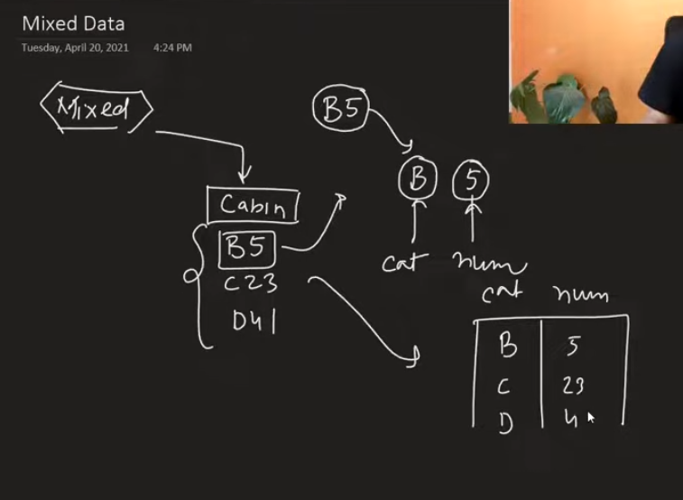

A single column with mixed values can also create problems 

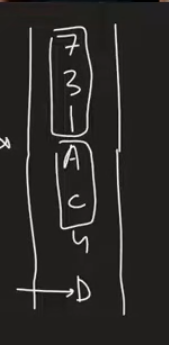

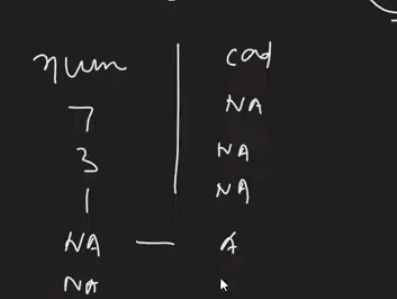

this is how we can fix this 

* Dataset used: a Titanic-like dataset with columns Cabin, Ticket, number (number of people the passenger travelled with) and Survived (some data was created by CampusX sir for the example)

----

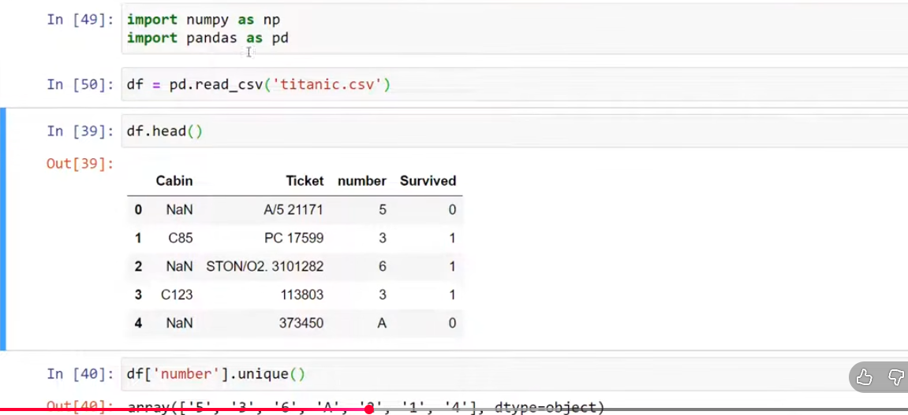

number column: we can see there is 

A -> alone 

* `df['number'].unique()` -> `['5', '3', '6', 'A', '2', '1', '4']`, so the column is stored as a string/object
* `value_counts().plot.bar()` shows most passengers travelled alone, a few with 1, 2, 4 etc.

inside Cabin we can also see 

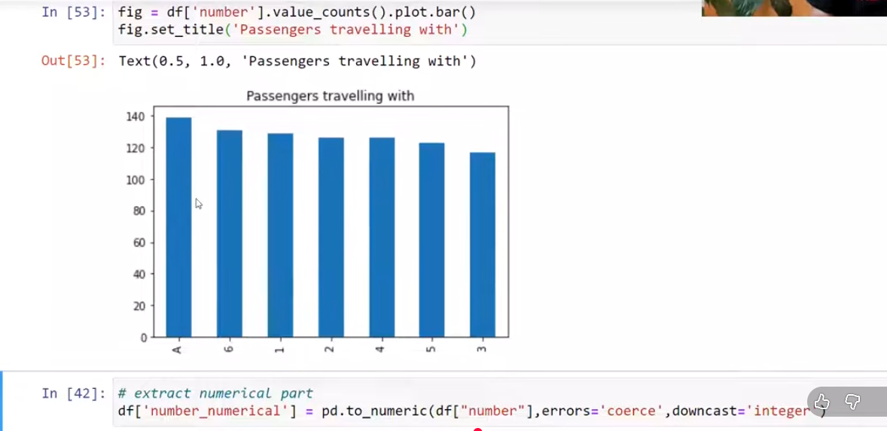

---

new column needs to be made 

* numerical column null, we do something 
* Code for the number column (Type 2):
    - `df['number_numerical'] = pd.to_numeric(df['number'], errors='coerce', downcast='integer')` -> numbers stay, `A` becomes NaN
    - `df['number_categorical'] = np.where(df['number_numerical'].isnull(), df['number'], np.nan)` -> only `A` stays, numbers become NaN
* After that we can fill the missing values: in the numerical column NaN can be filled with 0 (travelling alone), in the categorical column NaN can be filled with `'Missing'` or `'Not'` (any value of your choice)

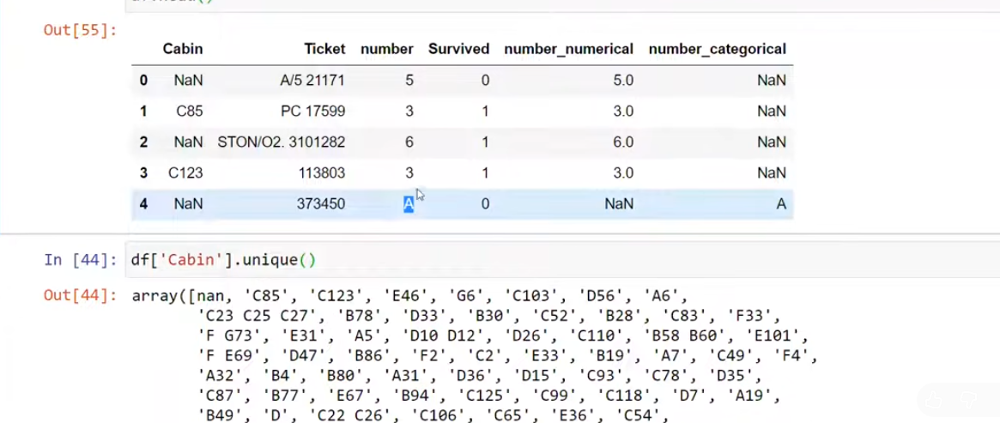

---

How to handle ticket and cabin column 

* Cabin (Type 1): a lot of unique values, so we can't treat it as a plain category
    - `df['cabin_num'] = df['Cabin'].str.extract('(\d+)')` -> captures the numerical part (regex)
    - `df['cabin_cat'] = df['Cabin'].str[0]` -> captures the first letter (the category)
    - e.g. `C85` -> category `C`, number `85`
* Ticket: `A/5 21171` -> category `A/5` and number `21171`
    - `df['ticket_num'] = df['Ticket'].apply(lambda s: s.split()[-1])` -> last part is the number
    - `df['ticket_cat'] = df['Ticket'].apply(lambda s: s.split()[0])` -> first part
    - `df['ticket_cat'] = np.where(df['ticket_cat'].str.isdigit(), np.nan, df['ticket_cat'])` -> tickets that have only a number have no category part
* After this the number of categories reduces a lot (cabin_cat plot: most people are in category C, followed by B etc.) and we can then do the other things on these columns (encoding, imputation)

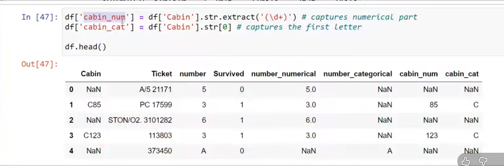

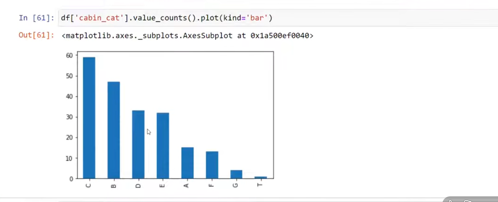

-----

same column in numerical and categorical

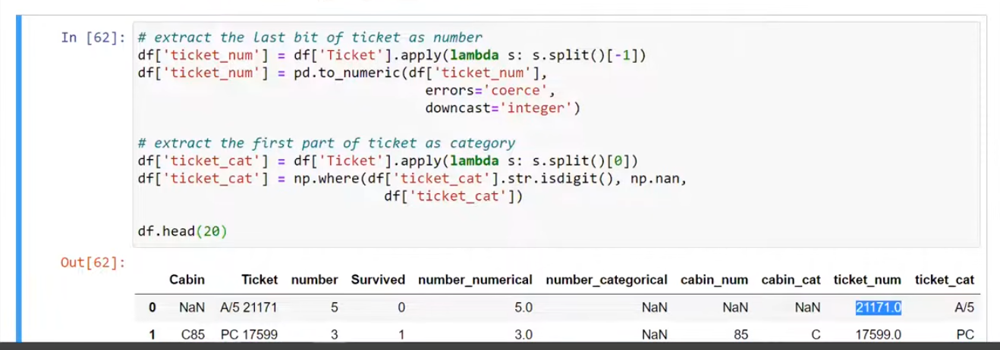

* Summary: mixed data comes in two ways: (1) number and category together in a single cell -> break it into two columns, (2) numbers and categories in the same column but in different rows -> again break into two columns, and each column will have values only for one type 


----

### <mark>CampusX PDF notes - L33 Handling Mixed Data Types (PDF pp. 765-774)</mark>

**<mark>1. What is mixed data?</mark>**
A column whose values contain **both categorical and numerical information at the same time**. It makes feature engineering difficult, because we must preserve both kinds of information separately.

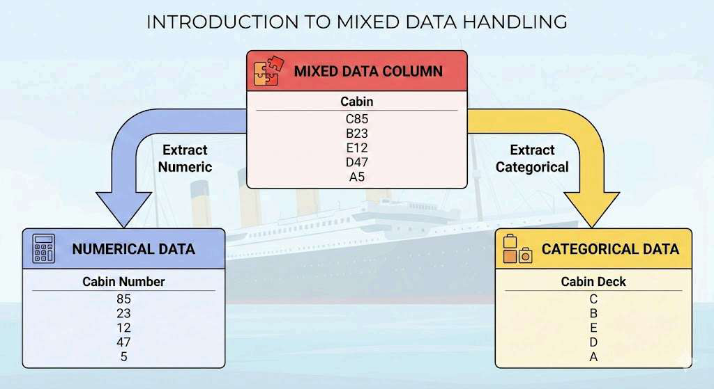

Examples from the Titanic dataset:
* `Cabin`: `C85, B23, D41` -> a letter (category) + a number.
* `Ticket`: `PC 17599, A/5 21171` -> a prefix (category) + a number.
* `number`: `5, 3, A, 6` -> some rows numeric, others categorical.

**<mark>2. Two types of mixed data</mark>**

| Type | Scenario | Example | Issue |
|---|---|---|---|
| **Type 1** | both parts combined in a single cell | `C85`, `B23`, `D41` | letter (category) + number (numeric) hidden in one value |
| **Type 2** | different types in different rows | `5, 3, A, 6` | the same column has numbers in some rows and categories in others |

**General strategy:** always split the mixed column into **TWO separate columns**: (1) a numerical column that stores all the numeric information, (2) a categorical column that stores all the categorical information.

**<mark>3. Example 1 - Type 2 (the `number` column)</mark>**
```python
df['number_numerical']   = pd.to_numeric(df['number'], errors='coerce', downcast='integer')   # non-numeric -> NaN
df['number_categorical'] = np.where(df['number_numerical'].isnull(), df['number'], np.nan)    # keep the original only where numeric is NaN
```
Logic: `number_numerical = x if x is numeric else NaN`; `number_categorical = x if x is categorical else NaN`.

| number | number_numerical | number_categorical |
|---|---|---|
| 5 | 5.0 | NaN |
| 3 | 3.0 | NaN |
| A | NaN | A |
| 6 | 6.0 | NaN |

* `errors='coerce'` turns anything that cannot be converted into NaN; `downcast='integer'` saves memory.
* `np.where(condition, value_if_true, value_if_false)` is the vectorized if/else used to build the categorical column.

**4. Example 2 - Type 1 (the `Cabin` column)** - regex extract
```python
df['cabin_num'] = df['Cabin'].str.extract('(\d+)')    # regex: \d+ = one or more digits, ( ) = capture group
df['cabin_cat'] = df['Cabin'].str[0]                  # first character = deck letter
```
| Cabin | cabin_num | cabin_cat |
|---|---|---|
| C85 | 85 | C |
| C123 | 123 | C |
| E46 | 46 | E |
| G6 | 6 | G |

(An alternative pattern shown in the PDF figure: `pattern=([A-Z])(\d+)` splits the letter and the digits in one go. Note that some cabin values contain several cabins, e.g. "C23 C25", so `extract` keeps only the first number.)

**<mark>5. Example 3 - Type 1, complex (the `Ticket` column, "PREFIX NUMBER")</mark>**
```python
df['ticket_num'] = df['Ticket'].apply(lambda s: s.split()[-1])           # last part = number
df['ticket_num'] = pd.to_numeric(df['ticket_num'], errors='coerce', downcast='integer')
df['ticket_cat'] = df['Ticket'].apply(lambda s: s.split()[0])            # first part = prefix
df['ticket_cat'] = np.where(df['ticket_cat'].str.isdigit(), np.nan, df['ticket_cat'])   # only digits -> no category
```
Step by step: (1) `"PC 17599".split()` -> `["PC", "17599"]`; (2) `[-1]` -> `"17599"`; (3) `pd.to_numeric` -> 17599; (4) `[0]` -> `"PC"`; (5) if the first part is all digits (a ticket like `113803`) there is no prefix, so the category becomes NaN.

| Ticket | ticket_num | ticket_cat |
|---|---|---|
| A/5 21171 | 21171 | A/5 |
| PC 17599 | 17599 | PC |
| 113803 | 113803 | NaN |

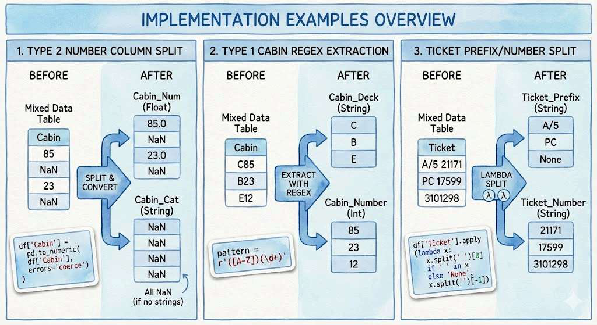

**<mark>6. Comparison of the two types</mark>**

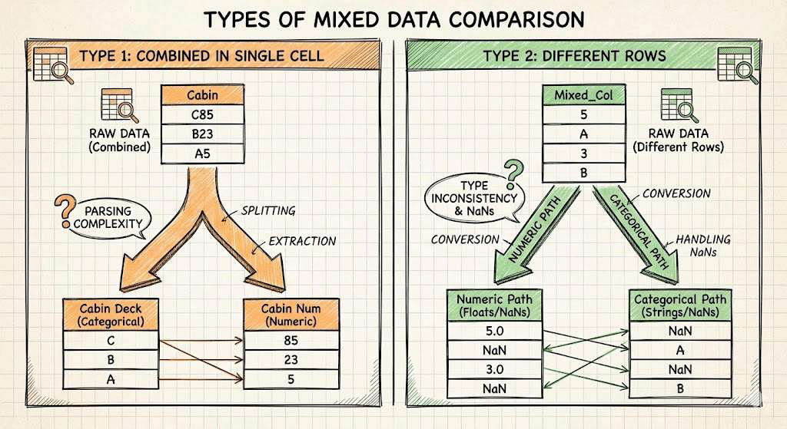

| | Type 1 (combined in a single cell) | Type 2 (different rows) |
|---|---|---|
| Raw data | `C85`, `B23`, `A5` | `5`, `A`, `3` |
| Problem | parsing / splitting complexity | type inconsistency |
| Method | regex / string split | `to_numeric(errors='coerce')` + `np.where` |
| Result | numeric path (floats/NaN) + categorical path (strings/NaN) | same, two columns each with NaN where the other type lives |

**<mark>7. After splitting - analysis</mark>**
* `df['cabin_cat'].value_counts().plot(kind='bar')`: most passengers are in cabin deck C (about 60), followed by B (about 47), D/E/A have moderate counts (30-35) and F/G/T are very few (< 10).
* `df['number'].value_counts().plot.bar()`: most passengers travel alone ("A" is the highest bar, about 140) or in small groups of 1-3; the rest of the distribution is relatively uniform.
* Next steps on the split columns: impute (numeric NaN -> 0 / mean, categorical NaN -> 'Missing'), then encode (ordinal / one-hot) as in L26-L28.

**<mark>8. Best practices</mark>**
1. Always split mixed columns - do not try to handle mixed types together.
2. Convert with `pd.to_numeric(..., errors='coerce')` to get the numeric part safely.
3. Use `np.where()` for conditional column creation based on another column.
4. Use regex for extraction: `str.extract('(\d+)')` for numbers, `str[0]` for the first character.
5. Validate: always check the unique values after splitting.

### <mark>Official code - L33 Handling mixed variables (repo: `day33-handling-mixed-variables/Untitled.ipynb`)</mark>

**<mark>Block 1 - load the data and look at the mixed column 'number'</mark>**

```python
import numpy as np
import pandas as pd

df = pd.read_csv('titanic.csv')    # columns: Cabin, Ticket, number, Survived
df.head()

df['number'].unique()              # ['5', '3', '6', 'A', '2', '1', '4'] -> numbers and a category 'A' in the same column

# bar plot of how many passengers travelled with how many people (A = alone)
fig = df['number'].value_counts().plot.bar()
fig.set_title('Passengers travelling with')
```

**<mark>Block 2 - Type 2 (numbers and categories in different rows): break the column into two columns</mark>**

```python
# to_numeric: converts to numbers; errors='coerce' -> whatever can't be converted (like 'A') becomes NaN
# downcast='integer' -> use the smallest integer type
df['number_numerical'] = pd.to_numeric(df["number"], errors='coerce', downcast='integer')

# np.where(condition, x, y): where the numerical part is NaN keep the original value (the category), else NaN
df['number_categorical'] = np.where(df['number_numerical'].isnull(), df['number'], np.nan)

df.head()
```

**<mark>Block 3 - Type 1 (number and category inside the same cell): Cabin</mark>**

```python
df['Cabin'].unique()     # C85, C123, E46 ... letter + number together
df['Ticket'].unique()    # 'A/5 21171', 'PC 17599', '113803' ...

# str.extract with a regex: '(\d+)' captures the digits of the cabin (the numerical part)
df['cabin_num'] = df['Cabin'].str.extract('(\d+)')
df['cabin_cat'] = df['Cabin'].str[0]          # first letter of the cabin (the categorical part)

df.head()
df['cabin_cat'].value_counts().plot(kind='bar')   # most of the cabins are of category C
```

**<mark>Block 4 - Type 1: Ticket (text part + number part)</mark>**

```python
# last word of the ticket is the number; to_numeric with errors='coerce' gives NaN if it is not a number
df['ticket_num'] = df['Ticket'].apply(lambda s: s.split()[-1])
df['ticket_num'] = pd.to_numeric(df['ticket_num'], errors='coerce', downcast='integer')

# first word of the ticket is the category; tickets having only a number have no category -> NaN
df['ticket_cat'] = df['Ticket'].apply(lambda s: s.split()[0])
df['ticket_cat'] = np.where(df['ticket_cat'].str.isdigit(), np.nan, df['ticket_cat'])

df.head(20)
df['ticket_cat'].unique()     # 'A/5', 'PC', 'STON/O2.', nan ...
```

----

## L34 Handling Date and Time variables

Working with date and time 

* they have a lot of hidden info in them 
* 23 august 2012
* From a date we can get: which day, which month, which year, day of the week (Monday, Tuesday...), which quarter, which semester, whether it is a weekend or not, etc.
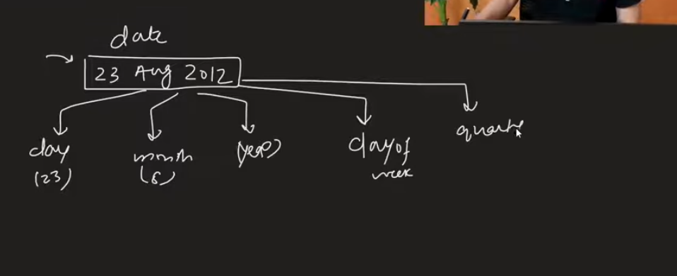
date weekend hai ki ni 

* in an analysis app, this type of date info is very very important
* sub information is very important 
* Example from CampusX sir: in an expense tracker project, finding if the user spends more on weekends, or in which month the spending is higher is very important
* Time also has hidden info: hour, minute, second
* This video is made as a reference material: whenever you face a date/time challenge, come back and see the code

-----

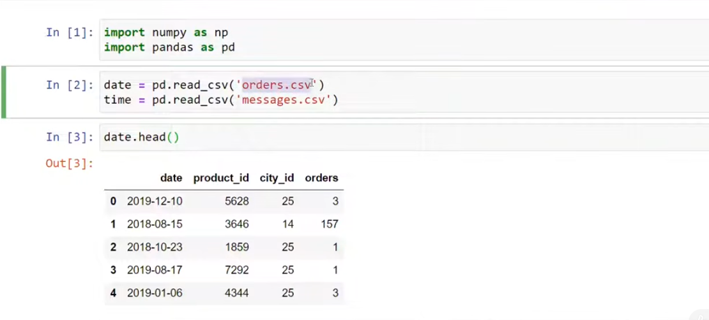

define the dataset

* Two datasets: `orders.csv` (e-commerce: date, product_id, city_id, orders) for date work and `messages.csv` (chat app: date/time, message) for time work

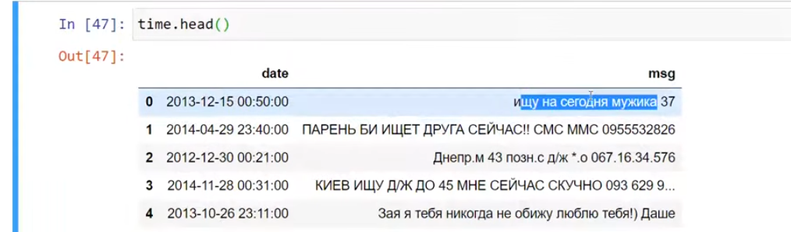

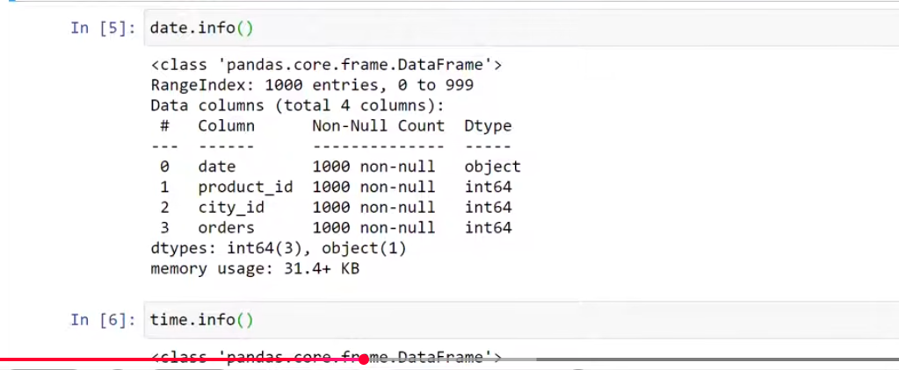
by default it is a string (object) 

* when we import a csv with `read_csv` the date/time column is by default an `object` (string), so we can't extract anything from it

now we need to change it to something which can be used 
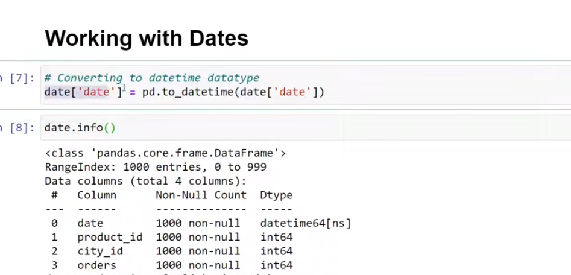

* `date['date'] = pd.to_datetime(date['date'])`: converts the column to the `datetime64` type

now date column type is changed
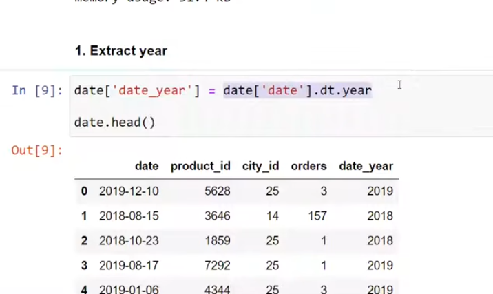

info in pandas series

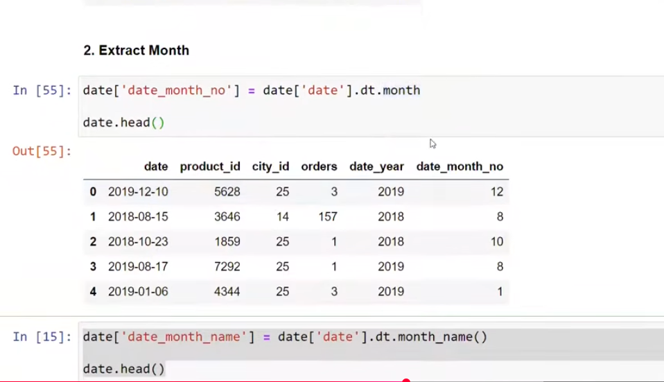

* All the functions are available through the `.dt` accessor on the column

-----

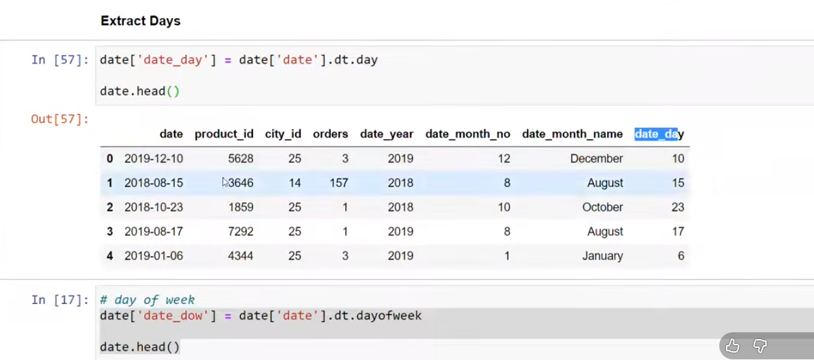

* Extract year: `date['date_year'] = date['date'].dt.year`
* Extract month: `date['date_month_no'] = date['date'].dt.month` (number) and `date['date'].dt.month_name()` (name)
* Extract day: `date['date_day'] = date['date'].dt.day`

# day of week 

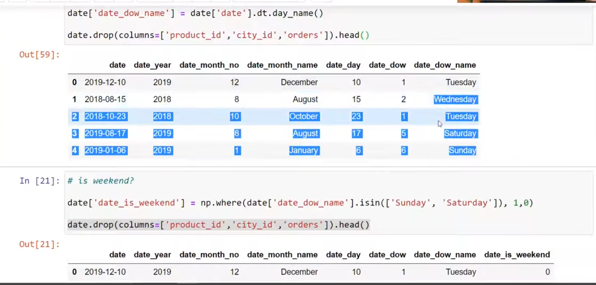

* `date['date'].dt.dayofweek`: gives the day number (in pandas Monday = 0 and Sunday = 6)
* `date['date'].dt.day_name()`: gives the name (Monday, Tuesday, ...)

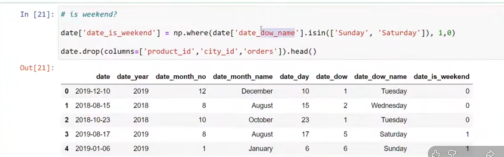

* Is weekend: `date['is_weekend'] = np.where(date['date_dayname'].isin(['Sunday','Saturday']), 1, 0)` -> 1 means it is a weekend

---

extract week of the year 

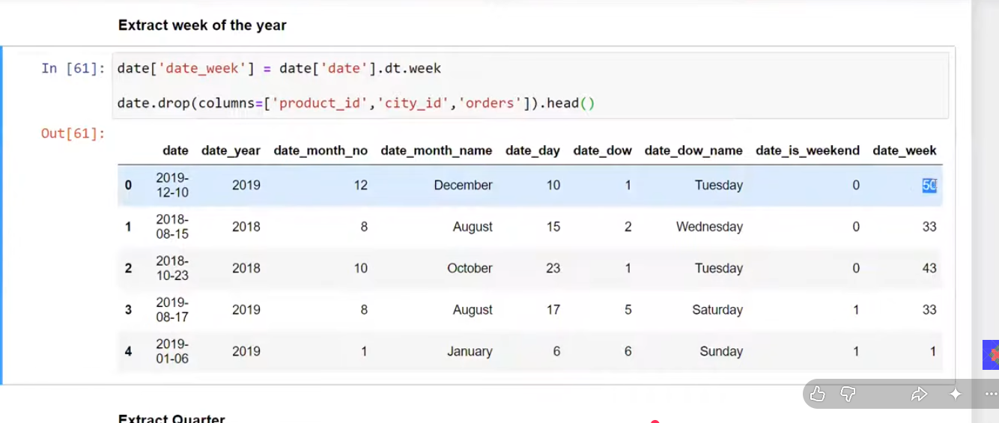

* A year has 52/53 weeks: `date['date'].dt.isocalendar().week` (older pandas: `dt.week`)
* e.g. 12 Dec 2019 falls in the 50th week, 8 Aug 2018 falls in the 32nd week

---

extract semester 


* Quarter: `date['quarter'] = date['date'].dt.quarter` -> Oct to Dec = 4th quarter, Jul to Sep = 3rd, Jan to Mar = 1st
* Semester (there are 2 semesters in a year): `date['semester'] = np.where(date['quarter'].isin([1,2]), 1, 2)` -> quarter 1 and 2 = first semester, quarter 3 and 4 = second semester

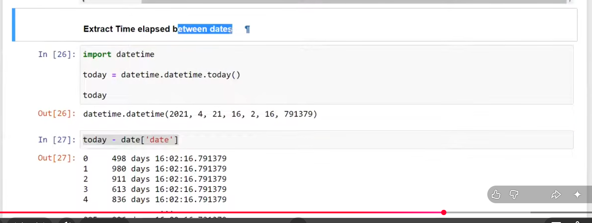

import today's date and then subtract 

* `import datetime` and `today = datetime.datetime.today()`
* `today - date['date']` -> gives a timedelta like "16 days 15:03:21", for every row

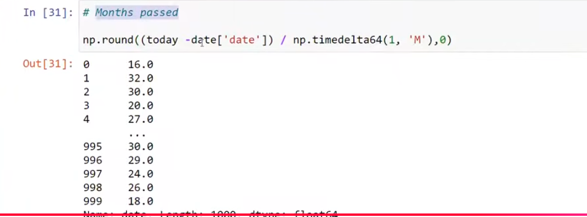

to find everything there are different things which we can alter and get the required info 

* Days only: `(today - date['date']).dt.days`
* Months: `np.round((today - date['date']) / np.timedelta64(1, 'M'), 0)` -> divide the timedelta by `np.timedelta64(1,'M')`
* Similarly we can use `'Y'` for years, `'h'` for hours, `'m'` for minutes, `'s'` for seconds

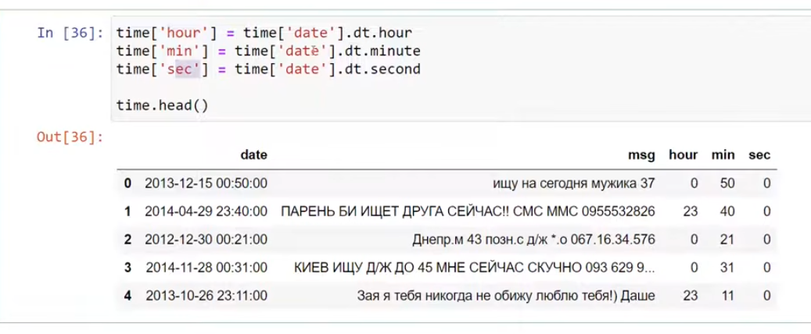

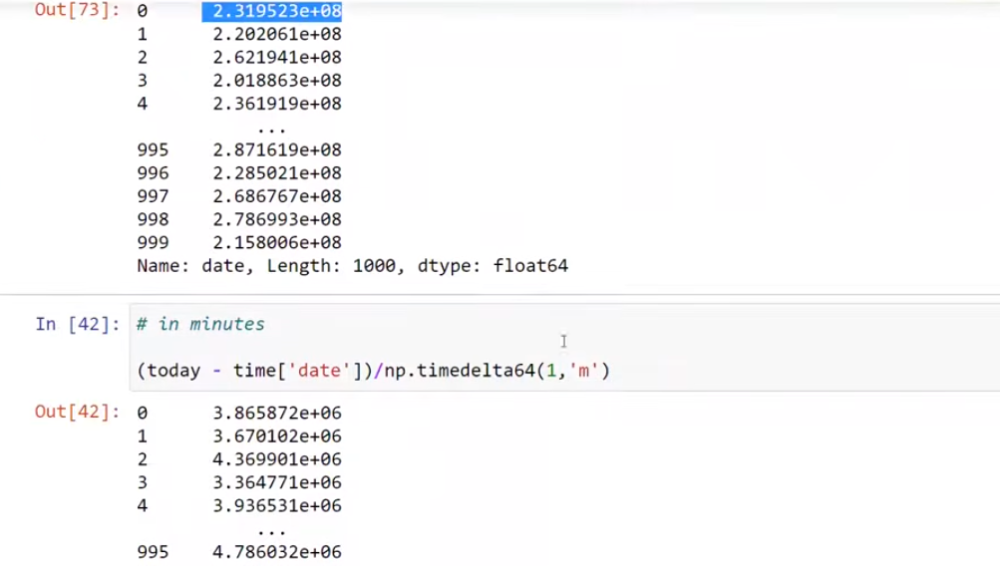

* Time part (messages dataset): first convert with `pd.to_datetime`, then 
    - `time['hours'] = time['date'].dt.hour`
    - `time['min'] = time['date'].dt.minute`
    - `time['sec'] = time['date'].dt.second`
* Only the time part (without the date): `time['date'].dt.time`
* Time difference: same as for date, `today - time['date']` and then divide by `np.timedelta64(1,'s')` (seconds) or `np.timedelta64(1,'m')` (minutes)
* Time zone work is rare, but it is possible (`dt.tz_localize`, `dt.tz_convert`)

---------

### <mark>CampusX PDF notes - L34 Date and Time Feature Engineering (PDF pp. 775-805)</mark>

**<mark>1. Why date and time features matter</mark>**
Date/time columns hide patterns that can strongly improve a model. A single date like `23-Aug-2012` contains many pieces of information: day (23), month (August), year (2012), day of week (Thursday), week of year (34), quarter (Q3), semester (2nd half), is-weekend (no)...


Typical analysis questions (expense tracker): users spend more on weekends? -> `is_weekend`; which month has the highest expenses? -> `month`; weekdays differ? -> `day_of_week`; quarterly trends? -> `quarter`; time of day? -> `hour`.

**Workflow:** Clean -> Convert -> Enrich -> Analyze.

**<mark>2. Datasets used</mark>**
* `orders.csv` (e-commerce): `date` (object/string), `product_id`, `city_id`, `orders` (all int64); 1000 rows, e.g. `2019-12-10, 5628, 25, 3`.
* `messages.csv` (chat): `date` (timestamp, object), `msg` (text); e.g. `2013-12-15 00:50:00`.

**<mark>3. Step 1 - convert to datetime (crucial)</mark>**
CSV dates load as `object` (string): you cannot extract year/month, cannot do date arithmetic, cannot use datetime functions.
```python
date['date'] = pd.to_datetime(date['date'])     # dtype object -> datetime64[ns]
date.info()                                      # date  1000 non-null  datetime64[ns]
```
Memory note from the PDF's `info()`: before 1.7+ KB (object), after extracting year/month/weekday 4.0 KB.

**<mark>4. Step 2 - extract components with the `.dt` accessor</mark>**

| What | Code | Output | Example |
|---|---|---|---|
| Year | `.dt.year` | int | 2019 |
| Month number | `.dt.month` | int | 8 |
| Month name | `.dt.month_name()` | string | "August" |
| Day of month | `.dt.day` | int | 23 |
| Day of week number | `.dt.dayofweek` | int | 2 (Mon = 0 ... Sun = 6) |
| Day of week name | `.dt.day_name()` | string | "Wednesday" |
| Week of year | `.dt.week` (pandas >= 2: `.dt.isocalendar().week`) | int | 34 |
| Quarter | `.dt.quarter` | int | 3 |
| Is weekend | custom `np.where` | 0/1 | 0 or 1 |

Examples (from the PDF):

| date | year | month | month name | day | dow | dow name | week | quarter |
|---|---|---|---|---|---|---|---|---|
| 2019-12-10 | 2019 | 12 | December | 10 | 1 | Tuesday | 50 | 4 |
| 2018-08-15 | 2018 | 8 | August | 15 | 2 | Wednesday | 33 | 3 |
| 2018-10-23 | 2018 | 10 | October | 23 | 1 | Tuesday | 43 | 4 |
| 2019-08-17 | 2019 | 8 | August | 17 | 5 | Saturday | 33 | 3 |
| 2019-01-06 | 2019 | 1 | January | 6 | 6 | Sunday | 1 | 1 |

Use cases: year = year-over-year trends; month = seasonal analysis, peak months; day = salary days / month-end patterns; day name = weekday vs weekend, peak traffic days, scheduling.

**Weekend flag**
```python
date['date_is_weekend'] = np.where(date['date_dow_name'].isin(['Sunday', 'Saturday']), 1, 0)
```
`is_weekend = 1 if day in {Saturday, Sunday} else 0`.

**Week of year:** week number = ceil(day of year / 7) roughly; a year has 52 (sometimes 53) weeks; week 1 starts Jan 1 or the first Monday depending on convention. Use: weekly sales reports, comparing the same week across years, seasonality.

**Quarter and semester**
* `quarter = ceil(month / 3)`; check: Jan -> 1, Apr -> 2 (4/3 = 1.33 -> 2), Aug -> 3 (8/3 = 2.67 -> 3), Dec -> 4.

| Quarter | Months | Semester |
|---|---|---|
| Q1 | Jan, Feb, Mar | 1 |
| Q2 | Apr, May, Jun | 1 |
| Q3 | Jul, Aug, Sep | 2 |
| Q4 | Oct, Nov, Dec | 2 |

```python
date['quarter']  = date['date'].dt.quarter
date['semester'] = np.where(date['quarter'].isin([1, 2]), 1, 2)
```
Use: quarterly financial reports, academic-year analysis, semi-annual reviews.

**<mark>5. Time elapsed (difference between dates)</mark>**
```python
import datetime
today = datetime.datetime.today()                      # e.g. datetime(2021, 4, 21, 16, 2, 16, 791379)
time_diff = today - date['date']                       # timedelta64[ns], e.g. "498 days 16:02:16.79"
days_elapsed = (today - date['date']).dt.days          # 498
```
Check for 2019-12-10 -> 2021-04-21: 21 days (rest of Dec 2019) + 366 (leap year 2020) + 111 (Jan 1 - Apr 21, 2021) = **498 days**.
Months: `np.round((today - date['date']) / np.timedelta64(1, 'M'), 0)` -> 498 days / 30.44 (average month) = 16.36 -> **16 months** (output column: 16, 32, 30, 20, 27 for the five sample rows). (In recent numpy/pandas the `'M'` unit is not allowed; use `.dt.days / 30.44`.)

| Unit | Code pattern | Notes |
|---|---|---|
| Days | `(today - date).dt.days` | direct attribute |
| Months | `(today - date) / np.timedelta64(1, 'M')` | division needed |
| Hours | `(today - date) / np.timedelta64(1, 'h')` | division needed |
| Minutes | `(today - date) / np.timedelta64(1, 'm')` | division needed |
| Seconds | `(today - date) / np.timedelta64(1, 's')` | division needed |

Conversions: 1 day = 24 hours = 1,440 minutes = 86,400 seconds. Example: 2,684 days -> 2684 x 86,400 = 231,897,600 seconds = 3,864,960 minutes = 64,416 hours. Use cases: customer lifetime value (time since first purchase), churn (time since last activity), product age, account age.

**<mark>6. Working with time (hour, minute, second)</mark>**
```python
time['date'] = pd.to_datetime(time['date'])
time['hour']  = time['date'].dt.hour
time['min']   = time['date'].dt.minute
time['sec']   = time['date'].dt.second
time['time']  = time['date'].dt.time                    # only HH:MM:SS (drops the date)
```
Example: `2013-12-15 00:50:00` -> hour 0, min 50, sec 0, time 00:50:00; `2014-04-29 23:40:00` -> 23, 40, 0. Use: time-of-day patterns, peak hours, shift analysis.

**7. Complete code template** (from the PDF): load -> `pd.to_datetime` -> year/month/month_name/day -> dayofweek/day_name/is_weekend -> week/quarter/semester -> `days_since`/`months_since` -> hour/minute/second/time_only and `seconds_since`, `minutes_since`, `hours_since`. Output columns: `['date','product_id','city_id','orders','year','month','month_name','day','day_of_week','day_name','is_weekend','week','quarter','semester','days_since','months_since']` for the orders data and `['date','msg','hour','minute','second','time_only','seconds_since','minutes_since','hours_since']` for the chat data.

| Category | Features | Code pattern |
|---|---|---|
| Year-Month-Day | year, month, month_name, day | `.dt.year`, `.dt.month`, `.dt.day` |
| Week information | day_of_week, day_name, week_of_year | `.dt.dayofweek`, `.dt.week` |
| Binary indicators | is_weekend | `np.where()` |
| Periods | quarter, semester | `.dt.quarter`, custom logic |
| Time components | hour, minute, second | `.dt.hour`, `.dt.minute` |
| Elapsed time | days_since, months_since | date arithmetic |

**<mark>8. Practical applications</mark>**
1. *E-commerce sales:* `date.groupby('day_name')['orders'].sum()`, by `month_name`, and `groupby('is_weekend')['orders'].mean()` -> highest-order days, seasonal trends, weekend vs weekday behaviour.
2. *Chat activity:* `time.groupby('hour')['msg'].count()` (peak hours), by day of week, and a time-of-day bucket: `pd.cut(time['hour'], bins=[0,6,12,18,24], labels=['Night','Morning','Afternoon','Evening'])` -> when are users most active, best time to send notifications.
3. *Expense tracking:* `expenses.groupby(['year','month'])['amount'].sum()`, weekend vs weekday spending, quarterly budget tracking.
4. *Customer behaviour (recency):* `latest_date = df['date'].max()`, `df['days_since_order'] = (latest_date - df['date']).dt.days`, then `pd.cut(..., bins=[0,30,90,180,365,float('inf')], labels=['Very Active','Active','Moderate','Inactive','Churned'])` -> at-risk customers, re-engagement campaigns, lifetime value.

**<mark>9. Common pitfalls and solutions</mark>**

| Problem | Solution |
|---|---|
| date is `object` type | `pd.to_datetime()` |
| missing / bad dates | `errors='coerce'` |
| different date formats | pass the `format=` parameter |
| timezone issues | `.dt.tz_localize()` / `.dt.tz_convert()` |
| week-start confusion | check the pandas docs for your version |

Performance tips: convert once at the start; use the vectorized `.dt` accessor instead of loops; drop the original date column if not needed; cast extracted features to small ints (`int8`, `int16`) to save memory.

**<mark>10. Key takeaways</mark>**
1. Dates hold hidden information that can significantly improve the model.
2. Always convert with `pd.to_datetime()` before extracting anything.
3. Feature families: temporal (year, month, day, hour, minute, second), derived (day of week, week of year, quarter, semester), binary (is_weekend, is_holiday), calculated (days_since, months_since).
4. Use the `.dt` accessor for every datetime operation.
5. Time differences can be computed in days, months, hours, minutes, seconds.
6. Useful for time-series analysis, seasonality, customer behaviour, sales forecasting.
Maths summary: `Q = ceil(M/3)`, `S = 1 if Q in {1,2} else 2`, `D = today - T_event`, `months = D / 30.44`. Advanced (PDF summary): lag features `Lag(t) = Value(t-k)` and rolling features `Rolling(t) = mean(Value(t-w ... t))`. Extra resources: `holidays` library for country-specific holiday flags, `pytz` for timezones.

### <mark>Official code - L34 Handling Date and Time variables (repo: `day34-handling-date-and-time/working-with-dates-and-time.ipynb`)</mark>

**<mark>Block 1 - load the two datasets and check the datatype</mark>**

```python
import numpy as np
import pandas as pd

date = pd.read_csv('orders.csv')      # e-commerce data: date, product_id, city_id, orders
time = pd.read_csv('messages.csv')    # chat data: date (with time), message

date.head()
time.head()

date.info()    # the 'date' column is of type object (a string), so we can't extract anything from it
time.info()
```

**<mark>Block 2 - working with dates: convert to datetime and extract year, month, day</mark>**

```python
# to_datetime: converts the string column to the datetime64 type
date['date'] = pd.to_datetime(date['date'])
date.info()

# .dt is the accessor which gives all the date functions
date['date_year'] = date['date'].dt.year                 # year
date['date_month_no'] = date['date'].dt.month            # month number
date['date_month_name'] = date['date'].dt.month_name()   # month name (January ...)
date['date_day'] = date['date'].dt.day                   # day of the month
date.head()
```

**<mark>Block 3 - day of the week, weekend, week of the year, quarter, semester</mark>**

```python
date['date_dow'] = date['date'].dt.dayofweek       # 0 = Monday ... 6 = Sunday
date['date_dow_name'] = date['date'].dt.day_name() # Monday, Tuesday ...

# is weekend? isin checks if the day name is in the list; np.where gives 1 / 0
date['date_is_weekend'] = np.where(date['date_dow_name'].isin(['Sunday', 'Saturday']), 1, 0)

# week number of the year (note: dt.week is removed in new pandas -> use dt.isocalendar().week)
date['date_week'] = date['date'].dt.week

date['quarter'] = date['date'].dt.quarter                        # quarter 1 to 4
date['semester'] = np.where(date['quarter'].isin([1, 2]), 1, 2)  # quarter 1,2 -> semester 1; quarter 3,4 -> semester 2

date.drop(columns=['product_id', 'city_id', 'orders']).head()    # look at only the date columns
```

**<mark>Block 4 - time elapsed between two dates</mark>**

```python
import datetime

today = datetime.datetime.today()    # current date and time
today

today - date['date']                 # timedelta (days, hours ...) for every row
(today - date['date']).dt.days       # only the days

# months passed: divide the timedelta by a 1 month timedelta
np.round((today - date['date']) / np.timedelta64(1, 'M'), 0)
```

**<mark>Block 5 - working with time (messages data)</mark>**

```python
time['date'] = pd.to_datetime(time['date'])   # convert to datetime first
time.info()

time['hour'] = time['date'].dt.hour       # hour
time['min'] = time['date'].dt.minute      # minute
time['sec'] = time['date'].dt.second      # second

time['time'] = time['date'].dt.time       # only the time part (without the date)
time.head()

# time difference between now and the message time
today - time['date']
(today - time['date']) / np.timedelta64(1, 's')   # in seconds
(today - time['date']) / np.timedelta64(1, 'm')   # in minutes
(today - time['date']) / np.timedelta64(1, 'h')   # in hours
```

----

## L35 Handling Missing Data | Part 1 

scikit learn: almost all the functions are not good enough to handle missing values 

* It is the responsibility of a data scientist to remove/handle all the missing values before giving the data to the model
* two options 
* remove the rows with missing values ( too much loss -> removing other data too)
* impute them (fill them)
* Plan: 5 videos on this topic: (1) Complete case analysis, (2) numerical imputation, (3) categorical imputation, (4) random sample imputation + missing indicator + automatic parameter selection, (5) multivariate imputation (KNN imputer, Iterative imputer)
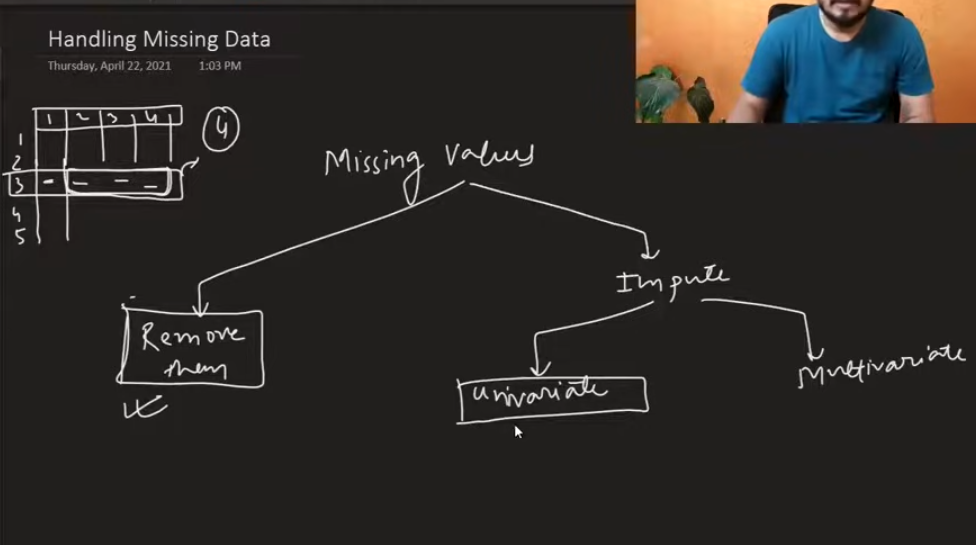

univariate and multivariate

* Univariate: we use only the values of the same column to fill the missing value (mean / median / mode / random / arbitrary / end of distribution)
* Multivariate: we use other columns also to fill the missing value (KNN imputer, iterative imputer)
*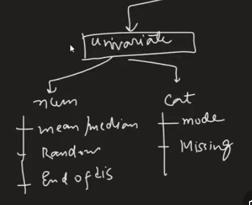

-----------

Multivariate

KNN 

Iterative imputer 

* Univariate imputation techniques are in `SimpleImputer`; multivariate in `KNNImputer` and `IterativeImputer`

----

Complete case analysis --> removing missing data 

* Also called **list-wise deletion** of cases: discard the observations (rows) where the values are missing in any of the columns
* It literally means analysing only those observations for which there is information in all the columns, hence "complete case"


* only rows which have values we work on it 

Assumption 

* your data is missing completely at random 
* Age column, 50 values missing 
these 50 values are randomly missing, only then we will be applying CCA 
* missing completely at random (MCAR) 
* then data distribution will be same 
* If the 50 missing rows are not random (e.g. all of them are the first 50 rows or all are from one particular category) then we won't apply CCA, because it will disturb the data
* Removing randomly missing rows is like randomly dropping rows of a dataset, so the distribution remains the same


easy to implement 

* CCA: the data distribution after removing the data and before it remains the same 
* Advantage: easy, just call the `dropna()` function; no data manipulation is required

---

* we may have to remove a large portion of the dataset
* what will the model do if it gets missing data at production time (it can't handle it, since it never saw missing data while training)
* If data is not MCAR, removing the data can distort the distribution 

1) MCAR (data missing completely at random) -> CCA only when less than 5 % of the data is missing 

* There is no hard rule, but people use 5 % as a thumb rule. If a column has more than 5 % missing, don't use CCA
* If a column has 98 % missing values, then we remove the column itself, not the rows

Example 

* Dataset: Data science job hiring (`data_science_job.csv`): 19158 rows, 13 columns; enrollee_id, city, city_development_index, gender, relevent_experience, enrolled_university, education_level, major_discipline, experience, company_size, company_type, training_hours, target

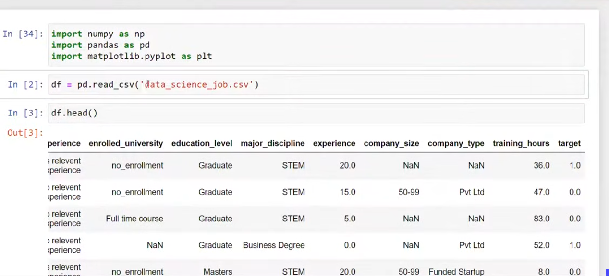


see which column you can apply CCA on by seeing the percent of missing rows

* `df.isnull().mean() * 100`: gender ~23.5 %, company_size ~30.8 %, company_type ~32.2 %, major_discipline is also quite high -> we can't apply CCA on these (we would lose 20 to 30 % rows)
* Columns with missing values between 0 and 5 %: city_development_index (2.5 %), enrolled_university (2 %), education_level (~2.4 %), experience (~0.3 %), training_hours (~4 %). We extract these with: `cols = [var for var in df.columns if df[var].isnull().mean() < 0.05 and df[var].isnull().mean() > 0]`
* A code like this is useful for a big dataset with 50 columns, where we can't check each column by eye

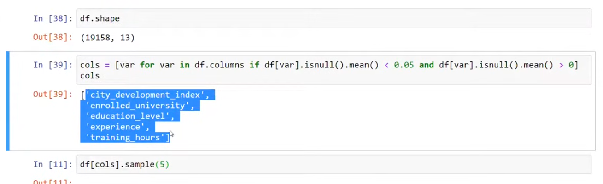

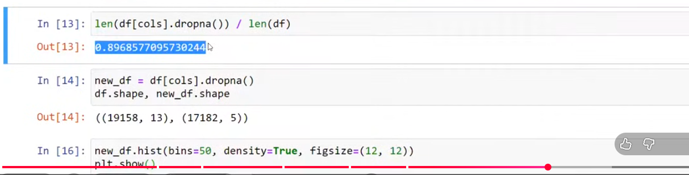

after dropping we will have 90 % of the data

* `len(df[cols].dropna()) / len(df)` = 0.8969 -> **about 89.7 % data remains**
* `new_df = df[cols].dropna()`: shape goes from (19158, 13) to (17182, 5)

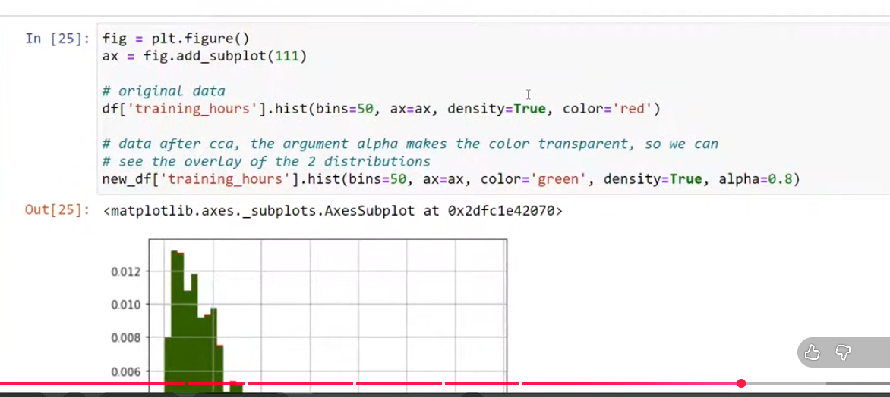

numerical data -> plot histogram before and after, if it is fine then we are fine 

* We should plot a histogram (and PDF) of the original data and the CCA data for the numerical columns (we do it for city_development_index, training_hours, experience)

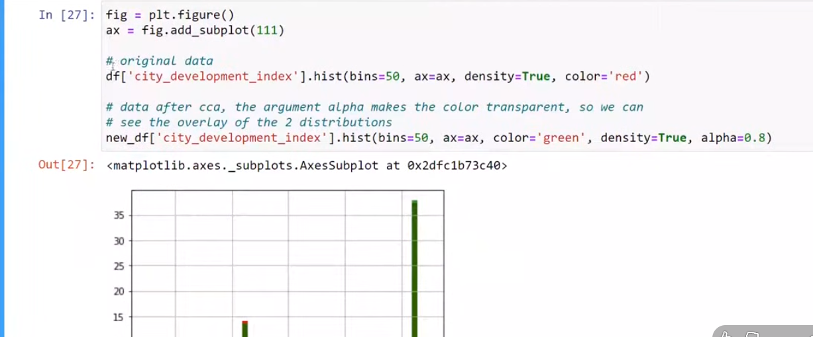

if they overlap then the missing data is missing at random

* Original and CCA PDF lines overlapping = distribution is the same = the CCA is fine to be applied (MCAR assumption holds)

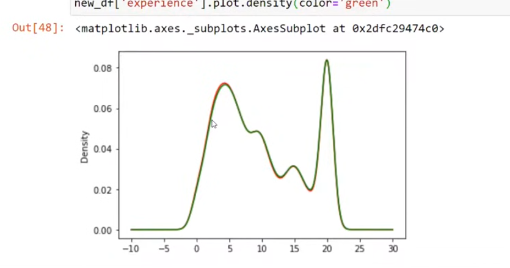

-----------

categorical columns 

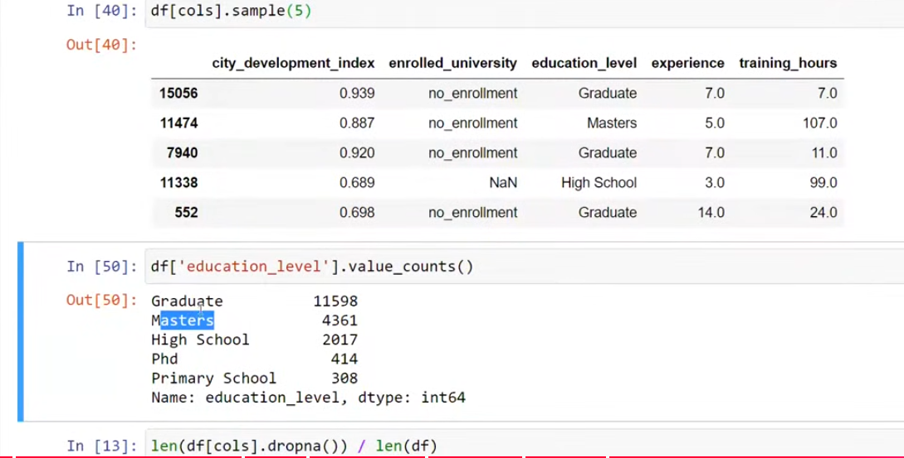

ratio should be maintained of graduate and other before and after CCA

* For categorical columns we compare the ratio of every category before and after CCA, using `value_counts() / len(...)` and keep both in a dataframe side by side (original vs cca)
* enrolled_university: no_enrollment 0.721 -> 0.735, Full time course 0.196 -> 0.201, Part time course 0.063 -> 0.064
* education_level: Graduate 0.605 -> 0.620, Masters 0.228 -> 0.234, High School 0.105 -> 0.107, Phd 0.0216 -> 0.0221, Primary School 0.0161 -> 0.0166
* The ratios are almost the same, so CCA is fine. If a ratio changes a lot (e.g. 0.19 -> 0.25) it is a red alert that CCA is damaging the data

-----------

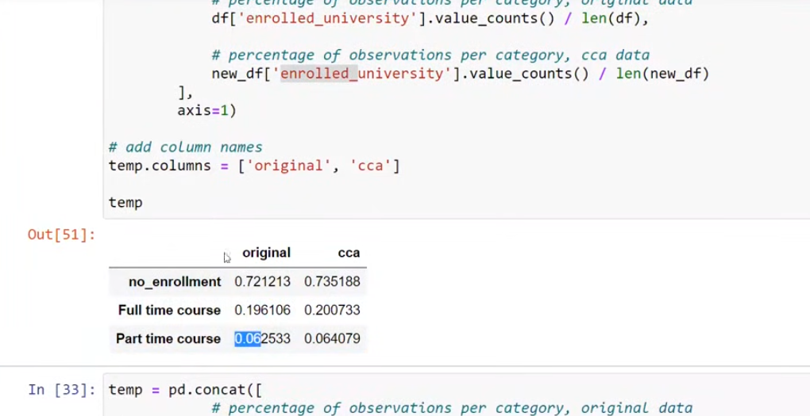

* Disadvantages of CCA:
    - it can exclude a large fraction of the original dataset (if a lot of data is missing)
    - the excluded observations could be informative for the analysis (if the data is not MCAR)
    - when using the model in production, the model will not know how to handle missing data (this is the most important point, so CCA is not used much in real projects)
* Due to this, people prefer imputation (next videos)

----------

### <mark>CampusX PDF notes - L35 Complete Case Analysis (CCA) for Handling Missing Data (PDF pp. 806-829)</mark>

**<mark>1. The problem</mark>**
ML algorithms cannot handle missing data natively. If you give a dataset with missing values to a model for training, it will fail to train. It is the **data scientist's responsibility** to remove or handle all missing values before training.

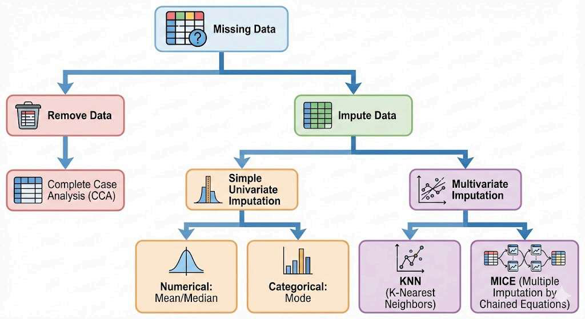

**High-level approaches**

| Option | Description | Usage |
|---|---|---|
| 1. Remove data | delete entire rows/columns with missing values (Complete Case Analysis) | less common |
| 2. Impute data | fill the missing values with statistical / ML techniques | more common |

* *Simple (univariate) imputation:* one column at a time. Numerical: mean, median, random value, end of distribution. Categorical: mode / most frequent value / a "missing" label. Class: `SimpleImputer`.
* *Multivariate imputation:* uses several columns to predict the missing values: **KNN Imputer** (K-Nearest Neighbors) and **Iterative Imputer / MICE** (Multiple Imputation by Chained Equations).

**<mark>2. Complete Case Analysis (CCA)</mark>**
CCA, also called **list-wise deletion**, discards the observations where the value in *any* of the variables is missing - only the complete rows are retained.

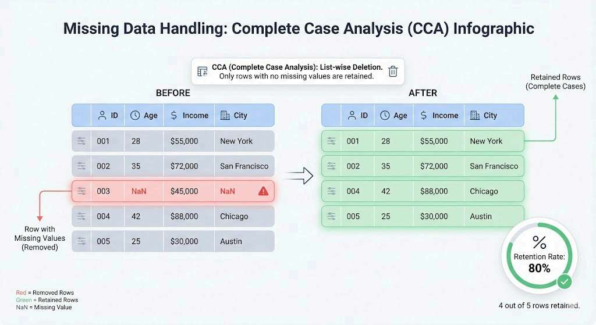

Example (5 rows, 1 with a missing age): row 003 (`Age = NaN`) is removed, 4 of 5 rows retained -> retention rate 80%.

| Before CCA (X1, X2, X3, Y) | After CCA |
|---|---|
| 5, 8, 3, 1 | 5, 8, 3, 1 |
| 2, 7, 9, 0 | 2, 7, 9, 0 |
| NaN, 4, 6, 1 | (removed) |
| 8, 9, 2, 0 | 8, 9, 2, 0 |
| 5, 3, 1, 1 | 5, 3, 1, 1 |

Key characteristics: *complete* (only observations with information in all columns), *entire row deletion* (one missing value removes the row), *no partial retention* (you cannot keep the partial information of a row).

**<mark>3. Assumption: MCAR (Missing Completely At Random)</mark>**
CCA is valid only when the missingness has no pattern. Example: 1000 rows, 4 columns, 50 values missing in one column; these 50 should be scattered randomly (e.g. not all at the beginning or all at the end).

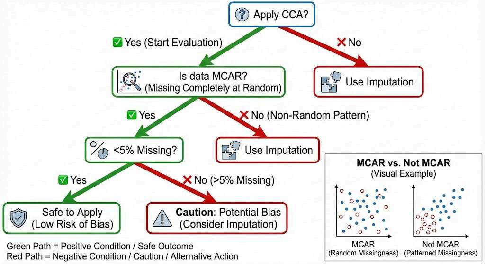

Mathematical intuition: if the data is MCAR then `P(missing)` is the same constant for all observations, so `Distribution after CCA ~ Distribution original`. Removing the rows is like **randomly sampling** 950 of the 1000 rows.

| Scenario | Safe for CCA? | Result |
|---|---|---|
| data missing randomly | yes | distribution remains the same |
| data missing in a pattern | no | distribution changes |
| missing values at the edges | no | bias is introduced |

**<mark>4. Advantages and disadvantages</mark>**

| # | Advantage | Description |
|---|---|---|
| 1 | easy to implement | no data manipulation, just `dropna()` |
| 2 | preserves the distribution | if MCAR, the distribution of the remaining data matches the original |

| # | Disadvantage | Description | Impact |
|---|---|---|---|
| 1 | large data loss | can exclude a significant fraction of the dataset | high |
| 2 | biased results | if the data is NOT MCAR, exclusion gives biased statistics | critical |
| 3 | production issues | the model does not know how to handle missing data in production | critical |

**The production problem:** during training all rows with missing data were removed, so the model only saw complete data; in production the new data may have missing values and the model has no strategy -> it fails. This is the biggest disadvantage of CCA and why it is rarely used in practice.

**<mark>5. When to use CCA</mark>**
Condition 1: the data is **MCAR** (must be confirmed). Condition 2: **less than 5%** missing.

| Missing % | Action | Reasoning |
|---|---|---|
| < 5% | apply CCA | minimal data loss |
| 5% - 95% | use imputation | too much data to discard |
| > 95% | remove the column | almost no information |

* Scenario 1: 1000 rows, column A has 50 missing (5%), randomly distributed -> CCA, 950 rows remain.
* Scenario 2: column B has 980 missing (98%), only 20 values present -> remove the entire column.
* Scenario 3: column C has 300 missing (30%) -> imputation (mean, median, KNN...).

| Missing % | Data pattern | Recommended action |
|---|---|---|
| < 5% | MCAR | CCA |
| < 5% | not MCAR | investigate the pattern, consider imputation |
| 5-30% | MCAR | CCA (with caution) or imputation |
| 5-30% | not MCAR | imputation |
| 30-95% | any | imputation |
| > 95% | any | remove the column entirely |

**<mark>6. Practical implementation - Data Science job applications</mark>**
Dataset `data_science_job.csv` (19,158 rows, 13 columns): `enrollee_id`, `city`, `city_development_index` (num), `gender`, `relevent_experience`, `enrolled_university`, `education_level`, `major_discipline`, `experience` (num), `company_size`, `company_type`, `training_hours` (num), `target` (hired = 1).
```python
missing_percentage = df.isnull().mean() * 100         # % missing per column
```
Missing % per column: city_development_index 2.50, gender 23.53, enrolled_university 2.01, education_level 2.40, major_discipline 14.68, experience 0.34, company_size 30.99, company_type 32.05, training_hours 4.00; the other columns 0.

Rule: apply CCA only to columns with 0% < missing < 5%:
```python
cols = [var for var in df.columns if df[var].isnull().mean() < 0.05 and df[var].isnull().mean() > 0]
# ['city_development_index', 'enrolled_university', 'education_level', 'experience', 'training_hours']
len(df[cols].dropna()) / len(df)      # 0.8969 -> 89.69% data retention
new_df = df[cols].dropna()            # shape (17182, 5)
```
Before: 19,158 rows -> after: 17,182 rows (-1,976 rows = -10.31%); the selected-subset columns are 5 (13 originally; the PDF counts the dropped columns as "-8").

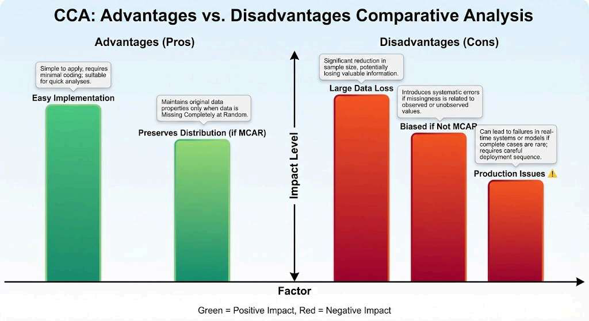

**<mark>7. Check that the distribution is preserved (validates MCAR)</mark>**
* *Numerical columns* - compare the histogram (`hist(bins=50, density=True)`) and density plot of the original (red) and after CCA (green, `alpha=0.8`): `df['training_hours'].plot.density(color='red')` vs `new_df['training_hours'].plot.density(color='green')`.

| Column | Distribution preserved? | MCAR validated? | Notes |
|---|---|---|---|
| training_hours | yes | yes | near-perfect overlap |
| city_development_index | yes | yes | very close match, minor variations |
| experience | yes | yes | strong overlap, minimal difference in the tails |

* *Categorical columns* - compare the **proportion of each category** before and after: `proportion = count_category / total observations`; we need `Proportion_before ~ Proportion_after`.
```python
temp = pd.concat([df['enrolled_university'].value_counts() / len(df),
                  new_df['enrolled_university'].value_counts() / len(new_df)], axis=1)
temp.columns = ['original', 'cca']
```

| enrolled_university | Before | After | Difference |
|---|---|---|---|
| no_enrollment | 72.12% (13806) | 73.52% | +1.40% |
| Full time course | 19.61% (3757) | 20.07% | +0.46% |
| Part time course | 6.25% (1198) | 6.41% | +0.16% |

| education_level | Before | After | Difference |
|---|---|---|---|
| Graduate | 60.54% (11598) | 61.98% | +1.44% |
| Masters | 22.76% (4361) | 23.41% | +0.65% |
| High School | 10.53% (2017) | 10.74% | +0.21% |
| Phd | 2.16% (414) | 2.21% | +0.05% |
| Primary School | 1.61% (308) | 1.66% | +0.05% |

| Change in proportion | Interpretation | Action |
|---|---|---|
| < 2.5% | excellent - clear MCAR | proceed with CCA |
| 2.5% - 5% | acceptable - likely MCAR | proceed with caution |
| 5% - 10% | concerning | investigate further |
| > 10% | unacceptable - NOT MCAR | do NOT use CCA |

Our results: both categorical variables changed by < 2.5% (max 1.40% and 1.44%), so there is strong evidence of MCAR and CCA is appropriate for this dataset.

**<mark>8. Common mistakes</mark>**

| Mistake | Impact | Solution |
|---|---|---|
| CCA on columns with > 5% missing | excessive data loss | use imputation |
| not checking distributions after CCA | may miss non-MCAR patterns | always validate with plots |
| ignoring categorical proportions | missing bias in categories | check the proportions of all categorical variables |
| using CCA when the data is NOT MCAR | bias, invalid results | test for MCAR first |
| forgetting production implications | model fails on new data with missing values | consider imputation for deployment |

Production fixes: (1) pre-process production data with the same CCA rules (risk: may reject too many predictions), (2) **use imputation instead of CCA during training (better)**, (3) have a fallback strategy: impute production data before prediction.

| Criteria | CCA | Imputation |
|---|---|---|
| Missing < 5% | good | good |
| Missing 5-30% | marginal | good |
| Missing > 30% | no | good |
| Data is MCAR | good | good |
| Data is NOT MCAR | no | good |
| Prototype / research | good | good |
| Production system | risky | good |
| Need to preserve all data | no | good |

Recommendation: for most production ML systems prefer imputation over CCA.

**<mark>9. Formulas and checklist</mark>**
`Rows after CCA = sum_{i=1..n} 1[row i has no missing value]` (indicator function); `Retention rate = (rows after CCA / n) x 100`; recommended retention >= 95% (<= 5% data loss) - here it is 89.69%, which is lower because we dropped rows across 5 columns together.
Checklist for the example: missing % of the 5 columns (2.5, 2.0, 2.4, 0.3, 4.0) all < 5%; distributions preserved for 3 numeric columns; proportions max change 1.40% and 1.44%; overall data retention 89.69% -> final verdict: all checks passed, MCAR validated.
Further checks (PDF summary): Little's MCAR test, chi-square (categorical) and t-tests (numerical) for comparing original vs CCA data, sensitivity analysis, report the data loss clearly. Alternatives: KNN, MICE, regression imputation. Code template: `cleaned_df = original_df.dropna()`.
References: Little & Rubin (2002) *Statistical Analysis with Missing Data*; van Buuren (2018) *Flexible Imputation of Missing Data*.


### <mark>Official code - L35 Complete Case Analysis (repo: `day35-complete-case-analysis/day35.ipynb`)</mark>

**<mark>Block 1 - load the data and find the columns where CCA can be applied (< 5 % missing)</mark>**

```python
import numpy as np
import pandas as pd
import matplotlib.pyplot as plt

df = pd.read_csv('data_science_job.csv')
df.head()

df.isnull().mean() * 100      # percentage of missing values in every column
df.shape                      # (19158, 13)

# list comprehension: columns which have between 0 % and 5 % missing values
cols = [var for var in df.columns if df[var].isnull().mean() < 0.05 and df[var].isnull().mean() > 0]
cols      # city_development_index, enrolled_university, education_level, experience, training_hours

df[cols].sample(5)
df['education_level'].value_counts()
```

**<mark>Block 2 - apply CCA (dropna) and see how much data remains</mark>**

```python
len(df[cols].dropna()) / len(df)    # ~0.897 -> about 90 % of the data remains

# dropna: removes every row which has a missing value in any of the selected columns
new_df = df[cols].dropna()
df.shape, new_df.shape              # ((19158, 13), (17182, 5))
```

**<mark>Block 3 - numerical columns: compare the distribution before and after CCA</mark>**

```python
new_df.hist(bins=50, density=True, figsize=(12, 12))    # histograms of all the columns of the CCA data
plt.show()

# training_hours: histogram of the original (red) and of the CCA data (green); alpha = transparency
fig = plt.figure()
ax = fig.add_subplot(111)
df['training_hours'].hist(bins=50, ax=ax, density=True, color='red')
new_df['training_hours'].hist(bins=50, ax=ax, color='green', density=True, alpha=0.8)

# the same comparison as a PDF (density plot) -> the two curves should overlap
fig = plt.figure()
ax = fig.add_subplot(111)
df['training_hours'].plot.density(color='red')
new_df['training_hours'].plot.density(color='green')

# city_development_index: histogram and PDF
fig = plt.figure()
ax = fig.add_subplot(111)
df['city_development_index'].hist(bins=50, ax=ax, density=True, color='red')
new_df['city_development_index'].hist(bins=50, ax=ax, color='green', density=True, alpha=0.8)

fig = plt.figure()
ax = fig.add_subplot(111)
df['city_development_index'].plot.density(color='red')
new_df['city_development_index'].plot.density(color='green')

# experience: histogram and PDF
fig = plt.figure()
ax = fig.add_subplot(111)
df['experience'].hist(bins=50, ax=ax, density=True, color='red')
new_df['experience'].hist(bins=50, ax=ax, color='green', density=True, alpha=0.8)

fig = plt.figure()
ax = fig.add_subplot(111)
df['experience'].plot.density(color='red')
new_df['experience'].plot.density(color='green')
```

**<mark>Block 4 - categorical columns: the ratio of every category must stay almost the same</mark>**

```python
# percentage of rows in every category: original data vs CCA data side by side
temp = pd.concat([
            df['enrolled_university'].value_counts() / len(df),            # original data
            new_df['enrolled_university'].value_counts() / len(new_df)     # CCA data
        ],
        axis=1)

temp.columns = ['original', 'cca']    # column names
temp

# same comparison for education_level
temp = pd.concat([
            df['education_level'].value_counts() / len(df),
            new_df['education_level'].value_counts() / len(new_df)
        ],
        axis=1)

temp.columns = ['original', 'cca']
temp
```

----

## L36 Handling missing data | Numerical Data | Simple Imputer 

numerical 

* univariate imputer
( statistical method on the same column )

* multivariate imputer
(using more than one column to fix or impute)

* This video is only for numerical data (techniques of univariate; multivariate will work for both)
* Four techniques today: mean/median, arbitrary value, end of distribution, random value (random value is covered in the next video)

---------------

univariate on numerical data

* mean / median 
* arbitrary 
* end of distribution
* random 
---------------

* Mean/Median imputation: replace the missing value with the mean or median of that column (calculated from the available values)


distribution mean --> 

if the dist is normal use mean (mean, median, mode are all the same), 
if dist is skewed use median (mean gets shifted by the skewness, so median is the better candidate)

Benefit 

1) simple
2) simplicity to use in production and very low power on server (easy to implement and recreate, just keep the mean/median)

Disadvantages
3) the distribution shape gets changed 
4) outliers will come due to this method (the peak of the distribution gets higher, and then the other values start looking like outliers)
5) covariance also changes (the relationship of the column with the other columns changes)


------
when to use 
* data missing completely at random 
* missing data less than 5 %
* People use it a lot on the internet because it is simple, but there are better techniques, so try everything and then decide

* Practical: Titanic dataset (Age, Fare, Family, Survived). Age has about 20 % missing, Fare about 5 % (5 % was removed by CampusX sir on purpose). Train-test split: (712, 3) and (179, 3). Mean/median is calculated on train data only: median of Age = 28.75, mean of Fare = 32.62
* Two ways: pandas `fillna` and sklearn `SimpleImputer` (sklearn is better as we can use it in a pipeline, grid search and production, but the output is a numpy array)

----------

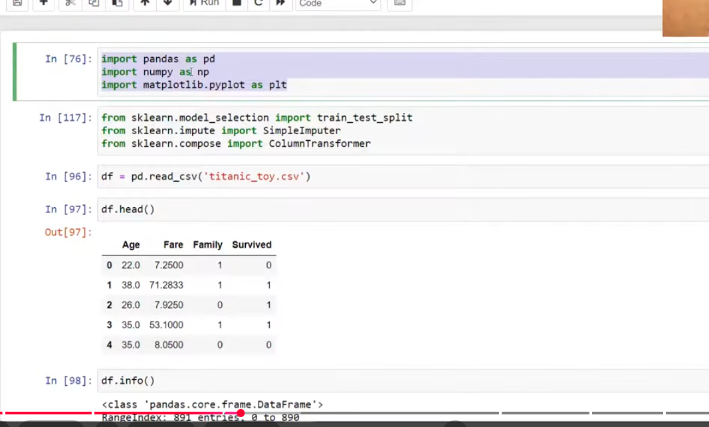

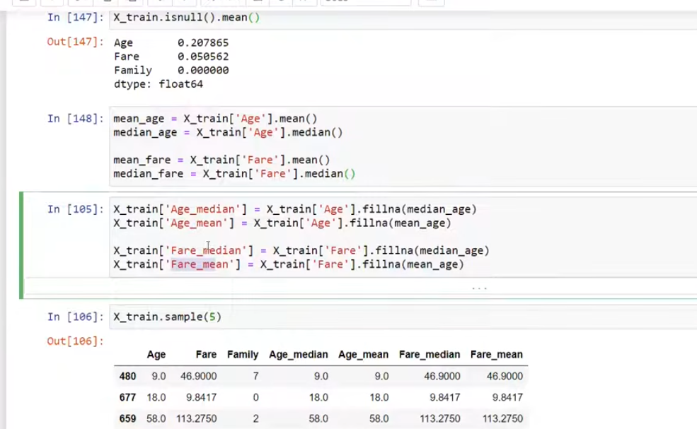

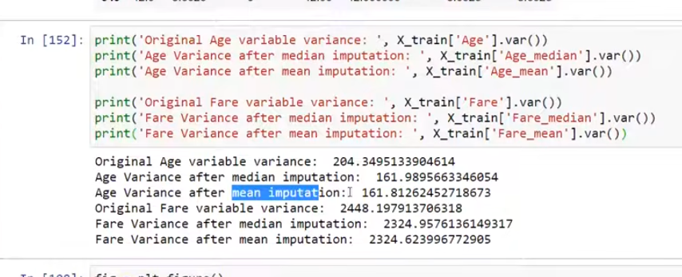

variance gets shrunk

* Things to check after imputation: (1) variance, (2) distribution (PDF), (3) covariance/correlation with other columns, (4) outliers (boxplot)
* Variance of Age: original 204.35 -> after median imputation 161.99 -> after mean imputation 161.81. The variance decreases because a lot of values are moved to the center (mean), and variance is the average squared distance from the mean
* if it decreases too much --> red flag

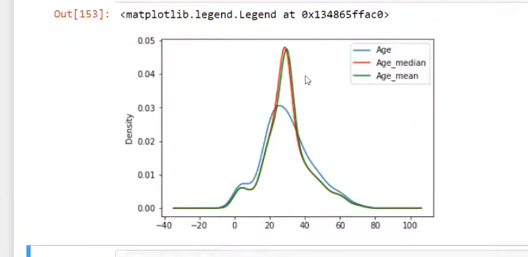

distribution got changed too much

* Age (20 % missing): the peak at the center becomes a lot higher after mean/median imputation (distribution changed)
* Fare (5 % missing): not much change, since the missing values are less
* Correlation/covariance also changes, e.g. covariance of Age and Fare: 70.72 (original) -> 57.96 (median) -> 55.60 (mean)

* 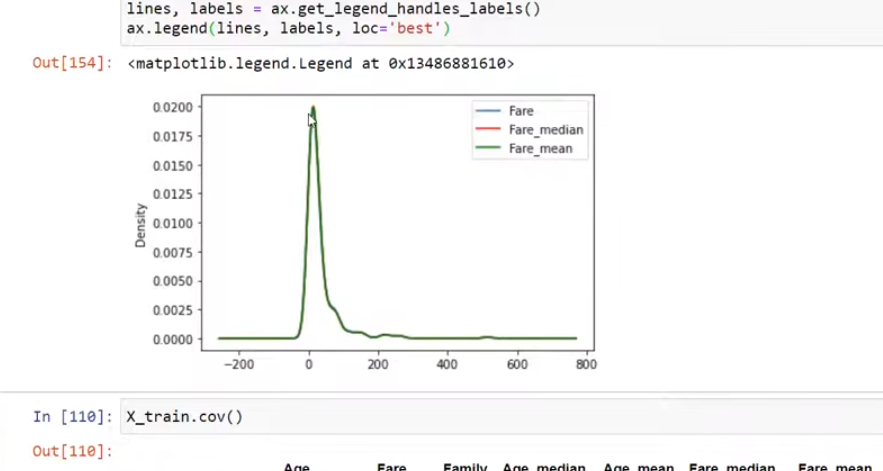

in this distribution after mean and median it is almost the same --> green flag

----

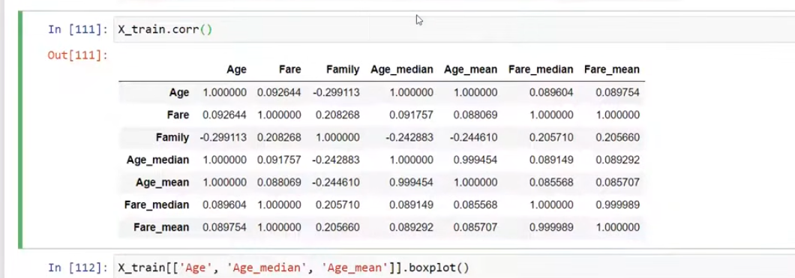

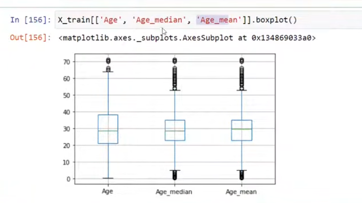

* Boxplot: more outliers appear after imputation (Fare, because extra values at the mean/median make the earlier ones look like outliers)

--------

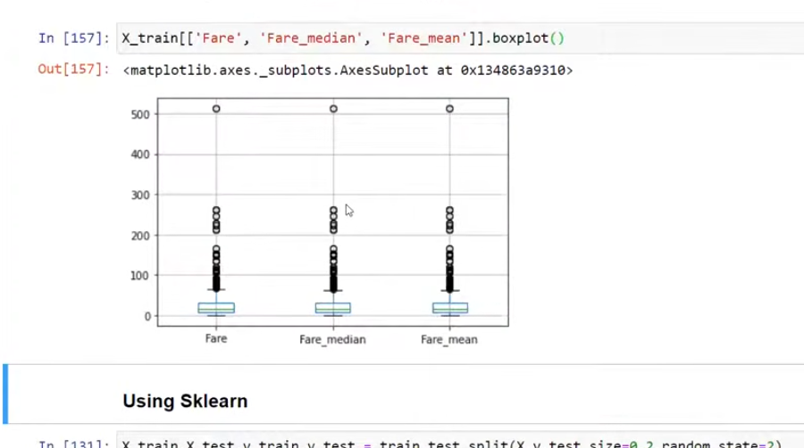

for a feature which shows a red flag I don't use it 

* e.g. we may use mean/median imputation for Fare, but for Age (20 % missing) better use another technique

-----
using scikit learn 

* `SimpleImputer(strategy='median')` for Age and `SimpleImputer(strategy='mean')` for Fare inside `ColumnTransformer(transformers=[('imputer1', SimpleImputer(strategy='median'), ['Age']), ('imputer2', SimpleImputer(), ['Fare'])], remainder='passthrough')`
* `trf.fit(X_train)`, then `trf.named_transformers_['imputer1'].statistics_` = [28.75] and `['imputer2'].statistics_` = [32.617...]
* Always: `fit` on train data and `transform` both train and test


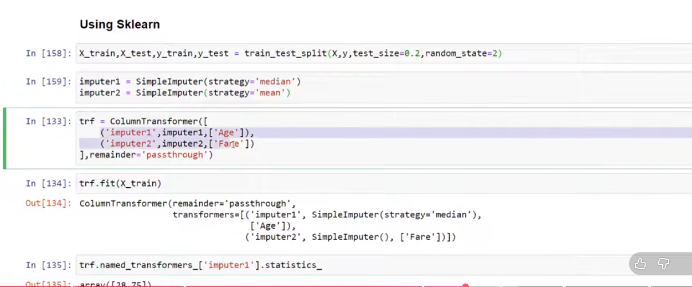


-----------

Arbitrary value imputation 

mainly used in categorical dataset 

* cat -> NA --> missing 

can also be used in numerical one 

* Replace all the missing values with some arbitrary number, e.g. 99, 999, -1, 0 (a value which is far from the data)
* Idea: we want the machine learning algorithm to get that there is something missing here (we bring the importance of missing values to the surface)


Benefit: 

* easy to apply 

disadvantage

* the distribution (PDF), variance and covariance with other columns all change
* Variance of Age: original 204.35 -> after filling 99: 951.73 -> after filling -1: 318.09 (it changes a lot)
* Hard to choose the best arbitrary value (needs trial and error)


------


* sklearn: `SimpleImputer(strategy='constant', fill_value=99)` for Age and `fill_value=999` for Fare (use ColumnTransformer to put different values on different columns)

dist 


* After arbitrary imputation a new bar/peak appears at 99 (and at -1) in the distribution plot

---------

* use when data is not missing at random (we want the model to understand that the data is missing)


-----

End of distribution imputation 

distribution ki end wali value uthate ho 

* It is an extension of arbitrary value imputation: instead of choosing a random value like 99 or -1, we take the value from the end of the distribution (so the value is automatically decided)
* but it has two variations 
* normal distribution: use `mean + 3 * SD` (or `mean - 3 * SD`), because outside this range there is only 0.3 % of data (this is treated as outlier)
* skewed distribution: use IQR proximity rule
* 

IQR 
Q1 - 1.5IQR
Q3 + 1.5 IQR

* Where IQR = Q3 - Q1 (75th percentile - 25th percentile). Use `Q3 + 1.5 * IQR` (right end) or `Q1 - 1.5 * IQR` (left end)

---------

missingness of the data: are we capturing it 
* easy to use 
* pdf changes
* covariance changes
* Use it when the data is not missing at random (the missing values are brought to the surface). It is used less in practice (better techniques are available)


### <mark>CampusX PDF notes - L36 Handling Missing Numerical Data (PDF pp. 830-867)</mark>

**<mark>1. Scope and the three missing-data mechanisms</mark>**
This lecture covers **univariate imputation for numerical data only** (categorical and multivariate come later). Goal: fill the missing values so that the integrity of the dataset is preserved and the model can train.


| Type | Meaning | Example | Suitable methods |
|---|---|---|---|
| **MCAR** (Missing Completely At Random) | missingness has no relationship with any data (observed or missing) | survey responses lost due to a technical error | mean/median imputation, list-wise deletion |
| **MAR** (Missing At Random) | related to the *observed* data, not to the missing value itself | older people report income less often | regression imputation, multiple imputation |
| **MNAR** (Missing Not At Random) | related to the *missing value itself* | high earners refuse to disclose income | arbitrary value / end of distribution, sensitivity analysis, pattern-mixture or selection models |

**<mark>2. Univariate vs multivariate imputation</mark>**


| Aspect | Univariate | Multivariate |
|---|---|---|
| Data used | one column only | many columns |
| Idea | Age missing -> use only the Age column's mean / median | Age missing -> predict from Age, Fare, Family... (`Column2 = f(Column1, Column3, Column4)`) |
| Complexity / speed | simple, fast | complex, slower |
| Accuracy | lower | higher |
| Preserves relationships | no | yes |
| Examples | mean, median, mode, arbitrary value | KNN Imputer, Iterative Imputer (MICE) |

Toy example: Column 2 = (10, 12, ??, 14) -> univariate fills `mean = 12` (or median 12); multivariate learns the pattern from the other columns and predicts `?? = f(7, 17, 22)`.

**<mark>3. Mean / median imputation</mark>**
Replace each missing value by the mean or median of the available values of the same column.
* Mean: `x_bar = (1/n) * sum(x_i)` over the non-missing values.
* Median: the middle value of the sorted data (odd n: the `(n+1)/2`-th value; even n: the average of the two middle values).


Worked example: `[22, 38, 26, 35, 35, NaN, 28, NaN, 40]` -> remove NaN: `[22, 38, 26, 35, 35, 28, 40]`, n = 7, sum = 224, **mean = 32.0** -> `[22, 38, 26, 35, 35, 32.0, 28, 32.0, 40]`. Median: sorted `[22, 26, 28, 35, 35, 38, 40]`, position (7+1)/2 = 4 -> **35** -> `[22, 38, 26, 35, 35, 35, 28, 35, 40]`. (Another example in the PDF: `[22,38,26,35,28,40]` -> mean 31.5 and median `(28+35)/2 = 31.5`.)

| Condition | Use mean | Use median |
|---|---|---|
| Distribution | normal / Gaussian | skewed |
| Outliers | few or none | many present |
| Robustness | less robust to extremes | more robust |
| Mathematical property | minimizes squared errors | minimizes absolute deviations |
| Speed | fast | slightly slower |

**Use mean/median imputation when:** (1) the data is **MCAR**, (2) **less than 5%** is missing, (3) you need a quick baseline, (4) nothing better is practical.

| Advantages | Disadvantages (impact) |
|---|---|
| simple, very easy to understand | distorts the distribution (high) |
| fast, works for large data | reduces the variance (high) |
| easy to deploy (one number per column) | creates artificial patterns (medium) |
| decent results when < 5% missing | changes covariance between variables (high) |
| | masks or amplifies outlier effects (medium) |

**Impact analysis**
* *Variance:* imputed values sit exactly at the centre, their distance from the mean is zero, so the spread decreases. Example: `[10, 20, NaN, 40, 50]` -> valid `[10, 20, 40, 50]`, mean 30, variance 250 -> after imputation `[10, 20, 30, 40, 50]`, mean 30, variance **200** (reduced). (The PDF uses the population variance, `1/n`.)
* *Distribution shape:* a tall artificial peak appears at the mean/median.
* *Covariance:* replacing missing Age by the average weakens the Age-Fare relationship (all missing ages become the average age).

**<mark>4. Implementation - pandas (Titanic toy data: Age, Fare, Family, Survived)</mark>**
Missing: Age 19.87%, Fare 5.05%. Split `train_test_split(X, y, test_size=0.2, random_state=2)` -> train (712, 3), test (179, 3); in train Age 20.79%, Fare 5.06% missing.
```python
mean_age, median_age = X_train['Age'].mean(), X_train['Age'].median()     # statistics from TRAIN only
mean_fare, median_fare = X_train['Fare'].mean(), X_train['Fare'].median()
# Age mean 29.79, median 28.75   |   Fare mean 32.62, median 14.45
X_train['Age_median']  = X_train['Age'].fillna(median_age)
X_train['Age_mean']    = X_train['Age'].fillna(mean_age)
X_train['Fare_median'] = X_train['Fare'].fillna(median_fare)
X_train['Fare_mean']   = X_train['Fare'].fillna(mean_fare)
```
Results the PDF reports:

| Measure | Original | After median | After mean |
|---|---|---|---|
| Age variance | 204.35 | 161.99 (-21%) | 161.81 |
| Fare variance | 2448.20 | 2340.09 (-4.4%) | 2324.24 |
| Cov(Age, Fare) | 70.72 | 57.96 | 55.60 |
| Corr(Age, Fare) | 0.093 | 0.092 | 0.088 |
| Corr(Age, Family) | -0.299 | -0.243 | -0.245 |

* Age (20% missing): a significant peak at the mean/median, the shape clearly changes. Fare (5% missing): the three KDE curves almost overlap -> **low missing % = low impact**.
* Box plots: after imputation the IQR of Age shrinks/changes, some values that were not outliers before may now appear as outliers; Fare shows no significant change.

**<mark>5. Implementation - scikit-learn (recommended for production)</mark>**
```python
transformer = ColumnTransformer(transformers=[
    ('imputer_median', SimpleImputer(strategy='median'), ['Age']),
    ('imputer_mean',   SimpleImputer(strategy='mean'),   ['Fare'])
], remainder='passthrough')
transformer.fit(X_train)
transformer.named_transformers_['imputer_median'].statistics_      # [28.75]
transformer.named_transformers_['imputer_mean'].statistics_        # [32.62]
X_train_transformed = transformer.transform(X_train); X_test_transformed = transformer.transform(X_test)   # (712, 3) and (179, 3)
```
Reasons: easy to integrate in pipelines, compatible with `GridSearchCV`, easy to deploy, consistent API. Cons: returns a numpy array (not a DataFrame), you must remember which strategy was used for which column. Pipeline example: `Pipeline([('imputer', ColumnTransformer(...)), ('classifier', RandomForestClassifier(random_state=42))])`.

| Aspect | Pandas | scikit-learn |
|---|---|---|
| Ease of use | very easy | moderate |
| Output | DataFrame (keeps column names) | numpy array |
| Pipeline integration | not directly | fully compatible |
| Production deployment | manual recreation | easy |
| GridSearchCV | not compatible | compatible |
| Best for | exploration, notebooks | production ML pipelines |

Best practice: explore with pandas, deploy with scikit-learn.

**<mark>6. Arbitrary value imputation</mark>**
Replace missing values by a specific arbitrary value that does not naturally occur: 99 / 999 / 9999 (positive data), -1 / -999 (non-negative data), 0 (if zero does not occur). **Core idea: signal to the model that "this value was originally missing".**
Example: Age `[22, 38, NaN, 35, NaN, 28]` -> `[22, 38, 99, 35, 99, 28]`; Fare `[7.25, 71.28, NaN, 53.10, 8.05, NaN]` -> 999 for the missing ones.


| Data type | Natural range | Recommended value | Reason |
|---|---|---|---|
| Age | 0-100 | -1 or 999 | age cannot be negative, 999 is impossible |
| Price / fare | 0 to infinity | -1 or 999 | prices cannot be negative |
| Temperature | -50 to 50 | 999 / -999 | outside the natural range |
| Percentage | 0-100 | -1 or 999 | cannot be negative or > 100 |
| Count | 0 to infinity | -1 | counts cannot be negative |

Rule: the arbitrary value must be clearly distinguishable from real values.
**When to use:** the data is **MNAR** (missingness carries information, e.g. high earners hiding income), you want to preserve the missingness information, numeric data of a categorical nature (zip codes, ids), combined with a missing indicator (`df['Age_missing_indicator'] = df['Age'].isnull().astype(int)`).

| Advantages | Disadvantages |
|---|---|
| captures the missingness pattern | distorts the distribution (adds artificial peaks) |
| simple (`df['Age'].fillna(-1)`), fast, easy to deploy | variance can increase dramatically |
| works when data is not missing at random | changes covariance; creates (extreme) outliers |
| | sensitive to scale, hurts distance-based algorithms |

Code and results:
```python
X_train['Age_99'] = X_train['Age'].fillna(99);  X_train['Age_minus1'] = X_train['Age'].fillna(-1)
X_train['Fare_999'] = X_train['Fare'].fillna(999); X_train['Fare_minus1'] = X_train['Fare'].fillna(-1)
```
| Variance | Original | Imputed value | After |
|---|---|---|---|
| Age | 204.35 | 99 | **951.73** (+365%) |
| Age | 204.35 | -1 | 318.09 (+56%) |
| Fare | 2448.20 | 999 | **47219.20** (+1829%) |
| Fare | 2448.20 | -1 | 2378.57 (-2.8%) |

The increase depends on how far the value is from the data and on the % missing (Age 99: x4.7 with 20% missing; Fare 999: x19.3 with 5% missing). The KDE shows a spike at 99 (or at -1). Covariance: Cov(Age, Fare) was **+70.72**, after the 99 imputation **-101.67** (the sign flips - the relationship is completely reversed!), after -1 it is +125.56.
Scikit-learn: `SimpleImputer(strategy='constant', fill_value=99)` for Age and `fill_value=999` for Fare inside a `ColumnTransformer`; transformed shape (712, 3).
**When NOT to use:** distance-based algorithms (K-NN, K-Means, SVM), MCAR data (use mean/median), when a variance increase is unacceptable, linear models without regularization.

**<mark>7. End-of-distribution imputation</mark>**
An extension of arbitrary value imputation: instead of a completely arbitrary value, use a value at the **extreme end of the data's own distribution** (still signals missingness, but principled and data-driven).
* *Normal distribution (3-sigma / empirical rule):* `value = mu + 3*sigma` (right end) or `mu - 3*sigma` (left end); 3 sigma covers 99.7%. Example: `[22, 38, 26, 35, NaN, 28, NaN, 40]`: mu = 189/6 = 31.5, sigma = sqrt(259.5/6) = sqrt(43.25) = 6.58 -> upper = 31.5 + 19.74 = **51.24**, lower = 11.76. Right-skewed -> use the upper, left-skewed -> use the lower -> `[22, 38, 26, 35, 51.24, 28, 51.24, 40]`.
* *Skewed distribution (IQR / Tukey):* upper = `Q3 + 1.5*IQR`, lower = `Q1 - 1.5*IQR`. Example: `[20, 22, 25, 26, NaN, 28, 30, NaN, 35, 38, 40, 45, 50, 55, 60]` -> 13 valid values; Q1 = (25+26)/2 = 25.5 (position 3.5), Q3 = (45+50)/2 = 47.5 (position 10.5), IQR = 22 -> upper = 47.5 + 33 = **80.5**, lower = -7.5 -> missing -> 80.5.

| Aspect | 3-sigma method | IQR method |
|---|---|---|
| Best for | normal distribution | skewed distribution |
| Sensitivity to outliers | high | low (robust) |
| Calculation | mean and std | quartiles |
| When | symmetric data | asymmetric data |

```python
def impute_end_of_distribution_3sigma(df, column, use_upper=True):
    mean, std = df[column].mean(), df[column].std()
    return df[column].fillna(mean + 3*std if use_upper else mean - 3*std)
def impute_end_of_distribution_iqr(df, column, use_upper=True):
    Q1, Q3 = df[column].quantile(0.25), df[column].quantile(0.75); IQR = Q3 - Q1
    return df[column].fillna(Q3 + 1.5*IQR if use_upper else Q1 - 1.5*IQR)
```
(The PDF notes that it provides this code itself - the lecture notebook does not have a separate end-of-distribution implementation.) Titanic Age: mean 29.79, std 14.30 -> 3-sigma upper = 29.79 + 42.90 = **72.69**; Q1 = 20, Q3 = 38, IQR = 18 -> IQR upper = 38 + 27 = **65.0** (both possible ages, unlike 99 or -1).

| | Arbitrary (999) | End of distribution (mu + 3 sigma) |
|---|---|---|
| Principle | completely arbitrary | data-driven |
| Justification | none | statistical theory |
| Outlier impact | always an extreme outlier | may not be an extreme outlier |
| Distribution distortion | very high | high |
| Interpretability | low | medium |

Same disadvantages: distorts the distribution, increases variance, changes covariance/correlation, creates outliers, hurts distance-based algorithms.

**<mark>8. Comparison and decision guide</mark>**

| Technique | Best for | Pros | Cons | Avoid when |
|---|---|---|---|---|
| Mean | MCAR, < 5% missing, normal data | simple, fast, easy to deploy | reduces variance, distorts distribution | skewed data, > 5% missing |
| Median | MCAR, < 5% missing, skewed data | robust to outliers, simple | reduces variance, distorts distribution | normal data, > 5% missing |
| Arbitrary value | MNAR, informative missingness | signals missingness, simple | greatly increases variance, creates outliers | MCAR data, distance-based algorithms |
| End of distribution | MNAR, want a principled value | data-driven, signals missingness | increases variance, creates outliers | MCAR data, distance-based algorithms |

| Impact | Mean/Median | Arbitrary | End of distribution |
|---|---|---|---|
| Distribution shape | modified | severely distorted | severely distorted |
| Variance | decreases | greatly increases | increases |
| Covariance | changes | drastically changes | changes |
| Outliers | may increase (IQR) | creates extreme outliers | may create outliers |

| If your data has... | Use this technique |
|---|---|
| < 5% missing, MCAR, normal | mean imputation |
| < 5% missing, MCAR, skewed | median imputation |
| > 5% missing, MCAR | consider advanced methods |
| MNAR, informative missingness | arbitrary value or end of distribution |
| need an ML pipeline | scikit-learn `SimpleImputer` |
| distance-based algorithm | NOT arbitrary value |

**<mark>9. Best practices</mark>**
1. **Split first, then impute** (train-test split before any imputation); compute the statistics from the **train set only** and apply them to train and test (computing the mean on all of `X` = data leakage).
2. Always analyze the impact: variance, distribution shape, covariance/correlation, box plots/outliers.
3. Document the choice (why, % missing, mechanism).

| Check | Acceptable range |
|---|---|
| Variance | should not change dramatically (about +/-30% for mean/median, +/-100% for arbitrary) |
| Distribution | shape should be recognizable |
| Correlation | should not flip sign (+/-0.1 change acceptable) |
| Outliers | should not create many new outliers |
| Mean | similar (about +/-5% for mean imputation) |

Production: `Pipeline([('imputer', SimpleImputer(strategy='median')), ('scaler', StandardScaler()), ('classifier', RandomForestClassifier())])`, fit on train, `joblib.dump(pipeline, 'model_pipeline.pkl')`, load and `predict(new_data)`.
Common mistakes: statistics from the full dataset (leakage), not checking variance, using the mean for skewed data (use the median), ignoring domain knowledge (impossible values), not documenting, using arbitrary values with K-NN/K-Means.
Formulas: `variance = (1/n) sum (x - mu)^2`, `std = sqrt(variance)`, `Cov(X,Y) = (1/n) sum (x - x_bar)(y - y_bar)`, `IQR = Q3 - Q1`, end of distribution: normal `mu +/- 3 sigma`, skewed `Q1 - 1.5 IQR` or `Q3 + 1.5 IQR`.


### <mark>Official code - L36 Mean / Median imputation (repo: `day36-imputing-numerical-data/mean-median-imputation.ipynb`)</mark>

**<mark>Block 1 - load the data and split</mark>**

```python
import pandas as pd
import numpy as np
import matplotlib.pyplot as plt

from sklearn.model_selection import train_test_split
from sklearn.impute import SimpleImputer             # univariate imputer (mean / median / constant / most_frequent)
from sklearn.compose import ColumnTransformer

df = pd.read_csv('titanic_toy.csv')     # Age, Fare, Family, Survived (Age ~20 %, Fare ~5 % missing)
df.info()
df.isnull().mean()                      # fraction of missing values in every column

X = df.drop(columns=['Survived'])
y = df['Survived']
X_train, X_test, y_train, y_test = train_test_split(X, y, test_size=0.2, random_state=2)
X_train.isnull().mean()
```

**<mark>Block 2 - mean and median imputation using pandas fillna</mark>**

```python
# calculate the mean / median on the TRAIN data only
mean_age = X_train['Age'].mean()
median_age = X_train['Age'].median()
mean_fare = X_train['Fare'].mean()
median_fare = X_train['Fare'].median()

# fillna: replaces the missing values with the given value; new columns are created to compare
X_train['Age_median'] = X_train['Age'].fillna(median_age)
X_train['Age_mean'] = X_train['Age'].fillna(mean_age)
X_train['Fare_median'] = X_train['Fare'].fillna(median_fare)
X_train['Fare_mean'] = X_train['Fare'].fillna(mean_fare)
```

**<mark>Block 3 - what changed? variance, distribution, covariance / correlation and outliers</mark>**

```python
# variance (var) shrinks after imputation
print('Original Age variable variance: ', X_train['Age'].var())
print('Age Variance after median imputation: ', X_train['Age_median'].var())
print('Age Variance after mean imputation: ', X_train['Age_mean'].var())

print('Original Fare variable variance: ', X_train['Fare'].var())
print('Fare Variance after median imputation: ', X_train['Fare_median'].var())
print('Fare Variance after mean imputation: ', X_train['Fare_mean'].var())

# distribution: kde = PDF; original (blue), median imputed (red), mean imputed (green)
fig = plt.figure()
ax = fig.add_subplot(111)
X_train['Age'].plot(kind='kde', ax=ax)
X_train['Age_median'].plot(kind='kde', ax=ax, color='red')
X_train['Age_mean'].plot(kind='kde', ax=ax, color='green')
lines, labels = ax.get_legend_handles_labels()
ax.legend(lines, labels, loc='best')

fig = plt.figure()
ax = fig.add_subplot(111)
X_train['Fare'].plot(kind='kde', ax=ax)
X_train['Fare_median'].plot(kind='kde', ax=ax, color='red')
X_train['Fare_mean'].plot(kind='kde', ax=ax, color='green')
lines, labels = ax.get_legend_handles_labels()
ax.legend(lines, labels, loc='best')

X_train.cov()     # covariance between the columns changes after imputation
X_train.corr()    # correlation also changes

# outliers appear after imputation (boxplot)
X_train[['Age', 'Age_median', 'Age_mean']].boxplot()
X_train[['Fare', 'Fare_median', 'Fare_mean']].boxplot()
```

**<mark>Block 4 - the sklearn way (SimpleImputer + ColumnTransformer)</mark>**

```python
X_train, X_test, y_train, y_test = train_test_split(X, y, test_size=0.2, random_state=2)

imputer1 = SimpleImputer(strategy='median')   # median for Age
imputer2 = SimpleImputer(strategy='mean')     # mean for Fare (mean is the default strategy)

# a different imputer for every column; the remaining columns (Family) pass through
trf = ColumnTransformer([
    ('imputer1', imputer1, ['Age']),
    ('imputer2', imputer2, ['Fare'])
], remainder='passthrough')

trf.fit(X_train)                                      # learns the median / mean from the train data
trf.named_transformers_['imputer1'].statistics_       # array([28.75])    -> median of Age
trf.named_transformers_['imputer2'].statistics_       # array([32.6176])  -> mean of Fare

X_train = trf.transform(X_train)    # output is a numpy array (order: Age, Fare, Family)
X_test = trf.transform(X_test)
```

### <mark>Official code - L36 Arbitrary value imputation (repo: `day36-imputing-numerical-data/arbitrary-value-imputation.ipynb`)</mark>

**<mark>Block 1 - load the data and split (same as above)</mark>**

```python
import pandas as pd
import numpy as np
import matplotlib.pyplot as plt

from sklearn.model_selection import train_test_split
from sklearn.impute import SimpleImputer
from sklearn.compose import ColumnTransformer

df = pd.read_csv('titanic_toy.csv')
df.isnull().mean()

X = df.drop(columns=['Survived'])
y = df['Survived']
X_train, X_test, y_train, y_test = train_test_split(X, y, test_size=0.2, random_state=2)
```

**<mark>Block 2 - fill the missing values with arbitrary numbers (99, -1, 999)</mark>**

```python
# fill the missing Age with 99 and with -1; the missing Fare with 999 and with -1 (new columns for comparison)
X_train['Age_99'] = X_train['Age'].fillna(99)
X_train['Age_minus1'] = X_train['Age'].fillna(-1)
X_train['Fare_999'] = X_train['Fare'].fillna(999)
X_train['Fare_minus1'] = X_train['Fare'].fillna(-1)

# variance changes a lot
print('Original Age variable variance: ', X_train['Age'].var())
print('Age Variance after 99 wala imputation: ', X_train['Age_99'].var())
print('Age Variance after -1 wala imputation: ', X_train['Age_minus1'].var())

print('Original Fare variable variance: ', X_train['Fare'].var())
print('Fare Variance after 999 wala imputation: ', X_train['Fare_999'].var())
print('Fare Variance after -1 wala imputation: ', X_train['Fare_minus1'].var())

# distribution: a new peak appears at the arbitrary value (99 / -1)
fig = plt.figure()
ax = fig.add_subplot(111)
X_train['Age'].plot(kind='kde', ax=ax)
X_train['Age_99'].plot(kind='kde', ax=ax, color='red')
X_train['Age_minus1'].plot(kind='kde', ax=ax, color='green')
lines, labels = ax.get_legend_handles_labels()
ax.legend(lines, labels, loc='best')

fig = plt.figure()
ax = fig.add_subplot(111)
X_train['Fare'].plot(kind='kde', ax=ax)
X_train['Fare_999'].plot(kind='kde', ax=ax, color='red')
X_train['Fare_minus1'].plot(kind='kde', ax=ax, color='green')
lines, labels = ax.get_legend_handles_labels()
ax.legend(lines, labels, loc='best')

X_train.cov()     # covariance changes
X_train.corr()    # correlation changes
```

**<mark>Block 3 - the sklearn way (strategy='constant')</mark>**

```python
X_train, X_test, y_train, y_test = train_test_split(X, y, test_size=0.2, random_state=2)

# strategy='constant' + fill_value: fills every missing value with the given constant
imputer1 = SimpleImputer(strategy='constant', fill_value=99)    # Age -> 99
imputer2 = SimpleImputer(strategy='constant', fill_value=999)   # Fare -> 999

trf = ColumnTransformer([
    ('imputer1', imputer1, ['Age']),
    ('imputer2', imputer2, ['Fare'])
], remainder='passthrough')

trf.fit(X_train)
trf.named_transformers_['imputer1'].statistics_    # array([99.])
trf.named_transformers_['imputer2'].statistics_    # array([999.])

X_train = trf.transform(X_train)
X_test = trf.transform(X_test)
```

----

## L37 Handling missing categorical data | Simple imputer 

* In categorical data there are two main techniques: (1) most frequent value (mode) imputation and (2) missing category imputation. Other techniques (random sample etc.) work for both types (next video)

* MCAR --> only 5 % or less missing data 


replace missing value with the mode (most frequent element)

* mean/median don't exist for categories, so we use the mode, i.e. the data which is the most frequent in our column. e.g. city column: Mumbai, Delhi, Kolkata and Mumbai is the most frequent, then every missing value is replaced with Mumbai
* (the same technique can be applied on numerical data also, but there mean/median works better, so nobody uses mode on numerical data)

* the mode of each category should come very often in the data in comparison to the other elements (one category should dominate the others)

* 10 % or more values missing, don't replace with mode, it gets wrong
* you can create a new category called missing 
* Advantage: easy to implement, can be used in production easily. Disadvantage: it changes the distribution (the frequency of the most frequent category increases), 


* Dataset: House prices (Kaggle Advanced Regression) with 3 columns: FireplaceQu (fireplace quality), GarageQual (garage quality), SalePrice. FireplaceQu has about 47.26 % missing (a lot) and GarageQual about 5.55 % (less), so we can compare


------------


missing ones changed with the mode

* GarageQual: mode = `TA` (average); `TA` dominates the column (about 95 %), so the imputation is fine
* We plot the distribution of SalePrice for houses with TA and for houses with missing GarageQual (original vs imputed): the two curves match -> green flag


most frequent should dominate 
here it didn't though

* FireplaceQu: mode = `Gd`, but `Gd` and `TA` are almost equal in the data (the most frequent doesn't dominate), plus 47 % missing, so after imputation the SalePrice distribution of the imputed variable changes a lot -> don't apply mode imputation here


using scikit learn

* `SimpleImputer(strategy='most_frequent')`; `imputer.statistics_` = ['Gd', 'TA'] (FireplaceQu, GarageQual); `imputer.fit_transform(X_train)` and `imputer.transform(X_test)`


* **Missing category imputation:** replace the missing values with a new category named "Missing", used when the data is not missing at random and a lot of values are missing (e.g. 50 %)
    - The ML algorithm will treat it as a completely new category, so it can learn the difference between observations with data and without data
    - Easy to apply; the downside is nothing special except that, if the data is missing at random, it is not that useful
    - sklearn: `SimpleImputer(strategy='constant', fill_value='Missing')`; `imputer.statistics_` = ['Missing', 'Missing']
    - After this a new bar "Missing" appears in the category bar plot
* Remember: numerical data used arbitrary value (99/-1) to tell the algorithm that data is missing; for categorical the same idea is "Missing" category

### <mark>CampusX PDF notes - L37 Categorical Missing Value Imputation (PDF pp. 868-896)</mark>

**<mark>1. Why special techniques?</mark>**
For numeric data the mean/median gives a meaningful centre; for categorical data we need **frequency-based** approaches. Two techniques: (1) **Most frequent value imputation (mode)** - replace missing values with the most common category; (2) **Missing category imputation** - create a new explicit category (e.g. `"Missing"`) for all missing values. Both are done with `SimpleImputer` (`strategy='most_frequent'` or `strategy='constant', fill_value='Missing'`).

**Dataset:** House Prices (Advanced Regression), ~85 columns; used: `GarageQual` (categorical), `FireplaceQu` (categorical), `SalePrice` (target).

| Column | Missing % | Type |
|---|---|---|
| FireplaceQu | **47.26%** (47.260274) | categorical |
| GarageQual | **5.55%** (5.547945) | categorical |
| SalePrice | 0% | numerical (target) |

Categories - GarageQual: TA (typical/average, most frequent), Gd (good), Ex (excellent), Fa (fair), Po (poor). FireplaceQu: Gd (good, most frequent among non-missing), TA, Ex, Fa, Po.

**<mark>2. Most frequent value (mode) imputation</mark>**
`Mode(X) = argmax_{c_i} frequency(c_i)`; rule: `X_imputed(i) = X(i)` if not missing, else `Mode(X)`.


Decision framework (by the missing %): **< 5%** missing -> mode imputation (safe choice); **5-10%** -> check the mode: dominant mode -> mode imputation, weak mode -> test both strategies; **> 10%** missing -> if the mode is dominant (> 50%) test both, if weak -> missing category.

*Use mode imputation when:* the data is **MCAR**; the missing percentage is low (<= 5-10%); a **dominant category** exists; you need a quick, production-friendly implementation.

| Advantages | Disadvantages |
|---|---|
| simple, easy to understand | distribution distortion (inflates the mode's frequency) |
| fast, suitable for large data | variance reduction |
| no new information introduced | assumes MCAR |
| production-ready | mode amplification (exaggerates the dominant category) |
| preserves relationships between existing categories | ignores the reason for missingness |

**<mark>3. Missing category imputation</mark>**
Creates a new category and treats **missingness as informative** instead of a problem to eliminate. `X_new = {C1, ..., Ck, C_missing}`; `X_imputed(i) = X(i)` if present, else `C_missing`.

*Use when:* high missing percentage (> 10-15%); missingness is informative (MAR/MNAR, correlates with the target); categories are balanced (no dominant mode); missingness can be a predictive feature.


| Advantages | Disadvantages |
|---|---|
| preserves the missingness signal | not a true imputation (no real value is filled) |
| no distortion of the original category frequencies | adds one more category (one-hot dimensionality) |
| explicit representation for the model | some models may not handle it well |
| effective with a lot of missing data | needs interpretation / explanation |
| models can learn from the missing pattern | possible overfitting if the missingness is noise |

**<mark>4. Scenario-based comparison</mark>**

| Missing % | Mode dominance | Recommendation |
|---|---|---|
| low | strong (60%+) | mode imputation |
| low | weak (~30%) | either / test both |
| high (> 50%) | strong (60%+) | consider both |
| high (> 50%) | weak (~30%) | **missing category** |
| medium (~15%) | balanced distribution | missing category |

**GarageQual (5.55% missing)** - TA 1311 (mode), Gd 14, Ex 3, Fa 48, Po 3, missing 81. Mode TA is clearly dominant -> **mode imputation**: after imputation TA = 1392 (1311 + 81, a 95.3% share vs 89.7% before), others unchanged, missing 0 -> minimal distortion because the missing % is low.
**FireplaceQu (47.26% missing)** - Gd is the mode but only ~30% among non-missing, others TA ~25%, Ex ~15%, Fa ~10%, Po ~5% (balanced). Mode imputation would make **Gd ~77% (30% + 47%) -> massive distortion**. Decision: **missing category** (the "Missing" ~47% is preserved as its own category).

**<mark>5. Key recommendations</mark>**
1. *Always visualize before vs after* (`value_counts().plot(kind='bar')`).
2. *Analyze the relation with the target:* plot the KDE of `SalePrice` for the mode category vs the rows with missing values. Similar distributions -> mode imputation is safe; different distributions -> prefer the missing category.
3. *Consider the importance of the feature:* high importance -> conservative, prefer missing category; low importance -> mode is acceptable; uncertain -> test both.
4. *Production:* mode = faster inference, no extra one-hot column, simpler deployment; missing category = one more dimension and the new category must be handled in production, but more informative.
5. *Cross-validate both:* `cross_val_score(model, X_mode_imputed, y, cv=5)` vs `cross_val_score(model, X_missing_imputed, y, cv=5)`.

**<mark>6. Code (summary of the PDF's implementation)</mark>**
```python
df = pd.read_csv('train.csv', usecols=['GarageQual', 'FireplaceQu', 'SalePrice'])
df.isnull().mean() * 100                              # FireplaceQu 47.26, GarageQual 5.55, SalePrice 0
mode_garage = df['GarageQual'].mode()[0]              # 'TA'  ((df['GarageQual'] == 'TA').sum() = 1311)
original_mode_dist = df[df['GarageQual'] == 'TA']['SalePrice'].copy()    # store for the before/after KDE
df['GarageQual'].fillna('TA', inplace=True)           # mode imputation -> 'TA' becomes 1392
# Missing category (pandas):  df['GarageQual'].fillna('Missing', inplace=True); df['FireplaceQu'].fillna('Missing', inplace=True)
# scikit-learn:
X_train, X_test, y_train, y_test = train_test_split(df.drop(columns=['SalePrice']), df['SalePrice'], test_size=0.2, random_state=42)
imputer = SimpleImputer(strategy='most_frequent')               # or SimpleImputer(strategy='constant', fill_value='Missing')
X_train_imputed = imputer.fit_transform(X_train)                # learn the mode on TRAIN
X_test_imputed  = imputer.transform(X_test)                     # reuse it on test; imputer.statistics_ shows the learnt fill values
```
(`SimpleImputer` returns a numpy array, so wrap it back with `pd.DataFrame(..., columns=X.columns, index=X_train.index)`.)

**Compare strategies with a model:** `evaluate_imputation(df, strategy='most_frequent' | 'constant', fill_value='Missing')` -> impute, `OneHotEncoder(sparse_output=False, handle_unknown='ignore')`, `LinearRegression`, report RMSE and R2 and the number of features (the missing-category version has more columns because of the extra "Missing" category); whichever has the higher R2 wins.
**Quantify the distribution change:** `scipy.stats.ks_2samp(dist_mode, dist_missing)` - KS test of the target distribution of the mode group vs the missing group (p < 0.05 -> distributions are different -> mode imputation is not appropriate), and mode-group before vs after imputation (significant change -> problem). Also a KL-style measure: `D_KL = sum p_original(ci) log(p_original(ci)/p_new(ci))` - higher = more distortion, 0 = no change (ideal for missing category).

| Visualization | Purpose | Insight |
|---|---|---|
| bar chart | frequency distribution | mode and distribution balance |
| pie chart | proportions including missing | the missing percentage |
| KDE plot | compare target distributions | is imputation appropriate? |
| before/after comparison | imputation impact | quantify the change |
| box plot | target range by category | outliers and spread |

**<mark>7. Pitfalls</mark>**

| Pitfall | Solution |
|---|---|
| blindly using the mode without checking the missing % | analyze the missing % first |
| ignoring the distribution impact | before/after comparison plots |
| treating all columns the same | analyze each categorical column independently |
| not validating after imputation | cross-validation |
| mode imputation with 30%+ missing | use the missing category instead |
| forgetting production | balance accuracy with simplicity |

Summary: `f_new(Mode) = f_old(Mode) + count(NaN)`. GarageQual (5.55% -> mode): minimal change. FireplaceQu (47.26%): mode = severe distortion, missing category = original distribution preserved.


### <mark>Official code - L37 Most frequent value imputation (repo: `day37-handling-missing-categorical-data/frequent-value-imputation.ipynb`)</mark>

**<mark>Block 1 - load the house price data</mark>**

```python
import pandas as pd
import numpy as np
import matplotlib.pyplot as plt

df = pd.read_csv('train.csv', usecols=['GarageQual', 'FireplaceQu', 'SalePrice'])
df.head()
df.isnull().mean() * 100    # FireplaceQu ~47 % missing, GarageQual ~5.5 % missing
```

**<mark>Block 2 - GarageQual: mode imputation works (TA dominates the column)</mark>**

```python
df['GarageQual'].value_counts().plot(kind='bar')   # TA is by far the most frequent category
df['GarageQual'].mode()                            # mode = the most frequent value -> 'TA'

# PDF of SalePrice: houses with TA vs houses with a missing GarageQual (they look similar)
fig = plt.figure()
ax = fig.add_subplot(111)
df[df['GarageQual'] == 'TA']['SalePrice'].plot(kind='kde', ax=ax)
df[df['GarageQual'].isnull()]['SalePrice'].plot(kind='kde', ax=ax, color='red')
lines, labels = ax.get_legend_handles_labels()
labels = ['Houses with TA', 'Houses with NA']
ax.legend(lines, labels, loc='best')
plt.title('GarageQual')

temp = df[df['GarageQual'] == 'TA']['SalePrice']      # store the original TA prices to compare after imputation

df['GarageQual'].fillna('TA', inplace=True)           # replace the missing values with the mode
df['GarageQual'].value_counts().plot(kind='bar')

# PDF of SalePrice before and after the imputation -> almost the same
fig = plt.figure()
ax = fig.add_subplot(111)
temp.plot(kind='kde', ax=ax)
df[df['GarageQual'] == 'TA']['SalePrice'].plot(kind='kde', ax=ax, color='red')
lines, labels = ax.get_legend_handles_labels()
labels = ['Original variable', 'Imputed variable']
ax.legend(lines, labels, loc='best')
plt.title('GarageQual')
```

**<mark>Block 3 - FireplaceQu: mode imputation does not work well (Gd and TA are almost equal, 47 % missing)</mark>**

```python
df['FireplaceQu'].value_counts().plot(kind='bar')
df['FireplaceQu'].mode()                          # 'Gd'

fig = plt.figure()
ax = fig.add_subplot(111)
df[df['FireplaceQu'] == 'Gd']['SalePrice'].plot(kind='kde', ax=ax)
df[df['FireplaceQu'].isnull()]['SalePrice'].plot(kind='kde', ax=ax, color='red')
lines, labels = ax.get_legend_handles_labels()
labels = ['Houses with Gd', 'Houses with NA']
ax.legend(lines, labels, loc='best')
plt.title('FireplaceQu')

temp = df[df['FireplaceQu'] == 'Gd']['SalePrice']

df['FireplaceQu'].fillna('Gd', inplace=True)
df['FireplaceQu'].value_counts().plot(kind='bar')

# the distribution of the imputed variable changes a lot -> red flag
fig = plt.figure()
ax = fig.add_subplot(111)
temp.plot(kind='kde', ax=ax)
df[df['FireplaceQu'] == 'Gd']['SalePrice'].plot(kind='kde', ax=ax, color='red')
lines, labels = ax.get_legend_handles_labels()
labels = ['Original variable', 'Imputed variable']
ax.legend(lines, labels, loc='best')
plt.title('FireplaceQu')
```

**<mark>Block 4 - the sklearn way (strategy='most_frequent')</mark>**

```python
from sklearn.model_selection import train_test_split
X_train, X_test, y_train, y_test = train_test_split(df.drop(columns=['SalePrice']), df['SalePrice'], test_size=0.2)

from sklearn.impute import SimpleImputer

imputer = SimpleImputer(strategy='most_frequent')   # mode of every column

X_train = imputer.fit_transform(X_train)   # fit learns the mode of every column from the train data
X_test = imputer.transform(X_train)        # (typo in the official notebook: it should be imputer.transform(X_test))

imputer.statistics_    # array(['Gd', 'TA'], dtype=object) -> mode of FireplaceQu and GarageQual
```

### <mark>Official code - L37 Missing category imputation (repo: `day37-handling-missing-categorical-data/missing-category-imputation.ipynb`)</mark>

**<mark>Block 1 - replace the missing values with a new category named 'Missing'</mark>**

```python
import pandas as pd
import numpy as np
import matplotlib.pyplot as plt

df = pd.read_csv('train.csv', usecols=['GarageQual', 'FireplaceQu', 'SalePrice'])
df.isnull().mean() * 100

# bar plot of the categories (sorted) before imputation
df['GarageQual'].value_counts().sort_values(ascending=False).plot.bar()
plt.xlabel('GarageQual')
plt.ylabel('Number of houses')

df['GarageQual'].fillna('Missing', inplace=True)    # missing values become a new category called 'Missing'

# a new bar 'Missing' appears after imputation
df['GarageQual'].value_counts().sort_values(ascending=False).plot.bar()
plt.xlabel('GarageQual')
plt.ylabel('Number of houses')
```

**<mark>Block 2 - the sklearn way (strategy='constant')</mark>**

```python
from sklearn.model_selection import train_test_split
X_train, X_test, y_train, y_test = train_test_split(df.drop(columns=['SalePrice']), df['SalePrice'], test_size=0.2)

from sklearn.impute import SimpleImputer

# constant + fill_value='Missing': every missing value is replaced by the word 'Missing'
imputer = SimpleImputer(strategy='constant', fill_value='Missing')

X_train = imputer.fit_transform(X_train)
X_test = imputer.transform(X_train)     # (typo in the official notebook: it should be imputer.transform(X_test))

imputer.statistics_     # array(['Missing', 'Missing'], dtype=object)
```

----

## L38 Missing Indicator | Random sample imputation 

* Random value imputation 
* Missing indicator
* automatic selection -> tuning 
* Plan of this video: first random sample imputation, then missing indicator, then automatic selection of imputer parameters using GridSearchCV (this finishes the univariate part, then multivariate)

random no. selected from the remaining no.s 

* we fill the missing places with values randomly selected from the data present in the column (not a random number from 1 to 100, but only from the values which are already there)


can be applied to both numerical and categorical types of data

* Easy to apply
* the distribution of data remains the same 
* 
peak means that number has the highest probability to be picked; the same will happen if we pick randomly, the distribution shape stays almost the same
* wont work well in decision tree
* works well in linear algorithms (linear regression, logistic regression), where the shape of the distribution should remain intact
* covariance relationship gets changed (the relationship with the other columns gets disturbed)
* memory heavy in deployment -> all the training data values need to be saved, and can't be saved on the server (the new row with missing value needs a random value from the training data)
----


making a new column 

* Practical (Titanic: Age, Fare, Survived): Age ~19.87 % missing. We create `Age_imputed` as a copy of Age in both train and test


what I did in this code --> removed missing values and then applied sample, took 148 values 

* `X_train['Age'].dropna().sample(X_train['Age'].isnull().sum())`: drop the missing from Age and take a sample of the same size as the number of missing values (148 in train); `.values` is used because the index would not match
* `X_train['Age_imputed'][X_train['Age_imputed'].isnull()] = ...values` (same for test, with the same train data used for sampling)


age vs age_imputed 

let's see distribution


almost same

* PDF of original Age and Age_imputed almost overlap (blue and orange)


variance is also almost the same (Age 204.35 -> Age_imputed 208.33), what changed is the covariance (Age-Fare covariance 71.51 -> 43.00)


Outlier also almost the same

-------


in production it is possible that for each input we will get a different random value, hence we will use random_state so that each input gets the same random value 

* Problem: the user enters the same data twice, one time the model gets a different random age than the other time and shows different results, which is bad. 
* Solution: for every input set the `random_state` based on the observation's other data (e.g. use the Fare of that row as the seed: `sample(1, random_state=int(observation['Fare']))`). Then the same input always gives the same random value. Remember this while making production projects

------

Categorical data 

* Dataset: house price (FireplaceQu ~47 % missing, GarageQual ~5.5 % missing)


percentage of missing


almost all categories same

* GarageQual (5 % missing): category ratios nearly the same before/after (TA 0.951 -> 0.949, Fa 0.037 -> 0.038 and so on)


where 50 percent of the dataset was missing it was not good to apply this 

* FireplaceQu (50 % missing): ratios and the SalePrice distribution per category changed a lot. This is a red flag; if you were using a linear model on it you would not use random imputation on this column
--------

Missing indicator

# any column with missing data we create a new column 

* Missing indicator is not an imputation technique by itself, it is used together with an imputation technique: for every column which has missing data we create a new column (True/False)


age_NA

F 
T (CORRESPONDING VALUE IS MISSING )

* Example: Age = [27, 30, NaN, 15, NaN] -> Age_NA = [False, False, True, False, True]. We can also name it `Age_NA` etc.
* Idea: the model learns to distinguish between rows where the data was missing and where it was not. This feature was used by a participant of a KDD (Cup) competition and he won with it, as it helped the model performance a lot 

KDD --> this helped 

estimate: our model is able to find the difference between missing rows and non-missing rows 

* It does not always work, but it is worth trying if the accuracy is not improving


using titanic dataset 

* Age and Fare columns, Survived as output; Age imputed with mean using SimpleImputer, LogisticRegression gives accuracy **61.45 %** 


* Now use `MissingIndicator()`: `mi.fit(X_train)`; `mi.features_` = [0] (says that the first column, Age, has missing values); `mi.transform(X_train)` gives a True/False array which we add as a new column `Age_NA` in both X_train and X_test. Then do the mean imputation and logistic regression: accuracy rises to **63.13 %**
* In sklearn you can also use directly `SimpleImputer(add_indicator=True)`: the new indicator columns are added automatically (so there is no need to import the MissingIndicator class separately). If you are using Pipeline/ColumnTransformer prefer this

-----

automatically set value for imputation

* Use `GridSearchCV` over the imputer parameters (the best strategy for each type of column)
-

removed four columns 

* Titanic: dropped PassengerId, Name, Ticket, Cabin; the remaining: Pclass, Sex, Age, SibSp, Parch, Fare, Embarked (Age and Embarked have missing values)


then apply preprocessing on age and fare

* Numerical pipeline: SimpleImputer + StandardScaler on Age and Fare; categorical pipeline: SimpleImputer + OneHotEncoder on Embarked and Sex. Combine them with a ColumnTransformer and then a Pipeline with LogisticRegression at the end

and then apply standardization, something to be done on


explain the image 243

* Parameters in grid search are named `step__substep__parameter`: `preprocessor__num__imputer__strategy` : ['mean', 'median'], `preprocessor__cat__imputer__strategy` : ['most_frequent', 'constant'], `classifier__C` : [0.1, 1.0, 10, 100]
* Image 243 is the pipeline diagram (`set_config(display='diagram')`): preprocessor (num pipeline and cat pipeline) -> classifier


----

GridSearchCV applied 

* `grid_search.fit(X_train, y_train)`, then `grid_search.best_params_` = {'classifier__C': 1.0, 'preprocessor__cat__imputer__strategy': 'most_frequent', 'preprocessor__num__imputer__strategy': 'mean'} and `best_score_` = 0.788 (internal CV)
* We can see all the results with `pd.DataFrame(grid_search.cv_results_)`, sorted by `mean_test_score`


-------

### <mark>CampusX PDF notes - L38 Advanced Missing Data Imputation: Random Sample, Missing Indicator, Automatic Parameter Selection (PDF pp. 897-933)</mark>

**Three techniques in this lecture:** (1) **Random (sample) imputation** - fill missing values with values randomly sampled from the existing data of the same column; (2) **Missing indicator** - add binary columns that flag which values were missing; (3) **Automatic parameter selection** - `GridSearchCV` over the imputation strategy.


**<mark>1. Random imputation - concept</mark>**
Missing values are replaced by randomly selecting values (with replacement) from the non-missing pool of the same column.


Example: Age `[27, 30, 21, NaN, 56, 51, NaN, 26, 20, 65, NaN, 43, 28]` -> non-missing pool `[27, 30, 21, 56, 51, 26, 20, 65, 43, 28]`, 3 missing -> randomly sample 3 values (e.g. 51, 26, 30) -> `[27, 30, 21, 51, 56, 51, 26, 26, 20, 65, 30, 43, 28]`.

*Maths:* `P(select value x) = count(x) / total non-missing values`; e.g. if 40% of the values lie in 60-70, 30% in 70-80, 20% in 50-60, 10% in 80-90, then sampling picks those ranges with exactly those probabilities, so the **original distribution shape is preserved**. The variance of the imputed column approximates the original: `Var(X_imputed) ~ Var(X_original)` because the filled values come from the same distribution.

| Advantages | Impact | Disadvantages | Impact |
|---|---|---|---|
| easy to implement | high accessibility | memory heavy (must store training data for deployment) | high footprint |
| preserves the distribution | critical for statistical models | distorts the correlation with other features | affects multivariate analysis |
| preserves the variance | important for linear models | introduces randomness (reproducibility) | instability |
| works for numerical and categorical | universal | not suitable for trees (they do not benefit) | limited applicability |
| no normality assumption | flexible | deployment complexity (need the original training set) | operational overhead |

Effect on relationships (the PDF text says correlation 0.71 -> 0.43; these are really the covariance numbers 71.5 -> 43.0 from its output): random sampling inserts values that do not have the same relationship with the other features as the true missing values would have.

**<mark>2. Random imputation - numerical (Titanic Age, ~20% missing)</mark>**
```python
df = pd.read_csv('train.csv', usecols=['Age','Fare','Survived'])
X_train, X_test, y_train, y_test = train_test_split(df.drop(columns=['Survived']), df['Survived'], test_size=0.2, random_state=2)
X_train['Age_imputed'] = X_train['Age']; X_test['Age_imputed'] = X_test['Age']      # copy the column, fill the copy
# train: sample as many values from the non-missing training Age as there are NaNs
X_train['Age_imputed'][X_train['Age_imputed'].isnull()] = X_train['Age'].dropna().sample(X_train['Age'].isnull().sum()).values
# test: ALSO sample from the TRAIN non-missing values (never from the test data)
X_test['Age_imputed'][X_test['Age_imputed'].isnull()] = X_train['Age'].dropna().sample(X_test['Age'].isnull().sum()).values
```
Missing Age in train: 148 -> 0 after. KDE of original vs imputed: almost identical. Variance: original **204.35** -> after random imputation **208.33** (only +1.9%). Covariance of Fare with Age = **71.51**, with Age_imputed = **43.00** (decreases - a known disadvantage).

**<mark>3. Random imputation - categorical (House prices: GarageQual 5.55%, FireplaceQu 47.26%)</mark>**
Same code with `X_train['GarageQual'].dropna().sample(n).values`.
* GarageQual (5% missing) - proportions original vs imputed: TA 0.951 vs 0.949, Gd 0.037 vs 0.038, Fa 0.010 vs 0.011, Ex/Po 0.0009 vs 0.0009 -> **frequencies preserved**.
* FireplaceQu (47% missing) - the frequency distribution changes significantly (Gd 0.494 -> 0.649, TA 0.412 -> 0.539, Fa 0.041 -> 0.053 ... in the PDF's table, which divides by different totals) -> too much missing data changes the data a lot.
* Effect on the SalePrice distribution per category (KDE per category before/after): for FireplaceQu the TA peak shifts left, the Gd peak moves from about 200k to about 250k, Fa gets narrower; Ex and Po are maintained. **With 47% missing, random imputation can significantly alter the relationship between feature and target.**

**<mark>4. Production considerations</mark>**
* *Problem:* the same input could give different imputed values each time (user submits Fare = 50, Age missing -> Age 32 -> "Survived"; submits again -> Age 45 -> "Not survived").
* *Solution:* a **deterministic random state** derived from the observation itself, e.g. `X_train['Age'].dropna().sample(1, random_state=int(observation['Fare']))` (use another observed feature as the seed), wrapped in `random_impute_production(observation, column_name, training_data)`.
* *Memory:* store the entire training set (~10 MB for 10,000 x 50 - high), or only the non-missing values per column (`imputation_values[col] = X_train[col].dropna().values`, ~2 MB for 2 columns - medium), versus only statistical parameters like mean/median (~1 KB for 50 columns - low).

**<mark>5. Missing indicator</mark>**
Creates additional binary columns that flag whether a value was originally missing, independent of the imputation method.


Why it works - *hypothesis:* the pattern of missingness itself carries information. Linked to mechanisms: **MAR** (probability of missing depends on observed data) and **MNAR** (related to the unobserved value, e.g. high earners hide income).

| Domain | Feature | Missing pattern | Predictive information |
|---|---|---|---|
| Healthcare | income | lower-income patients less likely to report | economic status affects health outcomes |
| Finance | previous loan data | first-time borrowers have missing data | different risk profile |
| E-commerce | product reviews | unhappy customers skip reviews | satisfaction predictor |
| Titanic | age | lower-class passengers have missing age | social status affects survival |

The model can learn two behaviours: row with original value `y = f(x1..xn, indicator = 0)`, row with imputed value `y = f(x1..xn, indicator = 1)` - it can apply different weights/decision boundaries.
**Method 1 - `MissingIndicator` class**
```python
mi = MissingIndicator()
mi.fit(X_train)                                  # features_ shows which columns have missing values -> [0] (only Age)
X_train_missing = mi.transform(X_train)          # boolean array (712, 1)
X_train['Age_NA'] = X_train_missing; X_test['Age_NA'] = mi.transform(X_test)
si = SimpleImputer(); X_train_trf = si.fit_transform(X_train); X_test_trf = si.transform(X_test)   # [Age_imputed, Fare, Age_NA]
```
**Method 2 - `SimpleImputer(add_indicator=True)`** - the shortcut: output (712, 3) = Age_imputed, Fare, Age_missing_indicator.

| Aspect | Method 1: `MissingIndicator` | Method 2: `add_indicator=True` |
|---|---|---|
| Code | more verbose | single parameter |
| Control | fine-grained | automated |
| Flexibility | can be used independently | tied to SimpleImputer |
| Use case | complex pipelines, production | quick implementation, prototyping |

*Performance (Titanic Age, `LogisticRegression`, `test_size=0.2, random_state=2`):* baseline (impute only) accuracy **0.6145**; with missing indicator (either method) **0.6313** -> **+0.0168 (+2.73%)**.
| Mechanism | Missing indicator useful? |
|---|---|
| MCAR | less useful |
| MAR | useful |
| MNAR | very useful |

**<mark>6. Automatic parameter selection with `GridSearchCV`</mark>**
Instead of trying mean, median, mode manually, search them as hyper-parameters of a pipeline:
```python
numerical_transformer   = Pipeline(steps=[('imputer', SimpleImputer(strategy='median')), ('scaler', StandardScaler())])
categorical_transformer = Pipeline(steps=[('imputer', SimpleImputer(strategy='most_frequent')), ('ohe', OneHotEncoder(handle_unknown='ignore'))])
preprocessor = ColumnTransformer(transformers=[('num', numerical_transformer, ['Age','Fare']), ('cat', categorical_transformer, ['Embarked','Sex'])])
clf = Pipeline(steps=[('preprocessor', preprocessor), ('classifier', LogisticRegression())])
param_grid = {
  'preprocessor__num__imputer__strategy': ['mean', 'median'],
  'preprocessor__cat__imputer__strategy': ['most_frequent', 'constant'],
  'classifier__C': [0.1, 1.0, 10, 100]}                   # (double underscore = step__sub-step__parameter)
grid_search = GridSearchCV(clf, param_grid, cv=10, scoring='accuracy', verbose=1)
grid_search.fit(X_train, y_train)                         # 2 x 2 x 4 = 16 candidates x 10 folds = 160 fits
```
(Data: Titanic with `PassengerId, Name, Ticket, Cabin` dropped; the `num` pipeline imputes then scales: `[22, NaN, 30, 25] -> median 26 -> [22, 26, 30, 25] -> standardized`; the `cat` pipeline imputes the most frequent port 'S' then one-hot encodes.)
Results in the PDF: best params `classifier__C = 1.0`, `cat imputer strategy = most_frequent`; best CV score **0.7879**; test accuracy **0.7877**. Observations: the top configurations all reach the same 78.79% -> imputation strategy has minimal impact on this dataset; regularization C matters more (C = 0.1 slightly worse, 78.64%); std about 0.04 = stable. Use `pd.DataFrame(grid_search.cv_results_)` sorted by `mean_test_score` and a heatmap of the strategy pivot table.


**<mark>7. Comparison and when to use</mark>**

| Technique | Data types | Distribution preserved | Complexity | When to use |
|---|---|---|---|---|
| Random imputation | numerical, categorical | moderate | medium | linear models, moderate missing data |
| Missing indicator | any (adds a binary column) | n/a | medium | MAR/MNAR, 10-30% missing |
| GridSearch for imputation | any | depends on the chosen strategy | high | when optimization is critical |
| Mean/median | numerical only | no | low | quick baseline, MCAR |
| Mode | categorical only | partial | low | MCAR categorical data |

Decision tree (PDF): < 5% missing -> simple imputation; 5-30% -> by data type and model type (linear/distance-based: **random imputation + missing indicator** / new category or most frequent + indicator; tree-based: usually a missing indicator or optimize with GridSearchCV); > 30% missing -> consider dropping the feature (with caution).
Performance table in the PDF (Titanic; the numbers are as printed there): mean imputation 0.6145, random imputation 0.6145, missing indicator **0.6313**, random + indicator 0.6350, GridSearch (optimized) 0.7879 (it also tuned the model's C and uses more features, so it is not like-for-like).

**<mark>8. Best practices</mark>**
* *Random imputation - good:* linear models (Linear/Logistic regression, SVM), moderate missing data (10-30%), when variance and distribution must be preserved, statistical inference matters, numerical and categorical features. *Avoid:* tree-based models, memory constraints in production, > 50% missing, when you need consistent predictions (unless a deterministic random state is used).
* *Missing indicator - good:* MAR/MNAR, moderate missingness (10-30%), Kaggle / critical accuracy, informative missingness. *Avoid:* MCAR data, very low (< 5%) or very high (> 70%) missingness, too many features with missing values (dimensionality).

| Pitfall | Problem | Solution |
|---|---|---|
| fitting the imputer on the entire dataset | data leakage | fit only on the training data |
| different random values every time | inconsistent predictions | deterministic random state |
| storing large training sets | memory overflow | store only the non-missing values per column |
| too many indicator columns | overfitting | feature selection |
| assuming MCAR | ignoring the missingness pattern | analyze the mechanism first |


### <mark>Official code - L38 Random sample imputation (repo: `day38-missing-indicator/random-sample-imputation.ipynb`)</mark>

**<mark>Block 1 - numerical data (Titanic Age): load and split</mark>**

```python
import numpy as np
import pandas as pd

from sklearn.model_selection import train_test_split

import matplotlib.pyplot as plt
import seaborn as sns

df = pd.read_csv('train.csv', usecols=['Age', 'Fare', 'Survived'])
df.isnull().mean() * 100          # Age ~19.87 % missing

X = df.drop(columns=['Survived'])
y = df['Survived']
X_train, X_test, y_train, y_test = train_test_split(X, y, test_size=0.2, random_state=2)
```

**<mark>Block 2 - random sample imputation (fill the missing places with randomly selected existing values)</mark>**

```python
# copy Age into a new column Age_imputed (in train and test)
X_train['Age_imputed'] = X_train['Age']
X_test['Age_imputed'] = X_test['Age']

# dropna() -> only the available values; sample(n) -> n randomly selected values; .values -> remove the index
# n = number of missing values (148 in train); the TRAIN data is used for sampling in both train and test
X_train['Age_imputed'][X_train['Age_imputed'].isnull()] = X_train['Age'].dropna().sample(X_train['Age'].isnull().sum()).values
X_test['Age_imputed'][X_test['Age_imputed'].isnull()] = X_train['Age'].dropna().sample(X_test['Age'].isnull().sum()).values

X_train['Age'].isnull().sum()     # 148
```

**<mark>Block 3 - what changed? distribution, variance, covariance and outliers</mark>**

```python
# PDF of the original and the imputed column almost overlap
sns.distplot(X_train['Age'], label='Original', hist=False)
sns.distplot(X_train['Age_imputed'], label='Imputed', hist=False)
plt.legend()
plt.show()

# variance almost the same
print('Original variable variance: ', X_train['Age'].var())
print('Variance after random imputation: ', X_train['Age_imputed'].var())

# covariance with Fare changes
X_train[['Fare', 'Age', 'Age_imputed']].cov()

X_train[['Age', 'Age_imputed']].boxplot()      # outliers stay almost the same
```

**<mark>Block 4 - production tip: use random_state so that the same input always gets the same random value</mark>**

```python
# the seed is taken from the observation's own value (Fare), so the same row gives the same sample every time
# ('observation' is the new incoming row in production)
sampled_value = X_train['Age'].dropna().sample(1, random_state=int(observation['Fare']))
```

**<mark>Block 5 - categorical data (house prices): same technique</mark>**

```python
data = pd.read_csv('house-train.csv', usecols=['GarageQual', 'FireplaceQu', 'SalePrice'])
data.isnull().mean() * 100

X = data
y = data['SalePrice']
X_train, X_test, y_train, y_test = train_test_split(X, y, test_size=0.2, random_state=2)

# new columns to keep the imputed values
X_train['GarageQual_imputed'] = X_train['GarageQual']
X_test['GarageQual_imputed'] = X_test['GarageQual']
X_train['FireplaceQu_imputed'] = X_train['FireplaceQu']
X_test['FireplaceQu_imputed'] = X_test['FireplaceQu']

# fill the missing places with random existing categories (sampled from train)
X_train['GarageQual_imputed'][X_train['GarageQual_imputed'].isnull()] = X_train['GarageQual'].dropna().sample(X_train['GarageQual'].isnull().sum()).values
X_test['GarageQual_imputed'][X_test['GarageQual_imputed'].isnull()] = X_train['GarageQual'].dropna().sample(X_test['GarageQual'].isnull().sum()).values

X_train['FireplaceQu_imputed'][X_train['FireplaceQu_imputed'].isnull()] = X_train['FireplaceQu'].dropna().sample(X_train['FireplaceQu'].isnull().sum()).values
X_test['FireplaceQu_imputed'][X_test['FireplaceQu_imputed'].isnull()] = X_train['FireplaceQu'].dropna().sample(X_test['FireplaceQu'].isnull().sum()).values

# compare the category ratio before and after (GarageQual -> almost same)
temp = pd.concat([
            X_train['GarageQual'].value_counts() / len(X_train['GarageQual'].dropna()),
            X_train['GarageQual_imputed'].value_counts() / len(X_train)
        ], axis=1)
temp.columns = ['original', 'imputed']
temp

# FireplaceQu (50 % missing) -> the ratios change
temp = pd.concat([
            X_train['FireplaceQu'].value_counts() / len(X_train['FireplaceQu'].dropna()),
            X_train['FireplaceQu_imputed'].value_counts() / len(df)
        ], axis=1)
temp.columns = ['original', 'imputed']
temp

# PDF of SalePrice for every category: before imputation and after imputation (the curves change -> red flag)
for category in X_train['FireplaceQu'].dropna().unique():
    sns.distplot(X_train[X_train['FireplaceQu'] == category]['SalePrice'], hist=False, label=category)
plt.show()

for category in X_train['FireplaceQu_imputed'].dropna().unique():
    sns.distplot(X_train[X_train['FireplaceQu_imputed'] == category]['SalePrice'], hist=False, label=category)
plt.show()
```

### <mark>Official code - L38 Missing indicator (repo: `day38-missing-indicator/missing-indicator.ipynb`)</mark>

**<mark>Block 1 - baseline: mean imputation + logistic regression</mark>**

```python
import numpy as np
import pandas as pd

from sklearn.model_selection import train_test_split
from sklearn.impute import MissingIndicator, SimpleImputer

df = pd.read_csv('train.csv', usecols=['Age', 'Fare', 'Survived'])

X = df.drop(columns=['Survived'])
y = df['Survived']
X_train, X_test, y_train, y_test = train_test_split(X, y, test_size=0.2, random_state=2)

# mean imputation
si = SimpleImputer()
X_train_trf = si.fit_transform(X_train)
X_test_trf = si.transform(X_test)

from sklearn.linear_model import LogisticRegression
from sklearn.metrics import accuracy_score

clf = LogisticRegression()
clf.fit(X_train_trf, y_train)
y_pred = clf.predict(X_test_trf)
accuracy_score(y_test, y_pred)      # ~0.6145
```

**<mark>Block 2 - MissingIndicator: True where the value is missing</mark>**

```python
mi = MissingIndicator()
mi.fit(X_train)            # finds the columns having missing values
mi.features_               # array([0]) -> the first column (Age) has missing values

X_train_missing = mi.transform(X_train)    # True / False array (True = value was missing)
X_test_missing = mi.transform(X_test)

# add it as a new column Age_NA
X_train['Age_NA'] = X_train_missing
X_test['Age_NA'] = X_test_missing
X_train
```

**<mark>Block 3 - imputation + indicator column together, and check the accuracy</mark>**

```python
si = SimpleImputer()
X_train_trf2 = si.fit_transform(X_train)     # now includes the Age_NA column
X_test_trf2 = si.transform(X_test)

clf = LogisticRegression()
clf.fit(X_train_trf2, y_train)
y_pred = clf.predict(X_test_trf2)
accuracy_score(y_test, y_pred)     # improves to ~0.6313
```

**<mark>Block 4 - the shortcut: SimpleImputer(add_indicator=True) (no separate MissingIndicator class needed)</mark>**

```python
si = SimpleImputer(add_indicator=True)     # the indicator columns are added automatically after the imputed columns

X_train = si.fit_transform(X_train)
X_test = si.transform(X_test)
```

### <mark>Official code - L38 Automatically select the imputer parameters (repo: `day38-missing-indicator/automatically-select-imputer-parameters.ipynb`)</mark>

**<mark>Block 1 - load the titanic data and split</mark>**

```python
import numpy as np
import pandas as pd

from sklearn.model_selection import train_test_split, GridSearchCV
from sklearn.compose import ColumnTransformer
from sklearn.pipeline import Pipeline
from sklearn.impute import SimpleImputer
from sklearn.preprocessing import StandardScaler, OneHotEncoder
from sklearn.linear_model import LogisticRegression

df = pd.read_csv('train.csv')
df.drop(columns=['PassengerId', 'Name', 'Ticket', 'Cabin'], inplace=True)   # remove four columns

X = df.drop(columns=['Survived'])
y = df['Survived']
X_train, X_test, y_train, y_test = train_test_split(X, y, test_size=0.2, random_state=2)
```

**<mark>Block 2 - preprocessing pipelines for numerical and categorical columns</mark>**

```python
numerical_features = ['Age', 'Fare']
numerical_transformer = Pipeline(steps=[
    ('imputer', SimpleImputer(strategy='median')),   # impute first
    ('scaler', StandardScaler())                     # then standardize
])

categorical_features = ['Embarked', 'Sex']
categorical_transformer = Pipeline(steps=[
    ('imputer', SimpleImputer(strategy='most_frequent')),
    ('ohe', OneHotEncoder(handle_unknown='ignore'))
])

# ColumnTransformer: numerical pipeline on the numerical columns, categorical pipeline on the categorical columns
preprocessor = ColumnTransformer(
    transformers=[
        ('num', numerical_transformer, numerical_features),
        ('cat', categorical_transformer, categorical_features)
    ]
)

# the final pipeline: preprocessing + the model
clf = Pipeline(steps=[
    ('preprocessor', preprocessor),
    ('classifier', LogisticRegression())
])

from sklearn import set_config
set_config(display='diagram')     # shows the diagram of the pipeline
clf
```

**<mark>Block 3 - GridSearchCV on the imputer strategies and on the model parameter</mark>**

```python
# parameter names: stepname__substepname__parameter
param_grid = {
    'preprocessor__num__imputer__strategy': ['mean', 'median'],
    'preprocessor__cat__imputer__strategy': ['most_frequent', 'constant'],
    'classifier__C': [0.1, 1.0, 10, 100]
}

grid_search = GridSearchCV(clf, param_grid, cv=10)    # tries every combination with 10 fold cross validation

grid_search.fit(X_train, y_train)

print(f"Best params:")
print(grid_search.best_params_)
# {'classifier__C': 1.0, 'preprocessor__cat__imputer__strategy': 'most_frequent', 'preprocessor__num__imputer__strategy': 'mean'}

print(f"Internal CV score: {grid_search.best_score_:.3f}")    # ~0.788

# all the results sorted by score
import pandas as pd
cv_results = pd.DataFrame(grid_search.cv_results_)
cv_results = cv_results.sort_values("mean_test_score", ascending=False)
cv_results[['param_classifier__C', 'param_preprocessor__cat__imputer__strategy', 'param_preprocessor__num__imputer__strategy', 'mean_test_score']]
```

----

## L39 Multivariate imputation | KNN imputer

* to fill a value we take the help of the remaining rows and columns to fill the missing values
* KNN imputer
* Iterative imputer
* Univariate = only the same column used; multivariate = the other columns' data also used (so we get the relationship between columns for free)

-----

KNN imputer 

* KNN -> the characteristics would be similar to the neighbors 
* similarity is found out using the euclidean distance
* Idea: to fill a missing value of a row, find the rows most similar to it (nearest neighbours) and use their values 
* **K = number of neighbors**: if K = 1, take the value of the closest neighbor; if K = 2, take the average of the 2 closest neighbors' values; if K = 3, the sum of the 3 values divided by 3, and so on


find the K NN (steps: 1) find the K nearest neighbors using the distance 2) find the value of the missing cell by averaging their value in that column)

find the value

---

nan_euclidean_distance

* Normal euclidean distance doesn't work, since some of the values are missing. So KNN imputer uses `nan_euclidean_distance` (check the official sklearn documentation)
* Formula: `dist(x, y) = sqrt( weight * (squared distance of the coordinates which are present in both) )`, where `weight = total number of coordinates / number of present coordinates`
* We only take the coordinates where both the rows have values, ignore the others, and then scale it up using the weight


show the calculation of actually finding the distance

* Example: for two rows of 3 columns where one of the values is missing, weight = 3/2 = 1.5; if only one coordinate is present in both, weight = 3/1 = 3; if all the 3 are present the weight is 3/3 = 1 (normal distance)


row 2 and row 4 

--------------

point 1's distance from point 2 

* We calculate the distance of the row (having a missing value) from all the other rows, then sort, take the nearest K rows, then average their values for the missing column


see it in detail

Advantages and disadvantages

* more accurate (most of the time better than mean/median imputation)
* more number of calculations and time-taking (we calculate the distance with every point)
* the whole training set needs to be on the server (for new incoming rows with missing values), speed slow and memory consumption high


* Practical (Titanic: Age, Pclass, Fare, Survived; only Age has missing values): `KNNImputer(n_neighbors=3, weights='distance')`, `fit_transform(X_train)`, `transform(X_test)`
* Parameters: `n_neighbors` (K, default 5, so experiment to find the best number), `weights` ('uniform' or 'distance'), `metric` ('nan_euclidean' is the default, no change needed), `add_indicator`
* `weights='uniform'`: all neighbors get equal weight (simple average). `weights='distance'`: weight = 1/distance, so the closer neighbors have more say: e.g. instead of (a + b)/2 we calculate (a/d1 + b/d2) / (1/d1 + 1/d2)
* Logistic regression accuracy: **KNN imputer (k=3, weights='distance') = 71.5 %** vs **SimpleImputer mean = 69.3 %**, so KNN is better here. Try different values of n_neighbors and weights (the results change)

new variable mai dal diya


### <mark>CampusX PDF notes - L39 KNN Imputer: Multivariate Imputation (PDF pp. 934-968)</mark>

**<mark>1. What is it?</mark>**
`KNNImputer` (`sklearn.impute.KNNImputer`) is a **multivariate**, distance-based imputation technique: it fills a missing value by looking at the **K nearest rows (neighbors)** and using *their* values of that feature. Unlike univariate methods (one column only), it uses the relationships between features. Primary use: missing **numerical** data; generally better than mean/median.


| Aspect | Univariate imputation | Multivariate imputation (KNN) |
|---|---|---|
| Data used | only the column with missing values | all available columns |
| Information | limited to single-feature statistics | uses relationships between features |
| Complexity | simple (mean, median, mode) | complex distance calculations |
| Computational cost | very low | higher (distances to all points) |
| Accuracy | moderate | generally higher |
| Preserves relationships | no | yes |
| Example | fill age with the mean age | fill age using similar records based on the other features |

Toy table (4 features, one missing value in Row 2, Feature 1): univariate fills the mean of the available Feature 1 values `(33 + 23 + 40 + 35)/4 = 32.75` and ignores the other features. KNN finds the rows most similar to Row 2 on Features 2-4, takes their Feature 1 values and fills a more contextual value.

**<mark>2. Fundamentals</mark>**
Each row is a point in N-dimensional space (N = number of features): similar points should have similar values.


Example rows: Row 1 `(33, 45, 67, 21)`, Row 2 `(?, 45, 68, 12)` (x1 missing), Row 3 `(23, 51, 71, 18)`, Row 4 `(40, ?, 81, ?)`.
Steps: (1) identify the row with a missing value -> (2) compute the distance to all other rows using the available features -> (3) sort by distance and take the **K nearest** neighbors -> (4) use their values of the missing feature -> (5) apply weighting (uniform or distance).

*Role of K:* closest neighbor (distance 10) age 30, 2nd (20) age 50, 3rd (30) age 35 -> K = 1: **30**; K = 2: (30 + 50)/2 = **40**; K = 3: (30 + 50 + 35)/3 = **38.33**.

**<mark>3. NaN-Euclidean distance (the default metric)</mark>**
Normal Euclidean distance `sqrt((x2-x1)^2 + (y2-y1)^2 + ...)` breaks when a coordinate is NaN. sklearn's `nan_euclidean`:

`d(x, y) = sqrt( (w / w') * sum over coordinates present in both of (x_i - y_i)^2 )`   with `w` = total number of coordinates, `w'` = number of coordinates present in both.

* **Ignore** coordinates where either value is missing; **scale up** by `w/w'` (the weight factor) to compensate for the missing dimensions; this keeps distances comparable even if rows have different numbers of observed features.

Clean worked example: Row A = `(5, 8, 12)`, Row B = `(2, NaN, 10)`. Feature 2 is skipped. Valid squared differences: `(5-2)^2 = 9`, `(12-10)^2 = 4` -> sum **13**. Weight = total pairs / valid pairs = 3/2 = **1.5**. Adjusted sum = 13 x 1.5 = **19.5**. Distance = sqrt(19.5) = **4.42**.
(The PDF also reproduces the whiteboard rows with several distances: 11.29, 9, 5.19, 14.39 from point 1 to points 2-5 and a few calculations such as `sqrt(1.333 x 2379) ~ 56.32` or `sqrt(106.64) ~ 10.33`; the PDF itself notes they do not match the whiteboard exactly (different data values/normalization), so rely on the formula above and the lecture video for the exact whiteboard numbers.)

**<mark>4. Weighting strategies</mark>**
* **Uniform:** all K neighbors contribute equally: `imputed = (1/K) sum v_i`. Neighbors with values 70 (distance 10) and 50 (distance 50), K = 2: `(70 + 50)/2 = 60`.
* **Distance:** weight `w_i = 1/d_i`, `imputed = sum(w_i v_i) / sum(w_i)`. Same neighbors: `w1 = 1/10 = 0.1`, `w2 = 1/50 = 0.02`; numerator `0.1 x 70 + 0.02 x 50 = 8`; denominator 0.12 -> **66.67** (pulled towards the nearer neighbor's 70 instead of the midpoint 60).
* Second example (K = 2): neighbors Row 3 (distance 2, value 3) and Row 4 (distance ~5, value 9): weights 0.5 and 0.2 -> `(0.5x3 + 0.2x9)/(0.5+0.2) = 3.3/0.7 = 4.71`.

| | Uniform | Distance |
|---|---|---|
| Weight | equal for all neighbors | proportional to proximity (1/d) |
| Formula | simple average | weighted average |
| Best when | neighbors roughly equidistant | neighbors vary a lot in distance |
| Sensitivity | less sensitive to the closest neighbor | more sensitive to the closest neighbor |
| Computation | faster | slightly slower |
| sklearn default | **yes** (`weights='uniform'`) | no, must specify |


**<mark>5. Advantages and disadvantages</mark>**
*Advantages:* (1) more accurate than mean/median (Titanic: 69.27% with mean -> 71.51% with KNN), (2) preserves relationships/correlations between features, (3) flexible, adapts to local patterns, (4) intuitive (similarity).
*Disadvantages:*
1. **Computationally expensive:** for each missing value compute distances to all rows: `O(m x n x f)` (m missing values, n rows, f features); e.g. 1,000 missing cells x 10,000 rows x 20 features = 200,000,000 operations.
2. **Memory intensive in production:** you must keep the entire training set to impute new rows (mean/median: just store one number; linear regression: only coefficients).
3. **Curse of dimensionality:** in high dimensions all points are almost equidistant, so neighbors are not truly similar.
4. **Scale sensitivity:** Income (20,000-100,000) dominates Age (20-80) -> always scale before KNN imputation.
5. **Choice of K:** too small K = high variance / noise, too large K = over-smoothing.

| Metric | Mean imputation | KNN imputer |
|---|---|---|
| Accuracy | moderate | high |
| Speed | very fast | slow |
| Memory | minimal | high |
| Simplicity | very simple | moderate |
| Preserves relationships | no | yes |
| Scalability | excellent | poor |

*Use KNNImputer when:* small to medium data (< 100,000 rows), correlated features, accuracy more important than speed, computational resources available, MAR data. *Avoid when:* very large data (> 1,000,000 rows), real-time predictions, limited memory/CPU, mostly independent features, strict latency.

**<mark>6. Implementation (Titanic: Age, Pclass, Fare, Survived)</mark>**
```python
df = pd.read_csv('train.csv')[['Age','Pclass','Fare','Survived']]      # only Age has missing values (19.87%)
X = df.drop(columns=['Survived']); y = df['Survived']
X_train, X_test, y_train, y_test = train_test_split(X, y, test_size=0.2, random_state=2)
knn = KNNImputer(n_neighbors=3, weights='distance')
X_train_trf = knn.fit_transform(X_train)          # fit stores the training rows (the neighbors pool)
X_test_trf  = knn.transform(X_test)               # test rows are imputed from TRAIN neighbors
lr = LogisticRegression().fit(X_train_trf, y_train)
accuracy_score(y_test, lr.predict(X_test_trf))    # 0.7151
```
`KNNImputer(missing_values=np.nan, n_neighbors=5, weights='uniform', metric='nan_euclidean', copy=True, add_indicator=False)`.

| Parameter | Default | Description |
|---|---|---|
| `missing_values` | `np.nan` | placeholder for missing values (e.g. -999) |
| `n_neighbors` | 5 | number of neighbors (typically 1-20, tune it) |
| `weights` | 'uniform' | 'uniform' or 'distance' |
| `metric` | 'nan_euclidean' | distance metric ('euclidean' has no NaN handling) |
| `copy` | True | copy the input |
| `add_indicator` | False | add missing-indicator columns |

Tuning: loop `k in [1, 3, 5, 7, 10, 15, 20]`, or a `Pipeline([('imputer', KNNImputer()), ('classifier', LogisticRegression())])` with `GridSearchCV` over `imputer__n_neighbors = [3, 5, 7, 10]` and `imputer__weights = ['uniform', 'distance']`.

**Comparison (Titanic, as printed in the PDF)**

| Method | Accuracy | Time | Notes |
|---|---|---|---|
| Mean | 0.6927 | fastest | ignores relationships |
| Median | 0.6816 | fast | outlier-robust baseline |
| KNN (K=3, uniform) | 0.7039 | ~0.05 s | balanced |
| **KNN (K=3, distance)** | **0.7151** | ~0.05 s | best accuracy |
| KNN (K=5, distance) | 0.7095 | slowest | stable estimates, possible over-smoothing |

Key insights: KNN with distance weighting gives about **+2.24 points** over mean imputation (relative +3.2%); mean/median are about 20-30x faster; K = 3 with distance weighting was best here; accept slower computation for better accuracy.

**<mark>7. Best practices</mark>**
1. **Scale first:** `Pipeline([('scaler', StandardScaler()), ('imputer', KNNImputer(n_neighbors=5, weights='distance'))])`.
2. Choose K by cross-validation: small data (< 1000) K = 3-7; medium (1000-10000) K = 5-15; large (> 10000) K = 10-30.
3. Encode categoricals first (`OrdinalEncoder`) - `KNNImputer` works only on numbers.
4. Computational resources: < 1,000 rows suitable; 1,000-10,000 use with caution; 10,000-100,000 consider faster alternatives; > 100,000 avoid unless necessary.
5. Distance weighting usually performs better (use uniform when neighbors are equidistant or you need speed).
6. `add_indicator=True` when missingness is informative (e.g. missing blood pressure = not tested).
7. Monitor memory in production: reduce the training set by sampling, use approximate nearest neighbors, or choose another imputation method.
8. Validate the imputed distribution (before vs after) and document the choice (K, weights, metric, rationale, trade-offs, monitoring).

Maths summary: standard Euclidean `sqrt(sum (x_i - y_i)^2)`; NaN-Euclidean `sqrt((w/w') sum_{present} (x_i - y_i)^2)`; uniform `(1/K) sum v_i`; distance-weighted `sum(v_i/d_i) / sum(1/d_i)`.


### <mark>Official code - L39 KNN Imputer (repo: `day39-knn-imputer/day39.ipynb`)</mark>

**<mark>Block 1 - load the data and split</mark>**

```python
import numpy as np
import pandas as pd

from sklearn.model_selection import train_test_split
from sklearn.impute import KNNImputer, SimpleImputer
from sklearn.linear_model import LogisticRegression
from sklearn.metrics import accuracy_score

df = pd.read_csv('train.csv')[['Age', 'Pclass', 'Fare', 'Survived']]   # keep only 4 columns
df.isnull().mean() * 100      # only Age has missing values (~19.87 %)

X = df.drop(columns=['Survived'])
y = df['Survived']
X_train, X_test, y_train, y_test = train_test_split(X, y, test_size=0.2, random_state=2)
```

**<mark>Block 2 - KNNImputer (n_neighbors=3, weights='distance') and the accuracy</mark>**

```python
# n_neighbors = K (number of nearest rows used to fill the value);
# weights='distance' -> closer neighbors get a higher weight (1 / distance); 'uniform' -> simple average
# the distance used is nan_euclidean (euclidean distance which ignores the missing coordinates)
knn = KNNImputer(n_neighbors=3, weights='distance')

X_train_trf = knn.fit_transform(X_train)    # fit stores the train rows; the missing values are filled from the neighbors
X_test_trf = knn.transform(X_test)          # test rows use the train rows as neighbors

lr = LogisticRegression()
lr.fit(X_train_trf, y_train)
y_pred = lr.predict(X_test_trf)
accuracy_score(y_test, y_pred)       # ~0.715
```

**<mark>Block 3 - comparison with the simple mean imputer</mark>**

```python
# SimpleImputer (mean by default) -> a univariate technique, only the same column is used
si = SimpleImputer()

X_train_trf2 = si.fit_transform(X_train)
X_test_trf2 = si.transform(X_test)

lr = LogisticRegression()
lr.fit(X_train_trf2, y_train)
y_pred2 = lr.predict(X_test_trf2)
accuracy_score(y_test, y_pred2)      # ~0.693 -> KNN imputer gave the better accuracy
```

----

## L40 Multivariate imputation by chained equation for missing values | MICE algorithm

MICE -> Multivariate Imputation by Chained Equations (in sklearn it is `IterativeImputer`), very popular technique to fill missing values

Assumption under use
* MCAR (certain rows ke liye data collect hi nahi hua, i.e. missing completely at random)
* missing at random (MAR) (optionally data nhi bhara, e.g. didn't fill the age; hence baaki columns k acc. we can fill it)
* missing not at random (MNAR) ( jaan puch ke hataya, data is removed on purpose, so there is not much relationship with the other columns, so we can't fill it by using them) 

* The three types of missing data: MCAR, MAR, MNAR


-------

Best at Missing at random (MAR) 

* we use MICE when we are sure that the data is missing at random, so that we can predict the missing column from the other columns. It can be tried anywhere, but you get better results with MAR 

using an ML algo to predict 
* Advantage: it is quite natural and the performance is good. Disadvantage: it is slow, since we are using an ML algorithm in loops, and also, as in KNN, we have to keep the whole training set on the server in production


speed and memory problem 


MICE is always implemented on the input columns 

* Example: 50_Startups dataset (R&D Spend, Administration, Marketing Spend, Profit), Profit is the output column, so we remove it. We take 5 random rows and scaled them (divide by 10000) so the numbers are small, and removed one value from each column on purpose


missing values need to be predicted using MICE


* Step 1: replace all the missing values by the mean of their column (e.g. the first column mean = 9.25, second = 11.25, third = 28.25)
* Step 2: take the first column (leftmost); the values which were missing in it are put back to missing (NaN) 
* Step 3: use any ML algorithm (linear regression, random forest etc.): the rows with data in this column become the training data (input = other columns, output = this column), and the row with the missing value is the test row. The prediction fills the missing value (here Linear Regression gives 23.14)


step 3 - move left to right 

row of missing value is the prediction and the rest become the training data 
same data moves down 

* Then go to the second column: bring back the NaN, train on the other rows (R&D Spend and Marketing Spend as input), predict (11.06). Then the third column (31.56). 


again continue 


end of the stage 1 we have no missing values

* End of iteration 1: no missing values in the dataset, but filled using the ML model for each column, and it is better than the mean


* Step 4: subtract iteration 1 values from iteration 0 (mean-filled) values: the known cells become 0 and the imputed cells get a difference (e.g. 30.89, -19.29, 2.31). Repeat till the difference becomes (almost) zero


2nd iteration: take the dataset from the first iteration as base, again remove the imputed values column by column, predict, and so on. Do 15-20 iterations until the values come as close to the actual values (the difference between two iterations is almost 0). In the second iteration the differences came down a lot (e.g. 0.79, 0.15) but it may fluctuate a bit, then converge

* Why repeat? the first prediction was made using the mean-filled rows, which may be wrong, so with every iteration we get closer to the actual values. The more iterations the better the fit
* In sklearn: `from sklearn.experimental import enable_iterative_imputer` then `from sklearn.impute import IterativeImputer` (`max_iter` = number of iterations, default 10). It is the experimental class, so the enable import is required

2nd row as base and prediction, do 15-20 iterations, come as close to the actual values 

### <mark>CampusX PDF notes - L40 MICE: Multivariate Imputation by Chained Equations (PDF pp. 969-1009)</mark>

**<mark>1. Introduction</mark>**
MICE is an advanced, model-based imputation technique for multivariate data. Other names: **Fully Conditional Specification (FCS)**, sequential regression multivariate imputation, chained equations. Characteristics: *iterative* (several passes refine the values), *model-based* (ML models predict the missing values), *multivariate* (uses relationships between all variables), *flexible* (a different algorithm can be used for each variable). In sklearn it is `IterativeImputer` (needs `from sklearn.experimental import enable_iterative_imputer`).

**<mark>2. Missing-data mechanisms</mark>**


| Type | Definition | Characteristics | Example | Can MICE handle it? |
|---|---|---|---|---|
| **MCAR** | missingness independent of observed and unobserved data; a random subset | no pattern, independent of all variables, purely random | survey not conducted on certain days due to holidays | yes, but may be overkill |
| **MAR** | depends only on the observed data, not on the missing values | pattern exists in the observed data, can be predicted from other columns; most common in practice | people of a certain age group skip the salary field | **yes - best results** |
| **MNAR** | related to the unobserved value itself | systematic differences that cannot be explained by observed data, weak relationship with other variables | high-income people skip income questions | limited effectiveness |

Maths: `MCAR: P(R | Xobs, Xmis) = P(R)`; `MAR: P(R | Xobs, Xmis) = P(R | Xobs)`; `MNAR: P(R | Xobs, Xmis) != P(R | Xobs)` (R = missingness indicator). Implication: MCAR -> analysis stays unbiased (with reduced power); MAR -> needs appropriate statistical techniques; MNAR -> significantly biased, hard to correct without external information.

**<mark>3. The algorithm - overview</mark>**
MICE is particularly effective for **MAR** data where a missing value in one column can be predicted from the others.


Philosophy: (1) *column-by-column* - each variable with missing values is modelled as a function of the others; (2) *iterative refinement*; (3) *flexible modelling* - different algorithms per variable; (4) uses the natural correlations.

**When to use:** MAR; multiple variables have missing values; complex (non-linear) relationships; accuracy is the priority; enough complete cases to train the models. **Avoid:** MNAR; limited compute; real-time inference; very large datasets; simple MCAR (simpler methods suffice).

| Advantage | Description |
|---|---|
| natural performance | leverages the actual relationships in the data -> higher accuracy |
| flexibility | any ML algorithm can be used |
| multivariate handling | considers all variables simultaneously |
| uncertainty quantification | can generate multiple imputations (variance of the imputation) |
| no distribution assumptions | works with various data types |

| Disadvantage | Mitigation |
|---|---|
| slow (iterative) | faster algorithms (e.g. LightGBM) |
| memory (keeps the training data) | sample the data / incremental learning |
| model selection needed | cross-validation |
| convergence issues | monitor convergence metrics |
| overfitting with many iterations | early stopping |

**<mark>4. Step-by-step process</mark>**
* **Step 0 - initialization:** replace all missing values by the **column mean** (`X_j(0) = X_j if observed, else mean of column j`).
* Then for each iteration `t` and each column `j` with missing values, left to right (`X1 -> X2 -> ... -> Xp`):
  1. *Column selection* - take the next column with missing values.
  2. *Restore NaN* - put the original NaN back in this column only (`x(t) = x(t-1) if originally observed, NaN if originally missing`).
  3. *Split* - training set = rows where column j is observed (inputs = all the other columns `X_-j`, output = column j); prediction set = rows where it is missing.
  4. *Train* a model `f_j = argmin sum L(X_j,i, f(X_-j,i))` over the observed rows (linear regression by default; also Ridge/Lasso, Random Forest, XGBoost/LightGBM, neural networks).
  5. *Predict* the missing values `X_j,i(t) = f_j(X_-j,i)`.
  6. *Update* the column with the predictions (observed values unchanged).
* After all columns: **difference** `Delta(t) = ||X(t) - X(t-1)||` over the originally-missing positions; stop if `Delta(t) < epsilon` (e.g. 1e-3 or 1e-4) or `t = T`; otherwise repeat. (Relative-change version: `|x(t) - x(t-1)| / (|x(t-1)| + eps)`.)

**<mark>5. Worked example (startup data: R&D Spend, Administration, Marketing Spend)</mark>**
Data: 5 rows of a startup dataset, 3 input columns (values divided by 10,000 and rounded), **3 values missing - one in each column** (R&D in row 37, Administration in row 14, Marketing in row 44). The numbers below are exactly those of the lecture.

*Iteration 0 (mean imputation):* column means from the observed values: R&D `(8 + 15 + 12 + 2)/4 = 37/4 = 9.25`; Administration `(15 + 5 + 10 + 15)/4 = 45/4 = 11.25`; Marketing `(30 + 20 + 41 + 26)/4 = 117/4 = 29.25`. So the imputed cells start as R&D (row 37) = 9.25, Administration (row 14) = 11.25, Marketing (row 44) = 29.25.

*Iteration 1* (one linear regression per column on the 4 rows where it is observed):
* R&D Spend (row 37): `R&D = b0 + b1*Administration + b2*Marketing` trained on the 4 observed rows; test input Administration = 5.0, Marketing = 20.0 -> **23.14**.
* Administration (row 14): inputs R&D, Marketing; test input R&D = 12.0, Marketing = 26.0 -> **11.06**.
* Marketing Spend (row 44): inputs R&D, Administration; test input R&D = 2.0, Administration = 15.0 -> **31.56**.
Difference iteration 1 - iteration 0: R&D **13.89**, Administration **-0.19**, Marketing **2.31** -> large changes, continue.

*Iteration 2:* 23.78, 11.22, 31.56. Differences: R&D 0.64, Administration 0.16, Marketing 0.0 (so far converged).
*Iteration 3:* 24.57, 11.37, **45.53**. Differences: R&D 0.79, Administration 0.15, Marketing **13.97** (a sudden jump). The PDF says this is normal - values can fluctuate during convergence; continue until stable. (This is also why sklearn's `max_iter` and a tolerance exist.)

Convergence pattern: `Delta` large at iteration 1, shrinking in later iterations, `Delta = 0` at convergence.

**<mark>6. Python implementation</mark>**
*Manual, first pass:*
```python
df = np.round(pd.read_csv('50_Startups.csv')[['R&D Spend','Administration','Marketing Spend','Profit']] / 10000)
np.random.seed(9); df = df.sample(5)
df = df.iloc[:, 0:-1]                                  # impute only the input features, never the target
df.iloc[1, 0] = np.NaN; df.iloc[3, 1] = np.NaN; df.iloc[-1, -1] = np.NaN     # introduce 3 missing values (rows 37, 14, 44)
df0 = pd.DataFrame()                                   # iteration 0: mean imputation of every column
df0['R&D Spend'] = df['R&D Spend'].fillna(df['R&D Spend'].mean()); df0['Administration'] = df['Administration'].fillna(df['Administration'].mean()); df0['Marketing Spend'] = df['Marketing Spend'].fillna(df['Marketing Spend'].mean())

df1 = df0.copy(); df1.iloc[1, 0] = np.NaN              # restore the NaN of the first column
X_train = df1.iloc[[0,2,3,4], 1:3]; y_train = df1.iloc[[0,2,3,4], 0]
lr = LinearRegression().fit(X_train, y_train)
df1.iloc[1, 0] = lr.predict(df1.iloc[1, 1:].values.reshape(1, 2))[0]            # 23.14
# repeat for Administration (restore NaN at [3,1], train on rows [0,1,2,4] and columns [0,2]) and Marketing (restore [4,-1], train on rows 0:4, columns 0:2)
difference = df1 - df0
```
*Full loop:* `mice_imputation(df_original, n_iterations=10, tolerance=1e-3)`: initialise with the means, `missing_mask = df_original.isna()`, then for every iteration and every column with missing values restore the NaNs, fit `LinearRegression` on `~missing_mask[col]` rows with the other columns, predict the `missing_mask[col]` rows, store history, `max_change = np.abs(df_current - df_previous)[missing_mask].max().max()` and stop when `max_change < tolerance`.
*sklearn:*
```python
from sklearn.experimental import enable_iterative_imputer
from sklearn.impute import IterativeImputer
imputer = IterativeImputer(estimator=LinearRegression(), max_iter=10, random_state=0, verbose=2)
df_imputed = pd.DataFrame(imputer.fit_transform(df), columns=df.columns, index=df.index)
```
*Different estimator per column* (`estimators_dict`): `'R&D Spend': RandomForestRegressor(n_estimators=10)`, `'Administration': Ridge(alpha=1.0)`, `'Marketing Spend': xgb.XGBRegressor(n_estimators=10)`.

**<mark>7. Convergence analysis</mark>**
Plot each imputed cell across the iterations (`history`). Metrics: absolute change `|x(t) - x(t-1)|`, relative change `abs / (|x(t)| + eps)`, maximum change, mean squared change. Stopping options: fixed iterations (`max_iterations = 10`); threshold (`max_change < 0.01`); relative improvement (`(prev - curr)/prev < 0.05`); combined (`max_change < 0.01 or iteration > 20`).

**<mark>8. Best practices</mark>**

| Algorithm | Best for | Pros | Cons |
|---|---|---|---|
| Linear regression | linear relationships, fast inference | fast, interpretable | assumes linearity |
| Ridge/Lasso | high-dimensional data | handles multicollinearity | may underfit |
| Random forest | non-linear relationships | robust, handles outliers | slower, less interpretable |
| XGBoost/LightGBM | complex patterns, large data | high accuracy, fast training | prone to overfitting |
| Neural networks | very complex patterns | extremely flexible | needs lots of data, slow |

Tune the imputation model with `GridSearchCV` on the complete cases; for mixed types use a regressor for numeric and a classifier for (encoded) categorical columns. Validation: (1) **hold-out** - hide 20% of known values, impute, compare with `mean_squared_error`; (2) **multiple imputation** - run `IterativeImputer(max_iter=10, random_state=i)` for i in 0..4 (with `sample_posterior=True` for real variability) and pool the results (Rubin's rules).
*Pitfalls:* do NOT use MICE on test data not seen in training, do NOT impute the target together with the features, do NOT over-iterate, do NOT forget to validate. *Do:* fit on the training data only and transform the test set separately; impute only input features; monitor convergence and stop early; use suitable models per column type; validate.

**<mark>9. Comparison with other methods (illustrative numbers from the PDF, 20% MAR)</mark>**

| Method | RMSE | R2 | Time (s) |
|---|---|---|---|
| Mean imputation | 2.45 | 0.45 | 0.01 |
| KNN (k=5) | 1.82 | 0.68 | 0.15 |
| MICE (linear) | 1.34 | 0.82 | 2.30 |
| MICE (random forest) | 1.21 | 0.86 | 5.40 |
| Deep learning | 1.15 | 0.88 | 45.20 |

(The PDF states these values are illustrative; the table in the PDF has two error columns whose second column is not labelled, so only RMSE, R2 and time are shown here.) Decision: delete rows only for a very low % of random missingness; mean/median/mode for simple cases; interpolation for time series; KNN/MICE when the data is MAR with relationships; MICE/deep learning when resources allow.

**<mark>10. Practical considerations</mark>**
* *Scalability:* use a faster estimator (`LGBMRegressor(n_estimators=10, num_leaves=31, n_jobs=-1)`), fewer iterations (`max_iter=5`), or fit on a 10% sample (`imputer.fit(df_sample)`, then `transform(df)`).
* *Production:* `Pipeline([('imputer', IterativeImputer(max_iter=10)), ('scaler', StandardScaler()), ('model', RandomForestRegressor())])`, `joblib.dump(pipeline, 'model_with_imputer.pkl')`.
* *Monitor quality:* compare the observed vs imputed mean/std and the KS test `ks_2samp(observed, imputed)` per column.
* *Edge cases:* > 50% missing -> reconsider imputation (domain knowledge / collect more data); systematic missingness -> visualize patterns (`sns.heatmap(df.isna(), cbar=False)`); outliers in imputed values -> clip to the 1st-99th percentile.
* References: van Buuren & Groothuis-Oudshoorn (2011) "mice: Multivariate Imputation by Chained Equations in R"; Azur et al. (2011); White, Royston & Wood (2011); van Buuren (2018) *Flexible Imputation of Missing Data*. Libraries: scikit-learn `IterativeImputer`, statsmodels MICE, `fancyimpute`, `miceforest`.

**Key takeaways:** MICE is powerful for MAR data through iterative refinement; it iterates through the columns using ML models; convergence = differences between iterations become negligible; the trade-off is high accuracy vs high computational cost; validation is crucial. Use when: MAR, high accuracy needed, compute available, complex relationships. Avoid when: MNAR, real-time inference, very large data (> 1M rows), simple methods are enough.

### <mark>Official code - L40 MICE / Iterative Imputer, step by step (repo: `day40-iterative-imputer/step-by-step.ipynb`)</mark>

**<mark>Block 1 - create a small dataset (50_Startups, 5 rows, 3 input columns) with one missing value in every column</mark>**

```python
import pandas as pd
import numpy as np

from sklearn.linear_model import LinearRegression

# divide by 10000 and round -> small numbers; np.random.seed fixes the random sample
df = np.round(pd.read_csv('50_Startups.csv')[['R&D Spend', 'Administration', 'Marketing Spend', 'Profit']] / 10000)
np.random.seed(9)
df = df.sample(5)       # 5 random rows

df = df.iloc[:, 0:-1]   # remove the output column Profit (MICE is applied only on the input columns)

# make one value missing in every column (NaN)
df.iloc[1, 0] = np.NaN
df.iloc[3, 1] = np.NaN
df.iloc[-1, -1] = np.NaN
df.head()
```

**<mark>Block 2 - Step 1 (iteration 0): fill every missing value with the mean of its column</mark>**

```python
df0 = pd.DataFrame()

df0['R&D Spend'] = df['R&D Spend'].fillna(df['R&D Spend'].mean())
df0['Administration'] = df['Administration'].fillna(df['Administration'].mean())
df0['Marketing Spend'] = df['Marketing Spend'].fillna(df['Marketing Spend'].mean())

df0     # the 0th iteration
```

**<mark>Block 3 - Step 2 and 3 (iteration 1): predict the missing values column by column from left to right</mark>**

```python
# ---- column 1 (R&D Spend) ----
df1 = df0.copy()
df1.iloc[1, 0] = np.NaN               # put the NaN back at the originally missing place

# rows having data in col 1 are the training data; the row with NaN is the row to predict
X = df1.iloc[[0, 2, 3, 4], 1:3]       # inputs = the other two columns
y = df1.iloc[[0, 2, 3, 4], 0]         # output = column 1

lr = LinearRegression()
lr.fit(X, y)                                                  # train on the rows which have data
lr.predict(df1.iloc[1, 1:].values.reshape(1, 2))              # predict the missing value -> 23.14
df1.iloc[1, 0] = 23.14                                        # fill the predicted value

# ---- column 2 (Administration) ----
df1.iloc[3, 1] = np.NaN
X = df1.iloc[[0, 1, 2, 4], [0, 2]]
y = df1.iloc[[0, 1, 2, 4], 1]

lr = LinearRegression()
lr.fit(X, y)
lr.predict(df1.iloc[3, [0, 2]].values.reshape(1, 2))          # -> 11.06
df1.iloc[3, 1] = 11.06

# ---- column 3 (Marketing Spend) ----
df1.iloc[4, -1] = np.NaN
X = df1.iloc[0:4, 0:2]
y = df1.iloc[0:4, -1]

lr = LinearRegression()
lr.fit(X, y)
lr.predict(df1.iloc[4, 0:2].values.reshape(1, 2))             # -> 31.56
df1.iloc[4, -1] = 31.56

df1          # after the 1st iteration there is no missing value

# Step 4: difference between iteration 1 and iteration 0 (known cells become 0)
df1 - df0
```

**<mark>Block 4 - iteration 2 (the same steps, but now df1 is the base)</mark>**

```python
df2 = df1.copy()

# column 1
df2.iloc[1, 0] = np.NaN
X = df2.iloc[[0, 2, 3, 4], 1:3]
y = df2.iloc[[0, 2, 3, 4], 0]
lr = LinearRegression()
lr.fit(X, y)
lr.predict(df2.iloc[1, 1:].values.reshape(1, 2))             # -> 23.78
df2.iloc[1, 0] = 23.78

# column 2
df2.iloc[3, 1] = np.NaN
X = df2.iloc[[0, 1, 2, 4], [0, 2]]
y = df2.iloc[[0, 1, 2, 4], 1]
lr = LinearRegression()
lr.fit(X, y)
lr.predict(df2.iloc[3, [0, 2]].values.reshape(1, 2))         # -> 11.22
df2.iloc[3, 1] = 11.22

# column 3
df2.iloc[4, -1] = np.NaN
X = df2.iloc[0:4, 0:2]
y = df2.iloc[0:4, -1]
lr = LinearRegression()
lr.fit(X, y)
lr.predict(df2.iloc[4, 0:2].values.reshape(1, 2))            # -> 31.56
df2.iloc[4, -1] = 31.56

df2
df2 - df1     # the differences are now smaller than in the first iteration
```

**<mark>Block 5 - iteration 3 (keep repeating until the difference becomes almost 0)</mark>**

```python
df3 = df2.copy()

# column 1
df3.iloc[1, 0] = np.NaN
X = df3.iloc[[0, 2, 3, 4], 1:3]
y = df3.iloc[[0, 2, 3, 4], 0]
lr = LinearRegression()
lr.fit(X, y)
lr.predict(df3.iloc[1, 1:].values.reshape(1, 2))             # -> 24.57
df3.iloc[1, 0] = 24.57

# column 2
df3.iloc[3, 1] = np.NaN
X = df3.iloc[[0, 1, 2, 4], [0, 2]]
y = df3.iloc[[0, 1, 2, 4], 1]
lr = LinearRegression()
lr.fit(X, y)
lr.predict(df3.iloc[3, [0, 2]].values.reshape(1, 2))         # -> 11.37
df3.iloc[3, 1] = 11.37

# column 3
df3.iloc[4, -1] = np.NaN
X = df3.iloc[0:4, 0:2]
y = df3.iloc[0:4, -1]
lr = LinearRegression()
lr.fit(X, y)
lr.predict(df3.iloc[4, 0:2].values.reshape(1, 2))            # -> 45.53 (the values can fluctuate before converging)
df3.iloc[4, -1] = 45.53

df3
df3 - df2     # in practice 10 - 20 iterations are run until the differences are ~0
```

----

## L41 What are Outliers

sharma ji ka ladka is the outlier 

* An outlier is a data point or observation which is very different from all the other data points (in a class where everyone's pocket money is 15-20k and Bill Gates joins, the mean salary becomes in crores which is not a good representation of the data)
* Example: study hours vs marks: a linear regression line should go through the normal trend, but 2 points with less study and a lot of marks pull the line towards them, and the model is not a correct representation any more
* Outliers are dangerous because they are hidden, and they can make your life difficult


Outliers are dangerous -> an outlier can be dangerous and not dangerous

* when to keep and not keep outliers
* age == 300 is not possible, we must remove it (e.g. a wrong entry such as 838 for age; we can't guess whether it was 83 or 38 so there is no way to correct it)

* anomaly detection algorithms -> we want to catch the outliers only | outliers can help a lot too (e.g. credit card fraud transactions)
* it is very difficult to understand what to do with outliers: keep, remove or change, so think about the problem statement (domain knowledge). e.g. maybe those students have a high IQ, which we can add as a column and justify the outliers
* Algorithms affected by outliers: Linear regression, Logistic regression, AdaBoost, Deep learning (weights are calculated using the data) 
* Not affected much: tree-based algorithms (decision tree, random forest, gradient boosting), since they split the data space by conditions
* Good practice: if your data has outliers then fix them anyway, since while experimenting you may try all kinds of algorithms

----

How to treat outliers

* Trimming
-> thin (remove the outliers from the data completely)
-> fast (but if we remove too many then we lose a lot of data)

* Capping 
-> beech mai wala kabhi nhi ho skta outlier (an outlier is always at the lower end or the higher end)
* Put a limit: anything above this = the upper limit and anything below = lower limit (e.g. if the cap is 90, everything above 90 becomes 90). Also called winsorization 


* Missing value treated like outliers (treat the outlier as NaN and use the missing value techniques)
* discretization (binning: the extreme values also fall in the last bin, so they are treated like the others)


first two are the most used (trimming and capping)

-------

How to detect outliers 

1) if we have normal distribution 

* In a normal distribution: 68 % of data lies within mean ± 1 SD, 95 % within ± 2 SD and 99.7 % within ± 3 SD. So any point outside mean ± 3 SD is an outlier


(u + 3 sigma) > or (u - 3 sigma) < 


if our data is skewed

IQR interquartile range
* Use the **IQR proximity rule** (box plot): lower fence = Q1 - 1.5 * IQR and upper fence = Q3 + 1.5 * IQR, where IQR = Q3 - Q1. Anything outside is an outlier
----

Percentile based approach 


2.5 se kam ya 97.5 se jyaada

* Works for any distribution: e.g. anything above the 97.5 percentile or below the 2.5 percentile (or 99 / 1) is treated as an outlier. We choose the numbers according to the problem 

-----

We will use four methods 
* z score 
* IQR based filtering
* percentile
* winsorization

----------

## L42 Outlier Detection and Removal using Z score

column must be normal distribution (or almost) 

bell curve

* The normal distribution (bell curve) is seen everywhere in nature: height, marks in an exam etc.


normal curve --> 1 + standard dev  

u + SD > ... > u - SD --> 68 percent here 

-> we find range u + 3* SD -> to get the outlier

* Empirical rule: ±1 SD = 68 %, ±2 SD = 95 %, ±3 SD = 99.7 %. Scientists decided that any value outside ±3 SD can be treated as an outlier, and this works well on many datasets

* Z score = ' (x - mean) / SD


* Z score tells how many standard deviations a point is away from the mean. We calculate the z score for every point; if it is outside (-3, 3) it is an outlier. It is the same thing as the `mean ± 3 SD` limits

u + 2 SD is z score only (z score of 2) 

* outlier treatment -> trimming and capping 
* trimming -> remove all 5 outlier rows (e.g. 1000 rows, 5 outliers: the new dataset has 995 rows)
* capping to prevent significant data from getting removed (if too much data is lost)
* max 3 and min -3 (cap values to the upper limit mean + 3 SD and lower limit mean - 3 SD)


* must be normal distribution (otherwise use the IQR method, next video)

-------------


* Dataset: `placement.csv` (1000 rows): cgpa, placement_exam_marks, placed. cgpa is nearly normally distributed (bell shape) and placement_exam_marks is right skewed (the exam was difficult), so we apply z score on cgpa only


placement exam marks not normally distributed


* cgpa: mean = 6.961, std = 0.616, min = 4.89, max = 9.12

----


total data is of 1000 students

* Boundary values: highest allowed = mean + 3*std = **8.809** and lowest allowed = mean - 3*std = **5.114**
* `df[(df['cgpa'] > 8.80) | (df['cgpa'] < 5.11)]` gives 5 outliers: 4.92 (row 485), 8.87 (995), 9.12 (996), 4.89 (997), 4.90 (999). Of these five, four students got placed (surprising for the low cgpa ones, but that's the data)


* Trimming (way 1): `new_df = df[(df['cgpa'] < 8.80) & (df['cgpa'] > 5.11)]` -> 995 rows remain 
* Way 2: create a z score column: `df['cgpa_zscore'] = (df['cgpa'] - df['cgpa'].mean()) / df['cgpa'].std()`, then outliers = `df[(df['cgpa_zscore'] > 3) | (df['cgpa_zscore'] < -3)]` (the z scores: 3.10, 3.51 above 3 and -3.31, -3.36, -3.35 below -3). Trim: `new_df = df[(df['cgpa_zscore'] < 3) & (df['cgpa_zscore'] > -3)]`. Both ways give the same 5 outliers and 995 rows

now we will do capping 


np.where(x,y,z)

x condition 
if condition is true then do y else do z 

* Capping: `upper_limit = df['cgpa'].mean() + 3*df['cgpa'].std()` and `lower_limit = df['cgpa'].mean() - 3*df['cgpa'].std()`
* `df['cgpa'] = np.where(df['cgpa'] > upper_limit, upper_limit, np.where(df['cgpa'] < lower_limit, lower_limit, df['cgpa']))`
* A nested `np.where`: first condition (value > upper limit) -> replace with upper limit; else, second `np.where`: (value < lower limit) -> replace with lower limit; else keep the value as it is 
* After capping no row gets deleted (shape stays (1000, 4)); `describe()` shows mean 6.9615 and std 0.6127 (almost same), min = 5.1135 (instead of 4.89) and max = 8.8089 (instead of 9.12), so the values have been clipped

* explain the code


* Very simple and effective technique, but only on (almost) normal distribution. If the data is not normal use the IQR / percentile method (next video)

----

### <mark>CampusX PDF notes - L42 Z-Score Method for Outlier Detection and Treatment (PDF pp. 1030-1047)</mark>

**<mark>1. Z-score concept</mark>**
`Z_i = (x_i - mu) / sigma` where `x_i` = the data point, `mu` = mean, `sigma` = standard deviation. It says how many standard deviations a point is from the mean.


Examples with mean 100 and sigma 15: x = 110 -> `(110-100)/15 = +0.67` (normal); x = 85 -> `-1.0` (normal); x = 140 -> `+2.67` (rare but within +/-3 sigma); x = 160 -> `(160-100)/15 = +4.0` -> **outlier**.

| Z-score range | Interpretation | Percentage | Action |
|---|---|---|---|
| -1 to +1 | within 1 std dev | 68.2% | keep |
| -2 to +2 | within 2 std dev | 95.4% | keep |
| -3 to +3 | within 3 std dev | 99.7% | keep |
| beyond +/-3 | beyond 3 std dev | 0.3% | **outlier** |

**<mark>2. Dataset and EDA</mark>**
`placement.csv` - 1,000 rows, 3 features: `cgpa`, `placement_exam_marks`, `placed`. (The PDF's side "dataset statistics" table with N = 500 and mean CGPA 8.75 is only a generic illustration - the real numbers are below.)
```python
sns.distplot(df['cgpa'])                       # roughly normal (bell shape)
sns.distplot(df['placement_exam_marks'])       # skewed (the IQR method is better for it - see L43)
df['placement_exam_marks'].skew()              # skewness check: 0 symmetric, > 0 right-skewed, < 0 left-skewed, -0.5 to 0.5 approx symmetric
```


We apply the z-score method to `cgpa` (because it is normally distributed): mean `mu = 6.961`, std `sigma = 0.616`, min **4.89**, max **9.12**.

**<mark>3. Boundaries (3-sigma rule)</mark>**
`Upper = mu + 3 sigma = 6.961 + 3(0.616) = 8.809`, `Lower = mu - 3 sigma = 6.961 - 3(0.616) = 5.114`. Values above 8.809 or below 5.114 are outliers.


**<mark>4. Detecting outliers - two ways (both give the same 5 rows)</mark>**
* *Method 1 - manual thresholds:* `df[(df['cgpa'] > 8.80) | (df['cgpa'] < 5.11)]` -> 5 outliers out of 1,000 rows (0.5%): high (> 8.80): CGPA 8.87 (exam marks 44), 9.12 (65); low (< 5.11): 4.92 (44), 4.89 (34), 4.90 (10).
* *Method 2 - z-score column:* `df['cgpa_zscore'] = (df['cgpa'] - df['cgpa'].mean()) / df['cgpa'].std()` -> sample: 7.19 -> 0.371, 7.46 -> 0.810, 7.54 -> 0.940, 6.42 -> -0.879 (all normal, within 1 sigma); 8.87 -> **3.099**, 9.12 -> **3.505** (outliers > 3); 4.92 -> **-3.314**, 4.89 -> **-3.363**, 4.90 -> **-3.347** (outliers < -3).
  `df[(df['cgpa_zscore'] > 3) | (df['cgpa_zscore'] < -3)]` -> the same 5 rows.

**<mark>5. Treatment 1 - Trimming</mark>**
```python
new_df = df[(df['cgpa'] < 8.80) & (df['cgpa'] > 5.11)]                    # manual thresholds
new_df = df[(df['cgpa_zscore'] < 3) & (df['cgpa_zscore'] > -3)]           # z-score method
```
Both give **995 rows** (1,000 - 5, retention 99.5%) and identical results, which confirms the z-score approach.

**<mark>6. Treatment 2 - Capping (winsorization)</mark>**
Instead of removing, replace the outliers by the boundary values: `cgpa > 8.809` -> 8.809 (e.g. 9.12 -> 8.809), `cgpa < 5.114` -> 5.114 (e.g. 4.89 -> 5.114), otherwise keep (7.19 -> 7.19).


```python
upper_limit = df['cgpa'].mean() + 3*df['cgpa'].std()      # 8.809
lower_limit = df['cgpa'].mean() - 3*df['cgpa'].std()      # 5.114
df['cgpa'] = np.where(df['cgpa'] > upper_limit, upper_limit,
                      np.where(df['cgpa'] < lower_limit, lower_limit, df['cgpa']))
df.shape                                                   # (1000, 4) - no row is lost
```
(The PDF figure caption mentions "5th/95th percentile limits" and `8.89` in one place; the limits actually used are mu +/- 3 sigma = 5.114 / 8.809.)

**Results after capping** (`df['cgpa'].describe()`): count 1000 (no change), mean 6.961 -> 6.961 (about -0.003), std 0.616 -> 0.613 (slightly reduced), min 4.89 -> **5.114** (+0.224), max 9.12 -> **8.809** (-0.311), quartiles (6.55, 6.96, 7.37) unchanged. Box plot: original has 5 outlier points, after trimming 0 (5.12 - 8.80), after capping 0 (5.11 - 8.81).

**<mark>7. Trimming vs capping</mark>**

| Aspect | Trimming | Capping |
|---|---|---|
| Action | remove outliers | replace outliers |
| Dataset size | reduced (995 rows) | maintained (1000 rows) |
| Data loss | 0.5% of rows | none |
| Distribution | more change | less change |
| Mean / std dev | change slightly | almost unchanged / minimal change |
| When to use | confident they are errors | preserve the sample size |
| Pros / cons | clean dataset / loses information | full dataset / artificial boundaries |

| Scenario | Recommended | Reason |
|---|---|---|
| large dataset (> 10,000) | trimming | losing a few rows will not matter |
| small dataset (< 1,000) | capping | every observation matters |
| clear data errors | trimming | no value in keeping errors |
| natural extremes | capping | the information is still valuable |
| time-series data | capping | maintain continuity |
| independent samples | trimming | can afford to lose samples |

**8. Complete pipeline (PDF):** import -> load -> EDA (distplots) -> `mean`, `std` -> `upper_limit = mean + 3*std`, `lower_limit = mean - 3*std` -> trimming (manual) -> z-score column -> detect with `|z| > 3` -> trimming with z-score -> capping with nested `np.where`.

**<mark>9. Best practices and limitations</mark>**
* Visualize first (high), calculate statistics (high), document decisions (high), compare methods (medium), check the normality assumption for the z-score (high), preserve the sample size when possible (medium).
* Z-score advantages: standardized, works well on normal distributions, easy to interpret, widely accepted, programmatically simple. Limitations: **assumes normality**, sensitive to the extreme outliers it is trying to find (they inflate the mean and std), poor on skewed data, a fixed threshold of 3 sigma may not suit every case.
* Observations: the manual and z-score methods are identical; capping keeps the data size; the mean is essentially unchanged; the standard deviation is slightly reduced.

### <mark>Official code - L42 Outlier detection and removal using the Z-score (repo: `day42-outlier-removal-using-zscore/day42.ipynb`)</mark>

### <mark>CampusX PDF notes - L41 What are Outliers (PDF pp. 1010-1029)</mark>

**<mark>1. What are outliers?</mark>**
Outliers are data points that **differ significantly from the other observations** - they lie far away from the majority of the data.


| Aspect | Description |
|---|---|
| Position | far from the central tendency (mean / median) |
| Frequency | rare occurrences in the dataset |
| Impact | can significantly affect statistical measures |
| Origin | measurement errors, natural variation, data-entry mistakes, or unique but valid events |

In a scatter plot the points follow a linear trend; the circled ones deviate from the general relationship between the variables.

**<mark>2. When is an outlier dangerous?</mark>**


| Scenario | Effect | Risk |
|---|---|---|
| small dataset | disproportionate influence on the statistics | high |
| large dataset | diluted effect but still significant | medium |
| regression analysis | skewed model parameters | high |
| mean calculation | pulled toward the extreme values | high |
| predictive modelling | poor generalization | high |

Dangerous situations: (1) *statistical measures* - the mean becomes unreliable; (2) *model training* - the algorithm tries to fit the outliers and the overall accuracy drops; (3) *decision making* - business decisions based on skewed data; (4) *predictions* - the model fails to generalize. Small dataset: the mean is significantly pulled, the regression line is pulled by the outlier; large dataset: slightly affected, the line is less influenced. **Always investigate and understand outliers.**

**<mark>3. Effect of outliers on ML algorithms</mark>**

| Algorithm | Sensitivity | Reason |
|---|---|---|
| Linear Regression | very high | least squares (minimizes squared errors) |
| Logistic Regression | moderate | can be influenced in the coefficient estimation |
| Decision Trees | low | split-based, less affected by extreme values |
| Random Forest | low | ensemble method, robust to outliers |
| K-Means clustering | high | centroid-based, pulled toward outliers |
| SVM | moderate | depends on the kernel and parameters |
| Neural Networks | moderate | can learn patterns but may overfit |
| K-Nearest Neighbors | high | distance-based, affected by extreme values |

**<mark>4. How to treat outliers?</mark>**

| Method | Description | When to use | Process / example | Keeps data? | Changes distribution? |
|---|---|---|---|---|---|
| **Trimming (removal)** | remove the outliers from the dataset | high confidence that they are errors | identify, then remove the points completely | no | yes |
| **Capping (winsorization)** | replace outliers by the threshold values | want to retain the sample size but limit extreme values | `min(max(x, lower), upper)`; e.g. `[1, 2, 3, 4, 100, 5, 6, 7]` with bounds 1 and 10 -> `[1, 2, 3, 4, 10, 5, 6, 7]` | yes | less |
| **Missing value treatment** | convert outliers to NaN | uncertain about their validity | then apply imputation (mean, median, mode) | partial | moderate |
| **Discretization (binning)** | convert the continuous variable into categories | categorical analysis preferred | create bins/ranges (e.g. 90-100 = "High") | yes | significant |

Trimming pros: clean dataset, better model performance, simpler analysis; cons: loss of information, reduced dataset size, may remove valid extreme cases.

**<mark>5. How to detect outliers?</mark>**


* **Statistical:** Z-score (`mu +/- 3 sigma`), IQR (`Q1 - 1.5 IQR`, `Q3 + 1.5 IQR`), percentile (2.5th / 97.5th).
* **Visual:** box plot, scatter plot, histogram.

**Method 1 - normal distribution (Z-score / 3-sigma rule):** the bell curve is symmetric around the mean, mean = median = mode, and follows the **68-95-99.7 rule**.


| Range | Coverage | Interpretation |
|---|---|---|
| mu +/- 1 sigma | 68.2% | common values |
| mu +/- 2 sigma | 95.4% | most values |
| mu +/- 3 sigma | 99.7% | almost all values |
| beyond +/- 3 sigma | 0.3% | potential outliers |

Decision rule: `lower = mu - 3 sigma`, `upper = mu + 3 sigma`; if `x < lower or x > upper` -> outlier. (In the diagram: red zones beyond 3 sigma = 0.1% on each side, blue 2 sigma zones 13.6%, green 1 sigma zones 34.1% each side.)

**Method 2 - IQR (skewed distributions)**


Box plot components: minimum (lowest non-outlier), Q1 (25th), median Q2 (50th), Q3 (75th), maximum (highest non-outlier), `IQR = Q3 - Q1` (the middle 50%). Steps: quartiles -> `IQR = Q3 - Q1` -> `Lower Bound = Q1 - 1.5 x IQR`, `Upper Bound = Q3 + 1.5 x IQR` -> `x < lower or x > upper` = outlier. Example: Q1 = 20, Q3 = 80, IQR = 60 -> lower = 20 - 90 = **-70**, upper = 80 + 90 = **170**.

**Method 3 - percentile:** use e.g. the **2.5th percentile** (lower) and **97.5th percentile** (upper) as thresholds - captures the middle 95%, similar to +/- 2 sigma. Other combinations: 1st/99th (Winsorization in L44), 5th/95th. Rule: `if x < P2.5 or x > P97.5: outlier`.

**<mark>6. Techniques for outlier detection and removal (overview)</mark>**
1. **Z-score treatment:** `Z = (x - mu)/sigma` = number of standard deviations from the mean. Keep: |Z| <= 1 (68%), <= 2 (95%), <= 3 (99.7%); beyond 3 -> remove. Steps: `mean = data.mean(); std = data.std(); z = (data - mean)/std; filtered = data[abs(z) < 3]`. Pros: easy to understand, based on the whole distribution, widely used, standard threshold 3. Cons: **assumes a normal distribution**, sensitive to extreme outliers (they inflate the mean and std), can be affected by multiple outliers, not robust for skewed data.
2. **IQR-based filtering:** sort -> Q1, Q2, Q3 (`np.percentile(data, 25/50/75)`) -> `IQR = Q3 - Q1` -> bounds -> `data[(data >= lower) & (data <= upper)]`. Multiplier: 1.5 (standard), 2.0 (moderate, less aggressive), 3.0 (extreme, only extreme outliers). Example: `[10, 12, 15, 18, 20, 25, 30, 35, 100]` -> Q1 = 15, Q3 = 30, IQR = 15, lower = 15 - 22.5 = **-7.5**, upper = 30 + 22.5 = **52.5** -> 100 is the outlier. Advantages: robust, non-parametric (no distribution assumption), easy to see in box plots, widely accepted.
3. **Percentile method:** `lower_threshold = np.percentile(data, 2.5)`, `upper_threshold = np.percentile(data, 97.5)`, then filter. Combinations: aggressive (e.g. 5/95), standard (2.5/97.5, like 2 sigma), conservative (1/99), very conservative (0.5/99.5).
4. **Winsorization (capping):** percentile-based `np.clip(data, np.percentile(data, 5), np.percentile(data, 95))`, or IQR-based `np.clip(data, Q1 - 1.5 IQR, Q3 + 1.5 IQR)`. Benefits: maintains the dataset size, retains the information that the value was extreme, less impact on the distribution, suitable when the sample size is critical.

| Detection method | Assumption | Complexity | Best for | Robustness |
|---|---|---|---|---|
| Z-score | normal distribution | low | normally distributed data | low |
| IQR | none | low | skewed distributions | high |
| Percentile | none | low | any distribution | high |

| Treatment | Data loss | Distribution change | Sample size | When to use |
|---|---|---|---|---|
| Trimming | high | moderate | reduced | certain errors |
| Capping | none | moderate | maintained | preserve the sample size |
| Missing value | partial | moderate | maintained | uncertain validity |
| Discretization | none | high | maintained | categorical analysis |

Code from the PDF: `detect_outliers_zscore(data, threshold=3)`, `detect_outliers_iqr(data)`, `detect_outliers_percentile(data, 2.5, 97.5)`, `winsorize_data(data, 5, 95)` applied on `pd.Series([10, 12, 15, 18, 20, 25, 30, 35, 40, 100, 120])`.


**7. Key takeaways:** (1) always visualize first (box plots, scatter plots, histograms); (2) understand the domain - not all outliers should be removed; (3) document your decisions (which method and why); (4) test multiple methods and compare; (5) consider the algorithm - some ML models are robust to outliers; (6) preserve information - prefer winsorization over removal when possible. Best practices: remove if it is a clear error, transform (log, root), impute, evaluate the impact by comparing models.

(L41 "What are Outliers" is a theory lecture and has no code.)

**<mark>Block 1 - load the placement data and check which column is normally distributed</mark>**

```python
import numpy as np
import pandas as pd
import matplotlib.pyplot as plt
import seaborn as sns

df = pd.read_csv('placement.csv')     # cgpa, placement_exam_marks, placed
df.shape                              # (1000, 3)
df.sample(5)

# distplot = histogram + PDF; cgpa is normal (bell shaped), placement_exam_marks is right skewed
plt.figure(figsize=(16, 5))
plt.subplot(1, 2, 1)
sns.distplot(df['cgpa'])

plt.subplot(1, 2, 2)
sns.distplot(df['placement_exam_marks'])
plt.show()

df['placement_exam_marks'].skew()     # skew() close to 0 = symmetric; a clear positive value = right skewed
```

**<mark>Block 2 - find the boundary values (mean ± 3 * std) and the outliers</mark>**

```python
print("Mean value of cgpa", df['cgpa'].mean())
print("Std value of cgpa", df['cgpa'].std())
print("Min value of cgpa", df['cgpa'].min())
print("Max value of cgpa", df['cgpa'].max())

# boundary values: anything outside these limits is an outlier
print("Highest allowed", df['cgpa'].mean() + 3 * df['cgpa'].std())    # ~8.81
print("Lowest allowed", df['cgpa'].mean() - 3 * df['cgpa'].std())     # ~5.11

# the rows which lie outside the limits (5 rows)
df[(df['cgpa'] > 8.80) | (df['cgpa'] < 5.11)]
```

**<mark>Block 3 - Trimming (remove the outlier rows)</mark>**

```python
# Approach 1: keep only the rows which lie between the two limits (& = and)
new_df = df[(df['cgpa'] < 8.80) & (df['cgpa'] > 5.11)]
new_df      # 995 rows are left

# Approach 2: calculate the z score of every row = (x - mean) / std
df['cgpa_zscore'] = (df['cgpa'] - df['cgpa'].mean()) / df['cgpa'].std()
df.head()

df[df['cgpa_zscore'] > 3]     # outliers on the upper side
df[df['cgpa_zscore'] < -3]    # outliers on the lower side
df[(df['cgpa_zscore'] > 3) | (df['cgpa_zscore'] < -3)]    # all the outliers (| = or)

# trimming using z score: keep only the rows with z score between -3 and 3
new_df = df[(df['cgpa_zscore'] < 3) & (df['cgpa_zscore'] > -3)]
new_df
```

**<mark>Block 4 - Capping (replace the outliers by the limits, no row is deleted)</mark>**

```python
upper_limit = df['cgpa'].mean() + 3 * df['cgpa'].std()
lower_limit = df['cgpa'].mean() - 3 * df['cgpa'].std()
lower_limit

# np.where(condition, value_if_true, value_if_false); nested twice:
# above the upper limit -> upper limit; below the lower limit -> lower limit; otherwise keep the value
df['cgpa'] = np.where(
    df['cgpa'] > upper_limit,
    upper_limit,
    np.where(
        df['cgpa'] < lower_limit,
        lower_limit,
        df['cgpa']
    )
)

df.shape                  # (1000, 4) -> no row is lost
df['cgpa'].describe()     # min = 5.11 and max = 8.81 now (clipped)
```
