## L43

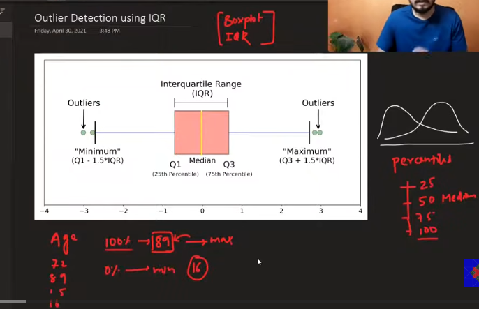

meaning of percentile 

differnet part in box plot

* IQR diff between 25 percentile and 75
* 

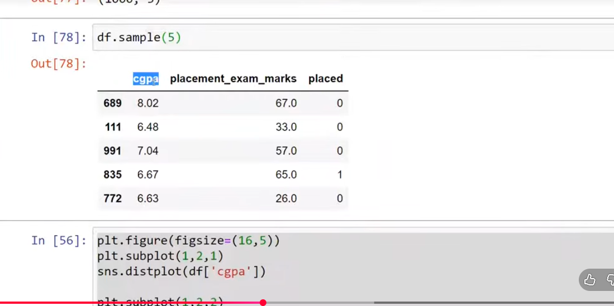

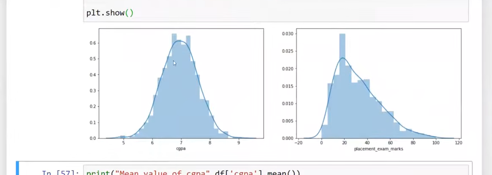

palcement_exam is skewed

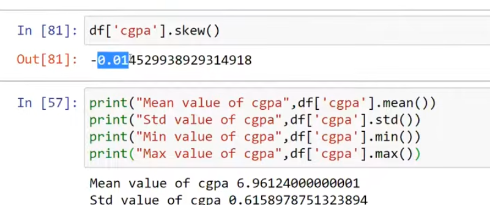

skew funciton clsoe to zero hence follwo nromal dist

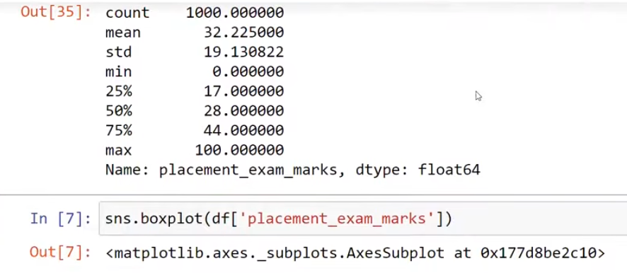

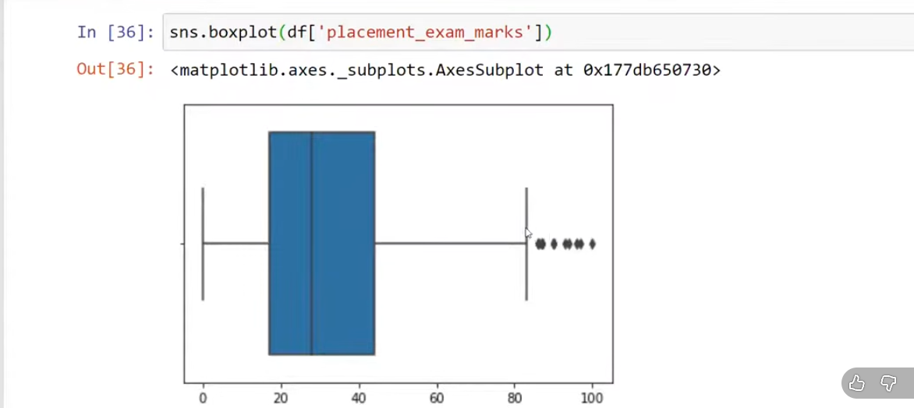

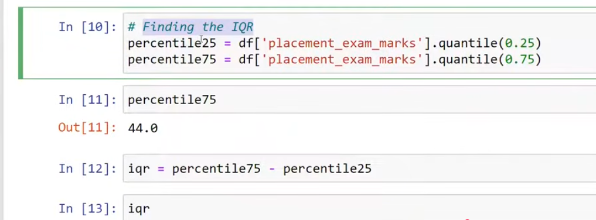

found IQR 

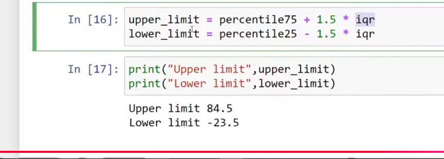

upper and lower limit

Finding Outliers 
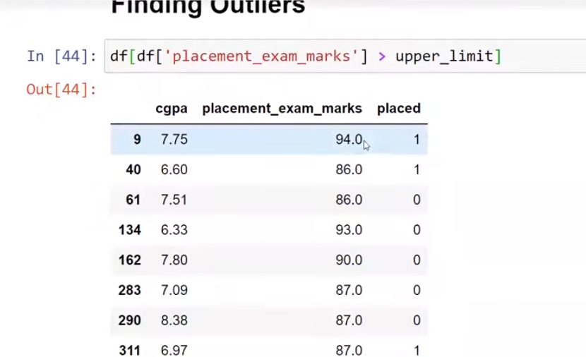


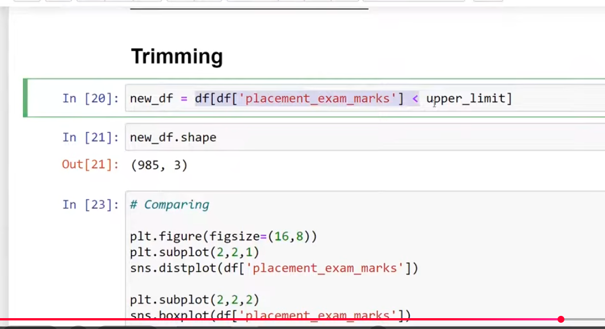

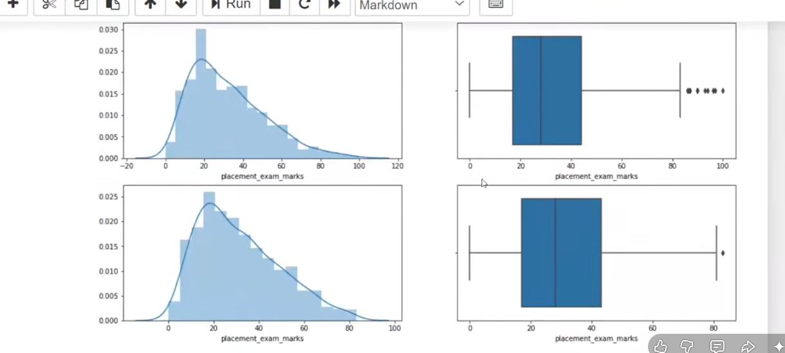

distribution didnt changed much

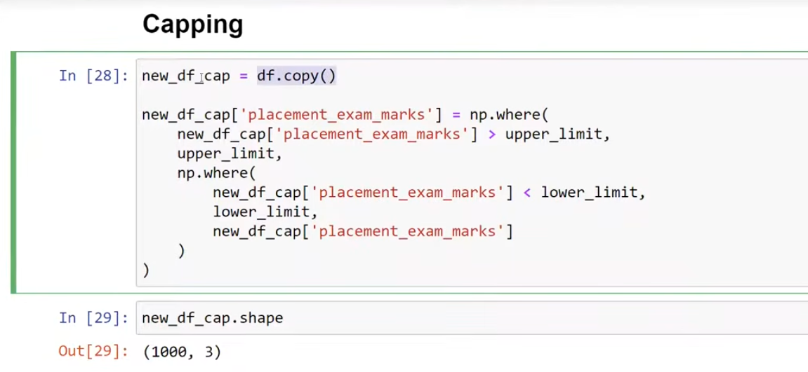

np.wher we send three term , cpoonditon , wjat to do when true, and what to do when false

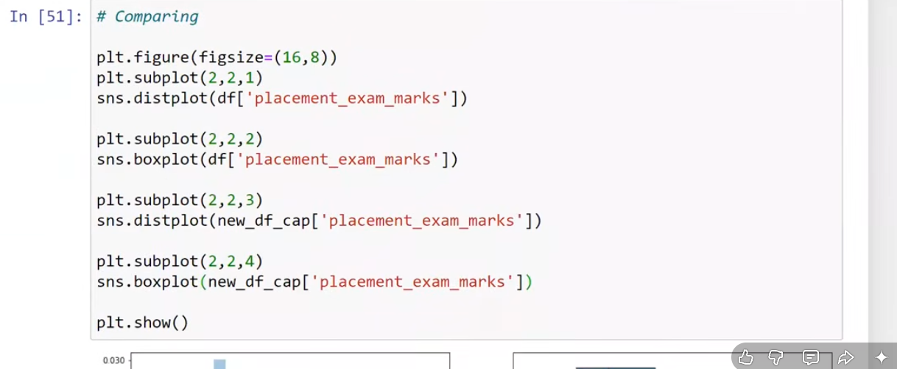

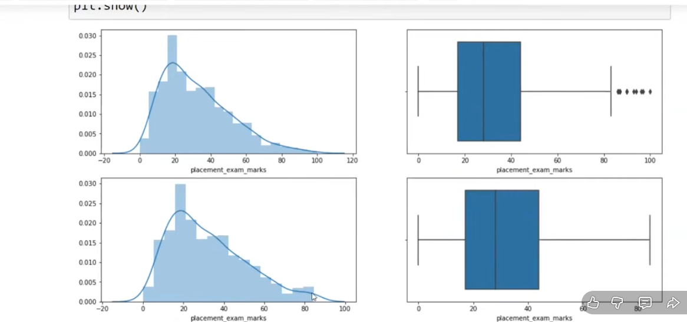

now all outlier remoced 

### <mark>CampusX PDF notes - L43 Outlier Detection and Removal Using the IQR Method (PDF pp. 1048-1076)</mark>

**<mark>1. Introduction</mark>**
The **IQR (Interquartile Range) method** is a robust statistical technique for detecting and handling outliers. Unlike methods that assume a normal distribution (Z-score), it works well with **skewed distributions**.

| Feature | Description |
|---|---|
| Type | statistical method |
| Best for | skewed (non-normal) distributions |
| Robustness | not affected by extreme values |
| Output | upper and lower bounds for outlier detection |
| Visualization | box plot (box-and-whisker plot) |

| Distribution type | Characteristic | Recommended method |
|---|---|---|
| Normal | bell-shaped, symmetric | Z-score / standard deviation |
| Skewed | asymmetric, long tail | **IQR method** |
| Heavy-tailed | extreme values present | IQR method |

Always visualize the distribution before choosing the method.

**<mark>2. Prerequisites</mark>**
* **Box plot** - shows the distribution through five statistics: minimum (smallest value excluding outliers), **Q1** (25th percentile), **median Q2** (50th), **Q3** (75th), maximum (largest value excluding outliers).
* **Percentiles** divide the data into 100 equal parts; a percentile is the value below which a given percentage of the observations falls.
* **IQR** = the range between Q1 and Q3.

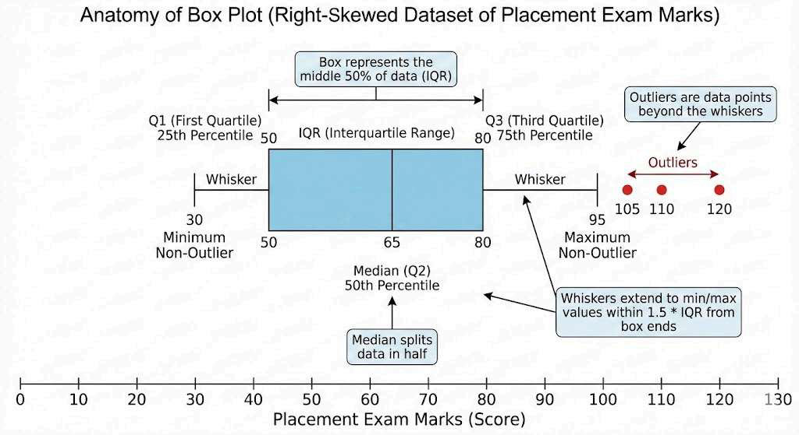

| Element | Position | Meaning |
|---|---|---|
| Lower whisker | `Q1 - 1.5 x IQR` | minimum boundary |
| Q1 | 25th percentile | 25% of the data below |
| Median | 50th percentile | middle of the data |
| Q3 | 75th percentile | 75% of the data below |
| Upper whisker | `Q3 + 1.5 x IQR` | maximum boundary |
| Outliers | beyond the whiskers | anomalous values |

The box = middle 50% of the data; the whiskers extend to the min/max values within 1.5 x IQR of the box ends; the median splits the data in half.

**Percentile example:** values `[0, 6, 7, 12, 18, 80]` -> P0 (minimum) = 0, **P25 (Q1) = 6**, **P50 (median) = 9.5** (average of 7 and 12), **P75 (Q3) = 18**, P100 (maximum) = 80. (With this small data set the quartile values depend on the interpolation method of `quantile`.)

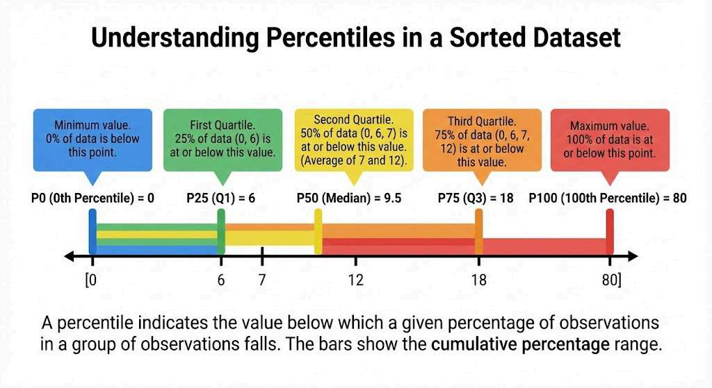

**<mark>3. IQR - definition and calculation</mark>**
`IQR = Q3 - Q1` = the spread of the middle 50% of the data.
Placement exam marks (1,000 students): `Q1 = df['placement_exam_marks'].quantile(0.25) = 17.0`, `Q3 = quantile(0.75) = 44.0`, **IQR = 44.0 - 17.0 = 27.0**.

| Characteristic | Meaning |
|---|---|
| large IQR | data spread out, high variability |
| small IQR | data concentrated, low variability |
| robust | not affected by extreme outliers |
| coverage | contains the middle 50% of the data |

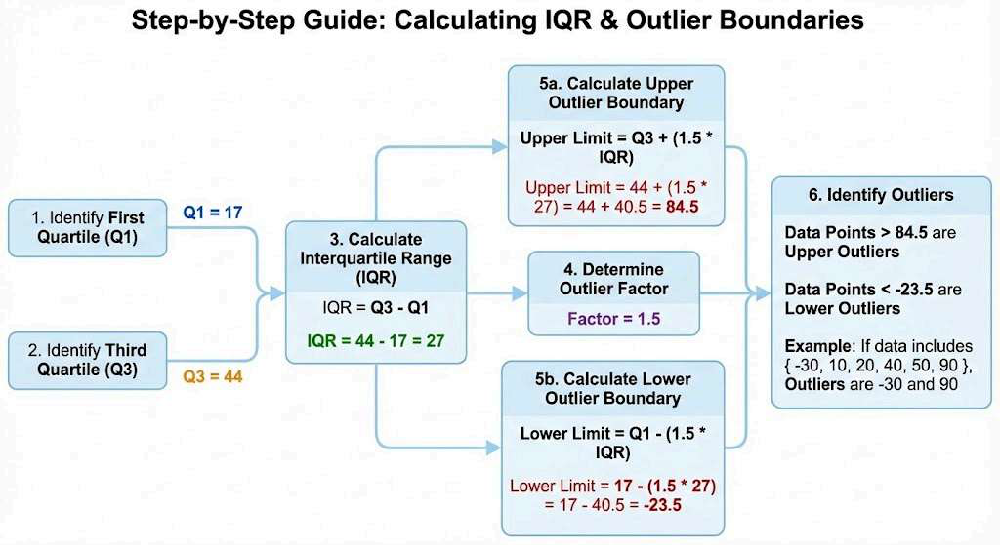

**<mark>4. The IQR proximity rule (1.5 x IQR rule)</mark>**
* Upper limit (upper fence) `= Q3 + 1.5 x IQR`: start at Q3 and add 1.5 times the IQR; anything above is an outlier.
* Lower limit (lower fence) `= Q1 - 1.5 x IQR`: start at Q1 and subtract 1.5 times the IQR; anything below is an outlier.
* The multiplier 1.5 is a convention that gives reasonable detection for most datasets (about 99.3% coverage for a normal distribution): 1.0 = aggressive (more outliers), **1.5 = standard**, 2.0 = conservative (fewer outliers), 3.0 = very conservative (only extreme outliers).

Maths: quartiles of the sorted data `Q1 = x_((n+1)/4)`, `Q2 = x_((n+1)/2)`, `Q3 = x_(3(n+1)/4)`; `Upper = Q3 + k IQR`, `Lower = Q1 - k IQR` with `k = 1.5`; `x_i` is an outlier if `x_i > Q3 + 1.5 IQR` OR `x_i < Q1 - 1.5 IQR`.

**Worked example (placement exam marks):** Q1 = 17, Q3 = 44, IQR = 27 -> `Upper = 44 + 1.5 x 27 = 44 + 40.5 =` **84.5**; `Lower = 17 - 40.5 =` **-23.5**. Anything > 84.5 or < -23.5 is an outlier. The minimum mark is 0, so there are no lower outliers; upper outliers exist. (Small example: data `{-30, 10, 20, 40, 50, 90}` -> outliers -30 and 90.)

**<mark>5. The detection workflow</mark>**

| Step | Action | Tool |
|---|---|---|
| 1 | load data | `pd.read_csv()` |
| 2 | explore | `df.head()`, `df.describe()` |
| 3 | visualize the distribution | `sns.distplot()`, `sns.boxplot()` |
| 4 | check skewness | visual inspection / skewness metric |
| 5 | calculate Q1 / Q3 / IQR | `df.quantile(0.25)`, `df.quantile(0.75)`, `Q3 - Q1` |
| 6 | calculate the limits | apply the formulas |
| 7 | detect outliers | boolean filtering |
| 8 | handle them | trimming or capping |
| 9 | validate | compare before/after visualizations |

**<mark>6. Practical implementation - placement data</mark>**
1,000 students; columns `cgpa`, `placement_exam_marks`, `placed`. `describe()` of `placement_exam_marks`: count 1000, mean **32.23**, std **19.13**, Q1 (25%) **17.0**, median **28.0**, Q3 (75%) **44.0**, max **100.0**.
* CGPA is nearly normal (bell-shaped); `placement_exam_marks` is **right-skewed** (the PDF reports a positive skewness, which confirms that the IQR method is appropriate for it).
* Box plot: outliers visible on the right side only.
```python
Q1 = df['placement_exam_marks'].quantile(0.25)     # 17.0
Q3 = df['placement_exam_marks'].quantile(0.75)     # 44.0
IQR = Q3 - Q1                                      # 27.0
upper_limit = Q3 + 1.5 * IQR                       # 84.5
lower_limit = Q1 - 1.5 * IQR                       # -23.5
upper_outliers = df[df['placement_exam_marks'] > upper_limit]    # 15 students with marks > 84.5
lower_outliers = df[df['placement_exam_marks'] < lower_limit]    # none
```

**<mark>7. Trimming vs capping</mark>**

| Aspect | Trimming | Capping |
|---|---|---|
| Definition | remove the outlier rows completely | replace outliers with the boundary values |
| Data size | reduced | remains the same |
| Information loss | high (entire rows lost) | low (values adjusted) |
| Use case | outliers are data errors | outliers are valid but extreme |
| Distribution change | moderate | significant at the boundaries |
| Implementation | filter / boolean indexing | `np.where()` or `np.clip()` |

Decision framework: outliers detected -> are they measurement errors? Yes -> trimming (remove); would removing change the sample size a lot? No (loss < 5%) -> trimming; yes (loss > 5%) -> capping (replace); unsure -> try both and compare.

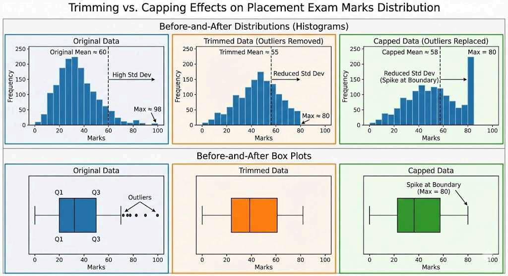

**Method 1 - Trimming:** `new_df_trimmed = df[df['placement_exam_marks'] <= upper_limit]` -> original shape (1000, 3) -> **(985, 3)**: 15 rows removed (1.5% data loss). Mathematically `{x in df | x <= 84.5}`. Observations: the right tail is removed, box plot shows no outliers, slightly higher density around the median.
**Method 2 - Capping:** `np.where(condition, value_if_true, value_if_false)` nested:
```python
new_df_capped = df.copy()
new_df_capped['placement_exam_marks'] = np.where(new_df_capped['placement_exam_marks'] > upper_limit, upper_limit,
                                          np.where(new_df_capped['placement_exam_marks'] < lower_limit, lower_limit,
                                                   new_df_capped['placement_exam_marks']))
```
Shape stays (1000, 3). Logic: `x > upper -> upper; x < lower -> lower; else keep` (`x_capped = 84.5 if x > 84.5, -23.5 if x < -23.5, x otherwise`). Observations: a **spike at 84.5** (all outliers moved to the boundary), box plot shows a single point at the upper limit, the distribution is more concentrated but all data points are retained.

| Metric | Original | Trimmed | Capped |
|---|---|---|---|
| Sample size | 1000 | 985 | 1000 |
| Rows lost | - | 15 (1.5%) | 0 |
| Mean | 32.23 | ~31.5 | ~32.0 |
| Std dev | 19.13 | ~18.5 | ~19.5 |
| Max | 100.0 | 84.5 | 84.5 |
| Outliers | 15 | 0 | 0 (moved to the boundary) |

(The trimmed/capped mean and std values are marked with "~" in the PDF - they are approximate; the histogram/box-plot infographic in the PDF uses an illustrative example with mean 60, trimmed mean 55, capped mean 58, max 80.)

| Scenario | Recommended | Reason |
|---|---|---|
| outliers are data-entry errors | trimming | invalid data should be removed |
| large dataset (> 10,000 rows) | trimming | loss of 1-5% is acceptable |
| small dataset (< 1,000 rows) | capping | preserve the sample size |
| outliers valid but extreme | capping | keep the information, reduce the impact |
| need the exact natural distribution | trimming | maintains the natural shape |
| ML with outlier-sensitive algorithms | capping | prevents extreme values affecting the model |

**<mark>8. Best practices (with code in the PDF)</mark>**
1. *Visualize first:* distribution plot, box plot, histogram (`hist(bins=50)`), Q-Q plot (`stats.probplot(df[col], dist="norm", plot=...)`).
2. *Document your decisions:* an `outlier_report` dict (column, Q1, Q3, IQR, limits, number of lower/upper outliers, % outliers, method used, reason).
3. *Compare approaches:* a DataFrame with the size, mean, std and max of the original, trimmed and capped data.
4. *Several columns:* `detect_and_handle_outliers_iqr(df, columns, method='trimming' | 'capping')` loops over the columns, computes Q1/Q3/IQR/limits per column and either filters (`>= lower` and `<= upper`) or caps with nested `np.where`.
5. *Validate:* statistical (describe before/after) and visual (side-by-side box plots).

**<mark>9. When the IQR method is not ideal</mark>**

| Scenario | Issue | Alternative |
|---|---|---|
| multivariate outliers | IQR is univariate | Mahalanobis distance |
| very small datasets (n < ~10) | unreliable quartile estimates | domain knowledge |
| multiple modes | may miss outliers in each mode | mixture models |
| time-series data | ignores temporal patterns | time-series-specific methods |
| categorical ordinal data | not designed for ordinal scales | frequency-based methods |

Combine with domain knowledge: `lower_limit = max(iqr_lower, domain_min)`, `upper_limit = min(iqr_upper, domain_max)` (e.g. marks must be between 0 and 100).

**10. Key takeaways:** (1) robust outlier detection for skewed distributions, not affected by extreme values; (2) use it when the data is not normal/skewed and you need a simple, interpretable method; (3) core formula: outlier if `x < Q1 - 1.5 IQR` or `x > Q3 + 1.5 IQR`; (4) two handling strategies: trimming (reduces sample size) and capping (preserves it); (5) best practices: visualize before and after, document, use domain knowledge, validate. Common mistakes: blindly removing outliers, ignoring the cause (could be a signal), not checking the distribution/assumptions.

| Component | Formula | Python |
|---|---|---|
| 25th percentile | Q1 | `df.quantile(0.25)` |
| 75th percentile | Q3 | `df.quantile(0.75)` |
| IQR | Q3 - Q1 | `Q3 - Q1` |
| Upper limit | Q3 + 1.5 IQR | `Q3 + 1.5 * IQR` |
| Lower limit | Q1 - 1.5 IQR | `Q1 - 1.5 * IQR` |
| Trimming | filter rows | `df[df[col] <= upper_limit]` |
| Capping | replace values | `np.where(condition, upper, lower)` |

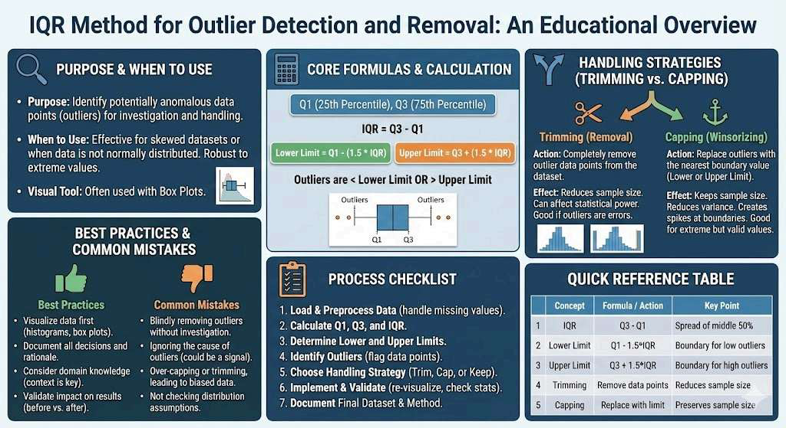

References: Tukey, J.W. (1977) *Exploratory Data Analysis*; Hoaglin, Mosteller & Tukey (1983) *Understanding Robust and Exploratory Data Analysis*.

### <mark>Official code - L43 Outlier removal using the IQR method (repo: `day43-outlier-removal-using-iqr-method/day43.ipynb`)</mark>

**<mark>Block 1 - imports and data</mark>**
```python
import numpy as np                  # np.where is used for capping later
import pandas as pd                 # DataFrame handling
import matplotlib.pyplot as plt     # plots
import seaborn as sns               # distplot / boxplot

df = pd.read_csv('placement.csv')   # student data: cgpa, placement_exam_marks, placed
df.head()                           # first 5 rows
```

**Block 2 - look at the distributions** (which column has outliers?)
```python
plt.figure(figsize=(16,5))
plt.subplot(1,2,1)                  # 1 row, 2 columns, first plot
sns.distplot(df['cgpa'])            # distplot = histogram + KDE (PDF). cgpa is roughly normal
plt.subplot(1,2,2)
sns.distplot(df['placement_exam_marks'])   # this one is right skewed -> the IQR method is the right tool
plt.show()

df['placement_exam_marks'].describe()      # count, mean, std, min, 25%, 50%, 75%, max
sns.boxplot(df['placement_exam_marks'])    # boxplot: the dots beyond the whiskers are the outliers
```

**<mark>Block 3 - calculate the IQR and the fences</mark>**
```python
# quantile(q): value below which a fraction q of the data lies
percentile25 = df['placement_exam_marks'].quantile(0.25)   # Q1
percentile75 = df['placement_exam_marks'].quantile(0.75)   # Q3
iqr = percentile75 - percentile25                          # IQR = Q3 - Q1 (spread of the middle 50%)

upper_limit = percentile75 + 1.5 * iqr                     # upper fence = Q3 + 1.5 * IQR
lower_limit = percentile25 - 1.5 * iqr                     # lower fence = Q1 - 1.5 * IQR
print("Upper limit", upper_limit)
print("Lower limit", lower_limit)
```

**<mark>Block 4 - find the outliers</mark>**
```python
df[df['placement_exam_marks'] > upper_limit]   # boolean mask: rows above the upper fence
df[df['placement_exam_marks'] < lower_limit]   # rows below the lower fence (none here)
```

**<mark>Block 5 - Trimming (remove the outlier rows)</mark>**
```python
new_df = df[df['placement_exam_marks'] < upper_limit]   # keep only the rows inside the fence
new_df.shape                                            # fewer rows than df

# compare before (top row) and after (bottom row): distplot + boxplot
plt.figure(figsize=(16,8))
plt.subplot(2,2,1); sns.distplot(df['placement_exam_marks'])
plt.subplot(2,2,2); sns.boxplot(df['placement_exam_marks'])
plt.subplot(2,2,3); sns.distplot(new_df['placement_exam_marks'])
plt.subplot(2,2,4); sns.boxplot(new_df['placement_exam_marks'])
plt.show()
```

**<mark>Block 6 - Capping (replace the outliers by the limits)</mark>**
```python
new_df_cap = df.copy()                                   # work on a copy so that df stays intact
# np.where(condition, value_if_true, value_if_false); nested to handle both tails
new_df_cap['placement_exam_marks'] = np.where(
    new_df_cap['placement_exam_marks'] > upper_limit,    # above the upper fence?
    upper_limit,                                         # -> replace by the upper limit
    np.where(
        new_df_cap['placement_exam_marks'] < lower_limit,  # below the lower fence?
        lower_limit,                                       # -> replace by the lower limit
        new_df_cap['placement_exam_marks']                 # otherwise keep the value
    )
)
new_df_cap.shape                                         # same number of rows as df (nothing deleted)
# the same 2x2 comparison plot as Block 5 is then drawn with new_df_cap
```
(The notebook also has a stray cell `np.where(condtion,true,false)`. It is only a reminder of the syntax and raises a NameError if run, so it is left out here.)
Trimming loses rows, capping keeps all the rows but changes the extreme values.

## L44 Outlier detection using percentile method

99 percentile mean , 99 percentile logg apse piche hai

minimum score is 10 then -> it is 0 percentile

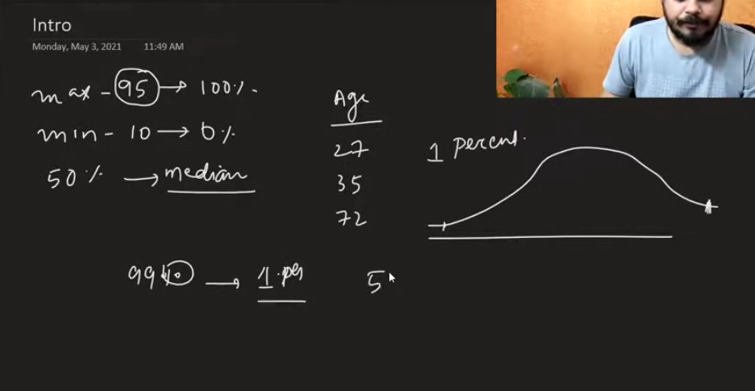

threshold for percentile is choosen by us

* once we detect outlier we can capped (it fill it with the just smaller value)
* or remove it 

* capping also called vinszation  

----------
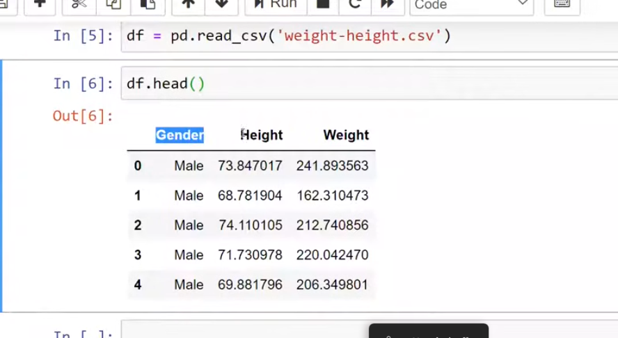

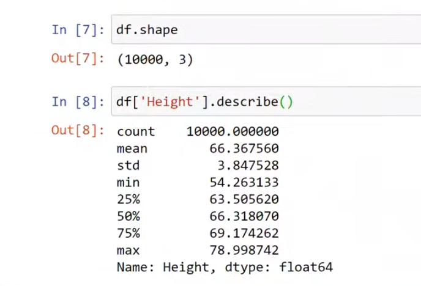

we can see all the percentile value 

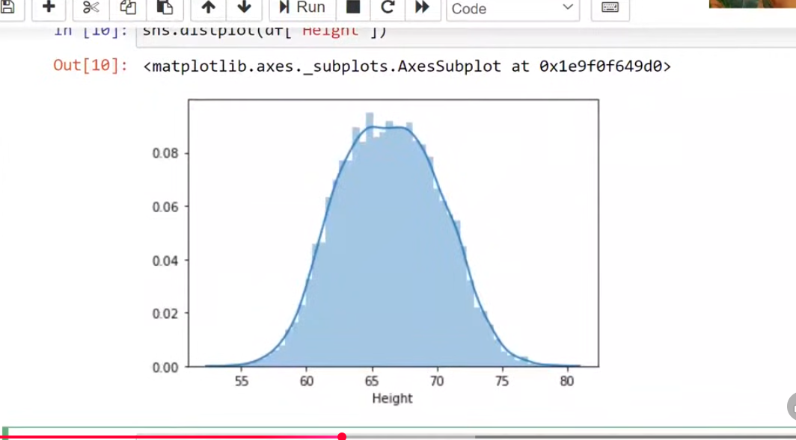

heigh column norma l dist 

if we plot box plot we can see the outliers 

* 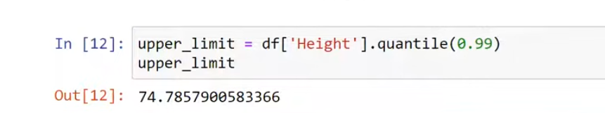
99% sai uppar everyone outliers 
* lower we got to choose 1 percentage onlyu
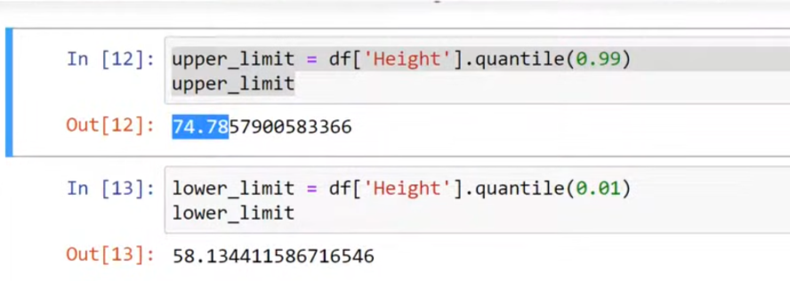 
* 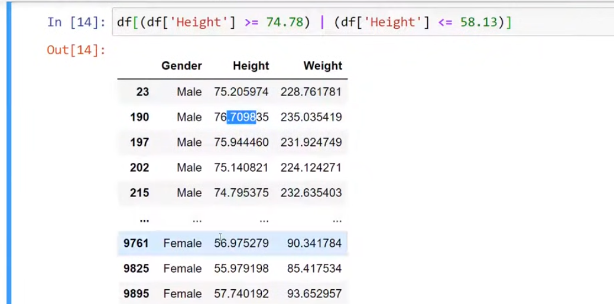
* around 201 rows doesn't fulfill our condition 
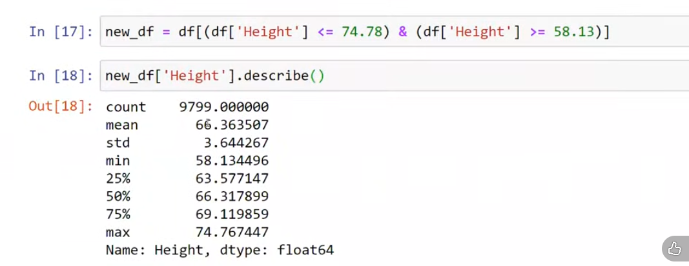
* 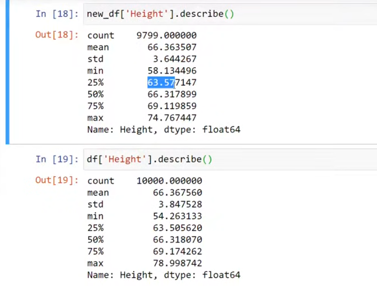

* just max valeu got reduced
* lets see the new box plot 
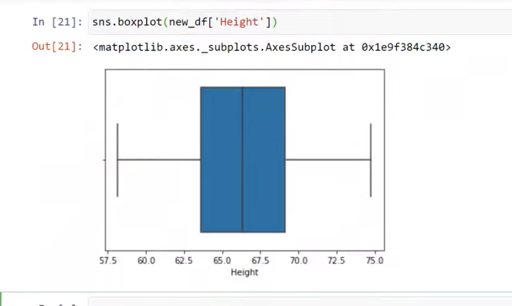

* no outliers left 

-----
* How to do capping | Winsorization 

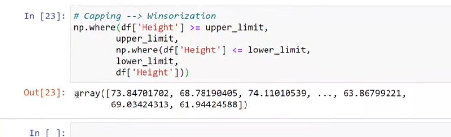

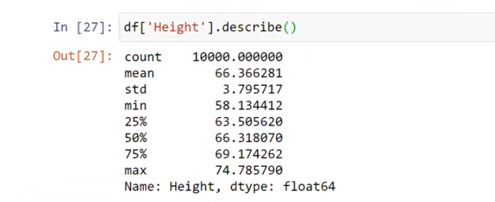

Upper limti + 1, upper limit - 1 sometime replace with this 


### <mark>CampusX PDF notes - L44 Outlier Detection and Removal Using Percentiles (Winsorization) (PDF pp. 1077-1108)</mark>

**<mark>1. Introduction</mark>**
Outlier detection with **percentiles** is a simple but powerful technique to identify and handle extreme values. It (1) needs **no assumption about the data distribution**, (2) is easy to understand and implement, (3) gives flexible control over the threshold, (4) is widely used in industry and research. Instead of the mean and standard deviation it uses **percentile thresholds** to define what an outlier is. This video introduces **Winsorization**.

**<mark>2. Percentiles</mark>**
A percentile is the value below which a given percentage of the observations falls (`Percentile_p = the value such that p% of the data is below it`).

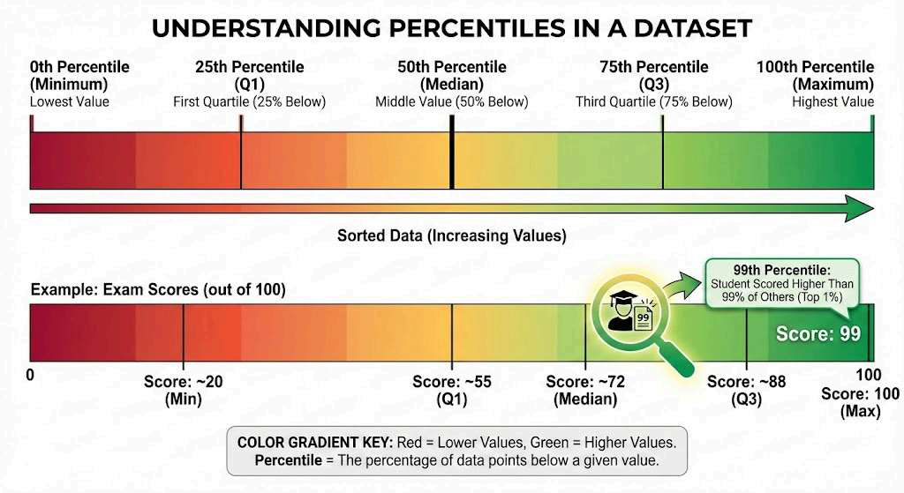

| Percentile | Symbol | Meaning |
|---|---|---|
| 0th | minimum | 0% of the data is below this |
| 1st | P1 | 1% below, 99% above |
| 25th | Q1 | 25% below |
| 50th | Q2 / median | 50% below, 50% above |
| 75th | Q3 | 75% below |
| 99th | P99 | 99% below, 1% above |
| 100th | maximum | 100% below |

Exam example: if your percentile is 99, then 99% of the students scored below you and only 1% above (top 1%); at the 50th percentile you are at the median position. (Example scores: min 20 at Q1... min ~20, Q1 ~55, median ~72, Q3 ~88, max 100 in the PDF's illustration.)

**<mark>3. Percentile-based outlier detection</mark>**
Set two threshold boundaries at percentile values; any point beyond them is an outlier. You choose a lower and an upper threshold.

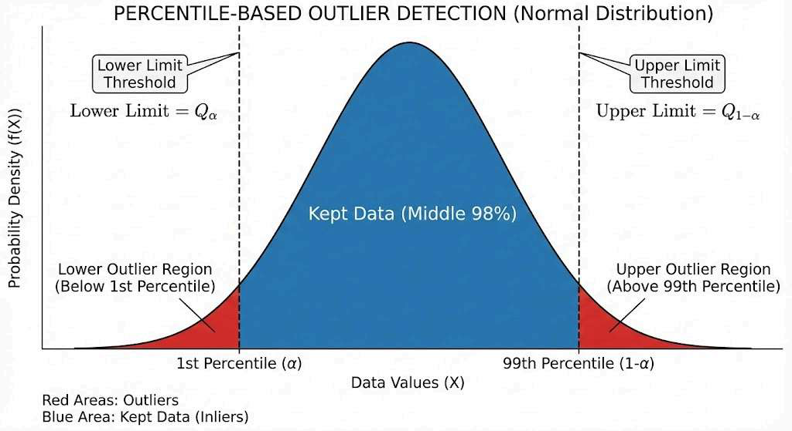

| Configuration | Lower | Upper | Data kept | Flagged as outliers |
|---|---|---|---|---|
| Conservative | 1st percentile | 99th percentile | middle 98% | extreme 2% (1% each side) |
| Moderate | 5th | 95th | middle 90% | extreme 10% (5% each side) |
| Aggressive | 10th | 90th | middle 80% | extreme 20% (10% each side) |

Maths: for `X = x1..xn`: `Lower limit = Q_alpha` (the alpha percentile), `Upper limit = Q_(1-alpha)`; `x_i` is an outlier if `x_i < Q_alpha` OR `x_i > Q_(1-alpha)`; `Is_Outlier(x_i) = 1` if so, else 0. Expected outlier rate for symmetric thresholds = `2 x alpha` (1st/99th -> about 2%, 5th/95th -> about 10%).

**<mark>4. Trimming vs capping (winsorization)</mark>**

| Aspect | Trimming | Capping (Winsorization) |
|---|---|---|
| Action | remove the outlier points | replace outliers with the threshold values |
| Dataset size | reduced (data loss) | maintained (no data loss) |
| Also known as | removal method | **Winsorization** (named after the biostatistician Charles P. Winsor) |
| When to use | outliers are data errors | outliers are real but extreme |
| Impact on distribution | more significant change in shape | moderate change |
| Preserves information | no | partially (capped at the boundary) |

* Trimming: `X_trimmed = {x_i in X | Q_alpha <= x_i <= Q_(1-alpha)}`. Example: 10,000 points, 1st/99th percentile, `Q0.01 = 58.13`, `Q0.99 = 74.78` -> **9,799** points remain, 201 removed (about 2%).
* Capping: `x_capped = Q_alpha if x < Q_alpha; Q_(1-alpha) if x > Q_(1-alpha); x otherwise`, equivalently `max(Q_alpha, min(x, Q_(1-alpha)))`. Example: heights 54.26 to 78.99; values < 58.13 -> 58.13, > 74.78 -> 74.78; about 100 points capped at each end, about 9,800 unchanged; size stays 10,000.

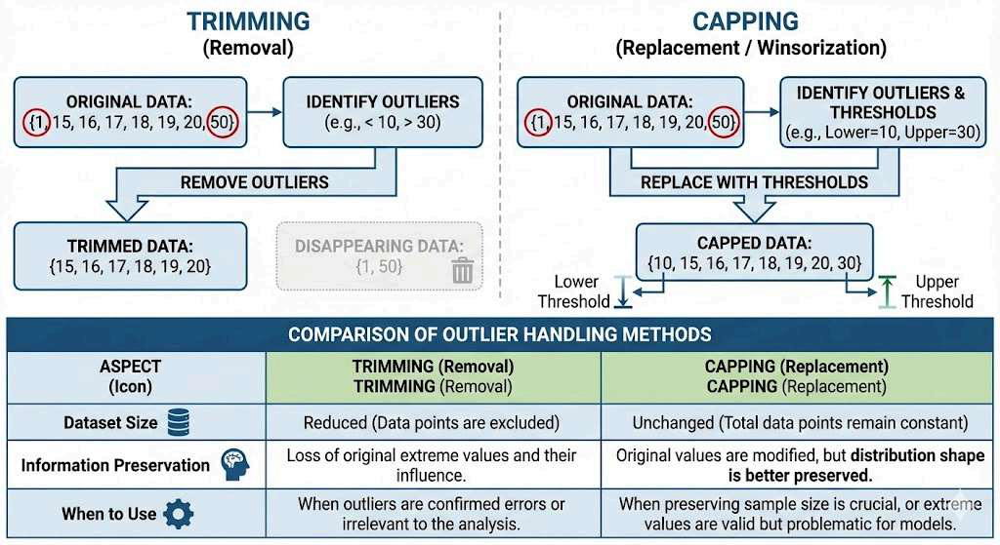

Toy example: data `{1, 15, 16, 17, 18, 19, 20, 50}` with thresholds 10 and 30 -> trimming gives `{15, 16, 17, 18, 19, 20}`; capping gives `{10, 15, 16, 17, 18, 19, 20, 30}`.
*Use trimming when:* data errors, clearly impossible values, enough data, you only want the "typical" distribution. *Use capping when:* real but extreme, limited data, sample size matters for statistical power, regression/modelling (keep all observations but limit influence).

**<mark>5. Mathematical foundation</mark>**
* **Percentile by linear interpolation:** `Position = p x (n - 1)/100 + 1`; if the position is an integer k the percentile is `x_k`, otherwise `x_k + (x_(k+1) - x_k) x fraction`. Example: 99th percentile of 10,000 sorted points: position `= 99 x 9999/100 + 1 = 9900.01` -> `x_9900 + 0.01 (x_9901 - x_9900)`.
* *Impact on the mean:* `delta_mu = mu_trimmed - mu_original` - small if the outliers are symmetric.
* *Impact on the standard deviation:* it always decreases after removing extreme values; `Reduction = (sigma_orig - sigma_new) / sigma_orig x 100%`.
* *Outlier rate* `= (number of outliers / total points) x 100`.

**<mark>6. Implementation (weight-height dataset)</mark>**
```python
df = pd.read_csv('weight-height.csv')              # Kaggle, 10,000 rows: Gender, Height (inches), Weight (pounds)
alpha = 0.01                                       # 1st and 99th percentile
lower_limit = df['Height'].quantile(alpha)         # 58.13
upper_limit = df['Height'].quantile(1 - alpha)     # 74.78 / 74.79
new_df = df[(df['Height'] >= lower_limit) & (df['Height'] <= upper_limit)]     # trimming
df['Height'] = np.where(df['Height'] >= upper_limit, upper_limit, np.where(df['Height'] <= lower_limit, lower_limit, df['Height']))   # capping
df['Height_capped'] = df['Height'].clip(lower=lower_limit, upper=upper_limit)   # cleaner: pandas clip = max(lower, min(Height, upper))
```
Original height statistics: count 10,000, mean **66.37**, std **3.85**, min **54.26**, Q1 63.51, median 66.32, Q3 69.17, max **79.00**. The distribution is approximately normal with some outliers on both sides.

| Statistic | Original | After trimming | Change | After capping | Change |
|---|---|---|---|---|---|
| Count | 10,000 | **9,799** | -201 | 10,000 | 0 |
| Mean | 66.37 | 66.36 | -0.01 | 66.37 | ~0 |
| Std dev | 3.85 | **3.64** | -0.21 (-5.45%) | **3.80** | -0.05 (-1.30%) |
| Min | 54.26 | 58.13 | +3.87 | 58.13 | +3.87 |
| Q1 | 63.51 | 63.58 | +0.07 | 63.51 | 0 |
| Median | 66.32 | 66.32 | 0 | 66.32 | 0 |
| Q3 | 69.17 | 69.12 | -0.05 | 69.17 | 0 |
| Max | 79.00 | 74.77 | -4.23 | 74.79 | -4.21 |

Observations: trimming loses 201 points (2.01%), mean changes minimally, std drops 5.45%, the median is unchanged (robust), the range shrinks from 24.74 to 16.64 inches. Capping: no data loss, mean virtually unchanged, std only -1.3%, quartiles unchanged (the middle 50% is unaffected).
Visually: before = box plot with outlier dots, normal with fat tails; after trimming = clean box plot, more concentrated and steeper peak, tails abruptly cut; after capping = clean box plot, slight accumulation at the boundary values.
Shape: trimming `N(66.37, 3.85) -> N(66.36, 3.64)` (more peaked, higher kurtosis, cleaner tails); capping `-> N(66.37, 3.80)` (slight accumulation at the boundaries, discrete jump at the caps).

| Metric | Original | Trimming | Capping | Best |
|---|---|---|---|---|
| Sample size | 10,000 | 9,799 | 10,000 | capping |
| Data retention | - | 97.99% | 100% | capping |
| Std dev reduction | - | 5.45% | 1.30% | (trimming removes more spread) |
| Information loss | - | moderate | none | capping |

(The PDF also prints Shapiro-Wilk results - original W = 0.9987, p = 0.023; trimmed p = 0.089; capped p = 0.056 - and an F-test ratio 1.12 / 1.03; they are shown as illustration only.)

| Scenario | Recommended | Reason |
|---|---|---|
| large dataset (n > 10,000) | trimming | data loss is a minimal percentage |
| small dataset (n < 1,000) | capping | preserve every data point |
| outliers are errors | trimming | remove bad data completely |
| outliers are real | capping | preserve information, limit influence |
| regression models | capping | keep the sample size for power |
| descriptive stats of typical values | trimming | pure distribution of typical values |
| time series | capping | preserve temporal continuity |

**<mark>7. Best practices</mark>**
* *Choosing the threshold:* n < 500 -> 5th/95th (conservative, keep more data); 500 <= n < 5,000 -> 2.5th/97.5th; n >= 5,000 -> 1st/99th; n >= 50,000 -> 0.5th/99.5th. Domains: healthcare 1-2.5% (conservative), finance/trading 0.5-1% (aggressive, to capture true extremes), manufacturing 2-5% (by tolerances), image processing 1-2%; social sciences preserve population diversity.
* *Always visualize first:* histogram with KDE, box plot, Q-Q plot, and the percentile lines on the histogram.
* *Document decisions:* a report dict (method, approach, thresholds, limits, original vs treated `describe()`, data loss %, number of outliers) saved as JSON.
* *Reusable functions:* `detect_outliers_percentile(data, lower_pct=0.01, upper_pct=0.99)` returns limits, mask, indices and count; `trim_outliers(...)` returns `data[(data >= lower) & (data <= upper)]`; `cap_outliers(...)` returns `np.clip(data, lower, upper)`. Compare several thresholds `[0.005, 0.01, 0.025, 0.05]` (data retained/lost, mean, std, range).
* **Pitfalls:** (1) the same threshold for all variables - analyze each variable separately (e.g. 0.01 for age, 0.005 for income); (2) not considering the data type - only apply to *continuous* numeric columns (not encoded categories); (3) forgetting to check the results - compare min/max and box plots before/after; (4) **applying on test data** - compute the percentiles on the TRAIN data only and apply the same limits to both: `X_train.quantile(0.01)`, `X_train.quantile(0.99)`, then `X_train.clip(lower, upper)` and `X_test.clip(lower, upper)`.

**<mark>8. Advantages and limitations</mark>**
*Advantages:* (1) **distribution-free** (unlike the z-score, which requires normality) - works for skewed, multimodal and heavy-tailed data; (2) intuitive and explainable ("we cap at the 99th percentile value"); (3) flexible sensitivity: 0.5-99.5 = only very extreme (initial exploration), 1-99 = standard, 2.5-97.5 = conservative, 5-95 = more inclusive (small datasets); (4) symmetric or asymmetric treatment (e.g. `Q0.01` and `Q0.95` for right-skewed data); (5) handles skewness naturally because it uses quantiles, not moments; (6) robust to extreme values: for `[1, 2, ..., 9, 1000]` the 90th percentile is 9 (unaffected) while mean = 104.5 and std = 296.9 are heavily affected.
*Limitations:* (1) arbitrary threshold - no universal rule (1%-99% flags ~200 per 10,000, 5%-95% ~1,000); (2) data loss when trimming (200 points of 10,000 -> wider confidence intervals); (3) assumes outliers are in the tails - misses outliers in the middle (e.g. a point in the gap of a bimodal distribution); (4) unstable for small datasets (n = 50: the 1st percentile is half a data point; use n > 1000); (5) sensitive to ties/discrete data (a 1-5 rating: P99 = P95 = P90 = 5); (6) ignores context (60 F in January vs July in New York); (7) multiple testing: with 20 variables at 5% each, `P(at least one false positive) = 1 - 0.95^20 = 0.64`.

| Method | Advantages | Limitations | Best for |
|---|---|---|---|
| Percentile | distribution-free, intuitive, flexible | arbitrary threshold, data loss | general purpose, any distribution |
| Z-score | statistical theory, precise | assumes normality, sensitive to outliers | normal distributions |
| IQR | robust, box-plot standard | fixed multiplier (1.5), less flexible | exploratory analysis |
| Isolation Forest | finds complex outliers, no distribution assumption | black box, computational cost | high-dimensional data |
| Density-based (LOF/DBSCAN) | detects local outliers | cost, parameter tuning | clustered data |

*Use the percentile method when:* the distribution is unknown/non-normal, you need a simple explainable method, large dataset (n > 1000), skewed data (income, web traffic), preprocessing for ML models. *Avoid when:* small dataset (n < 100), outliers are informative (fraud / anomaly detection - outliers are the target!), multivariate outliers (use Mahalanobis distance), time series with trends/seasonality, categorical or ordinal data.

**Glossary (PDF):** *percentile* - a value below which a given percentage of observations falls; *quantile* - the more general term (percentiles are quantiles expressed as percentages); *trimming* - removing outlier points; *capping/winsorization* - replacing outliers by the boundary values; *threshold* - the percentile used for the boundaries; *distribution-free* - works regardless of the underlying distribution; *robust statistic* - not heavily influenced by outliers (median, percentiles); *IQR* = Q3 - Q1.

### <mark>Official code - L44 Outlier detection using percentiles / winsorization (repo: `day44-outlier-detection-using-percentiles/day44.ipynb`)</mark>

**<mark>Block 1 - load the data</mark>**
```python
import numpy as np
import pandas as pd
import seaborn as sns

df = pd.read_csv('weight-height.csv')   # Gender, Height (inches), Weight (pounds)
df.shape                                # (10000, 3)
df['Height'].describe()                 # count, mean, std, min, quartiles, max
```

**<mark>Block 2 - visualise</mark>**
```python
sns.distplot(df['Height'])   # roughly normal, a few points on both tails
sns.boxplot(df['Height'])    # the dots outside the whiskers
```

**<mark>Block 3 - percentile limits</mark>**
```python
upper_limit = df['Height'].quantile(0.99)   # 99th percentile: only 1% of the people are taller
lower_limit = df['Height'].quantile(0.01)   # 1st percentile: only 1% of the people are shorter
```

**<mark>Block 4 - Trimming</mark>**
```python
# keep only the rows between the two percentile values (the notebook typed the numbers 74.78 and 58.13 = the two limits)
new_df = df[(df['Height'] <= 74.78) & (df['Height'] >= 58.13)]
new_df['Height'].describe()                                  # compare with df['Height'].describe(): min / max are now cut
sns.distplot(new_df['Height']); sns.boxplot(new_df['Height'])   # the outlier dots disappear
```

**<mark>Block 5 - Capping (Winsorization)</mark>**
```python
# values above the 99th percentile -> upper_limit; below the 1st percentile -> lower_limit
df['Height'] = np.where(df['Height'] >= upper_limit,
        upper_limit,
        np.where(df['Height'] <= lower_limit,
        lower_limit,
        df['Height']))
df.shape                      # rows are not removed
df['Height'].describe()       # min and max now equal the limits
sns.distplot(df['Height']); sns.boxplot(df['Height'])
```

## L 45 Feature Construciton 

given feature sai new feature create karoge

is throroughly manual process, based on intutuion and domian knowledge


2 -> large family | more than 4 people in family 

* tidy data --> data is mostly not tidy 

* Nmae : Mr Ankit -> we will create two columb --> this feature splitting does helps

---
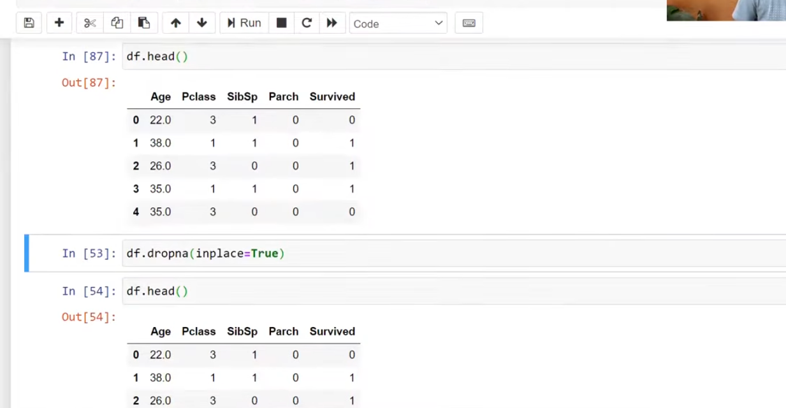

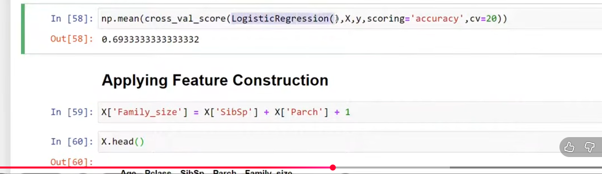

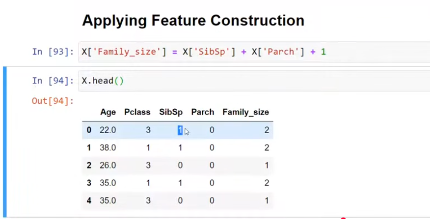

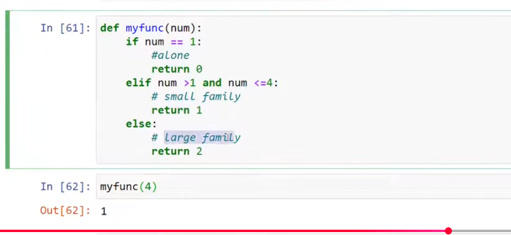

checkign our fucntion works on or not

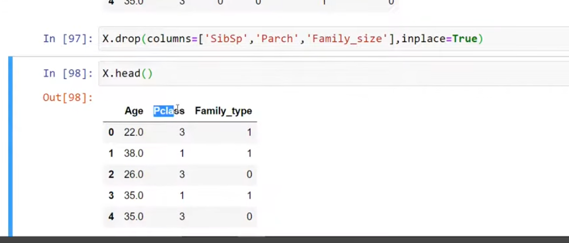

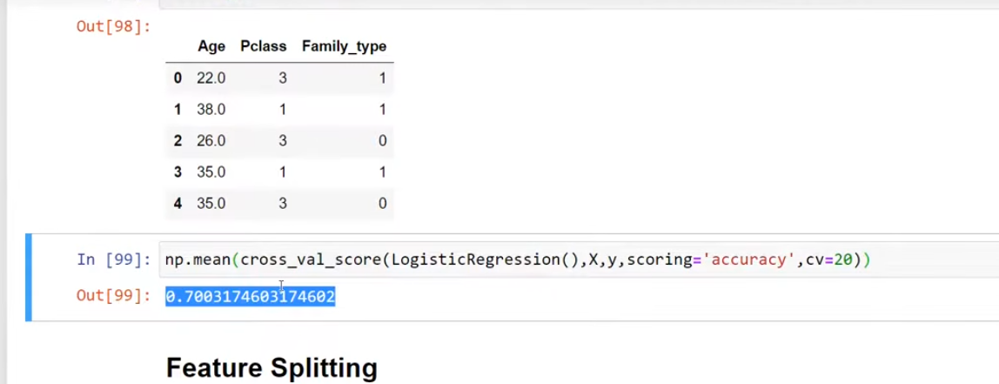

see accuracy improved

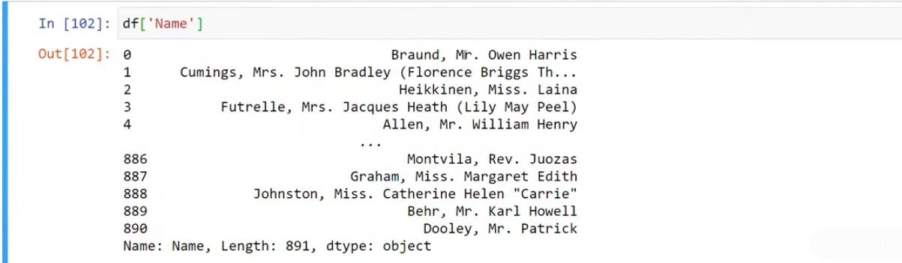

woill split name column 

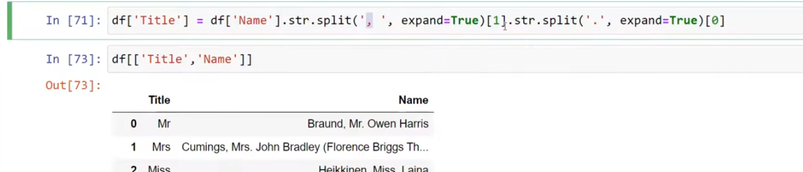

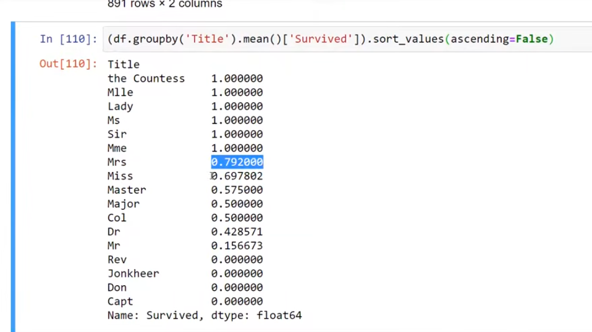

Mrs were high, Major were high 

------------

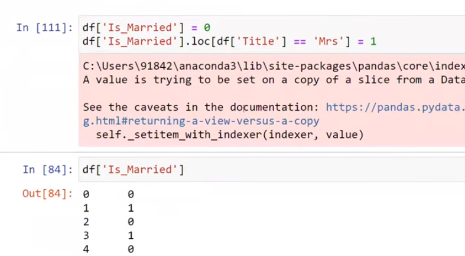
this is how we cna create new column 

### <mark>CampusX PDF notes - L45 Feature Construction and Feature Splitting (PDF pp. 1109-1121)</mark>

**<mark>1. Introduction</mark>**
Feature construction and feature splitting are **manual** feature-engineering techniques that rely on domain knowledge, intuition and experience rather than mathematical formulas. They can significantly improve model performance by creating meaningful representations of the data.

| Aspect | Description |
|---|---|
| Manual process | needs human intuition and decision-making |
| Domain-dependent | success depends on understanding the problem domain |
| Experience-based | becomes easier with practice and exposure to different datasets |
| No fixed formula | unlike transformations, there is no mathematical formula to follow |

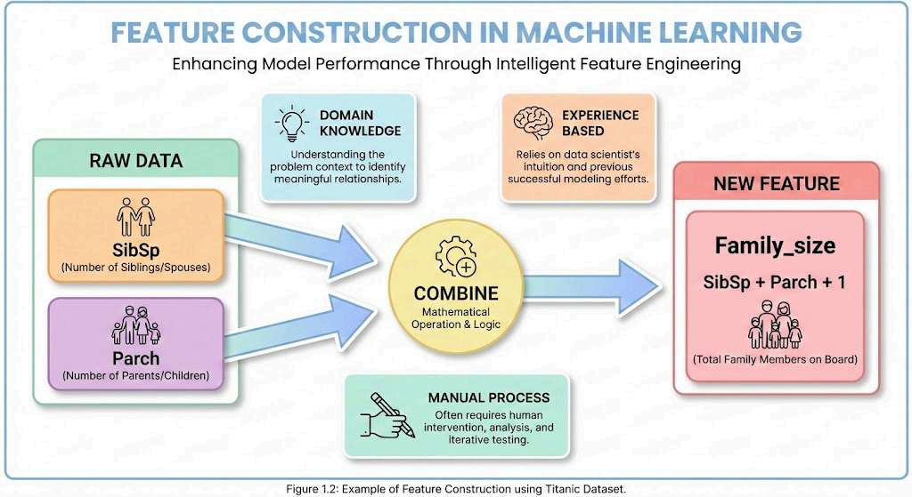

**<mark>2. Feature construction</mark>**
*Definition:* manually creating new features from existing features by combining, transforming or deriving them, based on domain knowledge and intuition.
General formula: `f_new = g(f1, f2, ..., fn)` where `g` is any function suggested by domain knowledge - arithmetic (`f1 + f2`, `f1 / f2`, `f1 x f2`) or conditional (`c1 if condition1, c2 if condition2, else c3`).

**Example - Titanic: Family size**

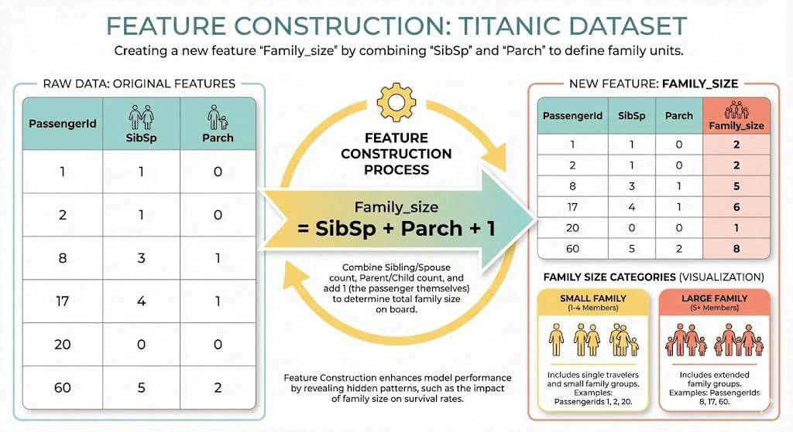

Goal: a meaningful family-related feature; intuition: survival may depend on whether the passenger travelled alone or with family.
* **Step 1 - `Family_size = SibSp + Parch + 1`** (SibSp = siblings/spouses aboard, Parch = parents/children aboard, +1 = the passenger himself/herself). Example rows: SibSp 1, Parch 0 -> `1 + 0 + 1 = 2`; SibSp 0, Parch 0 -> `0 + 0 + 1 = 1`. Code: `X['Family_size'] = X['SibSp'] + X['Parch'] + 1`.
* **Step 2 - `Family_type`** (categories instead of raw numbers):

| Family_size | Family_type code | Interpretation |
|---|---|---|
| 1 | 0 | alone (solo traveler) |
| 2 - 4 | 1 | small family |
| > 4 | 2 | large family |

```python
def myfunc(num):
    if num == 1:   return 0        # alone
    elif num > 1 and num <= 4: return 1    # small family
    else:          return 2        # large family
X['Family_type'] = X['Family_size'].apply(myfunc)
```
* **Step 3 - clean up** the redundant features: `X.drop(columns=['SibSp', 'Parch', 'Family_size'], inplace=True)`. Final features: `Age`, `Pclass`, `Family_type` (newly constructed).

**Impact on model performance** (`LogisticRegression`, 20-fold CV accuracy):

| Model configuration | Features | Accuracy | Improvement |
|---|---|---|---|
| before feature construction | Age, Pclass, SibSp, Parch | 69.33% (0.6933) | - |
| after feature construction | Age, Pclass, Family_type | 70.03% (0.7003) | **+0.70** points |

`Improvement = (0.7003 - 0.6933) / 0.6933 x 100 = about 1.0%` relative. Code: `np.mean(cross_val_score(LogisticRegression(), X, y, scoring='accuracy', cv=20))`.

**<mark>3. Feature splitting</mark>**
*Definition:* breaking a single column that contains multiple pieces of information into separate, **atomic** columns. It addresses non-tidy data where several values are stored in one cell (tidy data principle: each cell holds one value, each variable has its own column).

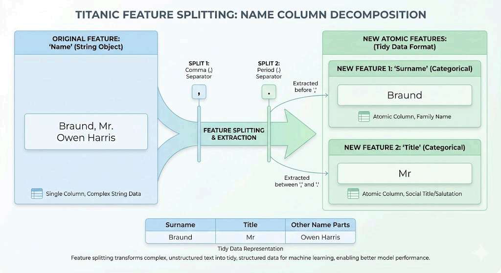

**Example - Titanic `Name`:** format `Surname, Title. FirstName MiddleName`, e.g. `"Braund, Mr. Owen Harris"`, `"Cumings, Mrs. John Bradley (Florence Briggs Thayer)"`, `"Heikkinen, Miss. Laina"`.
1. Split by comma: `df['Name'].str.split(', ', expand=True)` -> column 0 = surname (Braund), column 1 = "Mr. Owen Harris".
2. Take part 1 and split by period: `df['Name'].str.split(', ', expand=True)[1].str.split('.', expand=True)` -> column 0 = title (Mr / Mrs / Miss), column 1 = first name(s).
3. Title only: `df['Title'] = df['Name'].str.split(', ', expand=True)[1].str.split('.', expand=True)[0]`.

**Survival rate by title** - `(df.groupby('Title').mean()['Survived']).sort_values(ascending=False)`:

| Title | Survival rate | Interpretation |
|---|---|---|
| the Countess, Mlle, Lady, Mme, Sir, Ms | 100% | nobility / French titles / knighthood (very rare, small counts) |
| Mrs | 79.2% | married women - high survival |
| Miss | 69.8% | unmarried women - high survival |
| Master | 57.5% | young boys |
| Major | 50.0% | military |
| Col | 50.0% | military |
| Dr | 42.9% | doctors |
| Mr | 15.7% | men - low survival |
| Rev | 0.0% | reverends - lowest survival |
| Jonkheer, Don, Capt | 0.0% | Dutch / Spanish nobility, ship captain |

**Derived feature:** `Is_Married`: because Mrs has a high survival rate -> `df['Is_Married'] = 0; df['Is_Married'].loc[df['Title'] == 'Mrs'] = 1` (`1 if Title = 'Mrs' else 0`) - a subset with a high survival rate.

**<mark>4. Construction vs splitting</mark>**

| Aspect | Feature construction | Feature splitting |
|---|---|---|
| Purpose | create new features from existing ones | break complex features into atomic parts |
| Approach | combination and derivation | parsing and extraction |
| Example | Family_type from SibSp + Parch | Title from Name |
| Dependency | domain knowledge | understanding of the data structure |
| Impact | creates additional information | reveals hidden information |

**When to apply:** *construction* - you understand the relationships between features, simple combinations might be meaningful, domain knowledge suggests interactions, you need to reduce dimensionality. *Splitting* - one column holds several pieces of information, the data is not tidy, you need to extract categorical information, hierarchical information exists in strings.

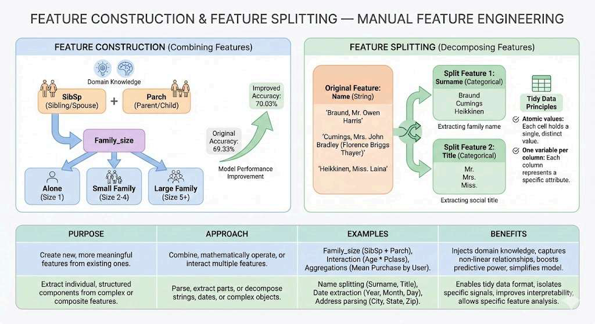

**5. Do's and don'ts:** Do: test the impact on model performance, document the feature-creation logic, start with simple combinations, keep track of which features work, ask domain experts when stuck, remove the redundant original features. Don't: create features without testing, guess without domain knowledge, over-complicate at first, forget to validate assumptions, rely solely on automated methods, keep all original features blindly.

**<mark>6. Practice ideas (PDF)</mark>**

| Dataset | Feature construction ideas | Feature splitting ideas |
|---|---|---|
| IPL cricket | strike rate, economy rate | player roles from names |
| Housing | price per sq ft, room ratio | address components |
| E-commerce | average order value | product categories from names |
| Healthcare | BMI, age groups | diagnosis codes |
| Finance | debt-to-income ratio | transaction descriptions |

Other construction examples from the figure: interaction `Age x Pclass`, aggregations (mean purchase per user); splitting: dates (year/month/day), addresses (city/state).
**Conclusion:** think creatively about feature relationships, always validate with model performance, learn through practice, consult domain experts, iterate.

### <mark>Official code - L45 Feature construction and feature splitting (repo: `day45-feature-construction-and-feature-splitting/day45.ipynb`)</mark>

**<mark>Block 1 - load and baseline</mark>**
```python
import numpy as np
import pandas as pd
from sklearn.model_selection import cross_val_score
from sklearn.linear_model import LogisticRegression

df = pd.read_csv('train.csv')[['Age','Pclass','SibSp','Parch','Survived']]   # Titanic, only 5 columns
df.dropna(inplace=True)                  # drop the rows with a missing Age (714 rows are left)
X = df.iloc[:, 0:4]                      # Age, Pclass, SibSp, Parch
y = df.iloc[:, -1]                       # Survived
# 20-fold cross validation accuracy with the original columns = the baseline score
np.mean(cross_val_score(LogisticRegression(), X, y, scoring='accuracy', cv=20))
```

**<mark>Block 2 - Feature construction: Family_size</mark>**
```python
X['Family_size'] = X['SibSp'] + X['Parch'] + 1   # siblings/spouse + parents/children + the passenger himself/herself
```

**<mark>Block 3 - Feature construction: Family_type (a categorical feature built from Family_size)</mark>**
```python
def myfunc(num):
    if num == 1:
        return 0            # alone
    elif num > 1 and num <= 4:
        return 1            # small family
    else:
        return 2            # large family

X['Family_type'] = X['Family_size'].apply(myfunc)    # apply runs the function on every value of the column
X.drop(columns=['SibSp','Parch','Family_size'], inplace=True)   # the 3 original columns are replaced by the one new feature
# same cross validation on the new feature set: is the score better than the baseline?
np.mean(cross_val_score(LogisticRegression(), X, y, scoring='accuracy', cv=20))
```

**<mark>Block 4 - Feature splitting: Title from Name ("Braund, Mr. Owen Harris" -> "Mr")</mark>**
```python
df = pd.read_csv('train.csv')                       # reload the full data
# split on ', ' -> take part [1] -> split on '.' -> take part [0]  =>  the title
df['Title'] = df['Name'].str.split(', ', expand=True)[1].str.split('.', expand=True)[0]
df[['Title','Name']]                                # check the result
# survival rate of every title, highest first (Mrs / Miss / Master survive more than Mr)
(df.groupby('Title').mean()['Survived']).sort_values(ascending=False)
```
(Newer pandas: use `df.groupby('Title')['Survived'].mean()`, because `.mean()` on the whole groupby fails on text columns.)

**<mark>Block 5 - a derived binary feature</mark>**
```python
df['Is_Married'] = 0
df['Is_Married'].loc[df['Title'] == 'Mrs'] = 1      # 1 if the title is Mrs
# newer pandas: df.loc[df['Title'] == 'Mrs', 'Is_Married'] = 1  (chained assignment is deprecated)
df['Is_Married']
```

## L46 Curse of Dimensionality 

this is feature selection 

fetaure sekectuib is generally done after learnign all algorithm 

* features --> dimensions 
* as no. of features increase , accuracy dont increase, computation get compler
* fn < fm --> adding more feature does nothing 
* 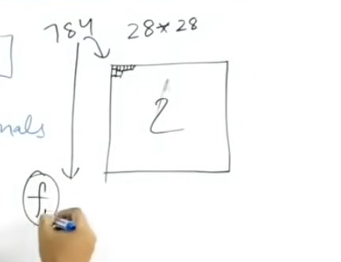
* if model work on limited area which matter onoly then only good 
working on unnecessary is useless
* curse of dimensionality --> 
* Images
* Text Data(3000)
* high dimension phase problem --> sparsity 
* easiest case will be find waller on the road, then to find on college building, etc 
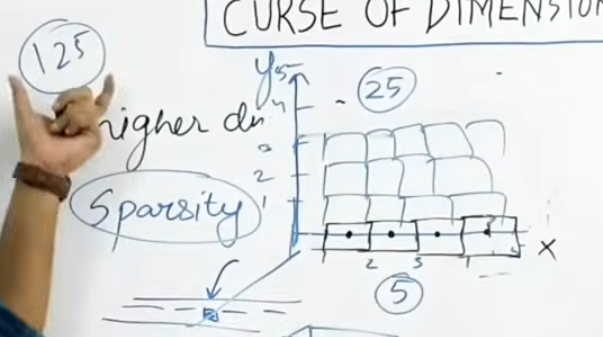
* soltuion is dimesnionality reduction 
* perfomrance decrease 
* computaiton 
-----

Dimensionality reduciton --> reduce the no.o fcolumn 
* Feature seleciton 
* feature extraction 


f1,f2,f3..... --> f1, f2, f10 --> forward selction, backward elinaiton

* feature extraction --> new column, linear combination of old columb --> PCA | LDA | t sne

---------------------------------------------

### <mark>CampusX PDF notes - L46 Curse of Dimensionality (PDF pp. 1122-1133)</mark>

**<mark>1. Introduction and where it fits</mark>**
The curse of dimensionality is one of the most important concepts in machine learning: it describes problems that appear in high-dimensional spaces and do not occur in low-dimensional settings. High-dimensional data increases the computational cost and makes learning harder.


Feature-engineering pipeline: feature transformation (clean/scale/prepare data) -> feature construction (new features such as ratios and interactions) -> outlier detection -> **feature selection** (choose the most relevant features) -> **feature extraction** (project into a lower-dimensional space, keeping information) -> dimensionality reduction.

**2. What is dimensionality?** The number of features (columns) in the dataset.

| Term | Definition | Example |
|---|---|---|
| Dimension | each feature / column | Age, Height, Weight |
| High dimensionality | a large number of features | an image with 784 pixels = 784 dimensions |
| Low dimensionality | few features | a dataset with 5 columns |

Image example: a 28 x 28 grayscale image has `28 x 28 = 784` pixels; each pixel is one feature, so the dataset has 784 columns / dimensions (this is the MNIST data used in PCA, L49).

**<mark>3. The core concept - the optimal number of features</mark>**
There exists an **optimal number of features** where the model performance is maximum. Adding more features beyond that point does **not** improve the performance, may actually **decrease** it, and increases the computational complexity.


| Stage | Features | Performance | Computation |
|---|---|---|---|
| Under-fitting | too few | low | fast |
| Optimal | just right | maximum | moderate |
| Curse of dimensionality | too many | decreases | very slow |

**<mark>4. Real-world example: finding a wallet</mark>**

| Dimension | Search space | Difficulty | Example |
|---|---|---|---|
| 1D - line | road | easy | the wallet is somewhere on one road: walk along it |
| 2D - area | college campus | moderate | check buildings, paths, grounds |
| 3D - volume | multi-storey building | hard | every floor, every room, every corner |

As the dimensions increase, the search space grows exponentially, so it becomes much harder to find the target.


**<mark>5. Problems caused by high dimensionality</mark>**
1. **Sparsity:** in high dimensions the data points become sparse - they are far apart from each other.
   * Maths: for a unit hypercube in d dimensions the volume is `1^d`, but most of the volume sits in the corners. The volume of the inscribed hypersphere is `V_sphere = pi^(d/2) / Gamma(d/2 + 1)` (r = 1), and as `d -> infinity`, `V_sphere / V_cube -> 0`.

| Dimensions | Point distribution | Distance between points |
|---|---|---|
| 2D / 3D | relatively dense | close |
| ~10D | less dense | moderate |
| 100D | very sparse | very far apart |
| 1000D | extremely sparse | extremely far |


2. **Distance metrics become meaningless:** all points become almost equidistant from each other. Distance concentration: `(max_ij ||xi - xj||) / (min_ij ||xi - xj||) -> 1` as `d -> infinity`, so you cannot tell "near" from "far" and **K-NN and other distance-based algorithms fail**.
3. **Performance degradation:** beyond the optimal point, adding features makes the model overfit and learn noise instead of patterns; below it, more features still help the model learn relationships.
4. **Computational complexity:** distance calculation `O(n x d)`, K-NN search `O(n x d x log n)`, model training `O(n x d^2)` or worse. Computation time and memory go from fast/moderate (low d) to slow/high (1000 dims) to very slow/very high (10,000 dims).

**<mark>6. Dimensionality reduction - the solution</mark>**
Two approaches:


| Aspect | Feature selection | Feature extraction |
|---|---|---|
| Definition | select a subset of the original features | create new features from the original ones |
| Features | original features retained | new transformed features |
| Interpretability | **high** (original features) | low (combination of features) |
| Information | some features are discarded | information compressed |
| Examples | correlation analysis, chi-square test, RFE (recursive feature elimination) | PCA, LDA, t-SNE |
| Use case | when interpretability is the priority | when performance is the priority |

* *Selection:* `F1, F2, F3, F4, F5 -> F1, F3, F5`; e.g. `Age, Height, Weight, Shoe_Size, Eye_Color -> Age, Height, Weight`. Pros: maintains interpretability, original features preserved, easy to understand. Cons: may lose important information, less flexible.
* *Extraction:* `F1, F2, F3 -> PC1, PC2` where `PC1 = w11 F1 + w12 F2 + w13 F3`, `PC2 = w21 F1 + w22 F2 + w23 F3` (e.g. `PC1 = 0.5 F1 + 0.3 F2 + 0.2 F3`, `PC2 = 0.2 F1 - 0.6 F2 + 0.4 F3`). Pros: captures the maximum variance, reduces noise, better for complex patterns. Cons: hard to interpret, the new features are combinations.
* Benefits of reduced dimensionality: improved model performance, faster training, reduced overfitting, better visualization.

**<mark>7. Mathematical understanding (hypercube vs hypersphere)</mark>**
Unit hypercube `[-1, 1]^d`: `V_cube(d) = 2^d`; inscribed unit hypersphere: `V_sphere(d) = pi^(d/2) / Gamma(d/2 + 1)`.

| Dimensions d | Sphere volume | Cube volume | Ratio |
|---|---|---|---|
| 2 | 3.14 | 4 | 0.785 |
| 3 | 4.19 | 8 | 0.524 |
| 5 | 5.26 | 32 | 0.164 |
| 10 | 2.55 | 1024 | 0.0025 |

As `d -> infinity` almost all of the volume is in the corners, not in the centre.
*Distance concentration:* for random points in d dimensions `E[distance] ~ sqrt(d)` but `Var[distance]` stays about constant, so as d increases the mean distance grows while the relative spread shrinks - all distances become similar.
*Sample-size requirement:* to keep the same density you need `n ~ d^k` (k about 1-2); e.g. for 100 dimensions about `100 x 10 = 1000` samples.

**<mark>8. Summary</mark>**

| Problem | Cause | Solution |
|---|---|---|
| sparsity | points are far apart in high-D | dimensionality reduction |
| meaningless distances | all distances become equal | feature selection / extraction |
| performance decrease | the model learns noise | reduce features to the optimal number |
| high computation | exponential complexity | reduce dimensions |

`Model performance = f(features, data quality, algorithm)`: too few features -> underfitting; optimal -> best performance; too many -> curse of dimensionality -> overfitting.

| Scenario | Recommended approach |
|---|---|
| need interpretability | feature selection |
| complex patterns | feature extraction (PCA) |
| image / text data | feature extraction (PCA, t-SNE) |
| tabular data | feature selection first |
| very high dimensions (> 1000) | feature extraction |
| small dataset | feature selection |


**Conclusion:** the curse of dimensionality is a fundamental challenge in ML; address it with the right dimensionality-reduction technique; the choice between selection and extraction depends on the use case, the data characteristics and interpretability vs performance.

### <mark>Official code - L46 Curse of Dimensionality</mark>
There is no notebook for this lecture in the official repo (it is a theory lecture).

## L47 PCA - part 1

PCA

* unsupervised machine problem 
* underline maths is too complex 

* feature extraction technique --> reduce the curse of dimensionality effect
* PCA --> 
* PCA tries to get best possible lower dimensiton form higher dimension 

3d ground to 2d image by photographer 
* benefits 
    - algorithm run faster due to less no. of column , compuation saving 
    - visulization 
    - 10 columns you can never visulaziae

------

Geometric intuition


Feature seleciton --> only keep important features
* we will remove reduce no. of grocery coluon , because it effect least on the price of the house

-------------------

whhat we will do when we dont have domain knowledge
* we plot a data in the 2D column 


data spread is more on the room axis 

plot data projection on each column 

d > d' --> spread --> pick feature with more spread 

---------------------

No. of rooms | no. of washrooms | price

* Now we know that flat price depend on both --> here feature selection is not much important 


data spread on both axis is almost same -> now we cant even choose mathematically 

Here comes the feature extraction which helps us

* Rooms | Washrooms | Price 
* PCA forgets the existing features 
* Geometric intuiton 


PCA will rotate coordinate axis is such a way to get , new feature 


in this new coodrinate axis --> x' (PCA 1) has more variance then y' PCA component 2 --> hence we transform data acoording to this axis 
* Why is variance | Data spread is important 

-------------
Why is variance is important??

mean is also statistical measure 
* 
* mean cant tell the difference bwtween thes two dataset 

but vairnce can 


v2 = 4 *v1

---
Spread is proporitonal to Variance --> it is not exactly spread

because mod fucntion is not differentiable  | hence we cant use it in optimization problems 


* 
* if we projected green and red point on the Y axis then we would have lost the distance between these points, and we would not be able to differentialte, hence in PCA our end goal will be to maximize the varianve

----------------------

### <mark>CampusX PDF notes - L47 Principal Component Analysis (PCA), part 1: intuition (PDF pp. 1134-1144)</mark>

**<mark>1. Introduction</mark>**
PCA is one of the most famous and widely used **dimensionality-reduction** techniques; it was introduced around 1950 and is still highly reliable.

| Characteristic | Detail |
|---|---|
| Type | **unsupervised** machine-learning technique |
| Category | **feature extraction** (not feature selection) |
| Main goal | reduce dimensionality while preserving the essence of the data |
| Age | old and well established (1950s) |
| Complexity | the mathematics is complex, the concept is intuitive |

**What is PCA?** A feature-extraction technique that transforms high-dimensional data into lower-dimensional data while keeping the essence of the original data. It finds new, **uncorrelated** axes (principal components) that maximize the variance and minimize the information loss.


**Photographer analogy:** a soccer match happens in 3D (the real world), the newspaper needs a 2D photo (reduced dimension); the photographer moves around to find the best angle that captures the essence of the match. PCA does the same: it finds the best projection of high-dimensional data into lower dimensions (good angle = all players visible; bad angle = players overlap).

**<mark>2. Benefits of using PCA</mark>**
1. **Faster algorithm execution:** before PCA - many features (e.g. 10 columns), more training and prediction time; after PCA - fewer features (e.g. 5 columns), faster training and prediction with the same or similar performance.
2. **Better visualization:** humans can only visualize 2D/3D, but ML datasets have 10, 100 or 1000+ features. PCA can reduce to 2D/3D (e.g. MNIST has 784 features = 28 x 28 pixels -> reduce to 3D or 2D to see patterns that were impossible to see before).

| Dimension | Use case | Visualization possible? |
|---|---|---|
| 1D | line plot | yes |
| 2D | scatter plot | yes |
| 3D | 3D scatter plot | yes |
| > 3D | - | no - need PCA to reduce |

(Also noise reduction, removal of multicollinearity and the cure for the curse of dimensionality, see L48.)

**<mark>3. Feature selection vs feature extraction</mark>**
*Feature selection:* select some columns of the original dataset and remove the others. Example: columns `No. of Rooms`, `No. of Grocery Shops`, target `Price` - keep "No. of Rooms" (house price depends more on rooms; grocery shops is a weak parameter).
*Mathematical approach:* plot the data, **project** the points on each axis; rule: **select the axis with maximum variance** (maximum spread). Variance measures how spread out the data is; higher variance = more information preserved.


**When selection fails:** modified dataset `No. of Rooms`, `No. of Bathrooms`, target `Price` - both features are equally important (price depends on rooms AND bathrooms), the plot shows a linear relationship (more rooms -> more bathrooms), the variance on the x-axis is similar to the variance on the y-axis, so you cannot simply drop one. **This is where feature extraction (PCA) comes in.**

| | Feature selection | Feature extraction (PCA) |
|---|---|---|
| Key rule | select a subset of the original features, discard low-variance/redundant ones | create new uncorrelated features (PCs) by combining the originals, maximizing variance along the new axes |
| Success | preserves the original meaning, simpler model | captures most of the information in fewer dimensions |
| Failure | may lose information if the discarded feature had hidden value | the new features (PCs) are less interpretable |

**<mark>4. Geometric intuition</mark>**
You have 2 features - x-axis: number of rooms, y-axis: number of bathrooms. A real-estate broker would say: *"instead of tracking rooms and bathrooms separately, just track the **size of the flat**"* - more rooms -> bigger flat, more bathrooms -> bigger flat, so the size captures both features in one measure. PCA creates such completely **new features from combinations of the old ones** (`Rooms, Bathrooms -> Size of flat`).
Procedure: (1) plot the data on the original axes; (2) PCA **rotates the coordinate system** to find the principal components; (3) **PC1 = the direction of maximum variance**; (4) PC2 = the direction of minimum variance (perpendicular to PC1); (5) keep PC1, discard PC2.
**Important rule: number of principal components = number of original features** (2 features -> 2 PCs, 10 features -> 10 PCs); then you select the top k components (highest variance).

**<mark>5. Understanding variance</mark>**
*Mean* tells the centre: data `-5, 0, 5` has mean 0 and data `-10, 0, 10` also has mean 0, but they are clearly different, so the mean alone cannot distinguish them.
*Variance* measures how spread out the data is from the mean: `Var = (1/n) sum (x_i - x_bar)^2` (square so that all differences are positive).
* Data `-5, 0, 5`: `(25 + 0 + 25)/3 = 16.67`.
* Data `-10, 0, 10`: `(100 + 0 + 100)/3 = 66.67` (about 4x higher = more spread).
Standard deviation = `sqrt(variance)` (the actual measure of spread). *Why variance in PCA?* Variance is differentiable everywhere (a smooth function), whereas the standard deviation involves an absolute value / square root that is not smooth at zero; PCA uses optimization that needs derivatives.

**<mark>6. Why variance is important in PCA</mark>**
Key insight: **maximizing variance = preserving the distances between the points.** When you project on the axis with the maximum variance the distances between points are preserved, the relationships between points are maintained, and ML algorithms can still distinguish the patterns (example: separating red and green points; photographer analogy - a good angle keeps all players distinguishable).
Goal of PCA = maximize variance -> (1) maximum information retained, (2) distances between points preserved, (3) data patterns remain intact, (4) ML models can still learn effectively.


**<mark>7. When to use PCA</mark>**

| Scenario | Use PCA? | Reason |
|---|---|---|
| too many features | yes | reduce dimensionality |
| need faster training | yes | fewer features = faster |
| want to visualize high-D data | yes | reduce to 2D/3D |
| features are correlated | yes | PCA removes the correlation |
| need interpretable features | **no** | PCs are not interpretable |

| Aspect | Feature selection | Feature extraction (PCA) |
|---|---|---|
| What it does | selects a subset of original features | creates new features |
| Original features | kept as they are | transformed |
| Interpretability | high | low |
| When features are correlated | fails | works |
| Example | keep "Rooms", remove "Bathrooms" | create "Size" from both |


**Key takeaways:** PCA transforms high-dimensional data to low-dimensional data, creates new features (principal components) from the old ones, keeps the essence of the original data; benefits: faster training, easier visualization, noise reduction, preprocessing step; limits: assumption of linearity, loss of the original meaning, not always optimal.

## L48 - PCA 2

Problem Formulation 

What does this solve mathematical objective function???

2d dataset we want to reduce to 1d

-----


dataset

lets take example of single points -> we can consider point as vectore | we will project this vector into another vector 
* when we project one 


projection will be the length, distance --> from every projection i will get the length

* I need to maximize the variance 

--------

How do we calcualtet the variaance 


projecting using variance 


X dash is basically the ptojeciton mean 


find the u vector for which the projection has the maximum variance, changing the unit vector our projection changes 

PCA ko aesa unit vector find krna hai jissse variance max kr dega

-----


Covariance and Covariance matrix 

* variance has problem -> will be diff for x and y axis -> is metric for single asix , but it doesnt tell realtion between two axis 

* in both the dataset the variance will be same according to the varinance
* hence here comes the covariance 
* see covariance came diff int he above examples 


-------
covariance matrix

x1, x2

it will be 2*2 martix 

* cov(x1,x1) is basically var x1


* square and symmetrix matrix 
* covariance matrix special matrix -> tell us about spread and also relationship 

--------

let see for the 3 variable the cov matrix 

* give us complete info about data
* non diagonal tell us about the orientation of the data
* diagonal tell us about the spread

----
Linear transformaiton , Eigen vectors and eigne values

Matrix a Linear transformaiton 

* matrix are linera transformaiton 
* each point and be treated as vectors 
* on applying identity transformation no change in cood


---
what are eigen vectors 

* on applying tranformaitonon on these vectors there is no change in the direction , magnitude cna cange 

* Another example 

Linear transformation -> no change in direcitonon 

* Eigne values -> how much eigen vedtor strechign or shringking after the transformaiton this is called the eigen value s


* why Eigen values and vector is helpful in PCA
* 

* Covariance matrix -> biggest eigen vector points to the maximum --> we where getting the maximum variance for that 

--------------------

Step by step PCA


step 1: mean center 

mean center helps in PCA performance

step 2: find covariance matrix 


Step 3: find the eigne value and the eigen vector of the cov matrix | 3D -> we get 3 vectors lambda 1, lambda2, lambda3 ---> if only lambda1 then its 1D


------------

How to transform points? 


4 column --> after transform (1000,2) onlt two column  --> 1 D conversion 


----

how do we do in 2D

* two vector 3 dimensional space | 

PC1 | PC2 | Target 

------------


dataframe


3d data 


we need best two axis in 2d to represent 


step 3 : fidnign eigen value and evctor 


3d data 3 eigen value and eigen vector


plot these in 3D -> fetched top w 


now dataset need to be shifted into 40 *2 ( orfinal was 40* 3)


now plot need to be done


-----------------

in next we do real life analysix on MNIST dataset

----------------

### <mark>CampusX PDF notes - L48 Principal Component Analysis (PCA), part 2: the mathematics (PDF pp. 1145-1163)</mark>

**<mark>1. Why do we need PCA?</mark>**


| Problem | Solution via PCA |
|---|---|
| curse of dimensionality | reduces the features while maintaining the information |
| computational cost | lower dimensions = faster algorithms |
| visualization | project to 2D/3D for visual analysis |
| noise reduction | the lower components often capture noise |
| multicollinearity | creates uncorrelated principal components |

**Core idea:** PCA finds new axes (principal components) such that (1) the first axis captures the maximum variance, (2) the second captures the maximum *remaining* variance (orthogonal to the first), (3) and so on.

**<mark>2. Problem formulation</mark>**
Given data in d-dimensional space, find the best k-dimensional subspace (k < d) that preserves the maximum information. Setup: `n` data points `x1..xn`, each a d-dimensional vector `x_i in R^d`. **Goal:** find a unit vector `u` (`||u|| = 1`) such that when all points are projected on `u` the **variance of the projections is maximized**. First **center** the data (`x_i - x_bar`), define the unit vector `u`, project the centred data on `u` with the dot product `u^T (x_i - x_bar) = ||x_i - x_bar|| cos(theta)`. The best axis is NOT necessarily the x- or y-axis but the direction of maximum spread.


**<mark>3. Vector projection - the foundation</mark>**
The projection of a vector `x` on a unit vector `u` is the dot product `u . x = u^T x` (since `||u|| = 1`). With `x = [x1, y1]^T` and `u = [x2, y2]^T`: `u^T x = x1 x2 + y1 y2` - a **scalar**: the coordinate of `x` in the new 1D space defined by `u`.

**<mark>4. Variance maximization objective</mark>**
Variance: `(1/n) sum (x_i - x_bar)^2`. Variance of the projections onto `u`: mean of projections `u^T x_bar`, so `Var(projections) = (1/n) sum (u^T x_i - u^T x_bar)^2`. The optimization:

`maximize Var(u^T x)  subject to  ||u|| = 1`

solved with the **Lagrange multiplier** method, which leads to an **eigenvalue decomposition**.

**<mark>5. Covariance and the covariance matrix</mark>**
Variance only measures the spread along one axis; we also need how the features vary *together*. Two datasets with the same variances: `(-1, 1), (0, 0), (1, -1)` (negative relationship: as X goes up, Y goes down) and `(1, 1), (0, 0), (-1, -1)` (positive relationship) - the same variance, different orientation. Variance cannot see it; **covariance can**.

`Cov(X, Y) = (1/n) sum (x_i - x_bar)(y_i - y_bar)`

| Covariance | Interpretation |
|---|---|
| positive | X up -> Y up (same direction) |
| negative | X up -> Y down (opposite direction) |
| zero | no linear relationship |

Example: points `(-1, 1), (0, 0), (1, -1)`, means 0: `Cov = ((-1)(1) + 0 + (1)(-1))/3 = -2/3` -> negative: as X increases Y decreases.

**Covariance matrix** (all pairwise relationships): 2D `Sigma = [[Var(X1), Cov(X1,X2)], [Cov(X2,X1), Var(X2)]]` (symmetric since `Cov(X1,X2) = Cov(X2,X1)`); 3D has `Var(X), Var(Y), Var(Z)` on the diagonal and the covariances off the diagonal.


| Property | Description |
|---|---|
| square | n x n for n features |
| symmetric | `Sigma = Sigma^T` |
| positive semi-definite | all eigenvalues >= 0 |
| diagonal = variances | self-covariance equals variance |

It tells us the spread of each feature (diagonal), the orientation of the data (off-diagonal) and the relationships between all pairs of features.

**<mark>6. Linear transformations</mark>**
A matrix is not just numbers - it is a **linear transformation**: it can rotate, scale (stretch/compress), shear and reflect vectors. The identity matrix `I = [[1,0],[0,1]]` leaves every vector unchanged. For `A = [[a, b], [c, d]]`: `A [x, y]^T = [ax + by, cx + dy]^T`. Key insight for PCA: under a linear transformation most vectors change both direction and magnitude, but some special vectors only change their magnitude (direction stays the same or reverses) - **eigenvectors**.

**<mark>7. Eigenvectors and eigenvalues</mark>**
`A v = lambda v` where `v` = eigenvector (the special direction) and `lambda` = eigenvalue (the scaling factor).


| Concept | Meaning |
|---|---|
| eigenvector | the direction that remains unchanged under the transformation |
| eigenvalue | how much the eigenvector is stretched or compressed |
| lambda > 1 | stretched |
| 0 < lambda < 1 | compressed |
| lambda < 0 | flipped and scaled |

Example: `A = [[3, 1], [0, 2]]`, `v = [1, 0]^T` -> `A v = [3, 0]^T = 3 [1, 0]^T`, so `lambda = 3`. A 2D space has 2 eigenvectors, 3D has 3, n-D has n; each represents a principal direction of the transformation.

**<mark>8. Eigendecomposition of the covariance matrix - the connection to PCA</mark>**
The eigenvector of the covariance matrix with the **largest eigenvalue** points in the direction of **maximum variance**. (The optimization `maximize u^T Sigma u` s.t. `||u|| = 1` with Lagrange multipliers gives `Sigma u = lambda u` - exactly the eigenvalue equation.)

| Eigenvalue | Eigenvector | Interpretation |
|---|---|---|
| largest lambda1 | 1st eigenvector | direction of maximum variance = PC1 |
| second largest lambda2 | 2nd eigenvector | direction of the second maximum variance = PC2 |
| third largest lambda3 | 3rd eigenvector | third maximum variance = PC3 |

Properties: eigenvectors are **orthogonal** (so the PCs are uncorrelated); **eigenvalue = variance along that direction**; a larger eigenvalue = a more important component. Variance explained by `PC_k = lambda_k / (sum of all lambda) x 100`.

**<mark>9. The PCA algorithm, step by step</mark>**


1. **Original data X** (n samples x d features).
2. **Mean centering:** `X_centered = X - mu` (subtract the mean of each feature). Purpose: centre the data around the origin so the covariance calculation is clean.
3. **Covariance matrix** `Sigma = (1/(n-1)) X_centered^T X_centered` (`np.cov(X.T)`), a d x d symmetric matrix.
4. **Eigenvalues and eigenvectors:** `Sigma v = lambda v` -> `np.linalg.eig(covariance_matrix)` returns d eigenvalues and a matrix whose **columns** are the eigenvectors.
5. **Sort by eigenvalue (descending)** - rank 1 (largest eigenvalue) = PC1, etc.
6. **Select the top k eigenvectors** using the explained-variance ratio (e.g. keep enough PCs for 95% of the variance), a scree plot (look for the elbow), or domain knowledge. Projection matrix `P` = the top k eigenvectors stacked as rows.
7. **Transform the data:** `X_new = X_centered . P^T`.

**<mark>10. How to transform points</mark>**
`x_new = P x` for one point, `X_new = X . P^T` for the dataset. The inner dimensions must match: `(n x d) . (d x k) = (n x k)`.
* 3D -> 1D: X is (1000, 3), PC1 eigenvector shape (1, 3) -> `PC1^T` is (3, 1) -> `(1000, 3) . (3, 1) = (1000, 1)`: 1000 samples, 1 feature.
* 3D -> 2D: top 2 eigenvectors stacked (2, 3) -> `P^T` (3, 2) -> `(1000, 3) . (3, 2) = (1000, 2)`: features PC1, PC2.

**<mark>11. Practical implementation (same data as the official notebook)</mark>**
Data: two classes of 20 points from 3D normal distributions centred at `(0,0,0)` (target 1) and `(1,1,1)` (target 0), identity covariance, `np.random.seed(23)`, combined with `pd.concat([df, df1], ignore_index=True)` (the modern replacement of `append`) and `df.sample(40)`.
```python
scaler = StandardScaler(); df.iloc[:, 0:3] = scaler.fit_transform(df.iloc[:, 0:3])      # Step 1: standardize (mean centering)
covariance_matrix = np.cov([df.iloc[:, 0], df.iloc[:, 1], df.iloc[:, 2]])                # Step 2
eigen_values, eigen_vectors = np.linalg.eig(covariance_matrix)                           # Step 3
sorted_indices = np.argsort(eigen_values)[::-1]                                          # Step 4: sort descending
pc = eigen_vectors[:, sorted_indices[:2]].T                                              # Step 5: top 2 eigenvectors (COLUMNS of eigen_vectors, transposed to rows)
transformed_df = np.dot(df.iloc[:, 0:3], pc.T)                                           # Step 6: (40,3) x (3,2) = (40,2)
```
Output in the PDF: covariance matrix `[[1.0256, 0.2048, 0.0801], [0.2048, 1.0256, 0.1984], [0.0801, 0.1984, 1.0256]]` (the diagonal is 40/39 = 1.0256 because `np.cov` divides by n-1); eigenvalues `[1.3536, 0.9456, 0.7777]` (they add up to the trace 3 x 1.0256 = 3.077, so the explained variance is about 44.0%, 30.7%, 25.3%); eigenvectors (as columns) `[[-0.539, -0.694, 0.478], [-0.656, -0.011, -0.755], [-0.528, 0.720, 0.449]]`.
**This is the correct version of the notebook's `pc = eigen_vectors[0:2]`** (which takes the first two *rows* instead of the first two *columns* sorted by eigenvalue).
*With sklearn:* `pca = PCA(n_components=2); principal_components = pca.fit_transform(df.iloc[:, 0:3])` (`pca.explained_variance_ratio_` shows the variance explained; sklearn's signs of the components may be flipped, which is fine).

**<mark>12. Summary</mark>**

| Concept | Formula |
|---|---|
| projection | `proj = u^T x` |
| covariance | `Cov(X,Y) = (1/n) sum (x_i - x_bar)(y_i - y_bar)` |
| eigenvalue equation | `Sigma u = lambda u` |
| PCA objective | `max u^T Sigma u` s.t. `||u|| = 1` |
| transformation | `X_new = X . P^T` |
| variance explained | `lambda_k / sum(lambda) x 100` |

| Property | Implication |
|---|---|
| covariance matrix is symmetric | eigenvectors are orthogonal |
| covariance matrix is positive semi-definite | all eigenvalues >= 0 |
| eigenvectors are orthogonal | the principal components are uncorrelated |
| largest eigenvalue | PC1 captures the maximum variance |

PCA assumptions: (1) **linearity** - relationships between features are linear; (2) large variance = important (high variance means meaningful information); (3) orthogonality of the PCs; (4) the mean and covariance are sufficient to characterize the data (normality is often assumed). Use when: correlated features, high dimensions, need visualization, noise reduction, preprocessing for other algorithms. Avoid when: non-linear relationships, you need interpretable features. Interactive tool: GeoGebra (https://www.geogebra.org/m/YCZa8TAH) to see how matrices transform the coordinate system and which vectors keep their direction (eigenvectors).


### <mark>Official code - L47/L48 PCA step by step (repo: `day47-pca/pca_step_by_step (1).ipynb`)</mark>

**<mark>Block 1 - create 3D toy data (two classes)</mark>**
```python
import numpy as np
import pandas as pd
np.random.seed(23)                                   # reproducible random numbers

mu_vec1 = np.array([0,0,0])                          # mean of class 1 = origin
cov_mat1 = np.array([[1,0,0],[0,1,0],[0,0,1]])       # identity covariance (independent features, variance 1)
class1_sample = np.random.multivariate_normal(mu_vec1, cov_mat1, 20)   # 20 points from a 3D normal distribution
df = pd.DataFrame(class1_sample, columns=['feature1','feature2','feature3'])
df['target'] = 1

mu_vec2 = np.array([1,1,1])                          # class 2 is centred at (1,1,1)
class2_sample = np.random.multivariate_normal(mu_vec2, cov_mat1, 20)
df1 = pd.DataFrame(class2_sample, columns=['feature1','feature2','feature3'])
df1['target'] = 0

df = df.append(df1, ignore_index=True)               # stack both classes (pandas 2: pd.concat([df, df1], ignore_index=True))
df = df.sample(40)                                   # shuffle the 40 rows
```

**<mark>Block 2 - 3D scatter plot</mark>**
```python
import plotly.express as px
# scatter_3d: interactive 3D plot, colour = class
fig = px.scatter_3d(df, x=df['feature1'], y=df['feature2'], z=df['feature3'], color=df['target'].astype('str'))
fig.update_traces(marker=dict(size=12, line=dict(width=2, color='DarkSlateGrey')), selector=dict(mode='markers'))
fig.show()
```

**<mark>Block 3 - Step 1: standardise (mean 0, variance 1)</mark>**
```python
from sklearn.preprocessing import StandardScaler
scaler = StandardScaler()
df.iloc[:, 0:3] = scaler.fit_transform(df.iloc[:, 0:3])   # PCA is scale-sensitive, so always scale first
```

**<mark>Block 4 - Step 2: covariance matrix</mark>**
```python
# np.cov: every argument is one variable. Result = 3x3 matrix (variances on the diagonal, covariances elsewhere)
covariance_matrix = np.cov([df.iloc[:,0], df.iloc[:,1], df.iloc[:,2]])
print('Covariance Matrix:\n', covariance_matrix)
```

**<mark>Block 5 - Step 3: eigenvalues and eigenvectors</mark>**
```python
# eig returns the eigenvalues (how much variance along each direction) and the eigenvectors (the directions, stored as COLUMNS)
eigen_values, eigen_vectors = np.linalg.eig(covariance_matrix)
eigen_values
eigen_vectors
```

**Block 6 - draw the eigenvectors on the 3D data** (visualisation only)
```python
# the notebook defines a small Arrow3D class (FancyArrowPatch + proj3d) to draw 3D arrows, then plots
# the points in blue, the mean in red, and one red arrow per eigenvector (for v in eigen_vectors.T)
# -> the arrows are the new axes PC1, PC2, PC3 (standard matplotlib 3D-arrow recipe, run with %pylab inline)
```

**<mark>Block 7 - Step 4: keep the top 2 components and transform</mark>**
```python
pc = eigen_vectors[0:2]                          # as written in the notebook: the first two ROWS
# NOTE: eigenvectors are the COLUMNS of eigen_vectors, so the correct selection is eigen_vectors[:, 0:2]
#       after sorting the eigenvalues in decreasing order (np.linalg.eig does not sort them).
transformed_df = np.dot(df.iloc[:, 0:3], pc.T)   # (40 x 3) . (3 x 2) = (40 x 2): the data in the new 2D space
new_df = pd.DataFrame(transformed_df, columns=['PC1','PC2'])
new_df['target'] = df['target'].values
new_df.head()
```

**<mark>Block 8 - plot the 2D result</mark>**
```python
new_df['target'] = new_df['target'].astype('str')
fig = px.scatter(x=new_df['PC1'], y=new_df['PC2'], color=new_df['target'],
                 color_discrete_sequence=px.colors.qualitative.G10)   # 2D scatter of the projected data
fig.update_traces(marker=dict(size=12, line=dict(width=2, color='DarkSlateGrey')), selector=dict(mode='markers'))
fig.show()
```

## L49 PCA part 3 

Coding 

digit recognizer pca demo 

* 
* MNNIST dataset consisit of 28 * 28 
* 42000 * 785 
* label is basically the actual digit 

<!-- this is instruction for the ai agent -->
* get code from here https://www.youtube.com/redirect?event=video_description&redir_token=QUlxb01IYjVWX2ZHYUw3Tmk4MjN0QnUyanVxenxBQnJ0NjlrVnlIa0M5Q1d0X3ZSaW00b2VTdmgxU2ZGcHp6OEN6dkFkMHVxTW41Q1hmVWFJZWdNbnoxZHNxTzNOVWxzVERnNlpPQXJOZXk3Rl9hLWlLNHJfa0lBQWF3U1Y5MEhi&q=https%3A%2F%2Fgithub.com%2Fcampusx-official%2F100-days-of-machine-learning%2Ftree%2Fmain%2Fday47-pca&v=tofVCUDrg4M

* break it into small small part and explain each part. Write the whole code here 
* explain how and why we break | give small theoretical knowledge
* how no. of components changes the accuracy 


----------

starting components are very important, hence accuracy at the beginning increase quite fast
* what does explained_variance represent 


------

How to find the optimimum no. of principle components 


lambda1 -> every eigen vector can explain how much of the variance of the orginal data
* lets say we want to explain at least 90% of variance of orginal data 

we will take 15 eigen vector because it hit our cutoff of 90% variance

* first three are covering 12% of variance of the whole data

784 components


95 percent variance explained that would be enough --> try to guage what is good or what is not 
-----------

When PCA wont work


### <mark>CampusX PDF notes - L49 PCA part 3: practical implementation (PDF pp. 1164-1186)</mark>

**<mark>1. Datasets</mark>**
PCA is demonstrated on two datasets: (1) **MNIST** handwritten digits (784 dimensions), (2) **Wine Quality** (12 features, wine type red/white). Primary use cases: dimensionality reduction (cut computational cost, mitigate the curse of dimensionality, remove noise/redundancy) and **data visualization** (project high-dimensional data to 2D/3D, find clusters and relationships).


| MNIST property | Value |
|---|---|
| image size | 28 x 28 pixels |
| total pixels per image | 784 (flattened) |
| number of classes | 10 (digits 0-9) |
| training samples | ~42,000 (the CSV is **42000 x 785**: label + 784 pixels) |
| test samples | ~28,000 |
| pixel value range | 0-255 (grayscale) |

Each image is converted from a 2D matrix (28 x 28) to a 1D vector (784 features); each pixel becomes a column.


Wine Quality dataset: 6,497 samples -> **5,295** after cleaning (missing values present + **1,168 duplicate rows**), target = wine type (red/white); features: fixed acidity, volatile acidity, citric acid, residual sugar, chlorides, free sulfur dioxide, total sulfur dioxide, density, pH (acidity level), sulphates, alcohol (all float) and quality (int).


| Step | Key consideration | Purpose |
|---|---|---|
| data cleaning | handle NaN, duplicates | remove noise |
| standardization | **mandatory before PCA** | scale features |
| PCA fit | use training data only | compute the components |
| PCA transform | apply to both train and test | project the data |
| model training | use the transformed features | learn patterns |
| evaluation | compare with the baseline | measure performance |

**<mark>2. The MNIST digit-recognizer PCA demo - the whole code, broken into blocks</mark>**
(Your note in the L49 section asks for the full code in small parts with an explanation of how/why it is split, a bit of theory, and how the number of components changes the accuracy. The official repo folder `day47-pca` contains only the 3D toy-data notebook (given at the end of L48); the MNIST digit-recognizer demo itself is shown in the video, so the code below is **reconstructed from the PDF's code listing**, not copied from the repo. The data file is the Kaggle "Digit Recognizer" `train.csv`.)

*Why we split it into blocks:* each block does ONE job (load -> split -> scale -> baseline -> PCA -> evaluate -> choose the number of components -> visualize). The order matters - you cannot PCA before scaling, and you cannot judge PCA without a baseline - and small blocks let you check the shape and result after every step.

**<mark>Block 1 - load the data and look at an image</mark>**
```python
import numpy as np, pandas as pd, matplotlib.pyplot as plt
train = pd.read_csv('train.csv')            # MNIST digits: first column = label, next 784 columns = pixels
print(train.shape)                          # (42000, 785) = 42000 images x (1 label + 784 pixels)

def show_digit(data, row_index):            # draws one digit
    pixels = data.iloc[row_index, 1:].values        # skip the label column, take the 784 pixel values
    plt.imshow(pixels.reshape(28, 28), cmap='gray') # 784 numbers -> a 28 x 28 grid -> image
    plt.title(f"label = {data.iloc[row_index, 0]}"); plt.show()
show_digit(train, 0); show_digit(train, 100)
```
Theory: every pixel is a feature, so one image = one point in a 784-dimensional space.

**<mark>Block 2 - split features and labels, then train/test split</mark>**
```python
from sklearn.model_selection import train_test_split
X = train.iloc[:, 1:]                       # all 784 pixel columns
y = train.iloc[:, 0]                        # the digit label
X_train, X_test, y_train, y_test = train_test_split(X, y, test_size=0.2, random_state=42)   # 80% / 20%
```
Why: split first, so the scaler and PCA are fitted only on the training data (no leakage). (X_train has 33,600 rows with `train.csv`; the PDF writes (8400, 784) for the test part.)

**<mark>Block 3 - standardize (mandatory before PCA and KNN)</mark>**
```python
from sklearn.preprocessing import StandardScaler
scaler = StandardScaler()                       # (x - mean) / std for every pixel column
X_train_scaled = scaler.fit_transform(X_train)  # learn mean/std on TRAIN, transform train
X_test_scaled  = scaler.transform(X_test)       # use the same mean/std on test
```
Theory: PCA maximizes variance, so a feature with a bigger scale would dominate the components; scaling gives every feature an equal chance. (Pixels with zero variance become NaN/0 - `StandardScaler` handles that by leaving them at 0.)

**<mark>Block 4 - baseline: KNN on all 784 features (no PCA)</mark>**
```python
import time
from sklearn.neighbors import KNeighborsClassifier
from sklearn.metrics import accuracy_score
knn = KNeighborsClassifier(n_neighbors=5)
start = time.time(); knn.fit(X_train_scaled, y_train); fit_time = time.time() - start
y_pred = knn.predict(X_test_scaled)
print(accuracy_score(y_test, y_pred), fit_time)       # PDF: accuracy ~96.7%, ~35 s
```
Theory: KNN computes distances to all points, which is slow and, in 784 dimensions, less meaningful (curse of dimensionality, L46). Wine dataset baseline: **99.34%** accuracy in < 1 s.

**<mark>Block 5 - apply PCA (784 -> 100 dimensions) and compare</mark>**
```python
from sklearn.decomposition import PCA
pca = PCA(n_components=100)                         # keep the 100 directions with the largest variance
X_train_pca = pca.fit_transform(X_train_scaled)     # fit on TRAIN only: learns the eigenvectors, then projects (33600, 784) -> (33600, 100)
X_test_pca  = pca.transform(X_test_scaled)          # project the test data with the SAME components

knn_pca = KNeighborsClassifier(n_neighbors=5)
start = time.time(); knn_pca.fit(X_train_pca, y_train); fit_time_pca = time.time() - start
print(accuracy_score(y_test, knn_pca.predict(X_test_pca)), fit_time_pca)   # PDF: ~95.5% accuracy, ~5 s
```
`PCA` parameters: `n_components` (how many components; an int, or a float like 0.90 = "keep 90% of the variance"), `svd_solver` ('auto', 'full', 'arpack', 'randomized'), `whiten` (False; True normalizes the components), `random_state`.

**<mark>Block 6 - how many components? explained variance and the 90% rule</mark>**
Each eigenvalue is the variance along its component: `Variance ratio_i = lambda_i / sum(lambda_j) x 100`, `Cumulative variance_k = sum of the first k ratios`.
```python
pca_full = PCA()                                      # n_components=None -> all 784 components
pca_full.fit(X_train_scaled)
explained_variance = pca_full.explained_variance_ratio_       # first PCs ~ 0.097, 0.071, 0.062, 0.054 ... (about 10%, 7%, 6%, 5%)
cumulative_variance = np.cumsum(pca_full.explained_variance_ratio_)
n_90 = np.argmax(cumulative_variance >= 0.90) + 1             # first k where the cumulative variance reaches 90%
pca_auto = PCA(n_components=0.90).fit(X_train_scaled)         # let PCA choose automatically
print(n_90, pca_auto.n_components_)
```
Rule of thumb: keep enough PCs to explain **at least 90%** of the total variance (also 95% when accuracy matters). The cumulative-variance plot has an elbow; the PDF's figure marks the 90% threshold (dashed red, about 120 components in its illustration) and 95% (dashed green). The first components are very important: the first three together explain only about 12% in the lecture, so the variance builds up slowly, but the first PCs carry most of the *useful* signal.


**<mark>Block 7 - how the number of components changes the accuracy</mark>**
```python
accuracies = []
for n in range(1, 785):                           # (in practice use a few values: 1, 2, 3, 5, 10, 50, 100, 200, ...)
    pca = PCA(n_components=n)
    X_train_pca = pca.fit_transform(X_train_scaled); X_test_pca = pca.transform(X_test_scaled)
    knn = KNeighborsClassifier(n_neighbors=5).fit(X_train_pca, y_train)
    accuracies.append(accuracy_score(y_test, knn.predict(X_test_pca)))
plt.plot(range(1, 785), accuracies); plt.xlabel('number of components'); plt.ylabel('accuracy'); plt.show()
```
Expected pattern (PDF):

| Components | 1 | 2 | 3 | 5 | 10 | 50 | 100 | 200 |
|---|---|---|---|---|---|---|---|---|
| Accuracy | ~25% | ~32% | ~51% | ~72% | ~80% | ~92% | ~95% | ~96% |

Observation: **accuracy increases quickly at the beginning, then plateaus** - the starting components are the most important, later components capture less (and mostly noise-like) variance, so the marginal improvement keeps decreasing. That is what `explained_variance` represents: how much of the data's total variance (information) each component keeps.

**<mark>Block 8 - visualize in 2D and 3D</mark>**
```python
import plotly.express as px
pca_2d = PCA(n_components=2); X_train_2d = pca_2d.fit_transform(X_train_scaled)
px.scatter(x=X_train_2d[:, 0], y=X_train_2d[:, 1], color=y_train.astype(str), title='MNIST - 2D PCA', labels={'x': 'PC1', 'y': 'PC2'}).show()
pca_3d = PCA(n_components=3); X_train_3d = pca_3d.fit_transform(X_train_scaled)
px.scatter_3d(x=X_train_3d[:, 0], y=X_train_3d[:, 1], z=X_train_3d[:, 2], color=y_train.astype(str), title='MNIST - 3D PCA', labels={'x': 'PC1', 'y': 'PC2', 'z': 'PC3'}).show()
```
Insights from the 3D plot: digits **0 and 7** are far apart (circular vs angular); **3, 5, 8** cluster together (curved upper parts); **1** is isolated (a single vertical line); **4 and 9** overlap (vertical stroke + loop); 0 and 6 are both circular. Rotate the interactive Plotly plot to see patterns hidden from a single angle.

**<mark>Block 9 - PCA attributes after fitting</mark>**
```python
pca = PCA(n_components=3).fit(X_train_scaled)
pca.explained_variance_ratio_     # e.g. [0.05, 0.04, 0.03] - share of variance per component
pca.components_                   # shape (3, 784) - the 3 eigenvectors, one per row (PC1 = components_[0] ...)
pca.explained_variance_           # eigenvalues
pca.singular_values_              # from the SVD
pca.mean_                         # (784,) per-feature mean used for centering
```
| Attribute | Shape | Description |
|---|---|---|
| `components_` | (n_components, n_features) | principal axes (eigenvectors) |
| `explained_variance_` | (n_components,) | variance explained by each PC |
| `explained_variance_ratio_` | (n_components,) | share of variance per PC |
| `singular_values_` | (n_components,) | singular values of the SVD |
| `mean_` | (n_features,) | per-feature mean for centering |
| `n_components_` | - | actual number of components |

**<mark>3. When PCA does not work</mark>**


1. **Spherical / uniform data:** equal variance in all directions -> all eigenvalues about equal (`lambda1 ~ lambda2 ~ lambda3 ...`), no dominant direction, no reduction without information loss (`np.random.randn(1000, 10)` -> each of the 10 components explains about 10%).
2. **Non-linear patterns:** PCA assumes linear relationships. A parabola `y = x^2`, `y = sin(x)` or a 3D spiral collapses to a line and the curvature/structure is lost. Alternatives: Kernel PCA, t-SNE, UMAP.
3. Categorical features (variance not meaningful) -> other encodings; very sparse data (variance may mislead) -> specialized sparse methods.

| Scenario | Why PCA fails | Alternative |
|---|---|---|
| spherical data | no dominant variance direction | consider whether reduction is needed |
| equal eigenvalues | all components equally important | feature selection |
| non-linear patterns | linear projection loses the structure | Kernel PCA, t-SNE, UMAP |
| categorical features | variance is not meaningful | different encoding strategies |
| very sparse data | variance may be misleading | specialized sparse methods |

**<mark>4. Performance comparison (as printed in the PDF)</mark>**

| MNIST configuration | Features | Accuracy | Training time | Speed-up |
|---|---|---|---|---|
| no PCA | 784 | ~96.7% | ~35 s | 1x |
| PCA (100 components) | 100 | ~95.5% | ~5 s | ~7x (the PDF lists ~5 s) |
| PCA (200 components) | 200 | ~96.0% | ~10 s | 3.5x |
| PCA (90% variance) | ~120 | ~95.5% | ~6 s | 5.8x |

| Wine configuration | Features | Accuracy | Notes |
|---|---|---|---|
| no PCA | 11 (12 columns incl. quality) | 99.34% | baseline |
| PCA (5 components) | 58% reduction | 98.87% | still very good |
| PCA (8 components) | - | ~99.1% | better balance |

**<mark>5. Best practices</mark>**
* *Pre-PCA checklist:* handle missing values (PCA cannot handle NaN), remove duplicates (they skew the variance), **standardize** (critical - equal contribution), check feature types (numerical only), remove outliers (optional - they can dominate the variance).
* *Selecting `n_components`:* fixed number when you know the target dimension; **variance threshold (0.90)** - general purpose, recommended; scree-plot elbow - visual; cross-validation - when accuracy is critical.
* *Common mistakes:* not standardizing (large-scale features dominate); fitting PCA/scaler on the test data (data leakage - fit on train, transform both); too few components (information loss - check the explained variance); too many components (no dimensionality benefit - use the 90% rule); ignoring that PCA creates abstract features (use it for specific purposes).
* *Pipeline:* `Pipeline([('scaler', StandardScaler()), ('pca', PCA(n_components=0.95)), ('classifier', KNeighborsClassifier(n_neighbors=5))])`, `pipeline.fit(X_train, y_train)`, `pipeline.score(X_test, y_test)`.
* Tasks from the lecture: Colab "TASK PCA" (https://colab.research.google.com/drive/19AtHlobDsFzsOSXKI8K9qlsqNu2McXza) and its solution (https://colab.research.google.com/drive/1gsYahZavBH9lX6CjRJztV-lIHkwr2ajL).

**6. Key takeaways:** PCA reduces the dimensions while preserving the maximum variance (ideal for images); standardization is mandatory; the 90% rule is a good starting point for the number of components; visualization to 2D/3D is a powerful application; there is a trade-off between reduction and information preservation; limitations: non-linear patterns and spherical data (consider t-SNE / UMAP); always validate with cross-validation. Formula: `X_pca = X . W_k` (W_k = the top-k eigenvector matrix).


## L50 Simple Linear Regression | Code + intuition | simple explantion 

* Linear regression is easy to understand
* foundation algorithm 

* Supervised machine learning algorithm 
* regression -> o/p vlaue number

* three type 
    - simple
    - multipl e
    - polynpmical: what if data is not linear

* Regularization
* 
------------------

Simple Linear Regression


if i dont have any data -> i would be doing simple avg \ median 


Data is sort of linear 

* why data is not linear??
    - real world factors | since real world data
    - stochastic errors


for perfectly linear dataset we would have used simple liner 

------
still be use line called - Best fit liner - which does least mistakes

* sort of linear data mai line kheechna hai 


line 1 or line 2??

--------------

Code examples


x -> input column 
y -> output 

------------


write code here | with question 


m slope will tell the weightage of the variable --> if b = 0 then package = m * cgpa 

exp | pacakge 


even if exp is zero still freshers get the salary 

----------------

### <mark>CampusX PDF notes - L50 Simple Linear Regression: code + intuition (PDF pp. 1187-1209)</mark>

**<mark>1. Introduction</mark>**
Linear regression is the foundational algorithm every data scientist meets first. It belongs to **supervised learning** and solves **regression** problems (predicting a continuous numeric value). Why it matters: easy to understand (the most primitive, intuitive algorithm), the foundation for advanced algorithms, **explainable** (you can say exactly what is happening), and still widely used in production.


| Characteristic | Description |
|---|---|
| Type | supervised learning - regression |
| Output | continuous numerical values |
| Relationship | linear relationship between features and target |
| Goal | find the best-fit line through the data points |
| Use cases | price prediction, salary estimation, trend forecasting |

Problem: given a dataset of inputs and targets, (1) find a mathematical relationship between inputs and outputs, (2) use it to predict values for new unseen inputs.

**<mark>2. Types of linear regression</mark>**
* **Simple linear regression:** 1 input (independent) variable X and 1 output (dependent) variable y, a straight line. Example: placement data - input `CGPA`, output `Package` (LPA = lakhs per annum). Sample: (6.89, 3.26), (5.12, 1.98), (7.82, 3.25), (7.42, 3.67), (6.94, 3.57).
* **Multiple linear regression:** more than 1 input (X1, X2, X3...) and 1 output, a hyperplane in multi-dimensional space. Example: CGPA, gender, 12th marks, state -> package.
* **Polynomial linear regression:** the data is curved; uses polynomial features (x^2, x^3 ...); still called "linear" because the *coefficients* enter linearly.

| Data pattern | Algorithm choice |
|---|---|
| straight-line pattern | simple / multiple linear regression |
| curved pattern | polynomial linear regression |
| no clear pattern | other algorithms (trees, neural networks) |


(Multiple regression comes in L53-L55 and polynomial regression with regularization in later lectures.)

**<mark>3. Mathematical foundation</mark>**
Line equation `y = m x + b`: `y` = predicted output, `x` = input feature, `m` = slope, `b` = y-intercept. In ML notation: `y_hat = theta1 x + theta0` (theta1 = weight/coefficient, theta0 = bias/intercept).
For the CGPA-package example the code gives **m = 0.5579 (slope), b = -0.8961 (intercept)** -> `Package = 0.5579 x CGPA - 0.8961`. Prediction for CGPA = 8.58: `0.5579 x 8.58 - 0.8961 = 4.7868 - 0.8961 = 3.8907 LPA`.

**Slope (m)** = rate of change / weight of the input feature: `m = delta y / delta x` ("how much does the output change when the input changes by 1 unit?").
Formula: `m = sum (x_i - x_bar)(y_i - y_bar) / sum (x_i - x_bar)^2`. Steps: (1) means `x_bar`, `y_bar`; (2) deviations `dx_i = x_i - x_bar`, `dy_i = y_i - y_bar`; (3) numerator = `sum dx_i dy_i`; (4) denominator = `sum dx_i^2`; (5) `m = numerator / denominator`.

| Slope | Meaning | Example |
|---|---|---|
| positive | Y increases as X increases | higher CGPA -> higher package |
| negative | Y decreases as X increases | more absences -> lower grades |
| zero | no relationship | random factors |
| large `|m|` | strong dependency (small change in X -> large change in Y) | |
| small `|m|` | weak dependency | |

Our case: m = 0.5579 -> "for every 1-point increase in CGPA the package increases by about 0.56 LPA".

**Intercept (b)** = the value of y when x = 0; `b = y_bar - m x_bar`. It is the base / starting value, independent of the input. *Why needed?* Without it (`y = m x`), x = 0 would force y = 0: a fresher with 0 years of experience would get 0 salary - unrealistic. With `Salary = m x Experience + b` a fresher gets the base salary `b`. Here `b = -0.8961` is negative, which looks odd, but CGPA = 0 is impossible on a 0-10 scale, so we never extrapolate there; it is just the number that positions the line.

| Scenario | Equation | Intercept meaning |
|---|---|---|
| experience-salary | `Salary = m x Experience + b` | b = starting salary of a fresher |
| house area-price | `Price = m x Area + b` | b = base price (land value etc.) |
| study hours-marks | `Marks = m x Hours + b` | b = baseline knowledge |


(The flowchart in the PDF uses a tiny made-up table - means 6.76, 2.99..., result `y = 2.99x - 16.86` - only to show the steps; the real numbers are m = 0.558 and b = -0.896.)

**<mark>4. Real-world data is not perfectly linear</mark>**
Placement data is "sort of linear" (approximately linear) - the points scatter around a trend. Reasons: **human factors** (interview performance, soft skills, negotiation), **external variables** (market conditions, economic shifts, industry demand, company budget), **measurement errors** (wrong CGPA/package recorded, reporting flaws), **randomness** (chance events, luck).


Outlier examples: CGPA about 8.5 but package about 2.5 LPA (poor interview, low-paying company, personal choice); CGPA 6.5 but package 4.0 LPA (great interview, high-paying company, special skills). Despite them there is a clear positive correlation - but it is not deterministic.

| Factor | Quantifiable? | Impact |
|---|---|---|
| CGPA | yes | direct, measurable |
| interview performance | no | high, subjective |
| company budget | no | high, varies by company |
| luck / timing | no | unpredictable |
| confidence | no | moderate, hard to measure |

These unquantifiable factors act like **stochastic (random) variables**; linear regression captures the overall trend in spite of them.

**<mark>5. The best-fit line</mark>**
Since real data is not perfectly linear we need the line that best represents the overall trend: the line that **minimizes the overall error** between the predicted values (points on the line) and the actual values. Error (residual) `e_i = y_i - y_hat_i`; minimize the **sum of squared errors** `SSE = sum (y_i - y_hat_i)^2`; find the optimal m and b (the derivation is the next lecture, L51).

| Property | Description |
|---|---|
| uniqueness | for given data there is only ONE best-fit line |
| minimizes error | the total distance from all points is minimized |
| balanced | some points above, some below; `sum (y_i - y_hat_i) = 0`, the line passes through the mean point `(x_bar, y_bar)` |
| representative | captures the overall trend |

SSE picture: a line that is too high or too low (large SSE, all positive or all negative errors) vs the best-fit line (minimal squared errors).

**<mark>6. Code implementation (scikit-learn)</mark>**
```python
df = pd.read_csv('placement.csv')                    # cgpa, package
plt.scatter(df['cgpa'], df['package'])               # positive correlation
X = df.iloc[:, 0:1]                                  # 2-D (n_samples, n_features) - X MUST be 2-D
y = df.iloc[:, -1]                                   # 1-D (n_samples,)
X_train, X_test, y_train, y_test = train_test_split(X, y, test_size=0.2, random_state=2)   # 160 train / 40 test
lr = LinearRegression(); lr.fit(X_train, y_train)    # fit() calculates the optimal m and b
y_pred = lr.predict(X_test)
prediction = lr.predict(X_test.iloc[0].values.reshape(1, 1))     # single prediction: reshape(1,1) = 1 sample, 1 feature
m = lr.coef_[0]; b = lr.intercept_                   # Slope 0.5580, Intercept -0.8961
manual_prediction = m * 8.58 + b                     # same as lr.predict
plt.scatter(df['cgpa'], df['package']); plt.plot(X_train, lr.predict(X_train), color='red')   # best-fit line
```
Training set (80%) is used to find m and b, the testing set (20%) to evaluate; `random_state` makes the split reproducible.

**<mark>7. Custom implementation - `MeraLR` (from scratch)</mark>**
```python
class MeraLR:
    def __init__(self): self.m = None; self.b = None            # slope and intercept
    def fit(self, X_train, y_train):
        numerator = 0
        for i in range(X_train.shape[0]):
            numerator += (X_train[i] - X_train.mean()) * (y_train[i] - y_train.mean())     # sum (xi - x_bar)(yi - y_bar) = covariance part
        denominator = 0
        for i in range(X_train.shape[0]):
            denominator += (X_train[i] - X_train.mean()) ** 2                              # sum (xi - x_bar)^2 = variance part
        self.m = numerator / denominator                                                   # slope
        self.b = y_train.mean() - (self.m * X_train.mean())                                # intercept
    def predict(self, X_test): return self.m * X_test + self.b                             # y = m x + b
```
Result: **m = 0.5579519734250721, b = -0.8961119222429152** (identical to sklearn). Test CGPA 8.58: actual package 4.10, predicted **3.89**.

| Aspect | scikit-learn | custom |
|---|---|---|
| Ease of use | very easy (2 lines) | more code |
| Performance | optimized (C/Cython) | slower (pure Python) |
| Understanding | black box | clear mathematics |
| Features | many extras | basic |
| Production | **recommended** | learning only |

Use the custom version to learn the maths and scikit-learn for projects.


**<mark>8. Intuition and interpretation</mark>**
Slope examples: m = 2.5 (`Package = 2.5 x CGPA - 0.8961`): CGPA 6 -> 14.1, 7 -> 16.6, 8 -> 19.1 LPA (1 CGPA point = 2.5 LPA, strong impact); m = 0.2 (`0.2 x CGPA + 2.0`): 3.2, 3.4, 3.6 LPA (weak impact). Our actual model (m = 0.558, moderate positive relationship): CGPA 6 -> 2.45, 7 -> 3.01, 8 -> 3.57, 9 -> 4.12 LPA.
Predictions: CGPA 7.0 -> `0.558 x 7 - 0.8961 = 3.01` LPA; 9.0 -> `5.022 - 0.8961 = 4.13` LPA; 10.0 (max) -> `5.580 - 0.8961 = 4.68` LPA. These are historical-trend predictions; the real values vary because of the random factors.
Intercept examples: experience-salary `b = 30000` (a fresher starts at 30,000); study hours-marks `b = 40` (baseline knowledge); house size-price `b = 500000` (base price of land/location).

**<mark>9. Summary</mark>**
1. Fundamentals: first ML algorithm, continuous output, supervised, easy to interpret. 2. Types: simple (1 input), multiple (many inputs), polynomial (curved). 3. Maths: `y = mx + b`, slope = weight/importance of the feature, intercept = base value when the input is 0. 4. Real-world: data is rarely perfectly linear, stochastic variables cause scatter, the best-fit line minimizes the overall error. 5. Implementation: scikit-learn for production, scratch for understanding; both give the same results.

| Use linear regression when | Do not use when |
|---|---|
| the relationship looks linear | the data is highly non-linear |
| you need an interpretable model | you need the highest accuracy at any cost |
| you need a quick baseline | complex patterns exist |
| a feature-target correlation exists | too many outliers |
| small to medium datasets | the target is categorical |

Formula card: prediction `y_hat = mx + b`; slope `sum (x_i - x_bar)(y_i - y_bar) / sum (x_i - x_bar)^2`; intercept `b = y_bar - m x_bar`; error `e = y - y_hat`. Model with noise `y = beta0 + beta1 x + epsilon`. Assumptions (linearity, homoscedasticity...) and evaluation metrics (MSE, R^2) come in the next lectures; remember correlation is not causation.


### <mark>Official code - L50 Simple Linear Regression, sklearn and from scratch (repo: `day48-simple-linear-regression/Untitled.ipynb` and `Untitled1.ipynb`)</mark>

**<mark>Block 1 - load and look at the data</mark>**
```python
import matplotlib.pyplot as plt
import pandas as pd
import numpy as np

df = pd.read_csv('placement.csv')            # columns: cgpa, package (LPA)
plt.scatter(df['cgpa'], df['package'])       # clear positive linear trend
plt.xlabel('CGPA'); plt.ylabel('Package(in lpa)')
```

**<mark>Block 2 - input / output and train-test split</mark>**
```python
X = df.iloc[:, 0:1]                          # 0:1 keeps X 2-D (a DataFrame); sklearn needs 2-D input
y = df.iloc[:, -1]                           # package (1-D)
from sklearn.model_selection import train_test_split
X_train, X_test, y_train, y_test = train_test_split(X, y, test_size=0.2, random_state=2)   # 80% / 20%
```

**<mark>Block 3 - train the model</mark>**
```python
from sklearn.linear_model import LinearRegression
lr = LinearRegression()                      # ordinary least squares
lr.fit(X_train, y_train)                     # learns the slope m and the intercept b
```

**<mark>Block 4 - predict and draw the best fit line</mark>**
```python
lr.predict(X_test.iloc[0].values.reshape(1, 1))   # predict for one student (reshape(1,1) = 1 row, 1 feature)
plt.scatter(df['cgpa'], df['package'])
plt.plot(X_train, lr.predict(X_train), color='red')   # the regression line
```

**<mark>Block 5 - m and b by hand: y = m x + b</mark>**
```python
m = lr.coef_                # slope
b = lr.intercept_           # intercept
m * 8.58 + b                # same as lr.predict for cgpa = 8.58
m * 9.5 + b
m * 100 + b                 # extrapolation far outside the data: not reliable
```

**<mark>Block 6 - the OLS formulas coded from scratch (class `MeraLR`)</mark>**
```python
class MeraLR:
    def __init__(self):
        self.m = None
        self.b = None

    def fit(self, X_train, y_train):
        num = 0                                  # numerator   = sum (xi - x_mean)(yi - y_mean)
        den = 0                                  # denominator = sum (xi - x_mean)^2
        for i in range(X_train.shape[0]):
            num = num + ((X_train[i] - X_train.mean()) * (y_train[i] - y_train.mean()))
            den = den + ((X_train[i] - X_train.mean()) * (X_train[i] - X_train.mean()))
        self.m = num / den                       # slope m = num / den
        self.b = y_train.mean() - (self.m * X_train.mean())   # intercept b = y_mean - m * x_mean
        print(self.m); print(self.b)

    def predict(self, X_test):
        print(X_test)
        return self.m * X_test + self.b          # y = m x + b

df = pd.read_csv('placement.csv')
X = df.iloc[:, 0].values                         # 1-D numpy arrays this time (the class loops over them)
y = df.iloc[:, 1].values
X_train, X_test, y_train, y_test = train_test_split(X, y, test_size=0.2, random_state=2)
lr = MeraLR()
lr.fit(X_train, y_train)                         # prints the same m and b as sklearn
print(lr.predict(X_test[0]))
```
The from-scratch m and b match `LinearRegression`, so sklearn simply applies these formulas (derived in L51).

## L51 Simple Linear Regression | Mathematical Foundation 

quick revision 


how our dataset will look like

--------

m,b value decide / caluclate which give value of m,b such that line make least error

* closed form solution -> where we can directly find out using formula (w/o using derivaiton , integraiton ) -> OLS (sckit learn use this) 
* non closed form solution -> (Gradient descent)

------------

If we have direct formula then why GD | GD is efficient if we have less dimension 
* if dimension is less then we can use OLS
* SGDRegressor to do linear regression using GD 


------------------

Best fit line try to be as close as to point as possible 


lets createa expression for this error

* E = d1 + d2 + d3


* why arent using modulus??
* we need to do differention at point hence we cant use diff

* give me m,b such that which minimize the above equation 

* distance di represent galti, in term of y (this is error
)

* Yi  , Yi hat is prediton 


* how is Yi hat calculated 


* 
* Error function is

-----------------------


* Y = f(x) -> x change Y also change
* individaul m, b change what will happen


* b = 0

* 


* Now lets keep m constant 


* 

Now lets see the 3D plot of this how it may look 


-----------------

Error function equation -> differentiated and equate to 0 


--------------------


 (Xi - Xbar)


-------


code parti


calculatiing m andthen we will move to calcualte the b
and doing it in MeraLR class


now lets write the prediction code 


-------------

scikit learn is made in such a way to handle the multiple linear regression 

### <mark>CampusX PDF notes - L51 Simple Linear Regression: OLS mathematical derivation (PDF pp. 1210-1229)</mark>

**<mark>1. The setup</mark>**
Simple linear regression: one input X (e.g. CGPA) and one output Y (e.g. package); find the best line describing their relationship, `y = m x + b` (`m` = slope, `b` = y-intercept, `x` = independent variable, `y` = dependent variable). Core question: **how do we find the optimal `m` and `b` so that the line is the "best" fit?**


**<mark>2. Two approaches to find the parameters</mark>**

| Aspect | Closed-form (OLS) | Non-closed-form (gradient descent) |
|---|---|---|
| Method type | direct formula application | iterative optimization |
| Mathematical basis | algebraic solution using derivatives | optimization using calculus, iterating |
| Computation | a single calculation | multiple iterations |
| Best for | low-dimensional data | high-dimensional data |
| sklearn class | `LinearRegression` | `SGDRegressor` |
| Speed (low dimensions) | very fast | slower |
| Speed (high dimensions) | can be slow / infeasible | efficient |

*Closed-form solution* = an expression evaluated in a finite number of standard operations (add, subtract, multiply, divide) with no iteration or approximation - like the quadratic formula `(-b +/- sqrt(b^2 - 4ac)) / 2a`.
When to use which: simple linear regression (1-2 features) -> OLS (fast, exact); multiple features (< 100) -> OLS still works well; high-dimensional (1000+ features) or very large datasets -> gradient descent (L56+); need the exact solution -> OLS.

**<mark>3. What makes a line "best"?</mark>**
Not just any line: the line whose **total deviation across all points is the smallest possible**. Random line = arbitrary m, b = high error; good line = closer to most points = medium error; **best-fit line = optimal m and b = minimum error**. The difference between the predicted and actual value of each point is its "error".

**<mark>4. Deriving the error (loss) function</mark>**
* Single point `i`: actual `y_i`, predicted `y_hat_i`, error (residual) `d_i = y_i - y_hat_i`; since `y_hat_i = m x_i + b`, `d_i = y_i - m x_i - b`.
* Naive total `E = d1 + d2 + ... + dn` - **positive and negative errors cancel out** (points above the line are positive, below are negative; the sum can be zero even for a bad line).
* Square each error: `E = d1^2 + d2^2 + ... + dn^2 = sum (y_i - y_hat_i)^2`.
* **Loss function** (cost / error function, also `J(m, b)` or `L(m, b)`): `E(m, b) = sum_{i=1..n} (y_i - m x_i - b)^2`.

**<mark>5. Why squared errors instead of absolute errors?</mark>**


| Criterion | Squared error `d^2` | Absolute error `|d|` |
|---|---|---|
| Cancellation | prevented | prevented |
| Penalizing outliers | heavily penalizes large errors | linear penalty |
| Differentiability | smooth, differentiable everywhere | **not differentiable at zero** |
| Mathematical convenience | easy to differentiate | harder to work with |
| Graph | smooth parabola | V-shape with a sharp corner |

The absolute value has a sharp corner at x = 0 (continuous but not differentiable there), which makes finding the minimum with calculus difficult; the square is smooth everywhere. *Why not higher powers (`d^4`, `d^6`)?* `d^2` already prevents cancellation and is differentiable; higher powers would add computational cost, over-penalize outliers and give no additional benefit.

**<mark>6. Geometry of the error function</mark>**
* *As a function of m (b fixed, e.g. b = 0):* `E(m) = sum (y_i - m x_i)^2` - too small m = line too flat = high error; optimal m = minimum error; too large m = too steep = high error -> a **parabola-like curve**.
* *As a function of b (m fixed):* `E(b) = sum (y_i - m x_i - b)^2` - also a parabola.
* *Both together:* a **3D surface** (a bowl).


| Region | m, b values | Error | Description |
|---|---|---|---|
| mountain peaks | extreme values | very high | poor-fit lines |
| slopes | getting closer to the optimal | medium | improving fit |
| valley bottom | optimal m, b | minimum | best-fit line |

The bowl is a **convex** function: exactly ONE (global) minimum, no local minima to get stuck in, and we can find the exact bottom using calculus. (This is the picture gradient descent will use in L56+.)

**<mark>7. Derivation with partial derivatives</mark>**
At the minimum of a function the slope (derivative) equals zero; for a function of two variables **both partial derivatives must be zero**: `dE/db = 0` and `dE/dm = 0`.


*Formula for b:*
1. `E = sum (y_i - m x_i - b)^2`.
2. `dE/db = sum 2 (y_i - m x_i - b) . (-1)` (chain rule).
3. Set to zero: `sum (y_i - m x_i - b) = 0`.
4. Expand: `sum y_i - m sum x_i - n b = 0`.
5. Divide by n: `y_bar - m x_bar - b = 0`.
6. **`b = y_bar - m x_bar`** (`y_bar` = mean of y, `x_bar` = mean of x).

*Formula for m:*
1. `dE/dm = sum 2 (y_i - m x_i - b) . (-x_i)`.
2. Set to zero: `sum x_i (y_i - m x_i - b) = 0`.
3. Substitute `b = y_bar - m x_bar`: `sum x_i (y_i - m x_i - y_bar + m x_bar) = 0` -> `sum x_i ((y_i - y_bar) - m (x_i - x_bar)) = 0`.
4. Expand: `sum x_i (y_i - y_bar) = m sum x_i (x_i - x_bar)`.
5. Use the property `sum (x_i - x_bar) = 0` to show `sum x_i (y_i - y_bar) = sum (x_i - x_bar)(y_i - y_bar)` and `sum x_i (x_i - x_bar) = sum (x_i - x_bar)^2`.
6. **`m = sum (x_i - x_bar)(y_i - y_bar) / sum (x_i - x_bar)^2`**.
An equivalent "normal-equation" form: `m = (n sum xy - sum x sum y) / (n sum x^2 - (sum x)^2)`.

**<mark>8. Final OLS formulas</mark>**

| Parameter | Formula | Note |
|---|---|---|
| slope `m` | `sum (x_i - x_bar)(y_i - y_bar) / sum (x_i - x_bar)^2` | calculated first |
| intercept `b` | `b = y_bar - m x_bar` | uses the calculated m |

Intuition: the numerator measures how X and Y vary *together* (covariance-like), the denominator measures how X varies *by itself* (variance of X) - "how much does Y change when X changes". For `b`: the line passes through the point `(x_bar, y_bar)`; solve `y_bar = m x_bar + b`.

| Property | Mathematical expression | Meaning |
|---|---|---|
| passes through the means | `(x_bar, y_bar)` is on the line | the line goes through the centre of the data |
| residuals balance | `sum (y_i - y_hat_i) = 0` | positive and negative errors cancel |
| minimizes SSE | minimum of `sum (y_i - y_hat_i)^2` | smallest possible squared error |

**9. Python implementation from scratch** (class `MeraLR`)
```python
class MeraLR:
    def __init__(self): self.m = None; self.b = None
    def fit(self, X_train, y_train):
        num = 0; den = 0
        for i in range(X_train.shape[0]):
            num = num + ((X_train[i] - X_train.mean()) * (y_train[i] - y_train.mean()))   # sum (xi - x_bar)(yi - y_bar)
            den = den + ((X_train[i] - X_train.mean()) * (X_train[i] - X_train.mean()))   # sum (xi - x_bar)^2
        self.m = num / den
        self.b = y_train.mean() - (self.m * X_train.mean())
    def predict(self, X_test): return self.m * X_test + self.b
```
| Formula | Code |
|---|---|
| `x_i - x_bar` | `X_train[i] - X_train.mean()` |
| `y_i - y_bar` | `y_train[i] - y_train.mean()` |
| `(x_i - x_bar)(y_i - y_bar)` | `(X_train[i] - X_train.mean()) * (y_train[i] - y_train.mean())` |
| `(x_i - x_bar)^2` | `(X_train[i] - X_train.mean()) ** 2` |
| `sum` (numerator / denominator) | `num = num + ...`, `den = den + ...` |
| `m = num/den`, `b = y_bar - m x_bar` | `self.m = num / den`, `self.b = y_train.mean() - self.m * X_train.mean()` |

**<mark>10. Complete example</mark>**
`X = df.iloc[:, 0].values` (CGPA), `y = df.iloc[:, 1].values` (package), `train_test_split(X, y, test_size=0.2, random_state=2)` -> 160 train, 40 test samples. `lr = MeraLR(); lr.fit(X_train, y_train)` -> **m = 0.5579519734250721, b = -0.8961119222429152**. Prediction for `X_test[0] = 8.58` -> **3.891116009744203** LPA.
Verification: `LinearRegression().fit(X_train.reshape(-1, 1), y_train)` gives the identical `m` and `b` (our m 0.5579519734250721 = sklearn m; our b -0.8961119222429152 = sklearn b).

**<mark>11. Summary</mark>**

| Formula | Expression | Purpose |
|---|---|---|
| line equation | `y = mx + b` | the model we are fitting |
| loss function | `E = sum (y_i - m x_i - b)^2` | what we minimize |
| slope | `sum (x_i - x_bar)(y_i - y_bar) / sum (x_i - x_bar)^2` | rate of change |
| intercept | `b = y_bar - m x_bar` | y-value when x = 0 |
| prediction | `y_hat = mx + b` | predict new values |

Concepts: *best-fit line* = the line that minimizes the total squared error; *residual* = `y_i - y_hat_i`; *OLS* (ordinary least squares) = minimizes the sum of squared residuals; *closed-form* = a direct formula with no iteration; *partial derivative* = derivative with respect to one variable holding the others constant.
Limitations of this implementation: only **simple** LR (one feature) -> extend to multiple linear regression (L53+); no regularization (L1/L2 later); **assumes linearity** (use polynomial features if needed); **sensitive to outliers** because squared errors amplify them (use robust regression).

## L52 Regression Metrics 

How to know your LR is workign well 

1. MAE
2. MSE
3. RMSE
4. R2 score
5. Adjusted R2 score

----------------
MAE (Mean absolute error)

* sign not considered  


Adv:
* loss which comes , is exactly in unit of y  (lpa in term of placement.csv), 1.5 lpa ka loss araha
* robust outliers

Dis:
* modulus function graph not diff at zero 


--------------

MSE (mean square error)


mse loss funciton in LR 

Lets see what geometrix MSE represent 


square ke area ka summation and try to minimize it 

Advacntage
* differentiable

Dis
* not in the unit of y 
* outliers ko bahut bhaao deta hai  (not robust to outliers)


---------------

RMSE (root MSE)


* rmse output same as output (y) lpa in our case
* rmse most used in DL 

------

R2 score -> model kitna acha perform kr rha 
* MAE , MSE etc depend on the context 

- R2 score we compare mean wali line and linear regression wli line ko comparsion 


SSm --> for mean wli line 


compared our worst case with the best

* R2 score = 0 --> then bekar model --> same as mean
* R2 score   = 1 --> more the model move into perfection since 
SSr error is zero 
* R2 score -ve is onylpossibel when 
regression line is making more mistake then even mean 


* maybe your data is not linear and you trying to apply linear reg


R2 = 0.8 means cgpa is able to give the 80 percent explanaiton 


if i/p feature : cgpa and iq then 0.8 mean only 80 percent explanaiton by these two column 

-------------

ADjusted R2 score 


n = no. of rows
k = independent 
k = 1, 2, 3

* faltu column added, k increase then denominator  decrease , hence R2 adjusted will increase (check the formula)

-----------

Code


linearly aligned data

----

we need to tell y _test and y 


------------


### <mark>CampusX PDF notes - L52 Regression Metrics: MAE, MSE, RMSE, R2, Adjusted R2 (PDF pp. 1230-1244)</mark>

**Introduction:** after applying a regression algorithm the fundamental question is *"how well is my model performing?"* We need metrics that quantify the prediction accuracy; several exist because different datasets and scenarios need different evaluations.

| Category | Metrics | Purpose | Goal |
|---|---|---|---|
| error metrics | MAE, MSE, RMSE | measure the prediction errors | **minimize** them |
| performance metrics | R2, Adjusted R2 | measure the model's goodness | **maximize** them (closer to 1) |

Running example: placement data - input CGPA, output package (LPA).

**<mark>1. Mean Absolute Error (MAE)</mark>**
The average magnitude of the errors, ignoring their direction. Steps: (1) `|y_i - y_hat_i|` for each point; (2) sum them; (3) divide by n:
`MAE = (1/n) sum |y_i - y_hat_i|`.


| Advantages | Disadvantages |
|---|---|
| same unit as the output (y in LPA -> MAE in LPA): easy to interpret ("the average error is 1.5 LPA") | not differentiable at zero (sharp corner) - harder to optimize |
| robust to outliers (extreme errors do not dominate) | cannot be used directly as a loss function in gradient-based methods |
| intuitive: the average prediction error | treats all errors equally (a 1-unit error weighs the same whether predictions are close or far) |

Example: 5 predictions with absolute errors 0.2, 0.3, 0.5, 0.1, 0.4 -> `MAE = 1.5/5 = 0.3 LPA` ("on average the predictions are off by 0.3 LPA").

**<mark>2. Mean Squared Error (MSE)</mark>**
Fixes MAE's differentiability problem by **squaring** the errors: smooth and differentiable everywhere, so it can be a loss function in gradient descent. `MSE = (1/n) sum (y_i - y_hat_i)^2`.
Geometric view: each squared error is the **area of a square** whose side equals the error; MSE = the mean area of these squares and the goal is to minimize it.


Why squaring works: `f(x) = x^2` is continuous, differentiable at all points and **convex** (single minimum, parabolic) - gradient descent reliably finds the optimal parameters.

| Advantages | Disadvantages |
|---|---|
| differentiable everywhere - usable as a loss function | unit is squared (y in LPA -> MSE in LPA^2) - hard to interpret ("what does 11.25 LPA^2 mean?") |
| penalizes large errors more | highly sensitive to outliers - one outlier can inflate MSE dramatically |
| mathematical convenience, unique global minimum (convex) | not robust - one extreme value can dominate |

Same example: squared errors 0.04, 0.09, 0.25, 0.01, 0.16 -> sum 0.55 -> `MSE = 0.55/5 = 0.11 LPA^2`.

**<mark>3. Root Mean Squared Error (RMSE)</mark>**
`RMSE = sqrt(MSE)` (so `MSE = RMSE^2`). Introduced to fix MSE's **unit problem** while keeping its good properties; it combines the best of both: differentiability (from MSE) and the same unit as the output (from MAE).


| Advantages | Disadvantages |
|---|---|
| same unit as the output (LPA) | still sensitive to outliers (the square root does not remove it) |
| differentiable | not robust - large errors still have a big impact |
| easy to interpret (directly comparable to y) | penalizes large errors (may not always be desired) |
| industry standard (widely used in deep learning) | |

Example: `RMSE = sqrt(0.11) = 0.332 LPA`.

| Metric | Value | Unit | Interpretation |
|---|---|---|---|
| MAE | 0.30 | LPA | average absolute error |
| MSE | 0.11 | LPA^2 | average squared error |
| RMSE | 0.33 | LPA | root of the average squared error |

Key insight: **RMSE >= MAE always** (squaring amplifies larger errors); if RMSE is much bigger than MAE, there are some large individual errors.

**<mark>4. R2 score (coefficient of determination)</mark>**
*Problem with the error metrics:* MAE/MSE/RMSE say "how much error", but not whether 1.5 LPA is good or bad - it depends on the context (predicting salaries in crores, 1.5 LPA is excellent; predicting freshers' packages, it is poor). We need a context-independent metric that works on all scales.
*Baseline model:* with no CGPA data, the best prediction for "what package will I get?" is the **average package** of all previous students (the simplest prediction, the mean line). With CGPA you build a regression model; **R2 measures how much better the model is than the baseline.**
* `SSR` (the PDF's name for the regression's sum of squared residuals; called SSE elsewhere) `= sum (y_i - y_hat_i)^2` - the error the regression line makes.
* `SSM` (called SST elsewhere) `= sum (y_i - y_bar)^2` - the error the mean line would make.
* **`R2 = 1 - SSR/SSM = 1 - sum (y_i - y_hat_i)^2 / sum (y_i - y_bar)^2`**.

| R2 value | Condition | Interpretation |
|---|---|---|
| R2 = 1 | SSR = 0 | perfect model - the line passes through all points |
| R2 = 0 | SSR = SSM | as bad as just predicting the mean |
| 0 < R2 < 1 | SSR < SSM | better than the mean (the typical case) |
| R2 < 0 | SSR > SSM | **worse than the mean** - something is wrong |

When R2 is negative: e.g. highly non-linear data (a sine wave) with linear regression - the line can do worse than the mean.
Variance interpretation: **R2 = the proportion of the variance of y explained by X**. If R2 = 0.80 with CGPA predicting package, CGPA explains 80% of the variance in the package and 20% remains unexplained (interview performance, luck...).
Example (mean package 3.0 LPA, 5 points): `SSR = 0.04 + 0.09 + 0.25 + 0.01 + 0.16 = 0.55`, `SSM = 1.00 + 0.25 + 1.00 + 0.00 + 2.25 = 4.50` -> `R2 = 1 - 0.55/4.50 = 1 - 0.122 = 0.878` -> the CGPA-based model explains 87.8% of the variance in the package.

**<mark>5. Adjusted R2</mark>**
*Problem with R2:* it **never decreases when you add more features - even irrelevant ones**. Example: CGPA -> package R2 = 0.80; CGPA + IQ R2 = 0.90 (expected, IQ is relevant); CGPA + temperature R2 = 0.81 (**problem**: temperature is irrelevant but R2 went up). Why: more features give the model more flexibility to fit the training data (even noise), a form of overfitting.
*Solution:* `Adjusted R2 = 1 - (1 - R2) x (n - 1)/(n - 1 - k)` with `R2` = the regular score, `n` = number of data points (rows), `k` = number of independent features (input columns).
*Penalty mechanism:* the factor `(n-1)/(n-1-k)` grows as k grows (the denominator decreases) -> it multiplies `(1 - R2)` (the unexplained variance) -> a bigger value is subtracted from 1 -> a smaller adjusted R2. So adding a feature only helps if the R2 increase beats the penalty.

| Scenario (n = 40) | k | R2 | Adjusted R2 | Conclusion |
|---|---|---|---|---|
| CGPA only | 1 | 0.780 | `1 - 0.22 x 39/38 = 0.774` | baseline |
| CGPA + random feature | 2 | 0.781 (barely up) | `1 - 0.219 x 39/37 = 0.769` (down) | the random feature hurt |
| CGPA + IQ | 2 | 0.800 (significant) | `1 - 0.20 x 39/37 = 0.789` (up) | IQ helped |

(This matches the official notebook experiment: random feature vs IQ feature.)

| Situation | Use R2 | Use adjusted R2 |
|---|---|---|
| simple linear regression (1 feature) | optional | use with caution |
| multiple linear regression (many features) | - | **recommended** |
| feature selection | - | essential |
| comparing models with a different number of features | - | essential |

**<mark>6. Comparison of all metrics</mark>**

| Metric | Formula | Unit | Range | Goal | Robust to outliers | Use case |
|---|---|---|---|---|---|---|
| MAE | `(1/n) sum |y - y_hat|` | same as y | [0, inf) | minimize | yes | general measure |
| MSE | `(1/n) sum (y - y_hat)^2` | squared | [0, inf) | minimize | no | loss function, optimization |
| RMSE | `sqrt(MSE)` | same as y | [0, inf) | minimize | no | deep learning, comparable to y |
| R2 | `1 - SSE/SST` | unitless | (-inf, 1] | maximize | no | model performance evaluation |
| Adjusted R2 | `1 - (1 - R2)(n-1)/(n-1-k)` | unitless | (-inf, 1] | maximize | no | multiple-feature comparison |

| Scenario | Recommended metrics | Reason |
|---|---|---|
| outlier-heavy data | MAE + R2 | MAE is robust, R2 for the overall fit |
| deep learning | RMSE or MSE | differentiability is essential |
| feature selection | adjusted R2 | penalizes irrelevant features |
| business reporting | MAE + RMSE | easy to explain: "error in the same units" |
| model comparison | all five | comprehensive evaluation |
| production deployment | RMSE + R2 | industry standard |

Note: these ranges are general guidelines; the acceptable range depends heavily on the domain and the problem complexity.

### <mark>Official code - L52 Regression metrics (repo: `day49-regression-metrics/Untitled.ipynb`)</mark>

**<mark>Block 1 - model on the placement data</mark>**
```python
import matplotlib.pyplot as plt, pandas as pd, numpy as np
from sklearn.model_selection import train_test_split
from sklearn.linear_model import LinearRegression

df = pd.read_csv('placement.csv')                       # 200 rows
X = df.iloc[:, 0:1]; y = df.iloc[:, -1]                 # cgpa -> package
X_train, X_test, y_train, y_test = train_test_split(X, y, test_size=0.2, random_state=2)
lr = LinearRegression(); lr.fit(X_train, y_train)
```

**<mark>Block 2 - MAE, MSE, RMSE, R2</mark>**
```python
from sklearn.metrics import mean_absolute_error, mean_squared_error, r2_score
y_pred = lr.predict(X_test)                             # predictions for the 40 test students

print("MAE", mean_absolute_error(y_test, y_pred))       # average |actual - predicted|, same unit as y (LPA)
print("MSE", mean_squared_error(y_test, y_pred))        # average squared error (punishes big errors, unit = LPA^2)
print("RMSE", np.sqrt(mean_squared_error(y_test, y_pred)))   # sqrt of MSE -> back to the unit of y
r2 = r2_score(y_test, y_pred)                           # 1 - SS_res / SS_tot (share of the variance explained)
print("R2", r2)                                         # (the notebook prints this with the label "MSE" by mistake)
```

**Block 3 - Adjusted R2** = `1 - ((1 - R2)(n - 1) / (n - 1 - k))` (n = test rows = 40, k = number of input columns)
```python
X_test.shape                                            # (40, 1) -> n = 40
1 - ((1 - r2) * (40 - 1) / (40 - 1 - 1))                # k = 1 input feature
```

**<mark>Block 4 - add a useless (random) feature: R2 never decreases, adjusted R2 can</mark>**
```python
new_df1 = df.copy()
new_df1['random_feature'] = np.random.random(200)       # pure noise between 0 and 1
new_df1 = new_df1[['cgpa', 'random_feature', 'package']]
plt.scatter(new_df1['random_feature'], new_df1['package'])   # no relationship at all

X = new_df1.iloc[:, 0:2]; y = new_df1.iloc[:, -1]
X_train, X_test, y_train, y_test = train_test_split(X, y, test_size=0.2, random_state=2)
lr = LinearRegression(); lr.fit(X_train, y_train)
y_pred = lr.predict(X_test)
r2 = r2_score(y_test, y_pred)                           # R2 stays about the same / changes slightly
1 - ((1 - r2) * (40 - 1) / (40 - 1 - 2))                # k = 2 -> adjusted R2 is penalised for the useless feature
```

**<mark>Block 5 - add a useful feature (iq related to package)</mark>**
```python
new_df2 = df.copy()
new_df2['iq'] = new_df2['package'] + (np.random.randint(-12, 12, 200) / 10)   # package + small noise
new_df2 = new_df2[['cgpa', 'iq', 'package']]
plt.scatter(new_df2['iq'], new_df2['package'])          # strong relationship

X = new_df2.iloc[:, 0:2]; y = new_df2.iloc[:, -1]
X_train, X_test, y_train, y_test = train_test_split(X, y, test_size=0.2, random_state=2)
lr = LinearRegression(); lr.fit(X_train, y_train)
y_pred = lr.predict(X_test)
r2 = r2_score(y_test, y_pred)                           # R2 jumps up
1 - ((1 - r2) * (40 - 1) / (40 - 1 - 2))                # adjusted R2 also goes up -> the feature really helps
```
Takeaway: R2 never goes down when you add a feature (even a random one); adjusted R2 goes up only if the new feature really improves the model.

