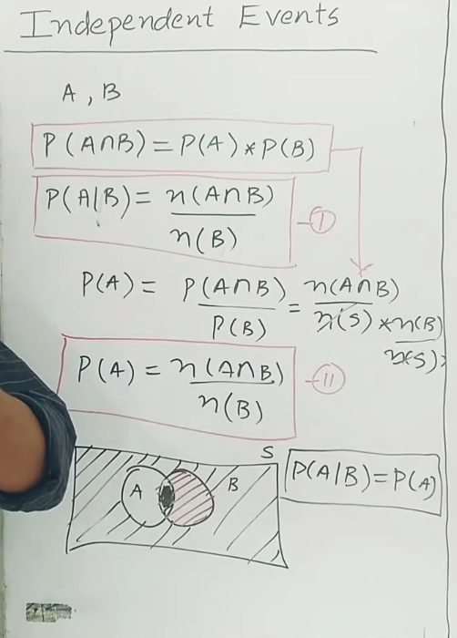

## L83 Naive Bayes Classifier | Part 2 | Independent events in probability 

A,B independent if 
P(A and B) = P(A)* P(B)

* probbiality of head on die 1 if die 2 had tail 
* one event doesn't affect the happending of other event 

--------

Mutually exclusive events 

