## L103 Voting Ensemble | Classification | Voting Classifier | Hard Vs Soft Voting

* Core idea
* Hard vs soft voting
* code

------------

Different models | Base model (D)

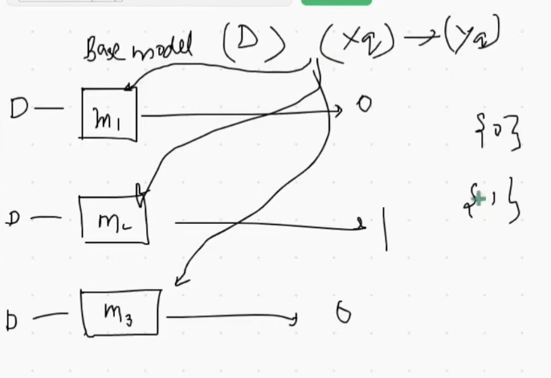

* example of logistic and gaussian
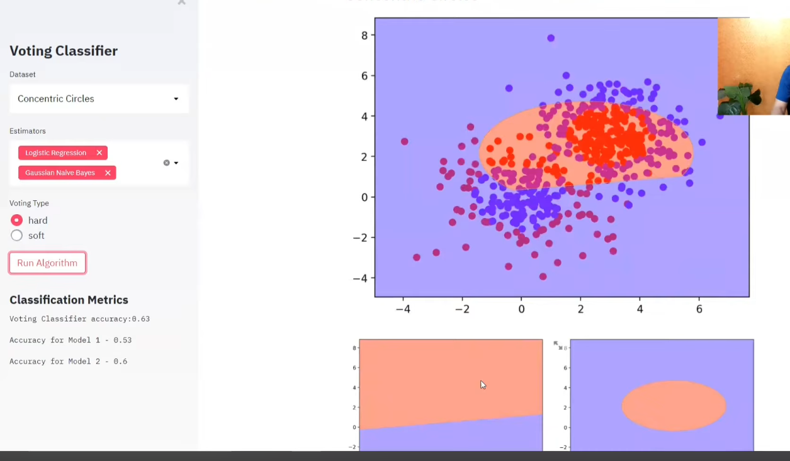

* Logistic and SVM
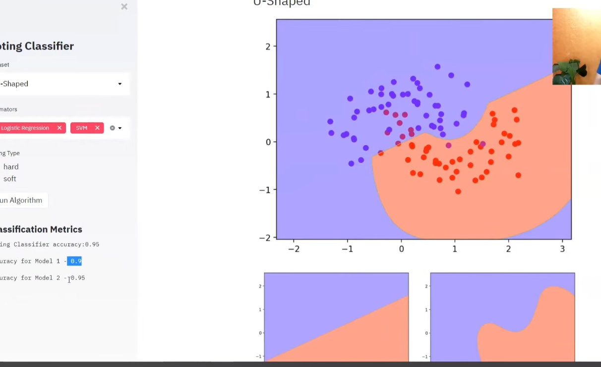

-----

Soft voting

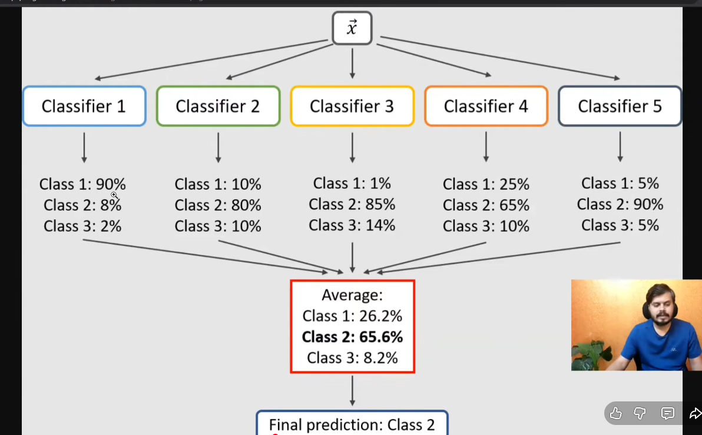

Generally speakign soft gives better result
* in soft we basically do average of all.

---------

Coding

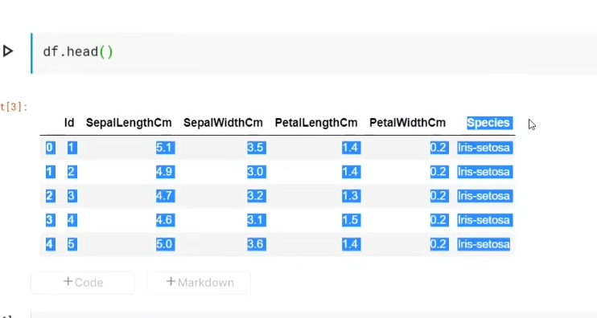

only taking two column 
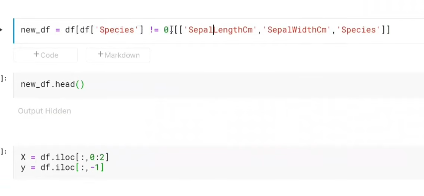

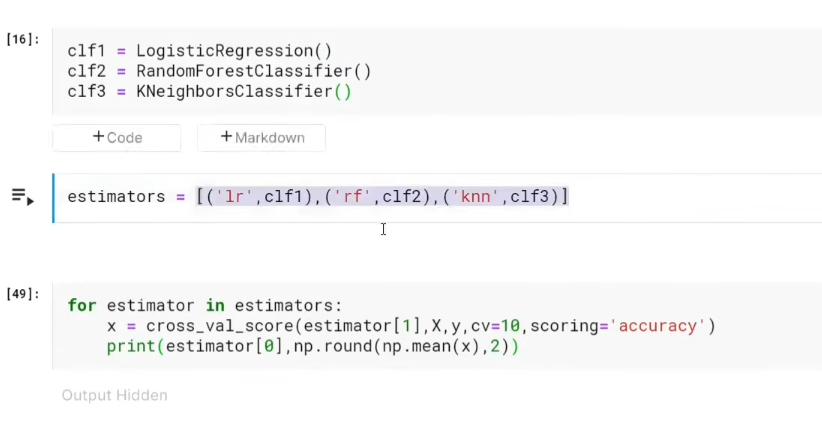
List of tuples

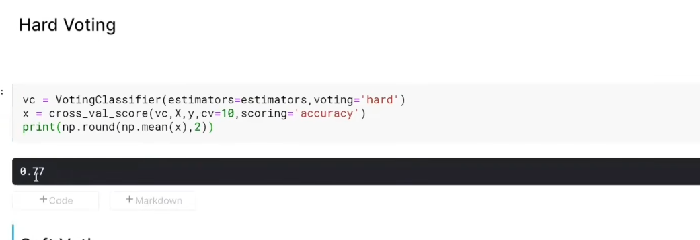

------

we also do soft voting

* hyperparameter: 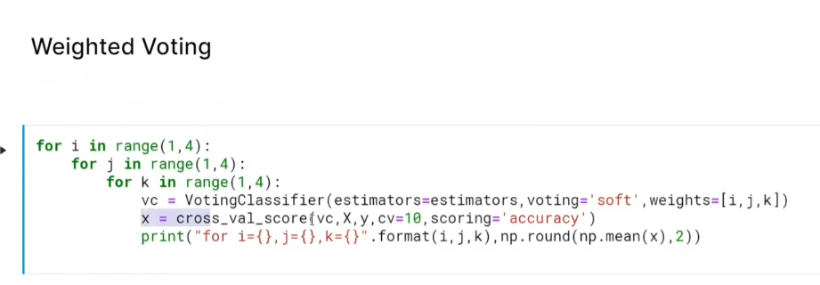
* a more weight to a model, more priority is given to that model

---------

Classifier of same algo
<!-- include code block with proper comments -->

### Code - L103 voting classifier, hard, soft, weighted, and same-algorithm voting (typed from your screenshots)

**Block 1 - iris, made harder on purpose**

```python
import numpy as np
import pandas as pd
from sklearn.datasets import load_iris
from sklearn.preprocessing import LabelEncoder

# the video reads Kaggle's Iris.csv; this builds the same table from scikit-learn
iris = load_iris()
df = pd.DataFrame(iris.data, columns=['SepalLengthCm', 'SepalWidthCm', 'PetalLengthCm', 'PetalWidthCm'])
df['Species'] = ['Iris-' + iris.target_names[i] for i in iris.target]

df['Species'] = LabelEncoder().fit_transform(df['Species'])    # 0, 1, 2

# only the two sepal columns, so that the problem is not trivially easy
X = df[['SepalLengthCm', 'SepalWidthCm']]
y = df['Species']
```

**About the screenshot:** it builds `new_df` (without class 0) but then writes `X = df.iloc[:, 0:2]`, so `new_df` is never used. The video's scores (0.81 for logistic regression, 0.77 for hard voting) match the two sepal columns with **all three classes**, which is what the code above does. To try the harder two-class version, use `new_df = df[df['Species'] != 0]` and take `X`, `y` from it; every score then drops to about 0.6 to 0.75.

**Block 2 - three different base models, each on its own**

```python
from sklearn.linear_model import LogisticRegression
from sklearn.ensemble import RandomForestClassifier, VotingClassifier
from sklearn.neighbors import KNeighborsClassifier
from sklearn.model_selection import cross_val_score

clf1 = LogisticRegression()
clf2 = RandomForestClassifier(random_state=42)
clf3 = KNeighborsClassifier()

estimators = [('lr', clf1), ('rf', clf2), ('knn', clf3)]       # a list of (name, model) tuples

for estimator in estimators:
    x = cross_val_score(estimator[1], X, y, cv=10, scoring='accuracy')
    print(estimator[0], np.round(np.mean(x), 2))    # lr 0.81, rf 0.72, knn 0.76
```

**Block 3 - hard voting (majority of predicted classes)**

```python
vc = VotingClassifier(estimators=estimators, voting='hard')
x = cross_val_score(vc, X, y, cv=10, scoring='accuracy')
print(np.round(np.mean(x), 2))                       # 0.77
```

**Block 4 - soft voting (average of probabilities)**

```python
vc = VotingClassifier(estimators=estimators, voting='soft')
x = cross_val_score(vc, X, y, cv=10, scoring='accuracy')
print(np.round(np.mean(x), 2))                       # 0.77
```

**Block 5 - weighted voting: try every weight from 1 to 3**

```python
for i in range(1, 4):
    for j in range(1, 4):
        for k in range(1, 4):
            vc = VotingClassifier(estimators=estimators, voting='soft', weights=[i, j, k])   # lr, rf, knn
            x = cross_val_score(vc, X, y, cv=10, scoring='accuracy')
            print("for i={},j={},k={}".format(i, j, k), np.round(np.mean(x), 2))
```

**Block 6 - the same algorithm with different hyperparameters**

```python
from sklearn.datasets import make_classification
from sklearn.svm import SVC

# 1000 rows, 20 columns: 15 useful and 5 redundant
X2, y2 = make_classification(n_samples=1000, n_features=20, n_informative=15,
                             n_redundant=5, random_state=2)

# five SVMs that differ only in the degree of the polynomial kernel
svm1 = SVC(probability=True, kernel='poly', degree=1)     # probability=True is needed for soft voting
svm2 = SVC(probability=True, kernel='poly', degree=2)
svm3 = SVC(probability=True, kernel='poly', degree=3)
svm4 = SVC(probability=True, kernel='poly', degree=4)
svm5 = SVC(probability=True, kernel='poly', degree=5)

svm_list = [('svm1', svm1), ('svm2', svm2), ('svm3', svm3), ('svm4', svm4), ('svm5', svm5)]

for estimator in svm_list:                                 # each one alone
    x = cross_val_score(estimator[1], X2, y2, cv=10, scoring='accuracy')
    print(estimator[0], np.round(np.mean(x), 2))           # 0.85 0.85 0.89 0.81 0.86

vc1 = VotingClassifier(estimators=svm_list, voting='soft')  # all five together
x = cross_val_score(vc1, X2, y2, cv=10, scoring='accuracy')
print(np.round(np.mean(x), 2))                              # 0.93 -> better than the best single one
```

(`cross_val_score` trains and tests the model on 10 different splits; `weights` multiplies each model's probability before averaging.)


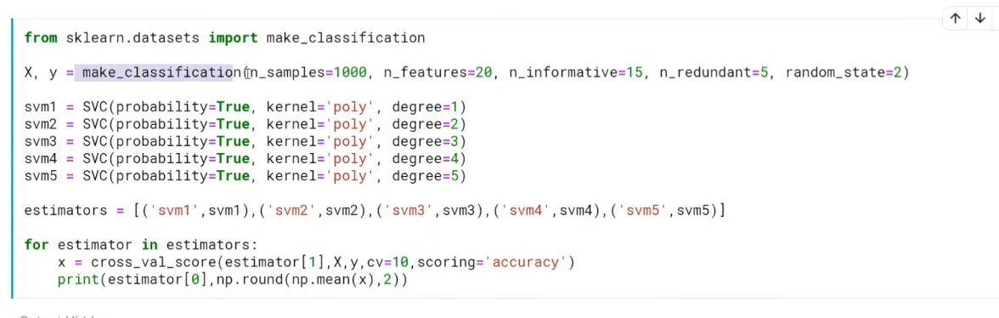

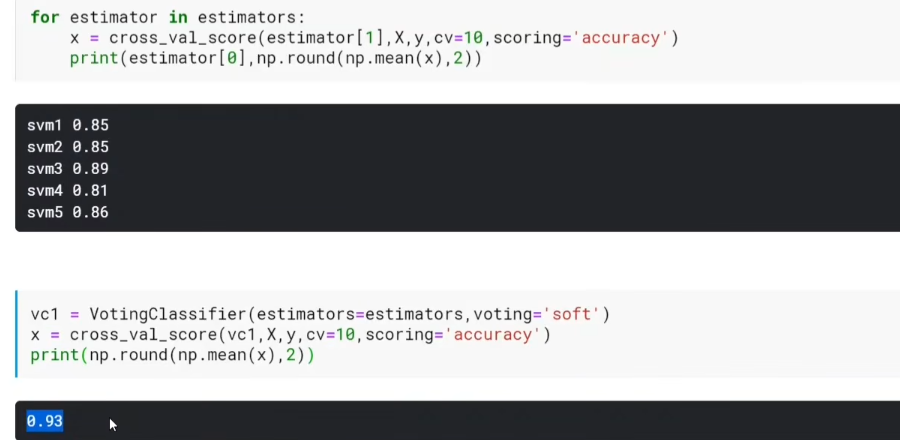

* same algorithmn ko diff hyper paraneters mai run kr dia

### CampusX PDF notes - L103 Voting Classifier: hard versus soft voting (PDF pp. 1860-1882)

(The code is above, at your comment.)

**1. Hard voting**

Every model predicts a class and the **majority** wins: `y_hat = mode(y1, y2, ..., yn)`.

**2. Soft voting**

Every model gives **probabilities**; they are averaged and the class with the highest average wins:

`y_hat = argmax over classes c of (1/n) * sum_i P_i(c)`

| model | P(class 0) | P(class 1) |
|---|---|---|
| 1 | 0.75 | 0.25 |
| 2 | 0.18 | 0.82 |
| 3 | 0.45 | 0.55 |
| **average** | 0.46 | **0.54** -> class 1 |

Hard and soft voting can disagree: two models that are only slightly sure can outvote one very sure model in hard voting, but not necessarily in soft voting.

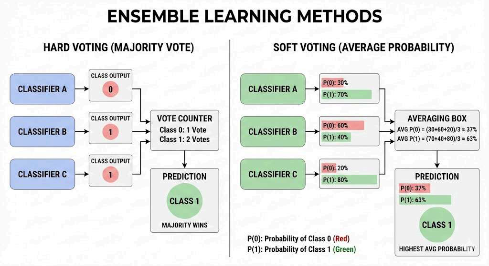

| | hard | soft |
|---|---|---|
| input | class labels | probabilities |
| uses confidence | no | yes |
| needs `predict_proba` | no | yes (`SVC` needs `probability=True`) |
| typical result | good | often better, not always |

**3. Weighted voting**

Better models get larger weights: `y_hat = argmax_c ( sum w_i P_i(c) / sum w_i )`. Example with weights 5, 1, 1 and class-0 probabilities 0.8, 0.4, 0.5: `(5*0.8 + 0.4 + 0.5) / 7 = 0.70`, so class 0. Pick weights by cross-validation (a grid over small integers). In hard voting the weights count votes.

**4. Same algorithm, different settings**

Five SVMs with polynomial degrees 1 to 5 scored 0.85, 0.85, 0.89, 0.81 and 0.86 alone and **0.93** with soft voting.

**5. Pitfalls**

Models that are too similar add nothing; weak models can drag the result down; searching weights on the same data you report makes the score optimistic; many models cost time for little gain (3 to 7 is typical).

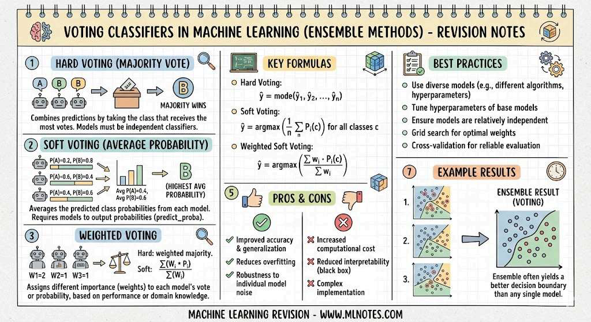

## L104 Voting Ensemble | Part 3

Voting regressor

* we hace multiple base models 
* all regressor

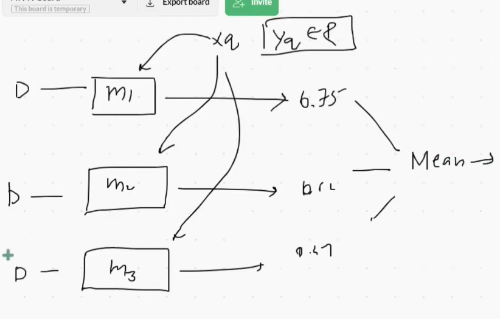

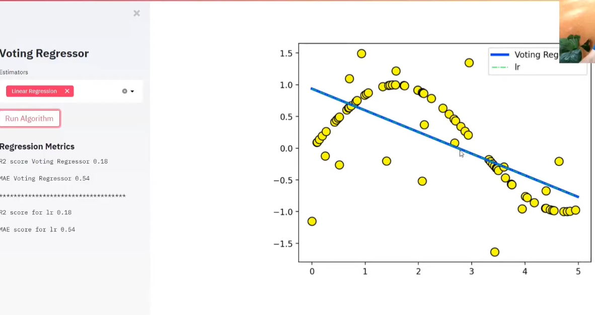

i ll add one more algo SVR
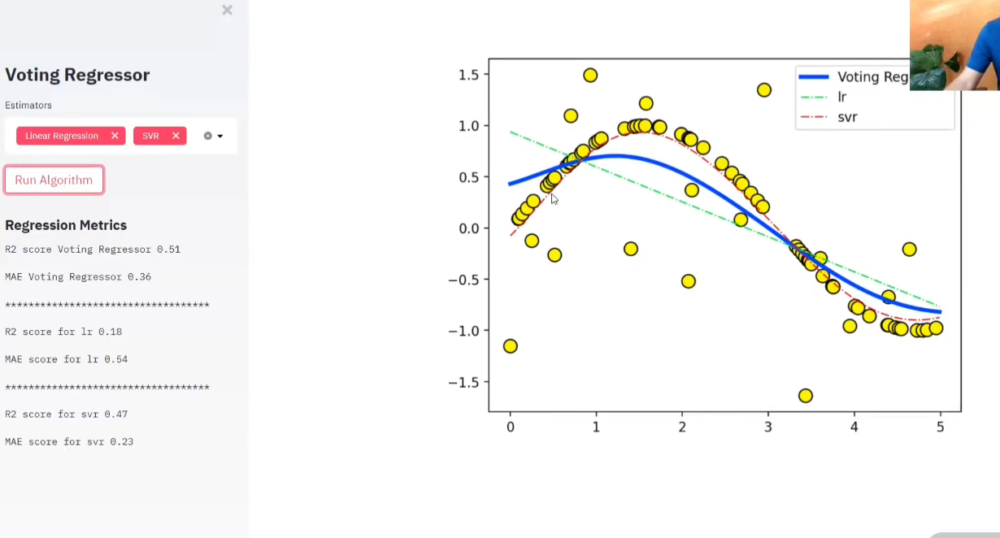

if we also add decision tree it may get overfit

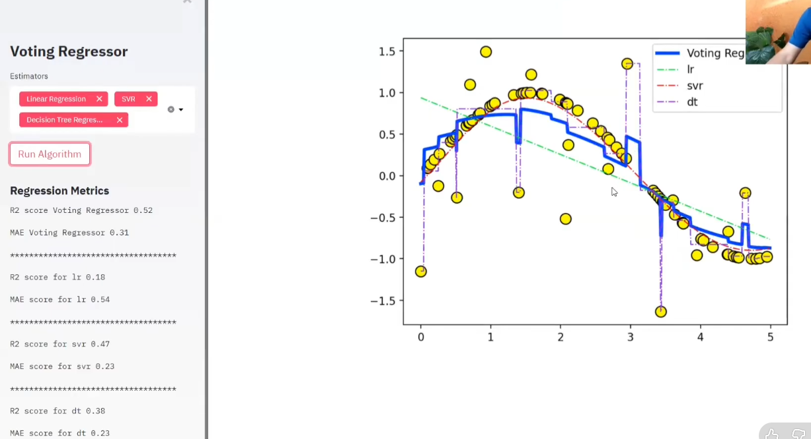

-----

<!-- coding -->

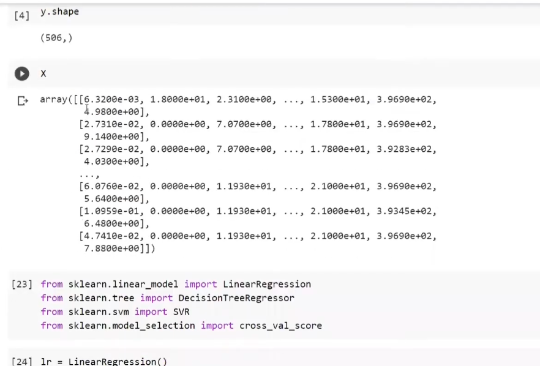

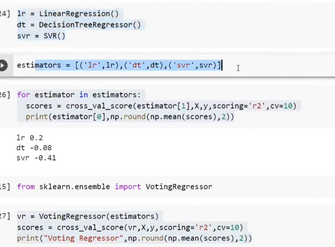

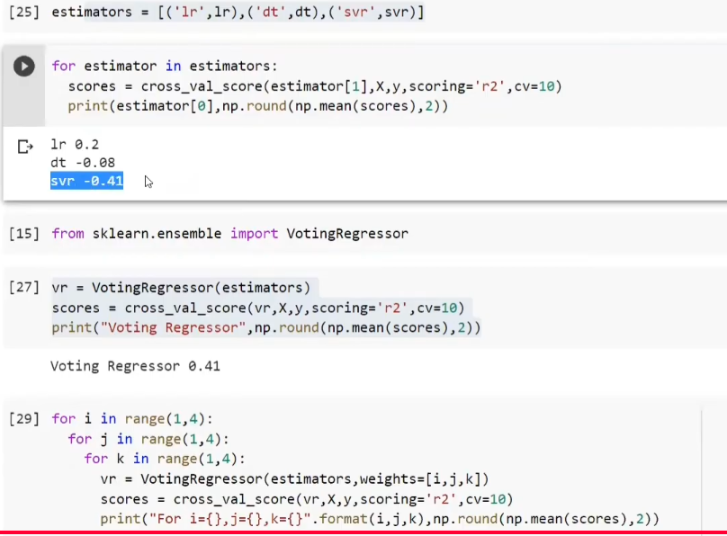

<!-- read these above image and then understand what code to include -->

### Code - L104 voting regressor (read from the three screenshots above)

What the screenshots do, in order: load the Boston data, score three regressors alone, average them with `VotingRegressor`, then try different weights.

**Block 1 - data (506 houses, 13 inputs)**

```python
import numpy as np
import pandas as pd

# the video uses load_boston(), which was removed from scikit-learn 1.2; this reads the original file
raw = pd.read_csv('http://lib.stat.cmu.edu/datasets/boston', sep=r'\s+', skiprows=22, header=None)
X = np.hstack([raw.values[::2, :], raw.values[1::2, :2]])
y = raw.values[1::2, 2]
print(X.shape, y.shape)           # (506, 13) (506,)
```

**Block 2 - three different regressors, each on its own**

```python
from sklearn.linear_model import LinearRegression
from sklearn.tree import DecisionTreeRegressor
from sklearn.svm import SVR
from sklearn.model_selection import cross_val_score

lr = LinearRegression()
dt = DecisionTreeRegressor(random_state=42)
svr = SVR()

estimators = [('lr', lr), ('dt', dt), ('svr', svr)]

for estimator in estimators:
    scores = cross_val_score(estimator[1], X, y, scoring='r2', cv=10)
    print(estimator[0], np.round(np.mean(scores), 2))     # lr 0.2, dt about 0, svr -0.41
```

**Block 3 - the voting regressor (mean of the three predictions)**

```python
from sklearn.ensemble import VotingRegressor

vr = VotingRegressor(estimators)
scores = cross_val_score(vr, X, y, scoring='r2', cv=10)
print("Voting Regressor", np.round(np.mean(scores), 2))   # about 0.4, better than every single model
```

**Block 4 - weighted average: try every weight from 1 to 3**

```python
for i in range(1, 4):
    for j in range(1, 4):
        for k in range(1, 4):
            vr = VotingRegressor(estimators, weights=[i, j, k])      # weights of lr, dt, svr
            scores = cross_val_score(vr, X, y, scoring='r2', cv=10)
            print("For i={},j={},k={}".format(i, j, k), np.round(np.mean(scores), 2))
```

**Block 5 - the same algorithm with different settings**

```python
trees = [(f'dt{d}', DecisionTreeRegressor(max_depth=d, random_state=42)) for d in [1, 3, 5, 7, None]]

for name, model in trees:
    print(name, np.round(cross_val_score(model, X, y, scoring='r2', cv=10).mean(), 2))
print('voting', np.round(cross_val_score(VotingRegressor(trees), X, y, scoring='r2', cv=10).mean(), 2))
```

**Why are the scores so low, even negative?** `cv=10` cuts the rows **in their stored order**, and nearby rows are neighbouring areas, so every fold is unlike the rest. `SVR` also needs scaled features. R2 below 0 means worse than always predicting the mean. For realistic scores use `KFold(10, shuffle=True, random_state=1)` and put `StandardScaler` before `SVR`; the lesson (the average beats weak, different models) is what the video is showing.


-----------

### CampusX PDF notes - L104 Voting Regressor (PDF pp. 1883-1910)

(The code is above, at your comment.)

**1. Difference from the classifier**

| | voting classifier | voting regressor |
|---|---|---|
| output | a class | a number |
| combination | majority, or average probability | **average of predictions** |
| types | hard, soft, weighted | simple, weighted |

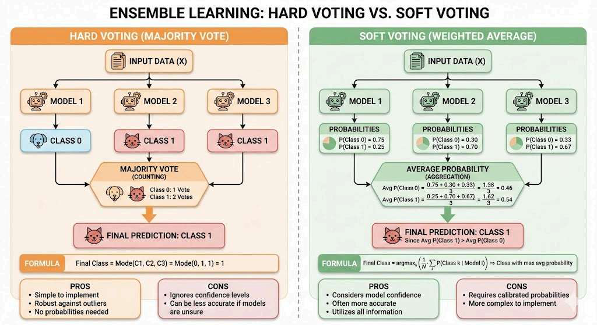

**2. Formulas**

* simple: `y_hat = (1/n) * sum y_hat_i`
* weighted: `y_hat = sum (w_i * y_hat_i) / sum w_i`

With predictions 25.5, 28.3 and 26.1 the mean is **26.63**; weights `[2, 1, 1]` give `(51 + 28.3 + 26.1) / 4 = 26.35`, pulled towards the first model.

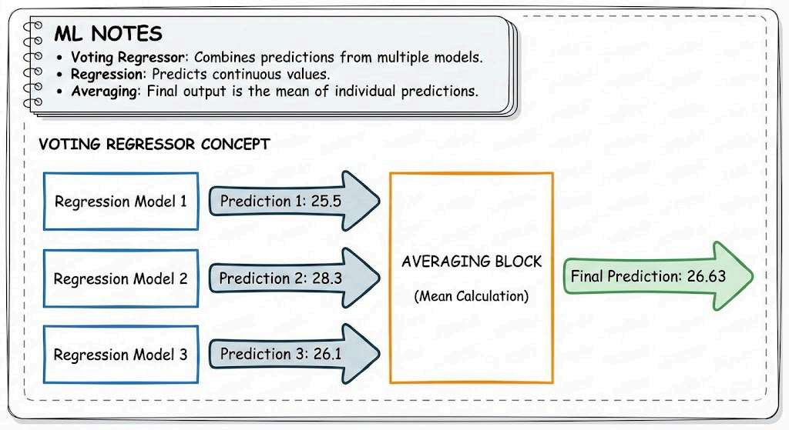

**3. Boston example (video)**

| model | R2 |
|---|---|
| linear regression | 0.20 |
| decision tree | -0.08 |
| SVR | -0.41 |
| voting regressor | 0.41 |
| weighted `[2, 1, 1]` (PDF) | 0.47 |

`R2 = 1 - SS_res / SS_tot`: 1 is perfect, 0 equals predicting the mean, **negative is worse than the mean**. Decision trees with different `max_depth` combined the same way also moved from negative scores to a positive one.

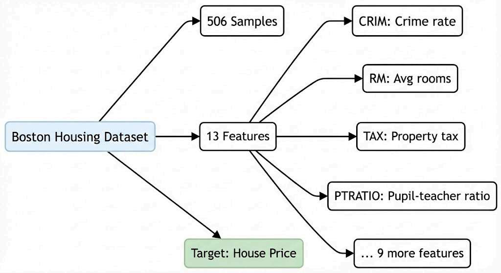

**4. Why averaging helps**

If one model overshoots and another undershoots, the mean is closer to the truth and the curve becomes smoother. As your note says, adding a decision tree can bring its overfitting into the ensemble.

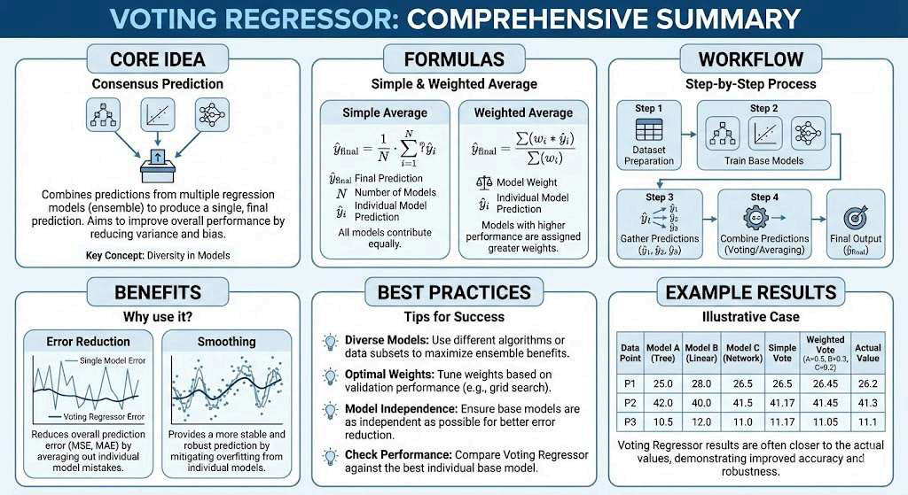

(The "example results" table in this figure is illustrative.)

## L105 Bagging | Part 1

Baggin Ensemble

* why use bagging 

-------

Bagging 
* Bootstrapping + aggregration

* bootstrapping - > technique , draw randoms from a sample
* dataset 10K 
* models of all single algorithm make sure
* train model --> with each part | every model given diff dataset

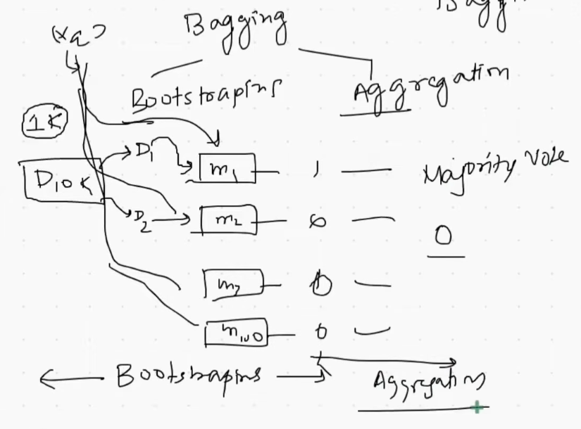

* aggregration is the part where we do the majority voting 
* why we do bagging ??How do it improve performance

* we need low bias and low variance
* train result bahut acha low bias
* most ML algo will be High bias , low Variance or vice versa

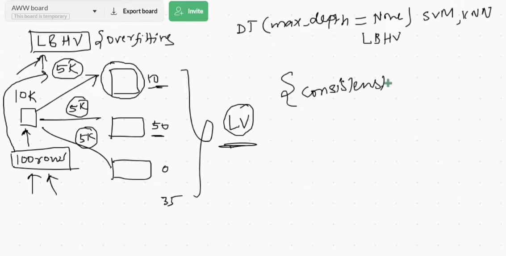
* consistent result
* because lets say new 100 dataset comes, it is sure that all wont go to the any one of the model , hence low varianve

-------

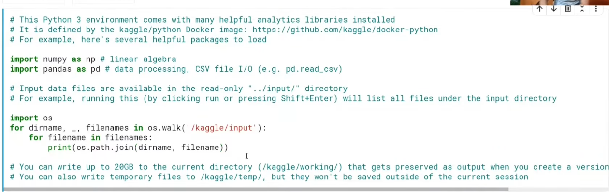

* Iris dataset
* 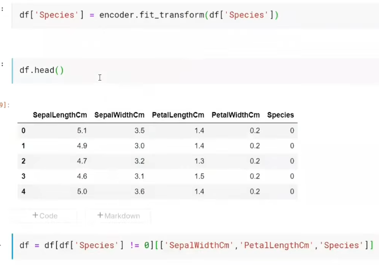
* 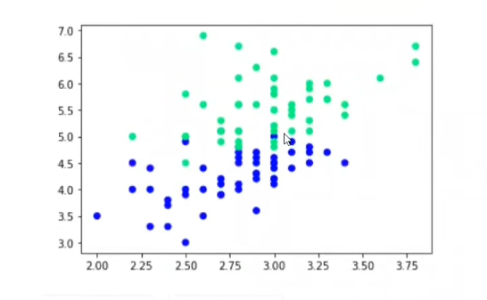
* 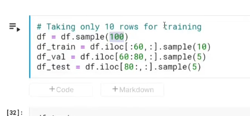
<!-- shuffled -->

### Code - L105 shuffling the data with `df.sample`

`df.sample(n)` returns `n` rows in **random order**, so it is a quick way to shuffle. The iris rows are stored class by class; without shuffling, a slice such as `df.iloc[:60]` would hold only some classes.

```python
import numpy as np
import pandas as pd
from sklearn.datasets import load_iris

iris = load_iris()
df = pd.DataFrame(iris.data, columns=['SepalLengthCm', 'SepalWidthCm', 'PetalLengthCm', 'PetalWidthCm'])
df['Species'] = iris.target                                   # 0, 1, 2 (what LabelEncoder gives)

# keep classes 1 and 2 and two columns (100 rows)
df = df[df['Species'] != 0][['SepalWidthCm', 'PetalLengthCm', 'Species']]

# df.sample(100) returns all 100 rows in random order = shuffling
df = df.sample(100, random_state=1)

df_train = df.iloc[:60, :].sample(10, random_state=2)         # only 10 rows for training
df_val = df.iloc[60:80, :].sample(5, random_state=3)
df_test = df.iloc[80:, :].sample(5, random_state=4)

X_test = df_test.iloc[:, 0:2]
y_test = df_test.iloc[:, -1]
df_train
```

(`random_state` makes the shuffle repeatable; your screenshot omits it, so its rows differ each run. `df.sample(frac=1)` also shuffles every row.)

* df.sample

<!-- Bagging code -->

### Code - L105 bagging by hand (typed from your screenshots)

(Continues the code above: it needs `df_train`, `X_test`, `y_test`.)

**Block 1 - a helper: train one tree, show it, show its regions, test it**

```python
import matplotlib.pyplot as plt
from sklearn.tree import DecisionTreeClassifier, plot_tree
from sklearn.metrics import accuracy_score
from mlxtend.plotting import plot_decision_regions            # pip install mlxtend

def evaluate(clf, X, y):
    clf.fit(X.values, y.values)
    plt.figure(figsize=(7, 5))
    plot_tree(clf)
    plt.show()
    plot_decision_regions(X.values, y.values, clf=clf, legend=2)
    plt.show()
    y_pred = clf.predict(X_test.values)
    print(accuracy_score(y_test, y_pred))
```

**Block 2 - bag 1: 8 rows drawn WITH replacement**

```python
# Data for Tree 1
df_bag = df_train.sample(8, replace=True, random_state=10)    # the same row can appear twice
X = df_bag.iloc[:, 0:2]
y = df_bag.iloc[:, -1]
print(df_bag)

dt_bag1 = DecisionTreeClassifier()
evaluate(dt_bag1, X, y)
```

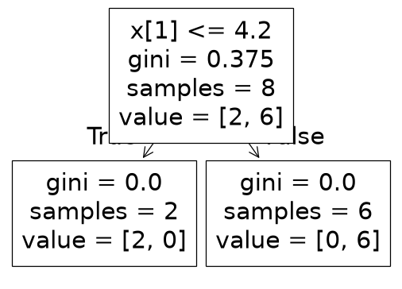

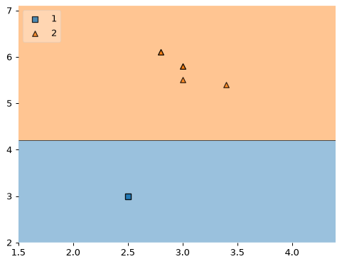

**Block 3 - bags 2 and 3: same algorithm, different rows**

```python
df_bag = df_train.sample(8, replace=True, random_state=20)
dt_bag2 = DecisionTreeClassifier()
evaluate(dt_bag2, df_bag.iloc[:, 0:2], df_bag.iloc[:, -1])

df_bag = df_train.sample(8, replace=True, random_state=30)
dt_bag3 = DecisionTreeClassifier()
evaluate(dt_bag3, df_bag.iloc[:, 0:2], df_bag.iloc[:, -1])
```

**Block 4 - aggregation: every tree predicts, the majority wins**

```python
for query in [[2.9, 4.6], [2.2, 5.0]]:
    point = np.array(query).reshape(1, 2)
    votes = [int(m.predict(point)[0]) for m in (dt_bag1, dt_bag2, dt_bag3)]
    print("Predictors 1, 2, 3 for", query, "->", votes)
    print("Majority vote:", max(set(votes), key=votes.count))
```

(In your screenshots all three trees say 1 for the first point; for `[2.2, 5.0]` they say 2, 1, 2, so the answer is 2. With other random bags the votes can differ.)

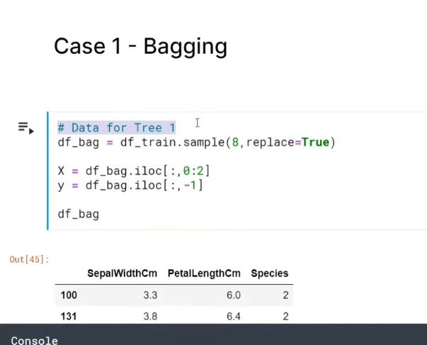

* sample replacement, one row can be multiple time 
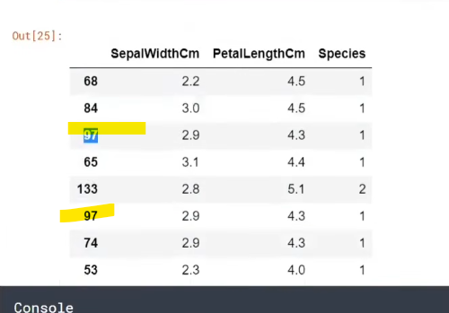
* evaluate funciton 
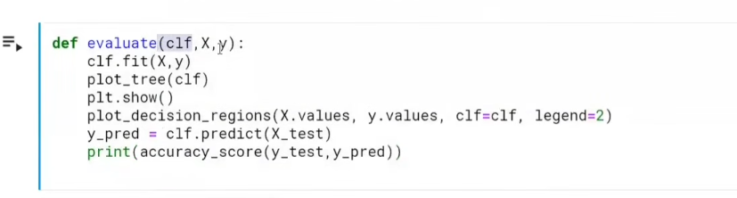

* 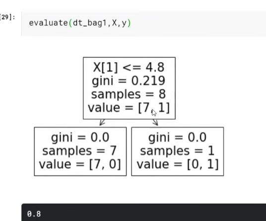

* we creating new sample size, trainging part

* Aggregatuoin oni prediction

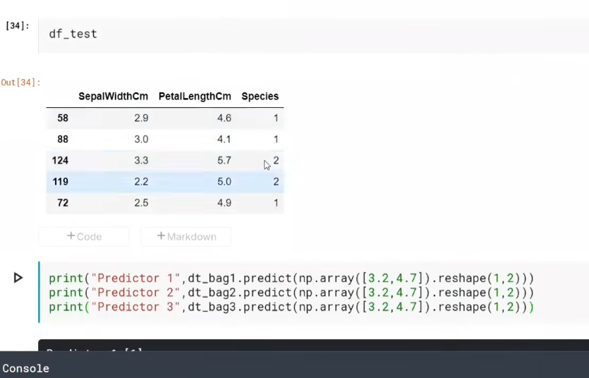

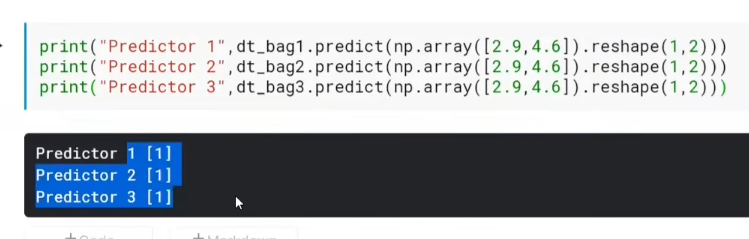
* all three saying its 1
* 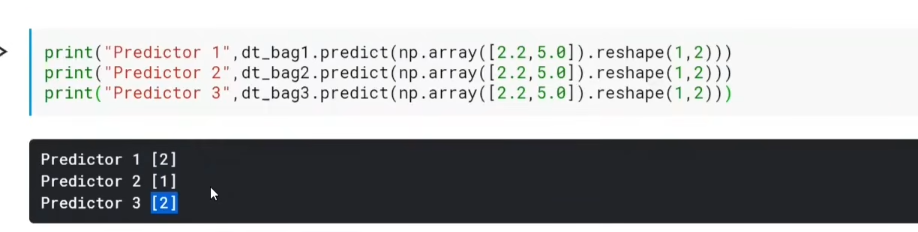
majority saying 2 , hence 2 voting

--------------------

Types of bagging: 

* on high dimensional we can also do column sampling

------
Pasting : you do row sampling but without replacement
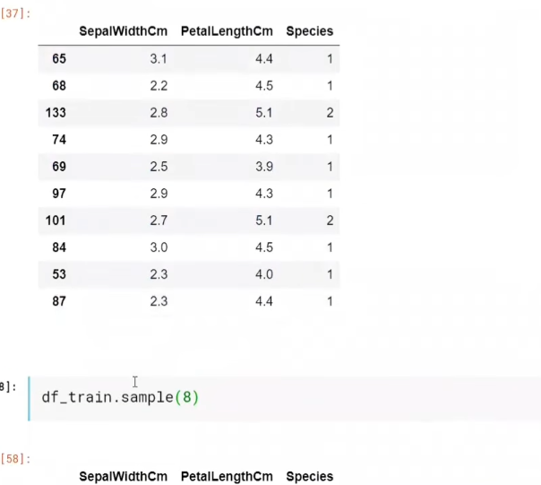

<!-- explain code , rad these images -->

### Code explained - L105 pasting, random subspaces and random patches (from these images)

All three only change **how each model's data is drawn**. `DataFrame.sample` does the drawing: `replace` says whether an item may be picked again, `axis=0` picks rows and `axis=1` picks columns.

(Continues the code above: it needs `iris`, `df_train` and `pd`.)

**Pasting - rows WITHOUT replacement**

```python
df_train.sample(8)                    # 8 different rows; no row can repeat
```

**A table with all columns for the column examples**

```python
full = pd.DataFrame(iris.data, columns=['SepalLengthCm', 'SepalWidthCm', 'PetalLengthCm', 'PetalWidthCm'])
full['Species'] = iris.target
df1 = full.sample(10, random_state=5)
features = df1.drop(columns='Species')       # sample only input columns, never the target
```

**Random subspaces - columns only, every row kept**

```python
features.sample(2, axis=1)                   # 2 random columns, all 10 rows
features.sample(2, replace=True, axis=1)     # with replacement: the same column may appear twice
```

**Random patches - rows AND columns**

```python
rows = df1.sample(8, replace=True)                                  # first draw rows
patch = rows.drop(columns='Species').sample(2, replace=True, axis=1)   # then draw columns
target = rows['Species']                                            # labels of the same rows
patch
```

**Reading your screenshots:** `df1.sample(2, replace=True, axis=1)` there samples from **all** columns, so it can pick `Species` (the answer) or `Id` as an input. That is why one output shows `SepalWidthCm, Species`. Remove those columns before sampling, as above.

| technique | rows | columns |
|---|---|---|
| bagging | sampled with replacement | all |
| pasting | sampled without replacement | all |
| random subspaces | all | sampled |
| random patches | sampled | sampled |


* random subspace: you only do the column sampling4
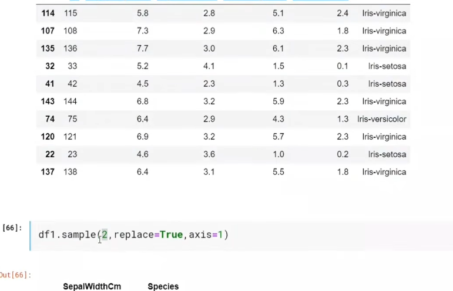

* random patches you do both random column and row sampling

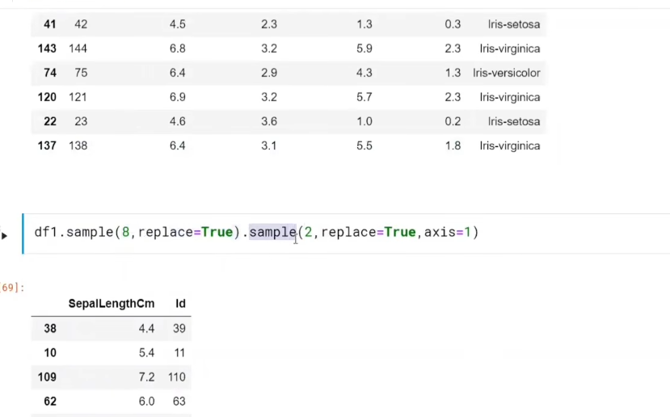
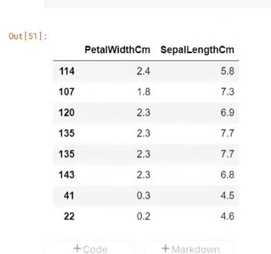

-----------------

### CampusX PDF notes - L105 Bagging: bootstrapping and aggregation (PDF pp. 1911-1933)

(The code is above, at your comments.)

**1. Definition**

**Bagging = Bootstrap AGGregatING.**

1. **Bootstrap:** draw several samples of the training data **with replacement**;
2. train one model of the **same algorithm** on each sample, independently;
3. **aggregate:** majority vote (classification) or mean (regression).

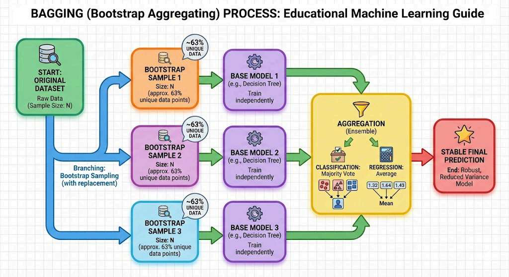

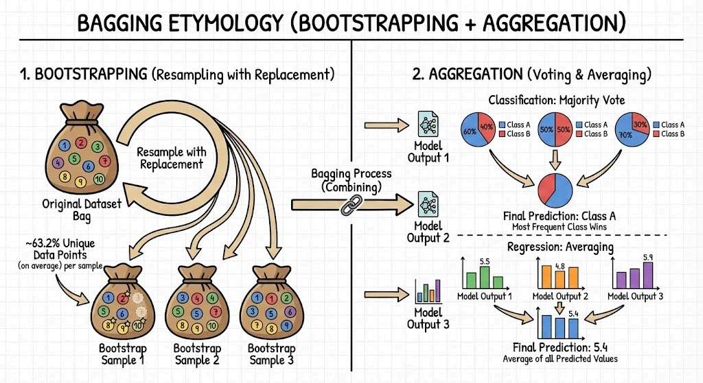

**2. Why it helps: bias and variance**

`expected error = bias^2 + variance + irreducible noise`

| | meaning | example |
|---|---|---|
| high bias | cannot capture the pattern (underfit) | linear model on curved data |
| high variance | changes a lot with the data (overfit) | fully grown decision tree |

Bagging takes **low-bias, high-variance** models and averages them: the bias stays about the same and the **variance drops**. For `M` models with variance `s^2` and pairwise correlation `p`:

**`variance of the average = p s^2 + (1 - p) s^2 / M`**

With independent models (`p = 0`) it is `s^2 / M`. Correlation sets a floor of `p s^2`, so the samples should make the models **different**.

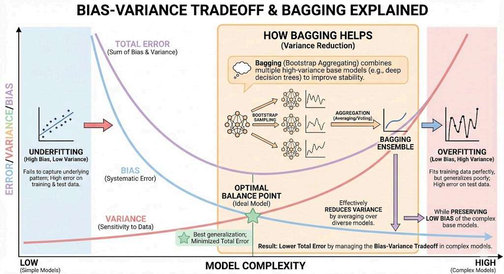

As in your board example: if 100 noisy rows are spread over many samples, each model sees only a few of them, and their effect on the final answer is small.

**3. The four variants**

| variant | rows | columns |
|---|---|---|
| bagging | sampled with replacement | all |
| pasting | sampled without replacement | all |
| random subspaces | all | sampled |
| random patches | sampled | sampled |

Bagging usually beats pasting because its samples are more diverse. Column sampling is useful for high-dimensional data.

**4. Best base models**

High-variance ones (unpruned trees). Linear or already regularised models gain little.

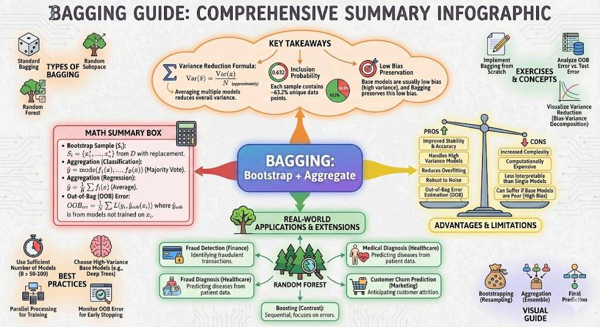

## L106 Bagging Ensemble | Part 2 | Bagging classifier

* demo run on an app
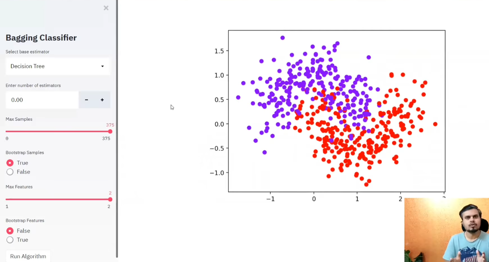

* toy dataset 
* first choose base model 
* estimators
* max samples -> each get 50 data 
* bootstrap samples --> replicates 
* max feature -> 2

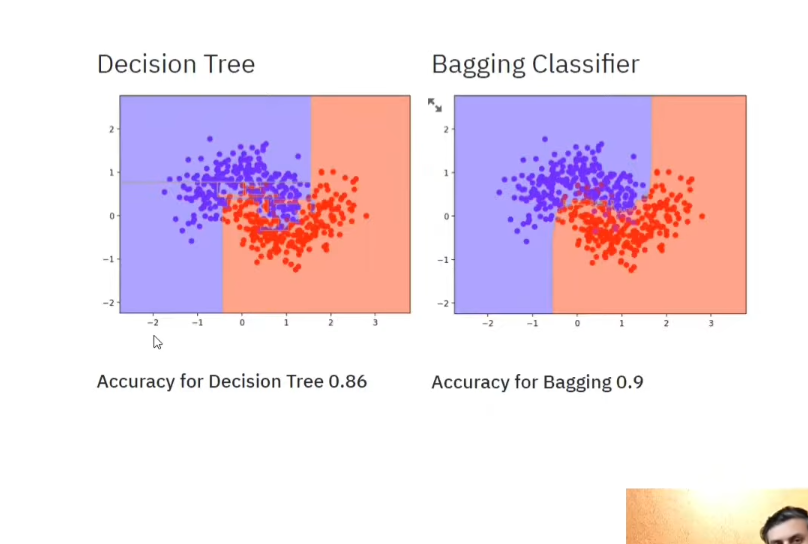

* blue region shows overfitting
* you can see bagging is geting better

* in knn term also azzuracy imroving
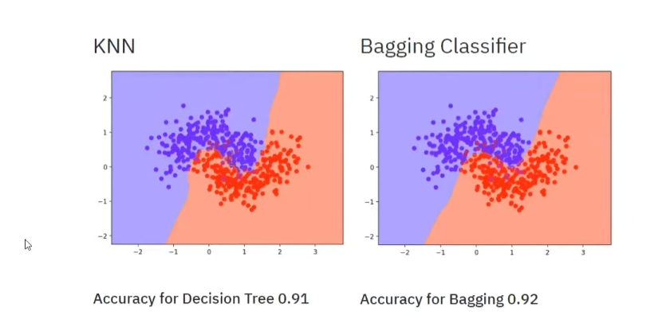

* we can also change no. of models(estimators)
------------

Bootstrap Samples =--> False
* Random 


* on single row and column it is failing
* use bagging (random subspace), if more no. of clayce wih 50k+ then s

-----------

bagging demo


Bagging


* 
* everytime we can get diff accuracy score


--------------

Pasting


* Random Subspaces
* gnerally baggin better 
* more option 


* column reduced


-----

Random patche 


----

Wht is OOB score

* out of bag score
* possible some bag dont get to any decision tree
* around only 63 % gets inside the bag 
* out of bag sample around 37% in sampling
* using these unseen we can use to test our model 


* 

------------

Bagging Tips

* bagging generally gives better result than pasting
* good results come aroung 25 % to 50% row sampling mark
* random patches and subspaces should be used while dealing with high dimensional data
* to find the correct hyper parameter values we can do GridSearchCV / RandomSearchCV

--

Applying GridSearchCV

<!-- kindly explain this algorithm with a code -->

### GridSearchCV explained, with code (L106)

**What the algorithm does**

1. You list candidate values for each hyperparameter (the **grid**).
2. It forms **every combination**: here `3 x 4 x 2 x 4 = 96` models.
3. Each combination is scored by **5-fold cross-validation**: the training data is cut into 5 parts, the model trains on 4 and is scored on the 5th, five times. That is `96 x 5 = 480` trainings.
4. The combination with the highest **average** score wins (`best_params_`, `best_score_`).
5. By default it is trained once more on all the training data, so `search` can predict directly.

The test set is not used in the search, so it still gives an honest final score.

**Block 1 - data (the same setup as the bagging demo)**

```python
from sklearn.datasets import make_classification
from sklearn.model_selection import train_test_split, GridSearchCV
from sklearn.ensemble import BaggingClassifier

X, y = make_classification(n_samples=10000, n_features=10, n_informative=3, random_state=42)
X_train, X_test, y_train, y_test = train_test_split(X, y, test_size=0.2, random_state=42)
```

**Block 2 - the grid and the search**

```python
parameters = {
    'n_estimators': [50, 100, 500],          # number of base models
    'max_samples': [0.1, 0.4, 0.7, 1.0],     # fraction of rows per model
    'bootstrap': [True, False],              # bagging or pasting
    'max_features': [0.1, 0.4, 0.7, 1.0]     # fraction of columns per model
}

search = GridSearchCV(BaggingClassifier(), parameters, cv=5, n_jobs=-1)   # n_jobs=-1: use all CPU cores
search.fit(X_train, y_train)                 # slow: 480 fits, up to 500 trees each (several minutes or more)
```

**Block 3 - results**

```python
print(search.best_score_)        # your screenshot: 0.8986
print(search.best_params_)       # your screenshot: bootstrap True, max_features 0.7, max_samples 0.4, n_estimators 500
print(search.score(X_test, y_test))
```

(Your numbers will differ, because the video's data was generated without a fixed seed. If it is too slow, drop 500 from `n_estimators`, or use `RandomizedSearchCV`, which tries only a random subset of the combinations.)


### Code - L106 bagging classifier on 10,000 rows (typed from your screenshots)

**Block 1 - data and a single decision tree**

```python
from sklearn.datasets import make_classification
from sklearn.model_selection import train_test_split
from sklearn.ensemble import BaggingClassifier
from sklearn.tree import DecisionTreeClassifier
from sklearn.svm import SVC
from sklearn.metrics import accuracy_score

X, y = make_classification(n_samples=10000, n_features=10, n_informative=3, random_state=42)
X_train, X_test, y_train, y_test = train_test_split(X, y, test_size=0.2, random_state=42)

dt = DecisionTreeClassifier(random_state=42)
dt.fit(X_train, y_train)
y_pred = dt.predict(X_test)
print("Decision Tree accuracy", accuracy_score(y_test, y_pred))
```

**Block 2 - bagging with 500 trees**

```python
bag = BaggingClassifier(
    estimator=DecisionTreeClassifier(),   # called base_estimator before scikit-learn 1.2
    n_estimators=500,                     # number of trees
    max_samples=0.25,                     # each tree gets 25% of the rows
    bootstrap=True,                       # rows drawn with replacement
    random_state=42,
    n_jobs=-1                             # use all CPU cores
)
bag.fit(X_train, y_train)
y_pred = bag.predict(X_test)
print("Bagging", accuracy_score(y_test, y_pred))

print(bag.estimators_samples_[0].shape)    # rows given to the first tree: (2000,)
print(bag.estimators_features_[0].shape)   # columns given to the first tree: (10,)
```

**Block 3 - bagging with SVM as the base model**

```python
bag_svm = BaggingClassifier(estimator=SVC(), n_estimators=500, max_samples=0.25,
                            bootstrap=True, random_state=42, n_jobs=-1)
bag_svm.fit(X_train, y_train)              # slow: 500 SVMs
print("Bagging using SVM", accuracy_score(y_test, bag_svm.predict(X_test)))
```

**Block 4 - pasting**

```python
paste = BaggingClassifier(estimator=DecisionTreeClassifier(), n_estimators=500, max_samples=0.25,
                          bootstrap=False,          # WITHOUT replacement
                          random_state=42, verbose=1, n_jobs=-1)
paste.fit(X_train, y_train)
print("Pasting classifier", accuracy_score(y_test, paste.predict(X_test)))
```

**Block 5 - random subspaces**

```python
subspace = BaggingClassifier(estimator=DecisionTreeClassifier(), n_estimators=500,
                             max_samples=1.0, bootstrap=False,              # every row
                             max_features=0.5, bootstrap_features=True,     # half the columns
                             random_state=42, n_jobs=-1)
subspace.fit(X_train, y_train)
print("Random Subspaces classifier", accuracy_score(y_test, subspace.predict(X_test)))
print(subspace.estimators_samples_[0].shape, subspace.estimators_features_[0].shape)   # (8000,) (5,)
```

**Block 6 - random patches**

```python
patches = BaggingClassifier(estimator=DecisionTreeClassifier(), n_estimators=500,
                            max_samples=0.25, bootstrap=True,
                            max_features=0.5, bootstrap_features=True,
                            random_state=42, n_jobs=-1)
patches.fit(X_train, y_train)
print("Random Patches classifier", accuracy_score(y_test, patches.predict(X_test)))
```

**Block 7 - out-of-bag score**

```python
oob = BaggingClassifier(estimator=DecisionTreeClassifier(), n_estimators=500, max_samples=0.25,
                        bootstrap=True, oob_score=True, random_state=42, n_jobs=-1)
oob.fit(X_train, y_train)
print("OOB score", oob.oob_score_)                 # scored on rows each tree never saw
print("Accuracy", accuracy_score(y_test, oob.predict(X_test)))
```

(Scores in your screenshots: tree 0.8755, bagging 0.937, pasting 0.9395, random subspaces 0.9335 and 0.911 in two runs, OOB 0.904. Yours differ because the video's data had no fixed seed.)

### CampusX PDF notes - L106 Bagging Classifier in practice (PDF pp. 1934-1953)

**1. Picture**


**2. Main parameters**

| parameter | meaning |
|---|---|
| `estimator` | the base model (default: decision tree) |
| `n_estimators` | number of models (default 10) |
| `max_samples` | rows per model, count or fraction |
| `bootstrap` | rows with replacement (True = bagging, False = pasting) |
| `max_features` | columns per model |
| `bootstrap_features` | columns with replacement |
| `oob_score` | evaluate on out-of-bag rows (needs `bootstrap=True`) |
| `n_jobs` | parallel cores, -1 for all |

**3. Out-of-bag (OOB) evaluation**

When `n` rows are drawn with replacement from `n` rows, the chance that a given row is **never** drawn is `(1 - 1/n)^n`, which tends to `e^-1 = 0.368`. So each model sees about **63 percent** of the distinct rows and about **37 percent** stay unseen. Each row is predicted only by the models that did not train on it, which gives a validation score without a separate set.

With `max_samples` below 1 the unseen share is larger: after `0.25 n` draws about `e^-0.25 = 78 percent` of the rows are unseen by a tree.


**4. Tips (as in your notes)**

* bagging usually beats pasting;
* `max_samples` of 0.25 to 0.5 often works well;
* use column sampling for high-dimensional data;
* tune with `GridSearchCV` or `RandomizedSearchCV`.


## L107 Bagging Regressor 

* Bagging regressor
* same dataset sampled to diff model 
* at aggregration time we jsut do the mean
* adn at bootstrapping time me can do all those which we learned before

<!-- please explian once again and give example of each bootstrapping technique -->

### Bagging regressor explained again, with an example of each sampling technique

**The idea once more**

1. Draw several datasets from the training data.
2. Train the **same** regression algorithm on each one.
3. For a new query every model predicts a number, and the answer is the **mean**.

Averaging smooths out the mistakes of the individual models, so the variance drops.

**A tiny example** (6 rows, 4 columns, to see exactly what each model receives)

```python
import numpy as np
import pandas as pd

data = pd.DataFrame({'cgpa': [6.1, 7.0, 7.4, 8.2, 8.8, 9.3],
                     'iq': [85, 92, 99, 104, 110, 121],
                     'hours': [2, 3, 3, 5, 6, 7],
                     'projects': [0, 1, 1, 2, 3, 3],
                     'package': [3.0, 4.2, 4.8, 6.5, 8.0, 9.4]},
                    index=['r1', 'r2', 'r3', 'r4', 'r5', 'r6'])
features = ['cgpa', 'iq', 'hours', 'projects']      # 'package' is the target
```

**1. Bagging: rows with replacement, all columns**

```python
data.sample(4, replace=True, random_state=1)        # a row may appear more than once
```

**2. Pasting: rows without replacement, all columns**

```python
data.sample(4, replace=False, random_state=1)       # 4 different rows
```

**3. Random subspaces: all rows, some columns**

```python
cols = list(pd.Series(features).sample(2, random_state=1))
data[cols + ['package']]                            # every student, only 2 inputs
```

**4. Random patches: some rows and some columns**

```python
rows = data.sample(4, replace=True, random_state=2)
cols = list(pd.Series(features).sample(2, random_state=2))
rows[cols + ['package']]
```

**The same four with scikit-learn's `BaggingRegressor`**

```python
from sklearn.ensemble import BaggingRegressor
from sklearn.tree import DecisionTreeRegressor
from sklearn.datasets import make_regression
from sklearn.model_selection import train_test_split

Xr, yr = make_regression(n_samples=1000, n_features=10, n_informative=6, noise=20, random_state=0)
Xr_train, Xr_test, yr_train, yr_test = train_test_split(Xr, yr, test_size=0.2, random_state=0)

settings = {
    'single tree':      None,
    'bagging':          dict(bootstrap=True,  max_samples=0.5, max_features=1.0),
    'pasting':          dict(bootstrap=False, max_samples=0.5, max_features=1.0),
    'random subspaces': dict(bootstrap=False, max_samples=1.0, max_features=0.5),
    'random patches':   dict(bootstrap=True,  max_samples=0.5, max_features=0.5),
}

for name, s in settings.items():
    if s is None:
        model = DecisionTreeRegressor(random_state=0)
    else:
        model = BaggingRegressor(DecisionTreeRegressor(), n_estimators=100, random_state=0, **s)
    model.fit(Xr_train, yr_train)
    print(f'{name:17s} train R2 {model.score(Xr_train, yr_train):.3f}   test R2 {model.score(Xr_test, yr_test):.3f}')
```

(`max_samples` and `max_features` given as fractions are the share of rows and columns each model gets; `bootstrap` controls replacement for rows and `bootstrap_features` for columns.)


------

code


training : 0.98

test : 0.812


* GridSearchCV is use to hyperparameter tunign

-------

### Code - L107 bagging regressor on the Boston data (typed from your screenshots)

**Block 1 - data and three single models**

```python
import numpy as np
import pandas as pd
from sklearn.linear_model import LinearRegression
from sklearn.neighbors import KNeighborsRegressor
from sklearn.model_selection import GridSearchCV, train_test_split
from sklearn.tree import DecisionTreeRegressor
from sklearn.metrics import r2_score

# load_boston() was removed from scikit-learn, so read the original file
raw = pd.read_csv('http://lib.stat.cmu.edu/datasets/boston', sep=r'\s+', skiprows=22, header=None)
X_boston = np.hstack([raw.values[::2, :], raw.values[1::2, :2]])
Y_boston = raw.values[1::2, 2]

X_train, X_test, Y_train, Y_test = train_test_split(X_boston, Y_boston, train_size=0.80,
                                                    test_size=0.20, random_state=123)
print(X_train.shape, X_test.shape)               # (404, 13) (102, 13)

lr = LinearRegression()
dt = DecisionTreeRegressor()
knn = KNeighborsRegressor()
for name, model in [('LR', lr), ('DT', dt), ('KNN', knn)]:
    model.fit(X_train, Y_train)
    print("R^2 score for", name, r2_score(Y_test, model.predict(X_test)))   # 0.66, 0.44, 0.55
```

**Block 2 - bagging regressor with default settings**

```python
from sklearn.ensemble import BaggingRegressor

bag_regressor = BaggingRegressor(random_state=1)          # 10 decision trees
bag_regressor.fit(X_train, Y_train)

print('Training Coefficient of R^2 : %.3f' % bag_regressor.score(X_train, Y_train))   # 0.980
print('Test Coefficient of R^2 : %.3f' % bag_regressor.score(X_test, Y_test))         # 0.812
```

**Block 3 - tune it with GridSearchCV**

```python
params = {'estimator': [None, LinearRegression(), KNeighborsRegressor()],   # None = decision tree
          'n_estimators': [20, 50, 100],
          'max_samples': [0.5, 1.0],
          'max_features': [0.5, 1.0],
          'bootstrap': [True, False],
          'bootstrap_features': [True, False]}

grid = GridSearchCV(BaggingRegressor(random_state=1), param_grid=params, cv=3, n_jobs=-1, verbose=1)
grid.fit(X_train, Y_train)                         # 144 candidates x 3 folds = 432 fits

print('Train R^2 Score : %.3f' % grid.best_estimator_.score(X_train, Y_train))   # 0.983
print('Test R^2 Score : %.3f' % grid.best_estimator_.score(X_test, Y_test))      # 0.802
print('Best R^2 Score Through Grid Search : %.3f' % grid.best_score_)            # 0.870
print('Best Parameters : ', grid.best_params_)
```

(In old versions the key is `'base_estimator'`. The numbers in the comments are the ones in your screenshots.)

### CampusX PDF notes - L107 Bagging Regressor (PDF pp. 1954-1965)

**1. Method**

Bootstrap samples, one regressor per sample, **average** the predictions: `y_hat = (1/M) * sum y_hat_m`.


**2. How many rows does a sample contain?**

For a sample of size `n` drawn with replacement, `P(row never chosen) = (1 - 1/n)^n`, about 0.368, so about **63.2 percent** of the distinct rows appear.

**3. Reading the results**

* single decision tree: test R2 about 0.44 (high variance);
* bagging with 10 trees: 0.81;
* the grid search has a good cross-validation score (0.87) but not a better test score (0.80) than the default here. With only 102 test rows such a small difference is within noise.

**4. When to use**

Good for high-variance base models, and the models can be trained in parallel. Little benefit for stable models such as ridge regression, or when predictions must be extremely fast.


## L108 Random Forest

* very famous , very commonly used in almost all machine learning problems 
* give good result to every ML problem
* Random forest no need to tune out of box much

* Ensemble technique, it is basically a collection of tree
* it is bagging ensemble

WHy name Random forest???

* multiple trees hence forest
* random -> since it is baggin based technique, bootstrap aggregrating
* bootstarp -> we sampling(done randomly)
* in Bagging if we use base model as decsion tree then it becomes Random forest

* dataset = 1000 rows  -- >
* lot of based model (decision tree)

* this data is given by sampling to each model 
* let say , each model gets 500 row each
* 
* selection of two type 
* with replacement
    - first row 1
    - second row 2
    - thrid row 1
    (here duplicate is possible)
* without replacemnet
    - duplijcate row is not possible

* combination 


* aggregration -> second step
* 100 decision tree trained
* all them did prediction to a queries
* how many predicted - 1
* lets say 47 told 0 and 53 tol 1 --> we choose 1 

---------

Random forest is bagging based algorithm 
* benefit of random forestt

-------

<!-- code -->

### Code - L108 how a random forest works, built by hand (typed from your screenshots)

**Block 1 - a small dataset: 100 rows, 5 columns**

```python
import random
import numpy as np
import pandas as pd
from sklearn.datasets import make_classification

X, y = make_classification(n_features=5, n_redundant=0, n_informative=5,
                           n_clusters_per_class=1, random_state=3)

df = pd.DataFrame(X, columns=['col1', 'col2', 'col3', 'col4', 'col5'])
df['target'] = y
print(df.shape)            # (100, 6)
df.head()
```

**Block 2 - the three sampling functions**

```python
# function for row sampling (with replacement, as in bagging)
def sample_rows(df, percent):
    return df.sample(int(percent * df.shape[0]), replace=True)

# function for feature (column) sampling; the target column is kept aside and added back
def sample_features(df, percent):
    inputs = df.columns.tolist()[:-1]                      # every column except 'target'
    cols = random.sample(inputs, int(percent * len(inputs)))
    return df[cols + ['target']]

# function for combined sampling
def combined_sampling(df, row_percent, col_percent):
    new_df = sample_rows(df, row_percent)
    return sample_features(new_df, col_percent)
```

(Two small fixes compared with the screenshot: the number of columns is counted without `target`, and `target` is returned with the sampled columns so that a tree can be trained on the result.)

**Block 3 - row sampling: three datasets of 10 rows**

```python
np.random.seed(1)
df1 = sample_rows(df, 0.1)
df2 = sample_rows(df, 0.1)
df3 = sample_rows(df, 0.1)
print(df3.shape)           # (10, 6)
df1                        # look for a repeated index
```

**Block 4 - one decision tree per dataset**

```python
import matplotlib.pyplot as plt
from sklearn.tree import DecisionTreeClassifier, plot_tree

clf1 = DecisionTreeClassifier()
clf2 = DecisionTreeClassifier()
clf3 = DecisionTreeClassifier()

clf1.fit(df1.iloc[:, 0:5].values, df1.iloc[:, -1])     # all five inputs
clf2.fit(df2.iloc[:, 0:5].values, df2.iloc[:, -1])
clf3.fit(df3.iloc[:, 0:5].values, df3.iloc[:, -1])

for clf in (clf1, clf2, clf3):
    plot_tree(clf)
    plt.show()             # three different trees
```

**Block 5 - one query, three votes, majority wins**

```python
query = np.array([0.551380, -1.876815, -1.807618, -1.557932, -0.039809]).reshape(1, 5)

votes = [int(clf.predict(query)[0]) for clf in (clf1, clf2, clf3)]
print(votes)
print("prediction:", max(set(votes), key=votes.count))
```

This is bagging with decision trees. A real random forest does the same with many trees (100 by default) **and** picks a new random set of features at every split.


* sampling randomly 

 -> feature, rows and comibined individual funcitons

* 


randomly selected 10 rows, with replacement
* 
* 


* 


* going by majority count prediction is 1

----------
<!-- give code for column sampling  -->

### Code - L108 column (feature) sampling

(Continues the code above: it needs `df`, `sample_features` and `query`.)

Each tree gets **all rows** but only some **columns**. It must also be asked about the same columns at prediction time.

```python
random.seed(2)
col_datasets = [sample_features(df, 0.6) for _ in range(3)]        # 3 of the 5 columns each

col_trees, col_used = [], []
for d in col_datasets:
    cols = d.columns[:-1].tolist()
    tree = DecisionTreeClassifier(random_state=0).fit(d[cols], d['target'])
    col_trees.append(tree)
    col_used.append(cols)
    print(d.shape, cols)

q = pd.DataFrame(query, columns=['col1', 'col2', 'col3', 'col4', 'col5'])
votes = [int(t.predict(q[c])[0]) for t, c in zip(col_trees, col_used)]    # give each tree ITS columns
print(votes, "->", max(set(votes), key=votes.count))
```


<!-- give example for mixed sampling (both row and column sampling) -->

### Code - L108 mixed sampling (both rows and columns)

(Needs `df`, `combined_sampling` and `q` from the code above.)

**Example: each tree gets 50 rows (with replacement) and 3 columns**

```python
np.random.seed(0)
random.seed(0)

forest = []
for i in range(101):                                   # an odd number of trees avoids ties
    d = combined_sampling(df, row_percent=0.5, col_percent=0.6)
    cols = d.columns[:-1].tolist()
    tree = DecisionTreeClassifier(random_state=i).fit(d[cols], d['target'])
    forest.append((tree, cols))
    if i < 3:
        print(f'tree {i+1}: {d.shape[0]} rows, {d.index.nunique()} different rows, columns {cols}')

votes = [int(t.predict(q[c])[0]) for t, c in forest]
print('votes for 0:', votes.count(0), ' votes for 1:', votes.count(1))
print('prediction:', max(set(votes), key=votes.count))
```

**The same idea in scikit-learn**

```python
from sklearn.ensemble import BaggingClassifier, RandomForestClassifier

# rows and columns sampled once per tree (random patches)
patches = BaggingClassifier(DecisionTreeClassifier(), n_estimators=101,
                            max_samples=0.5, max_features=0.6, random_state=0)
# rows sampled per tree, columns sampled at every split (random forest)
forest_sk = RandomForestClassifier(n_estimators=101, max_samples=0.5, max_features=3, random_state=0)

for model in (patches, forest_sk):
    model.fit(df.iloc[:, :5].values, df['target'])
    print(type(model).__name__, int(model.predict(query)[0]))
```

### CampusX PDF notes - L108 Random Forest (PDF pp. 1966-1986)

(The code is above, at your comments.)

**1. What it is**

A **bagging ensemble of decision trees** with one addition: random feature selection at every split. "Forest" because there are many trees, "random" because rows and features are chosen at random. It often works well without much tuning and handles classification and regression.


**2. Steps**

1. draw `M` bootstrap samples of the rows;
2. grow one tree on each; at every node look only at a random subset of the features;
3. combine: majority vote (classification) or mean (regression). Example: 47 trees say 0 and 53 say 1, so the answer is 1. (scikit-learn actually averages the trees' class probabilities.)


**3. Sampling choices**

| sampling | rows | columns |
|---|---|---|
| row sampling | sampled | all |
| column sampling | all | sampled |
| combined | sampled | sampled |

With replacement a row may appear several times; without replacement it cannot.


(This figure labels combined sampling per tree "random forest". A real random forest draws the features **per split**; see L110.)

**4. Variance of the forest**

`variance = p s^2 + (1 - p) s^2 / M`: more trees shrink the second term, and feature randomness lowers the correlation `p`.


## L109 How random forest perform so well? Bias variance trade off

* ML , error of two term 
* bias -> trainig mai acha nhi seekha bias high 
* variance -> high variance | training mai ratt lia data ke pattern ko
* in most ML algo if we try to decrease bias then variance increase and vice versa
* 

* random forest when given : Low bias and High varainve algo --> it give Low varianve and low bias

---

Random forest --> internally decision tree
* low bias and high variance (bad prediciton in new o/p)


* distribution of new data got distributed and hence its impact decreased 
<!-- code -->

### Official code - L109 why random forest works (repo: `day65-random-forest/random_forest_demo.ipynb`)

**Block 1 - noisy data: a small circle inside a larger one**

```python
import numpy as np
from sklearn.model_selection import train_test_split
from sklearn.datasets import make_circles
import matplotlib.pyplot as plt

np.random.seed(42)
X, y = make_circles(n_samples=500, factor=0.1, noise=0.35, random_state=42)
X_train, X_test, y_train, y_test = train_test_split(X, y, test_size=0.2)

plt.scatter(X[:, 0], X[:, 1], c=y)
plt.show()
```


**Block 2 - one fully grown decision tree**

```python
from sklearn.tree import DecisionTreeClassifier

dtree = DecisionTreeClassifier(random_state=42)
dtree.fit(X_train, y_train)

plt.figure(figsize=(12, 8))
x_range = np.linspace(X.min(), X.max(), 100)
xx1, xx2 = np.meshgrid(x_range, x_range)
y_hat = dtree.predict(np.c_[xx1.ravel(), xx2.ravel()])       # predict every grid point
y_hat = y_hat.reshape(xx1.shape)
plt.contourf(xx1, xx2, y_hat, alpha=0.2)
plt.scatter(X[:, 0], X[:, 1], c=y, cmap='viridis', alpha=.7)
plt.title("Decision tree")
plt.show()
print(dtree.score(X_train, y_train), dtree.score(X_test, y_test))
```


**Block 3 - random forest with 500 trees**

```python
from sklearn.ensemble import RandomForestClassifier

rf = RandomForestClassifier(n_estimators=500, random_state=42)
rf.fit(X_train, y_train)

plt.figure(figsize=(12, 8))
y_hat = rf.predict(np.c_[xx1.ravel(), xx2.ravel()]).reshape(xx1.shape)
plt.contourf(xx1, xx2, y_hat, alpha=0.2)
plt.scatter(X[:, 0], X[:, 1], c=y, cmap='viridis', alpha=.7)
plt.title("Random forest")
plt.show()
print(rf.score(X_train, y_train), rf.score(X_test, y_test))
```


**Block 4 - regression data: two bumps plus noise**

```python
n_train = 150
n_test = 1000
noise = 0.1

def f(x):                                   # the true curve
    x = x.ravel()
    return np.exp(-x ** 2) + 1.5 * np.exp(-(x - 2) ** 2)

def generate(n_samples, noise):
    X = np.random.rand(n_samples) * 10 - 5          # points between -5 and 5
    X = np.sort(X).ravel()
    y = np.exp(-X ** 2) + 1.5 * np.exp(-(X - 2) ** 2) + np.random.normal(0.0, noise, n_samples)
    X = X.reshape((n_samples, 1))
    return X, y

X_train, y_train = generate(n_samples=n_train, noise=noise)
X_test, y_test = generate(n_samples=n_test, noise=noise)

plt.figure(figsize=(18, 8))
plt.plot(X_test, f(X_test), "r")            # red = truth
plt.scatter(X_train, y_train, c="b", s=20)  # blue = training points
plt.xlim([-5, 5])
plt.show()
```


**Block 5 - decision tree regressor**

```python
from sklearn.tree import DecisionTreeRegressor

dtree = DecisionTreeRegressor().fit(X_train, y_train)
d_predict = dtree.predict(X_test)

plt.figure(figsize=(18, 8))
plt.plot(X_test, f(X_test), "r")
plt.scatter(X_train, y_train, c="b", s=20)
plt.plot(X_test, d_predict, "g", lw=2)
plt.xlim([-5, 5])
plt.title("Decision tree, MSE = %.2f" % np.sum((y_test - d_predict) ** 2))
plt.show()
```


**Block 6 - random forest regressor**

```python
from sklearn.ensemble import RandomForestRegressor

rfr = RandomForestRegressor(n_estimators=1000).fit(X_train, y_train)
rf_predict = rfr.predict(X_test)

plt.figure(figsize=(18, 8))
plt.plot(X_test, f(X_test), "r")
plt.scatter(X_train, y_train, c="b", s=20)
plt.plot(X_test, rf_predict, "g", lw=2)
plt.xlim([-5, 5])
plt.title("Random forest, MSE = %.2f" % np.sum((y_test - rf_predict) ** 2))
plt.show()
```


(**About "MSE" in the titles:** the notebook computes `np.sum(...)`, the **sum** of squared errors over 1000 test points, not the mean. Use `np.mean` for the true MSE, about 0.023 for the tree and 0.016 for the forest in your screenshots. The comparison is unchanged.)


apply decision tree 

* low bias adn high variance
* many yellow region only due to one single point

---------

if we apply random forezst --> 500 decision tree


now able to capture the true nature of the dataset 
* though some accuracy may decreased


* green line is decision tree regressor --> too overfitting
* same done with random forest


* trying to stay close to the red line and isn't touching the peaks 

----------------

### CampusX PDF notes - L109 Why random forest performs well: bias and variance (PDF pp. 1987-2001)

(The code is above, at your comment.)

**1. The two errors**

| | bias (underfitting) | variance (overfitting) |
|---|---|---|
| cause | model too simple | model too flexible |
| training score | low | very high |
| test score | low | much lower |
| examples | linear, logistic regression | deep tree, KNN with small K |

`total error = bias^2 + variance + irreducible noise`. Normally lowering one raises the other.


**2. What the forest does**

It starts from **low-bias, high-variance** fully grown trees. Each sees a different random part of the data, so a noisy point influences only some trees. Averaging them keeps the bias about the same and reduces the variance, giving **low bias and low variance**.

Your board example: 100 noisy rows among 10,000. A sample of 1000 rows contains only about 10 of them, and different trees get different ones, so the trees do not agree on the noise.


**3. Results in the video (regression)**

| model | error shown | curve |
|---|---|---|
| one tree | 22.70 | jagged, goes through the noisy points |
| random forest | 15.73 (31 percent lower) | smoother, closer to the true curve |

(These are sums of squared errors, not means; see the note under the code.)


## L110 Bagging and Random Forest

RF--> Bagging --> we can use different algorithm --> KNN --> SVM --> decision treee
* it is general method

* Random forest we can only use the decision tree
* there is also difference in the feature selection
* there is two type of sampling 
* row sampling
* coloumn sampling

------------

* Bagging and Random forest
* Baggign -> column tree level sampling
* random forest -> in each node we are doing randomness(sampling)


---------

<!-- proof this claim with the help of code -->

### Proof with code - L110 bagging samples columns per tree, random forest per node (official repo: `day65-random-forest/bagging_vs_random_forest.ipynb`, plus a check of every tree)

**Block 1 - five input columns**

```python
import numpy as np
import pandas as pd
from sklearn.datasets import make_classification
from sklearn.ensemble import BaggingClassifier, RandomForestClassifier
from sklearn.tree import plot_tree
import matplotlib.pyplot as plt

X, y = make_classification(n_features=5, n_redundant=0, n_informative=5, n_clusters_per_class=1,
                           random_state=1)
df = pd.DataFrame(X, columns=['col1', 'col2', 'col3', 'col4', 'col5'])
df['target'] = y
print(df.shape)
```

**Block 2 - bagging with 2 features: look at one tree**

```python
bag = BaggingClassifier(max_features=2, random_state=0)
bag.fit(df.iloc[:, :5].values, df.iloc[:, -1])

plt.figure(figsize=(12, 12))
plot_tree(bag.estimators_[0])
plt.show()              # only X[0] and X[1] appear: the tree's own 2 columns, renumbered
```


(Inside a bagged tree, `X[0]` and `X[1]` mean "the first and second of the columns this tree received". `bag.estimators_features_[0]` tells which original columns they are.)

**Block 3 - random forest with 2 features: look at one tree**

```python
rf = RandomForestClassifier(max_features=2, random_state=0)
rf.fit(df.iloc[:, :5].values, df.iloc[:, -1])

plt.figure(figsize=(12, 12))
plot_tree(rf.estimators_[4])
plt.show()              # many different column numbers appear in the same tree
```


**Block 4 - the proof for every tree**

```python
print('BAGGING')
for i, (tree, given) in enumerate(zip(bag.estimators_, bag.estimators_features_)):
    local = sorted(set(tree.tree_.feature[tree.tree_.feature >= 0]))     # -2 marks a leaf
    used = sorted(int(given[j]) for j in local)                          # back to original column numbers
    print(f'tree {i}: was given columns {sorted(given.tolist())}, splits on {used}')

print('RANDOM FOREST')
for i, tree in enumerate(rf.estimators_[:10]):
    used = sorted(int(j) for j in set(tree.tree_.feature[tree.tree_.feature >= 0]))
    print(f'tree {i}: splits on columns {used}')

bag_max = max(len(set(t.tree_.feature[t.tree_.feature >= 0])) for t in bag.estimators_)
rf_max = max(len(set(t.tree_.feature[t.tree_.feature >= 0])) for t in rf.estimators_)
print('most columns used by one tree -> bagging:', bag_max, ' random forest:', rf_max)
```

**What this proves:** every bagged tree uses **at most 2** columns in all its nodes, because the columns were chosen once for the tree. A random forest tree uses **more than 2** although `max_features=2`, because a new pair is drawn **at every node**.


you can see that splitting is always done on x[1] or x[0]

### CampusX PDF notes - L110 Bagging versus Random Forest (PDF pp. 2002-2009)

(The code proof is above, at your comment.)

**1. Base model**

Bagging accepts **any** algorithm (tree, KNN, SVM, ...). A random forest uses **only decision trees**.


**2. Feature sampling: the key difference**

| | bagging (`max_features`) | random forest (`max_features`) |
|---|---|---|
| when columns are drawn | **once per model** | **at every node** |
| within one tree | always the same columns | different columns at different nodes |
| randomness | lower | higher |
| correlation between trees | higher | lower |


**3. Why the forest is often better**

More randomness gives more varied, less correlated trees, so averaging removes more variance, and every feature gets a chance somewhere. It is not guaranteed: compare both by cross-validation. Bagging is the choice when you want a base model other than a tree.


## L111 Random Forest HyperParmaeters


* random forest ko tune krne ke liye hyper parameter
* num estimators ( ow many decision tree)
* max features (how mnay column yoyu wanna use)
* Bootstrap (random ness or not)
* max samples
* more decision tree smoother the surface
* max samples keep 50 - 75%
* 


*random forest regreesion -> almost everything is same

--------------

### CampusX PDF notes - L111 Random Forest hyperparameters (PDF pp. 2010-2031)

**1. Three groups**


**2. Forest parameters**

| parameter | default | effect |
|---|---|---|
| `n_estimators` | 100 | more trees give a smoother, more stable model; gains flatten while cost grows |
| `max_features` | `'sqrt'` (classifier), 1.0 (regressor) | features tried per split; fewer = less correlated but weaker trees |
| `bootstrap` | True | False gives every tree all rows |
| `max_samples` | None (all) | rows per tree when bootstrapping; 0.5 to 0.75 is a good start |
| `oob_score` | False | validation on unseen rows |

`max_features` accepts an int, a fraction, `'sqrt'`, `'log2'` or None. The old value `'auto'` in your documentation screenshot has been removed.

**3. Tree parameters**

`criterion` (gini, entropy, log_loss; squared_error and others for regression), `max_depth`, `min_samples_split`, `min_samples_leaf`, `max_leaf_nodes`, `min_impurity_decrease`, `ccp_alpha` (pruning). Same meaning as in L98.

**4. General parameters**

`n_jobs` (-1 = all cores), `random_state` (repeatable results), `verbose`, `warm_start` (add trees to a fitted forest), `class_weight` (`'balanced'` for imbalanced classes, classifier only).

With very few trees the model is **unstable** (higher variance). Adding more trees does not by itself cause overfitting.


### Code - L111 see the effect of three hyperparameters

```python
from sklearn.datasets import make_classification
from sklearn.ensemble import RandomForestClassifier
from sklearn.model_selection import cross_val_score

X, y = make_classification(n_samples=1000, n_features=10, n_informative=5, random_state=0)

def score(**params):
    model = RandomForestClassifier(random_state=0, n_jobs=-1, **params)
    return round(cross_val_score(model, X, y, cv=5).mean(), 4)

for n in [1, 5, 20, 100, 300]:
    print('n_estimators', n, score(n_estimators=n))
for m in [1, 'sqrt', 0.5, None]:
    print('max_features', m, score(max_features=m))
for s in [0.1, 0.5, 0.75, None]:
    print('max_samples', s, score(max_samples=s))
```

## L112 Hyperparameter tuning random forest using GridSearchCV and RandomizedSearchCV

* 
* 


* 
* running thee more time 
* 
* do random forest out of box it is good 
* cross validation to do actual accuracy 


----------

Hyper parameter tuning

* gridSearchCv
* for eahc combination a random forest is trained


* 
* each random forest trained 5 times 

RandomizedCV

* 
* 

* if we work on very big dataset on RandomSearchCV you can quickly get the result  in less time

### Official code - L112 random forest tuning (repo: `day65-random-forest/code-example-random-forest.ipynb`)

**Block 1 - imports and the heart disease data**

```python
import numpy as np
import pandas as pd
from sklearn.model_selection import train_test_split
from sklearn.ensemble import RandomForestClassifier, GradientBoostingClassifier
from sklearn.svm import SVC
from sklearn.linear_model import LogisticRegression
from sklearn.metrics import accuracy_score

# heart.csv lies in the same repo folder
url = ('https://raw.githubusercontent.com/campusx-official/100-days-of-machine-learning/'
       'main/day65-random-forest/heart.csv')
df = pd.read_csv(url)          # or pd.read_csv('heart.csv') after downloading it
print(df.shape)                # (303, 14)

X = df.iloc[:, 0:-1]
y = df.iloc[:, -1]
X_train, X_test, y_train, y_test = train_test_split(X, y, test_size=0.2, random_state=42)
print(X_train.shape, X_test.shape)     # (242, 13) (61, 13)
```

**Block 2 - four algorithms out of the box**

```python
rf = RandomForestClassifier()
gb = GradientBoostingClassifier()
svc = SVC()
lr = LogisticRegression()

for model in (rf, gb, svc, lr):
    model.fit(X_train, y_train)
    y_pred = model.predict(X_test)
    print(type(model).__name__, round(accuracy_score(y_test, y_pred), 4))
# notebook: forest 0.8525, boosting 0.7705, SVC 0.7049, logistic 0.8852
```

**Block 3 - change one hyperparameter, then check with cross-validation**

```python
rf = RandomForestClassifier(max_samples=0.75, random_state=42)
rf.fit(X_train, y_train)
print(accuracy_score(y_test, rf.predict(X_test)))        # notebook: 0.9016 (0.87 with scikit-learn 1.9)

from sklearn.model_selection import cross_val_score
print(np.mean(cross_val_score(RandomForestClassifier(max_samples=0.75), X, y, cv=10,
                              scoring='accuracy')))       # about 0.84
```

**Block 4 - GridSearchCV: every combination**

```python
# Number of trees in random forest
n_estimators = [20, 60, 100, 120]
# Number of features to consider at every split
max_features = [0.2, 0.6, 1.0]
# Maximum number of levels in tree
max_depth = [2, 8, None]
# Number of samples
max_samples = [0.5, 0.75, 1.0]
# 4 x 3 x 3 x 3 = 108 different forests

param_grid = {'n_estimators': n_estimators,
              'max_features': max_features,
              'max_depth': max_depth,
              'max_samples': max_samples}

from sklearn.model_selection import GridSearchCV
rf = RandomForestClassifier()
rf_grid = GridSearchCV(estimator=rf, param_grid=param_grid, cv=5, verbose=1, n_jobs=-1)
rf_grid.fit(X_train, y_train)              # 108 x 5 = 540 fits

print(rf_grid.best_params_)
print(rf_grid.best_score_)                 # notebook: 0.8307
```

**Block 5 - RandomizedSearchCV: a random subset of combinations**

```python
# three more value lists
bootstrap = [True, False]
min_samples_split = [2, 5]
min_samples_leaf = [1, 2]

param_grid = {'n_estimators': n_estimators,
              'max_features': max_features,
              'max_depth': max_depth,
              'max_samples': max_samples,
              'bootstrap': bootstrap,
              'min_samples_split': min_samples_split,
              'min_samples_leaf': min_samples_leaf}      # 864 combinations

from sklearn.model_selection import RandomizedSearchCV
rf_random = RandomizedSearchCV(estimator=rf, param_distributions=param_grid,
                               cv=5, verbose=1, n_jobs=-1)     # tries 10 combinations
rf_random.fit(X_train, y_train)            # 10 x 5 = 50 fits

print(rf_random.best_params_)
print(rf_random.best_score_)               # notebook: 0.8179
```

**About the warning "test scores are non-finite":** with `bootstrap=False`, `max_samples` must be `None`. Combinations such as `bootstrap=False, max_samples=0.75` fail and are scored `nan`. To avoid this, pass `param_distributions` as a list of two dictionaries: one with `bootstrap: [True]` and `max_samples`, and one with `bootstrap: [False]` without it. (Your screenshots call this second search `rf_grid` as well.)

### CampusX PDF notes - L112 Tuning with GridSearchCV and RandomizedSearchCV (PDF pp. 2032-2048)

**1. Baseline**

303 patients, 13 inputs, 242 rows for training and 61 for testing. A random forest is already good without tuning (0.85); logistic regression happened to score higher on this split (0.89).

**2. Single split against cross-validation**

The forest with `max_samples=0.75` reaches 0.90 on one test split but about **0.84** in 10-fold cross-validation. With 61 test rows one patient is 1.6 percent, so trust the cross-validation figure.

**3. The two searches**

| | `GridSearchCV` | `RandomizedSearchCV` |
|---|---|---|
| tries | every combination | `n_iter` random ones (default 10) |
| fits here | 108 x 5 = 540 | 10 x 5 = 50 |
| result | best of the grid | good, not guaranteed best |
| repeatable | yes, if the model has a seed | needs `random_state` |
| use when | the grid is small | the grid or the data is large |

The more iterations the random search gets, the better its expected best score. A practical plan: random search first to find the promising region, then a small grid around it. The search scores (about 0.82 to 0.83) are cross-validation scores on the training rows, so do not compare them with the single test score of 0.90.
