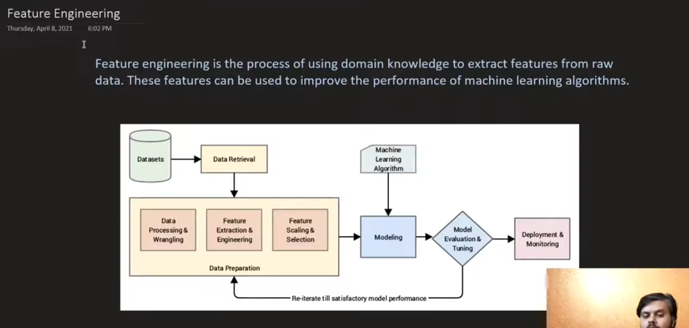

We need to prepare data for the ML model

* Feature Engineering = using **domain knowledge** to extract features from raw data (via data mining techniques) so that the performance of ML algorithms improves
* Having data does not mean we can directly give it to an ML algorithm; the data has to be prepared first
* A bad algorithm with very good features can beat a good algorithm with bad features
* Feature Engineering is a part of the ML life cycle: after initial preprocessing -> Feature Engineering -> Modelling
* **Definition (CampusX notes):** Feature Engineering involves creating new features or modifying existing ones to improve a model's performance, helping the model capture hidden patterns in the data
* Key points:
    - Raw data cannot be directly fed to ML algorithms; data must be prepared and transformed for optimal model performance
    - Feature Engineering is both an **art and a science** - it requires intuition, experience and domain knowledge
    - Critical principle: *"A bad algorithm with great features will outperform a great algorithm with bad features"*
* **Machine Learning pipeline (as in the slide):** Data Retrieval -> Data Preparation -> Data Processing (cleaning, e.g. missing value handling) -> Feature Extraction & Engineering (e.g. creating new features, dimensionality reduction) -> Scaling & Selection (e.g. normalization, feature selection) -> Model Training -> Model Evaluation -> Deployment

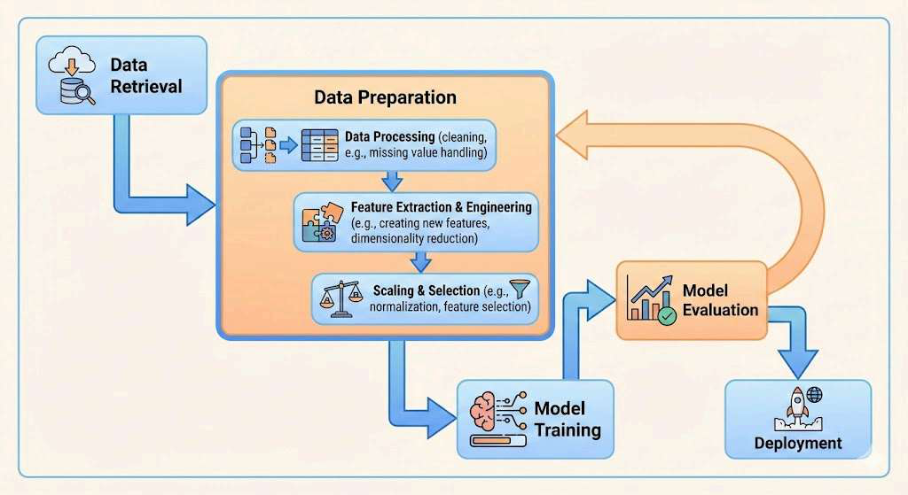


It is more like art 
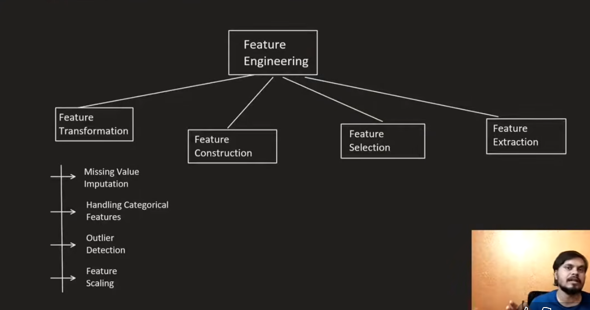

* There is no single fixed method, every data scientist has their own approach (just like programming)
* Broadly feature engineering has 4 parts: **Feature Transformation, Feature Construction, Feature Selection, Feature Extraction**
* Classification chart (from the notes):
    - **Feature Transformation** -> Missing value imputation, One-hot encoding (handling categorical), Outlier detection, Feature scaling
    - **Feature Construction** -> e.g. Family Size creation (SibSp + Parch + 1)
    - **Feature Selection** -> Filter, Wrapper, Embedded methods
    - **Feature Extraction** -> e.g. PCA


* Feature Transformation = converting the existing features from one form to another form for better performance

Transforming into the other type

* Feature Transformation: converting a column into some other form so that the model performs better
    - Missing value imputation
    - Handling categorical features
    - Outlier detection
    - Feature scaling
* Feature construction: we manually create new features
* Feature selection: remove the less important features
* Feature extraction: programmatically creating new features from the given ones

----
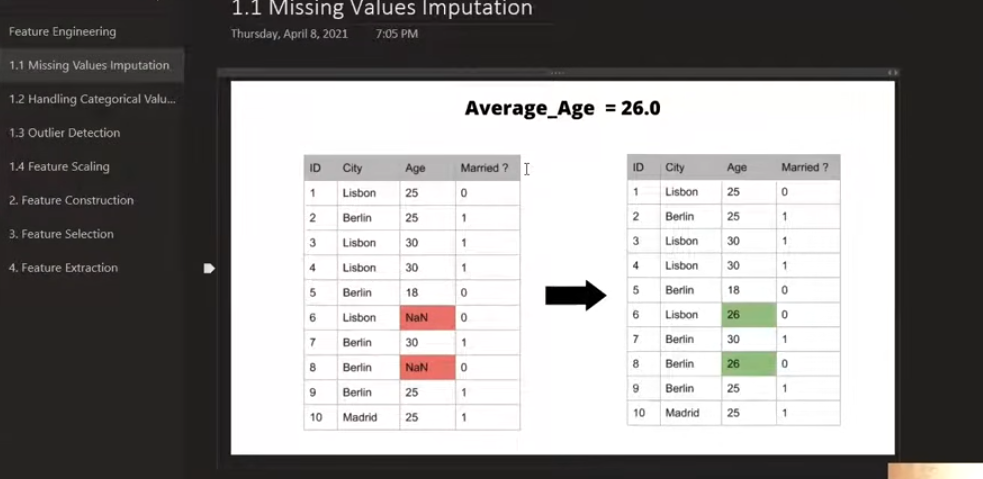

scikit learn doesn't accept the missing values
* we fill the missing values; if there are a lot of missing values we need to fill them (imputation) - we will study the different techniques in later videos
* Ways to handle: remove the rows (when very few are missing), or fill with mean / median / mode, etc.
* This is the first step of the feature engineering pipeline
* **Missing value imputation: techniques and when to use** (table from the notes):
    - Deletion: remove rows/columns with missing values -> when missing values are very few (< 5 %)
    - Mean imputation: replace with the mean of the column -> numerical data with a normal distribution
    - Median imputation: replace with the median of the column -> numerical data with outliers
    - Mode imputation: replace with the most frequent value -> categorical data
    - Forward fill: use the previous value -> time-series data; Backward fill: use the next value -> time-series data
    - KNN imputation: use K-nearest neighbors to predict the value -> complex patterns
    - Interpolation: estimate using mathematical functions -> sequential / time-series data
* Example from the slides: a dataset with missing Age values (shown as NaN); after imputation the missing values are filled with Average_Age = 26.0


---
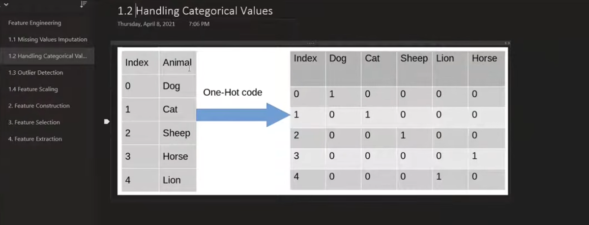

Second type

One hot encoding
Numerical values to categorical -- binning

* Handling categorical data: our ML libraries (sklearn) only work on numerical values, so a string column (e.g. Dog, Cat, Sheep) has to be converted into numbers
* One hot encoding: each category becomes a new column (1 where the category is present, else 0)
* Sometimes we also convert numerical values into categories, e.g. age 0-12 -> kid, 12-18 -> teenager, 18+ -> adult. This is called **binning**
* **Encoding techniques** (table from the notes):
    - **One-Hot Encoding:** create a binary column for each category (e.g. Animal: Dog, Cat -> Dog (1/0), Cat (1/0)) -> use for nominal categories (no order)
    - **Label Encoding:** assign numerical labels (e.g. Small: 0, Medium: 1, Large: 2) -> ordinal categories (with order)
    - **Ordinal Encoding:** manual mapping based on the order (Low: 1, Medium: 2, High: 3) -> ordinal data with a specific order
    - **Binary Encoding:** convert categories to a binary representation (5 categories -> 3 binary columns) -> high cardinality features
    - **Target Encoding:** replace the category with the mean of the target for that category -> high cardinality features with target correlation
* Binning example: Age -> categories (0-18: Child, 18-30: Teen, 30-45: Adult, 45+: Senior)

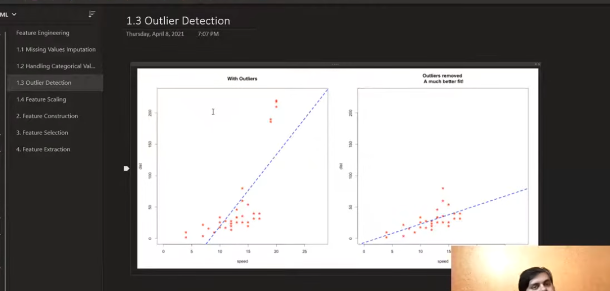

Outliers are very dangerous 
* if we remove the outlier then we are getting the correct line (e.g. in linear regression the line gets pulled towards the outlier)
* for that we need to first detect outliers 
* Algorithms which are affected by outliers (e.g. linear regression) need the outliers removed before giving the data to the algorithm
* We will study outlier detection in detail in later videos
* **Definition:** an outlier is a data point that significantly differs from the other observations (like "Sharma ji ka beta" who scores 98 % when everyone else scores 50 %)
* Why it is important: outliers can drastically affect model performance, they can skew the regression line and predictions, and some algorithms (Linear Regression, KNN) are sensitive to them
* **Outlier detection techniques** (table from the notes):
    - IQR method: values outside Q1 - 1.5 x IQR or Q3 + 1.5 x IQR (box plot)
    - Z-score method: (x - mean) / SD, threshold usually 3 (standard deviation method)
    - Percentile method: remove the top/bottom values, usually the 1st and 99th percentile
    - Visualization: box plots, scatter plots (visual inspection)
* After removal we get a clean fit (a better line) compared to the fit with outliers

--
Feature Scaling

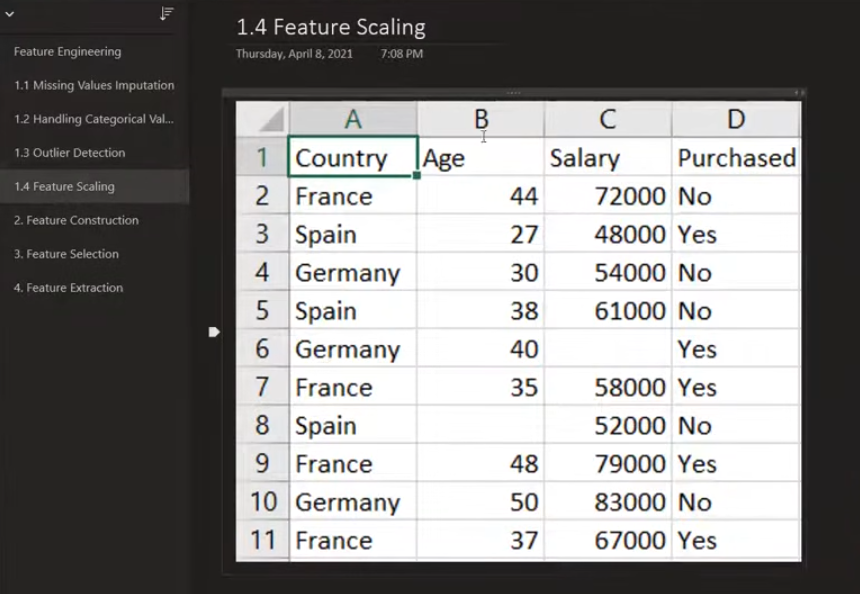

KNN - age and salary: there is a huge difference between the scales of the columns
* Features have very different ranges (age: 20-60, salary: 20,000-1,00,000)
* In distance based algorithms (KNN), salary will dominate the distance
* So we bring all the features to the same scale (generally -1 to 1)
* Techniques: Standardization, Normalization
* Example from the slides: Country, Age, Salary, Purchased (France, 44, 72000, No / Spain, 27, 48000, Yes / Germany, 30, 54000, No). Age range is 20-60, Salary range is 40,000-80,000
* Euclidean distance = sqrt((x2 - x1)^2 + (y2 - y1)^2): the Salary term dominates due to its larger magnitude, which makes Age irrelevant
* Solution: scale all the features to similar ranges (typically -1 to 1 or 0 to 1)
* **Scaling techniques** (table from the notes):
    - Standardization: (x - mean) / SD, gives mean = 0 and SD = 1 -> when the data is normally distributed
    - Min-Max normalization: (x - Xmin) / (Xmax - Xmin), range [0, 1] -> when you need a bounded range
    - Robust scaling: (x - median) / (Q3 - Q1), range not fixed -> when the data has outliers
    - MaxAbs scaling: x / |Xmax| -> sparse data
* **When feature scaling is critical:** K-Nearest Neighbors (KNN), Support Vector Machines (SVM), Neural Networks, K-Means clustering, Principal Component Analysis (PCA)

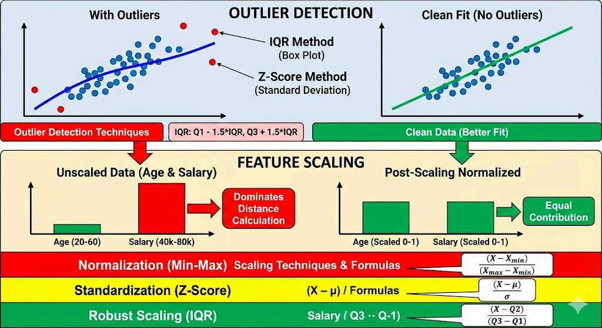


---

Feature Construction

Titanic dataset 

We create a completely new column, intuition based. We have a parent child column and a sibling spouse column; we can just create a single column called Family 

* Number of family members = SibSp + Parch (+1)
* We can then also convert it to categories: 1 -> Alone, 2-4 -> Small family, >4 -> Large family
* It depends on domain knowledge, intuition and experience, there is no fixed method
* **Definition (CampusX notes):** creating new features from the existing ones using domain knowledge, intuition or experience
* Key characteristics: highly creative and domain specific; no single standardized method; depends on the understanding of the problem; different data scientists may create different features
* Titanic example: original columns SibSp (siblings/spouses aboard) and Parch (parents/children aboard) -> `FamilySize = SibSp + Parch + 1  # +1 for the person themselves`
* Further construction (categorization): `if FamilySize == 1: "Alone"`, `elif FamilySize <= 4: "Small"`, `else: "Large"`. Impact: this new feature can be more predictive than the individual columns
* **Common feature construction techniques** (table from the notes):
    - Mathematical operations: Total = Price x Quantity (e-commerce)
    - Datetime features: extract Day, Month, Year, Hour, DayOfWeek (time series)
    - Text features: length, word count, special characters (NLP)
    - Ratio features: Price per sqft = Price / Area (real estate)
    - Aggregations: average, sum, count by group (customer analytics)
    - Polynomial features: x^2, x^3, x1 * x2 (non-linear relationships)

* Feature selection 

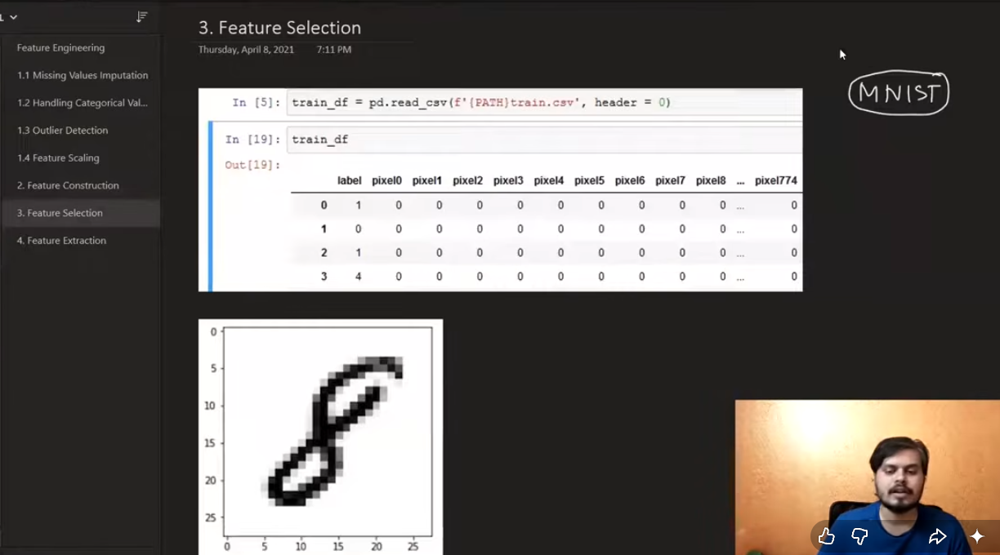

Each image is low resolution 28*28 
784 pixels 

* converted the image into tabular data | what if I don't consider all the pixels, from the given features only choose the features which are very important 
* Many pixels (corners) are not useful, the digit always lies in the center region
* Benefits: model performance improves and speed also improves (fewer columns)

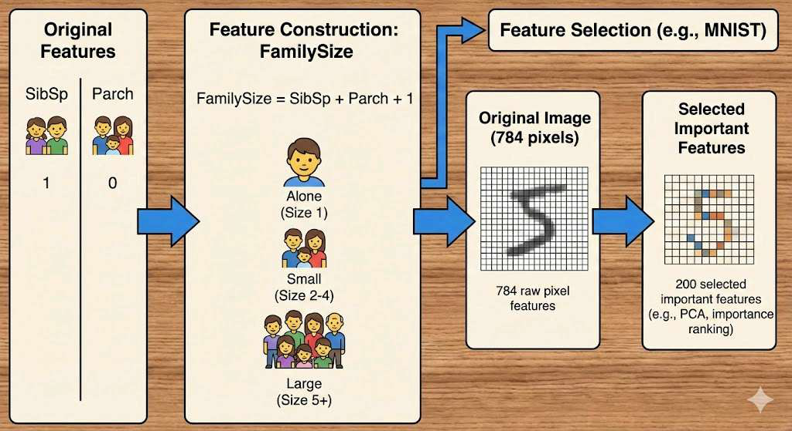

* Techniques: Forward selection, Backward elimination, etc.
* **Definition (CampusX notes):** selecting the most important features from the existing feature set and removing the redundant or less important ones
* **Why feature selection?**
    1. Reduces overfitting: fewer features = less chance of learning noise
    2. Improves performance: the model trains faster and often performs better
    3. Reduces complexity: easier to interpret and maintain
    4. Saves resources: less computation and storage
* MNIST scenario: 28 x 28 pixel images -> 784 features (each pixel is a feature); many edge pixels are always blank (always 0), the center pixels contain the actual digit information, so we can reduce from 784 to roughly 100-200 important features
* **Feature selection techniques** (table from the notes):
    - **Filter methods** (statistical): use statistical tests (correlation, chi-square). Pros: fast, independent of the model. Cons: ignores feature interactions
    - **Wrapper methods** (model-based): forward/backward selection using the model performance. Pros: considers interactions. Cons: computationally expensive
    - **Embedded methods** (built-in): feature importance from tree-based models, L1 regularization. Pros: efficient, integrated. Cons: model specific
    - **Recursive Feature Elimination (RFE)** (iterative): removes the least important features iteratively. Pros: systematic. Cons: time-consuming
* Comparison: Filter = fast speed, moderate accuracy, low complexity; Wrapper = slow, high accuracy, high complexity; Embedded = moderate speed, high accuracy, moderate complexity

* Feature Extraction -> from the given features create completely new features
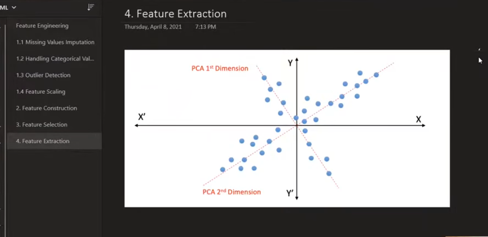

Rooms | washroom | Price

--> 
Rather than removing two features, we bring a new feature, sqft area, 
then 
basically creating a new column 

* Rooms and washrooms are both important, we can't drop any one of them, so we combine them -> square feet area, and the problem is solved with a single feature

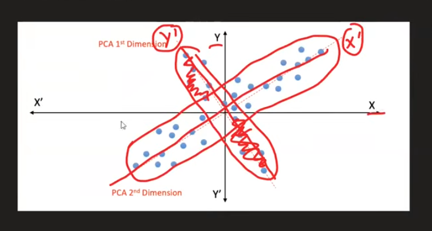


remove y' and kept x' 

* Create new axes (x', y') by rotating the original axes and keep only the useful ones (x'), drop y' where the variance is less

------

PCA and LDA are important in feature extraction 

* Also t-SNE
* We create completely new features from the old ones, and we can use only the most useful of them
* **Definition (CampusX notes):** creating completely new features programmatically using algorithms, rather than manually. These new features replace the original features
* **Key difference from feature construction:** Construction = manually created based on domain knowledge; Extraction = algorithmically created using mathematical transformations
* Real estate example: original features = number of rooms and number of bathrooms. Problem: we must remove one feature but both are important. Solution: extract a new feature, `Square_Feet = f(Rooms, Bathrooms)`, and use only that (one feature captures the information of both)
* **Mathematical example (PCA):** 2D data (X, Y axes) which we need to reduce to 1D
    1. Rotate / transform the axes
    2. Create a new axis (X') that captures the maximum variance
    3. Project all the points onto X'
    4. Remove the Y' axis
* In the slide: X' (Principal Component 1) retains about 85 % of the variance; Y' (Principal Component 2) has about 15 % variance and is discarded

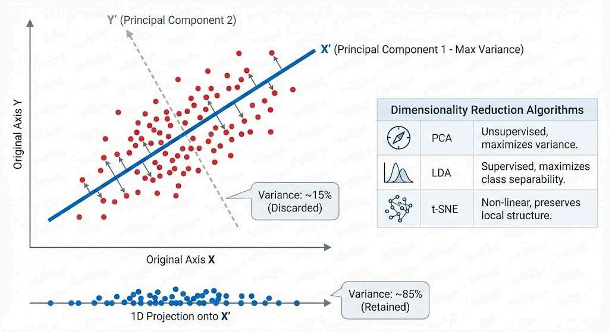

* **Popular feature extraction algorithms** (table from the notes):
    - **PCA (Principal Component Analysis):** linear, unsupervised, maximizes variance -> general dimensionality reduction, gives uncorrelated features
    - **LDA (Linear Discriminant Analysis):** linear, supervised, maximizes class separability -> classification problems
    - **t-SNE:** non-linear, preserves local structure -> visualization in 2D/3D
    - **Autoencoders:** neural network, learns a compressed encoded representation -> complex non-linear patterns
    - **UMAP:** non-linear, preserves local + global structure -> alternative to t-SNE for low-dimensional embedding

* --------------------

**Complete feature engineering pipeline (summary table from the notes)**

* 1. Imputation: input = data with missing values -> mean, median, mode, KNN -> handles the missing data
* 2. Encoding: categorical features -> one-hot, label, ordinal -> converts categories to numbers
* 3. Outlier handling: data with outliers -> IQR, Z-score, Isolation Forest -> removes extreme values
* 4. Scaling: features with different scales -> standardization, normalization -> scaled features with equal range
* 5. Construction: existing features -> domain-based feature creation -> adds meaningful new features using domain knowledge
* 6. Selection: many features -> filter, wrapper, embedded -> keeps the important features and reduces dimensionality
* 7. Extraction: original features -> PCA, LDA, autoencoders -> creates a new (transformed) feature space

**Decision guide: when to use what?**

* Missing data < 5 % -> delete rows (minimal data loss); missing data > 5 % -> imputation (mean/median/mode) to preserve the data
* Categorical data with no order -> one-hot encoding (avoids false ordinality); categorical data with order -> ordinal / label encoding (preserves the ordering)
* Outliers present + linear models -> remove / transform the outliers (prevents skewing); outliers present + tree models -> keep the outliers (trees are robust)
* Features with different scales + distance-based algorithm -> feature scaling (equal contribution); features with similar scales -> no scaling needed (avoids unnecessary computation)
* Domain knowledge available -> feature construction (better features)
* Too many features (curse of dimensionality) -> feature selection (reduces complexity); need to reduce features but keep the information -> feature extraction (PCA)

**Key takeaways**

1. Feature engineering is an art: no fixed rules; it requires intuition, experience and domain knowledge; different approaches yield different results
2. Order matters: Missing values -> Encoding -> Outliers -> Scaling -> Construction -> Selection -> Extraction
3. Not all steps are always needed: analyze your data first, apply only the relevant techniques and don't blindly apply all the methods
4. The golden rule: *"Better features with a simple algorithm > poor features with a complex algorithm"*
5. Iterative process: try different techniques, evaluate the model performance, refine and repeat

**Common pitfalls to avoid (Don't -> Do instead)**

* Apply scaling before handling outliers -> handle outliers first, then scale
* Use one-hot encoding on high cardinality features -> use target encoding or embeddings
* Remove features without checking the importance -> analyze the feature importance first
* Apply PCA without scaling -> always scale before PCA
* Forget to apply the same preprocessing to the test data -> save and reuse the preprocessing pipeline

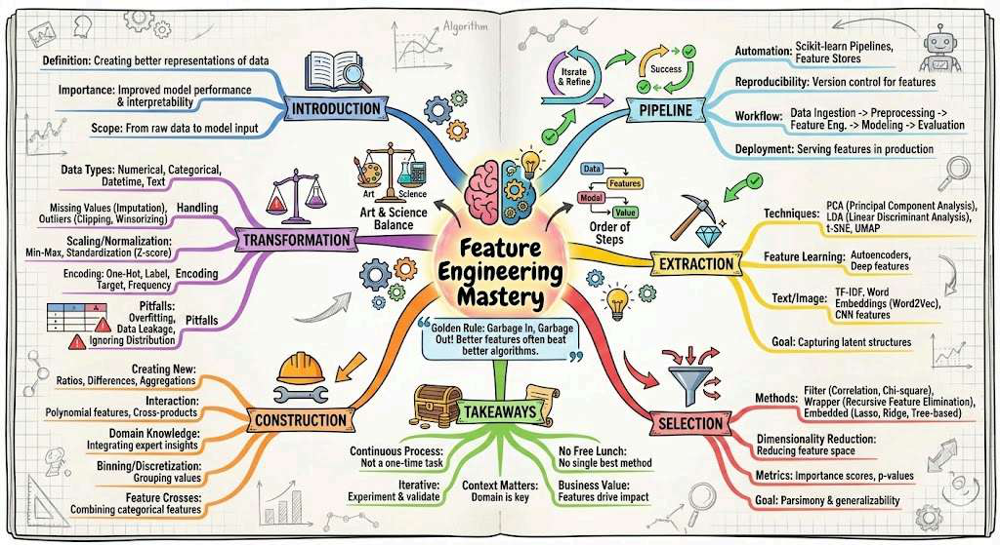

## L 24

Feature Scaling - Standardization 

* we do it just before giving the data to the model 
* Feature scaling = techniques to bring the independent features present in the data to a fixed range
* **Standardization (Z-score normalization)** transforms numerical features to have a mean of 0 and a standard deviation of 1, which helps in comparing and interpreting features with different scales
* Code of this lecture: `campusx-official/100-days-of-machine-learning` -> `day24-standardization`
* Feature scaling is the **last step in feature engineering**, performed just before feeding the data to the machine learning model. It is one of the easiest yet most important steps
* **Key insight:** feature scaling doesn't change the distribution shape of your data, only the scale/range changes. Relative distances between points are preserved, which prevents the features with larger scales from dominating the model
* Process: original data (uneven scales) -> feature scaling (Min-Max / Z-score transformation) -> scaled data (similar range) -> ML model

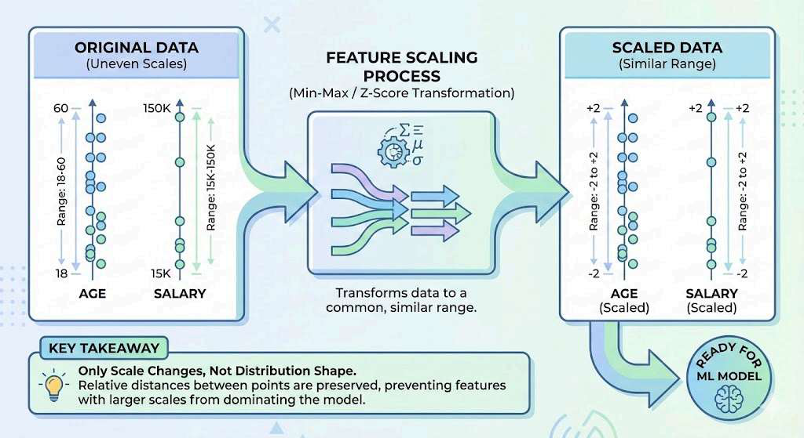


iq | cgpa | lpa

we need to bring iq and cgpa to the same scale 
* IQ is in the range of 100, CGPA in the range of 10
* Example scenario: two features IQ with range [100, 150] and CGPA with range [0, 10]. After feature scaling both features will be in a similar range (e.g. -2.5 to +2.5), which makes them comparable
    - Before scaling: IQ = 100-150, CGPA = 0-10; after scaling: IQ = -2.5 to +2.5, CGPA = -2.5 to +2.5 

* Why do we need it? Some ML algorithms work on distances / gradient descent, and they don't work well if the scales are different

---


example KNN 
we need to calculate the distance between two points .. we will see that in terms of salary the number is so big and in the other it is so small, and hence KNN gets biased towards salary

* distance = sqrt((x2-x1)^2 + (y2-y1)^2) -> the salary term dominates
* **Worked example (notes):** dataset predicting whether someone will purchase a luxury car. Point 1: Age = 50, Salary = 83,000; Point 2: Age = 27, Salary = 48,000
    - Age difference: (27 - 50)^2 = (-23)^2 = 529
    - Salary difference: (48000 - 83000)^2 = (-35000)^2 = 1,225,000,000
    - Total distance = sqrt(529 + 1,225,000,000) ≈ sqrt(1,225,000,000) ≈ 35,000
* The problem: the salary difference (≈ 1.225 billion) completely dominates the age difference (≈ 529), effectively making the age feature irrelevant. The algorithm becomes biased toward the feature with the larger scale
* Before scaling the data appears as a vertical line (age axis 0-100, salary axis 0-150,000), so we lose the age information; after scaling both axes are on a similar scale (-3 to +3) and the data spread is visible in both dimensions
* After scaling (point A' = (0.8, 0.9) in the slide, scaled differences 0.6 and 0.5): distance = sqrt(0.6^2 + 0.5^2) = sqrt(0.36 + 0.25) ≈ sqrt(0.61) ≈ 0.78 -> balanced contribution of both the features

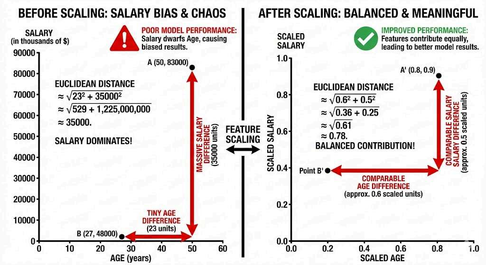


----

#### Types of feature scaling

* Standardization 

* Normalization 


-----

* Comparison table (notes):
    - **Standardization** (also called Z-score normalization): formula (x - mean)/SD, range unbounded (typically -3 to +3), best for data which is normally distributed
    - **Min-Max normalization** (Min-Max scaling): formula (x - x_min)/(x_max - x_min), range [0, 1] or [-1, 1], best when we need a bounded range
    - **Robust scaling**: formula (x - Q50)/(Q75 - Q25), unbounded, best when the data has outliers
* Standardization is the focus of this lecture; normalization techniques are covered separately (L25)

#### Standardization - Intuition, also called Z score normalization 


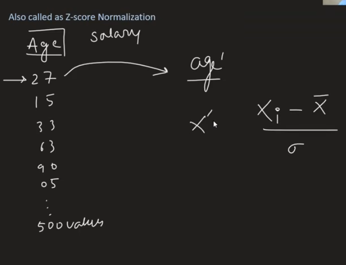

the formula is like this 

x_i' = (x_i - mean) / std

* Where: x' = standardized value, x_i = original value, mean = mean of the feature, std = standard deviation of the feature
* **Step-by-step example (notes):** Age values [27, 15, 50, 33, 96, 65] with mean = 32 and SD = 10 (as taken in the video)

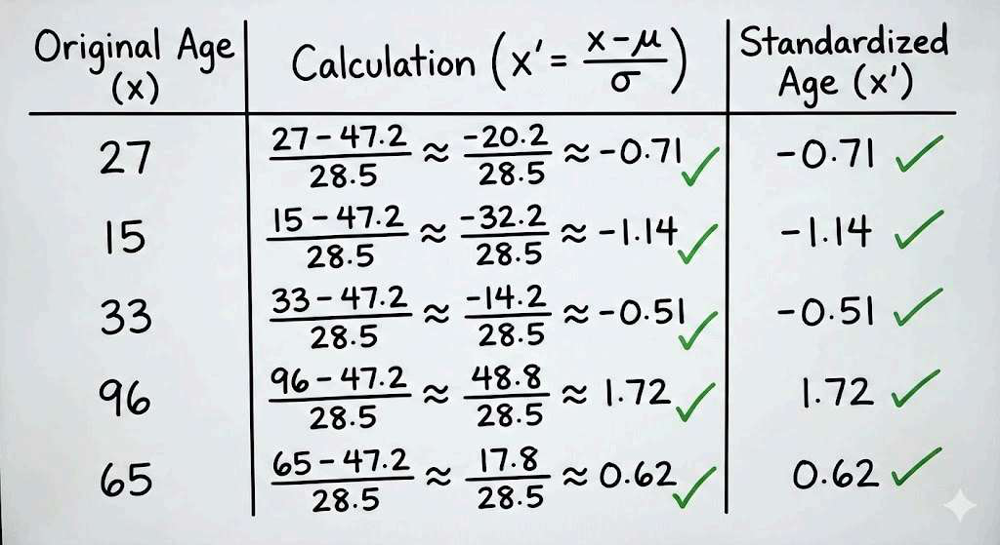


| Original value (Age) | Calculation | Standardized value |
|---|---|---|
| 27 | (27 - 32) / 10 | -0.5 |
| 15 | (15 - 32) / 10 | -1.7 |
| 50 | (50 - 32) / 10 | 1.8 |
| 33 | (33 - 32) / 10 | 0.1 |
| 96 | (96 - 32) / 10 | 6.4 |
| 65 | (65 - 32) / 10 | 3.3 |

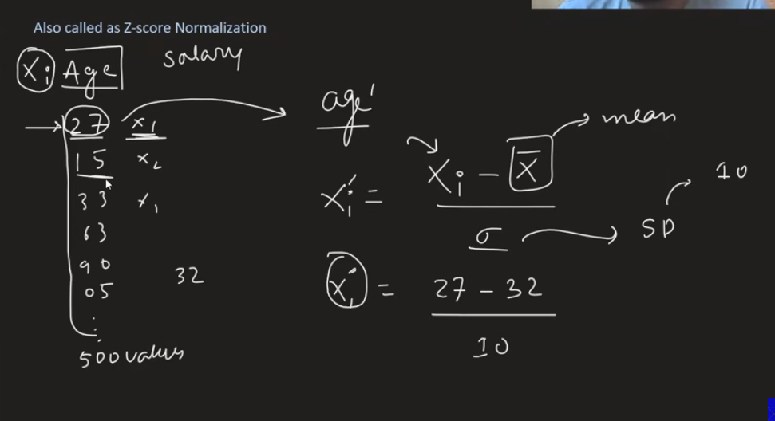
 in this example SD = 10 and mean 32

* the new 500 numbers will have mean = 0 and SD = 1.
* The transformed column always has mean 0 and SD 1 (this is a guaranteed property)
* Proof sketch (notes): new mean = (1/n) * sum((x_i - mean)/SD) = (1/(n*SD)) * (sum(x_i) - n*mean) = (1/(n*SD)) * (n*mean - n*mean) = 0. New variance = (1/n) * sum((x_i - mean)^2 / SD^2) = SD^2/SD^2 = 1, so the new SD = 1

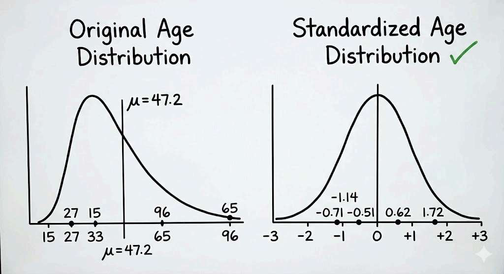


Geometric intuition:

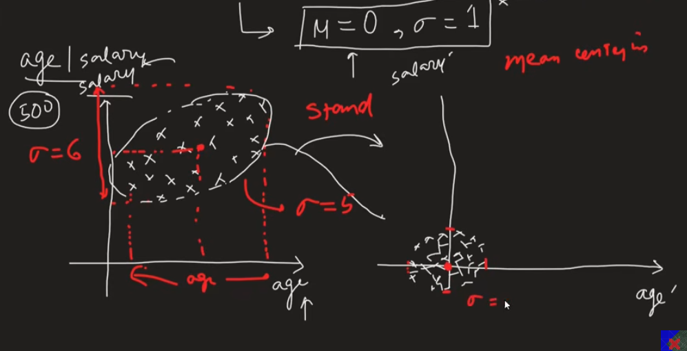

* Step 1: mean centering - move the whole data so that the mean of both columns becomes 0
* Step 2: scale down: if SD > 1 the data gets squeezed, if SD < 1 it gets stretched, so that SD becomes 1 on both axes
* Mean centering: x_centered = x - mean (this shifts the entire distribution so that the center/mean is now at zero, the data is at the origin (0, 0))
* Scaling by the standard deviation (to control the spread of the data): if SD > 1 the data is too spread out -> compress (divide by SD); if SD < 1 the data is too compressed -> expand (divide by SD); if SD = 1 no change. x_standardized = (x - mean) / SD
* Key observations: (1) data is centered at the origin (0, 0), (2) SD is exactly 1 in both directions, (3) shape is preserved (relative positions unchanged), (4) comparable scales, both features are on a similar range

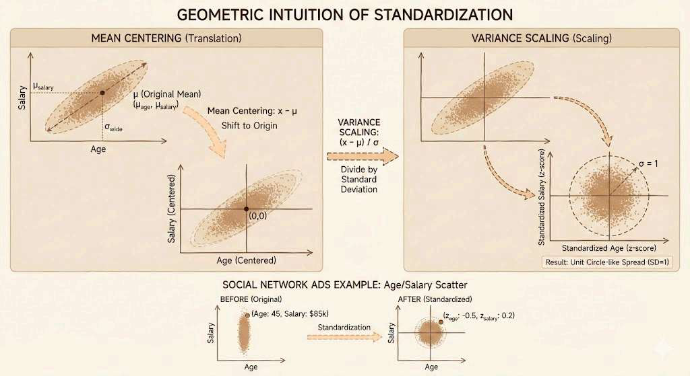

* **Visual analogy for gradient descent (cost function J):** without scaling the contours are elongated -> slow convergence; with scaling the contours are circular -> fast convergence. All features have similar gradients, the same learning rate works for all the parameters, so we get faster and more stable convergence

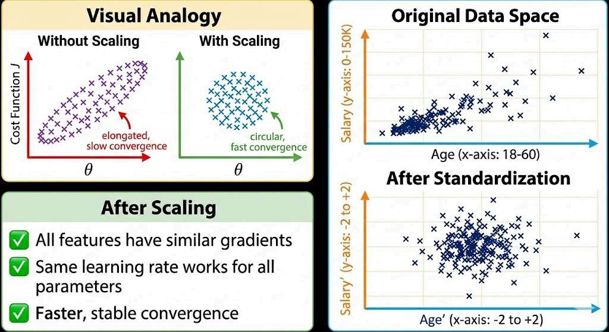

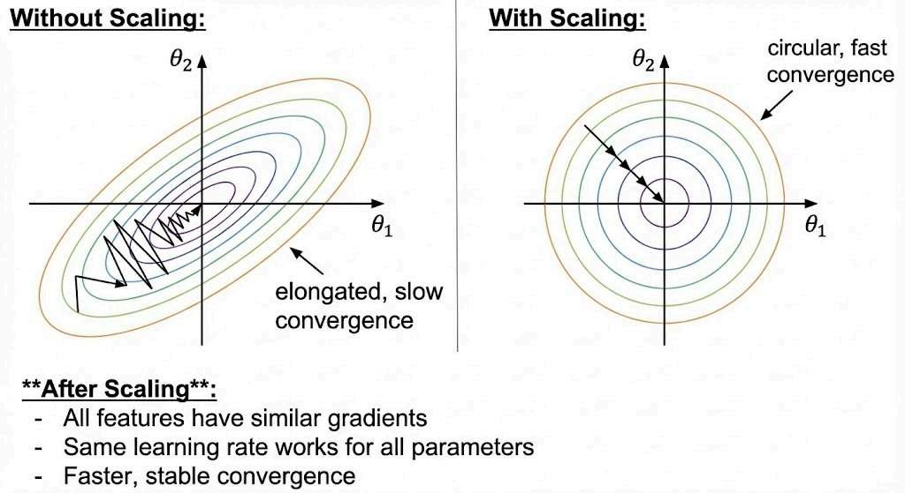


spread of the data or we can say SD is not 1 
in Standard deviation terms we are scaling down 

and in terms of mean we are decreasing it 

*  Impact of Outliers we will see later 

----
* Use sklearn `StandardScaler`: `fit` on the train data (it learns the mean and std), `transform` both train and test
* Never fit on the test data
* It returns a numpy array, so convert it back to a dataframe to view it
* Dataset used: Social_Network_Ads (Age, EstimatedSalary, Purchased) -> classification problem
* First do train test split, then scale
* **Real example (Social Network Ads dataset):**
    - Before standardization: Age -> mean = 37.9, SD = 10.2, range = [18, 60]; Salary -> mean = 69,807, SD = 34,641, range = [15,000, 150,000]
    - After standardization: Age' -> mean = 0, SD = 1, range ≈ [-1.9, 2.2]; Salary' -> mean = 0, SD = 1, range ≈ [-1.6, 2.3]
* Code (dataset preparation): `df = pd.read_csv('Social_Network_Ads.csv')` then `df = df.iloc[:, 2:]` (select Age, EstimatedSalary, Purchased)
* **Train-test split (ALWAYS do this first!):** `X_train, X_test, y_train, y_test = train_test_split(df.drop('Purchased', axis=1), df['Purchased'], test_size=0.3, random_state=0)` -> shapes (280, 2) and (120, 2)
* Why split first? To prevent **data leakage**, the test set should remain completely unseen, including its statistics (mean, std)
* StandardScaler implementation: `scaler = StandardScaler()` -> `scaler.fit(X_train)` (learns mean and std) -> `X_train_scaled = scaler.transform(X_train)` and `X_test_scaled = scaler.transform(X_test)`. Important: fit only on the training data, transform both train and test data using the same scaler
* Fit = learning phase: `scaler.mean_` = [37.86, 69807.14] and `np.sqrt(scaler.var_)` = [10.2, 34641.2]. Transform = application phase: x' = (x - mean)/std using the mean and std learned from the training data
* By default StandardScaler returns NumPy arrays, so convert back to a DataFrame for better visualization: `pd.DataFrame(X_train_scaled, columns=X_train.columns)`
* **Verification: before vs after statistics** (`np.round(X_train.describe(), 1)`):
    - Before: count 280; Age mean 37.9, std 10.2, min 18, 25 % 30, 50 % 37, 75 % 46, max 60; EstimatedSalary mean 69,807.1, std 34,641.2, min 15,000, 25 % 43,000, 50 % 70,500, 75 % 88,000, max 150,000
    - After: count 280; mean 0.0 and std 1.0 for both; min -1.9 / -1.6; 25 % -0.8 / -0.8; 50 % -0.1 / 0.0; 75 % 0.8 / 0.5; max 2.2 / 2.3 -> confirmed mean = 0, SD = 1

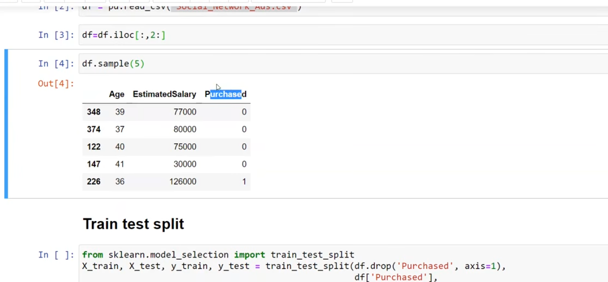

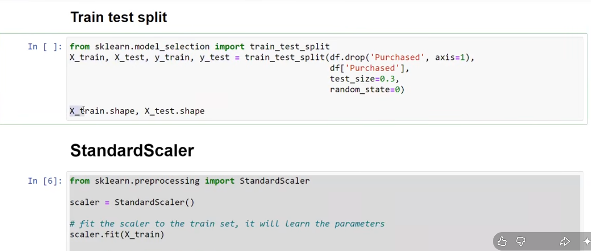

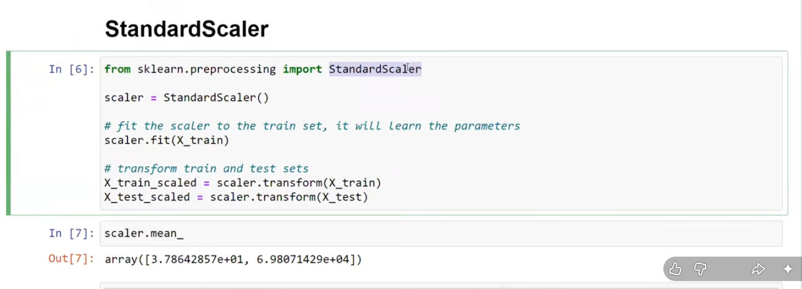

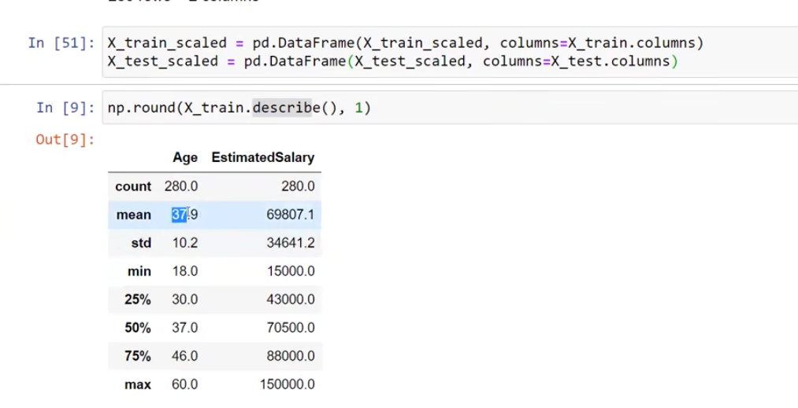

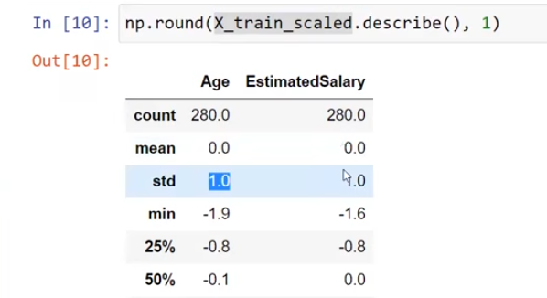

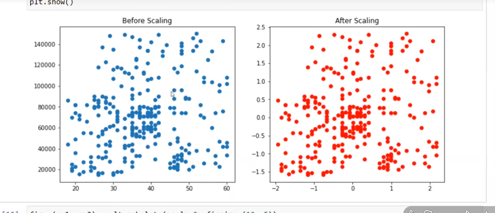

--------------

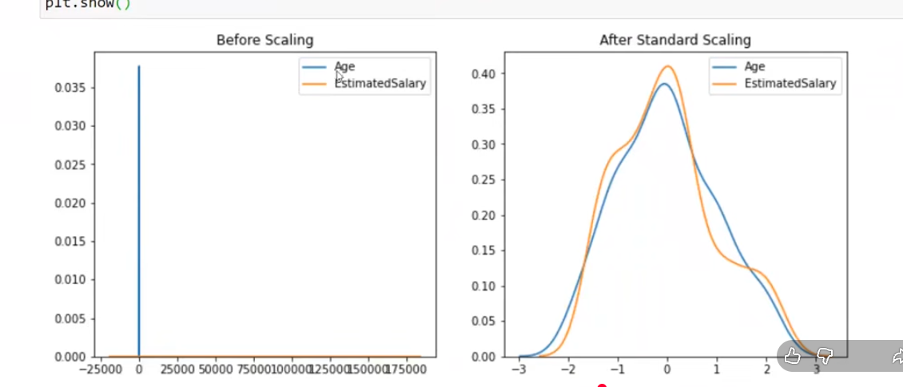

Before and after scaling 

before we can see the scales are so different 

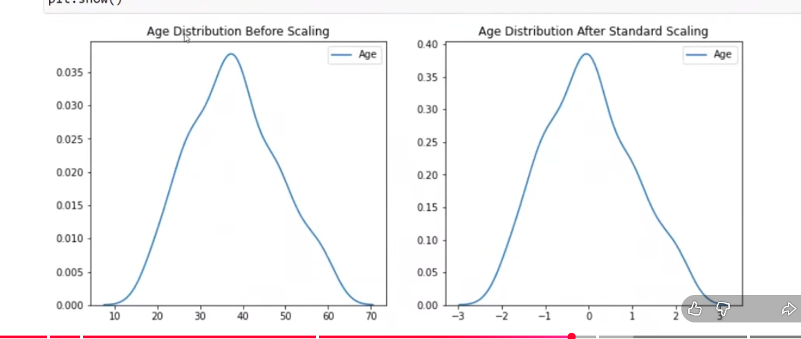

on individual distribution it is the same, just the scale got changed

* The shape of the distribution does not change, only the scale changes
* PDF plot: before scaling age and salary are not comparable, after scaling both lie on the same scale
* Scatter plot comparison (before vs after): same data points and the same relationships, only different scales, both axes are now comparable
* PDF (`sns.kdeplot`) observation: before scaling, Age (narrow peak) vs Salary (flat distribution) are incomparable; after scaling both distributions overlay nicely
* Distribution shape preservation: the individual Age and Salary distributions (KDE) have the same shape before and after standard scaling, only the scale changes

---

Logistic regression

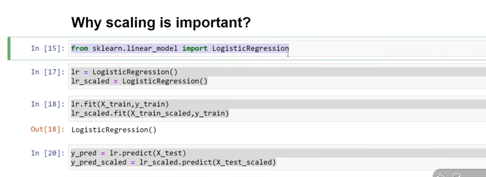

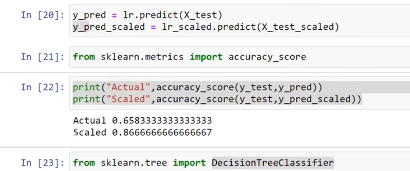

we can see the changes in actual and scaled 
* Accuracy of logistic regression improved a lot after scaling (65.8% -> 86.7% on the test set)
* Experiment 1 (notes): logistic regression is highly sensitive to feature scaling. Without scaling: **65.83 %**; with scaling: **86.67 %** (+20.84 %). Scaling dramatically improves the performance for logistic regression

and another where scaling doesn't matter 

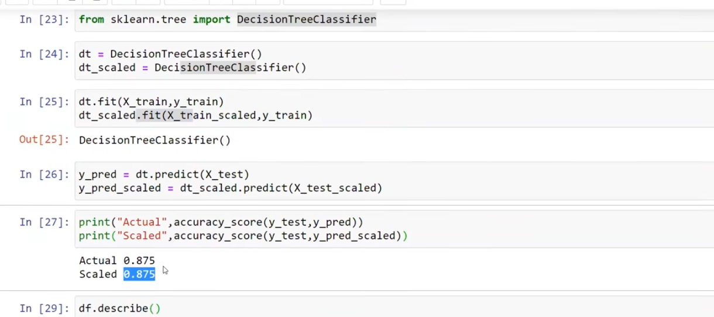

* Decision tree: accuracy is the same with or without scaling (87.5% both), because trees only do comparisons (greater / less than)
* Experiment 2 (notes): decision trees are insensitive to feature scaling. Without scaling: 87.50 %; with scaling: 87.50 % (0 % change). Conclusion: no difference! Decision trees work by making comparisons (>, <, ==), not by calculating distances, so scaling doesn't matter

----------

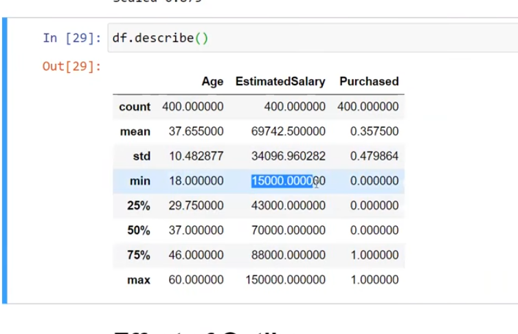

Effect of Outlier 

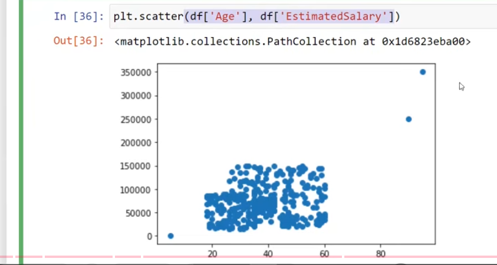

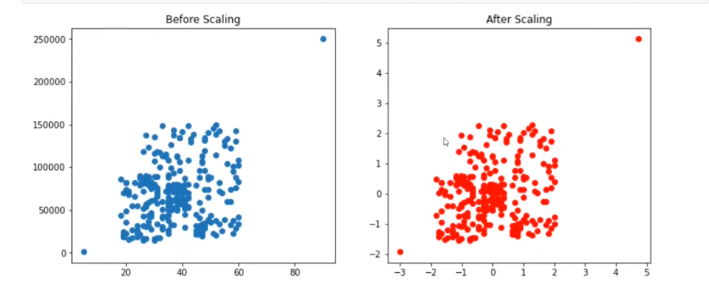

* Still an outlier is an outlier, outliers are not removed by standardization, they behave the same way as before (we have to handle them separately)
* Experiment (notes): original dataset statistics: Age min 18, max 60, mean 37.66; Salary min 15,000, max 150,000, mean 69,742.5. We add artificial outliers: `outliers = pd.DataFrame({'Age': [5, 90, 95], 'EstimatedSalary': [1000, 250000, 350000], 'Purchased': [0, 1, 1]})` and append them to the dataframe. Now Age min = 5, max = 95; Salary min = 1,000, max = 350,000
* Re-apply train-test split and standardization and plot before/after: the three extreme points are far from the main cluster; **after scaling they are still outliers**, they just appear at different coordinates, while the main cluster behaviour remains similar
* Key takeaway: standardization does NOT handle outliers. If your data has outliers you must (1) remove the outliers before standardization, OR (2) use `RobustScaler` (covered in the next video)

----

Standardization doesn't have any nuksaan (disadvantage) 


* When to use standardization (apply it blindly for these):
    - K-Means, KNN, hierarchical clustering (euclidean distance)
    - PCA (we want maximum variance, so mean centering is needed)
    - Artificial Neural Networks
    - Gradient Descent based algorithms (linear regression, logistic regression): with unscaled features the weights update at different rates and the algorithm never converges properly
* Not needed for tree based algorithms: Decision Tree, Random Forest, Gradient Boosting (they only compare values)

**Impact on ML algorithms: when to use standardization (table from the notes)**

* K-Means / K-NN: use Euclidean distance to measure similarity -> if not scaled, the large-scale features dominate, giving poor clustering/classification
* PCA: tries to find the features with maximum variance and requires mean-centered data -> if not scaled, the components are biased toward the high-variance features
* Linear Regression: uses Gradient Descent for optimization -> if not scaled, slow/no convergence and different learning rates are needed per parameter
* Logistic Regression: uses Gradient Descent -> if not scaled, slow/no convergence and poor probability estimates
* Neural Networks: use Gradient Descent (backpropagation) -> if not scaled, training instability, vanishing/exploding gradients
* SVM: uses the distance to the hyperplane -> if not scaled, bias toward large-scale features and a poor margin calculation

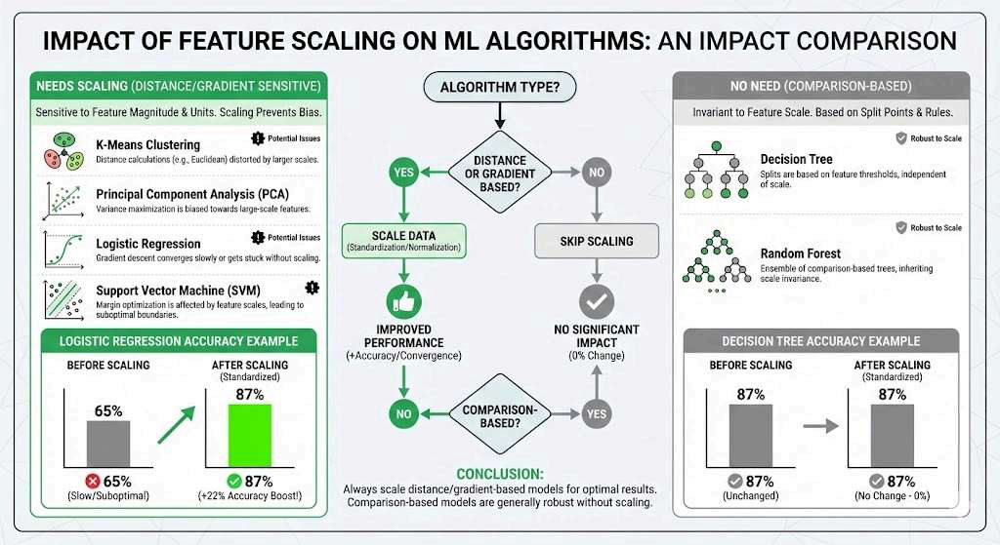

**Detailed explanations**

1. **K-Means and K-NN:** both calculate the Euclidean distance between points. Example: Age difference (50 - 30)^2 = 400; Salary difference (100,000 - 50,000)^2 = 2,500,000,000; total distance = sqrt(2,500,000,400) ≈ 50,000 (salary dominates!). After scaling: Age difference (1.2 - (-0.5))^2 = 2.89, Salary difference (0.8 - (-1.1))^2 = 3.61, total distance = sqrt(6.5) ≈ 2.55 (both features contribute equally)
2. **PCA:** it finds the directions of maximum variance. Without scaling, the features with larger variance dominate. Example: Age variance ≈ 100, Salary variance ≈ 1,200,000,000, so PCA will focus almost entirely on salary and ignore age. After scaling both features have variance = 1 and PCA considers them equally
3. **Gradient descent:** the update rule is θ_j := θ_j - α * (∂J/∂θ_j), where θ_j is the parameter for feature j, α is the learning rate and ∂J/∂θ_j is the gradient (slope). Without scaling the large-scale features have large gradients and the small-scale features have small gradients; using the same learning rate α causes large-scale features to update too fast (overshooting) and small-scale features to update too slowly (slow convergence)

**When NOT to use standardization**

* Tree-based algorithms (Decision Tree, Random Forest, XGBoost, LightGBM, CatBoost): they work by making comparisons (>, <, ==), not distances
* Naive Bayes (rule-based): uses probability ratios, not distances
* Decision tree logic: `if Age > 35: if Salary > 60000: Buy else: Don't buy; else: if Salary > 80000: Buy else: Don't buy`. Comparisons are scale-invariant: Age > 35 is true whether Age is in [18, 60] or [-2, +2]
* Mathematical explanation: for a comparison x > threshold, original x = 40 and threshold = 35 -> 40 > 35 is True; scaled x' = 0.5 and threshold' = 0.2 -> 0.5 > 0.2 is True, so the order is preserved
* For tree-based algorithms scaling won't hurt the performance but it won't help either. Verdict: skip scaling to save computation time

**Complete feature scaling decision guide (summary table)**

* K-Means: YES (distance-based) -> if skipped, poor clusters
* K-Nearest Neighbors: YES (distance-based) -> poor classification
* PCA: YES (variance-based) -> biased components
* Linear Regression: YES (gradient descent) -> slow/no convergence
* Logistic Regression: YES (gradient descent) -> slow convergence, poor accuracy
* Neural Networks: YES (gradient descent) -> training instability
* SVM: YES (distance to hyperplane) -> poor margin, slow training
* Decision Tree, Random Forest, Gradient Boosting (XGB/LGBM): NO (comparison-based) -> no impact
* Naive Bayes: NO (probability-based) -> no impact

**Key rules (notes)**

1. Always split before scaling to prevent data leakage
2. Fit the scaler only on the training data
3. Transform both train and test using the same scaler
4. Check your algorithm: does it need scaling?
5. Handle outliers separately, standardization won't remove them
6. Distribution shape is preserved, don't expect normalization (the data won't become normally distributed)

**Code template**

* Step 1: train-test split (`test_size=0.2`); Step 2: `scaler = StandardScaler()`; Step 3: `scaler.fit(X_train)`; Step 4: `X_train_scaled = scaler.transform(X_train)` and `X_test_scaled = scaler.transform(X_test)`; Step 5: `model.fit(X_train_scaled, y_train)`; Step 6: `y_pred = model.predict(X_test_scaled)`
* Use `fit_transform` on train and `transform` on test: `scaler.fit_transform(X_train)`, `scaler.transform(X_test)`
* Quick check example: original feature [10, 20, 30, 100 (outlier)] -> mean = 40, std = 37.4 -> standardized [-0.80, -0.53, -0.27, 1.60 (outlier)] with mean 0 and std 1 -> the outlier is still an outlier; consider Robust scaling for heavy outliers


### Official code - L24 Standardization (repo: `day24-standardization/day24.ipynb`)

**Block 1 - imports and loading the data**

```python
import numpy as np                # numerical operations
import pandas as pd               # dataframes
import matplotlib.pyplot as plt   # plotting
import seaborn as sns             # statistical plots (kdeplot)

df = pd.read_csv('Social_Network_Ads.csv')  # read the csv file into a DataFrame
df = df.iloc[:, 2:]   # iloc = position based slicing; keep only Age, EstimatedSalary, Purchased (drop User ID and Gender)
df.sample(5)          # look at 5 random rows
```

**Block 2 - train test split (always before scaling)**

```python
from sklearn.model_selection import train_test_split

# train_test_split: splits X and y into train and test parts; test_size=0.3 -> 30% test; random_state fixes the shuffle
X_train, X_test, y_train, y_test = train_test_split(df.drop('Purchased', axis=1),  # X = input columns
                                                    df['Purchased'],               # y = output column
                                                    test_size=0.3,
                                                    random_state=0)

X_train.shape, X_test.shape   # (280, 2) (120, 2)
```

**Block 3 - StandardScaler (fit on train, transform train and test)**

```python
from sklearn.preprocessing import StandardScaler

scaler = StandardScaler()           # object which will compute (x - mean) / std

# fit: learns the mean and std of every column from the TRAIN set only
scaler.fit(X_train)

# transform: applies (x - mean) / std using the values learnt in fit (output is a numpy array)
X_train_scaled = scaler.transform(X_train)
X_test_scaled = scaler.transform(X_test)

scaler.mean_    # the mean learnt for every column: [37.86, 69807.14]
```

**Block 4 - convert back to DataFrame and verify mean = 0, std = 1**

```python
# StandardScaler returns numpy arrays, so put the column names back
X_train_scaled = pd.DataFrame(X_train_scaled, columns=X_train.columns)
X_test_scaled = pd.DataFrame(X_test_scaled, columns=X_test.columns)

np.round(X_train.describe(), 1)         # statistics before scaling (mean 37.9 / 69807, std 10.2 / 34641)
np.round(X_train_scaled.describe(), 1)  # after scaling: mean = 0 and std = 1 for both the columns
```

**Block 5 - effect of scaling (scatter plot and PDF)**

```python
# subplots(ncols=2): two plots side by side; scatter: Age vs Salary
fig, (ax1, ax2) = plt.subplots(ncols=2, figsize=(12, 5))
ax1.scatter(X_train['Age'], X_train['EstimatedSalary'])
ax1.set_title("Before Scaling")
ax2.scatter(X_train_scaled['Age'], X_train_scaled['EstimatedSalary'], color='red')
ax2.set_title("After Scaling")
plt.show()

# kdeplot: smooth probability density function of a column
fig, (ax1, ax2) = plt.subplots(ncols=2, figsize=(12, 5))
ax1.set_title('Before Scaling')
sns.kdeplot(X_train['Age'], ax=ax1)
sns.kdeplot(X_train['EstimatedSalary'], ax=ax1)
ax2.set_title('After Standard Scaling')
sns.kdeplot(X_train_scaled['Age'], ax=ax2)
sns.kdeplot(X_train_scaled['EstimatedSalary'], ax=ax2)
plt.show()
```

**Block 6 - comparison of the individual distributions (shape does not change, only the scale)**

```python
# Age: before vs after
fig, (ax1, ax2) = plt.subplots(ncols=2, figsize=(12, 5))
ax1.set_title('Age Distribution Before Scaling')
sns.kdeplot(X_train['Age'], ax=ax1)
ax2.set_title('Age Distribution After Standard Scaling')
sns.kdeplot(X_train_scaled['Age'], ax=ax2)
plt.show()

# Salary: before vs after
fig, (ax1, ax2) = plt.subplots(ncols=2, figsize=(12, 5))
ax1.set_title('Salary Distribution Before Scaling')
sns.kdeplot(X_train['EstimatedSalary'], ax=ax1)
ax2.set_title('Salary Distribution Standard Scaling')
sns.kdeplot(X_train_scaled['EstimatedSalary'], ax=ax2)
plt.show()
```

**Block 7 - why scaling is important: Logistic Regression (accuracy improves)**

```python
from sklearn.linear_model import LogisticRegression
from sklearn.metrics import accuracy_score    # accuracy = correct predictions / total predictions

lr = LogisticRegression()          # model trained on unscaled data
lr_scaled = LogisticRegression()   # model trained on scaled data

lr.fit(X_train, y_train)                 # fit: train the model
lr_scaled.fit(X_train_scaled, y_train)

y_pred = lr.predict(X_test)                    # predict: output for the test rows
y_pred_scaled = lr_scaled.predict(X_test_scaled)

print("Actual", accuracy_score(y_test, y_pred))          # ~0.658
print("Scaled", accuracy_score(y_test, y_pred_scaled))   # ~0.867
```

**Block 8 - Decision Tree (accuracy does not change)**

```python
from sklearn.tree import DecisionTreeClassifier

dt = DecisionTreeClassifier()
dt_scaled = DecisionTreeClassifier()

dt.fit(X_train, y_train)
dt_scaled.fit(X_train_scaled, y_train)

y_pred = dt.predict(X_test)
y_pred_scaled = dt_scaled.predict(X_test_scaled)

print("Actual", accuracy_score(y_test, y_pred))          # trees only compare values, so scaling does not matter
print("Scaled", accuracy_score(y_test, y_pred_scaled))   # ~0.875 in both the cases
```

**Block 9 - effect of outliers (standardization does not remove outliers)**

```python
df.describe()   # min / max of the original data

# add 3 extreme rows (outliers) at the end; ignore_index=True renumbers the index
# (note: DataFrame.append is removed in pandas 2.x -> use pd.concat([df, new_rows], ignore_index=True))
df = df.append(pd.DataFrame({'Age': [5, 90, 95],
                             'EstimatedSalary': [1000, 250000, 350000],
                             'Purchased': [0, 1, 1]}), ignore_index=True)

plt.scatter(df['Age'], df['EstimatedSalary'])   # the 3 outliers are far from the main cluster

# repeat split + scaling on the new data
X_train, X_test, y_train, y_test = train_test_split(df.drop('Purchased', axis=1), df['Purchased'],
                                                    test_size=0.3, random_state=0)
scaler = StandardScaler()
scaler.fit(X_train)
X_train_scaled = scaler.transform(X_train)
X_test_scaled = scaler.transform(X_test)
X_train_scaled = pd.DataFrame(X_train_scaled, columns=X_train.columns)
X_test_scaled = pd.DataFrame(X_test_scaled, columns=X_test.columns)

fig, (ax1, ax2) = plt.subplots(ncols=2, figsize=(12, 5))
ax1.scatter(X_train['Age'], X_train['EstimatedSalary'])
ax1.set_title("Before Scaling")
ax2.scatter(X_train_scaled['Age'], X_train_scaled['EstimatedSalary'], color='red')
ax2.set_title("After Scaling")   # outliers are still outliers after standardization
plt.show()
```

----

## L25 - Normalization 

* Normalization: change the values of numeric columns to a common scale without distorting the differences in the ranges of values
* Eg: weight has a unit (kg, gm, pound) -> it is always a good idea to remove the units
* Code of this lecture: `campusx-official/100-days-of-machine-learning` -> `day25-normalization`
* **Definition (notes):** normalization is a data preprocessing technique that transforms numerical features to a common scale while (1) maintaining the original distribution shape, (2) preserving relative relationships between values, (3) eliminating unit dependencies, (4) improving model convergence and performance. The goal is to change the values of numeric columns to use a common scale without distorting the differences in the ranges of values or losing information
* Core principle: raw data (Weight in kg, Height in cm: 75 kg / 170 cm, 60 / 165, 90 / 185 ...) -> normalization technique (e.g. Min-Max scaling) -> transformed data on a common scale [0, 1] (e.g. 0.5 / 0.4, 0.2 / 0.3, 0.7 / 0.8) -> faster convergence and better accuracy

![PDF figure: normalization pipeline - raw weight and height -> min-max scaling -> common scale [0, 1]](pdf_img/L25_p521.png)

* **Why eliminate units?** every measurement has two components: (1) magnitude = the numerical value, (2) units = the measurement scale (grams, kilograms, pounds, centimeters, etc.). In ML it is always a good idea to eliminate the units because: different units cause scale disparities, algorithms may give undue weight to larger-scale features, removing the units provides a common scale for comparison, and it results in better and more stable model performance
* **Why feature scaling is important:** consider a dataset with Weight (range 32-130 kg) and Height (range 60-200 cm). Without scaling, features with larger ranges can dominate the learning process, leading to biased model weights, slower convergence, poor generalization and unstable gradient descent
* **Geometric intuition:** normalization "compresses" your entire dataset into a unit rectangle [0,1] x [0,1] (2D), unit cube [0,1]^3 (3D) or unit hypercube (higher dimensions) while maintaining the relative structure of the data. In the original data space the feature importance is biased; in the normalized unit square it is equal

![PDF figure: geometric intuition - the data is compressed into the unit square [0, 1] x [0, 1]](pdf_img/L25_p522.png)


---

Normalization types 

* Min-max scaling there are also other methods
* mean norm
* max 
* robust scaling 
* **Comparison table (notes):**
    - **MinMax scaling:** X' = (X - X_min)/(X_max - X_min), range [0, 1], use when min/max values are known, outlier sensitivity: High
    - **Mean normalization:** X' = (X - X_mean)/(X_max - X_min), range [-1, 1], use when centered data is needed, outlier sensitivity: High
    - **MaxAbs scaling:** X' = X / |X_max|, range [-1, 1], use for sparse data (many zeros), outlier sensitivity: High
    - **Robust scaling:** X' = (X - X_median)/IQR, range variable (unbounded), use when the data has outliers, outlier sensitivity: Low
* MinMax scaling (also called Min-Max normalization) is the most commonly used normalization technique. It transforms the features to a fixed range, typically [0, 1]

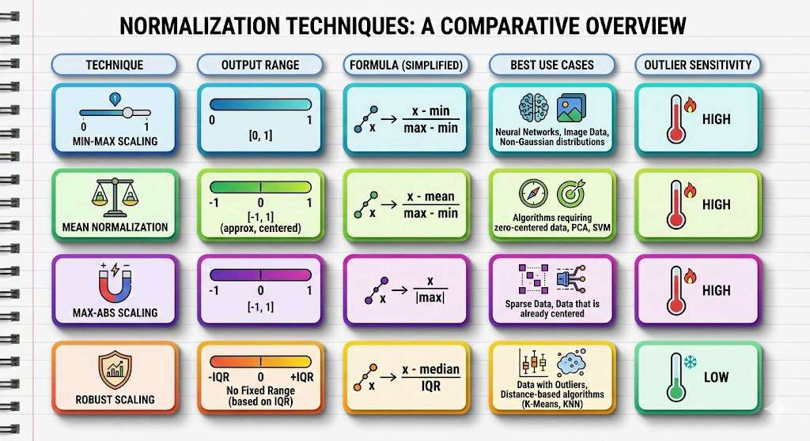


---

Minmax scaling

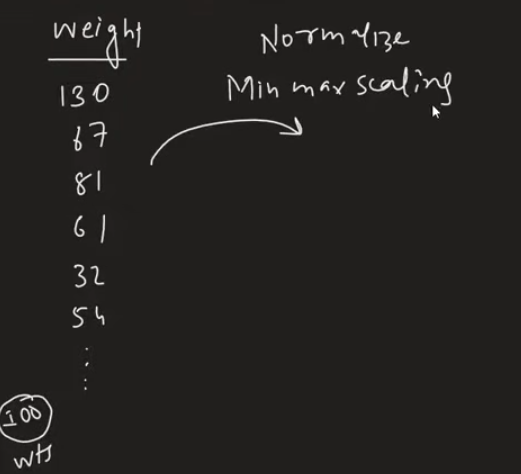

we just apply a formula on each value

X_scaled = (X - X_min) / (X_max - X_min)

* Where: X' = transformed value, X_i = original value, X_min = minimum value in the distribution, X_max = maximum value in the distribution
* **Step-by-step example (notes):** weight values [130, 67, 81, 61, 32, 54]
    - Step 1: identify min and max -> X_min = 32 and X_max = 130
    - Step 2: transform the value 67 -> (67 - 32)/(130 - 32) = 35/98 = **0.357**
    - Step 3: transform the maximum value 130 -> (130 - 32)/(130 - 32) = 98/98 = **1.0**
    - Step 4: transform the minimum value 32 -> (32 - 32)/(130 - 32) = 0/98 = **0.0**
* Important observations: (1) minimum value always becomes 0, (2) maximum value always becomes 1, (3) all transformed values fall in the range [0, 1], (4) the distribution shape is preserved, (5) outliers can significantly affect the scaling
* Python: `scaler = MinMaxScaler()` -> `scaler.fit(X_train)` (learns min and max) -> `X_train_scaled = scaler.transform(X_train)` and `X_test_scaled = scaler.transform(X_test)`

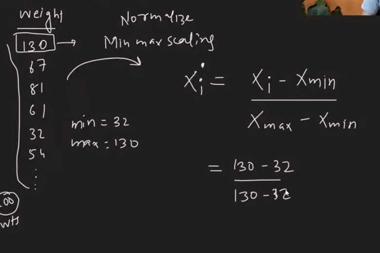

* the new distribution will be in the range from 0 to 1
* Min value becomes 0, max value becomes 1 
* 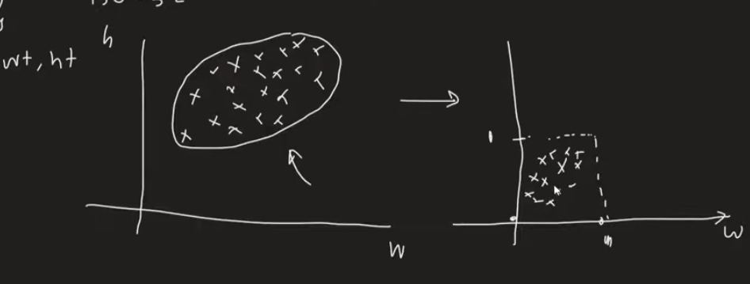

* squishing it into a unit square (for 3D data a unit cube, for more dimensions a unit hypercube)

-----

We will see a coding example of wine-data
* Columns: Class label, Alcohol, Malic acid (we take only these 3)
* `MinMaxScaler` from sklearn.preprocessing, again fit on train and transform both train and test
* **Practical implementation with the Wine dataset (notes):** features = Alcohol content and Malic acid levels; target = wine class labels (1, 2, 3); classification problem; challenge: the features have different scales. Load: `df = pd.read_csv('wine_data.csv', header=None, usecols=[0,1,2])` and `df.columns = ['Class label', 'Alcohol', 'Malic acid']`
* Original distribution statistics (train): Alcohol -> count 124, mean 13.0, std 0.8, min 11.0, 25 % 12.4, 50 % 13.0, 75 % 13.6, max 14.8; Malic acid -> count 124, mean 2.4, std 1.1, min 0.9, 25 % 1.6, 50 % 1.9, 75 % 3.2, max 5.6. Observation: Alcohol has a higher magnitude (11-15) compared to Malic acid (0.9-5.6)
* Train-test split: `train_test_split(df.drop('Class label', axis=1), df['Class label'], test_size=0.3, random_state=0)` -> training set (124, 2), test set (54, 2)
* Apply MinMax scaling: `scaler = MinMaxScaler()`, **fit only on the training data** (`fit()` learns min/max and stores X_min = 11.0, X_max = 14.8 for Alcohol), `transform()` applies the scaling to both train and test (using the same min/max), then convert back to a DataFrame for the analysis
* After scaling: Alcohol min 11.0 -> 0.0, max 14.8 -> 1.0; Malic acid min 0.9 -> 0.0, max 5.6 -> 1.0. Key changes: both features now range from [0, 1], minimum values map to 0, maximum values map to 1, both features are on the same scale

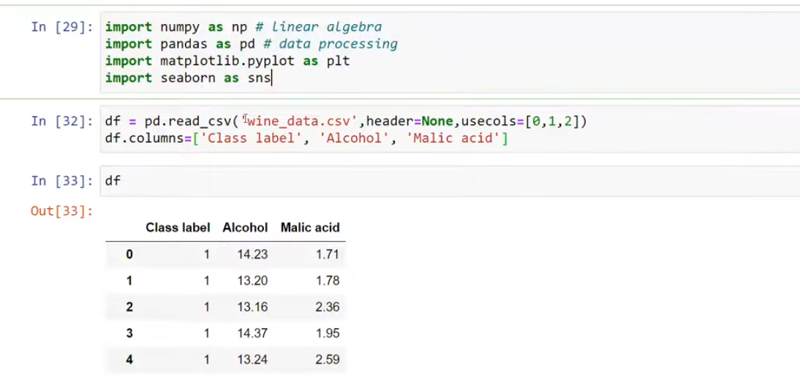

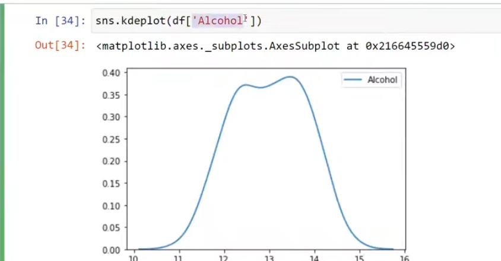

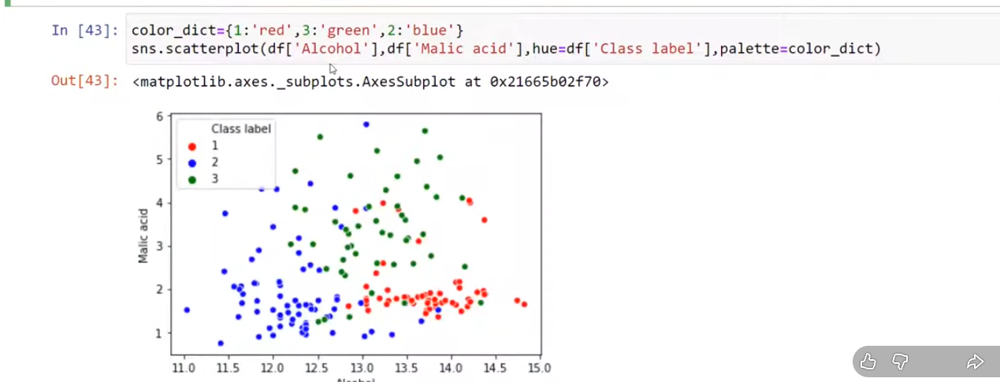

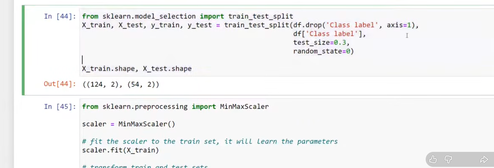

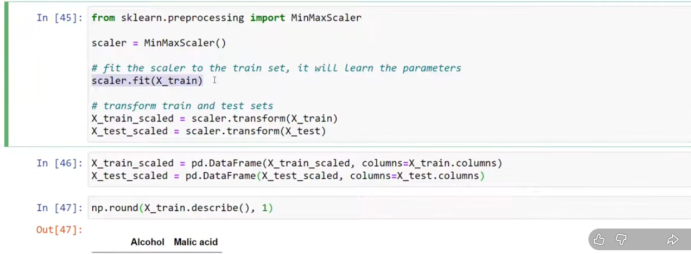

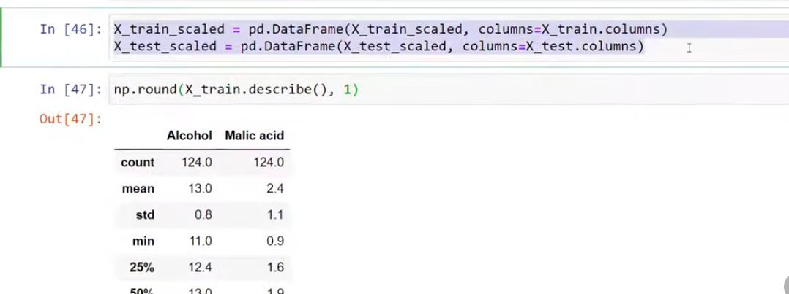

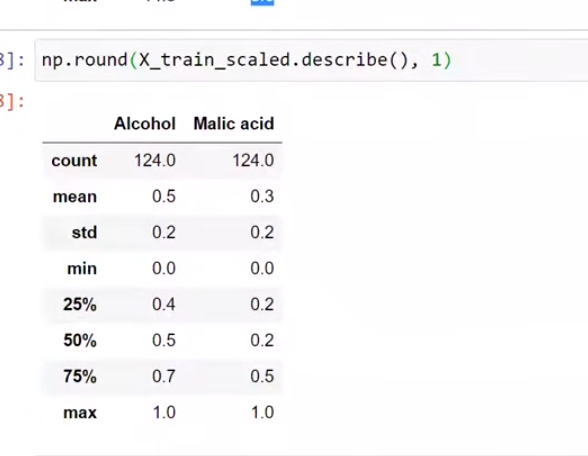


-----


now both are in the same range

* min of both columns = 0 and max of both = 1 (guaranteed), but nothing can be said about mean and SD
* Observations from the visualizations (KDE, scatter plot, box plot): (1) distribution shape is preserved in both the features, (2) both are now in the [0, 1] range, (3) relative structure is maintained within each feature, (4) the overlap is now visible because the scales are comparable. In the box plot, before scaling the different scales make the comparison difficult; after scaling both are directly comparable on the same scale [0, 1]
* **Important notes from the implementation:**
    - Fit vs transform: `fit()` learns the parameters (min, max) from the training data, `transform()` applies the learned parameters to the data. Always fit on the training data only
    - Distribution shape: MinMax scaling preserves the distribution shape for normal distributions, it may change the shape if outliers are present, the relative structure is always maintained
    - Outlier impact: outliers can compress the main data significantly, so if the data has outliers consider Robust scaling instead
    - Data leakage prevention: WRONG -> `scaler.fit(pd.concat([X_train, X_test]))`; CORRECT -> `scaler.fit(X_train)` then transform both


distribution shape can change though

* Outliers are a problem here, as everything is squished into 0-1
* **When to use MinMax scaling:** you know the approximate minimum and maximum values; bounded features (e.g. image pixels 0-255); neural networks (especially CNNs for image processing); algorithms that don't assume any distribution (e.g. neural networks, K-NN); you want to preserve zero values in sparse data
* **Avoid MinMax scaling when:** the data contains significant outliers; the distribution is highly skewed; new data might exceed the training min/max ranges
* Advantages: simple and intuitive; preserves relationships; bounded output range [0, 1]; works well with neural networks; fast computation. Limitations: sensitive to outliers; doesn't center the data; new data outside the range can cause issues; can compress the data too much if outliers exist; changes the distribution shape with outliers

---

mean normalization


X_scaled = (X - X_mean) / (X_max - X_min)

We are doing the mean centering 
* range is -1 to 1

- no support in sklearn -> where we need centered data (rarely used, people use standardization instead)
* **Mean normalization (notes):** it centers the data around zero by subtracting the mean and then scales by the range. Formula: X' = (X - X_mean)/(X_max - X_min), output range typically [-1, 1] but can vary depending on the data distribution. This technique is less commonly used but useful when you need centered data
* Properties: centers the data at zero (mean becomes 0), values below the mean become negative, values above the mean become positive, the mean value maps to exactly 0
* **Step-by-step example:** weight = [200, 100, 350] -> mean = (200 + 100 + 350)/3 = 216.67, X_max = 350, X_min = 100. Transform 200: (200 - 216.67)/(350 - 100) = -16.67/250 ≈ -0.067. Transform 350 (maximum): (350 - 216.67)/250 = 133.33/250 = 0.533
* Relationship to standardization: mean normalization is similar to standardization (both center the data), but it scales by the range instead of the standard deviation
* Use when: algorithms require centered data, you want the data centered around zero, algorithms assume zero-centered data. Avoid when: scikit-learn doesn't have a built-in class for this (we need to implement it manually), and in most cases where standardization would work better
* Custom implementation: `def mean_normalization(X): X_mean = X.mean(); X_max = X.max(); X_min = X.min(); return (X - X_mean) / (X_max - X_min)`

---

MaxAbsScaling


X_scaled = X / |X_max|

useful in sparse data -> where there are a lot of zeros we can use this 
* sklearn has the `MaxAbsScaler` class
* **MaxAbs scaling (notes):** scales each feature by its maximum absolute value, X' = X_i / |X_max|, where |X_max| = the absolute value of the maximum in the distribution. It is particularly useful for sparse data where many values are zero
* Characteristics: output range [-1, 1]; preserves the sign of the features; maintains sparsity (zeros remain zeros); does not center the data; does not shift the data
* **Step-by-step example:** weight = [200, 100, 350] -> |X_max| = 350 -> X_200 = 200/350 = 0.571, X_100 = 100/350 = 0.286, X_350 = 350/350 = 1.0
* Why it matters for sparse data: zeros remain zeros after the transformation, no memory overhead for zero values, maintains the sparse matrix efficiency; essential for text processing and NLP tasks
* Python: `scaler = MaxAbsScaler()`, `scaler.fit(X_train)`, `X_train_scaled = scaler.transform(X_train)`, `X_test_scaled = scaler.transform(X_test)`
* Use when: working with sparse data (many zero values), sparse matrices (e.g. TF-IDF, one-hot encoded data), you want to preserve sparsity, data is already centered at zero, text data or NLP tasks. Avoid when: the data is not sparse, other normalization techniques work better for dense data
* Advantages: preserves sparsity, simple computation, works with sparse matrices, maintains zero values. Limitations: less commonly used, sensitive to outliers, doesn't center the data, may not work well with dense data

---

Robust scaling 


X_scaled = (X - median) / IQR

IQR -> inter quartile range = 75th percentile value - 25th percentile value

--
robust to the outliers 
* If your data has a lot of outliers, try this
* sklearn: `RobustScaler`
* **Robust scaling (notes):** designed to be robust to outliers. Instead of using the mean and standard deviation (which are sensitive to outliers) it uses the median and the interquartile range (IQR). Formula: X' = (X_i - X_median)/IQR, where X_median = median of the distribution (50th percentile), IQR = Q3 - Q1, Q3 = 75th percentile, Q1 = 25th percentile. Alternative representation: (X_i - X_median)/(X_75th - X_25th)
* Understanding IQR: it contains the middle 50 % of the data, it is less affected by extreme values, it is a robust measure of spread
* **Step-by-step example:** weight = [200, 300, 100] -> sorted [100, 200, 300], median = 200, Q1 = 100, Q3 = 300, IQR = 300 - 100 = 200. Transform 200: (200 - 200)/200 = 0; transform 300: (300 - 200)/200 = 0.5; transform 100: (100 - 200)/200 = -0.5
* Why robust scaling is robust to outliers: it uses the median (not the mean), which is resistant to extreme values; it uses the IQR (not the range or std), which focuses on the central data; the outliers have a minimal impact on the scaling; it preserves the structure of the main data distribution
* **Outlier handling comparison:** MinMax (centering uses Min, scaling uses Max - Min) -> outlier sensitivity very high; Standardization (uses Mean, Std dev) -> high; Robust (uses Median, IQR) -> very low
* Use when: the data contains outliers, the distribution is skewed, you want to maintain the relative importance of typical values, outliers are not errors but valid extreme values, other scaling methods compress the main data too much. Avoid when: the data has no outliers, small datasets (percentiles may not be reliable), outliers are actually the values of interest
* Advantages: robust to outliers, preserves the main data structure, uses resistant statistics, works with skewed distributions, better than MinMax with outliers. Limitations: output range is unbounded, doesn't guarantee a specific range, may be overkill for clean data, percentile calculation adds computation, less interpretable than the [0, 1] range

experiment karke dekho (try and see) 
* we can't say beforehand which one will perform better, ML is all about experimentation

---4

Normalization vs Standardization

* is feature scaling required??
    - first answer this question: if the algorithm doesn't need scaling (e.g. trees) then don't scale
* Most of the time standardization gives better results and it is the most used
* MinMax used when we know the min max of our data --> example in CNN -> 0-255 (image pixel values)
* when we don't know we will use StandardScaler (standardization)
* Use Robust scaling when outliers are present
* MaxAbs when data is sparse
* If you have no idea, just use all of them and see which gives better results

**Normalization vs Standardization (comparison table from the notes)**

* Output range: Normalization = fixed (e.g. [0, 1]); Standardization = unbounded (any value)
* Centering: Normalization = no (except Mean normalization); Standardization = yes (mean = 0)
* Formula: Normalization = (x - x_min)/(x_max - x_min); Standardization = (x - μ)/σ
* Assumptions: Normalization = no distribution assumptions (works without them too); Standardization = assumes a normal distribution
* Outlier sensitivity: Normalization = high (uses min/max); Standardization = moderate (uses mean/std)
* Use case: Normalization = known bounds, neural networks, image data; Standardization = unknown bounds, most ML algorithms

**Decision framework (notes)**

* Question 1: is feature scaling required?
    - NOT required for: Decision Trees, Random Forest, Gradient Boosted Trees (XGBoost, LightGBM, CatBoost), tree-based ensemble methods
    - Required for: linear models (Linear/Logistic Regression), neural networks, SVM, KNN, K-Means clustering, PCA, gradient descent based algorithms
* Question 2: normalization or standardization?
    - Use **STANDARDIZATION** (most common, the default choice) when: general ML problems, no prior knowledge about the feature bounds, data may have different scales, working with algorithms that assume normally distributed features, you want unbounded outputs
    - Use **NORMALIZATION** when: you know the min/max bounds ahead of time, bounded features (e.g. image pixels 0-255, percentages 0-100), neural networks (especially CNNs for image processing), you need an interpretable [0, 1] range, distance-based algorithms with bounded features
* **Practical decision guide:** image processing -> MinMax normalization (pixels have known bounds [0-255]); general ML problem -> Standardization (most reliable, works for most cases); data with outliers -> Robust scaling (uses median and IQR, resistant to outliers); sparse data / NLP -> MaxAbs scaling (preserves sparsity); known bounds -> MinMax normalization (utilizes the domain knowledge); neural networks -> MinMax or Standardization (both work, MinMax is common for images); SVM, KNN -> Standardization (these algorithms are distance-based)
* **Special case, image processing with CNNs:** image pixels are in the range [0, 255], so `image_normalized = image / 255.0` which is effectively MinMax scaling, (pixel - 0)/(255 - 0) = pixel/255. Reasoning: (1) we know the minimum value 0 (black), (2) we know the maximum value 255 (white), (3) natural interpretation: 0 = no intensity, 1 = full intensity, (4) all images share the same bounds, (5) standardization would give negative values (no physical meaning for pixels)
* **Common misconceptions:** Myth: "always use standardization for neural networks" -> reality: MinMax often works better for CNNs with image data. Myth: "normalization and standardization are the same" -> reality: they are different techniques with different properties and use cases. Myth: "always use the same scaling for all features" -> reality: you can mix techniques, but usually one technique per model
* Machine learning is experimental: no one-size-fits-all solution; try multiple techniques; use cross-validation to compare; document what works for your specific problem; build intuition through practice

**Quick reference table (notes)**

* MinMax scaling: use when known min/max bounds, image processing, neural networks, need [0, 1] range; avoid when significant outliers or unknown future data range; range [0, 1]; class `MinMaxScaler`
* Standardization: use for general ML problems, unknown bounds, most algorithms (default choice); avoid when you need specific bounds or the data is already scaled; range unbounded; class `StandardScaler`
* Mean normalization: use when centered data is needed; avoid in most cases (use standardization instead); range [-1, 1]; manual implementation
* MaxAbs scaling: use for sparse data, many zeros, text data (TF-IDF); avoid for dense data or when there are no sparsity benefits; range [-1, 1]; class `MaxAbsScaler`
* Robust scaling: use when the data has outliers, skewed distributions, or the outliers are valid; avoid for clean data and small datasets; unbounded; class `RobustScaler`

**Practical examples (notes)**

1. Predicting house prices (square footage, number of bedrooms, age, location rating) -> Standardization: features have different scales, no known bounds, general regression problem: `scaler = StandardScaler()`, `X_train_scaled = scaler.fit_transform(X_train)`, `X_test_scaled = scaler.transform(X_test)`
2. Image classification (pixel values [0-255] for RGB channels) -> MinMax scaling: known bounds 0 to 255, convolutional neural network, natural interpretation of the [0, 1] range: `X_train_scaled = X_train / 255.0`, or use sklearn `MinMaxScaler`
3. Customer segmentation with outliers (income, age, purchase frequency, total spend; some customers have extremely high income/spend) -> Robust scaling: outliers present in income and spend, K-Means clustering (distance-based), median and IQR resistant to outliers: `RobustScaler()`
4. Text classification (TF-IDF vectors, a sparse matrix with many zeros) -> MaxAbs scaling or no scaling: sparse data structure, many zero values, want to preserve sparsity: `MaxAbsScaler()` with `fit_transform(X_train_sparse)`
* **Feature-wise scaling considerations:** can you scale different features differently? Not recommended: mixing scaling techniques within one model (inconsistent scale across features, hard to interpret and debug, may cause unexpected behaviour). Recommended: use one scaling technique for all the features in a model (consistent preprocessing, easier to maintain, standard practice). Exception: feature engineering pipelines where specific transformations are needed for specific feature types (use ColumnTransformer)

**Key takeaways (notes)**

1. Units matter: always eliminate the units in numerical features before applying ML algorithms for better and more stable results
2. Normalization ≠ Standardization: they are different techniques with different properties and use cases
3. Fit on training only: always fit scalers on the training data and then transform both train and test data to prevent data leakage
4. Preserve distribution: most scaling techniques preserve the distribution shape (except when outliers are present)
5. Experiment: when in doubt, try multiple scaling techniques and compare the performance using cross-validation ("better features with simple algorithms outperform poor features with complex algorithms")
6. Default choice: when unsure, start with Standardization, it works well for most problems (about 90 % of the cases)
7. Know your data: understanding your data characteristics (outliers, bounds, sparsity) helps choose the right scaling technique
8. Know your algorithm: understanding the algorithm requirements helps determine whether scaling is needed at all

**Scaling requirement by algorithm family (notes)**

* Tree-based (RF, XGBoost etc.): scaling not required -> none
* Linear models: required -> Standardization
* Neural networks: required -> MinMax (images) or Standardization
* SVM: required -> Standardization
* K-NN: required -> Standardization or MinMax
* K-Means: required -> Standardization
* PCA: required -> Standardization

**Summary table of all normalization techniques (notes)**

* MinMax: range [0, 1]; use for known bounds, images, NN; outlier robust? No; preserves sparsity? Yes (for zeros)
* Mean normalization: range [-1, 1]; use when centered data is needed; outlier robust? No; preserves sparsity? No
* MaxAbs: range [-1, 1]; use for sparse data, text; outlier robust? No; preserves sparsity? Yes
* Robust: unbounded; use when outliers are present; outlier robust? Yes; preserves sparsity? No
* Standardization (default): unbounded; use for general ML; outlier robust? No (moderate sensitivity); preserves sparsity? No


### Official code - L25 Normalization / MinMax scaling (repo: `day25-normalization/day25.ipynb`)

**Block 1 - imports and loading the wine data**

```python
import numpy as np
import pandas as pd
import matplotlib.pyplot as plt
import seaborn as sns

# header=None: the file has no header row; usecols=[0,1,2]: read only the first 3 columns
df = pd.read_csv('wine_data.csv', header=None, usecols=[0, 1, 2])
df.columns = ['Class label', 'Alcohol', 'Malic acid']   # give names to the columns
```

**Block 2 - look at the data (PDF of each column and scatter plot per class)**

```python
sns.kdeplot(df['Alcohol'])      # distribution of Alcohol (values around 11 - 15)
sns.kdeplot(df['Malic acid'])   # distribution of Malic acid (values around 1 - 6)

# scatterplot: Alcohol vs Malic acid, hue colors the points by class label
color_dict = {1: 'red', 3: 'green', 2: 'blue'}
sns.scatterplot(df['Alcohol'], df['Malic acid'], hue=df['Class label'], palette=color_dict)
```

**Block 3 - train test split**

```python
from sklearn.model_selection import train_test_split

X_train, X_test, y_train, y_test = train_test_split(df.drop('Class label', axis=1),   # inputs
                                                    df['Class label'],                 # output
                                                    test_size=0.3,
                                                    random_state=0)

X_train.shape, X_test.shape
```

**Block 4 - MinMaxScaler (x - min) / (max - min)**

```python
from sklearn.preprocessing import MinMaxScaler

scaler = MinMaxScaler()

# fit: learns min and max of every column from the train set only
scaler.fit(X_train)

# transform: applies (x - min) / (max - min) -> every value is now between 0 and 1
X_train_scaled = scaler.transform(X_train)
X_test_scaled = scaler.transform(X_test)

# numpy array -> DataFrame (to keep the column names)
X_train_scaled = pd.DataFrame(X_train_scaled, columns=X_train.columns)
X_test_scaled = pd.DataFrame(X_test_scaled, columns=X_test.columns)

np.round(X_train.describe(), 1)         # before scaling
np.round(X_train_scaled.describe(), 1)  # after scaling: min = 0 and max = 1 for both columns
```

**Block 5 - before vs after scaling plots**

```python
# scatter plot: the same points, only the scale changes (colored by class)
fig, (ax1, ax2) = plt.subplots(ncols=2, figsize=(12, 5))
ax1.scatter(X_train['Alcohol'], X_train['Malic acid'], c=y_train)
ax1.set_title("Before Scaling")
ax2.scatter(X_train_scaled['Alcohol'], X_train_scaled['Malic acid'], c=y_train)
ax2.set_title("After Scaling")
plt.show()

# PDF of both the columns together
fig, (ax1, ax2) = plt.subplots(ncols=2, figsize=(12, 5))
ax1.set_title('Before Scaling')
sns.kdeplot(X_train['Alcohol'], ax=ax1)
sns.kdeplot(X_train['Malic acid'], ax=ax1)
ax2.set_title('After Standard Scaling')
sns.kdeplot(X_train_scaled['Alcohol'], ax=ax2)
sns.kdeplot(X_train_scaled['Malic acid'], ax=ax2)
plt.show()

# PDF of each column separately (shape stays almost the same)
fig, (ax1, ax2) = plt.subplots(ncols=2, figsize=(12, 5))
ax1.set_title('Alcohol Distribution Before Scaling')
sns.kdeplot(X_train['Alcohol'], ax=ax1)
ax2.set_title('Alcohol Distribution After Standard Scaling')
sns.kdeplot(X_train_scaled['Alcohol'], ax=ax2)
plt.show()

fig, (ax1, ax2) = plt.subplots(ncols=2, figsize=(12, 5))
ax1.set_title('Malic acid Distribution Before Scaling')
sns.kdeplot(X_train['Malic acid'], ax=ax1)
ax2.set_title('Malic acid Distribution After Standard Scaling')
sns.kdeplot(X_train_scaled['Malic acid'], ax=ax2)
plt.show()
```

----

## L 26 Encoding Categorical Data 

feature engineering

Encoding categorical

Data is of two types, numerical and categorical type
* Categorical has two types - nominal and ordinal categories 
* Nominal -> state | each one is the same value (no relation, e.g. state, gender, color)
* ordinal we have some relation | Distinction 1st is better than 2nd (e.g. poor < average < good < excellent, school levels)

* Problem: ML algorithms work on numbers, categorical data usually comes in the form of strings, so we have to convert it to numbers

Ordinal Encoding -

Nominal

Label Encoding

* Two techniques we study today: Ordinal Encoding and Label Encoding
* One Hot Encoding (for nominal data) in the next video

----

Label Encoding


in classification, if the label | output is categorical then we will use label encoding, not ordinal encoding

* `LabelEncoder` is specially designed for the output column (y)
* We apply it only on the target; for input columns we use OrdinalEncoder / OneHotEncoder
* sklearn doc: "should be used to encode target values, i.e. y, and not the input X"
* The labels get values between 0 and n_classes - 1

Ordinal Encoding

transform into numerical
* PG > UG > HS
* We have to tell the order ourselves, then the encoder gives the highest value to PG and the lowest to HS
* Use the `OrdinalEncoder` class, parameter `categories=[[...], [...]]` (one list per column, in increasing order)
* Eg: review: Poor < Average < Good ; education: School < UG < PG


----------

Example
* Dataset: customer data - age, gender, review, education, purchased
* gender -> nominal, review and education -> ordinal, purchased -> output (use label encoding)
* Here we ignore gender (we will handle it in one hot encoding)
* Again: train test split first, `fit` on train, `transform` on both


---


* `encoder.categories_` shows which category got which number
* For label encoder: `le.classes_` 

### CampusX PDF notes - L26 Encoding Categorical Variables (PDF pp. 549-569)

**Where it sits:** Feature Engineering -> Feature Transformation -> Encoding Categorical Data -> {Ordinal Encoding, Label Encoding, One-Hot Encoding (next lecture)}.

**1. Data types**

| Aspect | Numerical data | Categorical data |
|---|---|---|
| Meaning | Quantities / measurements | Categories or groups |
| Examples | Height, weight, age, salary, temperature | Gender, state, education level, rating |
| Operations | Mean, median, std, arithmetic | No direct mathematical operation (only mode makes sense) |


**2. Nominal vs Ordinal (the core idea of the lecture)**

| Aspect | Nominal | Ordinal |
|---|---|---|
| Definition | Categories with no inherent order | Categories with a meaningful order / ranking |
| Relationship | No relationship between categories | Clear ordering exists (but the gaps between ranks are not necessarily equal) |
| Examples | State (Gujarat, West Bengal, Karnataka), gender, branch (CSE, ECE, ME), colour, blood type | Education (School < UG < PG), rating (Poor < Average < Good < Excellent), size (S < M < L), pain level |
| Comparison | You cannot say Maharashtra is "greater than" Karnataka | You can say PG > UG > School |
| Encoding | One-Hot Encoding (preferred) | Ordinal Encoding (integers following the order) |
| Number assignment | Random assignment would be acceptable (but it still creates a fake order, that is why we use OHE) | Must maintain the order |


**3. Why encode at all?**
* ML algorithms only understand numbers. The strings "School", "Undergraduate", "Postgraduate" are meaningless to them.
* After encoding: School -> 0, Undergraduate -> 1, Postgraduate -> 2, and now the algorithm can work with 0, 1, 2.


**4. Ordinal Encoding**
* Converts ordinal categorical variables into integers **while preserving the order**.
* Use it when: the column is ordinal, the column is an input feature (X), and the order matters for the model.
* Do NOT use it when: the data is nominal (use One-Hot) or when you are encoding the target (use LabelEncoder).

Process (4 stages): original column -> define order and rank -> assign ranks -> encoded data.

| Step 1: original | Step 2: order | Step 3: encoded |
|---|---|---|
| School | School = lowest (0) | 0 |
| Undergraduate | UG = middle (1) | 1 |
| Postgraduate | PG = highest (2) | 2 |
| Undergraduate | | 1 |
| School | | 0 |


Mathematical form: for an ordinal variable X with categories C1 < C2 < ... < Cn,
`OrdinalEncoder(X) = 0 if X = C1, 1 if X = C2, ..., n-1 if X = Cn`

**Two ordinal columns at once** (orders are Review: Poor < Average < Good and Education: School < UG < PG):

| Review (before) | Education (before) | Review (after) | Education (after) |
|---|---|---|---|
| Poor | School | 0 | 0 |
| Average | Undergraduate | 1 | 1 |
| Good | Postgraduate | 2 | 2 |
| Good | Undergraduate | 2 | 1 |
| Average | School | 1 | 0 |

```python
from sklearn.preprocessing import OrdinalEncoder
oe = OrdinalEncoder(categories=[['Poor','Average','Good'],   # order for 'review'
                                ['School','UG','PG']])       # order for 'education'
oe.fit(X_train)                       # learn the categories from TRAIN only
X_train_encoded = oe.transform(X_train)
X_test_encoded  = oe.transform(X_test)
```

**Important notes (from the PDF)**
1. *Always specify the order.* `OrdinalEncoder(categories=[[...]])` is correct. `OrdinalEncoder()` with no order assigns numbers alphabetically/randomly and destroys the meaning.
2. *Fit on train only.* `fit(X_train)` then `transform(X_train)` and `transform(X_test)`. Fitting on the test set = data leakage.
3. *Check the mapping:* `oe.categories_` -> `[array(['Poor','Average','Good']), array(['School','UG','PG'])]`.

**5. Label Encoding**
* A technique designed **only for the target variable (y)** in classification. It converts categorical class labels into integers 0 ... n_classes-1.
* Use it when: y is categorical (Yes/No, Pass/Fail, Cat/Dog).
* Do NOT use it when: encoding input features (use Ordinal/One-Hot), or regression (y is already numerical).

| Customer | Purchased (before) | Purchased (after) |
|---|---|---|
| 1 | Yes | 1 |
| 2 | No | 0 |
| 3 | Yes | 1 |
| 4 | No | 0 |
| 5 | Yes | 1 |

Math: `LabelEncoder(y) = 0 if y = class1, 1 if y = class2, ..., k-1 if y = class k` (classes are sorted alphabetically, so "No" -> 0 and "Yes" -> 1).

```python
from sklearn.preprocessing import LabelEncoder
le = LabelEncoder()
le.fit(y_train)                       # learn the classes
print(le.classes_)                    # ['No' 'Yes']
y_train_encoded = le.transform(y_train)
y_test_encoded  = le.transform(y_test)
```

From the sklearn docs: *"This transformer should be used to encode target values, i.e. y, and not the input X. Target values are between 0 and n_classes-1."*

**6. Ordinal Encoder vs Label Encoder - decision flow**


* Is the variable categorical? No -> no encoding needed.
* Yes -> is it the target y? Yes -> **LabelEncoder**.
* No (it is an input X) -> is it ordinal? Yes -> **OrdinalEncoder** (specify the order). No -> **OneHotEncoder**.

| Feature | Ordinal Encoding | Label Encoding |
|---|---|---|
| Applied on | Input features (X) | Target variable (y) |
| Data type | Ordinal categorical | Any categorical (binary or multi-class) |
| Order matters | Yes, you must specify it | No, assigned automatically (alphabetical) |
| sklearn class | `OrdinalEncoder` | `LabelEncoder` |
| Category specification | Required through the `categories` parameter | Automatic from the data |
| Input shape | 2D array (n_samples, n_features) | 1D array (n_samples,) |
| Columns | Can handle many columns at once | One column / array |
| Common mistake | Using it on nominal data, or not specifying the order | Using it on input features |

**7. Common mistakes to avoid**

| Wrong | Correct |
|---|---|
| LabelEncoder on input features | OrdinalEncoder for ordinal features, OneHotEncoder for nominal features |
| OrdinalEncoder on the target | LabelEncoder for the target |
| Not giving the category order | Always pass `categories` in the right order |
| Fitting the encoder on test data | Always fit on train, then transform train and test |
| OrdinalEncoder on nominal data | OneHotEncoder for nominal features |

**8. Worked example - customer dataset**

| Column | Type | Category type | Encoding method |
|---|---|---|---|
| Age | Numerical | N/A | No encoding needed |
| Gender | Categorical | Nominal | OneHotEncoder (next lecture) |
| Review | Categorical | Ordinal | OrdinalEncoder |
| Education | Categorical | Ordinal | OrdinalEncoder |
| Purchased | Categorical (target) | N/A | LabelEncoder |

Sample rows: (30, Male, Average, School, No), (45, Female, Good, Undergraduate, Yes), (35, Male, Poor, Postgraduate, Yes), (28, Female, Good, Undergraduate, No).

Workflow: (1) select `review`, `education` as X and `purchased` as y -> (2) `train_test_split(test_size=0.2, random_state=42)` -> (3) OrdinalEncoder on X (fit on train) -> (4) LabelEncoder on y (fit on train) -> (5) verify.

Sample output: the first 5 rows of X_train `(Poor,UG), (Average,UG), (Average,School), (Good,UG), (Good,PG)` become `[[0,1],[1,1],[1,0],[2,1],[2,2]]`; `le.classes_ = ['No' 'Yes']`, so No -> 0, Yes -> 1.

Verification snippet:
```python
for i, cat in enumerate(oe.categories_):
    print(f" Feature {i}: {cat}")
print(le.classes_)
assert X_train.shape[1] == 2, "Should have 2 features"
```


**9. Key takeaways**
1. Algorithms need numbers, so categorical variables must be encoded.
2. Two kinds of categorical data: nominal (no order) and ordinal (order).
3. Three encoders: Ordinal (ordinal X), Label (target y only), One-Hot (nominal X).
4. OrdinalEncoder: must give the order explicitly. LabelEncoder: automatic, target only.
5. Critical workflow: split first -> `fit` on train -> `transform` train and test.
6. References: sklearn docs for `OrdinalEncoder` and `LabelEncoder`.

### Official code - L26 Ordinal Encoding and Label Encoding (repo: `day26-ordinal-encoding/day26.ipynb`)

**Block 1 - load the customer data**

```python
import numpy as np
import pandas as pd

df = pd.read_csv('customer.csv')   # age, gender, review, education, purchased
df.sample(5)
df = df.iloc[:, 2:]                # keep review, education, purchased (the first two columns are ignored)
df.head()
```

**Block 2 - train test split (the split cell is missing in the repo notebook, it is the same split as in the lecture)**

```python
from sklearn.model_selection import train_test_split

# X = review, education (ordinal columns); y = purchased (the output column)
X_train, X_test, y_train, y_test = train_test_split(df.iloc[:, 0:2], df.iloc[:, -1], test_size=0.2)
```

**Block 3 - OrdinalEncoder (for the input columns that have an order)**

```python
from sklearn.preprocessing import OrdinalEncoder

# categories = one list per column, in INCREASING order; Poor=0, Average=1, Good=2 and School=0, UG=1, PG=2
oe = OrdinalEncoder(categories=[['Poor', 'Average', 'Good'], ['School', 'UG', 'PG']])

oe.fit(X_train)                     # fit: learns the category -> number mapping
X_train = oe.transform(X_train)     # transform: replaces the strings by numbers
# (X_test is transformed with the same oe.transform(X_test))

oe.categories_                      # shows the categories learnt for every column
```

**Block 4 - LabelEncoder (only for the output column y)**

```python
from sklearn.preprocessing import LabelEncoder

le = LabelEncoder()

le.fit(y_train)          # fit: learns the classes of the target (Yes / No)
le.classes_              # array(['No', 'Yes'])  -> No = 0 and Yes = 1

y_train = le.transform(y_train)   # transform both train and test target using the same encoder
y_test = le.transform(y_test)
```

----

## L27 One hot encoding

Handling nominal categorical data using this 


string to number format

ordinal --> order followed -> ordinal encoding

nominal --> no order followed --> one hot encoding

* If we use ordinal encoding on nominal data (Yellow = 0, Blue = 1, Red = 2) the ML algorithm will think Red > Blue > Yellow, which is wrong as all colors are equal

---

OneHotEncoding


each vector represents a color

* For every category create a new column; a row gets 1 in the column of its category and 0 in the others
* Yellow = [1, 0, 0], Blue = [0, 1, 0], Red = [0, 0, 1]

if you have 50 categories then you will make 50 columns 
* the dimensionality of the data increases and processing becomes slow

What is dummy variable trap??

---
we have to remove one column in doing one hot encoding

* If there are k categories we keep only k-1 columns

--
multicollinearity -> input columns have some mathematical relationship in them 
but it should not be, if we add all these color columns we will get the sum as 1 (so any one column can be predicted from the others)
this will be a problem in linear regression and we avoid such things in ML 

* Input columns should be independent of each other
* Solution: remove the first column

Y - 0 0 since blue and red is 0 and then by default we have Y = 1
this Y (yellow) is a dummy variable 

* These columns are called dummy variables, and having all of them gives the multicollinearity problem, this is the **dummy variable trap**
* We will study multicollinearity in detail in a separate video

---

Brand -> nominal one hot encoding

each brand each column 

processing slow

only frequent categories are kept and the rest, with very few, are kept in a new category called "other / uncommon"

* If a column has too many categories, make columns only for the top frequent categories and club the rest in one new category -> dimensionality reduces


---


* Dataset: used cars - brand, km_driven, fuel, owner, selling_price
* `pd.get_dummies(df, columns=['fuel', 'owner'])` -> directly gives one hot encoded columns
* `drop_first=True` removes the first column (k-1 encoding)


----

K - 1 one hot encoding


pandas doesn't remember which column it kept at which order, for this we use scikit-learn

* In ML projects use the `OneHotEncoder` class of sklearn (it remembers the categories learnt on train data, so the same thing is applied on new data in production)
* `OneHotEncoder(drop='first', sparse=False, dtype=np.int32)`
* `handle_unknown='ignore'` -> if a new category comes in test, all its values become 0
* We apply it only on the nominal columns, so we have to separate those columns, encode them and join them back with the remaining columns (np.hstack) - this is the pain that ColumnTransformer solves in the next video


will apply separately on the two columns, one hot encoding, and then combine them


uncommon category with less than 100 cars

* Using value_counts we find the brands with fewer than 100 cars and replace them with 'uncommon', then apply OHE (the number of columns reduces from ~30 brands to a few)

-----------------

### CampusX PDF notes - L27 One Hot Encoding (PDF pp. 570-594)

**1. Why do we need OHE?**
1. Most ML algorithms need numerical input.
2. In real datasets, categorical features are stored as strings.
3. Converting them is the data scientist's job before model training.

| Type | Description | Examples | Order? | Encoding |
|---|---|---|---|---|
| Ordinal | inherent order / ranking | Education (High School < Bachelor < Master < PhD), ratings | Yes | Ordinal Encoding |
| Nominal | no inherent order | Colours (Red, Blue, Green), gender, car brands (Maruti, Honda, Toyota) | No | One Hot Encoding |

Key distinction: in nominal data the categories are mutually exclusive and *equal*. Male = Female, Red = Blue = Yellow, every car brand is equal. So giving them 0, 1, 2 would invent an order that does not exist.


**2. What is OHE?** Convert each category of a nominal variable into a separate binary (0/1) column. For a variable with `n` unique categories create `n` columns; the column of the row's category gets 1, all others get 0.

Original data (Color, Target) with Yellow, Blue, Red:

| Color | Target | | Color_Y | Color_B | Color_R | Target |
|---|---|---|---|---|---|---|
| Yellow | 0 | -> | 1 | 0 | 0 | 0 |
| Yellow | 1 | -> | 1 | 0 | 0 | 1 |
| Blue | 1 | -> | 0 | 1 | 0 | 1 |
| Red | 1 | -> | 0 | 0 | 1 | 1 |

Process: (1) identify the unique categories -> (2) create one binary column for each -> (3) put 1 if present, 0 otherwise.
Vectors: Yellow = [1,0,0], Blue = [0,1,0], Red = [0,0,1].
Formula: `X_encoded = [x_C1, x_C2, ..., x_Cn]` where `x_Ci = 1 if X = Ci else 0`.


**3. The dummy variable trap**
* If you create `n` columns for `n` categories, the columns become mathematically dependent. For every row: `Color_Y + Color_B + Color_R = 1`.
* So `Color_Y = 1 - Color_B - Color_R`: one column can be predicted perfectly from the others (perfect multicollinearity).

| ID | Color_Y | Color_B | Color_R | Sum |
|---|---|---|---|---|
| 1 | 1 | 0 | 0 | 1 |
| 2 | 0 | 1 | 0 | 1 |
| 3 | 0 | 0 | 1 | 1 |

* **Solution: keep n-1 columns** (drop the first).

| Color_B | Color_R | Represents |
|---|---|---|
| 0 | 0 | Yellow (the base / dropped category) |
| 1 | 0 | Blue |
| 0 | 1 | Red |

Yellow = [0,0], Blue = [1,0], Red = [0,1]. The number of columns needed is `n - 1`. The regression equation after dropping is `y = b0 + b1*Color_B + b2*Color_R + e`, where `b0` represents the base category (Yellow).


**4. Multicollinearity - why it is bad**

| Impact | What happens | Effect on the model |
|---|---|---|
| Unreliable coefficients | tiny data changes cause large coefficient swings | unstable model |
| Inflated standard errors | higher variance of the coefficient estimates | wider confidence intervals |
| Difficult interpretation | you cannot isolate the effect of each feature | feature importance unclear |
| Computational issues | matrix inversion fails in Linear Regression | model may not converge |

Mathematically: there exist constants a1...an (not all zero) such that `a1*X1 + a2*X2 + ... + an*Xn = 0`. For colours: `1*X_Y + 1*X_B + 1*X_R - 1 = 0`.

| Algorithm | Affected? | Severity | Reason |
|---|---|---|---|
| Linear Regression | Yes | High | uses matrix inversion, needs independent variables |
| Logistic Regression | Yes | High | similar to linear regression |
| Decision Trees | No | None | trees handle correlated features |
| Random Forest | No | None | ensemble of trees, inherently robust |
| Neural Networks | Moderate | Medium | can handle it but convergence may slow |
| SVM | Moderate | Low-Medium | regularization helps, still problematic |

**5. High cardinality (e.g., 50+ categories)**

| Problem | Description | Impact |
|---|---|---|
| Dimensionality explosion | too many columns | memory use up, training slower |
| Sparse data | most values are 0 | inefficient storage and computation |
| Overfitting risk | too many features vs samples | model learns noise |
| Computational cost | more features | slower training and prediction |

Example: 40 brands -> standard OHE gives 40 columns, 39 after drop-first, mostly zeros.

**Solution - keep the top frequent categories and group the rest as "uncommon / Others".** With threshold `T` (e.g. 100): `C_keep = {Ci : fi > T}`, `C_others = {Ci : fi <= T}`, and all the `C_others` are replaced by one new category `"uncommon"`; final categories = `C_keep U {uncommon}`.

Example (illustrative counts in the PDF): Maruti 1500, Hyundai 1200, Honda 800 -> keep; Jaguar 50, Volvo 30, Land Rover 20 -> group into "uncommon". 32 brands -> 10 kept + 1 "uncommon" = 11 categories, i.e. 31 columns -> 10 columns after drop-first.

| Benefit | Impact |
|---|---|
| Reduced dimensionality | faster training and prediction |
| Better generalization | less overfitting risk |
| Preserved information | most common patterns retained |
| Memory efficiency | less sparse matrices, lower memory |


(Note: the brand counts in the PDF output table - Maruti 1500, Hyundai 1200 ... - are illustrative numbers of the notes; run the code to see the real `value_counts()`.)

**6. Method 1 - pandas `get_dummies()`**
```python
encoded_df = pd.get_dummies(df, columns=['fuel', 'owner'])                      # all k columns
encoded_df = pd.get_dummies(df, columns=['fuel', 'owner'], drop_first=True)     # k-1 columns
```
Parameters: `data` (DataFrame), `columns` (list to encode), `drop_first` (bool, avoids the dummy trap), `dtype` (e.g. np.int32).

Car dataset (8,128 rows): fuel has 4 categories (CNG, Diesel, LPG, Petrol), owner has 5 (First, Second, Third, Fourth & Above, Test Drive Car).
* Without drop_first: shape (8128, 5) -> **(8128, 12)** = 3 untouched + 4 fuel + 5 owner.
* With drop_first: **(8128, 10)** = 3 untouched + 3 fuel (CNG dropped) + 4 owner (First Owner dropped).

| Advantages | Disadvantages |
|---|---|
| simple and intuitive | does not remember the transformation (not suitable for production) |
| works directly on DataFrames, keeps column names | cannot transform test data consistently |
| fast on small/medium data | different columns may appear in different runs |
| | not compatible with sklearn pipelines |

**7. Method 2 - sklearn `OneHotEncoder` (the production way)**

| Aspect | pandas get_dummies | sklearn OneHotEncoder |
|---|---|---|
| Memory | does not remember | remembers the learnt categories |
| Consistency | may vary | consistent |
| Test data | manual handling | automatic transform |
| Pipelines | not supported | pipeline compatible |
| Production | not recommended | production ready |

```python
X_train, X_test, y_train, y_test = train_test_split(df.iloc[:, 0:4], df.iloc[:, -1], test_size=0.2, random_state=2)
ohe = OneHotEncoder(drop='first', sparse=False, dtype=np.int32)   # newer sklearn: sparse_output=False
X_train_encoded = ohe.fit_transform(X_train[['fuel', 'owner']])   # fit_transform on TRAIN
X_test_encoded  = ohe.transform(X_test[['fuel', 'owner']])        # only transform on TEST
X_train_final = np.hstack((X_train[['brand', 'km_driven']].values, X_train_encoded))
X_test_final  = np.hstack((X_test[['brand', 'km_driven']].values, X_test_encoded))
```
Shapes: train **(6502, 9)**, test **(1626, 9)** -> 2 untouched (brand, km_driven) + 3 fuel + 4 owner = 9.

| Parameter | Options | Description | Recommendation |
|---|---|---|---|
| `drop` | None, 'first', 'if_binary' | which category to drop | 'first' to avoid the dummy trap |
| `sparse` | True / False | output format | False for easy manipulation |
| `dtype` | np.int32, np.float64 | output dtype | np.int32 for memory efficiency |
| `handle_unknown` | 'error', 'ignore' | new category at test time | 'ignore' for robust production |

**8. EDA of the car dataset (8,128 rows)**
* `df['fuel'].value_counts()` -> Diesel 4861, Petrol 3110, CNG 143, LPG 14 (Diesel/Petrol dominate; CNG/LPG are rare).
* `df['owner'].value_counts()` -> First 5289, Second 2105, Third 555, Fourth & Above 174, Test Drive Car 5 (strong imbalance; "Test Drive Car" is extremely rare).
* `df['brand'].nunique()` = 32 -> a high-cardinality feature that needs special handling.

Handling it:
```python
brand_counts = df['brand'].value_counts()
threshold = 100
rare_brands = brand_counts[brand_counts <= threshold].index
df['brand'] = df['brand'].replace(rare_brands, 'uncommon')
print(df['brand'].value_counts())
```

**9. When to use OHE**

| Use case | Recommendation | Reason |
|---|---|---|
| Nominal data | always use | no inherent order |
| Ordinal data | do not use | use ordinal encoding to keep the order |
| Binary features | either | the column can simply be 0/1 |
| High cardinality (>50) | with caution | group rare categories first |
| Tree-based models | optional | trees can treat categories differently |

**10. Pitfalls (wrong -> correct)**
* Forgetting drop-first: `OneHotEncoder(sparse=False)` -> `OneHotEncoder(drop='first', sparse=False)`.
* Fitting on test: `ohe.fit_transform(X_test[...])` -> `ohe.transform(X_test[...])`.
* Using pandas in production: `pd.get_dummies` cannot be applied to new data -> use the sklearn `OneHotEncoder` and call `ohe.transform()` on new data.

**11. Performance tips**

| Tip | Implementation | Benefit |
|---|---|---|
| Use sparse matrices | `sparse=True` | lower memory for high-dimensional data |
| Specify dtype | `dtype=np.int8` | saves memory (int8 vs int32) |
| Feature selection | remove low-variance encoded columns | fewer dimensions |
| Target encoding | alternative for high-cardinality in tree models | alternative to OHE |

Memory = `m x (n-1) x dtype_size`. Example: 10,000 samples, 100 categories, int32 -> 10,000 x 99 x 4 = 3,960,000 bytes, about 3.96 MB. For a sparse matrix with about 1% density the memory is roughly 100x smaller.

**12. Unknown categories in production** - set `handle_unknown='ignore'`:
```python
ohe = OneHotEncoder(drop='first', sparse=False, handle_unknown='ignore')
ohe.fit(X_train[['category_column']])
X_new_encoded = ohe.transform(X_new[['category_column']])   # a new category -> all zeros
```
| Original category | Known in training? | Encoded vector (drop first) |
|---|---|---|
| Category A | yes (first, dropped) | [0, 0, 0] |
| Category B | yes | [1, 0, 0] |
| Category C | yes | [0, 1, 0] |
| Category D | yes | [0, 0, 1] |
| Category E | no (unknown) | [0, 0, 0] (same as the dropped category) |

**13. Final recommendations**

| Scenario | Recommended approach |
|---|---|
| Exploring data | pandas `get_dummies()` with `drop_first=True` |
| Building a pipeline | sklearn `OneHotEncoder(drop='first')` |
| High cardinality | group rare categories before encoding |
| Production system | always sklearn, `handle_unknown='ignore'` |
| Memory constraints | `sparse=True` |
| Tree-based models | OHE helpful but less critical |
| Linear models | OHE is essential, you must drop first |


### Official code - L27 One Hot Encoding (repo: `day27-one-hot-encoding/day27.ipynb`)

**Block 1 - load the cars data**

```python
import numpy as np
import pandas as pd

df = pd.read_csv('cars.csv')   # brand, km_driven, fuel, owner, selling_price
df.head()
df['owner'].value_counts()     # value_counts: how many rows are there in every category
```

**Block 2 - one hot encoding using pandas, and K-1 encoding**

```python
# get_dummies: creates one column per category (0/1) for the given columns
pd.get_dummies(df, columns=['fuel', 'owner'])

# drop_first=True: drops the first column of every feature (k-1 columns) -> avoids the dummy variable trap
pd.get_dummies(df, columns=['fuel', 'owner'], drop_first=True)
```

**Block 3 - one hot encoding using sklearn (the one used in ML projects)**

```python
from sklearn.model_selection import train_test_split

# first 4 columns are the inputs, the last column (selling_price) is the output
X_train, X_test, y_train, y_test = train_test_split(df.iloc[:, 0:4], df.iloc[:, -1], test_size=0.2, random_state=2)

from sklearn.preprocessing import OneHotEncoder

# drop='first' -> k-1 columns; sparse=False -> dense numpy array (newer sklearn: sparse_output=False); dtype -> 0/1 integers
ohe = OneHotEncoder(drop='first', sparse=False, dtype=np.int32)

# fit_transform on train (learns the categories and encodes), only transform on test (uses the learnt categories)
X_train_new = ohe.fit_transform(X_train[['fuel', 'owner']])
X_test_new = ohe.transform(X_test[['fuel', 'owner']])

X_train_new.shape

# join the other columns (brand, km_driven) with the encoded columns side by side
np.hstack((X_train[['brand', 'km_driven']].values, X_train_new))
```

**Block 4 - one hot encoding with top categories (club the rare brands in one category)**

```python
counts = df['brand'].value_counts()   # number of cars of every brand
df['brand'].nunique()                 # number of unique brands (31)

threshold = 100                       # brands with 100 or fewer cars are treated as 'uncommon'
repl = counts[counts <= threshold].index   # names of all the rare brands

# replace(): rare brands -> 'uncommon', then one hot encode the brand column
pd.get_dummies(df['brand'].replace(repl, 'uncommon')).sample(5)
```

----

## L28 Column Transformer

* Till now whatever feature engineering we did, we had to apply it on different columns separately, then join them again -> too much trouble
* `ColumnTransformer` of sklearn lets us apply different transformers on different columns in a single code

100 customer data 

Age (simple ) | City | Gender | review (ordinal categorical)

previously we had to do it separately


dataset is the toy.csv about the covid patients


Age numerical column 
* fever also numerical, with some missing values -> SimpleImputer

gender city -> nominal categorical (one hot encoding)
- cough -> ordinal encoding (Mild < Medium < Strong)


-------
without column transformer


--


----------


Now joined every column 

* For this we had to take care of which column is at which position, the chance of mistakes is high
* Remember: fit on train only, transform on both

----

if we know about column transformer


transformer.fit_transform(X_train).shape

* Syntax: `ColumnTransformer(transformers=[(name, transformer_object, [columns]), ...], remainder='passthrough')`
* Each tuple has 3 things: a name, the transformer object, and the list of columns on which to apply it
* `remainder`: what to do with the columns we haven't touched -> `'drop'` (default, removes them) or `'passthrough'` (keep as they are)
* Here: SimpleImputer on fever, OrdinalEncoder on cough, OneHotEncoder(drop='first') on gender and city, age passes through
* Then `transformer.fit_transform(X_train)` and `transformer.transform(X_test)` - output is a single numpy array

-----


### CampusX PDF notes - L28 Column Transformer (PDF pp. 595-621)

**1. What and why**
`ColumnTransformer` (from `sklearn.compose`) applies **different transformations to different subsets of columns in one unified step**, and concatenates the results automatically.

Real projects need different preprocessing per column type:
* Numerical columns -> imputation, scaling
* Nominal categorical -> One-Hot Encoding
* Ordinal categorical -> Ordinal Encoding

**Problems of the traditional ("aam zindagi") approach**

| Challenge | Description | Impact |
|---|---|---|
| Multiple transformations | different columns need different steps | long, hard-to-maintain code |
| Separate arrays | each transformation creates its own numpy array | manual concatenation needed |
| Repetitive code | same steps for train and test | higher chance of errors |
| No pipeline integration | hard to plug into sklearn pipelines | difficult to deploy |
| Complexity | with 50+ features the code is unmanageable | development time explodes |

Traditional flow: raw mixed data -> manually split columns (numerical / nominal / ordinal branches: impute, scale, one-hot, ordinal-encode) -> manual concatenation (`np.hstack` / `pd.concat`) -> final array. Risks: verbose code, column-index mismatch, leakage during cross-validation.


**2. Dataset - COVID toy dataset (100 rows)**

| Column | Type | Problem | Required transformation |
|---|---|---|---|
| age | numerical | none | keep as it is |
| fever | numerical | **10 missing values** | `SimpleImputer` (mean) |
| gender | nominal | none | `OneHotEncoder` |
| city | nominal (Delhi/Mumbai/Kolkata/Bangalore) | none | `OneHotEncoder` |
| cough | ordinal (Mild < Strong) | none | `OrdinalEncoder` |
| has_covid | target (Yes/No) | none | (label) |

`df.isnull().sum()` -> only `fever` has 10 missing values. Split: `train_test_split(df.drop(columns=['has_covid']), df['has_covid'], test_size=0.2)` -> **80 train / 20 test**, 5 features.

**3. Traditional approach, step by step**
1. `si = SimpleImputer()` (default strategy = mean: `imputed = (1/n) * sum(x_i)` of non-missing values) -> `fit_transform` on train fever, `transform` on test -> shape (80, 1).
2. `oe = OrdinalEncoder(categories=[['Mild','Strong']])` -> Mild = 0, Strong = 1 -> (80, 1).
3. `ohe = OneHotEncoder(drop='first', sparse=False)` on `['gender','city']` -> gender: 2 categories -> 1 column (Male dropped, `Female`); city: 4 categories -> 3 columns (Bangalore dropped; Delhi, Kolkata, Mumbai) -> **(80, 4)**. Rule: k categories -> k-1 columns.
4. Extract age: `X_train.drop(columns=['gender','fever','cough','city']).values` -> (80, 1), unchanged.
5. `np.concatenate((age, fever, gender_city, cough), axis=1)` -> **(80, 7)**: 1 + 1 + (1 + 3) + 1 = 7.

Problems: 5 separate steps for 5 features, you must track the column order yourself, same code repeated for train and test, does not scale to 50 features, and you cannot save/load the whole transformation as one object (deployment problem).

**4. ColumnTransformer approach ("Mentos zindagi")**
```python
from sklearn.compose import ColumnTransformer
transformer = ColumnTransformer(
    transformers=[
        ('tnf1', SimpleImputer(), ['fever']),
        ('tnf2', OrdinalEncoder(categories=[['Mild','Strong']]), ['cough']),
        ('tnf3', OneHotEncoder(sparse=False, drop='first'), ['gender','city'])
    ],
    remainder='passthrough')
X_train_transformed = transformer.fit_transform(X_train)   # (80, 7)
X_test_transformed  = transformer.transform(X_test)        # (20, 7)
```
Each transformer is a **tuple of 3 things**: `('name', transformer_object, [columns])`.

| Element | Meaning | Example |
|---|---|---|
| name | string identifier | 'tnf1', 'tnf2', 'tnf3' |
| transformer | sklearn transformer object | SimpleImputer(), OrdinalEncoder() |
| columns | columns it will be applied to | ['fever'], ['cough'] |

**`remainder` parameter**

| Option | Behaviour | When to use |
|---|---|---|
| `'drop'` (default) | untransformed columns are dropped | you only want the transformed features |
| `'passthrough'` | untransformed columns are kept as they are | some columns need no transformation (here: age) |
| an estimator | it is applied to the remaining columns | rare |

**Output column order** = `[tnf1 columns] + [tnf2 columns] + [tnf3 columns] + [remainder columns]`, i.e. `fever, cough, gender_Female, city_Delhi, city_Kolkata, city_Mumbai, age` = 1 + 1 + 4 + 1 = 7. (Because of this order, age comes LAST even though it was first in the DataFrame.)


**5. Constructor and parameters**
```python
ColumnTransformer(transformers, remainder='drop', sparse_threshold=0.3, n_jobs=None, transformer_weights=None, verbose=False)
```

| Parameter | Default | Description |
|---|---|---|
| `transformers` | required | list of (name, transformer, columns) tuples |
| `remainder` | 'drop' | `'drop'`, `'passthrough'` or a transformer, for the columns not mentioned |
| `sparse_threshold` | 0.3 | density threshold for returning a sparse matrix |
| `n_jobs` | None | parallel jobs (-1 = all cores) |
| `transformer_weights` | None | weight multiplied to each transformer's output |
| `verbose` | False | print progress messages |

**Column selectors you can use in the 3rd element:** list of names `['age','salary']`, list of indices `[0,3,5]`, a slice `slice(0,3)`, a boolean mask `[True, False, True]`, or a callable `lambda X: X.dtypes == 'float'` (also `make_column_selector`).

**Methods:** `fit(X, y=None)` fits all transformers, `transform(X)`, `fit_transform(X, y=None)`, `get_feature_names_out()` gives the output column names (e.g. `['imputer__fever', 'ordinal__cough', 'onehot__gender_Male', ..., 'remainder__age']`).

**Verification code from the PDF:**
```python
feature_names = transformer.get_feature_names_out()
print(np.isnan(X_train_transformed).sum(axis=0))   # all zeros -> no missing values left
```

**6. Traditional vs ColumnTransformer**

| Aspect | Traditional | ColumnTransformer |
|---|---|---|
| Lines of code | ~30 | ~10 |
| Objects to manage | 5 (si, oe, ohe, age extractor, concatenation) | 1 (transformer) |
| Manual steps | 5 transformations + 1 concatenation | 1 `fit_transform` call |
| Error-proneness | high (column order, concatenation) | low (automatic) |
| Time | `T = T_impute + T_ordinal + T_onehot + T_extract + T_concat` | `T = max(T_impute, T_ordinal, T_onehot) + T_concat` with `n_jobs=-1` |

Maintainability scores given in the PDF (traditional vs ColumnTransformer): readability 6/10 vs 9/10, maintainability 5 vs 9, scalability 4 vs 10, deployment 5 vs 10, pipeline integration 3 vs 10.

**7. Common use cases (from the PDF)**
* *Mixed data types:* `('num', StandardScaler(), ['age','income','credit_score'])`, `('cat', OneHotEncoder(drop='first'), ['gender','city','occupation'])`, `('impute', SimpleImputer(), [...])`.
* *Text + numeric:* `('text', TfidfVectorizer(max_features=100), 'review_text')` (note: text vectorizers take a single column name, not a list), plus scaler and OHE.
* *Time-series:* `PolynomialFeatures(degree=2)` on `time_index`, scaling on temperature/humidity/pressure, `'passthrough'` for cyclic sin/cos columns.
* *Image + metadata:* `PCA(n_components=50)` on `slice(0,784)` pixel columns, `'passthrough'` for metadata columns.

**8. Advanced example - ColumnTransformer inside a Pipeline**
```python
numeric_transformer = Pipeline(steps=[('imputer', SimpleImputer(strategy='median')), ('scaler', StandardScaler())])
ordinal_transformer = OrdinalEncoder(categories=[['Junior','Mid','Senior']])
nominal_transformer = OneHotEncoder(drop='first', sparse=False)

preprocessor = ColumnTransformer(transformers=[
    ('num', numeric_transformer, ['age','salary']),
    ('ord', ordinal_transformer, ['experience']),
    ('nom', nominal_transformer, ['education','city'])])

clf = Pipeline(steps=[('preprocessor', preprocessor), ('classifier', RandomForestClassifier())])
clf.fit(X_train, y_train)
predictions = clf.predict(X_test)
```
This is the bridge to the next lecture (Pipelines).

**9. Mathematical view**
Original data `X in R^(n x m)`. Traditional: `X_transformed = [T1(X[:,c1]) | T2(X[:,c2]) | ... | Tk(X[:,ck])]` (horizontal concatenation). ColumnTransformer does exactly the same in one object. Output dimension `m' = sum of d_i(|C_i|)`. For our data: `m' = d_imputer(1) + d_ordinal(1) + d_onehot(2 columns -> 1 + 3) + d_passthrough(1) = 1 + 1 + 4 + 1 = 7`.

**10. Troubleshooting**

| Error | Cause | Solution |
|---|---|---|
| `KeyError: 'column_name'` | column name does not exist | check `df.columns` |
| `ValueError: could not convert string to float` | wrong transformer for the data type | use an encoder for categorical data |
| Feature mismatch in transform | different columns in train and test | ensure the same columns |
| Memory error | dataset too large | use sparse output in `OneHotEncoder` |
| Imputer error | a column that is all NaN | check data quality or change the strategy |

Debug tips: `transformer.transformers_` (fitted transformers and columns), loop `for name, trans, cols in transformer.transformers_`, `transformer.get_params()`, and compare the expected feature count with `transformer.transform(X).shape[1]`.

**11. Key takeaways and decision**
* Problem: different columns need different preprocessing. Solution: ColumnTransformer applies many transformers in one step. Benefit: cleaner, less error-prone code, easier maintenance. Integration: works with Pipelines. Best practice: use it for any dataset with mixed data types.
* Decision: multiple columns? No -> a single simple transformer is enough. Yes -> do the columns need different preprocessing? No -> single transformer; Yes -> **ColumnTransformer**.
* Docs to read: sklearn `ColumnTransformer`, `Pipeline`, preprocessing guide.


### Official code - L28 Column Transformer (repo: `day28-column-transformer/day28.ipynb`)

**Block 1 - imports, load the covid data and split**

```python
import numpy as np
import pandas as pd

from sklearn.impute import SimpleImputer             # fills the missing values
from sklearn.preprocessing import OneHotEncoder      # nominal categories
from sklearn.preprocessing import OrdinalEncoder     # ordinal categories

df = pd.read_csv('covid_toy.csv')   # age, gender, fever, cough, city, has_covid
df.head()
df.isnull().sum()                   # fever has some missing values

from sklearn.model_selection import train_test_split
X_train, X_test, y_train, y_test = train_test_split(df.drop(columns=['has_covid']),   # inputs
                                                    df['has_covid'],                   # output
                                                    test_size=0.2)
```

**Block 2 - "Aam Zindagi": the long way, every column handled separately**

```python
# 1) SimpleImputer on fever (mean by default)
si = SimpleImputer()
X_train_fever = si.fit_transform(X_train[['fever']])
X_test_fever = si.fit_transform(X_test[['fever']])   # (official notebook uses fit_transform here; the correct one is si.transform)
X_train_fever.shape

# 2) OrdinalEncoder on cough (Mild < Strong)
oe = OrdinalEncoder(categories=[['Mild', 'Strong']])
X_train_cough = oe.fit_transform(X_train[['cough']])
X_test_cough = oe.fit_transform(X_test[['cough']])   # (should be oe.transform)
X_train_cough.shape

# 3) OneHotEncoder on gender and city (nominal columns)
ohe = OneHotEncoder(drop='first', sparse=False)
X_train_gender_city = ohe.fit_transform(X_train[['gender', 'city']])
X_test_gender_city = ohe.fit_transform(X_test[['gender', 'city']])   # (should be ohe.transform)
X_train_gender_city.shape

# 4) the untouched column: age (drop the columns we already transformed)
X_train_age = X_train.drop(columns=['gender', 'fever', 'cough', 'city']).values
X_test_age = X_test.drop(columns=['gender', 'fever', 'cough', 'city']).values
X_train_age.shape

# 5) join everything side by side (axis=1 -> column wise)
X_train_transformed = np.concatenate((X_train_age, X_train_fever, X_train_gender_city, X_train_cough), axis=1)
X_test_transformed = np.concatenate((X_test_age, X_test_fever, X_test_gender_city, X_test_cough), axis=1)
X_train_transformed.shape
```

**Block 3 - "Mentos Zindagi": the same work in a single ColumnTransformer**

```python
from sklearn.compose import ColumnTransformer

# transformers = list of (name, transformer object, list of columns)
# remainder='passthrough' -> the columns which are not mentioned (age) are kept as they are
transformer = ColumnTransformer(transformers=[
    ('tnf1', SimpleImputer(), ['fever']),
    ('tnf2', OrdinalEncoder(categories=[['Mild', 'Strong']]), ['cough']),
    ('tnf3', OneHotEncoder(sparse=False, drop='first'), ['gender', 'city'])
], remainder='passthrough')

transformer.fit_transform(X_train).shape   # fit on train and transform it
transformer.transform(X_test).shape        # only transform the test data
```

----

## L29 Machine Learning Pipeline

* Pipeline: a mechanism to chain multiple steps, where the output of one step is used as the input of the next step
* We just give the input and the pipeline automatically gives the output


input of one step is output of the other step 

* Advantages:
    - code becomes clean, easy to manage
    - the same preprocessing is automatically applied on train and test data
    - at deployment (website / app) the new data coming in gets the same preprocessing automatically, we don't need to repeat the steps
    - hyperparameter tuning and cross validation can be done on the whole pipeline

we will do the project without and with pipeline

----

without using pipeline


Titanic dataset 


removed some columns (PassengerId, Name, Ticket, Cabin) 


we have to tell whether the passenger will survive or not 


we have some missing values in Age and Embarked


X_train_age

* Two SimpleImputers: one for Age (mean), one for Embarked (most frequent), because we can't give both together (different strategy)


Now we have some columns as categorical


we can't start one hot encoding together (we have to do it separately on Sex and Embarked and then join) 


* Finally train the Decision Tree on the final data, predict on the test data

----

accuracy score 


to export the model we use the pickle library 

* `pickle.dump(clf, open('models/clf.pkl', 'wb'))`
* We also have to export the OHE objects (ohe_sex, ohe_embarked), because the new data needs to be encoded in exactly the same way (we didn't export the imputers as we know where the values are missing)
* In production we load all of them with `pickle.load` and repeat all the preprocessing steps by hand -> too much hassle, a small mistake in order will break it

-----------------

with pipeline


Strategy

* missing values ko impute karo age and embarked

* one hot encoding 
* scaling the columns 
* feature selection -> take 5 best features
* model train using decision tree


1 and 6th column given 

* The imputer is applied using a column transformer; here we give the column index (not names), because the output of a column transformer is a numpy array and has no column names


since I am doing feature selection hence I am using min max 

* (feature selection with chi2 needs non negative values, so we use MinMax scaling instead of standard scaling)
* After the previous two transformers we have 10 columns, so scaling is applied on columns 0 to 10 (`slice(0, 10)`)
* Feature selection: `SelectKBest(score_func=chi2, k=8)` - no column transformer needed here
* Last step: `DecisionTreeClassifier()`


* Creating Pipeline 


chain ka naam (name of each step) 

* `Pipeline([('trf1', trf1), ('trf2', trf2), ('trf3', trf3), ('trf4', trf4), ('trf5', trf5)])`
* It takes a list of tuples, each tuple = (name of step, object)
* `pipe.fit(X_train, y_train)` - the data goes through each step one by one, finally the decision tree gets trained
* `pipe.predict(X_test)` - same steps are applied automatically on test data

---

some also use make_pipeline 

* make pipeline is simpler 


* We don't need to give the names, it gives names on its own (`make_pipeline(trf1, trf2, trf3, trf4, trf5)`)
* If only data processing is done (no model at the end) use `fit_transform`; if a model is at the end then use `fit`

-----

Explore the pipeline 


visual representation of the pipeline 

* `from sklearn import set_config; set_config(display='diagram')` gives this diagram
* `pipe.named_steps` -> dictionary of all the steps; we can look inside any step
* e.g. `pipe.named_steps['trf1'].transformers_[0][1].statistics_` shows the mean / most frequent values learned by the imputer

Selecting the best 8 features of the pipeline

* `pipe.named_steps['trf4'].get_support()` gives which columns are selected (True / False)

----


* Accuracy ~62.6% (cross validation ~63.9%); it is slightly lower than the no-pipeline version since feature selection removed some columns (try removing that step and see)
* Then we predict on a new input directly with `pipe.predict(test_input)`

---

Cross validation can also be done using pipeline 
* Hyper parameter tuning can also be done using it

* `cross_val_score(pipe, X_train, y_train, cv=5, scoring='accuracy').mean()`


Grid search -- trf5

* `params = {'trf5__max_depth': [1, 2, 3, 4, 5, None]}` -> note the format: step name + double underscore + parameter name
* `GridSearchCV(pipe, params, cv=5, scoring='accuracy')`, then `grid.best_score_` (~0.639) and `grid.best_params_` (`{'trf5__max_depth': 2}`)

* Export the pipeline: `pickle.dump(pipe, open('pipe.pkl', 'wb'))` - only a single file; in production just load it and call `predict`. If we change something we only have to replace the pickle file, no change in the production code


### CampusX PDF notes - L29 Scikit-Learn Pipelines (PDF pp. 622-648)

**1. Definition**
A Pipeline chains multiple steps so that **the output of each step is the input of the next one**. With transformations T1...Tn and a final estimator E:

`Pipeline(X) = E( Tn( Tn-1( ... T2( T1(X) ) ) ) )`

Flow: raw data (X, y) -> imputation (mean/median/mode) -> encoding (one-hot) -> scaling (standard/minmax) -> model training (Random Forest, SVM...) -> predictions. The entire sequence acts as **one object**: it simplifies fit/predict, keeps data consistent and **prevents data leakage**.


**2. Why pipelines? (the production problem)**
Without a pipeline, in production you must (1) repeat the same preprocessing code, (2) track every transformation manually, (3) risk errors and inconsistencies, (4) duplicate code between training and production.

| Without pipeline | With pipeline |
|---|---|
| manual preprocessing at each stage | automatic preprocessing |
| separate code for training and production | same code for both |
| high chance of errors | minimal errors |
| difficult to maintain | easy to maintain |
| must track every transformation | all transformations stored in the pipeline |
| repeat the same steps for new data | just call `pipeline.predict()` |


**3. Titanic dataset used in the lecture**

| Column | Description | Type | Missing |
|---|---|---|---|
| PassengerId | unique ID | int | no |
| Survived | target (0 = dead, 1 = alive) | int | no |
| Pclass | ticket class 1/2/3 | int | no |
| Name | passenger name | string | no |
| Sex | gender | string | no |
| Age | age in years | float | **yes (177)** |
| SibSp | siblings/spouses aboard | int | no |
| Parch | parents/children aboard | int | no |
| Ticket | ticket number | string | no |
| Fare | ticket fare | float | no |
| Cabin | cabin number | string | yes (many) |
| Embarked | port of embarkation | string | **yes (2)** |

We drop `PassengerId, Name, Ticket, Cabin` -> 7 input columns: `Pclass, Sex, Age, SibSp, Parch, Fare, Embarked`.

**4. WITHOUT a pipeline (the painful way)**


1. `train_test_split(..., test_size=0.2, random_state=42)`.
2. **Imputation:** `si_age = SimpleImputer()` (mean) and `si_embarked = SimpleImputer(strategy='most_frequent')`; `fit_transform` on train, `transform` on test.
3. **One-hot:** two separate encoders `ohe_sex`, `ohe_embarked` (`sparse=False, handle_unknown='ignore'`).
4. **Concatenate:** `np.concatenate((X_train_rem, X_train_age, X_train_sex, X_train_embarked), axis=1)` where `X_train_rem` = the untouched columns (Pclass, SibSp, Parch, Fare).
5. `DecisionTreeClassifier().fit(...)` -> accuracy **79.33%** in the PDF (official notebook: about 0.6256 on a random split; the value changes with the split, see the code section).
6. **Saving for production:** you must pickle MANY objects - `ohe_sex.pkl`, `ohe_embarked.pkl`, `clf.pkl` (the imputers are not even saved, "assuming no missing values in production").

Production code problems: load 3 pickles, manually apply `ohe_sex.transform(test_input[:,1].reshape(1,1))` etc., rebuild the age column, concatenate **in the exact same order**, then `clf.predict(...)`.

| Issue | Impact |
|---|---|
| multiple objects | 3+ separate pickle files |
| manual preprocessing | 5+ lines of transformation code |
| order dependency | must keep the exact order of transformations |
| code duplication | same preprocessing logic in training and production |
| error prone | wrong order = wrong predictions |
| hard to update | changing one step means updating training AND production code |

**5. WITH a pipeline - step by step**


Imports: `ColumnTransformer, SimpleImputer, OneHotEncoder, MinMaxScaler, Pipeline, make_pipeline, SelectKBest, chi2, DecisionTreeClassifier`.

Plan: (1) impute Age (mean) and Embarked (most frequent) -> (2) one-hot encode Sex and Embarked -> (3) MinMaxScaler on all columns -> (4) select the best 8 features by the chi-squared test -> (5) DecisionTreeClassifier.

```python
trf1 = ColumnTransformer([
    ('impute_age',      SimpleImputer(),                          [2]),    # Age at index 2
    ('impute_embarked', SimpleImputer(strategy='most_frequent'),  [6])     # Embarked at index 6
], remainder='passthrough')

trf2 = ColumnTransformer([
    ('ohe_sex_embarked', OneHotEncoder(sparse=False, handle_unknown='ignore'), [1, 6])
], remainder='passthrough')

trf3 = ColumnTransformer([('scale', MinMaxScaler(), slice(0, 10))])        # scale columns 0..9
trf4 = SelectKBest(score_func=chi2, k=8)
trf5 = DecisionTreeClassifier()
```

*Why column indices instead of names?* After the first transformer the output is a numpy array, so column names are lost. Indices work throughout the pipeline.

*Why `slice(0, 10)`?* Original columns = 7. After trf1 (imputation) still 7. After trf2: Sex becomes 2 columns (female, male), Embarked becomes 3 columns (C, Q, S): removed 2, added 5 -> net +3 -> **7 - 2 + 5 = 10 columns**, so `slice(0, 10)` scales all of them. (MinMax is used because `chi2` needs non-negative values.)

*Chi-squared score:* `chi2 = sum( (O - E)^2 / E )`, O = observed frequency, E = expected frequency = (row total x column total) / grand total. Higher value = more important feature. `SelectKBest` calculates the score of each feature with the target, ranks, and keeps the top K.

**Create the pipeline - two ways**
```python
pipe = Pipeline([('trf1', trf1), ('trf2', trf2), ('trf3', trf3), ('trf4', trf4), ('trf5', trf5)])   # named steps
pipe = make_pipeline(trf1, trf2, trf3, trf4, trf5)                                                  # auto names
```

| Feature | `Pipeline` | `make_pipeline` |
|---|---|---|
| Syntax | list of (name, object) tuples | only the objects |
| Step names | manual | auto-generated (columntransformer-1, ... , decisiontreeclassifier) |
| Readability | better with meaningful names | shorter code |
| Debugging | easier | harder |
| Recommendation | preferred | quick prototyping |

Train and predict - one line each: `pipe.fit(X_train, y_train)` and `y_pred = pipe.predict(X_test)`; `accuracy_score(y_test, y_pred)` -> about 62.6% in the PDF.

**Important notes**
1. `fit()` when the pipeline ends with an estimator (returns the pipeline object); `fit_transform()` when it has only transformers (returns the transformed data); `predict()` after fitting.
2. Use **column indices**, not names, in transformers that come after another ColumnTransformer.
3. `remainder='passthrough'` keeps the rest of the columns; `remainder='drop'` drops them.

**6. Pipeline components (the maths)**
* **SimpleImputer:** `x_filled = x if x != NaN else x_bar` (x_bar = mean of the non-missing values). Strategies: `mean` (numerical, roughly normal), `median` (numerical with outliers), `most_frequent` (categorical, the mode), `constant` (`fill_value=...`).
* **OneHotEncoder:** a variable with k categories -> `[I(x=c1), ..., I(x=ck)]` where I is 1 if x equals the category, 0 otherwise. Parameters: `sparse=False`, `handle_unknown='ignore'`.
* **MinMaxScaler:** `x_scaled = (x - x_min) / (x_max - x_min)`. Example: [10, 20, 30, 40, 50] -> [0, 0.25, 0.5, 0.75, 1.0]. Alternative: StandardScaler `(x - mean) / std`.
* **SelectKBest(chi2, k=8)**, see above.
* **DecisionTreeClassifier:** splits by Gini impurity `Gini(D) = 1 - sum(p_i^2)`. Example: 60% class 0 and 40% class 1 -> `1 - (0.36 + 0.16) = 0.48`.

**7. Exploring a pipeline**
```python
from sklearn import set_config
set_config(display='diagram')
pipe                                           # shows the interactive pipeline diagram

pipe.named_steps                               # dict of all steps
pipe.named_steps['trf1']                       # a step by name
pipe.steps[0][1]                               # a step by index (steps is a list of tuples)
pipe.named_steps['trf1'].transformers_         # fitted transformers of a ColumnTransformer
pipe.named_steps['trf1'].transformers_[0][1].statistics_   # array([29.69911765])  -> learned mean age
pipe.named_steps['trf1'].transformers_[1][1].statistics_   # array(['S'], dtype=object) -> most frequent port
```
Path breakdown: `pipe` (Pipeline) -> `.named_steps['trf1']` (first ColumnTransformer) -> `.transformers_[0]` (first tuple) -> `[1]` (the transformer object, not name or columns) -> `.statistics_` (the learned parameter).

**8. Cross validation with a pipeline**
CV score = `(1/K) * sum(Score_i)` over K folds.
```python
from sklearn.model_selection import cross_val_score
cv_scores = cross_val_score(pipe, X_train, y_train, cv=5, scoring='accuracy')
cv_scores.mean()      # about 0.639 in the PDF
```
Because the whole pipeline is passed, imputation/encoding/scaling are re-fitted inside every fold, so there is **no leakage**. CV is better than one train/test split: more stable score, less chance of overfitting to one split, more reliable (at the cost of K times the training). Strategies: `KFold(n_splits=5, shuffle=True, random_state=42)`, `StratifiedKFold` (keeps the class distribution), `LeaveOneOut` (n_splits = n_samples).

**9. Grid search over pipeline parameters**
Parameter names are `stepname__parameter` (double underscore): `{'trf5__max_depth': [1, 2, 3, 4, 5, None]}`.
```python
grid = GridSearchCV(pipe, params, cv=5, scoring='accuracy')
grid.fit(X_train, y_train)
grid.best_score_            # e.g. 0.6391
grid.best_params_           # e.g. {'trf5__max_depth': 2}
best_pipe = grid.best_estimator_
results_df = pd.DataFrame(grid.cv_results_)
```
Total fits = (number of combinations) x (number of folds). Multi-step tuning, for example `{'trf5__max_depth': [1,2,3,None], 'trf5__min_samples_split': [2,5,10], 'trf4__k': [5,8,10]}` -> 4 x 3 x 3 = 36 combinations x 5 folds = **180 fits**. For huge spaces use `RandomizedSearchCV(pipe, params, n_iter=20, cv=5, random_state=42)`: 20 x 5 = 100 fits instead of 4 x 4 x 3 x 6 = 288 combinations (x 5 folds). (The result table in the PDF - ranks with max_depth 2, 3, 4, 5, None, 1 and CV score 0.6391 ... 0.5832 - is illustrative; run it yourself.)

**10. Export and production**
```python
pickle.dump(pipe, open('pipe.pkl', 'wb'))     # saves ALL fitted transformers + the trained model
pipe = pickle.load(open('pipe.pkl', 'rb'))
test_input = np.array([2, 'male', 31.0, 0, 0, 10.5, 'S'], dtype=object).reshape(1, 7)
pipe.predict(test_input)                      # -> array([0]) = will not survive
```

| Without pipeline | With pipeline |
|---|---|
| `ohe_sex.pkl`, `ohe_embarked.pkl`, `clf.pkl` | one file `pipe.pkl` |
| ~18 lines of production code | ~5 lines (about 70% less code) |

Benefits: single file, production code never changes, easy updates (replace `pipe.pkl`), easy version control, guaranteed same preprocessing everywhere.

**11. Conclusion / best practices**
* Always include scaling/encoding inside the pipeline, handle missing values inside the pipeline, avoid leakage, save and load with pickle/joblib.
* Pros: reproducibility, encapsulation, leakage prevention, easy grid search. Cons: can be rigid for custom logic.
* Four wins: **code quality** (DRY), **production ready**, **reproducibility**, **efficiency** (write once, use everywhere).


### Official code - L29 Machine Learning Pipeline (repo: `day29-sklearn-pipelines`)

**Part A - Titanic WITHOUT a pipeline (`titanic-without-using-pipeline.ipynb`)**

**Block A1 - imports, load the data, remove the useless columns and train test split**

```python
import numpy as np
import pandas as pd

from sklearn.model_selection import train_test_split
from sklearn.impute import SimpleImputer
from sklearn.preprocessing import OneHotEncoder
from sklearn.preprocessing import MinMaxScaler
from sklearn.tree import DecisionTreeClassifier

df = pd.read_csv('train.csv')
df.drop(columns=['PassengerId', 'Name', 'Ticket', 'Cabin'], inplace=True)   # remove the columns we don't need

# Step 1 -> train/test/split
X_train, X_test, y_train, y_test = train_test_split(df.drop(columns=['Survived']),
                                                    df['Survived'],
                                                    test_size=0.2,
                                                    random_state=42)
df.isnull().sum()   # Age and Embarked have missing values

```

**Block A2 - imputation (SimpleImputer): Age with the mean, Embarked with the most frequent value**

```python
# Step 2 -> imputation: Age with the mean, Embarked with the most frequent value
si_age = SimpleImputer()
si_embarked = SimpleImputer(strategy='most_frequent')

X_train_age = si_age.fit_transform(X_train[['Age']])
X_train_embarked = si_embarked.fit_transform(X_train[['Embarked']])

X_test_age = si_age.transform(X_test[['Age']])
X_test_embarked = si_embarked.transform(X_test[['Embarked']])

```

**Block A3 - one hot encoding of Sex and Embarked (OneHotEncoder)**

```python
# Step 3 -> one hot encoding of Sex and Embarked
# handle_unknown='ignore': a new category in test data gets all zeros instead of an error
ohe_sex = OneHotEncoder(sparse=False, handle_unknown='ignore')
ohe_embarked = OneHotEncoder(sparse=False, handle_unknown='ignore')

X_train_sex = ohe_sex.fit_transform(X_train[['Sex']])
X_train_embarked = ohe_embarked.fit_transform(X_train_embarked)

X_test_sex = ohe_sex.transform(X_test[['Sex']])
X_test_embarked = ohe_embarked.transform(X_test_embarked)

```

**Block A4 - join the remaining columns with the transformed columns (np.concatenate)**

```python
# Step 4 -> the remaining columns (Pclass, SibSp, Parch, Fare) and joining everything
X_train_rem = X_train.drop(columns=['Sex', 'Age', 'Embarked'])
X_test_rem = X_test.drop(columns=['Sex', 'Age', 'Embarked'])

X_train_transformed = np.concatenate((X_train_rem, X_train_age, X_train_sex, X_train_embarked), axis=1)
X_test_transformed = np.concatenate((X_test_rem, X_test_age, X_test_sex, X_test_embarked), axis=1)
X_test_transformed.shape

```

**Block A5 - train the decision tree and check the accuracy**

```python
# Step 5 -> train the decision tree and check the accuracy
clf = DecisionTreeClassifier()
clf.fit(X_train_transformed, y_train)

y_pred = clf.predict(X_test_transformed)

from sklearn.metrics import accuracy_score
accuracy_score(y_test, y_pred)

```

**Block A6 - export the model and the encoders using pickle (all of them are needed in production)**

```python
# Step 6 -> export the model and the encoders with pickle (needed to repeat the same steps in production)
import pickle
pickle.dump(ohe_sex, open('models/ohe_sex.pkl', 'wb'))           # 'wb' = write in binary mode
pickle.dump(ohe_embarked, open('models/ohe_embarked.pkl', 'wb'))
pickle.dump(clf, open('models/clf.pkl', 'wb'))
```

**Part B - Titanic WITH a pipeline (`titanic-using-pipeline.ipynb`)**

**Block B1 - imports, load the data and train test split**

```python
import numpy as np
import pandas as pd

from sklearn.model_selection import train_test_split
from sklearn.compose import ColumnTransformer
from sklearn.impute import SimpleImputer
from sklearn.preprocessing import OneHotEncoder
from sklearn.preprocessing import MinMaxScaler
from sklearn.pipeline import Pipeline, make_pipeline
from sklearn.feature_selection import SelectKBest, chi2
from sklearn.tree import DecisionTreeClassifier

df = pd.read_csv('train.csv')
df.drop(columns=['PassengerId', 'Name', 'Ticket', 'Cabin'], inplace=True)

X_train, X_test, y_train, y_test = train_test_split(df.drop(columns=['Survived']),
                                                    df['Survived'],
                                                    test_size=0.2,
                                                    random_state=42)

```

**Block B2 - the five steps of the pipeline as separate transformers (imputation, encoding, scaling, feature selection, model)**

```python
# trf1: imputation; the columns are given by index (2 = Age, 6 = Embarked)
trf1 = ColumnTransformer([
    ('impute_age', SimpleImputer(), [2]),
    ('impute_embarked', SimpleImputer(strategy='most_frequent'), [6])
], remainder='passthrough')

# trf2: one hot encoding of Sex and Embarked (indexes 1 and 6 after trf1)
trf2 = ColumnTransformer([
    ('ohe_sex_embarked', OneHotEncoder(sparse=False, handle_unknown='ignore'), [1, 6])
], remainder='passthrough')

# trf3: MinMax scaling of all the 10 columns (slice(0,10)); MinMax is used because chi2 needs non-negative values
trf3 = ColumnTransformer([
    ('scale', MinMaxScaler(), slice(0, 10))
])

# trf4: feature selection -> keep the 8 best columns according to the chi2 score
trf4 = SelectKBest(score_func=chi2, k=8)

# trf5: the model
trf5 = DecisionTreeClassifier()

```

**Block B3 - create the Pipeline (and the make_pipeline alternative)**

```python
# Pipeline: chain of steps (name, object); output of one step is the input of the next step
pipe = Pipeline([
    ('trf1', trf1),
    ('trf2', trf2),
    ('trf3', trf3),
    ('trf4', trf4),
    ('trf5', trf5)
])

# alternate syntax: make_pipeline does not need names, they are given automatically
pipe = make_pipeline(trf1, trf2, trf3, trf4, trf5)

```

**Block B4 - train, explore and predict using the pipeline**

```python
# fit: data goes through every step one by one, finally the tree is trained
pipe.fit(X_train, y_train)

# explore the pipeline
pipe.named_steps                                # dictionary of all the steps
from sklearn import set_config
set_config(display='diagram')                   # visual (diagram) representation of the pipeline

# predict: the same steps are applied automatically on the test data
y_pred = pipe.predict(X_test)

from sklearn.metrics import accuracy_score
accuracy_score(y_test, y_pred)

```

**Block B5 - cross validation and grid search using the pipeline**

```python
# cross validation using the pipeline (cv=5 -> 5 folds)
from sklearn.model_selection import cross_val_score
cross_val_score(pipe, X_train, y_train, cv=5, scoring='accuracy').mean()

# grid search using the pipeline: parameter name = stepname__parameter
params = {
    'trf5__max_depth': [1, 2, 3, 4, 5, None]
}

from sklearn.model_selection import GridSearchCV
grid = GridSearchCV(pipe, params, cv=5, scoring='accuracy')
grid.fit(X_train, y_train)

grid.best_score_     # best cross validation accuracy
grid.best_params_    # best value of max_depth ({'trf5__max_depth': 2})

```

**Block B6 - export the complete pipeline (a single file is enough for production)**

```python
# export the complete pipeline in a single file
import pickle
pickle.dump(pipe, open('pipe.pkl', 'wb'))
```

----

## L30 Function Transformer

Feature engineering 
* feature transformation 
* mathematical transformation 

1) Log transform 
2) Reciprocal Transform
3) Power (sq/ sqrt) 


1) Box-Cox
2) Yeo- Johnson 

* Idea: apply some mathematical formula on a column and transform it into something else, so that the model performance improves

-----

Generally the data we get is not normally distributed, and we convert it into a normal distribution by using these methods.

Problem gets easy if we are able to apply a normal distribution 

decision tree doesn't care if we have a normal distribution 
* if we need an ML algo which needs a normal distribution (linear regression, logistic regression) then we have to do it 
* (Normal distribution = bell curve, PDF)

---
sklearn has 3 mathematical transformers
* function transformer

* power transformer
* Quantile transformer (not covered in this series)

----
Function transformer
* log, reciprocal, sq/sqrt, custom 
* Power transformer: Box-Cox and Yeo-Johnson (next video)

---

How do we know that current data follows a normal distribution??

sns.displot --> 
call pandas skew --> 0 then fine (negative or positive -> skewed)

QQplot is the most reliable way to check normal dist 

* QQ plot (quantile-quantile plot): theoretical quantiles vs sample quantiles; if the points lie on the 45 degree line then the data is normally distributed

---


---
jitna aap line ke upar ho utna normal dist follow kr rhe 

* Points leaving the line from above at the end -> right skewed, from below -> left skewed, both sides -> fat tails

--

Log transform 

* take log of every value, then it will be more normally distributed
* negative values: log not possible
* right skewed data --> log --> brings it in the center -->> so good for them 
* It converts an additive scale into a multiplicative scale: values like 1, 10, 100, 1000 get equally spaced (0, 1, 2, 3), so large values come closer to the others


--------

Reciprocal Transform 

* the large values become small and the small values become large (1/x)
* it is a strong transformation, it has a considerable effect on the shape of the distribution
* not defined for 0

Square
* used for left skewed data 

Square root 
* used for right skewed data (weaker than log)

-----

we should try all methods and then use the best one 
* We can't know beforehand, just a one line code change (function name) and we get the results

example 

Titanic dataset 
* columns: Age, Fare, Survived (only these 3), fill the Age missing values with the mean
* Algorithms: Logistic Regression and Decision Tree (to show that the tree doesn't care)

---


---
fare 


right skewed then log transform 

* Age is almost normal; Fare is highly right skewed (some passengers paid a huge amount of fare)
* `FunctionTransformer(func=np.log1p)` -> `trf.fit_transform(X_train)` and `trf.transform(X_test)`


np.log --> fails if the value is zero 
np.log1p --> adds 1 first, so value can never be zero (log(1 + x)) 

* That's why people generally use log1p

----


<!-- QQ plot -->


* Result: logistic regression accuracy improved after log on both columns (64.8% -> 68.2% on test, cross validation ~67.8%); the decision tree did not benefit (68.7% -> 67.0%, basically no real change since trees don't care about distribution)
* Applying the transformation on both columns made the Age distribution worse -> so use ColumnTransformer and apply the log only on Fare (`('trf1', FunctionTransformer(np.log1p), ['Fare'])`, other columns passthrough)

other function 


* We can build a general function `apply_transform(transform)` and try reciprocal, square, sqrt, and even custom functions (e.g. `np.sin`) and see the accuracy and QQ plots
* Here square root and square did not help; reciprocal made it worse; log worked best
* Anything can be passed in `func`, we can write our own custom function


### CampusX PDF notes - L30 Mathematical Transformations (PDF pp. 649-688)

**1. Context and idea**
Feature Engineering series so far: feature construction, feature encoding, missing values, feature scaling. Now **feature transformation using mathematical functions**: apply a function to a column to change its distribution (usually towards normal) so that statistical ML algorithms perform better.
Core concept: `Original data -> mathematical function -> transformed data`.


**Transformers in scikit-learn**

| Transformation | Function | Use case | Class |
|---|---|---|---|
| Log | `log(x)` or `log(x+1)` | right-skewed data | `FunctionTransformer` |
| Reciprocal | `1/x` | inverse relationships | `FunctionTransformer` |
| Square | `x^2` | left-skewed data | `FunctionTransformer` |
| Square root | `sqrt(x)` | moderate right skew | `FunctionTransformer` |
| Box-Cox | complex formula | general normalization (positive data) | `PowerTransformer` |
| Yeo-Johnson | complex formula | works with negatives | `PowerTransformer` |

This lecture = `FunctionTransformer`; Box-Cox and Yeo-Johnson = next lecture (L31). (sklearn also has `QuantileTransformer`, not covered.)

**2. Normal distribution fundamentals**
Normal (Gaussian) distribution: symmetric about the mean; data near the mean are more frequent than data far from it.
PDF: `f(x) = 1/(sigma*sqrt(2*pi)) * e^( -(x - mu)^2 / (2*sigma^2) )` where mu = mean (centre), sigma = standard deviation (spread).


* Symmetric bell shape, **mean = median = mode**, infinite (asymptotic) tails.
* **Empirical rule (68-95-99.7):** mu +/- 1 sigma = 68%, mu +/- 2 sigma = 95%, mu +/- 3 sigma = 99.7% of the data.
* "When statisticians or ML practitioners see normally distributed data they become happy" - it is a critical concept in statistics.

| Algorithm | Needs normality? | Impact |
|---|---|---|
| Linear Regression | High | assumes normally distributed errors |
| Logistic Regression | Medium-High | benefits from normal features |
| SVM | Medium | can benefit |
| Neural Networks | Medium | can improve convergence |
| Decision Trees | None | do not require normality |
| Random Forest | None | do not require normality |

With a normal distribution: (1) outliers are well-defined (beyond 3 sigma), (2) positive and negative deviations are equally likely, (3) probabilities are easy to compute, (4) many relationships become linear after transformation.

**3. Three methods to check normality**


1. **PDF / histogram (visual):** `sns.distplot(data['col'])` (in new seaborn use `histplot(kde=True)` / `kdeplot`).
2. **Skewness value:** `Series.skew()`.

| Skewness | Interpretation |
|---|---|
| = 0 | perfectly normal (rare) |
| -0.5 to +0.5 | approximately normal |
| > 1 or < -1 | highly skewed |
| > 0 | right-skewed (positive skew), mean > median |
| < 0 | left-skewed (negative skew), mean < median |

3. **QQ plot (Quantile-Quantile plot) - the most reliable method.** It compares the quantiles of your data (sample quantile) with the quantiles of a theoretical normal distribution. `Q_sample(p)` = value at percentile p of your data; `Q_theoretical(p) = mu + sigma * Phi^-1(p)` (Phi^-1 = inverse of the standard normal CDF). Points on the 45-degree line = normal; the deviation from the line shows exactly how the data departs from normality.


| QQ pattern | Meaning | Recommended transform |
|---|---|---|
| points on the line | normal | none needed |
| upper right curves **up** | right-skewed (heavy right tail) | log, square root |
| lower left curves **down** | left-skewed (heavy left tail) | square, exponential |
| both ends curve away | heavy tails (extreme values both sides) | robust scaling first |
| S-shape | bimodal / multimodal | consider data segmentation |
| points closer to the line than normal | light tails (kurtosis < normal) | usually minor / none |

```python
import scipy.stats as stats
stats.probplot(data['column'], dist="norm", plot=plt)    # draws the QQ plot
```
Titanic: **Age** QQ plot is mostly on the line (approximately normal); **Fare** curves strongly up at the right end (heavily right-skewed).

**4. `FunctionTransformer`**
```python
from sklearn.preprocessing import FunctionTransformer
FunctionTransformer(func=None, inverse_func=None, validate=False, accept_sparse=False, check_inverse=True)
```
| Parameter | Description | Example |
|---|---|---|
| `func` | the function to apply | `np.log1p`, `np.sqrt` |
| `inverse_func` | function to reverse the transformation | `np.expm1` for `log1p` |
| `validate` | validate the input array (usually False for speed) | False |
| `accept_sparse` | accept sparse matrix input | False |
| `check_inverse` | check that func and inverse_func are inverses | True |

NumPy functions you can pass: `np.log, np.log1p, np.log2, np.log10, np.sqrt, np.square, np.power, np.sin, np.cos, np.tan, np.reciprocal, np.exp, np.expm1`. Custom: `def custom(x): return x**2 + 2*x` then `FunctionTransformer(func=custom)`.

| | `np.log` | `np.log1p` |
|---|---|---|
| Formula | `log(x)` | `log(1 + x)` |
| Zeros | no (gives -inf) | yes (`log(1+0) = 0`) |
| Negatives | no (NaN) | no |
| Use | data with no zeros | data with zeros or small values |
| Inverse | `np.exp` | `np.expm1` |

So `np.log1p` is generally preferred for real-world data.

**5. Log transformation**
`y = log(x)` or `y = log(1 + x)`. Key property: it converts **multiplicative scale to additive scale**, `log(a*b) = log(a) + log(b)`.
* Distances example: values 1, 10, 100, 1000 have gaps 9, 90, 900. After log10: 0, 1, 2, 3, all gaps = 1. Large values come closer to the rest, which is why the log helps skewed data.
* Use cases: income (10, 100, 1000, 10000 -> 1, 2, 3, 4), population (1000, 10000, 1000000 -> 3, 4, 6), prices, right-skewed data (pulls the tail in).
* Selective use with `ColumnTransformer`: `ColumnTransformer([('log', FunctionTransformer(np.log1p), ['Fare'])], remainder='passthrough')`.
* Titanic Fare: min $0, max $512.33, heavily right-skewed. After log: range 0-6.2, more symmetric, outliers less extreme, QQ points closer to the line.

| Advantages | Limitations |
|---|---|
| reduces skewness of right-skewed data | cannot handle negatives (undefined) |
| handles wide ranges | cannot handle zeros with `np.log` (use `log1p`) |
| stabilizes variance | changes the interpretation of coefficients |
| makes multiplicative relationships linear | may not work for left-skewed data |
| reduces the impact of outliers | |

**6. Reciprocal transformation** `y = 1/x`: small values become large and large values become small (1 -> 1, 2 -> 0.5, 10 -> 0.1, 100 -> 0.01, 0.1 -> 10, 0.01 -> 100). It is a strong transformation with a considerable effect on the shape.
* Use cases: speed -> time per km; price -> 1/price (yield); frequency -> period; items per hour -> hours per item.
* Zero handling (1/0 is infinity): add a small constant `1/(x+0.01)`, replace zeros first (`x[x==0] = 0.01`), or `np.where(x != 0, 1/x, large_value)`.
* Advantages: inverts relationships (rate/time conversions), can help with left-skewed data, makes hyperbolic relationships linear. Limitations: cannot handle zeros or negatives, small values become very large, harder to interpret, rarely used (better alternatives: Box-Cox / Yeo-Johnson).

**7. Square and square-root transformations**
* **Square** `x^2`: for **left-skewed** data. Amplifies differences, especially for larger values (-3 -> 9, 0 -> 0, 1 -> 1, 2 -> 4, 3 -> 9; negatives become positive). Makes right-skewed data worse and can make outliers more extreme.
* **Square root** `sqrt(x)`: for **moderate right-skew**, count data. Compresses the range more for larger values (0 -> 0, 1 -> 1, 4 -> 2, 9 -> 3, 100 -> 10, 10000 -> 100). Cannot handle negatives; weaker than log.

| Aspect | Log | Square root |
|---|---|---|
| Compression | very strong | moderate |
| Skew handled | severe right skew | moderate right skew |
| Zeros | no problem (log1p) | fine |
| Negatives | cannot handle | cannot handle |
| Interpretation | multiplicative scale | easier |
| Usage | very common | moderately common |

For x = 100: log gives 2, sqrt gives 10, original 100 -> compression strength: log > sqrt > original.

**Power transform family:** `y = x^lambda`. lambda = 2 -> square, 0.5 -> square root, 1 -> no transform, 0 -> log (by convention), -1 -> reciprocal.

**8. Practical implementation - Titanic**
1. `df = pd.read_csv('train.csv', usecols=['Age','Fare','Survived'])`.
2. Missing values: Age has 177 missing, fill with the mean (transformations cannot handle NaN).
3. `X = df.iloc[:, 1:3]` (Age, Fare), `y = df.iloc[:, 0]` (Survived).
4. `train_test_split(X, y, test_size=0.2, random_state=42)` -> **712 train / 179 test**.
5. Age: PDF approximately bell-shaped, QQ mostly on the line, mean about 29.7, std about 14.5, skewness about 0.4 -> **already fairly normal**.
6. Fare: heavily right-skewed with a long tail, QQ curves up at the right end, range $0-$512.33, mean about $32, most paid < $20 and few paid > $200 -> **not normal**.

**Baseline (no transformation)**

| Model | Accuracy |
|---|---|
| Logistic Regression | 64.80% |
| Decision Tree | 68.72% |

(Decision Tree is better, as expected, since it does not need normality. These are the scores to beat.)

**Experiment 1 - log transform on both columns:** `trf = FunctionTransformer(func=np.log1p)`; `fit_transform(X_train)`, `transform(X_test)`.

| Model | Baseline | After log | Change |
|---|---|---|---|
| Logistic Regression | 64.80% | 68.16% | **+3.36%** |
| Decision Tree | 68.72% | 67.04% | -1.68% |

10-fold cross-validation (`cross_val_score(..., scoring='accuracy', cv=10)`) on the whole transformed data: LR **67.80%**, DT **66.00%**. (CV is more reliable than a single split and uses the whole dataset.)

QQ-plot check: Fare before log = strong upward curve; after log = much closer to the line (successfully normalized). Age before log = already close to the line; after log = **slightly worse** -> the log was unnecessary for Age.

**Experiment 2 - selective transformation (only Fare)**
```python
trf2 = ColumnTransformer([('log', FunctionTransformer(np.log1p), ['Fare'])], remainder='passthrough')
X_train_transformed2 = trf2.fit_transform(X_train)
X_test_transformed2  = trf2.transform(X_test)
```
| Model | Baseline | Both columns | Only Fare |
|---|---|---|---|
| Logistic Regression | 64.80% | 68.16% | 67.04% (+2.24%) |
| Decision Tree | 68.72% | 67.04% | 65.92% (-2.80%) |

10-fold CV: LR **67.13%**, DT **66.00%**. Differences between single-split results are partly randomness, so CV gives the clearer picture.

**Key findings:** winner = log transform improves Logistic Regression by about 3%; loser = Decision Tree (as expected); best practice = transform only the columns that need it; validation = cross-validation confirms the result is real.

| Comparison | LR result | Reliability |
|---|---|---|
| Single train-test | 68.16% | low (one split) |
| 10-fold CV | 67.80% | high (10 splits) |

The difference of about 0.36% shows the natural variation.

*Why LR improved:* features became more normal, outliers got less extreme influence, the linear decision boundary worked better, coefficients became more stable. *Why DT decreased:* the transformation changed the information content, trees' splitting logic preferred the original scale, natural randomness, the tree may have overfit.
Linear models assume linear relationships and work better when features are on similar scales; tree models split on thresholds and do not care about the distribution shape.

(The numbers in the PDF match the lecture's: they depend on `random_state` and the pandas/seaborn versions, so your run may differ slightly. See the official-code section.)


**9. Best-practice workflow**
1. *Understand the data:* `df.describe()`, `(df < 0).any()`, `(df == 0).any()`, `df.skew()`.
2. *Visualize:* a figure with histogram, KDE/PDF and QQ plot (`plt.subplots(1, 3)`).
3. *Choose the transformation:*

| Data characteristics | Recommended transform |
|---|---|
| right-skewed, no zeros, no negatives | `np.log` or `np.log1p` |
| right-skewed with zeros | `np.log1p` |
| right-skewed with negatives | Yeo-Johnson or Box-Cox |
| left-skewed | `np.square` |
| moderate right-skew | `np.sqrt` |
| heavy-tailed | try several transforms |

4. *Apply:* a single `FunctionTransformer`, or different transforms per column: `ColumnTransformer([('log', FunctionTransformer(np.log1p), ['col1','col2']), ('sqrt', FunctionTransformer(np.sqrt), ['col3']), ('square', FunctionTransformer(np.square), ['col4'])], remainder='passthrough')`.
5. *Validate:* QQ plots before and after, and `skew()` before and after.
6. *Test model performance:* `cross_val_score(model, X_original, y, cv=10)` vs `cross_val_score(model, X_transformed, y, cv=10)`.

**10. Common mistakes**
1. Transforming already-normal data (e.g. Age) - can make it worse; check QQ plots first.
2. Using `np.log` with zeros (gives -inf) - use `np.log1p`.
3. Ignoring negative values (`np.log` gives NaN) - use `PowerTransformer(method='yeo-johnson')`.
4. Not using cross-validation - a single split can mislead.
5. Fitting the transformer on test data - `fit` on train only, then `transform` both (leakage otherwise).
6. Transforming for tree-based models - usually unnecessary and can hurt; use transformations mainly for linear models.

**11. Cheat sheets**

| Situation | Transformation | Code |
|---|---|---|
| right-skewed, positive | Log | `FunctionTransformer(np.log1p)` |
| left-skewed | Square | `FunctionTransformer(np.square)` |
| moderate right-skew | Square root | `FunctionTransformer(np.sqrt)` |
| heavy tails | robust scaling first | `RobustScaler()` |
| any distribution | Box-Cox / Yeo-Johnson | `PowerTransformer()` |

| Algorithm | Needs normalization? | Priority |
|---|---|---|
| Linear Regression | yes | high |
| Logistic Regression | yes | high |
| SVM | yes | medium |
| K-NN | scaling matters more | low |
| Decision Trees / Random Forest / Gradient Boosting | no | none |
| Neural Networks | scaling critical, normalization helpful | medium |

| Transform | Formula | Python | Best for |
|---|---|---|---|
| Log | `log(x)` | `np.log` | right skew, no zeros |
| Log1p | `log(1+x)` | `np.log1p` | right skew, with zeros |
| Reciprocal | `1/x` | `np.reciprocal` | inverse relationships |
| Square | `x^2` | `np.square` | left skew |
| Square root | `sqrt(x)` | `np.sqrt` | moderate right skew |

**Key principles:** (1) transform for normality, (2) QQ plots are the most reliable validation, (3) use `np.log1p` not `np.log`, (4) use cross-validation, (5) linear models benefit most, trees do not need it, (6) transform only what needs it (ColumnTransformer), (7) fit on train, transform on test.
Practice: apply log to different datasets, compare QQ plots before and after, test on various algorithms, try different transformations, validate with CV. Next lecture: `PowerTransformer`, Box-Cox, Yeo-Johnson.


### Official code - L30 Function Transformer (repo: `day30-function-transformer/day30.ipynb`)

**Block 1 - imports and loading the data**

```python
import pandas as pd
import numpy as np
import scipy.stats as stats               # probplot -> QQ plot
import matplotlib.pyplot as plt
import seaborn as sns

from sklearn.model_selection import train_test_split
from sklearn.metrics import accuracy_score
from sklearn.model_selection import cross_val_score
from sklearn.linear_model import LogisticRegression
from sklearn.tree import DecisionTreeClassifier
from sklearn.preprocessing import FunctionTransformer
from sklearn.compose import ColumnTransformer

# usecols: read only these 3 columns of the titanic csv
df = pd.read_csv('train.csv', usecols=['Age', 'Fare', 'Survived'])
df.isnull().sum()                                  # Age has missing values
df['Age'].fillna(df['Age'].mean(), inplace=True)   # fill the missing ages with the mean

X = df.iloc[:, 1:3]    # Age, Fare
y = df.iloc[:, 0]      # Survived
X_train, X_test, y_train, y_test = train_test_split(X, y, test_size=0.2, random_state=42)
```

**Block 2 - check the distribution: PDF and QQ plot of Age and Fare**

```python
# distplot: histogram + PDF; probplot(..., dist="norm", plot=plt): QQ plot against the normal distribution
plt.figure(figsize=(14, 4))
plt.subplot(121)
sns.distplot(X_train['Age'])
plt.title('Age PDF')
plt.subplot(122)
stats.probplot(X_train['Age'], dist="norm", plot=plt)   # points on the straight line = normally distributed
plt.title('Age QQ Plot')
plt.show()

plt.figure(figsize=(14, 4))
plt.subplot(121)
sns.distplot(X_train['Fare'])
plt.title('Fare PDF')
plt.subplot(122)
stats.probplot(X_train['Fare'], dist="norm", plot=plt)  # Fare is right skewed -> points leave the line
plt.title('Fare QQ Plot')
plt.show()
```

**Block 3 - accuracy without any transformation**

```python
clf = LogisticRegression()          # sensitive to the distribution of the data
clf2 = DecisionTreeClassifier()     # does not care about the distribution

clf.fit(X_train, y_train)
clf2.fit(X_train, y_train)

y_pred = clf.predict(X_test)
y_pred1 = clf2.predict(X_test)

print("Accuracy LR", accuracy_score(y_test, y_pred))
print("Accuracy DT", accuracy_score(y_test, y_pred1))
```

**Block 4 - log transform on both the columns using FunctionTransformer**

```python
# FunctionTransformer: applies any function on the columns; np.log1p = log(1 + x) (never fails for 0)
trf = FunctionTransformer(func=np.log1p)

X_train_transformed = trf.fit_transform(X_train)   # fit_transform on train
X_test_transformed = trf.transform(X_test)         # only transform on test

clf = LogisticRegression()
clf2 = DecisionTreeClassifier()

clf.fit(X_train_transformed, y_train)
clf2.fit(X_train_transformed, y_train)

y_pred = clf.predict(X_test_transformed)
y_pred1 = clf2.predict(X_test_transformed)

print("Accuracy LR", accuracy_score(y_test, y_pred))
print("Accuracy DT", accuracy_score(y_test, y_pred1))

# cross validation (cv=10) to be sure about the improvement
X_transformed = trf.fit_transform(X)
clf = LogisticRegression()
clf2 = DecisionTreeClassifier()
print("LR", np.mean(cross_val_score(clf, X_transformed, y, scoring='accuracy', cv=10)))
print("DT", np.mean(cross_val_score(clf2, X_transformed, y, scoring='accuracy', cv=10)))
```

**Block 5 - QQ plots before and after the log transform**

```python
# Fare: before vs after log
plt.figure(figsize=(14, 4))
plt.subplot(121)
stats.probplot(X_train['Fare'], dist="norm", plot=plt)
plt.title('Fare Before Log')
plt.subplot(122)
stats.probplot(X_train_transformed['Fare'], dist="norm", plot=plt)
plt.title('Fare After Log')
plt.show()

# Age: before vs after log (Age was already normal, so it gets worse)
plt.figure(figsize=(14, 4))
plt.subplot(121)
stats.probplot(X_train['Age'], dist="norm", plot=plt)
plt.title('Age Before Log')
plt.subplot(122)
stats.probplot(X_train_transformed['Age'], dist="norm", plot=plt)
plt.title('Age After Log')
plt.show()
```

**Block 6 - apply the log transform only on Fare (ColumnTransformer)**

```python
# only the Fare column is transformed, the other columns pass through untouched
trf2 = ColumnTransformer([('log', FunctionTransformer(np.log1p), ['Fare'])], remainder='passthrough')

X_train_transformed2 = trf2.fit_transform(X_train)
X_test_transformed2 = trf2.transform(X_test)

clf = LogisticRegression()
clf2 = DecisionTreeClassifier()

clf.fit(X_train_transformed2, y_train)
clf2.fit(X_train_transformed2, y_train)

y_pred = clf.predict(X_test_transformed2)
y_pred2 = clf2.predict(X_test_transformed2)

print("Accuracy LR", accuracy_score(y_test, y_pred))
print("Accuracy DT", accuracy_score(y_test, y_pred2))

X_transformed2 = trf2.fit_transform(X)
clf = LogisticRegression()
clf2 = DecisionTreeClassifier()
print("LR", np.mean(cross_val_score(clf, X_transformed2, y, scoring='accuracy', cv=10)))
print("DT", np.mean(cross_val_score(clf2, X_transformed2, y, scoring='accuracy', cv=10)))
```

**Block 7 - one general function to try any transformation (log, reciprocal, square, sqrt, sin ...)**

```python
def apply_transform(transform):
    X = df.iloc[:, 1:3]
    y = df.iloc[:, 0]

    # apply the given function only on Fare
    trf = ColumnTransformer([('log', FunctionTransformer(transform), ['Fare'])], remainder='passthrough')

    X_trans = trf.fit_transform(X)

    clf = LogisticRegression()

    # mean accuracy of 10 fold cross validation
    print("Accuracy", np.mean(cross_val_score(clf, X_trans, y, scoring='accuracy', cv=10)))

    # QQ plot of Fare before and after the transformation
    plt.figure(figsize=(14, 4))

    plt.subplot(121)
    stats.probplot(X['Fare'], dist="norm", plot=plt)
    plt.title('Fare Before Transform')

    plt.subplot(122)
    stats.probplot(X_trans[:, 0], dist="norm", plot=plt)
    plt.title('Fare After Transform')

    plt.show()

apply_transform(np.sin)   # any function can be passed: np.log1p, np.reciprocal, np.sqrt, np.square ...
```

----

## L31 Box- Cox

Box - Cox
and Yeo Johnson

* Both are `PowerTransformer` of sklearn (power transformers)
* Box-Cox is a transformation named after George Box and David Cox 


they only collaborated because their name was too OP (Box-Cox) 

* Both are applied on a column, and they transform the distribution into a normal distribution
* Formula of Box-Cox: 
    - x(λ) = (x^λ - 1) / λ   if λ ≠ 0 
    - x(λ) = log(x)    if λ = 0
* Special cases: λ = 0 is log transform, λ = 0.5 is similar to sqrt, λ = -1 is reciprocal
* lambda range from -5 to 5, we try all values of lambda, we finally choose the value which works best (the one which gives the best approximation of normal distribution)

* Two techniques to find the best lambda: 
1) Maximum likelihood 
2) Bayesian statistics (different field, not covered here)
* Lambda is calculated separately for each column

---
Strictly applicable to positive values only (>0) - zero and negative will not work

* Yeo-Johnson is an adjustment of Box-Cox which can also work on negative and zero values
* Formula of Yeo-Johnson:
    - x ≥ 0, λ ≠ 0: ((x + 1)^λ - 1) / λ
    - x ≥ 0, λ = 0: log(x + 1)
    - x < 0, λ ≠ 2: -((-x + 1)^(2-λ) - 1) / (2-λ)
    - x < 0, λ = 2: -log(-x + 1)
* `PowerTransformer(method='box-cox')` or `PowerTransformer(method='yeo-johnson')`; by default `standardize=True`, i.e. standard scaling is applied automatically after the transformation


Example
---

Concrete material -> predict the strength of the concrete 
* Columns: cement, blast furnace slag, fly ash, water, superplasticizer, coarse aggregate, fine aggregate, age -> output: strength (regression problem)
* Model: Linear Regression


<!--  has min value 0  -->

R2 score

* No missing values; but some columns have a min value of 0, so for Box-Cox we add a very small number (0.000001) to all the values
* R2 score without any transformation: ~0.628 (cross validation only ~0.461, so it is even worse in reality)

cross validation ✔ (to be sure the result is not by chance) 


age is worst 
* Plot the distribution and QQ plot of every column: slag, ash, superplasticizer and age are not normal (age is the worst)


cross validation improved 

* With Box-Cox the R2 improved to ~0.805 (cross val ~0.666)
* `pt.lambdas_` shows the lambda value of each column (e.g. cement ~0.17, slag ~0.02, fly ash ~-0.04)


* Yeo-Johnson: gives a similar (a bit better) result, R2 ~0.816 (cross val ~0.683), and no need to add a small value
* Before vs after distribution plots: age gets the most improvement, it becomes nearly normal; some columns were already good
* Conclusion: if you use linear regression / logistic regression etc. and the data is not normal, try both of these (and function transformers), and use whichever gives the best result. In my experience PowerTransformer (Yeo-Johnson) performs better than log / sqrt most of the time

### CampusX PDF notes - L31 Power Transformer: Box-Cox and Yeo-Johnson (PDF pp. 689-725)

**1. Introduction**
`PowerTransformer` is a family of **parametric, monotonic transformations** that make data more Gaussian-like (normal). Useful for:
* *Modeling:* many algorithms (Linear Regression, Logistic Regression, LDA...) assume normally distributed features.
* *Variance stabilization:* reduces heteroscedasticity.
* *Performance:* algorithms that assume normality do better on transformed data.

Key points: it is a general-purpose transformation; **log and square-root are special cases of Box-Cox**; it converts any distribution to an approximately normal one; it applies **standardization (mean = 0, std = 1) by default**.

**Classification of mathematical transformers**

| Category | Transform type | Examples |
|---|---|---|
| FunctionTransformer | fixed mathematical functions | log, square root, reciprocal |
| PowerTransformer | parametric power transformations | Box-Cox, Yeo-Johnson |
| QuantileTransformer | distribution-based (maps to uniform or normal via quantiles) | uniform, normal |


**2. Box-Cox vs Yeo-Johnson (at a glance)**

| Aspect | Box-Cox | Yeo-Johnson |
|---|---|---|
| Year introduced | 1964 | 2000 |
| Developers | George Box and David Cox | I.K. Yeo and R.A. Johnson |
| Data requirement | strictly positive (x > 0) | any real number |
| Zeros | not supported (add a small constant) | supported |
| Negatives | not supported | supported |
| Lambda optimization | Maximum Likelihood | Maximum Likelihood |
| Standardization | automatic (sklearn) | automatic (sklearn) |
| Computational cost | lower | slightly higher |
| Usage | legacy datasets | modern applications; **sklearn default** |

| Scenario | Box-Cox | Yeo-Johnson | Recommendation |
|---|---|---|---|
| all positive data | excellent | excellent | either (Box-Cox slightly faster) |
| contains zeros | poor (needs shift) | excellent | Yeo-Johnson |
| contains negatives | not applicable | excellent | Yeo-Johnson |
| right-skewed | excellent | excellent | either |
| left-skewed | N/A | excellent | Yeo-Johnson |
| large dataset (>100k rows) | fast | moderate | Box-Cox if positive |
| mixed-sign data | N/A | excellent | Yeo-Johnson |

**3. Box-Cox transform**
```
x_i(lambda) = (x_i^lambda - 1) / lambda      if lambda != 0
x_i(lambda) = ln(x_i)                         if lambda = 0
```
x_i = original value, lambda = transformation (power) parameter, x_i(lambda) = transformed value. Purpose: convert any distribution to approximately normal.

| lambda | Transformation | Form |
|---|---|---|
| 1 | no transformation | `x - 1` (a shift) |
| 0.5 | square root | `2*(sqrt(x) - 1)` |
| 0 | log | `ln(x)` |
| -1 | reciprocal | `1 - 1/x` |
| 2 | square | `(x^2 - 1)/2` |

*Why lambda = 0 gives the log:* at lambda = 0 the formula is `0/0` (indeterminate). Apply L'Hopital's rule: differentiate the numerator `d/dlambda (x^lambda - 1) = x^lambda * ln(x)` and the denominator `d/dlambda (lambda) = 1`; then `lim lambda->0 x^lambda * ln(x) = ln(x)`. So Box-Cox becomes the natural log.

**How lambda is found:** typical range -5 to 5. Two methods: (1) **Maximum Likelihood Estimation** - find the lambda that makes the transformed data most likely to be normal; (2) Bayesian statistics (prior and posterior, more robust for complex cases). Log-likelihood: `ln L(lambda) = -(n/2) * ln( (1/n) * sum (x_i(lambda) - mean(x(lambda)))^2 ) + (lambda - 1) * sum ln(x_i)` - the second term is the Jacobian correction; `lambda* = argmax ln L(lambda)`. **Every feature gets its own lambda** (independent optimization; each distribution has its own skew).

**Restrictions:** Box-Cox needs `x_i > 0` for all i. No zeros, no negatives. Reasons: for `lambda < 0` you need `x != 0`; for fractional lambda (e.g. `x^0.5`) you need `x >= 0`; for `lambda = 0` `ln(x)` needs `x > 0`. Workaround for zeros: `pt.fit_transform(X + 0.000001)`.

**4. Yeo-Johnson transform** (a generalization that handles positive, zero and negative values)

| Case | Condition | Formula |
|---|---|---|
| 1 | x >= 0, lambda != 0 | `((x + 1)^lambda - 1) / lambda` |
| 2 | x >= 0, lambda = 0 | `ln(x + 1)` |
| 3 | x < 0, lambda != 2 | `-((-x + 1)^(2 - lambda) - 1) / (2 - lambda)` |
| 4 | x < 0, lambda = 2 | `-ln(-x + 1)` |

Properties: a variation of Box-Cox; works with all real numbers; continuous (smooth across zero); symmetric treatment of positive and negative values. Lambda range -5 to 5. Default in sklearn.

**Lambda interpretation**

| Lambda | Interpretation | Effect on distribution |
|---|---|---|
| > 1 | expansion | spreads the right tail (fixes left skew) |
| = 1 | no transformation | already normal |
| 0 < lambda < 1 | compress the right tail | right-skew reduction |
| = 0 | log | logarithmic compression, strong right-skew reduction |
| < 0 | invert and compress | extreme distributions |

More detailed: lambda > 2 strong expansion (left-skewed data); 1 < lambda <= 2 moderate expansion (mild left skew); lambda = 1 identity; 0.5 < lambda < 1 mild compression; 0 < lambda <= 0.5 moderate compression; lambda = 0 log (strong right skew); -0.5 < lambda < 0 strong compression; lambda <= -0.5 inversion + compression (extreme distributions).

**5. `PowerTransformer` in sklearn**
```python
sklearn.preprocessing.PowerTransformer(method='yeo-johnson', standardize=True, copy=True)
```
| Parameter | Default | Description |
|---|---|---|
| `method` | 'yeo-johnson' | 'box-cox' or 'yeo-johnson' |
| `standardize` | True | zero-mean, unit-variance after the transform |
| `copy` | True | set False to transform in place |

Attributes: `lambdas_` (one lambda per feature), `n_features_in_`, `feature_names_in_`.
```python
pt = PowerTransformer(method='box-cox')
X_train_t = pt.fit_transform(X_train + 0.000001)      # fit on train; small constant because Box-Cox cannot take 0
X_test_t  = pt.transform(X_test + 0.000001)           # only transform on test
pt.lambdas_                                           # learnt lambdas
pt_yeo = PowerTransformer()                           # yeo-johnson (default): no constant needed
```

**6. Practical example - Concrete strength (regression)**
Domain: material science. Target: `Strength` (compressive strength in MPa). 8 continuous features: Cement, Blast Furnace Slag, Fly Ash, Water, Superplasticizer, Coarse Aggregate, Fine Aggregate (all kg/m3), Age (days). Shape **(1030, 9)**, no missing values, all numeric. Some features have minimum 0 (a problem for Box-Cox); the scales differ.

| Statistic | Cement | Slag | Fly Ash | Water | Superplasticizer | Age |
|---|---|---|---|---|---|---|
| mean | 281.17 | 73.90 | 54.19 | 181.57 | 6.20 | 45.66 |
| std | 104.51 | 86.28 | 64.00 | 21.35 | 5.97 | 63.17 |
| min | 102.00 | 0.00 | 0.00 | 121.80 | 0.00 | 1.00 |
| max | 540.00 | 359.40 | 200.10 | 247.00 | 32.20 | 365.00 |

Split: `train_test_split(X, y, test_size=0.2, random_state=42)` -> train **(824, 8)**, test **(206, 8)**.

Distribution before the transformation: Cement slightly right-skewed; Blast Furnace Slag and Fly Ash highly right-skewed (spike at 0); Water approximately normal; Superplasticizer bimodal; Coarse and Fine Aggregate approximately normal; **Age extremely right-skewed** (very poor normality).


**Baseline `LinearRegression`:** test R2 **0.6276**, 10-fold CV R2 **0.4610**.

**Box-Cox lambdas** (`pt_boxcox.lambdas_`): Cement 0.177 (moderate compression, log-like), Blast Furnace Slag 0.025 (near log), Fly Ash -0.039 (inversion + compression), Water 0.773 (mild compression), Superplasticizer 0.099 (moderate), Coarse Aggregate 1.130 (mild expansion), Fine Aggregate 1.782 (moderate expansion), Age 0.067 (strong, near log). -> test R2 **0.8048**, CV R2 **0.6659**.

**Yeo-Johnson lambdas:** Cement 0.174, Slag 0.016, Fly Ash -0.161, Water 0.771, Superplasticizer 0.254, Coarse Aggregate 1.130, Fine Aggregate 1.783, Age 0.020. -> test R2 **0.8162**, CV R2 **0.6835**.

| Method | Test R2 | CV R2 | Test improvement | CV improvement |
|---|---|---|---|---|
| Baseline | 0.6276 | 0.4610 | - | - |
| Box-Cox | 0.8048 | 0.6659 | +28.2% | +44.5% |
| **Yeo-Johnson** | **0.8162** | **0.6835** | +30.1% | +48.3% |

Winner: Yeo-Johnson (best overall). Lambda comparison: most lambdas differ by < 0.01; the largest differences are Superplasticizer (0.155) and Fly Ash (0.122), which explains the small performance gap. Both methods identify similar transformation needs. (Exact scores depend on the library versions and the split - compare with the official-code section.)

**Feature-by-feature (Box-Cox)**
* *Cement* (lambda 0.177): more symmetric after; moderate power transform (near cube root) reduces right skew.
* *Blast Furnace Slag* (0.025): near-log; still bimodal but more spread (zeros cannot be fixed).
* *Fly Ash* (-0.039): slight inversion balances it; bimodal structure persists.
* *Water* (0.773): already near-normal, minimal change.
* *Superplasticizer* (0.099): strong compression redistributes extreme values.
* *Coarse Aggregate* (1.130): already near-normal, lambda > 1 = slight expansion.
* *Fine Aggregate* (1.782): moderate expansion spreads the distribution slightly.
* *Age* (0.067): **most dramatic change** - extremely right-skewed exponential-like data becomes a nearly perfect bell curve (lambda about 0 = log-like).

Skewness before/after (PDF, "theoretical values"): Cement 0.524 -> 0.143 (BC) / 0.138 (YJ); Slag 1.089 -> 0.421 / 0.398; Fly Ash 0.965 -> 0.356 / 0.289; Water 0.312 -> 0.098 / 0.095; Superplasticizer 1.245 -> 0.512 / 0.445; Coarse Aggregate -0.213 -> -0.142 / -0.145; Fine Aggregate -0.156 -> -0.089 / -0.091; **Age 2.135 -> 0.087 / 0.076**. Interpretation: optimal |skew| <= 0.5, acceptable |skew| <= 1, poor > 1.

**Worked lambda examples (PDF)**
* *Age, lambda = 0.067 (approximately 0):* near-log. The PDF lists the transform of [1, 7, 28, 90, 180, 365] as [0, 1.95, 3.33, 4.50, 5.19, 5.90] - these intermediate numbers are rough. Recomputing `(x^0.067 - 1)/0.067` gives **[0, 2.08, 3.73, 5.25, 6.21, 7.24]** (for 365: `365^0.067 = 1.485`, `(1.485 - 1)/0.067 = 7.24`). The idea is what matters: strong log-like compression of large ages.
* *Water, lambda = 0.773:* close to 1, almost a linear transformation.
* *Fine Aggregate, lambda = 1.782 (> 1):* mild expansion; the transformed value is then standardized to mean 0, std 1.


**7. Best practices**

| Algorithm | Assumes normality | Power transformer benefit |
|---|---|---|
| Linear Regression, Logistic Regression | yes | high |
| LDA, QDA | yes | very high |
| Gaussian Naive Bayes | variant-dependent | moderate |
| SVM (linear), Neural Networks, K-Means | no | beneficial, moderate |
| Random Forest, XGBoost/LightGBM, Decision Trees | no | low (not needed) |

Workflow:
1. Explore: `X[col].skew()`, `X[col].kurtosis()`.
2. Choose the method: if the data has zeros or negatives -> `'yeo-johnson'`, else `'box-cox'` (`has_zeros = (X == 0).any().any()`).
3. Apply: `PowerTransformer(method=method, standardize=True)`; `fit_transform(X_train)`, `transform(X_test)`.
4. Evaluate: `cross_val_score` before vs after, compute the improvement %.

Pitfalls and solutions:

| Pitfall | Problem | Solution |
|---|---|---|
| zeros with Box-Cox | transformation fails | add a small constant (0.000001) or use Yeo-Johnson |
| negatives with Box-Cox | undefined | use Yeo-Johnson |
| not using `standardize=True` | features have different scales | keep the default |
| transforming test data wrongly | data leakage | `fit_transform` on train, `transform` on test |
| applying to tree models | wasted effort | skip for trees |
| blind transformation | no proof it helps | always compare before/after performance |
| same lambda for all features | suboptimal | let `PowerTransformer` optimize per feature |
| transforming the target | interpretation issues | generally avoid |

Pro tips: always plot before/after; save the fitted transformer with `joblib.dump(pt, 'power_transformer.pkl')`; compare both methods; monitor lambda values (|lambda| < 0.2 = features needing strong transformation); combine with outlier removal (before), feature selection / polynomial features (after) and cross-validation (always).

**8. When to use**
* *Strongly recommended:* Linear Regression (normal residuals), Logistic Regression (linearity in log-odds), LDA / QDA (multivariate normality), Gaussian Naive Bayes.
* *It helps with:* right-skewed features (income, house prices), heteroscedasticity, multiplicative relationships (compound growth), outlier sensitivity (financial, sensor data), mixed-scale features.
* *Do NOT use for:* tree-based models (scale-invariant), already-normal data (skew between -0.5 and 0.5), categorical features (one-hot / ordinal), very small datasets (n < 30, lambda estimation unreliable), when interpretability of raw values is critical.
* Domains: finance (credit scoring - income/debt right-skewed), healthcare (biomarkers log-normal), real estate (prices), marketing (customer lifetime value), manufacturing (tolerances), insurance (claim amounts), energy (load forecasting), retail (demand).

**9. Conclusion / key takeaways**
1. Power Transformer is a general tool: finds the optimal lambda per feature, more flexible than fixed log/sqrt.
2. Two methods: Box-Cox (positive data only), Yeo-Johnson (all numeric data), both via MLE.
3. Impact: can improve linear-model performance by 20-50% (here +48% CV R2), most when features are highly skewed.
4. Easy: `PowerTransformer(method='yeo-johnson').fit_transform(X_train)`.
5. Automatic standardization: no separate `StandardScaler` needed.

### Official code - L31 Box-Cox and Yeo-Johnson (repo: `day31-power-transformer/day31.ipynb`)

**Block 1 - imports and loading the concrete data**

```python
import numpy as np
import pandas as pd
import seaborn as sns
import matplotlib.pyplot as plt
import scipy.stats as stats

from sklearn.model_selection import train_test_split
from sklearn.model_selection import cross_val_score
from sklearn.linear_model import LinearRegression
from sklearn.metrics import r2_score
from sklearn.preprocessing import PowerTransformer   # contains Box-Cox and Yeo-Johnson

df = pd.read_csv('concrete_data.csv')
df.shape            # rows and columns
df.isnull().sum()   # no missing values
df.describe()       # check min values: some columns have 0 (a problem for Box-Cox)

X = df.drop(columns=['Strength'])   # inputs
y = df.iloc[:, -1]                  # output = Strength
X_train, X_test, y_train, y_test = train_test_split(X, y, test_size=0.2, random_state=42)
```

**Block 2 - linear regression without any transformation (baseline)**

```python
lr = LinearRegression()
lr.fit(X_train, y_train)
y_pred = lr.predict(X_test)
r2_score(y_test, y_pred)    # r2 score ~0.627

# cross check with cross_val_score (default cv=5) -> the real picture is worse (~0.46)
lr = LinearRegression()
np.mean(cross_val_score(lr, X, y, scoring='r2'))
```

**Block 3 - check the distribution of every column (PDF + QQ plot)**

```python
for col in X_train.columns:
    plt.figure(figsize=(14, 4))
    plt.subplot(121)
    sns.distplot(X_train[col])                              # PDF
    plt.title(col)

    plt.subplot(122)
    stats.probplot(X_train[col], dist="norm", plot=plt)     # QQ plot
    plt.title(col)

    plt.show()
```

**Block 4 - Box-Cox transform**

```python
# method='box-cox' works only for strictly positive data, so we add a very small value (0.000001) to remove the zeros
pt = PowerTransformer(method='box-cox')

X_train_transformed = pt.fit_transform(X_train + 0.000001)   # fit learns the best lambda of every column
X_test_transformed = pt.transform(X_test + 0.000001)

pd.DataFrame({'cols': X_train.columns, 'box_cox_lambdas': pt.lambdas_})   # lambda of every column

# linear regression on the transformed data
lr = LinearRegression()
lr.fit(X_train_transformed, y_train)
y_pred2 = lr.predict(X_test_transformed)
r2_score(y_test, y_pred2)       # improves to ~0.80

# cross validation score
pt = PowerTransformer(method='box-cox')
X_transformed = pt.fit_transform(X + 0.0000001)
lr = LinearRegression()
np.mean(cross_val_score(lr, X_transformed, y, scoring='r2'))   # ~0.66

# before and after comparison of the distributions
X_train_transformed = pd.DataFrame(X_train_transformed, columns=X_train.columns)
for col in X_train_transformed.columns:
    plt.figure(figsize=(14, 4))
    plt.subplot(121)
    sns.distplot(X_train[col])               # before
    plt.title(col)
    plt.subplot(122)
    sns.distplot(X_train_transformed[col])   # after Box-Cox
    plt.title(col)
    plt.show()
```

**Block 5 - Yeo-Johnson transform (works with zero and negative values, it is the default method)**

```python
pt1 = PowerTransformer()    # default method is 'yeo-johnson'

X_train_transformed2 = pt1.fit_transform(X_train)   # no need to add a small value
X_test_transformed2 = pt1.transform(X_test)

lr = LinearRegression()
lr.fit(X_train_transformed2, y_train)

y_pred3 = lr.predict(X_test_transformed2)
print(r2_score(y_test, y_pred3))     # ~0.816

pd.DataFrame({'cols': X_train.columns, 'Yeo_Johnson_lambdas': pt1.lambdas_})

# cross validation score
pt = PowerTransformer()
X_transformed2 = pt.fit_transform(X)
lr = LinearRegression()
np.mean(cross_val_score(lr, X_transformed2, y, scoring='r2'))   # ~0.68

# before and after comparison
X_train_transformed2 = pd.DataFrame(X_train_transformed2, columns=X_train.columns)
for col in X_train_transformed2.columns:
    plt.figure(figsize=(14, 4))
    plt.subplot(121)
    sns.distplot(X_train[col])
    plt.title(col)
    plt.subplot(122)
    sns.distplot(X_train_transformed2[col])
    plt.title(col)
    plt.show()

# side by side lambdas of both the methods
pd.DataFrame({'cols': X_train.columns, 'box_cox_lambdas': pt.lambdas_, 'Yeo_Johnson_lambdas': pt1.lambdas_})
```

----

## L32 Binning and Binarization 

Encoding numerical features 

numerical -> categorical 

Why?? need to 

* google playstore, no. of downloads --> 23, 10201001 (downloads based on app), now divided into categories: 100+ downloads, 100000+ downloads, 1 million+ ... 
* the original column is very skewed (many apps with few downloads, few with huge downloads), after the conversion the problem becomes simpler and results improve

* there are two famous techniques 
* discretization 
* Binarization 

---

Discretization (binning)

* The process of transforming continuous variables into discrete variables by creating a set of contiguous intervals that span the range of the variable's values
* Also called binning, and the intervals are called bins


we will make intervals 

* Age: 0-10, 10-20, 20-30, ... -> count how many values lie in each interval (just like a histogram)

----

* benefit: we can handle outliers in a better fashion (the outlier just falls in the last bin and is treated like the rest)
* to improve the value spread 

Types of discretization 

* unsupervised
    - equal width (uniform)
    - equal frequency (quantile)
    - k-means

* supervised
    - decision tree based

* custom binning (domain based)


----

Equal width / Uniform binning

* We decide the number of bins; formula: width of interval = (max - min) / number of bins
* Eg: min = 0 and max = 100, 10 bins -> 0-10, 10-20, ... all of the same width

* Age 
27, 32, 84, 56


see which age comes in which bin and then draw the histogram 

- each interval is of the same width 
- spread of the data is not different (shape of the histogram doesn't change)
- outlier handled 

-----

Equal frequency / Quantile binning

* We give the number of bins, each bin will contain the same number of observations (e.g. 10 bins -> each bin has 10% of the data)
* Intervals are formed with percentiles; width of the bins is not equal


0 --> 10% percentile value 

0-16 (10% population lie)

16 - 20 (20% population lie)

20 - 22 (30% population lie)

* Benefits: 
1) Handles outliers 
2) Makes the value spread uniform (histogram looks flat)
* It is used more than uniform binning

----

1) Outliers 
2) Value spread 


-----------

K-Means binning

* Here we use the K-Means clustering algorithm; clusters are formed automatically in n dimensions

automatically forms the clusters in n dimensions

especially used when our data is in clusters (the data is spread in the form of clusters)

* intervals are called centroids here 

* Steps: 
    - randomly initialize k centroids (k = number of bins)
    - calculate every point's distance with each centroid, the nearest one to a centroid becomes part of that cluster
    - then we move each centroid to the mean of all the points in its cluster
    - again calculate the distance of all the points, and repeat until the centroids stop moving
* Finally the points around each centroid form one bin

* calculate every point distance with the centroid, and the nearest ones to the centroid are then part of that centroid. map to that cluster with centroid 

* then we move the centroid, with the mean of all the points
* again then calculate the distance of all the points 

---
Encoding the discretized variable 


encoding 
- ordinal 
- one hot encoding 


* `KBinsDiscretizer(n_bins=15, encode='ordinal', strategy='quantile')`
    - n_bins: number of bins
    - strategy: 'uniform', 'quantile', 'kmeans'
    - encode: 'ordinal' (0, 1, 2, ...) or 'onehot' / 'onehot-dense'
* `trf.bin_edges_` shows the intervals of each column

---

example 
* Titanic dataset: take Age, Fare, Survived; drop null rows (177 rows removed) 
* Decision tree without any binning: accuracy ~62.9% (cross validation ~62.9%)


* Use ColumnTransformer to apply two KBinsDiscretizer (one for Age, one for Fare), then compare before / after histograms of each column
* After quantile binning the histogram becomes uniform; test accuracy goes ~62.9% -> ~63.6%, but cross validation does not improve (~62.8%), so this dataset isn't well suited for binning (just a demonstration)
* Run it with all 3 strategies and see which one is best

------
custom and domain based binning

[0-18] -- kids

[18-60] -- adults 

* e.g. age 0-18 -> kid, 18-60 -> adult, 60+ -> senior (this uses our own business / domain knowledge) 

need to do it through pandas 

* This option is not available in sklearn, we have to write the logic ourselves (`pd.cut`)

-----

Binarization: continuous values are given the binary values 

* Converting a continuous numerical value into binary (0 / 1)
* e.g. annual income: if less than 6 lakh -> not taxable (0), else taxable (1)

61 < age --> 0 taxable income 

127.5 > pixel then black(0) else white

* Image processing: pixel values range from 0 to 255; take a threshold 127.5, below it is black (0), above it is white (1) -> color image becomes a black and white image
* sklearn: `Binarizer(threshold=..., copy=...)`; if `copy=True` it creates a new column, else it modifies the same column


without 


* Titanic: Family = SibSp + Parch; if Family == 0 then the passenger is travelling alone (0), else with family (1)
* Using Binarizer(threshold=0) on the family column; accuracy was almost the same here (62.9% -> 63.6% on test, cross validation 64.3% -> 63.0%), the example is not much accurate but it shows how to use it

any passenger akele kaam kr rha ki ni (is travelling alone or not) 


----

### CampusX PDF notes - L32 Encoding Numerical Features: Binning and Binarization (PDF pp. 726-764)

**1. Introduction**
Encoding numerical features = transforming numerical data into **categorical / discrete** representations. Useful when the categorical form gives better model performance than the continuous values. Two techniques: **Discretization (binning)** and **Binarization (thresholding)**.


*When to convert?* Google Play Store example: download counts vary enormously (popular apps: 1,000,000+; less popular: 100). Converting to categorical bins (100+, 1,000+, 10,000+, 100,000+, 1,000,000+) simplified the problem and improved model performance.

**2. What is discretization?**
Transforming continuous variables into discrete variables by creating a set of **contiguous intervals (bins)** that span the range of the variable's values. Example: Age `[23, 42, 57, 81]` -> bins `[0-10], [10-20], [20-30], ...` -> 23 -> Bin 3 (20-30), 42 -> Bin 5 (40-50), 57 -> Bin 6 (50-60) (the PDF numbers bins slightly differently in different places; the idea is the same).

**Why use it?**
1. *Outlier handling:* outliers are grouped into the edge bin. `[10, 12, 15, 18, 1000]` -> `[Bin1, Bin1, Bin1, Bin1, Bin5]` - the outlier 1000 is treated like the other values in its bin.
2. *Improve the value spread:* heavily concentrated data becomes a more uniform distribution.

| Benefit | Description | Impact |
|---|---|---|
| Outlier handling | groups extreme values into bins | reduces the impact of outliers |
| Value spread | more uniform distribution | improves model stability |
| Noise reduction | smooths out minor variations | reduces overfitting |
| Interpretability | meaningful categories | easier to explain |
| Non-linear relationships | piecewise-linear approximation | better for decision trees; linear models get non-linearity |

**Types of discretization**

| Type | Method | Strategy | Use when |
|---|---|---|---|
| Unsupervised | Equal width (uniform) | uniform intervals | data roughly uniformly distributed |
| Unsupervised | Equal frequency (quantile) | equal observations per bin | want a uniform distribution |
| Unsupervised | K-Means | cluster-based | data has natural clusters |
| Supervised | Decision-tree based | target-based splits | classification problems |
| Custom | domain based | expert-defined bins | domain knowledge available |

**3. Equal width (uniform) binning**
`bin width = (max - min) / n_bins`.
* Steps: define the number of bins -> compute the width -> create the intervals -> assign values. Example: data 0..100, 10 bins, width = (100 - 0)/10 = 10 -> `[0,10), [10,20), ..., [90,100]`; 23 -> `[20,30)`, 87 -> `[80,90)`.
* Age `[23, 31, 89, 58]` -> 23 -> `[20,30)`, 31 -> `[30,40)`, 89 -> `[80,90)`, 58 -> `[50,60)`.

| Characteristic | Description |
|---|---|
| interval width | all equal |
| observations per bin | varies (not uniform) |
| outlier handling | effective - outliers sit in edge bins |
| distribution | **keeps the original shape** (the histogram shape does not change) |
| use case | when the range is important and outliers are present |

Pros: simple, handles outliers, interpretable, preserves the shape. Cons: can create **empty bins** if data is skewed, unequal observations per bin, may not improve performance much.

**4. Equal frequency (quantile) binning**
Each bin has about the same number of observations (10 bins -> 10% each); bin widths are unequal. Quantiles: `Q_i = i/n` for `i = 0..n` (Q0 = min, Qn = max). It is the **most commonly used** method and the default of `KBinsDiscretizer`.

Worked example (sorted ages): `[0.42, 6, 16, 19, 21, 23, 25, 28, 30, 32, 35, 38, 42, 47, 54, 80]` -> with 10 bins: Q0 = 0.42, Q1 (10%) = 16, Q2 (20%) = 20 (the lecture reads 20% and 30% as 20 and 22), ... Q10 = 80, so the bins are `[0.42,16)`, `[16,20)`, `[20,22)`, ... each with about 10% of the data (the PDF's Q-table and interval list use slightly different numbers in different places - they are illustrative).

5-bin example for age data concentrated in 20-30: `[0.42, 21)`, `[21, 25)`, `[25, 35)`, `[35, 45)`, `[45, 80]` - each holds 20% of observations. The `[21, 25)` bin is short (high density) and `[45, 80]` is long (low density).

| Metric | Before binning | After quantile binning |
|---|---|---|
| distribution | skewed | uniform |
| outlier impact | high | low |
| value spread | uneven | even |

| Characteristic | Description |
|---|---|
| interval width | varies |
| observations per bin | approximately equal |
| outlier handling | excellent - outliers are isolated |
| distribution | creates a uniform distribution (flat histogram) |

Pros: uniform distribution, excellent outlier handling, each bin has similar statistical power, most commonly used, better model performance in most cases. Cons: different widths, less interpretable than equal width, may split natural groupings.

**5. K-Means binning**
Uses the K-Means clustering algorithm: cluster centres become the bin centres, bin boundaries are the midpoints between adjacent centroids. Best when the data is spread in clusters.
1. `k` = number of bins/clusters.
2. Initialize `k` centroids randomly (e.g. `[10, 30, 50, 70, 90]`).
3. Assign each point to its nearest centroid (`d(x, mu) = |x - mu|`; e.g. point 23: distances 13, 7, 27 -> cluster 2).
4. Move each centroid to the mean of its points (e.g. cluster `[20, 23, 25, 28]` -> new centroid 24).
5. Repeat until the centroids stop moving. Objective: minimize the within-cluster sum of squares `argmin sum_i sum_{x in C_i} ||x - mu_i||^2`.

Example: Age `[5, 7, 8, 10, 22, 23, 25, 27, 40, 42, 45, 65, 68, 70]` with k = 4: initial centroids 8, 25, 42, 68 -> after iteration 1: 7.5, 24.25, 42.33, 67.67 -> unchanged after iteration 2 (converged). Clusters: `[5,7,8,10]` children, `[22,23,25,27]` young adults, `[40,42,45]` middle age, `[65,68,70]` senior.
Boundaries: `(7.5 + 24.25)/2 = 15.875`, `(24.25 + 42.33)/2 = 33.29`, `(42.33 + 67.67)/2 = 55.0` -> bins `[0, 15.875)`, `[15.875, 33.29)`, `[33.29, 55.0)`, `[55.0, inf)`.

| Characteristic | Description |
|---|---|
| interval width / obs per bin | vary with the clusters |
| outliers | good - outliers form separate clusters |
| spread | based on natural data groupings |
| use case | clear clusters, multi-modal distributions |

Ideal for natural groupings (age groups, income brackets, customer segments), multi-modal data, data-driven boundaries, multi-dimensional data (2-D K-Means on Age and Income, with the Euclidean distance `sqrt((x1-mu1)^2 + (x2-mu2)^2)`); not for uniformly distributed data (use quantile). Pros: data-driven, multi-dimensional, handles complex distributions. Cons: computationally expensive, you must choose k, sensitive to initialization, poor for uniform data.

**6. Custom / domain-based binning**
Bins are defined by business knowledge, not statistics. Examples:
* *Age:* `[0,18)` minor, `[18,60)` adult, `[60,inf)` senior (18 = legal adult, 60 = retirement).
* *Income tax:* `[0,250000)` no tax, `[250000,500000)` 5%, `[500000,1000000)` 20%, `[1000000,inf)` 30%.
* *Temperature:* `<0` freezing, `[0,15)` cold, `[15,25)` comfortable, `[25,35)` hot, `35+` very hot.
* *Credit score:* `[300,580)` poor, `[580,670)` fair, `[670,740)` good, `[740,800)` very good, `[800,850]` excellent.

Strategy: consult domain experts -> consider business logic (legal, industry standards, objectives, user behaviour) -> define bins (`bins = [0, 18, 60, 100]`) -> validate (makes business sense? interpretable? improves performance?).
`KBinsDiscretizer` does **not** support custom bins, so use pandas:
```python
df['age_category'] = pd.cut(df['age'], bins=[0, 18, 60, 100], labels=['Minor', 'Adult', 'Senior'])
```

| Aspect | Custom | Statistical |
|---|---|---|
| Basis | domain knowledge | data distribution |
| Interpretability | very high | moderate |
| Flexibility | high | low to moderate |
| Data-driven | no | yes |
| Requires expertise | yes | no |
| Reproducibility | manual | automatic |

Use when: strong domain knowledge, industry standards, regulations, interpretability is crucial. Do not use when: no domain expertise, exploring for the first time, you want a data-driven or automated pipeline. Pros: highly interpretable, aligned with business, stakeholder acceptance. Cons: requires expertise, not data-driven, may not optimize model performance, manual.

**7. Binarization**
A special case of discretization: numerical values become **binary (0/1) using a threshold**. `x_binary = 1 if x > threshold else 0`. Discretization: continuous -> many categories; binarization: continuous -> 2 values.

Examples: (1) *Income and tax:* threshold 600,000 -> 300,000 -> 0, 500,000 -> 0, 800,000 -> 1 (taxable). (2) *Image processing:* pixels 0 (black) to 255 (white), threshold 127.5 -> `[50, 120, 200, 230]` -> `[0, 0, 255, 255]`. (3) *Titanic family size:* the PDF uses threshold 0 on `family`.

| Domain | Feature | Threshold | Binary meaning |
|---|---|---|---|
| Finance | income | 600,000 | taxable / non-taxable |
| Healthcare | age | 18 | minor / adult |
| Image processing | pixel value | 127.5 | black / white |
| E-commerce | cart value | 500 | free delivery / paid |
| Education | marks | 40 | pass / fail |
| Travel | family size | 0 | has family / alone |

Characteristics: output 0/1, user-defined threshold, very high interpretability, information loss moderate to high. Use when a yes/no decision is meaningful, the threshold has practical significance, and simplification improves interpretability. Do not use when multiple categories are more appropriate, the continuous relationship matters, there is no clear threshold, or too much information would be lost. Pros: extremely simple, fast, reduces complexity, clear decision boundary. Cons: high information loss, subjective threshold, can oversimplify, sensitive to the threshold.

**8. sklearn implementation**

`KBinsDiscretizer(n_bins=10, encode='ordinal', strategy='quantile')`

| Parameter | Options | Description | Default |
|---|---|---|---|
| `n_bins` | int or array | number of bins (`[5, 10, 15]` = different bins per feature) | 5 |
| `encode` | 'ordinal', 'onehot', 'onehot-dense' | how to encode the output | 'onehot' |
| `strategy` | 'uniform', 'quantile', 'kmeans' | binning strategy | 'quantile' |
| `dtype` | dtype | output type | float64 |

* `encode='ordinal'` -> 0, 1, 2, ... (order matters, most common, tree models). `'onehot'` -> sparse one-hot (no order, linear models). `'onehot-dense'` -> dense one-hot.
* `strategy='uniform'` = equal width, `'quantile'` = equal frequency (most common), `'kmeans'` = k-means binning.
* After `fit`: `discretizer.bin_edges_` gives the edges per feature.
```python
X = np.array([[23], [45], [17], [89], [34]])
d = KBinsDiscretizer(n_bins=3, encode='ordinal', strategy='quantile')
d.fit_transform(X).ravel()        # [0., 2., 0., 2., 1.]   (PDF edges shown: [17, 28.5, 39.5, 89]; yours may differ slightly)
```

`Binarizer(threshold=0.0, copy=True)`: values `<= threshold` -> 0, `> threshold` -> 1. `threshold=0.0`: `[-5, -1, 0, 1, 5] -> [0, 0, 0, 1, 1]`; `threshold=10`: `[5, 10, 15, 20] -> [0, 0, 1, 1]`; `Binarizer(threshold=2.0).transform([[0],[1],[2],[3],[4]]) -> [0, 0, 0, 1, 1]`. `copy=False` modifies the input in place.

With `ColumnTransformer` (different treatment per column):
```python
transformer = ColumnTransformer([
    ('age_binning',   KBinsDiscretizer(n_bins=10, encode='ordinal', strategy='quantile'), [0]),
    ('fare_binning',  KBinsDiscretizer(n_bins=10, encode='ordinal', strategy='quantile'), [1]),
    ('family_binary', Binarizer(threshold=0, copy=False), [2])
], remainder='passthrough')
```

**9. Practical example 1 - Titanic discretization**
`df = pd.read_csv('train.csv', usecols=['Age','Fare','Survived']); df.dropna(inplace=True)` -> shape **(714, 3)**. `X = df.iloc[:, 1:]` (Age, Fare), `y = Survived`, `train_test_split(test_size=0.2, random_state=42)`.
* Baseline `DecisionTreeClassifier`: accuracy **0.6294**; 10-fold CV **0.6289**.
* Quantile binning with 15 bins for Age and for Fare (`ColumnTransformer([('age', age_disc, [0]), ('fare', fare_disc, [1])])`): age bin edges `[0.42, 6, 16, 19, 21, 23, 25, 28, 30, 32, 35, 38, 42, 47, ...]`, fare edges `[0, 7.55, 7.854, 8.05, 10.5, ...]`. Accuracy with binning **0.6364**, CV **0.6304**.
* To see which value went to which bin: build an `output` DataFrame with `age`, `age_binned` and `pd.cut(X_train['Age'], bins=age_bins)` labels (e.g. age 14.0 -> bin 0 `(0.42, 6]`... the PDF sample rows show the same value-to-bin mapping idea).

**Compare strategies** with `test_strategy('uniform' / 'quantile' / 'kmeans')` (10 bins, 10-fold CV): uniform **0.6275**, quantile **0.6304**, kmeans **0.6318**. A histogram of Age before (30 bins) vs after binning (10 bins) is drawn in each case.

**Example 2 - Titanic binarization (traveling alone)**
`df = pd.read_csv('train.csv')[['Age','Fare','SibSp','Parch','Survived']]`, `df.dropna()`, then `df['family'] = df['SibSp'] + df['Parch']`, keep `Age, Fare, family, Survived`. Baseline accuracy **0.6294**, CV **0.6429**.
```python
family_binarizer = Binarizer(threshold=0, copy=False)
transformer = ColumnTransformer([('family_binary', family_binarizer, [2])], remainder='passthrough')
```
With binarization: accuracy **0.6364**, CV **0.6304**.

| Model | Test accuracy | CV score |
|---|---|---|
| Baseline (no transformation) | 0.6294 | 0.6429 |
| With binarization | 0.6364 | 0.6304 |

The PDF's remark: modest improvement on the test set, slightly lower CV; **results are dataset-specific**.
**Important correction to the PDF's interpretation:** `Binarizer(threshold=0)` returns **1 when family > 0** and 0 when family = 0, i.e. it flags *"has family"*. The PDF text says family = 0 -> 1 "traveling alone", which is the opposite. To get a "traveling alone" flag (1 = alone), invert it (`1 - x`) or use `family == 0`.

**10. Strategy comparison and when to use what**

| Strategy | Pros | Cons | Best for |
|---|---|---|---|
| Equal width | simple, handles outliers, preserves shape | unequal observations, empty bins possible | uniformly distributed data, when the range matters |
| Equal frequency | uniform distribution, good outlier handling, balanced bins | variable widths, less interpretable | most datasets (**default choice**), skewed distributions |
| K-Means | data-driven, natural groupings, multi-dimensional | computationally expensive, needs initialization | clustered / multi-modal data |
| Custom | interpretable, business-relevant, domain-aligned | manual, not data-driven | domain expertise available, regulatory needs |
| Binarization | very simple, fast, clear decisions | information loss, only 2 categories | binary decisions (yes/no, pass/fail) |

Performance table in the PDF (Titanic): no transformation 0.6294 / 0.6289; equal width CV 0.6275; equal frequency 0.6364 / 0.6304; K-Means CV 0.6318 (slow); binarization 0.6364 / 0.6304.

* *Equal width:* approx. uniform data, range matters, outliers need grouping (temperature, time intervals).
* *Equal frequency:* skewed data, balanced classes, no domain boundaries (income, age).
* *K-Means:* natural clusters, multi-modal, many features (customer segmentation).
* *Custom:* domain knowledge, business rules (credit score, tax brackets, age groups).
* *Binarization:* meaningful yes/no, clear threshold (taxable income, pass/fail).

**Impact on models:** decision trees often benefit (can reduce overfitting, clearer split points); linear models moderate benefit (help with non-linearity, one-hot usually needed); neural networks usually not beneficial (they learn non-linearity and prefer continuous features); tree ensembles (Random Forest, XGBoost) minimal benefit (sometimes for interpretability).

**Encoding after discretization**

| Encode | Output | Use when |
|---|---|---|
| ordinal | 0, 1, 2, 3 ... | order matters, tree-based models |
| onehot | `[1,0,0]`, `[0,1,0]`, ... | no order, linear models |
| label | category names | human interpretation |


**11. Key takeaways**
1. Discretization converts continuous variables into discrete categories (bins).
2. Three main strategies: equal width, equal frequency (quantile), K-Means.
3. Equal frequency is the most commonly used and the default.
4. Binarization is a special case: converts to 0/1 based on a threshold.
5. sklearn classes: `KBinsDiscretizer` and `Binarizer`.
6. Custom binning from domain knowledge is valuable but needs expertise (`pd.cut`).
7. Not always beneficial: validate with cross-validation before deploying.

### Official code - L32 Binning (Discretization) (repo: `day32-binning-and-binarization/day32.ipynb`)

**Block 1 - imports, loading data and the baseline decision tree**

```python
import pandas as pd
import numpy as np
import matplotlib.pyplot as plt

from sklearn.model_selection import train_test_split
from sklearn.tree import DecisionTreeClassifier
from sklearn.metrics import accuracy_score
from sklearn.model_selection import cross_val_score
from sklearn.preprocessing import KBinsDiscretizer   # binning (discretization) of numerical columns
from sklearn.compose import ColumnTransformer

df = pd.read_csv('train.csv', usecols=['Age', 'Fare', 'Survived'])
df.dropna(inplace=True)     # remove the rows having missing values
df.shape

X = df.iloc[:, 1:]          # Age, Fare
y = df.iloc[:, 0]           # Survived
X_train, X_test, y_train, y_test = train_test_split(X, y, test_size=0.2, random_state=42)

# without binning: accuracy of the decision tree
clf = DecisionTreeClassifier()
clf.fit(X_train, y_train)
y_pred = clf.predict(X_test)
accuracy_score(y_test, y_pred)

np.mean(cross_val_score(DecisionTreeClassifier(), X, y, cv=10, scoring='accuracy'))   # cross validation accuracy
```

**Block 2 - KBinsDiscretizer with 15 quantile bins on Age and Fare**

```python
# n_bins = number of bins; encode='ordinal' -> bin numbers 0,1,2... (use 'onehot' for one hot encoding);
# strategy = 'uniform' (equal width) / 'quantile' (equal frequency) / 'kmeans'
kbin_age = KBinsDiscretizer(n_bins=15, encode='ordinal', strategy='quantile')
kbin_fare = KBinsDiscretizer(n_bins=15, encode='ordinal', strategy='quantile')

# apply a different discretizer on every column (columns are given by index: 0 = Age, 1 = Fare)
trf = ColumnTransformer([
    ('first', kbin_age, [0]),
    ('second', kbin_fare, [1])
])

X_train_trf = trf.fit_transform(X_train)
X_test_trf = trf.transform(X_test)

trf.named_transformers_['first'].bin_edges_    # the intervals (edges) learnt for Age
```

**Block 3 - see which value went to which bin (pd.cut) and check the accuracy**

```python
output = pd.DataFrame({
    'age': X_train['Age'],
    'age_trf': X_train_trf[:, 0],        # bin number of Age
    'fare': X_train['Fare'],
    'fare_trf': X_train_trf[:, 1]        # bin number of Fare
})

# pd.cut: gives every value the interval (label) in which it lies, using the learnt bin edges
output['age_labels'] = pd.cut(x=X_train['Age'], bins=trf.named_transformers_['first'].bin_edges_[0].tolist())
output['fare_labels'] = pd.cut(x=X_train['Fare'], bins=trf.named_transformers_['second'].bin_edges_[0].tolist())

output.sample(5)

# decision tree on the binned data
clf = DecisionTreeClassifier()
clf.fit(X_train_trf, y_train)
y_pred2 = clf.predict(X_test_trf)
accuracy_score(y_test, y_pred2)

# cross validation score (official notebook scores X here; the transformed data is X_trf)
X_trf = trf.fit_transform(X)
np.mean(cross_val_score(DecisionTreeClassifier(), X, y, cv=10, scoring='accuracy'))
```

**Block 4 - a function to try any number of bins and any strategy (with before/after histograms)**

```python
def discretize(bins, strategy):
    kbin_age = KBinsDiscretizer(n_bins=bins, encode='ordinal', strategy=strategy)
    kbin_fare = KBinsDiscretizer(n_bins=bins, encode='ordinal', strategy=strategy)

    trf = ColumnTransformer([
        ('first', kbin_age, [0]),
        ('second', kbin_fare, [1])
    ])

    X_trf = trf.fit_transform(X)
    print(np.mean(cross_val_score(DecisionTreeClassifier(), X, y, cv=10, scoring='accuracy')))

    # Age histogram: before (original) and after (binned)
    plt.figure(figsize=(14, 4))
    plt.subplot(121)
    plt.hist(X['Age'])
    plt.title("Before")
    plt.subplot(122)
    plt.hist(X_trf[:, 0], color='red')
    plt.title("After")
    plt.show()

    # Fare histogram: before and after
    plt.figure(figsize=(14, 4))
    plt.subplot(121)
    plt.hist(X['Fare'])
    plt.title("Before")
    plt.subplot(122)
    plt.hist(X_trf[:, 1], color='red')
    plt.title("Fare")
    plt.show()

discretize(5, 'kmeans')   # 5 bins using the k-means strategy
```

### Official code - L32 Binarization (repo: `day32-binning-and-binarization/binarization.ipynb`)

**Block 1 - load the data and create the family column**

```python
import numpy as np
import pandas as pd

from sklearn.model_selection import train_test_split, cross_val_score
from sklearn.tree import DecisionTreeClassifier
from sklearn.metrics import accuracy_score
from sklearn.compose import ColumnTransformer

df = pd.read_csv('train.csv')[['Age', 'Fare', 'SibSp', 'Parch', 'Survived']]
df.dropna(inplace=True)

df['family'] = df['SibSp'] + df['Parch']       # new column: number of family members travelling with the passenger
df.drop(columns=['SibSp', 'Parch'], inplace=True)   # the two old columns are not needed now

X = df.drop(columns=['Survived'])
y = df['Survived']
X_train, X_test, y_train, y_test = train_test_split(X, y, test_size=0.2, random_state=42)
```

**Block 2 - accuracy without binarization**

```python
clf = DecisionTreeClassifier()
clf.fit(X_train, y_train)
y_pred = clf.predict(X_test)
accuracy_score(y_test, y_pred)

np.mean(cross_val_score(DecisionTreeClassifier(), X, y, cv=10, scoring='accuracy'))
```

**Block 3 - Binarizer (family > 0 -> 1, else 0)**

```python
from sklearn.preprocessing import Binarizer   # default threshold = 0: value > threshold -> 1, else 0

# copy=False -> the column is changed in place; the other columns pass through
trf = ColumnTransformer([
    ('bin', Binarizer(copy=False), ['family'])
], remainder='passthrough')

X_train_trf = trf.fit_transform(X_train)
X_test_trf = trf.transform(X_test)

# output column order: family (binarized), Age, Fare
pd.DataFrame(X_train_trf, columns=['family', 'Age', 'Fare'])

clf = DecisionTreeClassifier()
clf.fit(X_train_trf, y_train)
y_pred2 = clf.predict(X_test_trf)
accuracy_score(y_test, y_pred2)

X_trf = trf.fit_transform(X)
np.mean(cross_val_score(DecisionTreeClassifier(), X_trf, y, cv=10, scoring='accuracy'))
```


