## L53 Multiple Linear Regression 

Linear regression has three types

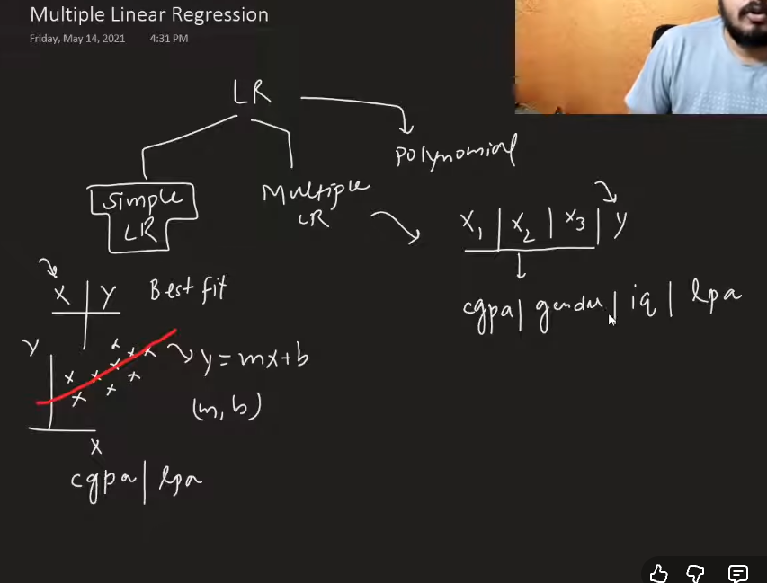

* more than one features / column in the input 
* MLR is extension of LR 

* y = mx + b
* y = mx1 + nx2 + b
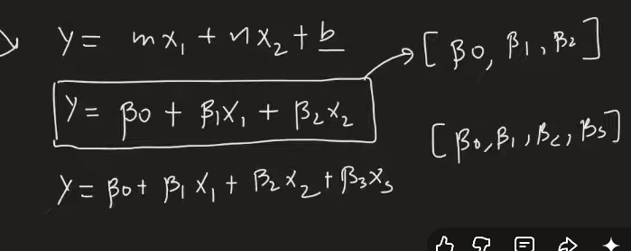

these beta vectore we need to find 

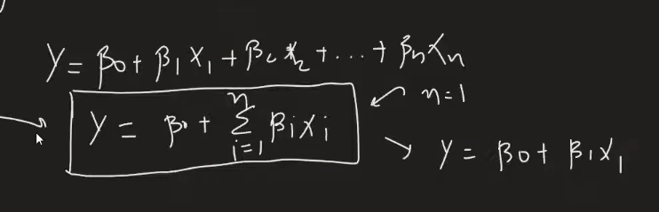

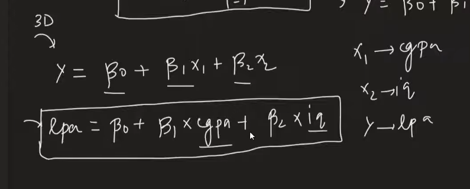

these coefficient are like weights 

---------
Code of the multiple linear regression  

weights tell us which feature/  columns are more important 

How to find equation of line in n hyperplane

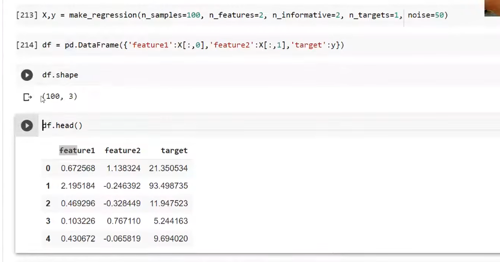

3D look of the data
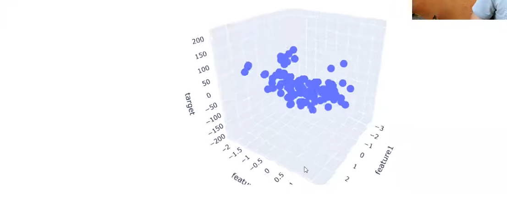

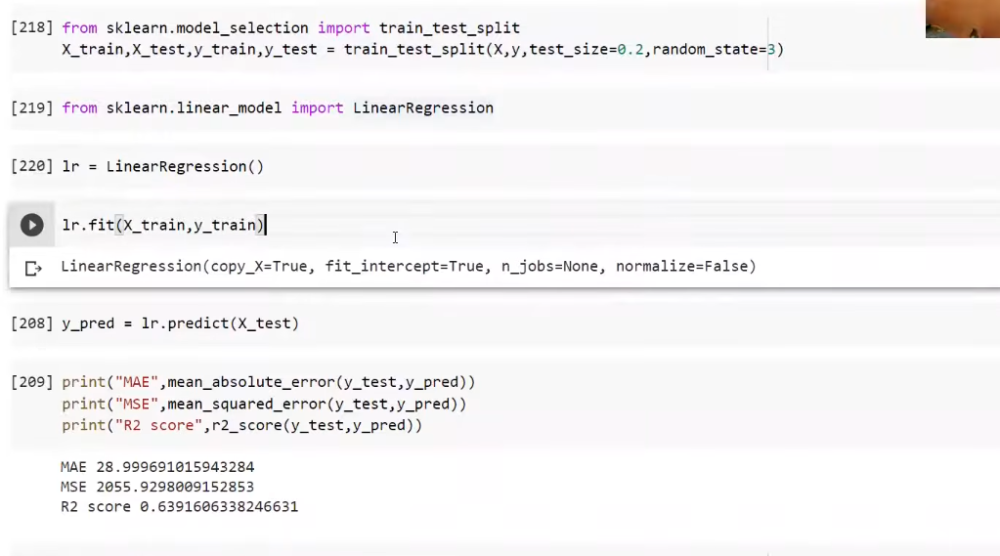

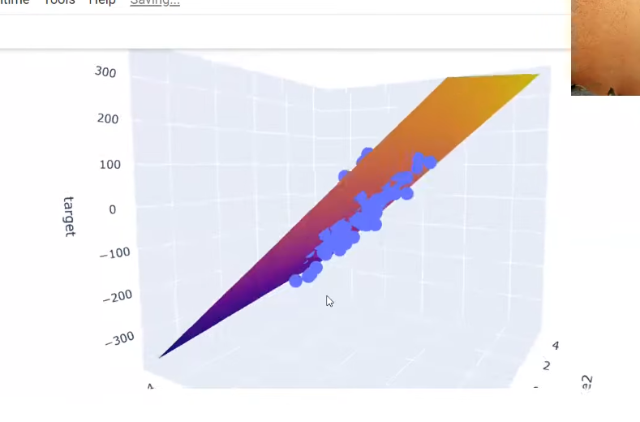

value of betas
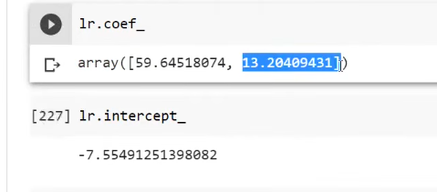

in higher dimension we find the hyperplane

### CampusX PDF notes - L53 Multiple Linear Regression (PDF pp. 1245-1258)

**1. Introduction - what is Linear Regression?**
Linear Regression (LR) is a **supervised** learning algorithm used to predict a **continuous** target variable by establishing a **linear relationship** between the independent variables (features / input columns) and the dependent variable (target / output column).

| Aspect | Regression | Classification |
|---|---|---|
| Output | continuous numerical value | discrete category / label |
| Examples | price prediction, temperature forecast | spam detection, image classification |
| Evaluation | MAE, MSE, RMSE, R2 | Accuracy, Precision, Recall, F1 |
| Algorithms | Linear Regression, Ridge, Lasso | Logistic Regression, SVM, Decision Trees |

**2. Types of Linear Regression**

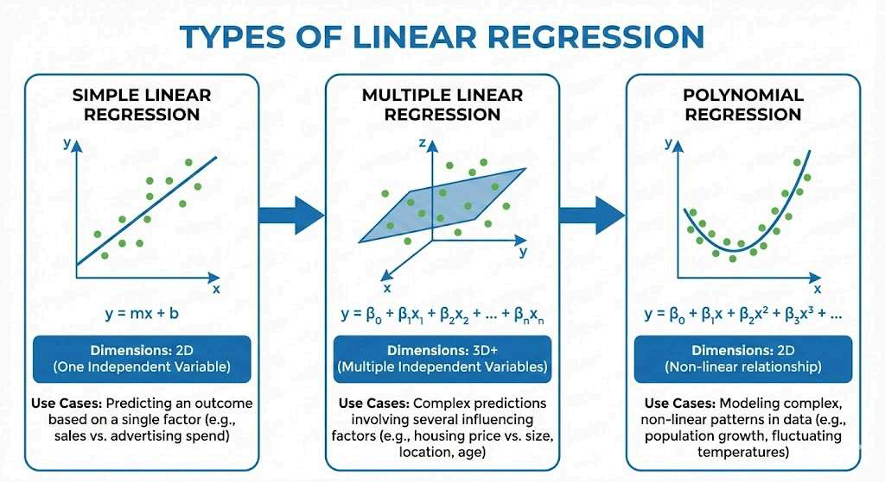

| Type | Features | Equation | Dimensions | Use case |
|---|---|---|---|---|
| **Simple LR** | 1 | `y = mx + b` | 2D (a line) | outcome from a single factor (sales vs advertising spend) |
| **Multiple LR** | 2 or more | `y = b0 + b1x1 + b2x2 + ... + bnxn` | 3D+ (a plane / hyperplane) | several influencing factors (house price vs size, location, age) |
| **Polynomial LR** | 1+ (with powers) | `y = b0 + b1x + b2x^2 + ...` | 2D (a curve) | non-linear relationships (population growth, fluctuating temperature) |

Note: all three are still "linear" in the **coefficients** - polynomial regression is just LR applied on powers of x (details in L61).

**3. Geometric interpretation: from a 2D line to a 3D plane**

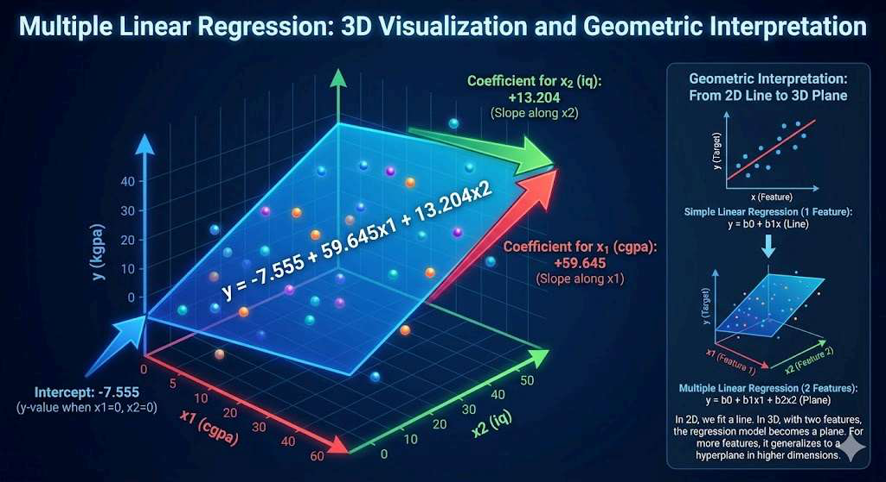

* Simple LR (one feature): the best-fit **line** `y = b0 + b1x` in 2D.
* Multiple LR (two features): the best-fit **plane** `y = b0 + b1x1 + b2x2` in 3D.
* n features: the best-fit **hyperplane** in an (n+1)-dimensional space - we cannot draw it, but the maths is identical.
* In the figure's example (`x1 = cgpa`, `x2 = iq`): `y = -7.555 + 59.645 x1 + 13.204 x2`. The slope along x1 (cgpa) is 59.645, the slope along x2 (iq) is 13.204, and the intercept (value of y when x1 = x2 = 0) is -7.555.
* **Best-fit line/plane = the one that minimises the sum of squared residuals (errors).**

**4. Multiple LR theory - general form and matrix form**

* General form: `y = b0 + b1x1 + b2x2 + b3x3 + ... + bnxn`, compact notation `y = b0 + sum(bi * xi)`.
  * `y` predicted target, `b0` intercept (bias term), `bi` coefficient (weight) of feature `xi`, `n` number of features.
* Matrix form (for m samples and n features): **`Y = X b + e`**
  * `Y` = (m x 1) target vector
  * `X` = (m x (n+1)) feature matrix - the **extra first column is all 1's** (for the intercept b0)
  * `b` = ((n+1) x 1) coefficient vector
  * `e` = (m x 1) error vector
* The matrix form is the whole reason code can be vectorised (the 1-column trick is used in the from-scratch class of L55).
* Whiteboard example used in the video: `kgpa = b0 + b1 x cgpa + b2 x iq` - target `kgpa`, features `cgpa` and `iq`, weights `b0, b1, b2`.

**5. Python implementation (sklearn) - step by step**

| Step | Code | Meaning |
|---|---|---|
| Data generation | `make_regression(n_samples=100, n_features=2, n_informative=2, n_targets=1, noise=50)` | 100 rows, 2 features, both informative, 1 target, Gaussian noise (std = 50) |
| DataFrame | `pd.DataFrame({'feature1': X[:,0], 'feature2': X[:,1], 'target': y})` | shape (100, 3) |
| Split | `train_test_split(X, y, test_size=0.2, random_state=3)` | 80 train / 20 test rows |
| Train | `lr = LinearRegression(); lr.fit(X_train, y_train)` | learns the coefficients |
| Predict | `y_pred = lr.predict(X_test)` | |

What `.fit()` does:
1. Calculates the optimal coefficients using **Ordinary Least Squares (OLS)**.
2. Minimises the cost `J(b) = (1/2m) * sum( yi - yi_hat )^2` where `yi_hat = b0 + b1 xi1 + b2 xi2`.
3. Closed-form (analytical) solution: **`b = (X^T X)^-1 X^T y`** (derived in L54).

Result from the video: `lr.coef_ = [59.645, 13.204]`, `lr.intercept_ = -7.555` -> **`y = -7.555 + 59.645 x1 + 13.204 x2`**.

**6. Interpreting the coefficients**

| Parameter | Value | Meaning |
|---|---|---|
| b0 (intercept) | -7.555 | baseline value when all features are 0 |
| b1 (feature1) | 59.645 | target increases by 59.645 for one unit increase in feature1 (feature2 held constant) |
| b2 (feature2) | 13.204 | target increases by 13.204 for one unit increase in feature2 (feature1 held constant) |

* "Weights tell us which feature / column is more important" - compare |b1| = 59.645 vs |b2| = 13.204 -> feature1 has more impact. **Caution:** this comparison is only valid if the features are on the **same scale** (standardise first).
* Prediction example: for x1 = 1.0, x2 = 0.5: `y_hat = -7.555 + 59.645(1.0) + 13.204(0.5) = -7.555 + 59.645 + 6.602 =` **58.692**.

**7. Model evaluation metrics**

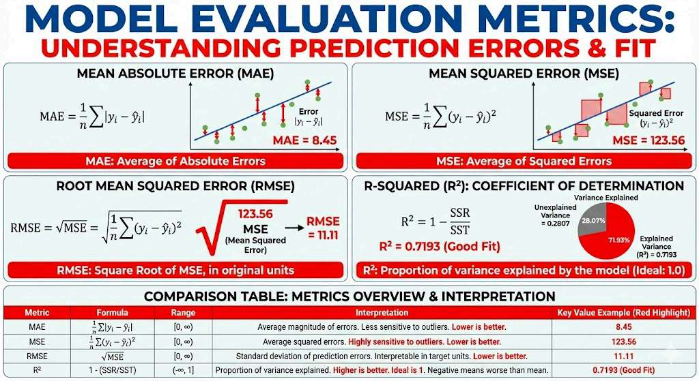

| Metric | Formula | Value (this model) | Range / best | Outlier sensitivity |
|---|---|---|---|---|
| MAE | `(1/m) sum abs(yi - yi_hat)` | **33.087** | [0, inf), best 0 | low |
| MSE | `(1/m) sum (yi - yi_hat)^2` | **1659.914** | [0, inf), best 0 | high |
| RMSE | `sqrt(MSE)` | sqrt(1659.914) = **40.74** | [0, inf), best 0 | high |
| R2 | `1 - SS_res / SS_tot` | **0.7193** | (-inf, 1], best 1 | moderate |

* MAE = 33.087 -> on average predictions are off by 33 units.
* RMSE is in the **same units as the target** (so easier to interpret than MSE).
* R2 = 0.7193 -> **71.93% of the variance of the target is explained** by the model; 0 means "as good as predicting the mean", 1 means perfect, negative means worse than the mean.
* Adjusted R2 (from the summary page) = `1 - (1 - R2)(n - 1)/(n - p - 1)` - adjusts R2 for the number of predictors `p` (it only improves if a new feature really helps).

**8. Visualising the regression plane in 3D**
Idea: make a grid of (x1, x2) values, predict z for every grid point and draw it as a surface over the 3D scatter plot.
* `np.linspace(-5, 5, 10)` -> 10 values for each axis; `np.meshgrid` -> 10 x 10 = 100 grid points.
* `np.vstack(...).T` -> an input matrix of shape (100, 2); `lr.predict(final).reshape(10, 10)` -> z values for the surface.
* Geometric summary: 2D case -> line; 3D case (2 features) -> plane; n-D case -> hyperplane in (n+1)-D space.

**9. Assumptions of Linear Regression (checklist)**

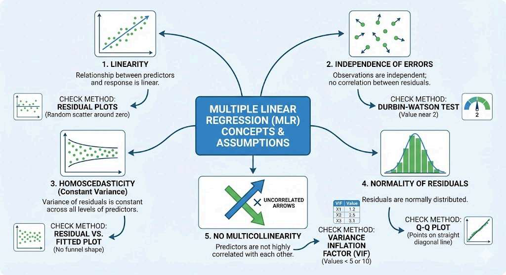

| # | Assumption | Meaning | How to check |
|---|---|---|---|
| 1 | **Linearity** | features and target have a linear relationship | residual plots |
| 2 | **Independence of errors** | observations are independent, no correlation between residuals | Durbin-Watson test |
| 3 | **Homoscedasticity** | variance of residuals is constant across all levels of predictors | residual vs fitted plot |
| 4 | **Normality of residuals** | residuals are normally distributed | Q-Q plot, histogram |
| 5 | **No multicollinearity** | predictors not highly correlated with each other | VIF (values < 5 or 10) |

(Each assumption is explained with code in L56.)

**10. Cost function minimisation - the derivation roadmap**
1. Hypothesis: `yi_hat = b0 + b1 xi1 + b2 xi2`.
2. Residual: `ei = yi - yi_hat`.
3. Square it: `ei^2`.
4. Sum over all rows: `SSE = sum(yi - yi_hat)^2`.
5. Normalise by sample size: `J(b) = (1/2m) SSE`.
6. Take the partial derivative w.r.t. every `bj` and set it to zero: `dJ/dbj = 0`.
7. Normal equations: `X^T X b = X^T y`.
8. Final solution: **`b = (X^T X)^-1 X^T y`**.

**11. Practical guidelines**

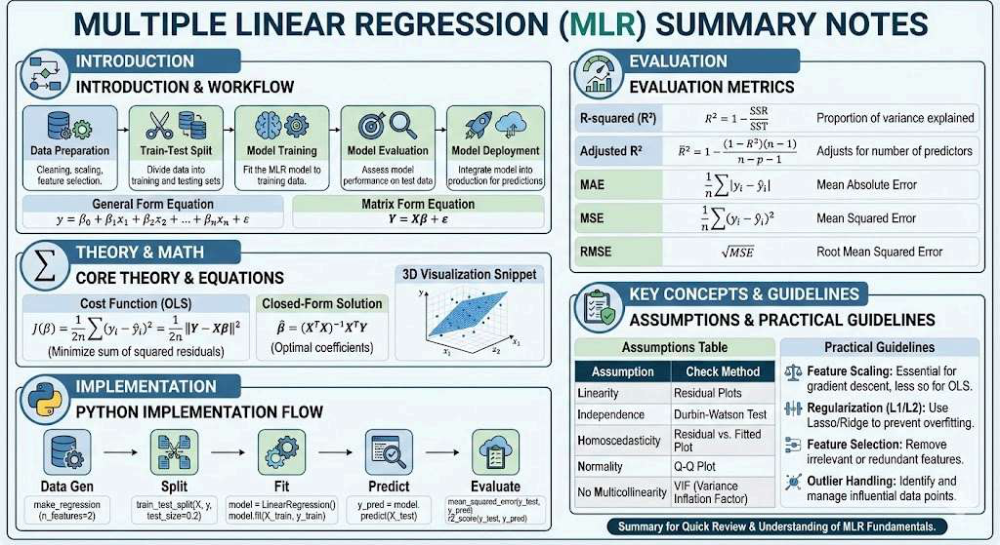

| Use MLR when | Avoid MLR when |
|---|---|
| the relationship is approximately linear | the relationship is highly non-linear (use polynomial / tree-based models) |
| the target is continuous | the target is categorical (use classification) |
| several features influence the outcome | features are highly correlated (use regularisation) |
| interpretability is important | small dataset with many features (overfitting risk) |
| you need a quick baseline model | |

* **Feature scaling** is essential for gradient-descent based fitting.
* **Regularisation (Ridge / Lasso)** to prevent overfitting; **feature selection** to remove irrelevant / redundant features; **outlier handling** for influential points.
* Model selection trade-off: fewer features -> simple, interpretable but may miss patterns; more features -> better fit, lower training error but overfitting risk (balance with regularisation).

### Official code - L53 Multiple Linear Regression in 3D (repo: `day50-multiple-linear-regression/multiple_linear_regression.ipynb`)

**Block 1 - imports**

```python
from sklearn.datasets import make_regression          # creates a synthetic regression dataset
import pandas as pd
import numpy as np

import plotly.express as px                           # quick interactive 3D scatter
import plotly.graph_objects as go                     # needed to draw the regression surface

from sklearn.metrics import mean_absolute_error, mean_squared_error, r2_score   # the 4 metrics
```

**Block 2 - make the data and put it in a DataFrame**

```python
# 100 rows, 2 input columns (both useful), 1 target, lots of noise (std = 50)
X, y = make_regression(n_samples=100, n_features=2, n_informative=2, n_targets=1, noise=50)

df = pd.DataFrame({'feature1': X[:, 0], 'feature2': X[:, 1], 'target': y})
df.shape      # (100, 3)
df.head()
```

**Block 3 - look at the data in 3D**

```python
# scatter_3d: x and y axes are the two features, z axis is the target
fig = px.scatter_3d(df, x='feature1', y='feature2', z='target')
fig.show()
```

**Block 4 - train/test split and fit the model**

```python
from sklearn.model_selection import train_test_split
X_train, X_test, y_train, y_test = train_test_split(X, y, test_size=0.2, random_state=3)   # 80/20 split

from sklearn.linear_model import LinearRegression
lr = LinearRegression()          # sklearn's LinearRegression solves OLS (closed form) internally
lr.fit(X_train, y_train)         # learn b0, b1, b2
y_pred = lr.predict(X_test)      # predict on unseen rows
```

**Block 5 - evaluate**

```python
print("MAE", mean_absolute_error(y_test, y_pred))    # average absolute error
print("MSE", mean_squared_error(y_test, y_pred))     # average squared error
print("R2 score", r2_score(y_test, y_pred))          # fraction of variance explained
```

**Block 6 - draw the fitted plane over the scatter**

```python
# build a 10 x 10 grid of (x, y) points and predict z for each grid point
x = np.linspace(-5, 5, 10)
y = np.linspace(-5, 5, 10)
xGrid, yGrid = np.meshgrid(y, x)

# NOTE: in the repo notebook the cell order is swapped: z_final = lr.predict(final) is written BEFORE `final` is defined
# (it only works because the notebook was run in a different order). Correct order:
final = np.vstack((xGrid.ravel().reshape(1, 100), yGrid.ravel().reshape(1, 100))).T   # shape (100, 2)
z_final = lr.predict(final).reshape(10, 10)          # predicted z on the grid
z = z_final

fig = px.scatter_3d(df, x='feature1', y='feature2', z='target')
fig.add_trace(go.Surface(x=x, y=y, z=z))             # the regression plane
fig.show()
```

**Block 7 - read the learned parameters**

```python
lr.coef_          # [b1, b2]  -> weight of each feature (PDF run: [59.645, 13.204])
lr.intercept_     # b0        -> (PDF run: -7.555)
```

## L54 Multiple Linear Regression | Part 2

example of the dataset 

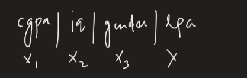


data is on the 4D

-----

in form of equation 
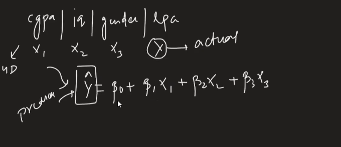

lets say we have 100 studnet data

datasetr (100,4)

I want to find ypredicted of all 100 students

X12 -> first studetn iq value , X13 -> first student ka gender value 

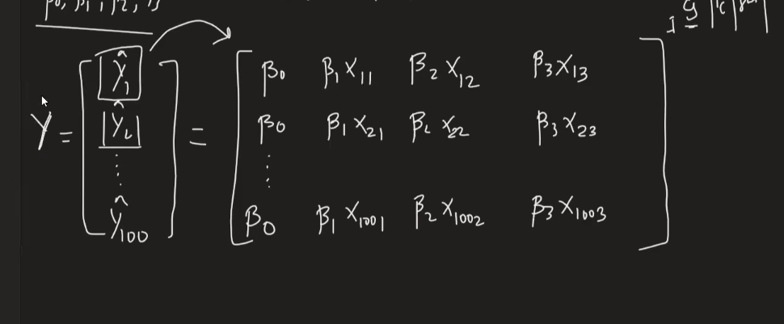

made it into matrix

---
assumption lets say we have n rows and m columns 

then how we will rewrite this matrix???

* Y^ is the predicted value  

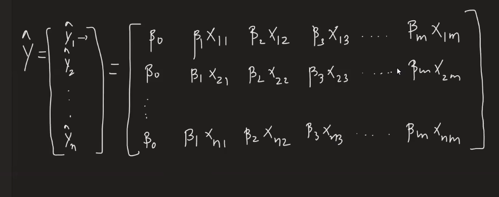

converted into the general case

Now lets rewrite the matrix 
* 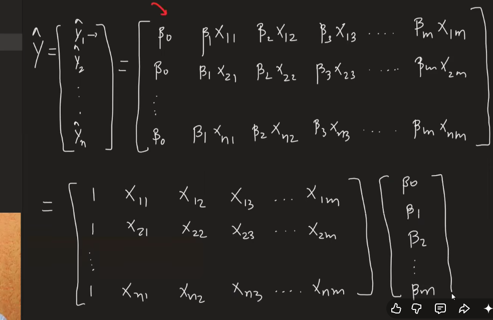
* decompose into product of two matrix 
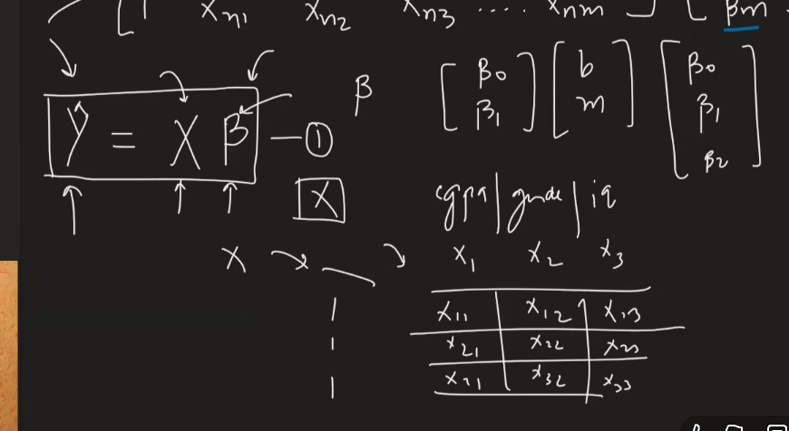

* Actual output values

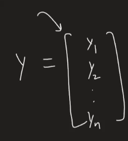

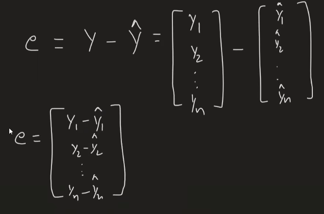

* Single LR 
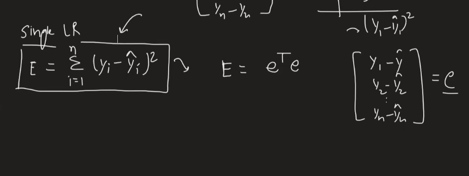

-----------

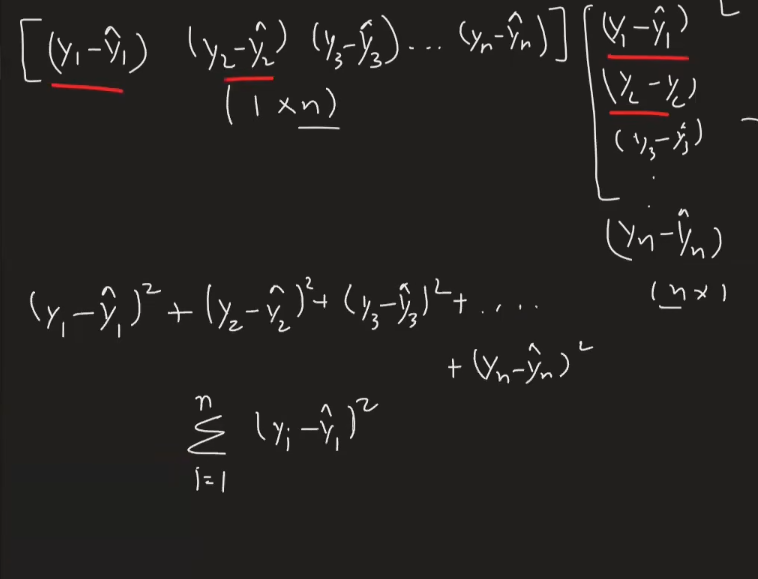

error fucntion in matrix form of y 

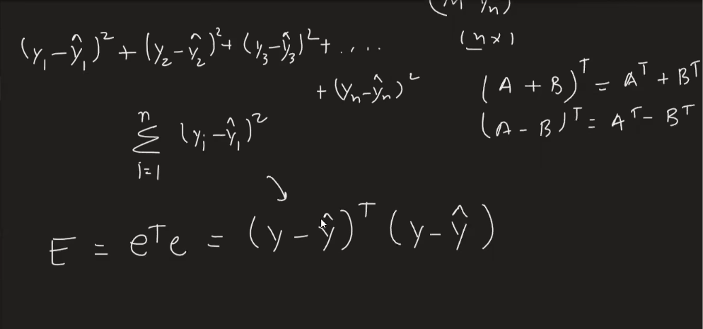
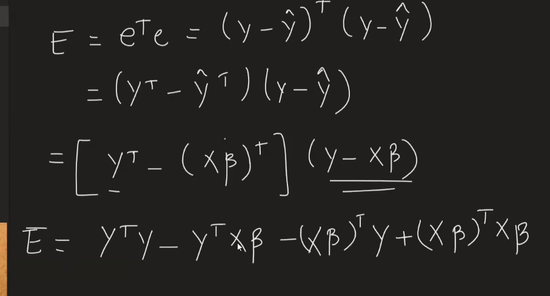

-0---

Detour 

* we need to prove that this is equal 
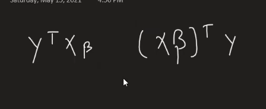
* both of these two terms are equal 
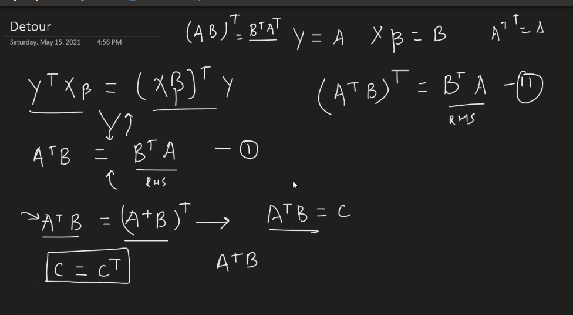

a matrix is equal to its transpose -> 
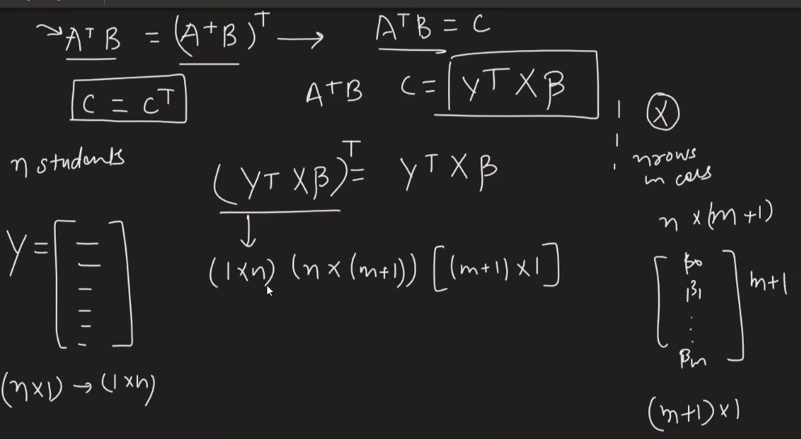

-------------

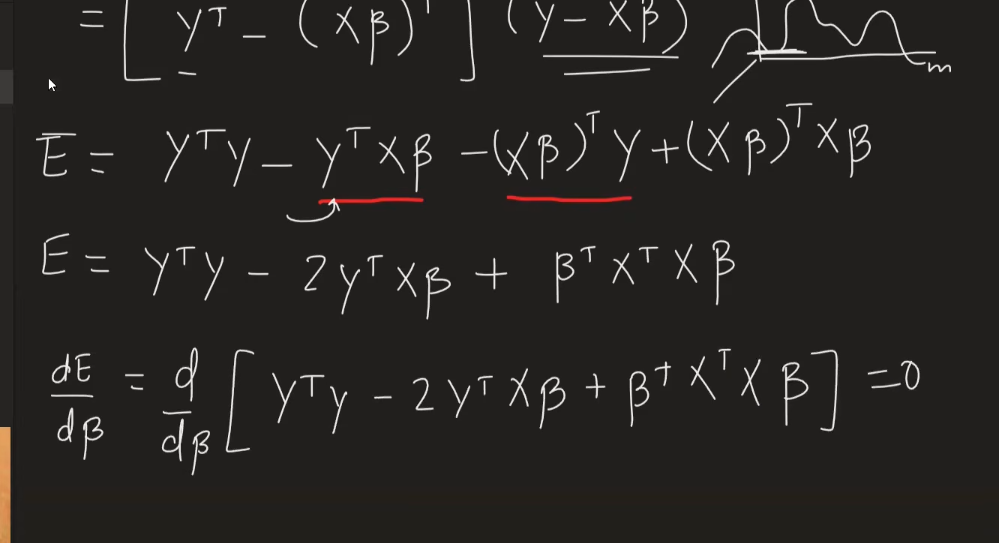

now differentiate and make it zero 
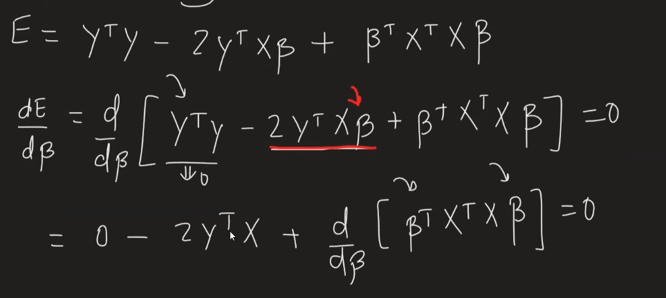

we need to learn matrix diff for it 

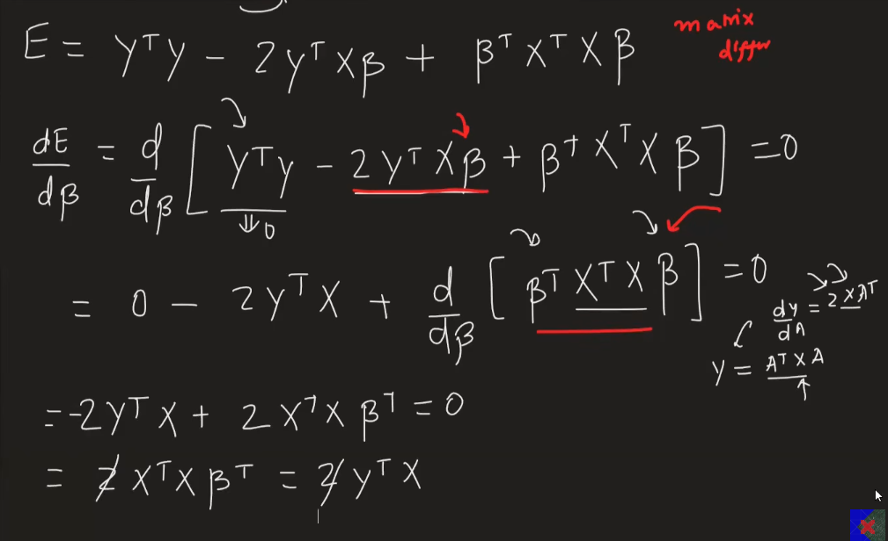

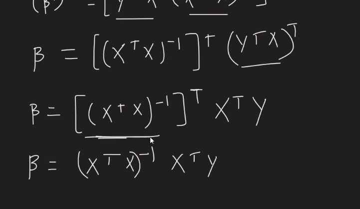

square matrix ka transpose karoge to shape same raheg.

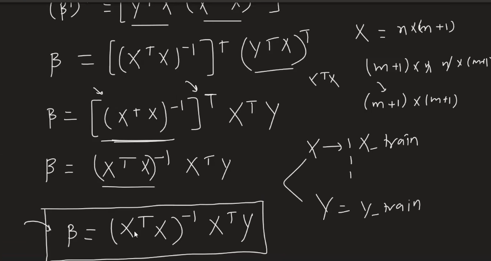

---------------

B = B0 .... B1.... Bm

Why Gradient descent???

due to the inverse operation complexity 

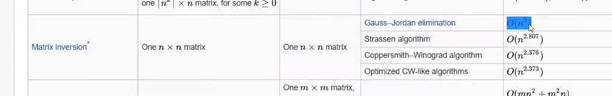

n^3 TC for calcualting the inverse matrix calcualtino 
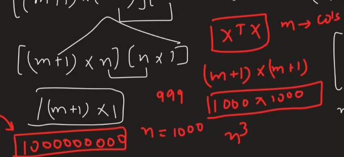

this makes our calculation too much slow -> hence we will use GD

sckiti learn has also gave us both 
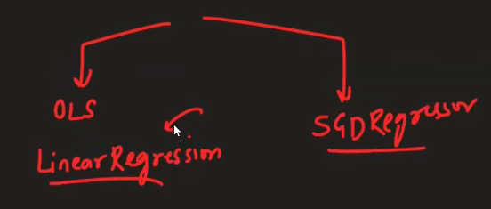

---------------

### CampusX PDF notes - L54 Multiple Linear Regression | Part 2: Mathematical Formulation (PDF pp. 1259-1276)

**1. Objective of this lecture**
Derive, from scratch, the **closed-form solution** of Multiple Linear Regression, i.e. find the formula for the optimal coefficients `b0, b1, ..., bm` that minimise the error between predicted and actual values.

**2. Problem setup and notation**

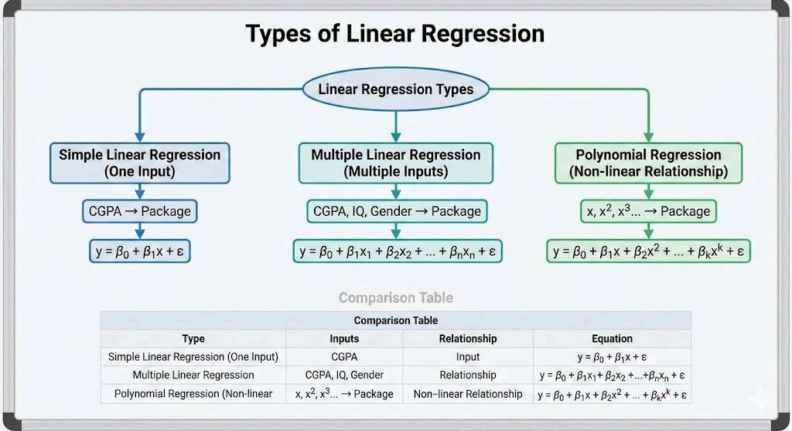

| Type | Inputs | Equation |
|---|---|---|
| Simple LR | 1 column (CGPA -> Package) | `y = b0 + b1 x + e` |
| Multiple LR | many columns (CGPA, IQ, Gender -> Package) | `y = b0 + b1x1 + b2x2 + ... + bm xm + e` |
| Polynomial LR | 1 column, non-linear terms (x, x^2, x^3) | `y = b0 + b1x + b2x^2 + ... + bk x^k` |

Dataset example used in the video: **n students and m = 3 input features** (`x1 = CGPA`, `x2 = IQ`, `x3 = Gender`), target `y = Package`. `x21` means "second student's CGPA", `x13` means "first student's gender" (row index first, column index second).

Prediction equation for one student: `y_hat = b0 + b1 x1 + b2 x2 + ... + bm xm` (2 features -> a plane, 3 features -> a 3D hyperplane...).
* `y_hat` = predicted value, `y` = actual value, `b0` = intercept (bias), `b1..bm` = coefficients (slopes), `x1..xm` = input features.

**3. From individual predictions to matrices**
For each of the n students we can write one prediction equation:
```
y1_hat = b0 + b1 x11 + b2 x12 + b3 x13
y2_hat = b0 + b1 x21 + b2 x22 + b3 x23
...
yn_hat = b0 + b1 xn1 + b2 xn2 + b3 xn3
```
**Smart matrix decomposition:** this column of n equations is the product of a feature matrix and a coefficient vector:

```
[ y1_hat ]   [ 1  x11  x12  x13 ]   [ b0 ]
[ y2_hat ] = [ 1  x21  x22  x23 ] x [ b1 ]       i.e.   Y_hat = X b
[  ...   ]   [ ...              ]   [ b2 ]
[ yn_hat ]   [ 1  xn1  xn2  xn3 ]   [ b3 ]
```
Check why it works: row 1 x column = `1*b0 + x11*b1 + x12*b2 + x13*b3 = y1_hat` (and similarly for every other row).

| Matrix | Shape | Contains |
|---|---|---|
| `Y` (actual) | (n x 1) | actual package of all students |
| `Y_hat` (predicted) | (n x 1) | predicted package of all students |
| `X` (feature matrix) | (n x (m+1)) | **first column all 1's** (for the intercept b0), then the m feature columns |
| `b` (coefficients) | ((m+1) x 1) | `[b0, b1, ..., bm]` - **everything we have to find** |

**4. The loss function in matrix form**
* Residual (error) vector: `e = Y - Y_hat = [y1 - y1_hat, ..., yn - yn_hat]^T` (n x 1).
* In Simple LR the loss was `E = sum (yi - yi_hat)^2`. In matrix form: **`E = e^T e = (Y - Y_hat)^T (Y - Y_hat)`**.
* Why: `e^T e = (y1-y1_hat)^2 + (y2-y2_hat)^2 + ... + (yn-yn_hat)^2 = sum (yi - yi_hat)^2` (a row vector times a column vector gives one number = sum of squares).
* Substituting `Y_hat = X b`: **`E = (Y - Xb)^T (Y - Xb)`**.

**5. Derivation of b (step by step)**

*Step 1 - expand the loss.* Using `(A - B)^T = A^T - B^T` and `(AB)^T = B^T A^T`:
```
E = (Y^T - (Xb)^T)(Y - Xb) = (Y^T - b^T X^T)(Y - Xb)
```
*Step 2 - multiply out:*
```
E = Y^T Y - Y^T X b - b^T X^T Y + b^T X^T X b
```
*Step 3 - the transpose detour (prove the two middle terms are equal).*
Let `A = Y^T X b` and `B = b^T X^T Y`.

| Term | Shapes multiplied | Result |
|---|---|---|
| `Y^T X b` | (1 x n)(n x (m+1))((m+1) x 1) | (1 x 1) -> a **scalar** |
| `b^T X^T Y` | (1 x (m+1))((m+1) x n)(n x 1) | (1 x 1) -> a **scalar** |

For any scalar `s = s^T`. Take the transpose of A: `A^T = (Y^T X b)^T = b^T X^T (Y^T)^T = b^T X^T Y = B`. Since A is a scalar, `A = A^T = B`. **So the two middle terms are equal and combine:**
```
E = Y^T Y - 2 Y^T X b + b^T X^T X b
```
*Step 4 - differentiate w.r.t. b (matrix differentiation).* Formula needed: if `f(b) = b^T A b` with A symmetric, then `df/db = 2 A b`.
* `d/db [Y^T Y] = 0` (no b in it)
* `d/db [-2 Y^T X b] = -2 X^T Y` (the shape must be ((m+1) x 1) like b; the PDF writes it in the row form `-2 Y^T X`)
* `d/db [b^T X^T X b] = 2 X^T X b` (using the formula with `A = X^T X`)
```
dE/db = -2 X^T Y + 2 X^T X b
```
*Step 5 - set the derivative to zero (minimum error):* `-2 X^T Y + 2 X^T X b = 0  =>  X^T X b = X^T Y`.

*Step 6 - solve for b:* multiply both sides by `(X^T X)^-1`:

> **b = (X^T X)^-1 X^T Y**

This is the **Normal Equation** = the **Ordinary Least Squares (OLS) solution**. (Note: `X^T X` is always symmetric, which is why the `2Ab` formula and the inverse are valid.)

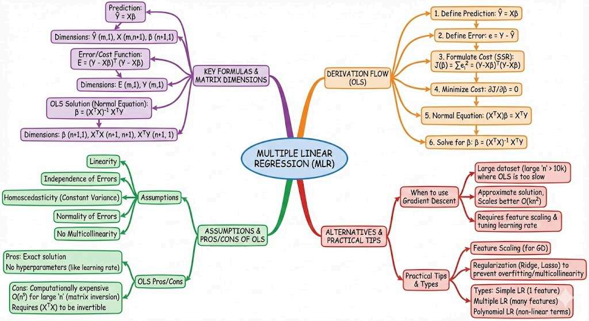

**6. Dimensional analysis - verifying the formula**
* `X^T`: ((m+1) x n); `X^T X`: ((m+1) x n)(n x (m+1)) = **((m+1) x (m+1))** a square matrix -> its inverse exists (if non-singular).
* `X^T Y`: ((m+1) x n)(n x 1) = ((m+1) x 1).
* `(X^T X)^-1 X^T Y`: ((m+1) x (m+1))((m+1) x 1) = **((m+1) x 1)** = shape of b. Left side and right side match.
* Example: n = 1000 students, m = 3 features -> X is (1000 x 4), `X^T X` is only (4 x 4) -> trivial to invert, b is (4 x 1) = `[b0, b1, b2, b3]`.

**7. Why Gradient Descent? (the problem with the inverse)**
* `X^T X` is a ((m+1) x (m+1)) matrix and inverting it by Gaussian elimination costs **O(m^3)**.
* If m = 1000 features (text / image data) -> matrix of 1001 x 1001 -> about 10^9 operations; for m = 10,000 -> 10^12; for 50,000 pixel features -> 10^14 ("practically impossible").
* Also needs a lot of memory, and fails when `X^T X` is singular (perfectly correlated features, or more features than samples).

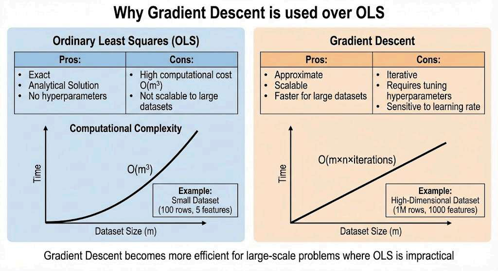

| Aspect | OLS (Normal Equation) | Gradient Descent |
|---|---|---|
| Type | closed-form (analytical) solution | iterative approximation |
| Speed, few features | very fast | slower |
| Speed, many features | very slow `O(m^3)` | much faster, roughly `O(m x n x iterations)` |
| Memory | high (inverting a matrix) | low |
| Convergence | instant (one calculation) | needs many iterations |
| Accuracy | exact | approximate (very close) |
| Hyperparameters | none | learning rate, epochs (needs tuning, sensitive to learning rate, needs feature scaling) |
| When to use | m < ~10,000 features, want exact answer | m > ~10,000 features, text / image data, limited memory |
| sklearn class | `LinearRegression()` | `SGDRegressor()` |

"sklearn has both": `LinearRegression().fit(X, y)` (OLS) and `SGDRegressor().fit(X, y)` (gradient descent).

**8. Complexity of the OLS steps**

| Step | Operation | Complexity |
|---|---|---|
| 1 | `X^T` (transpose) | O(n(m+1)) |
| 2 | `X^T X` (multiplication) | O((m+1)^2 n) |
| 3 | `(X^T X)^-1` (inversion) | **O((m+1)^3) - the bottleneck** |
| 4 | `X^T Y` | O((m+1) n) |
| 5 | `(X^T X)^-1 (X^T Y)` | O((m+1)^2) |

Total complexity is dominated by the inversion -> **O(m^3)** (m = number of features, not rows - rows only enter linearly). That is the "n^3 TC for calculating the inverse" in your notes.

**9. When OLS fails + assumptions needed**
* Fails when `X^T X` is not invertible (singular), when features are perfectly correlated (multicollinearity), when there are more features than samples.
* Assumptions for the Normal Equation to work: (1) linearity, (2) independence of observations, (3) homoscedasticity (constant error variance), (4) no perfect multicollinearity, (5) `X^T X` invertible.

**10. Implementation tip (NumPy, closed form)**
```python
import numpy as np
# X has shape (n, m+1): first column is all 1's (intercept), the rest are the features
# y has shape (n, 1)
X_T      = X.T                          # (m+1, n)
X_T_X    = X_T @ X                      # (m+1, m+1)
X_T_X_inv= np.linalg.inv(X_T_X)         # (m+1, m+1)  <- the O(m^3) step
X_T_y    = X_T @ y                      # (m+1, 1)
beta     = X_T_X_inv @ X_T_y            # (m+1, 1)  -> [b0, b1, ..., bm]
y_pred   = X @ beta                     # (n, 1)
```

**11. Matrix properties used in the derivation**
* `(A + B)^T = A^T + B^T`, `(A - B)^T = A^T - B^T`, `(AB)^T = B^T A^T`, `(A^T)^T = A`.
* Matrix multiplication is associative, but **not commutative** (`AB != BA` in general).
* A scalar (1 x 1 matrix) equals its own transpose.
* `X^T X` is always symmetric.

**12. Key takeaways**
1. Matrix notation turns a long set of equations into `Y_hat = X b`.
2. The loss `E = (Y - Xb)^T (Y - Xb)` is minimised by differentiating and setting the derivative to 0.
3. OLS `b = (X^T X)^-1 X^T Y` is exact but expensive for many features.
4. Gradient descent (next lectures) is the alternative for high-dimensional data.
5. Knowing the maths tells you when and why the algorithm fails.

## L55 Multiple Linear Regression | Part 3


Code here  include the code 
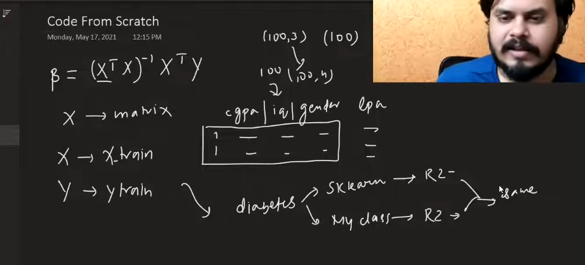

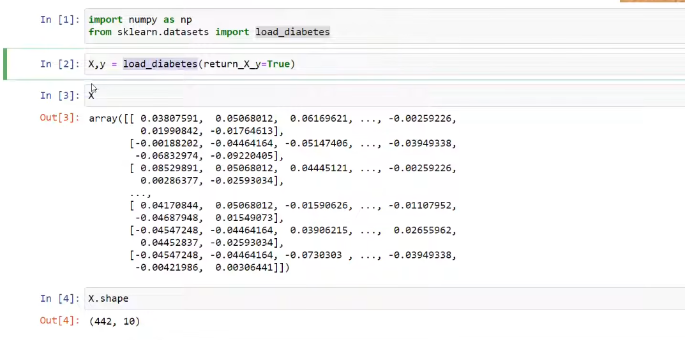

we using sckiti learn diabetes dataset
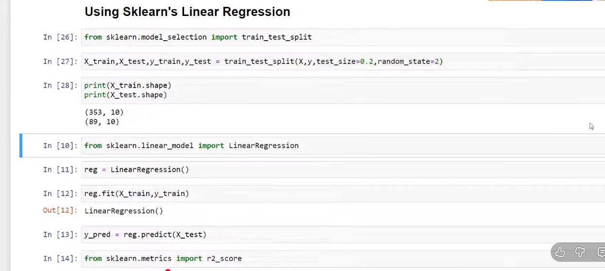

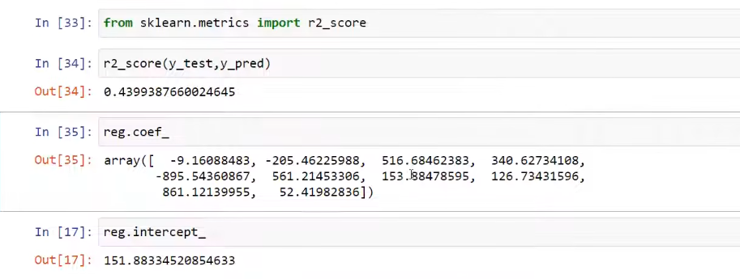

--------

Now lets write from scractch

* testing 

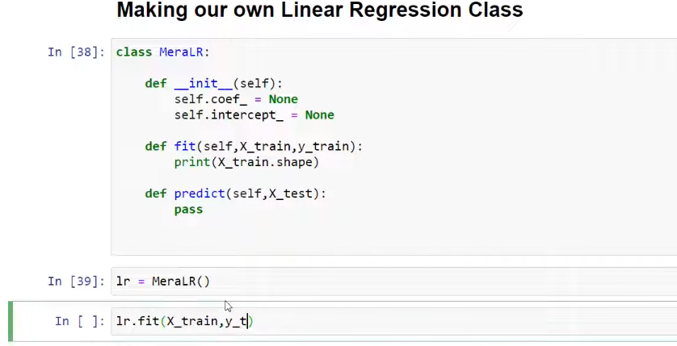

* we need to add the 1 column 
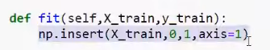
* X_train : kispe change krna hai
* 0 : konse row mai change krna hai
* 1 : kya change krna hai
* axis 

* in the fit funciton calculate all the coefficients
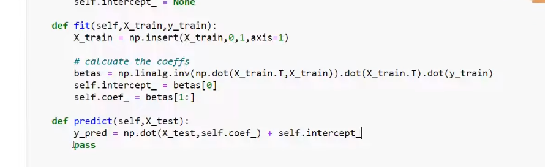

### CampusX PDF notes - L55 Multiple Linear Regression | Part 3: Implementation from Scratch (PDF pp. 1277-1289)

**1. Goal of the lecture**
Implement Multiple Linear Regression **from scratch using the Normal Equation (OLS)**, i.e. write our own `LinearRegression` class (`MeraLR`) and verify that it gives the **same coefficients as scikit-learn**.

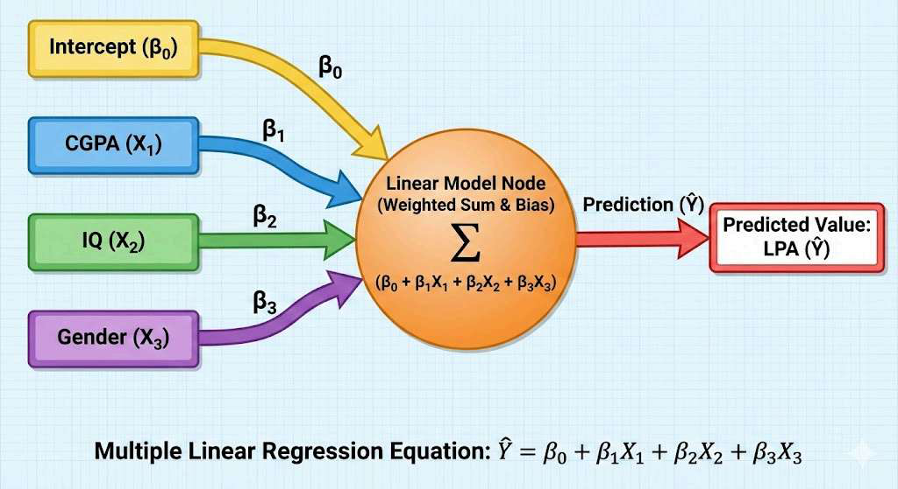

* Model: `y_hat = b0 + b1 x1 + b2 x2 + b3 x3 + ... + bp xp` (e.g. CGPA, IQ, Gender -> LPA package).
* Matrix form: `Y_hat = X b` where `X` is the **design matrix with a bias column** of 1's.
* Normal Equation: **`b = (X^T X)^-1 X^T y`** - computes all coefficients including the intercept in a single step.

| Symbol | Meaning | Shape |
|---|---|---|
| `Y_hat` | predicted values | (n x 1) |
| `X` | design matrix (with bias column) | (n x (p+1)) |
| `b` | coefficient vector incl. intercept | ((p+1) x 1) |

**2. Matrix dimensions (concrete example: n = 100, p = 3)**
* `X_test (n x p)` times `coefficients (p x 1)` plus the intercept gives `y_pred (n x 1)`.
* For one sample i: `y_pred,i = b0 + sum_j ( x_i,j * b_j )`.
* The design matrix has a **first column of 1's** that multiplies the intercept b0.

**3. The 7 steps of the derivation / algorithm**

| Step | What we do | Shape / result |
|---|---|---|
| 1 | Set up the problem: `X_train (n x p)`, `y_train (n x 1)` | |
| 2 | **Augment** X with a column of ones: `X_aug = [1 | X_train]` | (n x (p+1)) |
| 3 | Compute `X^T X` | ((p+1) x n)(n x (p+1)) = ((p+1) x (p+1)) |
| 4 | Compute the inverse `(X^T X)^-1` | ((p+1) x (p+1)) |
| 5 | Compute `X^T y` | ((p+1) x n)(n x 1) = ((p+1) x 1) |
| 6 | `b = (X^T X)^-1 . X^T y` | ((p+1) x 1) |
| 7 | **Extract**: `intercept = b[0]`, `coefficients = b[1:]` | |

**4. Code part 1 - scikit-learn on the diabetes dataset (reference result)**
* Dataset: `load_diabetes` -> X shape (442, 10), 442 samples, 10 features; split 80/20 with `random_state=2` -> train (353, 10), test (89, 10).
* sklearn results: **R2 = 0.4399387660024645**, **intercept = 151.88334520854633**, coefficients `[-9.16, -205.46, 516.68, 340.63, -895.54, 561.21, 153.88, 126.73, 861.12, 52.42]`.

**5. Code part 2 - our own class `MeraLR`**

* `__init__`: sets `coef_ = None` (will hold b1...bp) and `intercept_ = None` (will hold b0).
* `fit(X_train, y_train)`:
  1. `X_train = np.insert(X_train, 0, 1, axis=1)` - **insert a column of 1's**. In your own notes: `X_train` = array to change, `0` = at which position (index) to insert, `1` = what value to insert, `axis=1` = insert a column (not a row). Shape (353, 10) -> (353, 11).
  2. `betas = np.linalg.inv(np.dot(X_train.T, X_train)).dot(X_train.T).dot(y_train)` - the Normal Equation in one line (`np.dot` = matrix multiplication, `.T` = transpose, `np.linalg.inv` = matrix inverse).
  3. `self.intercept_ = betas[0]`; `self.coef_ = betas[1:]` (10 values).
* `predict(X_test)`: `np.dot(X_test, self.coef_) + self.intercept_` - shapes: (89, 10) . (10,) -> (89,), plus the scalar intercept -> (89,).

**6. Results comparison - sklearn vs MeraLR**

| Metric | Scikit-Learn | Custom (MeraLR) | Match? |
|---|---|---|---|
| R2 score | 0.4399387660024645 | 0.43993876600246407 | yes (differs only at the 14th decimal) |
| Intercept | 151.88334520854633 | 151.8833452085463 | yes |
| Coefficients b1...b10 | -9.16, -205.46, 516.68, 340.63, -895.54, 561.21, 153.88, 126.73, 861.12, 52.42 | identical to 8 decimals | yes |

**Conclusion:** both implementations produce identical results -> our derivation of the Normal Equation is right.

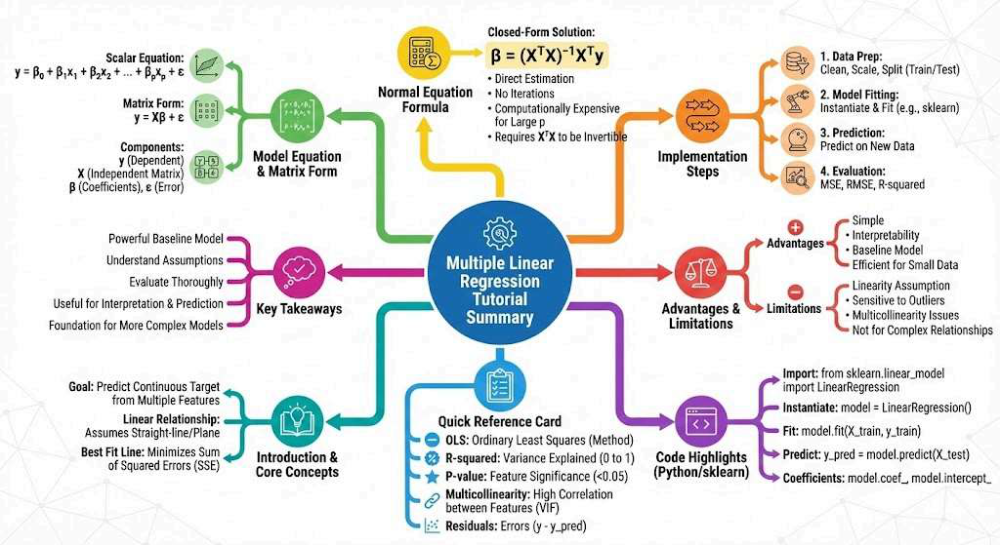

**7. Key takeaways - advantages and limitations of the Normal Equation**

| Advantages | Limitations |
|---|---|
| no learning rate / hyperparameters | matrix inversion is O(n^3) - slow for many features |
| one-step solution | memory intensive (must store `X^T X`) |
| guaranteed exact optimum of the cost function | numerical instability if `X^T X` is singular |
| simple and a powerful baseline | not suitable for very large datasets / online learning |

Remember: a column of 1's must be added to X so that the intercept is part of the calculation; first element of `b` = intercept, the rest = feature coefficients.

### Official code - L55 Multiple Linear Regression from scratch (repo: `day50-multiple-linear-regression/code-from-scratch.ipynb`)

**Block 1 - load the diabetes dataset**

```python
import numpy as np
from sklearn.datasets import load_diabetes     # built-in regression dataset: 442 patients, 10 features

X, y = load_diabetes(return_X_y=True)           # return_X_y=True -> directly get (features, target) arrays
X.shape    # (442, 10)
y.shape    # (442,)
```

**Block 2 - train / test split**

```python
from sklearn.model_selection import train_test_split

# 80% train, 20% test; random_state fixes the shuffle so results are reproducible
X_train, X_test, y_train, y_test = train_test_split(X, y, test_size=0.2, random_state=2)
print(X_train.shape)    # (353, 10)
print(X_test.shape)     # (89, 10)
```

**Block 3 - reference: sklearn's LinearRegression**

```python
from sklearn.linear_model import LinearRegression
from sklearn.metrics import r2_score

reg = LinearRegression()
reg.fit(X_train, y_train)          # OLS fit
y_pred = reg.predict(X_test)       # predict on test data

r2_score(y_test, y_pred)           # 0.4399387660024645
reg.coef_                          # 10 coefficients
reg.intercept_                     # 151.88334520854633
```

**Block 4 - our own class MeraLR (Normal Equation)**

```python
class MeraLR:

    def __init__(self):
        self.coef_ = None          # will store b1..bp
        self.intercept_ = None     # will store b0

    def fit(self, X_train, y_train):
        # np.insert(array, position, value, axis): add a column of 1's at column index 0 (the bias column)
        X_train = np.insert(X_train, 0, 1, axis=1)

        # calculate the coeffs: b = (X^T X)^-1 X^T y
        betas = np.linalg.inv(np.dot(X_train.T, X_train)).dot(X_train.T).dot(y_train)
        self.intercept_ = betas[0]      # first value is the intercept b0
        self.coef_ = betas[1:]          # rest are the feature coefficients

    def predict(self, X_test):
        # y_hat = X . coef + intercept
        y_pred = np.dot(X_test, self.coef_) + self.intercept_
        return y_pred
```

**Block 5 - use MeraLR and compare with sklearn**

```python
lr = MeraLR()                          # create our model
lr.fit(X_train, y_train)               # learn b0..b10 with the Normal Equation

X_train.shape                          # (353, 10)  -> original X
np.insert(X_train, 0, 1, axis=1).shape # (353, 11)  -> after adding the bias column

y_pred = lr.predict(X_test)
r2_score(y_test, y_pred)               # 0.43993876600246407 -> same as sklearn
lr.coef_                               # identical to reg.coef_
lr.intercept_                          # identical to reg.intercept_
```

## L56 What are the main assumption of the Linear Regression??

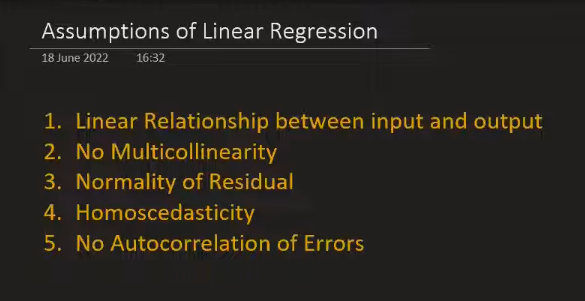


we will also show the code showing how to test this 


x1 x2 x3 x4 --- Y

every input should have linear relationship with the output Y
----

Multicolinearity should not exist

X1 and X2 and X3 shoudl be indepent 

* in linear regression we find the hyperplane 


are assumption is that beta1 is waht will happen if we keep x2 and x3 constant , now lets say that on chaging x1 , x2 also changes then we fail 


vif is 1 then their is no multicollinearity 


----------

Normal residual 


erro should be normal --> mean shoudl be zero 


kde

other method QQ plot 


----------

Homoscedasticity 


scatter plot should be uniform and it should not be aligned on one side 


mostly uniform

--------


we can see that no realtionship exist between residual 

---------

### CampusX PDF notes - L56 Assumptions of Linear Regression (PDF pp. 2339-2357, listed in the PDF as lecture 112)

*(In the PDF this lecture sits much later (L112) in the course; it is placed here because your notes have it right after multiple linear regression.)*

**1. Why the assumptions matter**
For Linear Regression to give reliable and valid results certain assumptions must hold. Why you must know them: (1) a **very common interview question** in data science / ML roles; (2) **model validity** - violating them can give biased, inefficient or unreliable predictions; (3) **diagnostic skills** - knowing how to *test* them shows practical expertise. The lecture first explains all assumptions in theory and then tests them in Python ("we will also show the code showing how to test this" - your note).


| # | Assumption | What it means | How to test |
|---|---|---|---|
| 1 | **Linear relationship** | input and output have a linear relationship | scatter plots |
| 2 | **No multicollinearity** | input features are independent of each other | VIF, correlation matrix |
| 3 | **Normality of residuals** | errors follow a normal distribution | histogram / KDE, Q-Q plot |
| 4 | **Homoscedasticity** | constant variance of residuals | residual vs predicted plot |
| 5 | **No autocorrelation** | no pattern / correlation among errors | residual line plot, Durbin-Watson |

**2. Assumption 1 - Linear relationship between input and output**


* **Definition:** a straight-line relationship between the independent variable(s) X and the dependent variable Y - as X changes, Y changes proportionally. This is your note "every input should have a linear relationship with the output Y" (x1, x2, x3, x4 -> Y).
* Points forming an upward line = positive linear (`b1 > 0`, e.g. `Y = 2X + 5`); downward = negative linear (`b1 < 0`, `Y = -2X + 20`); curve or random scatter = not linear (e.g. quadratic `Y = X^2 - 10X + 30`).
* Math: `Y = b0 + b1 X + e` (simple); `Y = b0 + b1X1 + ... + bnXn + e` (multiple), `e` = error term.

| Relationship | Acceptable for LR? |
|---|---|
| positive linear | yes |
| negative linear | yes |
| quadratic | no |
| exponential | no |
| no relationship (random scatter) | no |

* **Why it matters:** LR fits a straight line (hyperplane); if the true relationship is curved the model has **high bias**.
* **How to test:** scatter plot between every input feature and the target (code in the official section below). **Fix:** transform variables (log, sqrt) or add polynomial terms (L61).

**3. Assumption 2 - No multicollinearity**
* **Definition:** two or more independent variables are highly correlated with each other; the assumption says there should be **none** (X1, X2, X3 should be independent).
* **Analogy:** a physicist + a chemist on a project -> easy to judge each person's contribution; two people with identical skills -> impossible to separate who contributed what. Likewise with correlated features we can't tell each feature's individual effect and the betas become unreliable.
* **Mathematical reason:** in `Y = b0 + b1X1 + b2X2 + b3X3 + e`, `b1 = dY/dX1` means "the change in Y when X1 changes **holding X2 and X3 constant**". If X1 and X2 are correlated, X2 also changes when X1 changes, which breaks this - exactly your note *"our assumption is that b1 is what happens if we keep x2 and x3 constant; if on changing x1, x2 also changes then we fail"* (in linear regression we find a hyperplane, and each beta is a partial slope).

| Problem | Explanation |
|---|---|
| unreliable coefficients | betas become unstable, can change dramatically with small data changes |
| inflated standard errors | wider confidence intervals, hard to judge significance |
| interpretation difficulty | can't assess individual feature importance |
| model instability | small data changes -> very different coefficient estimates |

* **Variance Inflation Factor (VIF):** how much the variance of an estimated coefficient is inflated by multicollinearity. **`VIF_i = 1 / (1 - R_i^2)`**, where `R_i^2` is the R-squared from regressing feature `Xi` on **all the other** independent variables.

| VIF value | Interpretation |
|---|---|
| = 1 | no correlation with other features (your note: "VIF is 1 then there is no multicollinearity") |
| 1 to 5 | moderate correlation (usually acceptable) |
| >= 5 | high correlation (potential problem) |
| >= 10 | severe multicollinearity (must address) |


* Second technique: **correlation matrix heatmap** - flag |correlation| > 0.7 / 0.8 (in the PDF's sample matrix X1-X2 = 0.85 and X3-X4 = 0.78 are highlighted).
* **Fixes:** drop one of the correlated predictors, PCA (L47-L49), Ridge / Lasso regularisation, or collect more data.

**4. Assumption 3 - Normality of residuals**
* **Residual** = actual minus predicted: `e_i = y_i - y_hat_i`.
* **Assumption:** `e ~ N(0, sigma^2)` - the errors follow a **normal distribution with mean zero** (and constant variance). Most residuals near zero, some slightly positive (under-predicted), some slightly negative (over-predicted), very few far from zero -> a bell curve. Your note: "error should be normal -> mean should be zero".


| If violated | Impact |
|---|---|
| hypothesis tests | t-tests and F-tests on coefficients become invalid |
| confidence intervals | may not have correct coverage |
| prediction intervals | uncertainty estimates are wrong |
| statistical inference | p-values unreliable |

* **Tests:** (1) histogram / **KDE** of the residuals (should be bell-shaped and symmetric around 0); (2) **Q-Q plot** - residual quantiles vs theoretical normal quantiles; points should lie on the straight line; (3) Shapiro-Wilk test (p-value > 0.05 -> normality is not rejected).

| Q-Q pattern | Meaning | Action |
|---|---|---|
| points on the line | normal distribution | proceed |
| curve up at the ends | heavy tails (outliers) | consider robust regression |
| curve down at the ends | light tails | generally acceptable |
| S-shaped curve | skewed data | log or Box-Cox transformation |

**5. Assumption 4 - Homoscedasticity**
* **Homo** = same, **scedasticity** = scatter / spread -> *same scatter = constant variance*; the opposite is **heteroscedasticity**. `Var(e_i) = sigma^2` for all i.
* Plot residuals against predicted values: **good** = uniform spread like a horizontal band; **bad** = spread changes, a cone / funnel shape. Your note: "scatter plot should be uniform and not aligned on one side".


| If violated (heteroscedasticity) | Impact |
|---|---|
| inefficient estimates | OLS is no longer BLUE (Best Linear Unbiased Estimator) |
| invalid standard errors | standard errors are biased |
| wrong confidence intervals | too narrow or too wide |
| unreliable t-tests | wrong conclusions from hypothesis tests |

| Pattern in the residual plot | Interpretation | Action |
|---|---|---|
| random scatter around zero | homoscedasticity | proceed |
| funnel, spreading out | heteroscedasticity | transform Y (log, sqrt) |
| funnel, narrowing | heteroscedasticity | transform Y |
| curved pattern | non-linearity issue | add polynomial terms |

Other fixes: Weighted Least Squares (WLS), robust (Huber-White) standard errors. Formal test: Breusch-Pagan. Visual inspection of the residual vs predicted plot is the primary diagnostic.

**6. Assumption 5 - No autocorrelation of errors**
* **Definition:** residuals should be **independent** of each other - no pattern or correlation between consecutive errors; `Cov(e_i, e_j) = 0` for all `i != j`. Your note: "no relationship exists between residuals".
* Types: **positive autocorrelation** (similar errors cluster - if the error at time t is positive, t+1 is likely positive; looks like a smooth wave); **negative** (errors alternate in a zig-zag); **none** (random scatter). Coefficient `rho = Cov(e_t, e_{t-1}) / Var(e)`: 0 = none, > 0 positive, < 0 negative.


| If violated | Impact |
|---|---|
| underestimated standard errors | coefficients look more significant than they are |
| inefficient estimates | OLS not the most efficient |
| misleading R2 | may be artificially inflated |
| poor predictions | model misses systematic patterns |

* **Tests:** line plot of the residuals in order (should look random); **Durbin-Watson statistic** - `DW ~ 2` = no autocorrelation, `DW < 1.5` = positive, `DW > 2.5` = negative, `1.5 < DW < 2.5` generally acceptable.
* **Fixes:** add lag terms, time-series models (ARIMA), Newey-West standard errors. (Autocorrelation mostly appears in time-ordered data.)

**7. Quick reference table and interview tips**

| # | Assumption | Test | Ideal result | If violated |
|---|---|---|---|---|
| 1 | Linearity | scatter plots | linear pattern | polynomial features, transformations |
| 2 | No multicollinearity | VIF, correlation heatmap | VIF < 5, correlation < 0.7 | remove features, PCA, Ridge |
| 3 | Normal residuals | histogram, Q-Q plot | bell shape, points on the line | transform Y, check outliers |
| 4 | Homoscedasticity | residual vs predicted | horizontal band | transform Y, WLS |
| 5 | No autocorrelation | residual line plot, Durbin-Watson | random scatter, DW ~ 2 | add lags, time-series model |

* Always mention **all 5** assumptions confidently; explain both **what they mean and how to test** them; know **what to do when they are violated**; know the Python code for each test.
* Assumptions are **diagnostic tools, not strict rules**; visual inspection is often as important as statistical tests; context matters (prediction vs inference) - some violations are tolerable; checking and fixing is an iterative cycle.

### Official code - L56 Linear regression assumptions (repo: `campusx-official/linear-regression-assumptions` -> `linear-regression-assumptions.ipynb` + `data.csv`)

(This lecture's code is in its own repo, not in the 100-days repo. `data.csv` has 3 features `feature1..feature3` and a `target` column.)

**Block 1 - imports, data, train/test split**

```python
import pandas as pd
import numpy as np
import matplotlib.pyplot as plt
import seaborn as sns

df = pd.read_csv('data.csv')
df.head()                                   # feature1, feature2, feature3, target

X = df.iloc[:, 0:3].values                  # first 3 columns = input features
y = df.iloc[:, -1].values                   # last column = target

from sklearn.model_selection import train_test_split
X_train, X_test, y_train, y_test = train_test_split(X, y, test_size=0.3, random_state=1)
```

**Block 2 - fit the model and compute the residuals (used by assumptions 3, 4, 5)**

```python
from sklearn.linear_model import LinearRegression
model = LinearRegression()
model.fit(X_train, y_train)

# Residual = actual - predicted
y_pred = model.predict(X_test)
residual = y_test - y_pred
```

**Block 3 - Assumption 1: linear relationship (scatter plot of every feature vs target)**

```python
fig, (ax1, ax2, ax3) = plt.subplots(ncols=3, figsize=(12, 2.5))   # 3 plots side by side

ax1.scatter(df['feature1'], df['target']); ax1.set_title("Feature1")
ax2.scatter(df['feature2'], df['target']); ax2.set_title("Feature2")
ax3.scatter(df['feature3'], df['target']); ax3.set_title("Feature3")
plt.show()          # each cloud should look like a rough straight line
```

**Block 4 - Assumption 2: no multicollinearity (VIF + heatmap)**

```python
from statsmodels.stats.outliers_influence import variance_inflation_factor

vif = []
for i in range(X_train.shape[1]):
    vif.append(variance_inflation_factor(X_train, i))     # VIF of feature i vs all the others

pd.DataFrame({'vif': vif}, index=df.columns[0:3]).T
# notebook output: feature1 1.010, feature2 1.010, feature3 1.014  -> all ~1 -> no multicollinearity

# another technique: correlation heatmap of the input features
sns.heatmap(df.iloc[:, 0:3].corr(), annot=True)
```

**Block 5 - Assumption 3: normality of residuals (KDE + Q-Q plot)**

```python
sns.displot(residual, kind='kde')            # should look like a bell centred at 0

# QQ plot
import scipy as sp
fig, ax = plt.subplots(figsize=(6, 4))
sp.stats.probplot(residual, plot=ax, fit=True)    # points should follow the straight line
plt.show()
```

**Block 6 - Assumption 4: homoscedasticity (residual vs predicted)**

```python
plt.scatter(y_pred, residual)      # should be a uniform horizontal band, no funnel / cone
```

**Block 7 - Assumption 5: autocorrelation of residuals**

```python
plt.plot(residual)                 # should look like random noise, no wave / zig-zag pattern
```
The PDF also uses `durbin_watson(residual)` from `statsmodels.stats.stattools` (value close to 2 = good); the official notebook only draws the line plot.

## L57 Gradient Descent from Scratch


----

idea is to take stepping in th eopposite direction of the gradient , it is an optimizing algorithm

Gradient descent used

* Linear Regression
* Logistic Regression
* Deep learning 

-------------

we will apply graident descent on the linear regression in our example


L funcitonn depend on the m and b 

* we will lets say that we know the m (e.g 78.35) now our L is 


* Now we need the value b such that L is minimum 
* 
* L and b will have graph similar to like this and we need the minimum value 
from comming -10 (b) to b = 0 
* it doesn't know where is minimum 

* how will be knwo that decreasing or increasign b will get us minimum 
* answer is on the slope
* how to find slope at any point 

* slope direction will guide us where to go 
* b_new = b_old - slope


* idea is to take repeated steps in the opposite side of the gradient 
* how will i know when to stop???
* currently we can see that we are taking drastic step and going zig zag hence we need to limit that thing 

* where this new term introduced is called learning rate

-----------
* when to stop??? 
*b_new - b_old is ver very small then it means we are converging to solution 
* or we can stop after a iteration (epoch)
* we can understand it from the graph too

-----------------------------

Mathematical formulation 

step -> start with the random value of b


put the value 

* b_new = b_old - n* slope 
* will do till the epoch value

-----------

Code: 


slope * learning_rate is called step size 


continuing the iteration 


again plotting the red line signify the correct solution 


which we got from the scikit learn
* the benefit of GD is if we are too far we will take big steps and if we are close we will take small steps
* learning rate too small we may never reach the answers
* learnign rate it may diverge

------------

Code :

Creating our own class and method

* first for reference we usiing sklearn to get linear treg 


* now we will create our class 

* 

* you can see visualization in the lecture

--------------

* Effect of learning rate


- we have shown three case, learning rate too high, too low and fine

* Universality of Gradient Descent


* all we want is differentiable loss function , it is not dependent on the Linear regression

-----------------

Now lets perform actual GD , with both m and b 

* initialize random valyues of m and b 
* epoch = 100, learnign rae = 0.001
* 


- partial derivative wrt b 
-  partial derivative wrt m


------------

now lets again modify our code so that it work for both m and b together


* predict function

### CampusX PDF notes - L57 Gradient Descent from Scratch (PDF pp. 1290-1310)

**1. Introduction and definition**
**Gradient Descent (GD)** is a **first-order iterative optimisation algorithm** for finding a **local minimum of a differentiable function**. Wikipedia's definition (quoted in the PDF): *"The idea is to take repeated steps in the opposite direction of the gradient of the function at the current point, because this is the direction of steepest descent."*

| Term | Definition |
|---|---|
| **Gradient** | vector of partial derivatives of a function w.r.t. all its variables; it points in the direction of **steepest ascent** |
| **Descent** | moving in the **opposite** direction of the gradient (downhill) to minimise the function |
| **Learning rate (eta)** | hyperparameter that controls the step size in each iteration |
| **Loss function (L)** | the function we want to minimise (also called cost / objective function) |
| **Epoch** | one complete pass through the training data (here: one update iteration) |
| **Convergence** | the point where further iterations don't change the result significantly |


Used in: Linear Regression (optimal slope / intercept), Logistic Regression (binary classification), Neural Networks (backpropagation), SVMs (margin optimisation), and many other ML algorithms.

**2. Why gradient descent? (the OLS problem)**
Linear regression can be solved with the Normal Equation `theta = (X^T X)^-1 X^T y`, but: matrix inversion is **O(n^3)** (n = number of features), becomes impractical for high-dimensional data, and needs a lot of memory. GD instead: works efficiently on large datasets, scales to high dimensions, can be applied to **any differentiable loss function**, and is the foundation of deep learning.

**3. Intuition - the mountain descent analogy**


You are on top of a mountain with your **eyes closed** and want to reach the valley:
1. Feel the slope under your feet (**calculate the gradient**).
2. Take a step in the direction where the ground goes down (**move opposite to the gradient**).
3. Repeat until you reach the bottom (**iterate until convergence**).

The sign of the slope tells the direction:

| Slope sign | Meaning | Action |
|---|---|---|
| Negative (-) | function decreasing | move forward (increase the parameter) |
| Positive (+) | function increasing | move backward (decrease the parameter) |
| Zero (0) | minimum / maximum | stop - optimal point found |

This is exactly the idea in your notes: `b_new = b_old - slope` (and, because the raw slope makes steps too drastic and zig-zag, we multiply with the learning rate).

**4. Mathematical formulation**

*Step 1 - loss (MSE / sum of squared errors):* `L = sum_i (yi - yi_hat)^2` with `yi_hat = m xi + b`, i.e. `L = sum_i (yi - m xi - b)^2`.

*Step 2 - the loss depends on two parameters:* `L = f(m, b)`.

| If you change... | The line... |
|---|---|
| `m` (slope) | **rotates** |
| `b` (intercept) | **shifts** up/down |
| both | rotates and shifts |

*Step 3 - the update rule:* **`theta_new = theta_old - eta * dL/d(theta)`** (eta typically 0.01, 0.001, ...).

*Step 4 - partial derivatives (chain rule):*
* w.r.t. `b`: `dL/db = 2 sum (yi - m xi - b) * (-1) = -2 sum (yi - m xi - b)`
* w.r.t. `m`: `dL/dm = 2 sum (yi - m xi - b) * (-xi) = -2 sum (yi - m xi - b) * xi`

| Parameter | Gradient (slope) | Update rule |
|---|---|---|
| b | `-2 sum (yi - m xi - b)` | `b_new = b_old - eta * dL/db` |
| m | `-2 sum (yi - m xi - b) * xi` | `m_new = m_old - eta * dL/dm` |

**5. Algorithm (pseudocode)**
```
Input: X, y, eta (learning rate), epochs
1. INITIALISE m and b with random values (e.g. 0, 1, -100 ...)
2. FOR i = 1 to epochs:
     slope_b = -2 * sum(y - m*X - b)
     slope_m = -2 * sum((y - m*X - b) * X)
     b = b - eta * slope_b          # update both together
     m = m - eta * slope_m
     (optional) store the loss for plotting
3. RETURN m, b
```
"Slope x learning rate" = **step size**.

**6. Single variable GD (only b, m known)**
To understand GD first take the case in your notes: the slope is already known from OLS, **m = 78.35**, and we only need the best intercept b. Then `L(b) = sum (yi - 78.35 xi - b)^2` is a **2D parabola** in b (a convex curve with one minimum).

Worked example from the PDF (4 data points, start b = 0, eta = 0.1; the slope values are the PDF's illustrative "let's say" numbers):

| Iteration | b | slope_b | step = eta * slope | new b |
|---|---|---|---|---|
| 1 | 0 | -209.8 | 0.1 x (-209.8) = -20.98 | 0 - (-20.98) = **20.98** |
| 2 | 20.98 | -41.8 | -4.18 | 20.98 + 4.18 = **25.16** |
| 3 | 25.16 | -8.4 | -0.84 | **26.0** |
| 4 | 26.0 | -1.6 | -0.16 | **26.15** |
| ... | ... | -> 0 | -> 0 | converged (about 26.15) |

Observation: **far from the minimum the slope is large -> big steps; near the minimum the slope is small -> small steps.** That is the benefit of GD.

**7. Multi-variable GD (m and b together)**


* With two unknowns the loss is a **3D surface** over (m, b). Both are updated **simultaneously** in every iteration using the same loop shown above.
* Terminology: **derivative** = single-variable function; **partial derivative** = rate of change w.r.t. one variable holding the others constant; **gradient** = vector of all partial derivatives. Here `grad L = [dL/dm, dL/db]` points to steepest *ascent*, so we move the opposite way.

**8. Effect of learning rate (eta)**


| Learning rate | Behaviour | When to use |
|---|---|---|
| 0.0001 | very slow convergence | when overshooting is a problem |
| 0.001 | slow but stable | good starting point |
| 0.01 | balanced | most common choice |
| 0.1 | fast but may oscillate | when you need quick results |
| 0.5+ | likely to diverge | usually not recommended |

"Goldilocks problem": too small = takes forever (may never reach the answer in the given epochs); too large = overshoots, oscillates and **diverges**; just right = perfect convergence.

**9. Effect of the loss function - convex vs non-convex**

| Type | Minima | GD behaviour | Where |
|---|---|---|---|
| **Convex** (bowl / parabola) | exactly 1 (global) | always finds the optimum | MSE of linear regression |
| **Non-convex** | many local minima + saddle points | may get stuck in a local minimum | neural networks |

* **Saddle point / plateau:** gradient is almost zero but it is neither a max nor a min (flat in some directions) -> tiny steps, "stuck" for many iterations.
* "Universality of GD" (your notes): all we need is a **differentiable** loss function - it does not depend on linear regression.

**10. Effect of data - feature scaling**

| Without scaling | With scaling |
|---|---|
| elongated contours | circular contours |
| zig-zag path | direct path |
| many iterations, may oscillate | fewer iterations, smooth convergence |

Fix: **standardisation** `x' = (x - mean)/std` or **min-max normalisation** `x' = (x - xmin)/(xmax - xmin)` before GD.

**11. Convergence criteria (when to stop?)**
1. **Parameter change threshold:** `abs(b_new - b_old) < epsilon` (e.g. 0.0001) - this is "b_new - b_old is very very small" in your notes.
2. **Maximum iterations (epochs):** fixed 100 / 1000 / 10000; plot loss vs epochs to choose.
3. **Loss change threshold:** `abs(L_new - L_old) < epsilon`.

**12. What to visualise**

| Graph | X | Y | Purpose |
|---|---|---|---|
| Loss curve | epochs | loss | check the loss is decreasing |
| Parameter trajectory | epochs | m or b | see how parameters evolve |
| Contour plot | m | b | optimisation path in 2D |
| 3D surface | m, b | loss | whole loss landscape |
| Regression line animation | X | y | watch the fit improve |

**13. Code in the PDF - GDRegressor class**
```python
class GDRegressor:
    def __init__(self, learning_rate=0.01, epochs=100):
        self.learning_rate = learning_rate; self.epochs = epochs
        self.m = None; self.b = None; self.loss_history = []

    def fit(self, X, y):
        self.m = np.random.randn(); self.b = np.random.randn()   # random start
        for epoch in range(self.epochs):
            slope_b = -2 * np.sum(y - self.m * X - self.b)         # dL/db
            slope_m = -2 * np.sum((y - self.m * X - self.b) * X)   # dL/dm
            self.b = self.b - self.learning_rate * slope_b
            self.m = self.m - self.learning_rate * slope_m
            self.loss_history.append(np.mean((y - self.predict(X)) ** 2))
        return self

    def predict(self, X):
        return self.m * X + self.b
```
(The official repo version, given below, starts from fixed values `m = 100, b = -120` and does not store the loss.)

**14. Key takeaways + OLS vs GD**

| Aspect | OLS (Normal Equation) | Gradient Descent |
|---|---|---|
| Formula | `theta = (X^T X)^-1 X^T y` | `theta = theta - eta * grad L` |
| Computation | single step | iterative |
| Scalability | poor for large data | good for large data |
| Memory | high | low |
| Flexibility | limited to specific loss | any differentiable loss |
| Deep learning | not applicable | foundation of all training |

1. GD finds a minimum by moving **opposite to the gradient**. 2. Update rule `theta_new = theta_old - eta * grad L`. 3. Learning rate is critical. 4. Gradient points to steepest ascent so we go the other way. 5. Convex loss (MSE) guarantees the global minimum. 6. Feature scaling speeds up convergence. 7. Convergence is detected by parameter change, loss change or a fixed number of epochs.

### Official code - L57 Gradient Descent (repo: `day51-gradient-descent/`)

**Block 1 - step by step with only the intercept b (gradient_descent_step_by_step.ipynb): data and the OLS reference line**

```python
from sklearn.datasets import make_regression
import numpy as np

# only 4 points so that every number can be checked by hand
X, y = make_regression(n_samples=4, n_features=1, n_informative=1, n_targets=1, noise=80, random_state=13)

import matplotlib.pyplot as plt
plt.scatter(X, y)

# OLS gives the "true" best line -> it is the red reference line in all plots
from sklearn.linear_model import LinearRegression
reg = LinearRegression()
reg.fit(X, y)
reg.coef_          # slope m  (the notes use m = 78.35)
reg.intercept_     # best intercept b
```

**Block 2 - one gradient descent step on b (m fixed)**

```python
# assume the slope is already known (m = 78.35) and start b from a wrong value
m = 78.35
b = 100

# slope of the loss w.r.t. b:  dL/db = -2 * sum(y - m*x - b)
loss_slope = -2 * np.sum(y - m * X.ravel() - b)

lr = 0.1                       # learning rate
step_size = loss_slope * lr    # slope * learning rate = step size
b = b - step_size              # new intercept (moves towards the OLS line)
```
Repeat the same three cells for iteration 2, 3, ... (each cell plots the new line `y = 78.35x + b` next to the older ones); the notebook's comment says "b = 0" for the starting line but the code actually starts from `b = 100`.

**Block 3 - the same thing in a loop (100 epochs) - all lines on one plot**

```python
b = -100
m = 78.35
lr = 0.01
epochs = 100

for i in range(epochs):
    loss_slope = -2 * np.sum(y - m * X.ravel() - b)   # gradient w.r.t. b
    b = b - (lr * loss_slope)                         # update
    y_pred = m * X + b
    plt.plot(X, y_pred)                               # each epoch draws the current line

plt.scatter(X, y)     # lines crowd around the best-fit line
```

**Block 4 - GDRegressor from scratch for both m and b (gradient-descent-code-from-scratch.ipynb): data + sklearn baseline**

```python
from sklearn.datasets import make_regression
import matplotlib.pyplot as plt
import numpy as np

X, y = make_regression(n_samples=100, n_features=1, n_informative=1, n_targets=1, noise=20, random_state=13)
plt.scatter(X, y)

from sklearn.model_selection import train_test_split
X_train, X_test, y_train, y_test = train_test_split(X, y, test_size=0.2, random_state=2)

from sklearn.linear_model import LinearRegression
lr = LinearRegression()
lr.fit(X_train, y_train)
print(lr.coef_)            # OLS slope
print(lr.intercept_)       # OLS intercept

from sklearn.metrics import r2_score
y_pred = lr.predict(X_test)
r2_score(y_test, y_pred)   # R2 of the OLS model (the target for our own GD to match)
```

**Block 5 - our GDRegressor class**

```python
class GDRegressor:

    def __init__(self, learning_rate, epochs):
        self.m = 100            # starting slope (any value)
        self.b = -120           # starting intercept (any value)
        self.lr = learning_rate
        self.epochs = epochs

    def fit(self, X, y):
        # calculate m and b using GD
        for i in range(self.epochs):
            # partial derivatives of the loss
            loss_slope_b = -2 * np.sum(y - self.m * X.ravel() - self.b)
            loss_slope_m = -2 * np.sum((y - self.m * X.ravel() - self.b) * X.ravel())

            # update both parameters (step = learning_rate * slope)
            self.b = self.b - (self.lr * loss_slope_b)
            self.m = self.m - (self.lr * loss_slope_m)
        print(self.m, self.b)

    def predict(self, X):
        return self.m * X + self.b
```

**Block 6 - train, predict and compare with OLS**

```python
gd = GDRegressor(0.001, 50)        # learning rate 0.001, 50 epochs
gd.fit(X_train, y_train)           # prints the learned m, b (should be close to the OLS values)

y_pred = gd.predict(X_test)
r2_score(y_test, y_pred)           # similar R2 to LinearRegression
```
Try bigger / smaller learning rates and epochs here to reproduce the "effect of learning rate" figure (too small = slow, too big = diverges).

**Block 7 - the cost surface in 3D and the descent path (gradient-descent-3d.ipynb)**

```python
# 1) build the loss surface: compute the sum of squared errors for a 10 x 10 grid of (m, b) pairs
m_arr = np.linspace(-150, 150, 10)
b_arr = np.linspace(-150, 150, 10)
mGrid, bGrid = np.meshgrid(m_arr, b_arr)
final = np.vstack((mGrid.ravel().reshape(1, 100), bGrid.ravel().reshape(1, 100))).T   # 100 (m, b) pairs

z_arr = []
for i in range(final.shape[0]):
    z_arr.append(np.sum((y - final[i, 0] * X.reshape(100) - final[i, 1]) ** 2))        # loss at (m, b)
z_arr = np.array(z_arr).reshape(10, 10)

# 2) plot the surface
import plotly.graph_objects as go
fig = go.Figure(data=[go.Surface(x=m_arr, y=b_arr, z=z_arr)])
fig.update_layout(title='Cost Function', autosize=False, width=500, height=500)
fig.show()
```

**Block 8 - run GD for both m and b and record the path**

```python
b = 150; m = -127.82; lr = 0.001
all_b, all_m, all_cost = [], [], []
epochs = 30

for i in range(epochs):
    slope_b = 0; slope_m = 0; cost = 0
    for j in range(X.shape[0]):                       # loop over all data points (batch GD)
        slope_b = slope_b - 2 * (y[j] - (m * X[j]) - b)
        slope_m = slope_m - 2 * (y[j] - (m * X[j]) - b) * X[j]
        cost = cost + (y[j] - m * X[j] - b) ** 2

    b = b - (lr * slope_b)                            # simultaneous update
    m = m - (lr * slope_m)
    all_b.append(b); all_m.append(m); all_cost.append(cost)
```

**Block 9 - show the descent path on the surface and on a contour plot**

```python
import plotly.express as px
# red dots = path of (m, b, cost) over the 30 epochs, drawn on top of the cost surface
fig = px.scatter_3d(x=np.array(all_m).ravel(), y=np.array(all_b).ravel(), z=np.array(all_cost).ravel() * 100)
fig.add_trace(go.Surface(x=m_arr, y=b_arr, z=z_arr * 100))
fig.show()

# contour (top view): white line = path of GD towards the minimum
fig, ax = plt.subplots(1, 1)
cp = ax.contourf(m_arr, b_arr, z_arr)
ax.plot(np.array(all_m).ravel(), np.array(all_b).ravel(), color='white')
fig.colorbar(cp)
ax.set_title('Filled Contours Plot'); ax.set_xlabel('m'); ax.set_ylabel('b')
plt.show()
```
The remaining notebooks `gradient-descent-animation(onlyb)` and `(both-m-and-b)` repeat the same loop but animate the line, the loss and the parameter with `matplotlib.animation.FuncAnimation` (they also save GIFs with `PillowWriter`) - run them locally to see the animation shown in the lecture.

## L58 Batch Gradient Descent

we update value of m and b in each iteration 
* 
* we see the whole 300 rows and then update
* Stochastic GD is fast but error prone
* Mini batch GD: we difne batch size , m and b will be updated after lets say 30 data abd theb it will be upgraded 10 times in the 
* convex function we can use batch GD, but not if data is too big 


* we will learn to apply GD on n D dataset
---------

Mathematical Formulation

* n- dimension dataset 
* 3 cols 
* 
* three things to calculate

1) start with random values of beta 
2) decide epoch and learning rate and then start GD

Loss funciton is of 3 variable dependent - 4D 
* 
* 
* n dimensiton -> n+1 derivative need to be calculated


* 

-----------


herer is the general formula 


-------

Code part

* first we will use scikit learn dataset
* constructor
* 
* yi is the output column , yi^ predition on input data by model 

* for intercpet we are calculating 


* now we need to update the coefficient 
* coef_der is derivative of all coefficient together 

* to get all derivative together we would do dot product like this

* 
* what we get is the derivative of the coefficient 

### CampusX PDF notes - L58 Batch Gradient Descent for Multi-Dimensional Data (PDF pp. 1311-1326)

**1. Recap - what is gradient descent?**
An iterative optimisation algorithm that finds the parameters (weights and bias) that minimise a loss function by repeatedly moving in the direction of steepest descent (negative gradient) until convergence. Mountain-in-fog analogy: feel the slope under your feet -> step downhill (learning rate = step size) -> repeat until the valley (convergence). Why GD: **scalability** (large datasets), **generality** (many ML algorithms), **flexibility** (any differentiable loss).

**2. The three types of gradient descent**


| Aspect | **Batch GD** | **Stochastic GD (SGD)** | **Mini-batch GD** |
|---|---|---|---|
| Data used per update | all N rows | 1 row | k rows (batch size, e.g. 32-256) |
| Updates per epoch | **1** | **N** | **N / k** |
| Convergence speed | slow | fast | moderate |
| Convergence stability | stable | noisy | balanced |
| Memory requirement | high | low | moderate |
| Computation per update | heavy | light | moderate |
| Best for | small datasets, convex problems | large datasets, online learning | most practical cases (deep learning) |

This matches your notes: *"in batch GD we see the whole 300 rows and then update; SGD is fast but error prone; mini-batch: define a batch size, update after e.g. 30 rows"*. (The PDF table's "Updates per epoch" row is scrambled in the extraction - the correct reading is 1 / N / N/k as above.)

**3. Batch Gradient Descent (a.k.a. vanilla GD) - definition and algorithm**
It computes the gradient of the loss using the **entire training dataset before making a single parameter update**.


Algorithm (flow chart in the PDF):
1. Initialise parameters: `b0 = 0`, `bj = 1` (j > 0).
2. Calculate predictions `y_hat = b0 + sum bj xj`.
3. Compute the loss `L = (1/n) sum (yi - yi_hat)^2`.
4. Compute the gradients.
5. Update `bj = bj - eta * dL/dbj`.
6. Converged? No -> go back to step 2; Yes -> optimal parameters.

Pros: stable convergence, finds the global minimum for convex functions. Cons: slow for large datasets, computationally expensive, memory intensive.

**4. Mathematical formulation for n-dimensional data**
* m input columns (`x1..xm`), 1 output `y`, n rows. Prediction: `y_hat = b0 + b1x1 + b2x2 + ... + bm xm`.
* **Number of parameters to learn = m + 1** (m coefficients + 1 intercept). In your notes: "3 cols -> 4 things to calculate; the loss function is of 3 variables -> 4D; n dimensions -> n+1 derivatives".
* Example (student placement): features CGPA (x1) and IQ (x2), target LPA (y): `y_hat = b0 + b1 CGPA + b2 IQ`.

**5. Loss function (MSE) and its partial derivatives**
* `L = (1/n) sum_i (yi - yi_hat)^2`. For 2 samples: `L = (1/2) [ (y1 - b0 - b1x11 - b2x12)^2 + (y2 - b0 - b1x21 - b2x22)^2 ]`.
* Notation: `yi` actual value of row i, `yi_hat` predicted value of row i, `xij` value of feature j in row i, `bj` coefficient of feature j, `b0` intercept, `n` samples, `m` features.
* We need `dL/db0, dL/db1, ..., dL/dbm`.

*Derivative w.r.t. the intercept b0* (chain rule, then generalise from 2 samples to n):
```
dL/db0 = -(2/n) * sum_i (yi - yi_hat)
```
i.e. "-2/n x (sum of errors)".

*Derivative w.r.t. coefficient bj* (the extra factor is the feature value, since `d(yi_hat)/dbj = xij`):
```
dL/dbj = -(2/n) * sum_i (yi - yi_hat) * xij
```
i.e. "-2/n x sum of (error x feature value)". General formula for every coefficient j = 1..m.

*Update rules (eta = learning rate):*
* Intercept: `b0 = b0 - eta * dL/db0 = b0 + (2 eta / n) * sum (yi - yi_hat)`
* Coefficient j: `bj = bj - eta * dL/dbj = bj + (2 eta / n) * sum (yi - yi_hat) * xij`


**6. Matrix formulation (compute all derivatives together)**
Computing each gradient separately is inefficient. Matrix form: calculates all gradients simultaneously, uses optimised NumPy / BLAS routines, and gives cleaner code. This is "coef_der is the derivative of all coefficients together; to get all derivatives together we would do a dot product" from your notes.


* Prediction: `y_hat = X . b + b0` (X is n x m, b is m x 1, b0 is a scalar that broadcasts to all rows).
* Intercept gradient: `dL/db0 = -(2/n) * mean-style sum of (y - y_hat)` -> in code `-2 * np.mean(y - y_hat)`.
* All coefficient gradients at once: `dL/db = -(2/n) * X^T . (y - y_hat)`  (shape (m x n)(n x 1) = (m x 1)).

Shape analysis for the diabetes training set:

| Object | Shape |
|---|---|
| `X_train` | (353, 10) - 353 samples, 10 features |
| `y_train` | (353,) / (353, 1) |
| `b` (coefficients) | (10, 1) |
| `y_hat` | (353,) predictions |
| `y - y_hat` (residuals) | (353,) errors |
| `X^T` | (10, 353) |
| `X^T . (y - y_hat)` | (10,) -> all 10 gradients |

**7. Code in the PDF - GDRegressor (multi-dimensional)**
* `__init__`: `coef_ = None`, `intercept_ = None`, `lr = learning_rate`, `epochs`.
* `fit`: start with `intercept_ = 0` and `coef_ = np.ones(n_features)`; for each epoch: `y_hat = X.dot(coef_) + intercept_` -> `intercept_der = -2 * np.mean(y - y_hat)` -> update the intercept -> `coef_der = -2 * np.dot(y - y_hat, X) / n_samples` -> update the coefficients.
* `predict`: `np.dot(X_test, coef_) + intercept_`.
* Note: the PDF writes `/ X_train.shape` but it must be `X_train.shape[0]` (number of rows) - the repo code below is correct.

Results on the diabetes data (`random_state=2`):

| Model | R2 score |
|---|---|
| sklearn `LinearRegression` (OLS) | 0.4399 |
| our `GDRegressor(epochs=1000, learning_rate=0.5)` | **0.4535** |

Intercept from GD = 152.01 (OLS = 151.88). GD is "approximately the same as OLS" and, because we stop after 1000 epochs, the coefficients are close but not identical (GD's R2 here is slightly different, not strictly better).

**8. Batch GD vs the analytical (Normal Equation) solution**

| Aspect | Batch GD | Normal Equation |
|---|---|---|
| Formula | iterative updates | `b = (X^T X)^-1 X^T y` |
| Scalability | good for large data | poor for large data |
| Time complexity | O(n x m x epochs) | O(m^3) for the inversion |
| Memory | O(n x m) | O(m^2) |
| Hyperparameters | learning rate, epochs | none |
| Feature scaling | required | not required |
| Use when | large datasets | small to medium datasets |

**9. Hyperparameter effects**

| Learning rate | Effect |
|---|---|
| too small (0.001) | slow convergence, may not reach the optimum |
| optimal (0.01 - 0.5) | good balance of speed and accuracy |
| too large (> 1) | may overshoot, diverge or oscillate |

| Epochs | Effect |
|---|---|
| too few (10-50) | underfitting, poor convergence |
| optimal (100-1000) | good convergence |
| too many (> 10000) | diminishing returns, wasted computation |

**10. When to use / avoid batch GD, and takeaways**
* **Use when:** dataset fits in memory, you need stable reliable convergence, you have computational resources, the loss surface is convex (or nearly convex) - as in your notes "for a convex function we can use batch GD, but not if the data is too big".
* **Avoid when:** very large datasets (millions of rows), real-time / online learning, limited compute, data arriving in streams.
* Takeaways: batch GD uses the **whole dataset** per update; loss `L = (1/n) sum (yi - yi_hat)^2`; matrix operations compute all gradients together; both learning rate and epochs need tuning; stable but expensive; feature scaling recommended.
* Next steps: Stochastic GD (update after each sample), Mini-batch GD (update after a batch), advanced optimisers (Adam, RMSprop, Momentum).

### Official code - L58 Batch Gradient Descent (repo: `day52-types-of-gradient-descent/batch-gradient-descent.ipynb`)

**Block 1 - imports and data**

```python
from sklearn.datasets import load_diabetes          # 442 rows, 10 features
import numpy as np
from sklearn.linear_model import LinearRegression
from sklearn.metrics import r2_score
from sklearn.model_selection import train_test_split

X, y = load_diabetes(return_X_y=True)
print(X.shape)     # (442, 10)
print(y.shape)     # (442,)
```

**Block 2 - split and the OLS baseline**

```python
X_train, X_test, y_train, y_test = train_test_split(X, y, test_size=0.2, random_state=2)

reg = LinearRegression()               # closed-form OLS -> the answer GD should approach
reg.fit(X_train, y_train)
print(reg.coef_)
print(reg.intercept_)

y_pred = reg.predict(X_test)
r2_score(y_test, y_pred)               # 0.4399...
X_train.shape                          # (353, 10)
```

**Block 3 - the batch GD class**

```python
class GDRegressor:

    def __init__(self, learning_rate=0.01, epochs=100):
        self.coef_ = None          # weights b1..bm
        self.intercept_ = None     # b0
        self.lr = learning_rate
        self.epochs = epochs

    def fit(self, X_train, y_train):
        # init your coefs
        self.intercept_ = 0
        self.coef_ = np.ones(X_train.shape[1])          # one weight per feature, start at 1

        for i in range(self.epochs):
            # predictions for ALL rows (this is what makes it "batch"): y_hat = X.b + b0
            y_hat = np.dot(X_train, self.coef_) + self.intercept_

            # derivative w.r.t. intercept: -2 * mean(y - y_hat)
            intercept_der = -2 * np.mean(y_train - y_hat)
            self.intercept_ = self.intercept_ - (self.lr * intercept_der)

            # derivatives of all coefficients together: -2/n * X^T (y - y_hat)
            coef_der = -2 * np.dot((y_train - y_hat), X_train) / X_train.shape[0]
            self.coef_ = self.coef_ - (self.lr * coef_der)

        print(self.intercept_, self.coef_)

    def predict(self, X_test):
        return np.dot(X_test, self.coef_) + self.intercept_
```

**Block 4 - train, predict and compare with OLS**

```python
gdr = GDRegressor(epochs=1000, learning_rate=0.5)   # large learning rate is fine here (convex loss)
gdr.fit(X_train, y_train)                           # prints the learned intercept and coefficients

y_pred = gdr.predict(X_test)
r2_score(y_test, y_pred)                            # PDF run: 0.4534 (OLS: 0.4399)
```

## L59 Stochastic GD

* problem with batch GD, we will have to do calculation of all rows in our data
* n = 1000 rowzs in our data
* col -> 5 , epoch = 50 
* 
* total derivatives


* Vectorization -> Xtrain fully loaded in RAM , in big dataset we may not be able to do it at all 

--------------

SGD 

* only on seeing one row you will update m,n 
* in 1 epoch you will go 1000 (no. of rows) updates
* hence we will need less epoch
* faster convergence
* we dont load full data
* stochastic (random) -> we select randomly and dont choose on sequence
* on same data apply SGD you will get diff answer
---------

Code: 


class SGD regressor made 

prediciton


we can also , check time for convergence 
* Note if no. of epoch is same, then batch GD will be faster

* but since, using SGD we wont need that no. of epoch to converge
* it is possible that we may even perform bad then previous step in SGD, over period of time SGD get fine 


-----------

When to use SGD

1) Big data --> SGD
2) Non convex function 


3) It is possible that due to momentum or velocity SGD may get out of the local minima and get into the maximum minima 


4) one of the problem with the SGD is that once it region near minima it still fluctuate , so we use learnign schedule (learngin rate chagnes as we converges)
* 

* scikit learn SGDRegressor function:

* can use this to apply on other algos 
Code for the scikit learn implementation

------------

### CampusX PDF notes - L59 Stochastic Gradient Descent (SGD) - Complete Guide (PDF pp. 1327-1348)

**1. Introduction - the three types of GD**


* Gradient descent minimises the loss (cost) function by iteratively updating the parameters. The variants differ in **how much data is used to compute the gradient before one update**.
* **Stochastic** = "randomly determined; having a random probability distribution that can be analysed statistically but not predicted precisely". **Gradient** = vector of partial derivatives; **Descent** = moving downwards towards the minimum.
* **SGD = gradient descent where the gradient is calculated using only ONE randomly selected data point at each iteration** instead of the entire dataset.

**2. The problem with Batch GD**

*Problem 1 - computational complexity.* To get each coefficient we need the derivative of the loss using **all rows**: `dL/db1 = -(2/m) sum_i (yi - yi_hat) * xi1`.

| | Small dataset | Big data |
|---|---|---|
| Rows | 1,000 (10^3) | 100,000 (10^5) |
| Columns -> coefficients | 5 -> 6 (~10^2 order in the PDF's rounding) | 100 -> ~10^2 |
| Epochs | 50 (~10^3 order) | 1,000 (10^3) |
| Derivatives calculated = rows x coefficients x epochs | ~10^3 x 10^2 x 10^3 = **10^8** | ~10^5 x 10^2 x 10^3 = **10^10** |

This is your note "n = 1000 rows, col = 5, epoch = 50 -> total derivatives". With 10^10 calculations batch GD becomes extremely slow.

*Problem 2 - hardware / memory (vectorisation).* Batch GD uses vectorised code `y_hat = np.dot(X_train, coef_) + intercept_` to avoid Python loops, but this requires the **whole X_train to be loaded in RAM at once**. For a very large dataset (1 GB, 10 GB) it may not fit -> memory errors / crashes. It is especially problematic in deep learning (CNN on images with millions of pixels, RNN on text with large vocabularies, huge parameter spaces).

**3. SGD - definition and concept**


* Only on seeing **one row** you update the parameters (`m, b` / all betas). In one epoch you therefore make **n updates** (e.g. 1000 rows -> 1000 updates), so you need **fewer epochs**, convergence is **faster**, and **you don't load the full data**.
* The row used for each update is chosen **randomly** (not in sequence) -> randomness -> **running SGD on the same data gives a different answer each time**.

| Aspect | Batch GD | Stochastic GD |
|---|---|---|
| Data per update | all rows | 1 random row |
| Updates per epoch | 1 | n (number of rows) |
| Convergence speed | slower | faster |
| Memory | high (loads all data) | low (one row at a time) |
| Path | smooth, direct | noisy, zig-zag |
| Final solution | optimal (for convex) | near-optimal, varies run to run |
| Consistency | same result every run | different result each run |
| Big data | poor | excellent |
| Escape local minima | cannot | can (noise helps) |
| Implementation | simpler | slightly more complex |

**4. Mathematical formulation**
* MSE cost: `J(b0..bn) = (1/m) sum (yi - yi_hat)^2` with `yi_hat = b0 + b1xi1 + ... + bn xin`.
* **Batch GD** (all samples): `dJ/db0 = -(2/m) sum (yi - yi_hat)`, `b0 = b0 - alpha * dJ/db0`; `dJ/dbj = -(2/m) sum (yi - yi_hat) xij`, `bj = bj - alpha * dJ/dbj`.
* **SGD** (one random sample i): **no summation and no division by m**; the prediction is a scalar:
  * `b0 = b0 - alpha * (-2)(y - y_hat)`
  * `bj = bj - alpha * (-2)(y - y_hat) * xij`

Step by step for one SGD update:
1. Pick a random index `idx`; take that single row `X[idx]` and its target `y[idx]`.
2. Prediction: `y_hat = X[idx] . b + b0` (a scalar).
3. Error: `error = y[idx] - y_hat`.
4. Intercept: `b0 = b0 + 2 * alpha * error`.
5. Coefficients: `bj = bj + 2 * alpha * error * X[idx, j]`.

**5. Time complexity - which is faster?**
If the **number of epochs is fixed** (e.g. 100 for both), **batch GD is faster**: it does 1 update per epoch (100 total) while SGD does n updates per epoch (100 x n total). - Your note: *"if no. of epochs is the same, batch GD will be faster"*.

**But SGD needs far fewer epochs to converge**, so overall it is faster:

| | Batch GD | SGD |
|---|---|---|
| Epochs needed (example) | 1000 | 10 |
| Updates per epoch | 1 | 353 (rows of the training set) |
| Total updates | 1000 | 3530 |
| Time to converge | longer | shorter (each SGD update is a cheap single-row computation) |

**6. Results on the diabetes dataset (PDF run)**

| Model | Epochs | R2 score | Time |
|---|---|---|---|
| Batch GD (`lr = 0.5`) | 1000 | 0.4534 | 0.006 s |
| SGD (`lr = 0.01`) | 40 | 0.4205 | 0.17 s |
| sklearn `LinearRegression` | - | 0.4399 | - |

* Note: with its own settings, batch GD (vectorised, no inner loop) was *faster in wall-clock time* here; the point of SGD is for data too large for the vectorised approach. Time was measured with `time.time()` before and after `fit`.
* **Why SGD results vary:** random row selection -> different run, different answer (PDF example runs: intercept 157.26 / 155.12 / 158.45, R2 0.4205 / 0.4189 / 0.4221).
* Convergence paths: batch GD = smooth, direct, every step improves; SGD = noisy zig-zag, some steps may even make the solution worse than the previous step, but over time it settles near the optimum. This is your note *"it is possible that we may even perform worse than the previous step in SGD, but over a period of time SGD gets fine"*.


**7. Code difference: Batch GD vs SGD**

| Element | Batch GD | SGD |
|---|---|---|
| Inner loop | none | `for j in range(X_train.shape[0])` |
| Row selection | all rows | `idx = np.random.randint(0, X_train.shape[0])` |
| `y_hat` shape | vector (m,) | scalar |
| Intercept derivative | `-2 * np.mean(y_train - y_hat)` | `-2 * (y_train[idx] - y_hat)` |
| Coef derivative | `-2 * np.dot(error, X_train) / m` | `-2 * np.dot(error, X_train[idx])` |

**8. When to use SGD**
1. **Big data** - many rows (> 100,000) and/or many columns (> 100), dataset doesn't fit in RAM.

| Scenario | Recommendation |
|---|---|
| n < 10,000 rows | batch GD is fine |
| n > 100,000 rows | use SGD |
| n > 1,000,000 rows | SGD is mandatory |
| deep learning (images / text) | always SGD / mini-batch |

2. **Non-convex cost functions** (as in your notes). A convex function has a single global minimum, so batch GD works; a non-convex one has multiple local minima and batch GD can get stuck. SGD's **noise lets it jump out of local minima** (momentum / velocity can also help it leave a local minimum and reach a better minimum).

| Algorithm | Cost function | SGD benefit |
|---|---|---|
| Logistic regression (as treated here) | non-convex in this setting | escapes local minima |
| SVM | non-convex | better generalisation |
| Neural networks | highly non-convex | essential for training |
| Deep learning | very non-convex | standard approach |

**9. Learning-rate schedules (learning rate decay)**
**Problem:** once SGD reaches the region near the minimum, the random oscillations keep it jumping around instead of settling. **Solution:** *learning schedule* - decrease the learning rate as training progresses: large steps first, small steps later.

* PDF function: `eta = eta0 / (1 + i / t)` where `eta0` = initial learning rate, `t` = total iterations (epochs x rows), `i` = current iteration.
* Example with `eta0 = 0.1`, `t = 100`:

| Iteration i | i / t | learning rate |
|---|---|---|
| 0 | 0 | 0.1 / 1 = **0.1** |
| 25 | 0.25 | 0.1 / 1.25 = **0.08** |
| 50 | 0.5 | 0.1 / 1.5 = **0.067** |
| 75 | 0.75 | 0.1 / 1.75 = **0.057** |
| 99 | 0.99 | 0.1 / 1.99 = **0.05** |

| Schedule | Formula / idea |
|---|---|
| Constant | `eta = eta0`, no decay |
| Time-based | `eta = eta0 / (1 + d t)` (the one above) |
| Step decay | `eta = eta0 * d^floor(t/r)` - drops by factor d every r epochs |
| Exponential | `eta = eta0 * e^(-d t)` |
| Adaptive | Adam, RMSprop, etc. |

In the class `SGDRegressorWithSchedule`, `_get_learning_rate(iteration, total_iterations)` is called for every row update and `iteration` is incremented after every update.

**10. scikit-learn's `SGDRegressor`**
`from sklearn.linear_model import SGDRegressor` - "can use this to apply on other algorithms too".

| Parameter | Meaning | Options / default |
|---|---|---|
| `loss` | loss function | `'squared_error'`, `'huber'`, `'epsilon_insensitive'` |
| `penalty` | regularisation | `'l2'`, `'l1'`, `'elasticnet'`, `None` |
| `alpha` | regularisation strength | default 0.0001 |
| `max_iter` | number of epochs | default 1000 |
| `tol` | stopping tolerance | default 1e-3 |
| `learning_rate` | schedule | `'constant'`, `'optimal'`, `'invscaling'`, `'adaptive'` |
| `eta0` | initial learning rate | default 0.01 |
| `random_state` | reproducibility | int |
| `early_stopping` | stop if no improvement | bool |

Learning-rate options: `'constant'` -> `eta = eta0`; `'optimal'` -> `eta = 1/(alpha (t0 + t))`; `'invscaling'` -> `eta = eta0 / t^power`; `'adaptive'` -> keeps eta0 until the loss stops improving, then divides by 5.

Mapping of our implementation to sklearn: `learning_rate` -> `eta0`, `epochs` -> `max_iter`, `coef_` -> `coef_`, `intercept_` -> `intercept_`.

**11. Summary - key takeaways**
1. SGD uses **one random sample per update** instead of the whole dataset. 2. Many more updates per epoch (n vs 1). 3. Faster overall convergence despite more updates. 4. Low memory - the entire data need not be in RAM. 5. Results vary between runs. 6. Can escape local minima in non-convex problems. 7. Learning-rate schedules help the final stability. 8. Essential for deep learning and big data. Challenges: high variability, oscillation near the minimum, sensitivity to learning rate (needs tuning); fixes: learning-rate decay, momentum, Adam; for a balance see mini-batch GD (next lecture).

### Official code - L59 Stochastic Gradient Descent (repo: `day52-types-of-gradient-descent/stochastic-gradient-descent-from-scratch.ipynb`)

**Block 1 - imports and data**

```python
from sklearn.datasets import load_diabetes
import numpy as np
from sklearn.linear_model import LinearRegression
from sklearn.metrics import r2_score
from sklearn.model_selection import train_test_split
import time                                     # to compare the training time

X, y = load_diabetes(return_X_y=True)
print(X.shape)    # (442, 10)
print(y.shape)    # (442,)
```

**Block 2 - split and the OLS reference**

```python
X_train, X_test, y_train, y_test = train_test_split(X, y, test_size=0.2, random_state=2)

reg = LinearRegression()
reg.fit(X_train, y_train)
print(reg.coef_)
print(reg.intercept_)
y_pred = reg.predict(X_test)
r2_score(y_test, y_pred)          # 0.4399...
```

**Block 3 - our own SGDRegressor class**

```python
class SGDRegressor:

    def __init__(self, learning_rate=0.01, epochs=100):
        self.coef_ = None
        self.intercept_ = None
        self.lr = learning_rate
        self.epochs = epochs

    def fit(self, X_train, y_train):
        # init your coefs
        self.intercept_ = 0
        self.coef_ = np.ones(X_train.shape[1])

        for i in range(self.epochs):
            # one epoch = as many updates as there are rows
            for j in range(X_train.shape[0]):
                idx = np.random.randint(0, X_train.shape[0])      # pick ONE random row

                y_hat = np.dot(X_train[idx], self.coef_) + self.intercept_   # prediction for that single row (a scalar)

                intercept_der = -2 * (y_train[idx] - y_hat)                  # no mean: only one row
                self.intercept_ = self.intercept_ - (self.lr * intercept_der)

                coef_der = -2 * np.dot((y_train[idx] - y_hat), X_train[idx])
                self.coef_ = self.coef_ - (self.lr * coef_der)

        print(self.intercept_, self.coef_)

    def predict(self, X_test):
        return np.dot(X_test, self.coef_) + self.intercept_
```

**Block 4 - train (and time it), predict, score**

```python
sgd = SGDRegressor(learning_rate=0.01, epochs=40)    # only 40 epochs needed (batch GD needed 1000)

start = time.time()
sgd.fit(X_train, y_train)
print("The time taken is", time.time() - start)

y_pred = sgd.predict(X_test)
r2_score(y_test, y_pred)           # close to the OLS R2; changes slightly on every run (random rows)
```

**Block 5 - scikit-learn's own SGDRegressor**

```python
from sklearn.linear_model import SGDRegressor        # NOTE: this name now refers to sklearn's class, not ours

reg = SGDRegressor(max_iter=100, learning_rate='constant', eta0=0.01)   # constant learning rate, 100 epochs
reg.fit(X_train, y_train)

y_pred = reg.predict(X_test)
r2_score(y_test, y_pred)
```

## L60 Mini-batch GD


* here we do the batches updates / epoch 
* n rows | batch_size = n | 1

---------------

mini batch GD from scratch


Now we will make our class


--------


all three 
* learning_schedule --> rnadmo=

### CampusX PDF notes - L60 Mini-Batch Gradient Descent (PDF pp. 1349-1370)

**1. Introduction - why mini-batch GD?**
Mini-Batch GD (MBGD) **combines the advantages of Batch GD and Stochastic GD**: a middle ground between computational efficiency and convergence stability. The three variants differ in how often parameters are updated:


| Aspect | Batch GD | Stochastic GD | Mini-batch GD |
|---|---|---|---|
| Data per update | entire dataset | single sample | a subset (batch) |
| Updates per epoch | 1 | n | **n / batch_size** |
| Convergence path | smooth, direct | noisy, random | balanced |
| Speed | slow | fast | moderate / fast |
| Memory | high | low | moderate |

This is exactly your note: *"here we do the batch updates / epoch; n rows | batch_size = n | 1"* - batch size = n gives batch GD, batch size = 1 gives SGD, anything in between is mini-batch.

**2. Characteristics of each variant**
* **Batch GD:** 1 update per epoch; sees the entire dataset before a single update; very slow for large datasets; guaranteed convergence to the global minimum for convex functions; best for small convex datasets.
* **SGD:** n updates per epoch; very fast convergence; random / noisy path; can escape local minima; best for large non-convex datasets; may not reach the most optimal solution.
* **Mini-batch GD:** (n / batch_size) updates per epoch; balances speed and stability; less noisy than SGD, faster than batch GD; **most commonly used in practice**, especially in deep learning.


**3. Mathematical foundation**
* General update rule: `theta_new = theta_old - alpha * grad J(theta)` (alpha = learning rate, J = cost function e.g. MSE).
* Linear regression: `y_hat = X w + b` (X is (n, m), w is (m,), b is the bias). Cost `J(w, b) = (1/n) sum (yi - yi_hat)^2`.
* Batch GD uses all n samples; **mini-batch GD uses a batch of size B**:
  * `dJ/db = -(2/B) sum_{i in batch} (yi - yi_hat)`
  * `dJ/dw = -(2/B) sum_{i in batch} (yi - yi_hat) * xi`
* Parameter update, per batch: (1) predictions `y_hat_batch = X_batch w + b`; (2) gradients `grad_b = -2 mean(y_batch - y_hat_batch)`, `grad_w = -2 (y_batch - y_hat_batch)^T X_batch`; (3) update `b = b - alpha grad_b`, `w = w - alpha grad_w`.

**4. Algorithm (pseudocode)**
```
Input: X_train (n x m), y_train (n,), batch_size B, learning_rate alpha, epochs
1. Initialise b = 0, w = [1, 1, ..., 1]
2. num_batches = floor(n / B)
3. FOR epoch = 1..epochs:
4.   FOR batch_idx = 1..num_batches:
       a. idx = random.sample(range(n), B)          # B random row indices
       b. X_batch = X_train[idx]; y_batch = y_train[idx]
       c. y_hat = X_batch . w + b
       d. grad_b = -2 * mean(y_batch - y_hat)
          grad_w = -2 * (y_batch - y_hat) . X_batch
       e. b = b - alpha*grad_b; w = w - alpha*grad_w
5. RETURN w, b
```
Worked setting in the PDF: n = 1000, B = 100, alpha = 0.01 -> number of batches = 1000 / 100 = **10 updates per epoch**.

**5. Relationship between GD variants - mini-batch is the general form**


By changing the batch size, mini-batch GD becomes batch GD (B = n) or SGD (B = 1).

| Configuration | Updates per epoch | Total updates (100 epochs, n = 1000) |
|---|---|---|
| Batch GD (B = n = 1000) | 1 | 100 |
| Mini-batch (B = 100) | 10 | 1,000 |
| Mini-batch (B = 50) | 20 | 2,000 |
| Mini-batch (B = 10) | 100 | 10,000 |
| SGD (B = 1) | 1000 | 100,000 |

* Number of batches (= updates per epoch) = n / B.
* **Variance reduction:** increasing the batch size (towards batch GD) reduces the variance of the gradient estimate -> smoother, more stable path than SGD's erratic path.


**6. Implementation from scratch - the `MBGDRegressor` class**
Walk-through of the code (same as the official code below):
1. **Initialisation:** `intercept_ = 0`, `coef_ = np.ones(n_features)` (b = 0, w = vector of ones).
2. **Number of batches:** `n_batches = int(n_samples / batch_size)`. Example: n_samples = 353 and batch_size = 10 -> 35 batches, so the inner loop runs 35 times per epoch.
3. **Random batch selection:** `idx = random.sample(range(n_samples), batch_size)` - Python's `random.sample` gives `batch_size` **unique** indices (sampling without replacement within a batch).
4. **Forward pass:** `y_hat = np.dot(X_batch, coef_) + intercept_` with shapes (B x m) . (m,) -> (B,).
5. **Gradients:** `intercept_der = -2 * np.mean(y_batch - y_hat)`, `coef_der = -2 * np.dot(y_batch - y_hat, X_batch)` (chain rule on MSE; vector form `grad_w = -2 (y_batch - y_hat)^T X_batch`).
6. **Update:** `intercept_ -= lr * intercept_der`, `coef_ -= lr * coef_der`.

(Note: the sum over the batch is not divided by B in `coef_der`, unlike batch GD where `/ X_train.shape[0]` is used, so the effective step is larger; the repo's code is written this way and works with `lr = 0.01`.)

**7. Using scikit-learn**
sklearn has no true mini-batch regressor, but `SGDRegressor.partial_fit(X, y)` performs **one pass of gradient descent over the data given to it**, so passing a random subset each time simulates mini-batch behaviour.

| Aspect | Description |
|---|---|
| Purpose | performs one step of gradient descent on the provided samples |
| Internal behaviour | each call processes the given samples (true SGD per call) |
| Workaround | by passing a random subset of data we simulate mini-batch |
| Advantage | allows incremental / online learning |

```python
sgd = SGDRegressor(learning_rate='constant', eta0=0.1)
for i in range(100):
    idx = random.sample(range(X_train.shape[0]), 35)    # batch size 35
    sgd.partial_fit(X_train[idx], y_train[idx])
```
(Your note: "all three; learning_schedule" - sklearn's SGDRegressor can do all three behaviours, and `learning_rate` can be a schedule.)

**8. Hyperparameters and batch-size guide**

| Hyperparameter | Effect |
|---|---|
| batch size | small: more updates, noisy; large: fewer updates, stable. Common: 32, 64, 128, 256 |
| learning rate | typical 0.001 - 0.1; too high -> divergence; too low -> slow convergence |

| Batch size | Use case | Updates / epoch | Characteristics |
|---|---|---|---|
| 1 | online learning, streaming data | n | very noisy, fast iteration |
| 16-32 | deep learning, neural networks | n/16 - n/32 | good balance, GPU efficient |
| 64-128 | standard training | n/64 - n/128 | more stable gradients |
| 256-512 | large datasets | n/256 - n/512 | very stable, needs more epochs |
| n (full) | small datasets, precise training | 1 | most stable, slowest |

| Learning rate | Symptom |
|---|---|
| too high (> 0.1) | loss oscillates or increases (overshooting) |
| optimal (0.001-0.01) | steady decrease in loss |
| too low (< 0.0001) | very slow improvement |

Tips: start with `batch_size = 32`, `lr = 0.01`, `epochs = 100`; grid search `batch_sizes = [8, 16, 32, 64, 128]`, `learning_rates = [0.001, 0.01, 0.1]`; use a learning-rate schedule such as `lr = lr_initial * 1 / (1 + decay * epoch)` to reduce oscillation near the minimum.

**9. Convergence behaviour - why mini-batch oscillates less than SGD**

| Algorithm | Path |
|---|---|
| Batch GD | straight, smooth line to the minimum - predictable but slow |
| SGD | zig-zag, highly oscillatory, random jumps - fast but may overshoot / miss the optimum |
| Mini-batch | moderate zig-zag, trending to the minimum - best of both worlds |

SGD's single-sample gradient has high variance, so it keeps oscillating even at the minimum. Averaging over B samples reduces the gradient variance: **Var(mini-batch gradient) ~ Var(single-sample gradient) / B** (so the standard deviation shrinks by sqrt(B)) -> more stable convergence while keeping the speed advantage.

**10. Advantages and disadvantages**

| Aspect | Batch GD | SGD | Mini-batch GD |
|---|---|---|---|
| Speed | slow | fast | fast |
| Convergence stability | very stable | unstable | stable |
| Memory | high | low | moderate |
| GPU utilisation | inefficient | inefficient | **efficient** |
| Escape local minima | cannot | can | can |
| Reproducibility | deterministic | random | semi-random |
| Deep learning suitability | poor | moderate | **excellent** |

* **Advantages:** (1) computational efficiency - vectorised operations on batches, better GPU use; (2) noise reduction - averaging reduces variance but keeps some beneficial noise; (3) better generalisation - noise helps escape sharp minima and find flatter ones (implicit regularisation); (4) flexibility - tune batch size to memory limits, adjustable speed/stability trade-off.
* **Disadvantages:** (1) hyperparameter sensitivity (batch size, learning rate); (2) not guaranteed to reach the exact minimum - needs learning-rate scheduling for fine convergence; (3) small overhead of random sampling / shuffling each epoch.

**11. Common mistakes + recommended workflow**

| Mistake | Problem | Solution |
|---|---|---|
| not shuffling data each epoch | bias in batch selection | random sampling every epoch |
| fixed learning rate | oscillation near the minimum | learning-rate scheduling |
| too large a batch size | slow convergence | reduce batch size |
| too small a batch size | noisy updates | increase batch size |
| no feature scaling | features on different scales | standardise features |
| ignoring gradient clipping | exploding gradients | clip the gradient norm |

Workflow: (1) preprocess with `StandardScaler` (fit on train, transform test); (2) start conservative: `batch_size = 32`, `lr = 0.01`, `epochs = 100`; (3) monitor the loss per epoch, watch for overfitting, use a validation set; (4) tune: increase batch size if too noisy, decrease learning rate if oscillating, add epochs if not converged.

**Summary:** mini-batch GD = best of both worlds - faster epochs than batch GD, stable updates and efficient GPU use compared with SGD, moderate memory.

### Official code - L60 Mini-Batch Gradient Descent (repo: `day52-types-of-gradient-descent/mini-batch-gradient-descent-from-scratch.ipynb`)

**Block 1 - imports, data, split**

```python
from sklearn.datasets import load_diabetes
import numpy as np
from sklearn.linear_model import LinearRegression
from sklearn.metrics import r2_score
from sklearn.model_selection import train_test_split

X, y = load_diabetes(return_X_y=True)
print(X.shape)    # (442, 10)
print(y.shape)    # (442,)

X_train, X_test, y_train, y_test = train_test_split(X, y, test_size=0.2, random_state=2)
```

**Block 2 - OLS reference**

```python
reg = LinearRegression()
reg.fit(X_train, y_train)
print(reg.coef_)
print(reg.intercept_)
y_pred = reg.predict(X_test)
r2_score(y_test, y_pred)          # the value our mini-batch model should approach
```

**Block 3 - the MBGDRegressor class**

```python
import random                       # random.sample -> unique random row indices for each batch

class MBGDRegressor:

    def __init__(self, batch_size, learning_rate=0.01, epochs=100):
        self.coef_ = None
        self.intercept_ = None
        self.lr = learning_rate
        self.epochs = epochs
        self.batch_size = batch_size        # NEW compared with batch GD / SGD

    def fit(self, X_train, y_train):
        # init your coefs
        self.intercept_ = 0
        self.coef_ = np.ones(X_train.shape[1])

        for i in range(self.epochs):                                    # outer loop: epochs

            for j in range(int(X_train.shape[0] / self.batch_size)):    # inner loop: number of batches per epoch

                idx = random.sample(range(X_train.shape[0]), self.batch_size)   # pick one random batch of rows

                y_hat = np.dot(X_train[idx], self.coef_) + self.intercept_      # predictions for the batch only

                intercept_der = -2 * np.mean(y_train[idx] - y_hat)
                self.intercept_ = self.intercept_ - (self.lr * intercept_der)

                coef_der = -2 * np.dot((y_train[idx] - y_hat), X_train[idx])
                self.coef_ = self.coef_ - (self.lr * coef_der)

        print(self.intercept_, self.coef_)

    def predict(self, X_test):
        return np.dot(X_test, self.coef_) + self.intercept_
```

**Block 4 - train, predict, evaluate**

```python
# batch_size = 353/50 = 7 rows per batch -> 50 updates per epoch
mbr = MBGDRegressor(batch_size=int(X_train.shape[0] / 50), learning_rate=0.01, epochs=100)
mbr.fit(X_train, y_train)

y_pred = mbr.predict(X_test)
r2_score(y_test, y_pred)           # compare with the OLS R2
```

**Block 5 - the same idea with sklearn's SGDRegressor.partial_fit**

```python
from sklearn.linear_model import SGDRegressor

sgd = SGDRegressor(learning_rate='constant', eta0=0.1)    # constant learning rate

batch_size = 35
for i in range(100):
    idx = random.sample(range(X_train.shape[0]), batch_size)    # one random mini-batch per call
    sgd.partial_fit(X_train[idx], y_train[idx])                 # one gradient-descent pass over just this batch

sgd.coef_
sgd.intercept_
y_pred = sgd.predict(X_test)
r2_score(y_test, y_pred)
```

## L61 Polynomial regression


Code: 
* how to apply lR in this type of dataset??

* 
* 
* 
* how our dataset look like 
* simple LR

* we can see it is not working
* we need to tell degree

* polynomial features only on input
* 


* polynomial regression was able to understand the essence of the data
* as we increase degree --> it try to rely more on the training data and started learning the training data

* we need to stop on correct degree while applying the polnomial LR

--------------------------------
* now what if more than one input column 


* 
* data in  3D 
* 
* simple linear regression here it is 

* error too high for lot of data points


* 
* now lets increase degree

* trying to overfit | bad shit

### CampusX PDF notes - L61 Polynomial Regression (PDF pp. 1371-1386)

**1. Introduction**
Polynomial Regression is an **extension of Linear Regression** that models **non-linear** relationships by adding **polynomial terms (powers) of the input features**. Despite the polynomial terms it is still a form of *linear* regression, because the model stays **linear in the coefficients** (the beta values).

**Core concept:** when data shows a curved pattern, a straight line cannot capture it (underfitting, high bias). So we transform the original features into higher-degree polynomial features and then apply ordinary linear regression on the transformed features. (Your note: "how will we apply LR on this type of dataset? polynomial features are applied only on the input".)


| Scenario | Linear regression | Polynomial regression |
|---|---|---|
| data follows a straight line | appropriate | overcomplicated |
| data shows a curved pattern | underfits | appropriate |
| quadratic relationship (parabola) | poor fit | use degree = 2 |
| complex curves | cannot capture | use an appropriate degree |
| periodic patterns | cannot capture | consider other methods |

**2. Equation hierarchy**

| Type | Equation |
|---|---|
| Simple linear (1 feature) | `y = b0 + b1 x` |
| Multiple linear (n features) | `y = b0 + b1x1 + b2x2 + ... + bn xn` |
| Simple polynomial (1 feature, degree d) | `y = b0 + b1 x + b2 x^2 + ... + bd x^d` |
| Multiple polynomial (2 features, degree 2) | `y = b0 + b1x1 + b2x2 + b3 x1^2 + b4 x1x2 + b5 x2^2` |

The 2-feature degree-2 equation contains the original features (x1, x2), the squared terms (x1^2, x2^2) and the **interaction term** x1 x2.

**3. Why is it still "linear" regression?**
"Linear" refers to linearity in the **coefficients**, not in the features. For `y = b0 + b1 x + b2 x^2` substitute `z0 = 1`, `z1 = x`, `z2 = x^2`; then `y = b0 z0 + b1 z1 + b2 z2`, which is an ordinary linear model in the new features z. So we only **transform the data**, and the same OLS / gradient descent machinery applies.


**4. Number of output features**
For n input features and degree d the number of output features (including the bias term) is **`(n + d)! / (n! d!)`**.

| Input features (n) | Degree (d) | Output features |
|---|---|---|
| 1 | 2 | 3 (1, x, x^2) |
| 1 | 3 | 4 (1, x, x^2, x^3) |
| 2 | 2 | 6 (1, x1, x2, x1^2, x1x2, x2^2) |
| 2 | 3 | 10 |
| 2 | 30 | 496 |
| 5 | 5 | 252 |
| 5 | 10 | 3,003 |

**Feature explosion:** the number of features grows very quickly with n and d - this is why a high degree on many features is dangerous (memory, speed, overfitting).

**5. How `PolynomialFeatures` transforms the data**
* One feature, degree 2: original `x = -0.887` -> with `include_bias=True` the output is `[1.0, -0.887, 0.787]` (bias `x^0 = 1`, original `x`, square `(-0.887)^2 = 0.787`).
* Two features, degree 2 -> 6 columns, described by the **powers matrix** (`poly.powers_`):

| Index | Term | Power (x1, x2) | Example x1 = -0.5, x2 = 0.5 |
|---|---|---|---|
| 0 | 1 (bias) | (0, 0) | 1 |
| 1 | x1 | (1, 0) | -0.5 |
| 2 | x2 | (0, 1) | 0.5 |
| 3 | x1^2 | (2, 0) | 0.25 |
| 4 | x1 x2 | (1, 1) | -0.25 |
| 5 | x2^2 | (0, 2) | 0.25 |


* **Degree constraint rule:** for several features, the *sum of powers* of any term cannot exceed the degree. With 2 features and degree 2: `x1^2` (sum 2, yes), `x2^2` (yes), `x1 x2` (yes), `x1^2 x2` (sum 3, **no**), `x1^2 x2^2` (sum 4, **no**).
* **`include_bias` parameter:** `True` (default) adds the `x^0 = 1` column -> `[1, x, x^2]` (3 columns); `False` -> `[x, x^2]`. Since `LinearRegression()` adds its own intercept, `include_bias=False` avoids redundancy.

**6. Algorithm workflow**

| Step | Action | Code |
|---|---|---|
| 1 | import | `from sklearn.preprocessing import PolynomialFeatures` |
| 2 | split data | `train_test_split(X, y, test_size=0.2)` |
| 3 | create transformer | `poly = PolynomialFeatures(degree=2)` |
| 4 | transform train | `X_train_poly = poly.fit_transform(X_train)` |
| 5 | transform test | `X_test_poly = poly.transform(X_test)` |
| 6 | create and train the model | `lr.fit(X_train_poly, y_train)` |
| 7 | predict | `y_pred = lr.predict(X_test_poly)` |
| 8 | evaluate | `r2_score(y_test, y_pred)` |

Critical notes: `fit_transform` **only on training data**; `transform` (not fit_transform) on test data; transform only the input X, **never y**.

**7. Results of the 2D example (PDF run)**
Data: `X = 6 * np.random.rand(200, 1) - 3` and `y = 0.8 X^2 + 0.9 X + 2 + noise`.

| Model | R2 | Quality |
|---|---|---|
| Linear regression | **0.16** | poor (underfitting) |
| Polynomial regression, degree 2 | **0.83** | good |

Recovered coefficients vs the true equation `y = 0.8x^2 + 0.9x + 2`: intercept 2.0 -> ~1.99; x coefficient 0.9 -> ~0.89; x^2 coefficient 0.8 -> ~0.78 (the small differences are due to the random noise). "Polynomial regression was able to understand the essence of the data" - your note.

**8. Overfitting - effect of the degree**


As the degree increases the curve relies more and more on the training points and starts learning the noise (your note: "as we increase the degree it tries to rely more on the training data").

| Degree | Training fit | Test fit | Behaviour | Problem |
|---|---|---|---|---|
| too low (1) | poor | poor | underfitting | high bias |
| optimal (2) | good | good | generalisation | none |
| too high (15) | excellent | poor | overfitting | high variance |
| very high (350) | perfect | terrible | memorisation | severe overfitting |

| Indicator | Underfitting | Good fit | Overfitting |
|---|---|---|---|
| Training R2 | low | high | very high (~1.0) |
| Test R2 | low | high | low |
| Train-test gap | small | small | **large** |
| Curve | too rigid | smooth | wiggly / erratic |

(PDF figure example: degree 1 test R2 0.18, degree 2 test R2 0.83, degree 6 test R2 0.71.)

**How to choose the degree:** one input feature -> visual inspection; several features -> **cross-validation**; plot **learning curves** (training vs validation error); use **regularisation** (Ridge / Lasso) to penalise large coefficients. "We need to stop at the correct degree" - your note.

**9. Multiple polynomial regression (3D+)**
When there are several inputs and the relationship is non-linear in several dimensions. PDF example: 2 inputs (x, y) predicting z with the true equation `z = x^2 + y^2 + 0.2x + 0.2y + 0.1xy + 2`.

* Simple linear regression on this 3D data gives a flat plane - "error too high for a lot of data points" (your note). With `PolynomialFeatures(degree=2)` the 2 inputs become **6** output features (`poly.n_input_features_ = 2`, `poly.n_output_features_ = 6`) and the fitted surface is curved.
* `poly.powers_` for 2 features, degree 2 = `[[0,0], [1,0], [0,1], [2,0], [1,1], [0,2]]` -> terms `1, x, y, x^2, xy, y^2`; the sum of powers never exceeds the degree.
* "Now let's increase the degree - trying to overfit": with degree 30 there are 496 features for only 100 rows - the surface passes through the training points (overfitting).

**10. Best practices**

| Pitfall | Problem | Solution |
|---|---|---|
| high degree without regularisation | overfitting | use Ridge / Lasso |
| not scaling features | numerical instability (x^30 is huge) | `StandardScaler` |
| fitting polynomial on y | incorrect transformation | only transform X |
| `fit_transform` on test data | data leakage | `transform` only |
| ignoring feature explosion | memory / speed issues | limit the degree for many features |

Recommended pipeline:
```python
from sklearn.pipeline import Pipeline
polynomial_pipeline = Pipeline([
    ("poly_features", PolynomialFeatures(degree=2, include_bias=False)),
    ("std_scaler",   StandardScaler()),          # important for high-degree polynomials
    ("lin_reg",      LinearRegression()),
])
polynomial_pipeline.fit(X_train, y_train)
y_pred = polynomial_pipeline.predict(X_test)
```

**When NOT to use polynomial regression:** very high-dimensional data -> Ridge / Lasso; need interpretability -> splines, GAMs; periodic patterns -> Fourier / trigonometric features; deep non-linear relationships -> neural networks; sparse high-degree needs -> SVM with RBF kernel.

**11. Comparison and takeaways**

| Type | Equation | Use case | Limitation |
|---|---|---|---|
| Simple linear | `y = b0 + b1 x` | linear, 1 feature | cannot capture curves |
| Multiple linear | `y = b0 + sum bi xi` | linear, n features | cannot capture curves |
| Simple polynomial | `y = b0 + sum bi x^i` | curved, 1 feature | overfits with high degree |
| Multiple polynomial | polynomial terms incl. interactions | curved surfaces, n features | feature explosion, overfitting |

1. Polynomial regression transforms the features into powers, then uses linear regression. 2. Still linear in the coefficients. 3. Degree selection is critical (too low = underfitting / high bias, too high = overfitting / high variance). 4. Feature explosion with many features. 5. Always scale features for high degrees, use pipelines, transform only X, `fit_transform` on train and `transform` on test.


### Official code - L61 Polynomial Regression (repo: `day53-polynomial-regression/polynomial-regression.ipynb`)

**Block 1 - imports**

```python
import numpy as np
import matplotlib.pyplot as plt

from sklearn.model_selection import train_test_split
from sklearn.linear_model import LinearRegression, SGDRegressor
from sklearn.preprocessing import PolynomialFeatures, StandardScaler   # PolynomialFeatures builds the powers
from sklearn.metrics import r2_score
from sklearn.pipeline import Pipeline
```

**Block 2 - create and plot quadratic data**

```python
# 200 random x values in [-3, 3]; y = 0.8x^2 + 0.9x + 2 + gaussian noise
X = 6 * np.random.rand(200, 1) - 3
y = 0.8 * X**2 + 0.9 * X + 2 + np.random.randn(200, 1)

plt.plot(X, y, 'b.')
plt.xlabel("X"); plt.ylabel("y")
plt.show()                          # a clear curve (parabola)
```

**Block 3 - plain linear regression (does not work well)**

```python
X_train, X_test, y_train, y_test = train_test_split(X, y, test_size=0.2, random_state=2)

lr = LinearRegression()
lr.fit(X_train, y_train)
y_pred = lr.predict(X_test)
r2_score(y_test, y_pred)            # low R2 (PDF run: ~0.16) -> a straight line can't fit a curve

plt.plot(X_train, lr.predict(X_train), color='r')     # the straight line
plt.plot(X, y, "b.")
plt.show()
```

**Block 4 - polynomial features (degree 2)**

```python
poly = PolynomialFeatures(degree=2, include_bias=True)   # adds columns [1, x, x^2]

X_train_trans = poly.fit_transform(X_train)   # learn the structure on train and transform
X_test_trans = poly.transform(X_test)         # only transform on test (no refit -> no leakage)

print(X_train[0])          # [-0.887]
print(X_train_trans[0])    # [ 1.   -0.887  0.787]  -> bias, x, x^2
```
The notebook also has an empty "include_bias parameter" cell - see the PDF notes: it only controls the column of 1's.

**Block 5 - train linear regression on the transformed data**

```python
lr = LinearRegression()
lr.fit(X_train_trans, y_train)            # still linear regression, just on [1, x, x^2]

y_pred = lr.predict(X_test_trans)
r2_score(y_test, y_pred)                  # much better (PDF run: ~0.83)

print(lr.coef_)                           # close to [0, 0.9, 0.8]
print(lr.intercept_)                      # close to 2
```

**Block 6 - plot the fitted curve**

```python
X_new = np.linspace(-3, 3, 200).reshape(200, 1)   # smooth x values for a smooth curve
X_new_poly = poly.transform(X_new)
y_new = lr.predict(X_new_poly)

plt.plot(X_new, y_new, "r-", linewidth=2, label="Predictions")
plt.plot(X_train, y_train, "b.", label='Training points')
plt.plot(X_test, y_test, "g.", label='Testing points')
plt.xlabel("X"); plt.ylabel("y"); plt.legend()
plt.show()
```

**Block 7 - effect of the degree (a helper function with a pipeline)**

```python
def polynomial_regression(degree):
    X_new = np.linspace(-3, 3, 100).reshape(100, 1)
    X_new_poly = poly.transform(X_new)       # NOTE: unused line left in the notebook (the pipeline below does its own transform)

    polybig_features = PolynomialFeatures(degree=degree, include_bias=False)
    std_scaler = StandardScaler()            # scaling keeps huge powers (x^350) numerically sane
    lin_reg = LinearRegression()
    polynomial_regression = Pipeline([
        ("poly_features", polybig_features),
        ("std_scaler", std_scaler),
        ("lin_reg", lin_reg),
    ])
    polynomial_regression.fit(X, y)          # NOTE: fits on the full X, y
    y_newbig = polynomial_regression.predict(X_new)
    plt.plot(X_new, y_newbig, 'r', label="Degree " + str(degree), linewidth=2)

    plt.plot(X_train, y_train, "b.", linewidth=3)
    plt.plot(X_test, y_test, "g.", linewidth=3)
    plt.legend(loc="upper left")
    plt.xlabel("X"); plt.ylabel("y")
    plt.axis([-3, 3, 0, 10])
    plt.show()

polynomial_regression(350)     # degree 350 -> very wiggly curve that chases every point = overfitting
poly.powers_                    # which power of x each output column has
```

**Block 8 - polynomial regression with gradient descent**

```python
poly = PolynomialFeatures(degree=2)
X_train_trans = poly.fit_transform(X_train)
X_test_trans = poly.transform(X_test)

sgd = SGDRegressor(max_iter=100)       # gradient descent instead of the closed form
sgd.fit(X_train_trans, y_train)

X_new = np.linspace(-2.9, 2.8, 200).reshape(200, 1)
X_new_poly = poly.transform(X_new)
y_new = sgd.predict(X_new_poly)
y_pred = sgd.predict(X_test_trans)

plt.plot(X_new, y_new, "r-", linewidth=2, label="Predictions " + str(round(r2_score(y_test, y_pred), 2)))
plt.plot(X_train, y_train, "b.", label='Training points')
plt.plot(X_test, y_test, "g.", label='Testing points')
plt.xlabel("X"); plt.ylabel("y"); plt.legend(); plt.show()
```

**Block 9 - 3D data (two input columns)**

```python
x = 7 * np.random.rand(100, 1) - 2.8
y = 7 * np.random.rand(100, 1) - 2.8
# true surface: z = x^2 + y^2 + 0.2x + 0.2y + 0.1xy + 2 (+ noise)
z = x**2 + y**2 + 0.2*x + 0.2*y + 0.1*x*y + 2 + np.random.randn(100, 1)

import plotly.express as px
df = px.data.iris()           # only used to give px.scatter_3d a dataframe argument; the x, y, z passed are our own arrays
fig = px.scatter_3d(df, x=x.ravel(), y=y.ravel(), z=z.ravel())
fig.show()
```

**Block 10 - plain multiple linear regression on the 3D data (a flat plane)**

```python
lr = LinearRegression()
lr.fit(np.array([x, y]).reshape(100, 2), z)

# grid of (x, y) points to draw the plane
x_input = np.linspace(x.min(), x.max(), 10)
y_input = np.linspace(y.min(), y.max(), 10)
xGrid, yGrid = np.meshgrid(x_input, y_input)
final = np.vstack((xGrid.ravel().reshape(1, 100), yGrid.ravel().reshape(1, 100))).T

z_final = lr.predict(final).reshape(10, 10)

import plotly.graph_objects as go
fig = px.scatter_3d(df, x=x.ravel(), y=y.ravel(), z=z.ravel())
fig.add_trace(go.Surface(x=x_input, y=y_input, z=z_final))   # flat plane -> large error for many points
fig.show()
```

**Block 11 - polynomial features on two inputs (degree 30 = overfit)**

```python
X_multi = np.array([x, y]).reshape(100, 2)
X_multi.shape                              # (100, 2)

poly = PolynomialFeatures(degree=30)       # deliberately huge degree
X_multi_trans = poly.fit_transform(X_multi)

print("Input", poly.n_input_features_)     # 2
print("Ouput", poly.n_output_features_)    # 496 columns for just 100 rows
print("Powers\n", poly.powers_)            # the (x-power, y-power) pair of every column
X_multi_trans.shape                        # (100, 496)

lr = LinearRegression()
lr.fit(X_multi_trans, z)

X_test_multi = poly.transform(final)       # transformed grid (the notebook computes it but then predicts on the training data)
z_final = lr.predict(X_multi_trans).reshape(10, 10)   # NOTE: uses the 100 TRAINING rows (reshaped to 10x10), not the grid

fig = px.scatter_3d(x=x.ravel(), y=y.ravel(), z=z.ravel())
fig.add_trace(go.Surface(x=x_input, y=y_input, z=z_final))
fig.update_layout(scene=dict(zaxis=dict(range=[0, 35])))
fig.show()                                 # the surface twists to chase the training points = overfitting
```

## L62 Biance Variance trade off


* bias -> training data smajh nhi pa rha model then it has high bias 

* variance -> difference of prediciton and orginal 

* overfitting -> training error low 
* underfitting -> trainign error high 


* ideally we want low bias and low variance

M1 -> simple model 
M3 -> is very complex 

### CampusX PDF notes - L62 Bias-Variance Trade-off (PDF pp. 1387-1406)

**1. Introduction**
The bias-variance trade-off describes the relationship between a model's ability to minimise two sources of error that prevent supervised learning algorithms from **generalising beyond their training set**. Key question: *how do we balance a model's complexity to get the best performance on unseen data?*

**2. Core concepts**

| | **Bias** | **Variance** |
|---|---|---|
| Definition | error introduced by approximating a (possibly very complex) real-world problem with a **simplified model** | error introduced by the model's **sensitivity to small fluctuations in the training set** |
| High value means | **underfitting** | **overfitting** |
| Model | too simple, strong assumptions, fails to capture the pattern | too complex, captures the noise in the training data |
| Performance | poor on both training and test data | excellent on training data, poor on test / unseen data |

In your notes: *"bias -> the model is not able to understand the training data -> high bias; variance -> difference between prediction and original"*. **Trade-off:** you cannot minimise both at the same time - reducing one typically increases the other. "Ideally we want low bias and low variance".


**3. The three models (M1, M2, M3 from the whiteboard)**

| | **M1** - underfitting | **M2** - good fit | **M3** - overfitting |
|---|---|---|---|
| Complexity | too simple (e.g. linear regression on non-linear data) | optimal | too complex (e.g. high-degree polynomial) |
| Bias | **high** | low | low |
| Variance | low | low | **high** |
| Training error | high | low | very low |
| Test error | high | low | high |
| Generalisation | poor | excellent | poor |
| Train-test gap | small | small | **large** |
| Pattern | misses the patterns | captures well | captures the noise |
| Examples | linear regression on non-linear data, shallow decision tree, simple logistic regression | appropriate polynomial degree, well-regularised model, optimal tree depth | high-degree polynomial, deep tree without pruning, neural network without regularisation |

Your notes: *"M1 -> simple model, M3 -> very complex; overfitting -> training error low; underfitting -> training error high"*. M2 is the goal.

Illustrative error table from the PDF (typical ranges, not from a dataset): training accuracy 60-70% / 85-95% / 98-100%; test accuracy 60-70% / 85-92% / 50-70%; gap ~0-5% / ~3-5% / 25-50% for under / good / over fit.

**4. Symptoms and indicators**

| Symptom | Indicates |
|---|---|
| high training error + high test error | underfitting (high bias) |
| low training error + low test error | good fit |
| very low training error + high test error | overfitting (high variance) |
| performance degrades with more features | overfitting |
| performance doesn't improve with more data | high bias |
| large gap between train / test performance | high variance |

**5. Mathematical foundation - total error decomposition**


**`Total error = Bias^2 + Variance + Irreducible error`**
* **Bias** = `E[f_hat(x)] - f(x)` (expected prediction minus the true value); `Bias^2` is the systematic error.
* **Variance** = `E[(f_hat(x) - E[f_hat(x)])^2]` - how much the predictions vary for different training sets (spread of predictions around their average).
* **Irreducible error** = noise inherent in the data, `Var(e) = sigma^2` - cannot be reduced by any model.

**6. Choosing the complexity - the "sweet spot"**
* As model complexity increases, **bias falls** and **variance rises**; the training error keeps falling, while the validation / test error is U-shaped. The minimum of the total error is the **optimal complexity point** between the underfitting zone (high bias) and the overfitting zone (high variance).
* Diagnostic checklist: training error high? -> increase model complexity. Big gap between train and test error? -> reduce variance (regularisation, bagging). Doesn't more data help? -> high bias. Not good in cross-validation? -> likely overfitting. Predictions inconsistent across data? -> high variance.


**7. Solutions - fixing high variance and high bias**

| Problem | Technique | How it works | Impact |
|---|---|---|---|
| Overfitting (high variance) | **Regularisation** | penalise model complexity (large weights) | reduces variance, slightly increases bias |
| Overfitting (high variance) | **Bagging** | average many models trained on bootstrap samples | significantly reduces variance, minimal impact on bias |
| Underfitting (high bias) | **Boosting**, more complex model, more features / interactions | build models sequentially, each correcting previous errors | reduces bias (and variance); can overfit if not tuned |

*Regularisation*
* **L1 (Lasso):** `Loss = MSE + lambda * sum(abs(w))` - drives some weights to exactly zero -> feature selection, sparse models.
* **L2 (Ridge):** `Loss = MSE + lambda * sum(w^2)` - shrinks all weights toward zero; use when all features are relevant.
* **Elastic Net:** `Loss = MSE + lambda1 sum(abs(w)) + lambda2 sum(w^2)` - combines both.
* **Dropout** (neural networks): randomly drop neurons during training (typical rate 20-50%) to prevent co-adaptation.
* Use it when training accuracy >> test accuracy or the model has many parameters. (Ridge / Lasso / Elastic Net are the topics of the next lectures.)

*Bagging (Bootstrap Aggregating)*
1. **Bootstrap sampling:** create multiple datasets by sampling *with replacement*, each the same size as the original (some points repeat, some are missing).
2. **Parallel training:** train independent models on each bootstrap sample.
3. **Aggregation:** regression -> average the predictions; classification -> majority vote.
* **Random Forest = bagging + random feature selection** (for each of B trees: bootstrap sample, at every split choose the best among m randomly selected features, grow fully with no pruning; prediction = average / majority vote). Easy to parallelise, reduces overfitting.

*Boosting*
1. **Sequential learning** - each model focuses on the mistakes of the previous one (cannot be parallelised).
2. **Adaptive reweighting** - increase the weight of misclassified examples.
3. **Weighted combination** - better models get a higher weight.
* **AdaBoost:** initialise `wi = 1/n`; for each round train a weak classifier on weighted data, compute error `e`, classifier weight `alpha = 0.5 ln((1 - e)/e)`, update weights `wi = wi exp(-alpha yi h(xi))`, normalise; final `H(x) = sign(sum alpha_t h_t(x))`.
* **Gradient boosting:** start from a constant `F0`; each round fit a weak learner to the **pseudo-residuals** (negative gradient of the loss) and update `Fm = Fm-1 + gamma_m h_m`.
* **XGBoost:** gradient boosting with L1 + L2 regularisation, parallel processing, tree pruning, missing-value handling, built-in cross-validation. **LightGBM:** leaf-wise tree growth, histogram-based, faster on large datasets.
* Caution: can overfit if not tuned, sensitive to hyperparameters, slower (sequential).

| Situation | Recommended technique |
|---|---|
| linear model overfitting | Ridge / Lasso |
| neural network overfitting | dropout + L2 |
| decision tree overfitting | Random Forest (bagging) |
| need the highest accuracy | XGBoost / LightGBM (boosting) |
| limited data | regularisation + cross-validation |
| imbalanced classes | boosting algorithms |
| real-time predictions | regularised simple model (fast inference) |
| large dataset | LightGBM / Random Forest |

**8. Practical examples (illustrative numbers from the PDF)**
* **Housing prices:** simple linear (train R2 0.45, test 0.42) = underfitting; polynomial degree 2 (0.78 / 0.75) = good; polynomial degree 10 (0.99 / 0.55) = **overfitting**; Ridge on degree 10 with lambda = 0.1 (0.85 / 0.82) = good. Path: started with high variance -> applied Ridge regularisation -> good generalisation.
* **Image classification (cats vs dogs):** logistic regression on pixels 60% (underfit) -> shallow CNN 75% -> deep CNN 98% train / 70% test (overfit) -> dropout 0.5 + L2 + data augmentation 85% train / 83% test.
* **Text classification (10,000 reviews):** Naive Bayes 78 / 76; linear SVM 88 / 85; SVM RBF C = 100 ~99 / 72 (overfit); Random Forest 92 / 86 (bagging helps); tuned XGBoost 91 / 88 (best - boosting reduced both bias and variance).

**9. Code snippets from the PDF (preview of the next lectures)**
```python
from sklearn.linear_model import Ridge, Lasso, ElasticNet
ridge   = Ridge(alpha=1.0).fit(X_train, y_train)               # L2
lasso   = Lasso(alpha=0.1).fit(X_train, y_train)               # L1
elastic = ElasticNet(alpha=0.1, l1_ratio=0.5).fit(X_train, y_train)   # L1 + L2

from sklearn.ensemble import RandomForestClassifier, AdaBoostClassifier, GradientBoostingClassifier
rf = RandomForestClassifier(n_estimators=100, max_features='sqrt', max_depth=10, n_jobs=-1).fit(X_train, y_train)   # bagging + random features
ada = AdaBoostClassifier(n_estimators=50, learning_rate=1.0).fit(X_train, y_train)                                  # boosting
```
(`alpha` / `lambda` = regularisation strength; `l1_ratio` = mix of L1 and L2; `max_features='sqrt'` = random feature selection per split; `n_jobs=-1` = use all CPU cores.) The PDF also lists XGBoost / LightGBM and a Keras example with `kernel_regularizer=l2(0.01)` plus `Dropout(0.5)`.

**10. Best practices, takeaways**
1. Always split data into train / validation / test. 2. Use **cross-validation** (k = 5 or 10). 3. Plot **learning curves** (performance vs training-set size) and **validation curves** (performance vs a hyperparameter) to diagnose bias / variance. 4. Start with a simple baseline. 5. Change one thing at a time. 6. Monitor both training and test error. 7. Don't overfit to the validation set - keep a hold-out test set for the final evaluation.

Core principles: there is **always a trade-off**; the goal is the sweet spot M2 (low bias *and* low variance); "no free lunch" - you can't minimise both perfectly; context matters - the optimal complexity depends on the data and the problem. **The goal is not to eliminate bias or variance completely but to find the optimal balance for your problem.**


(No official notebook exists for this lecture in the repo - the polynomial-regression notebook of L61 is the practical demonstration of under/overfitting.)
