## L63 Ridge regression part 1

1) Ridge
2) Lasso
3) Elastic Net

Regularization decrease overfitting
* ML overfit we can do it by 
y = mx + b
* on overfit model m will have very high, since model highly depend on m 
* m = 0 , underfit it doesn't depend on the training data
* m = infinity then its crazy

* blue dot : train rest test data
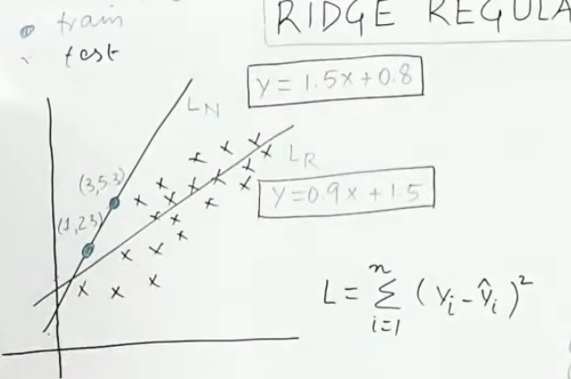

* training diff , but actual line shouldbe diff
* i want to model choose Lr
* we add extra term 
* lambda is hyperparameter

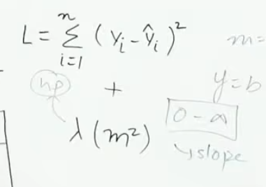

* i will calcualate loss for both of the lines 
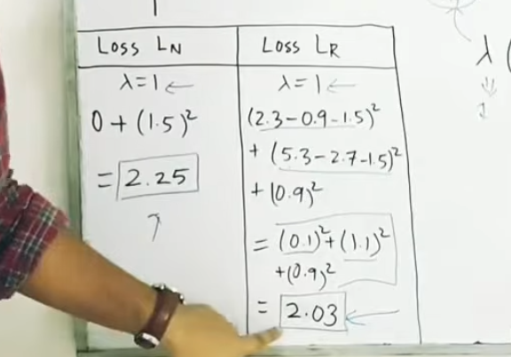
* now ML model has no choice and it has to choose the Lr line , due to the added term 
* it is called L2 regularization -> L2 norm 

-------
Now lets see the code part


* 10 input column 

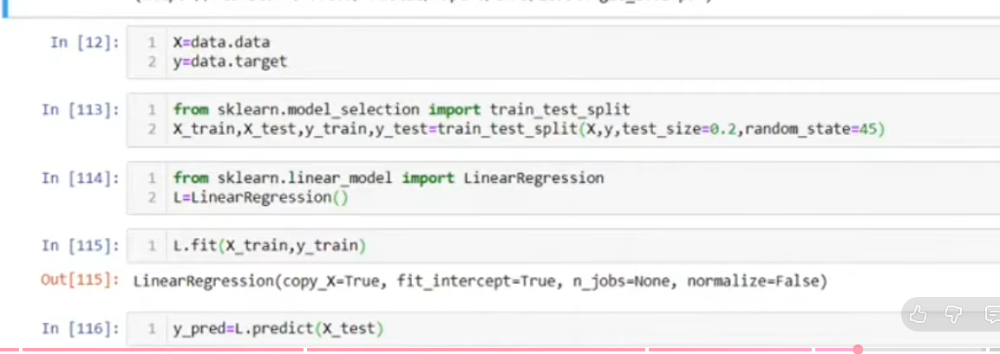
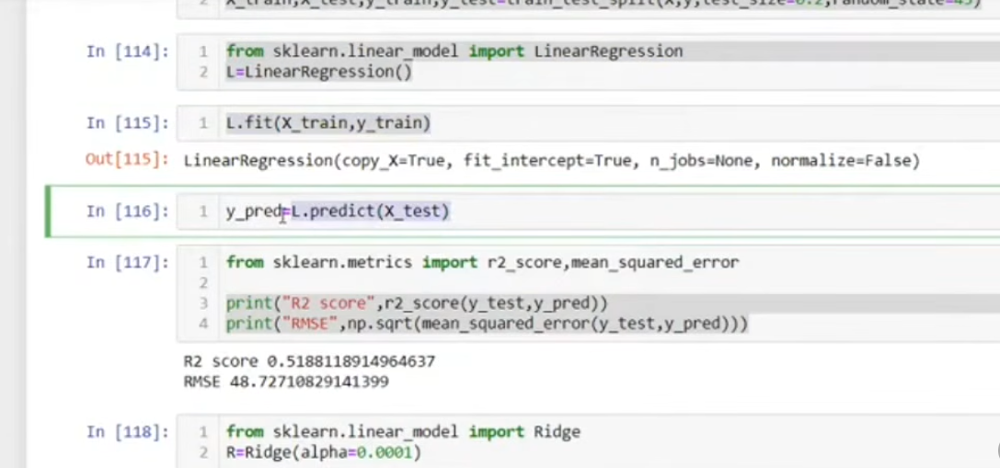

Now will impleemtn usign ridge regression 

we can figure alpha using cross validation

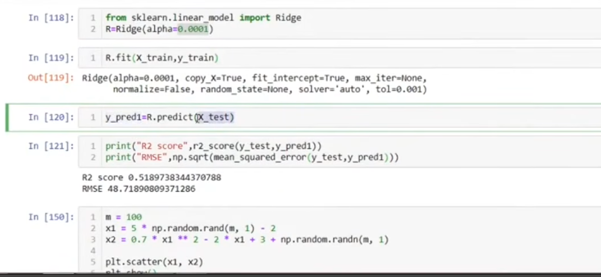
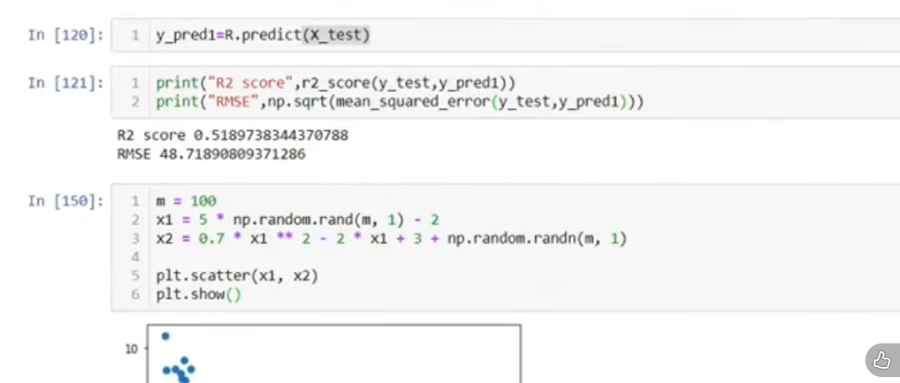

non linear 
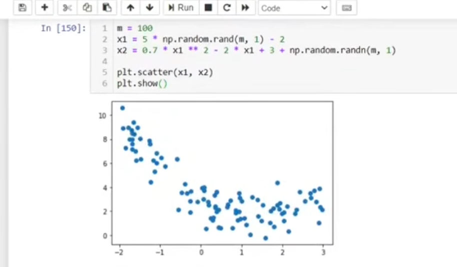

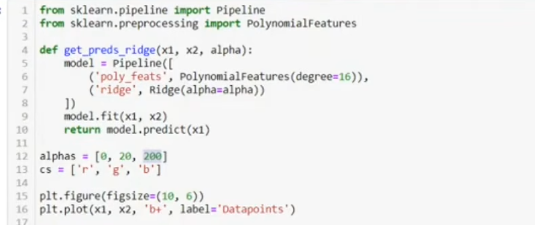

degree 16 polynomial 

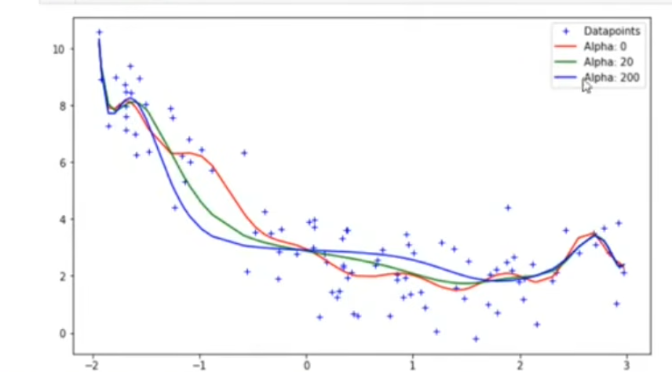

cahnging alpha value
* alpha too high --> simplifying 


------------------

### CampusX PDF notes - L63 Regularization: Complete Guide / Ridge part 1 (PDF pp. 1407-1435)

**1. What and why - regularization**
**Regularization** = adding a **penalty term** to the loss function so that the model cannot become too complex. Instead of minimising only the prediction error we minimise

**`Total loss = Prediction error + Complexity penalty`**

* Needed when there is high-dimensional data, few training samples, or a complex model (high-degree polynomial, deep network) -> the model **overfits** (excellent on train, poor on test; it captures noise).
* What regularization does: constrains the model complexity, **reduces the size of the coefficients**, can do automatic feature selection (L1), improves generalisation.
* Link with your notes: in `y = mx + b` an overfit model has a very large `m` (the model depends too heavily on the training data); `m = 0` means underfit (does not depend on data at all). The penalty term pulls `m` towards a sensible middle.

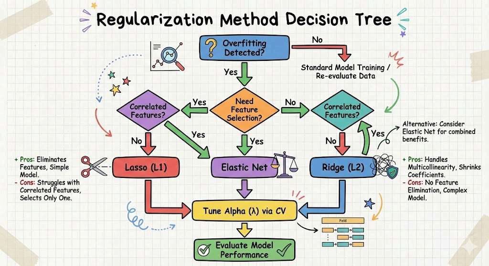

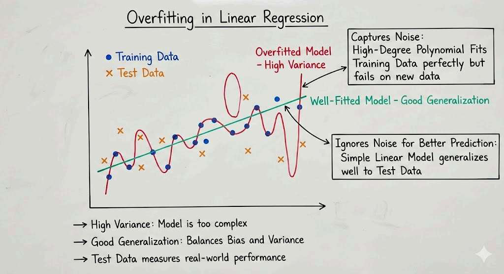

**2. The two-line example (your whiteboard)**
Two candidate lines for the same data: **Line 1** `y = 1.5x + 0.8` (steep, m = 1.5, complex) and **Line 2** `y = 0.9x + 1.5` (gentle, m = 0.9, simple). Without a penalty the model just picks the line with the lowest training error (it may be the steep, overfit one). With a penalty `lambda * m^2` the loss of both lines is `error + lambda * m^2`:
* Line 1: `0 + 1 * 1.5^2 = 2.25`
* Line 2: `2.03 + 1 * 0.9^2` - the PDF writes 2.03 and says the error "already includes m^2 somehow"; **this is inconsistent in the PDF** (the penalty 0.81 should be added, giving 2.84). The idea to take away is what your notes say: *the model has no choice but to pick the simpler line because of the added term*.
* The added term is a **hyperparameter** `lambda` (called `alpha` in sklearn). Because it uses the squared magnitude (the L2 norm) of the coefficients this is called **L2 regularization**.

**3. The three types**

| | **Ridge (L2)** | **Lasso (L1)** | **Elastic Net** |
|---|---|---|---|
| Penalty | `lambda * sum(w_i^2)` | `lambda * sum(abs(w_i))` | `lambda1 * sum(abs(w_i)) + lambda2 * sum(w_i^2)` |
| Effect | shrinks coefficients towards zero, **never exactly zero** | can shrink coefficients to **exactly zero** -> automatic feature selection, sparse model | both: shrinkage + selection |
| Good when | many correlated features, all useful | many irrelevant features, need a sparse / interpretable model | correlated features **and** you want selection; unsure which to use |
| Weak when | needs feature selection | correlated features (Lasso picks one arbitrarily, unstable) | slower, two hyperparameters |

Ridge loss: `L = sum (y_i - y_hat_i)^2 + lambda * sum (m_j^2)` (y_i actual, y_hat_i predicted, m_j the slopes - the intercept is not penalised, lambda = alpha = strength).
Elastic Net alternative form: `lambda * [alpha_mix * sum abs(m) + (1 - alpha_mix) * sum m^2]` - mix `0` = pure Ridge, `1` = pure Lasso, `0.5` = equal (sklearn calls the mix `l1_ratio`).

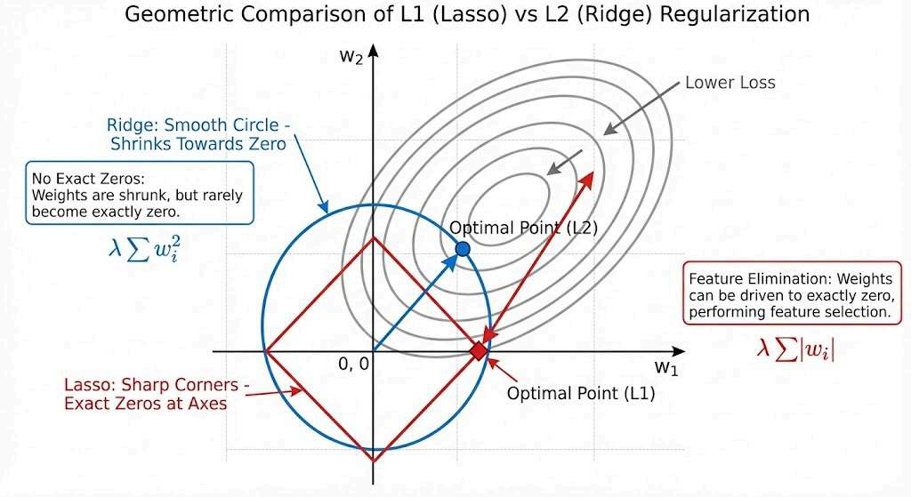

**Geometric view.** Ridge: `w1^2 + w2^2 <= t` (a circle / sphere); Lasso: `abs(w1) + abs(w2) <= t` (a diamond / hypercube). The loss contours first touch the circle at a smooth point (both weights non-zero) but the diamond at a **corner on an axis** (one weight = 0) - this is why Lasso gives zeros and Ridge does not.

**4. Effect of lambda (alpha)**

| lambda | effect | model |
|---|---|---|
| 0 | no regularization (= ordinary regression) | high complexity, overfitting risk |
| small (0.01 - 1) | gentle penalty | moderate |
| medium (1 - 100) | balanced | good generalisation (usually) |
| large (> 100) | strong penalty | too simple, **underfitting** |
| infinity | all coefficients -> 0 | the model ignores the data |

Gradient-descent view: plain update `w = w - lr * dLoss/dw`; with Ridge it becomes `w = w - lr * (dLoss/dw + 2 * lambda * w) = w * (1 - 2 * lr * lambda) - lr * dLoss/dw`, so every step first **shrinks (decays) the weight** by the factor `(1 - 2 * lr * lambda)` - hence the alternative name *weight decay*.

**Which solver?** Ridge has a **closed-form solution** `w = (X^T X + lambda I)^-1 X^T y`; Lasso has none (the L1 term is not differentiable at 0), so it uses **coordinate descent** (one coefficient at a time), **LARS** (computes the whole regularization path) or **proximal gradient descent**.

**5. Results on the diabetes dataset (442 patients, 10 features)**
Your code in this lecture is exactly this (`random_state=45`, test size 0.2). The first two rows are real runs from the repo notebook, the others are the PDF's illustrative numbers.

| Model | R2 | RMSE | Max coef | Features used | Note |
|---|---|---|---|---|---|
| Linear regression | 0.5188 | 48.73 | 970.80 | 10/10 | big coefficients (+23, -247, +492, -971 ...) -> possible overfit (real run) |
| Ridge alpha = 100000 | -0.0004 | 70.26 | 0.0078 | 10/10 | coefficients ~ 0.00x -> severe **underfitting** (real run) |
| Ridge alpha = 1 | 0.5195 | 48.65 | 771 | 10/10 | slightly smaller coefficients (PDF illustration) |
| Lasso alpha = 0.1 | 0.5201 | 48.62 | 612 | 6/10 | 4 features eliminated (PDF illustration) |
| Elastic Net a = 0.1, l1 = 0.5 | 0.5215 | 48.55 | 534 | 9/10 | best of the PDF's numbers (illustration) |

Your notes: "alpha too high -> simplifying". A pure Ridge with alpha = 1e5 makes the model a flat line near the mean of `y` (R2 ~ 0) - exactly the underfit end of the trade-off.

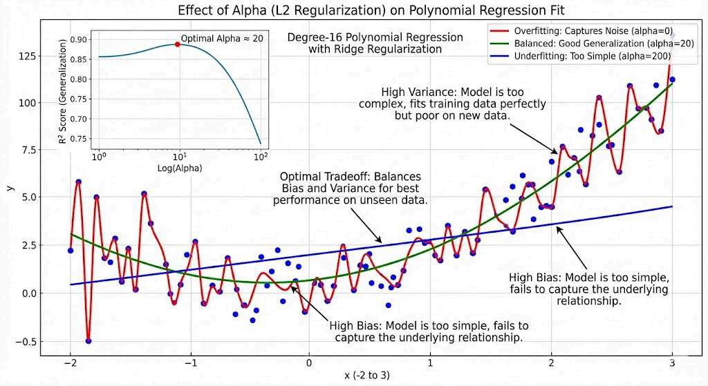

**Degree-16 polynomial (your "non linear" screenshot).** Data: `x2 = 0.7 x1^2 - 2 x1 + 3 + noise`. Fit with `PolynomialFeatures(degree=16)` + `Ridge(alpha)` for `alpha = 0, 20, 200`: **0 = overfit (red)**, **20 = balanced (green)**, **200 = underfit (blue)**. The right alpha is found with cross-validation.

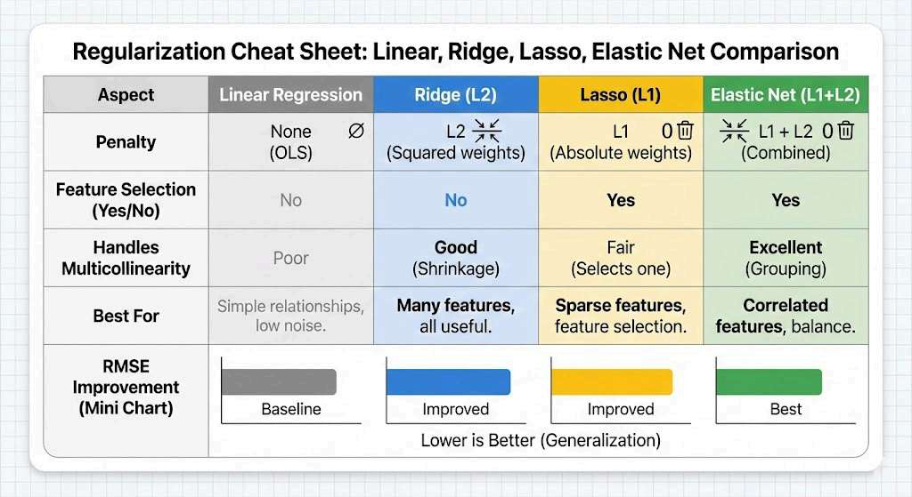

**6. Choosing alpha**
1. **GridSearchCV** over `alpha in [0.001 ... 1000]`, `cv=5`, `scoring='neg_mean_squared_error'`.
2. **RidgeCV** - `RidgeCV(alphas=np.logspace(-3, 3, 100), cv=5)`; the best value is in `.alpha_`.
3. **Validation curve** - `validation_curve(Ridge(), X, y, param_name='alpha', param_range=..., cv=5, scoring='r2')` and plot train vs validation score on a log axis.

| alpha range | use |
|---|---|
| 0.001 - 0.01 | small data, low noise |
| 0.01 - 0.1 | mild overfitting |
| **0.1 - 1** | typical starting point |
| 1 - 10 | high-dimensional data |
| 10 - 100 | extreme overfitting |
| > 100 | usually too much |

**7. When to use which (PDF decision guide)**
* **Linear regression:** few, well-understood features, no overfitting. **Ridge:** all features matter, correlated features (e.g. house size, rooms, area). **Lasso:** many irrelevant features, need a sparse model (e.g. gene data - thousands of genes, few relevant). **Elastic Net:** correlated features and you want selection, Lasso is unstable, or you are not sure.
* Beyond linear models: **Dropout** (randomly drop neurons while training, e.g. `Dropout(0.5)`), **L2 in deep learning** (`kernel_regularizer=regularizers.l2(0.01)`), **early stopping** (stop when validation loss stops improving, `patience=10`, `restore_best_weights=True`).
* PDF case studies (illustrative): text classification with an L1 logistic regression kept 237 of 10,000 features; house prices with Ridge (alpha = 10) improved R2 from 0.78 to 0.85; genetic markers with Elastic Net (alpha = 0.5, l1_ratio = 0.5) kept 156 genes in correlated groups.

**8. Best practices, takeaways**
Always split train / validation / test; use cross-validation to select alpha; start with a moderate alpha (0.1 - 1); plot the regularization path; **scale the features before regularizing** (the penalty is on the size of the coefficients, so un-scaled features are penalised unequally); try Elastic Net if unsure; watch both training and validation error. Quick reference: overfitting -> increase alpha; underfitting -> decrease alpha; need selection -> L1; keep all features -> L2; both -> Elastic Net.

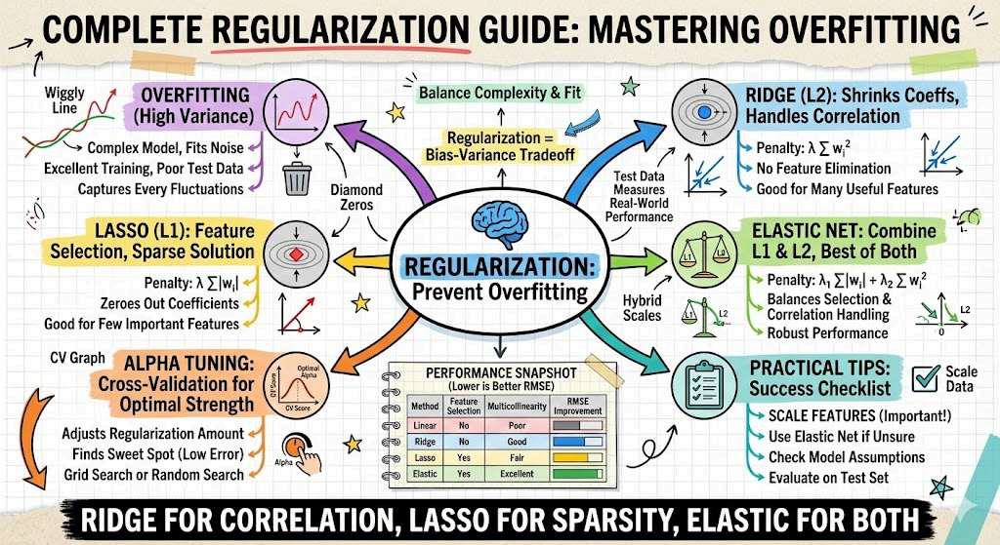

### Official code - L63 Ridge regression part 1 (repo: `day55-regularized-linear-models/Ridge Regularization.ipynb`)

**Block 1 - load the diabetes data**

```python
import numpy as np
import pandas as pd
import matplotlib.pyplot as plt

from sklearn.datasets import load_diabetes     # built-in dataset: 442 patients, 10 features

data = load_diabetes()
X = data.data                                  # (442, 10) features (already mean-centred and scaled)
y = data.target                                # disease progression after one year
```

**Block 2 - train / test split and plain linear regression (baseline)**

```python
from sklearn.model_selection import train_test_split
X_train, X_test, y_train, y_test = train_test_split(X, y, test_size=0.2, random_state=45)

from sklearn.linear_model import LinearRegression
L = LinearRegression()
L.fit(X_train, y_train)
print(L.coef_)         # [ 23.5 -247.4  492.1  329.4 -970.8  573.5  182.4  255.9  794.2  89.3] -> large values
print(L.intercept_)    # 152.14

from sklearn.metrics import r2_score, mean_squared_error
y_pred = L.predict(X_test)
print("R2 score", r2_score(y_test, y_pred))                      # 0.5188
print("RMSE", np.sqrt(mean_squared_error(y_test, y_pred)))       # 48.73
```

**Block 3 - Ridge with a huge alpha (underfitting)**

```python
from sklearn.linear_model import Ridge
R = Ridge(alpha=100000)       # alpha = lambda; a huge value -> strong shrinkage
R.fit(X_train, y_train)
print(R.coef_)                # every coefficient ~ 0.00x
print(R.intercept_)           # 151.83 -> the model predicts ~ the mean of y

y_pred1 = R.predict(X_test)
print("R2 score", r2_score(y_test, y_pred1))                     # -0.0004 (no better than the mean)
print("RMSE", np.sqrt(mean_squared_error(y_test, y_pred1)))      # 70.26
```

**Block 4 - non-linear data (quadratic + noise)**

```python
m = 100
x1 = 5 * np.random.rand(m, 1) - 2                                # 100 points in [-2, 3]
x2 = 0.7 * x1 ** 2 - 2 * x1 + 3 + np.random.randn(m, 1)          # a parabola + gaussian noise

plt.scatter(x1, x2)
plt.show()
```

**Block 5 - degree-16 polynomial with Ridge at alpha = 0, 20, 200**

```python
from sklearn.pipeline import Pipeline
from sklearn.preprocessing import PolynomialFeatures    # adds x^2 ... x^16 as new columns

def get_preds_ridge(x1, x2, alpha):
    # Pipeline = polynomial features first, then Ridge on the expanded columns
    model = Pipeline([
        ('poly_feats', PolynomialFeatures(degree=16)),
        ('ridge', Ridge(alpha=alpha))
    ])
    model.fit(x1, x2)
    return model.predict(x1)

alphas = [0, 20, 200]          # red = overfit, green = good, blue = underfit
cs = ['r', 'g', 'b']

plt.figure(figsize=(10, 6))
plt.plot(x1, x2, 'b+', label='Datapoints')

for alpha, c in zip(alphas, cs):
    preds = get_preds_ridge(x1, x2, alpha)
    # sort by x so the curve is drawn left to right
    plt.plot(sorted(x1[:, 0]), preds[np.argsort(x1[:, 0])], c, label='Alpha: {}'.format(alpha))

plt.legend()
plt.show()
```

(The repo's last cell is empty. The numbers in Blocks 2-3 are the notebook's saved outputs; Ridge alpha = 100000 is the same experiment as your screenshot.)

## L64 Ridge regression part 2

for linear regression we need to find the value of m and b 

* we want to decrease the value of m and hence increase bias and decrease variance

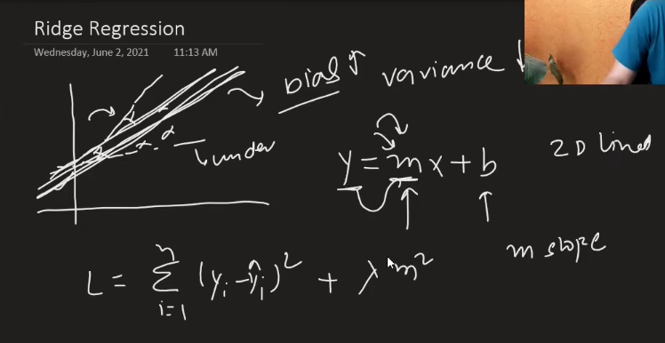
* we will see the derivation to understand how it 
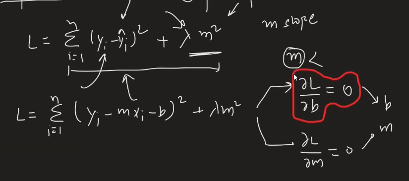

diff wrt m to get the value of m 

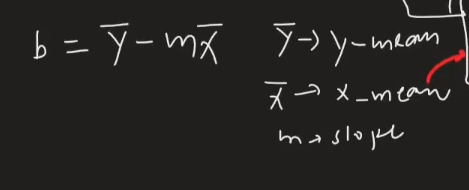
* since our focus is only on m, to decrease m to decrease dependecy on x (trainign data)
* 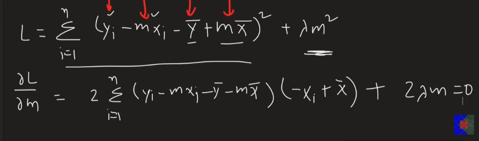
* 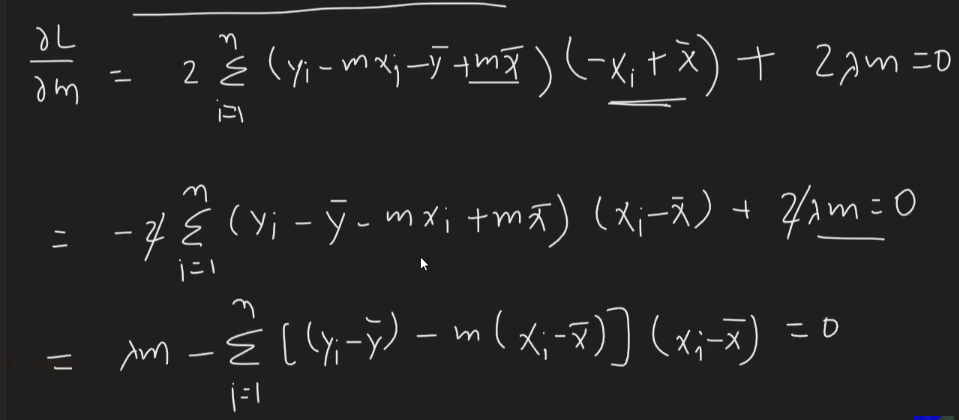

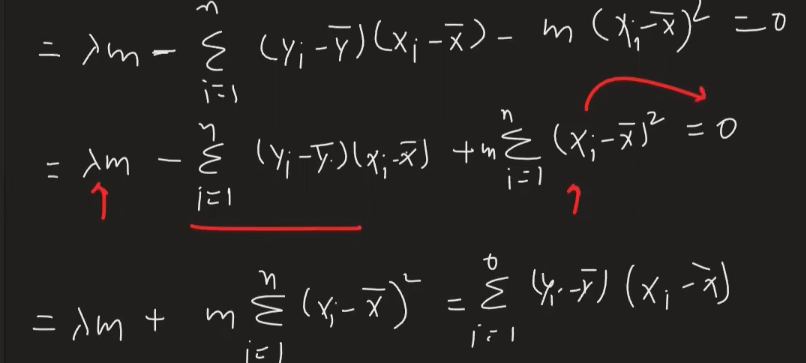

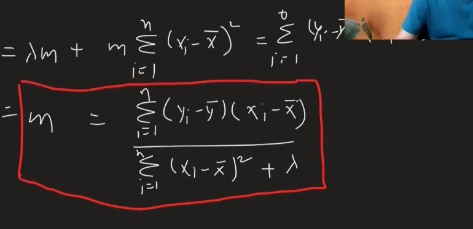

* orginal LR now we just have a lambda term in the denominator
* lamda value is high then m decreases 
* lambda = 0 no effect on the value of m coefficient 

-------

code

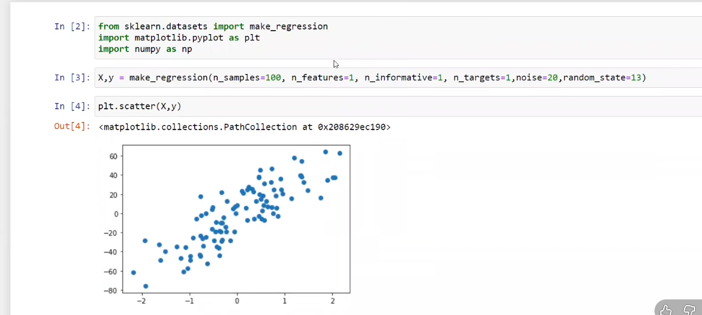

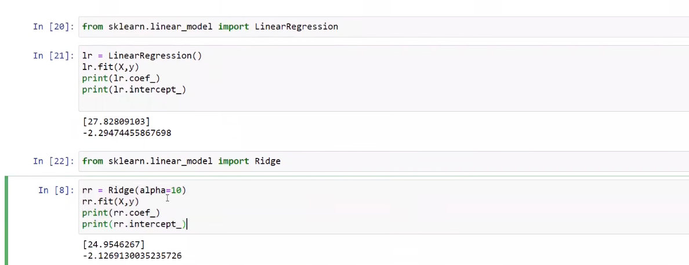

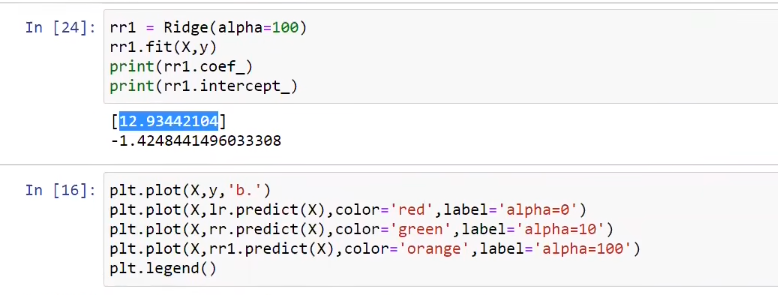

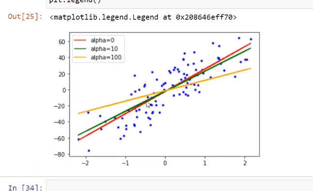

increase alpha too much we got lot of bias term 

---------------


We will now make our own Ridge regression class

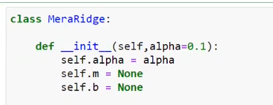

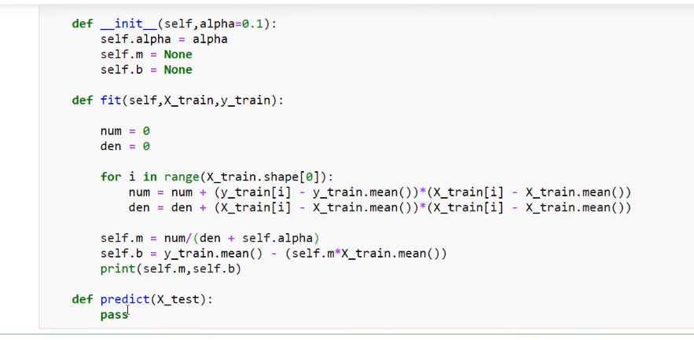

------------

Ridge regression for nD data

* n + 1 column 
* m rows 

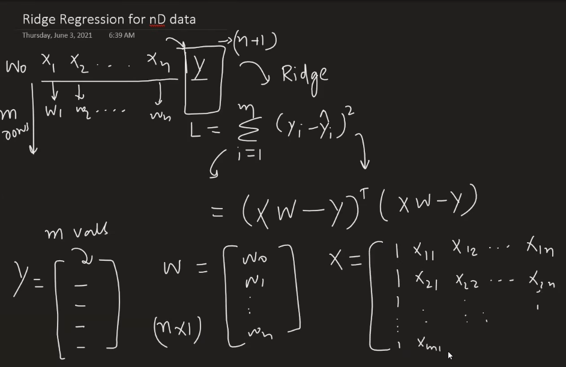

loss fucniton

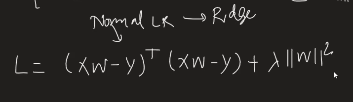
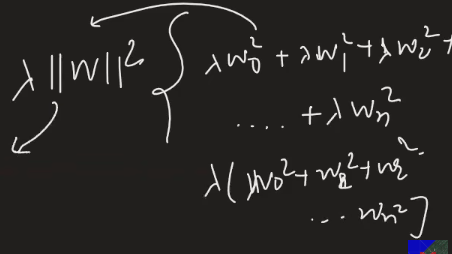
* Matrix form 
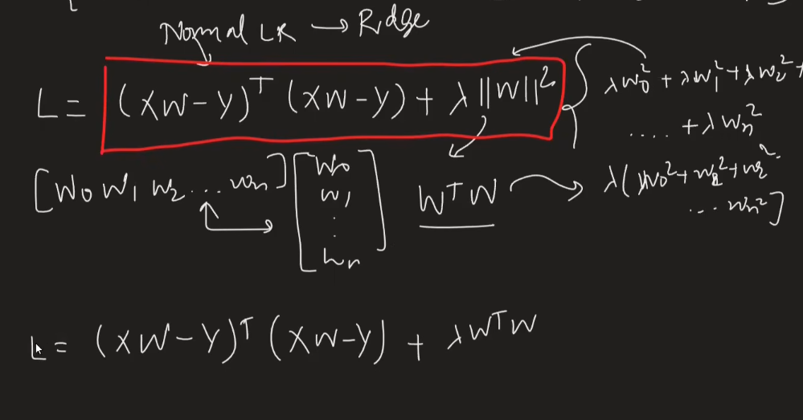

* diff wrt W
* lets simplify it more first

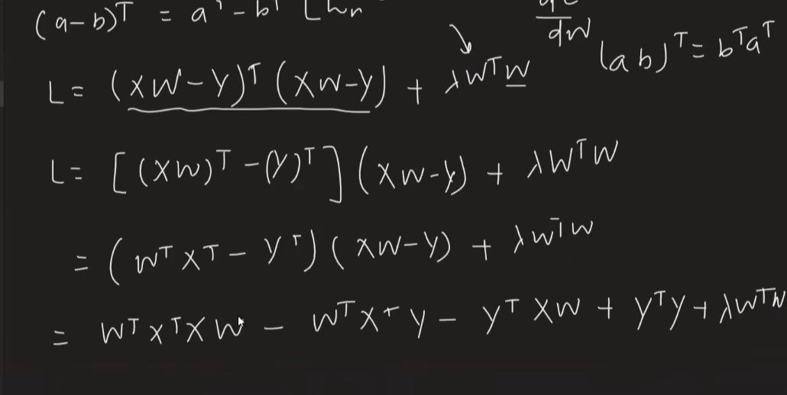

* middle two term same
* 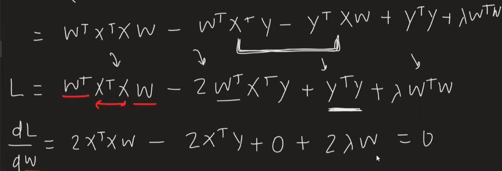

* 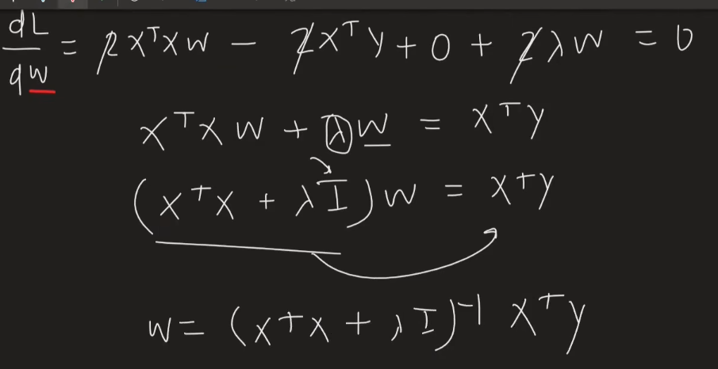

this is the solution of the ridge regg

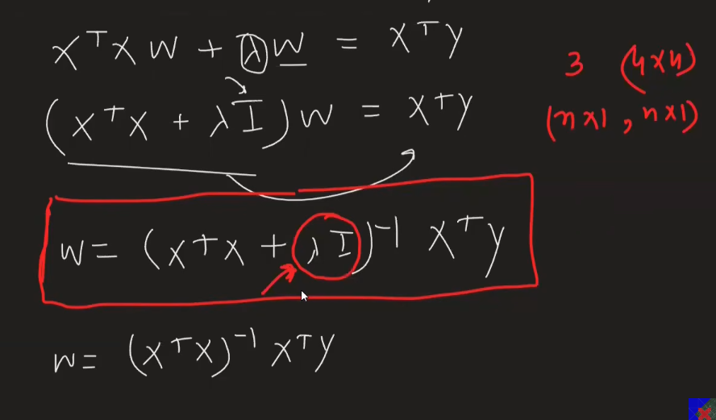

----------

code 

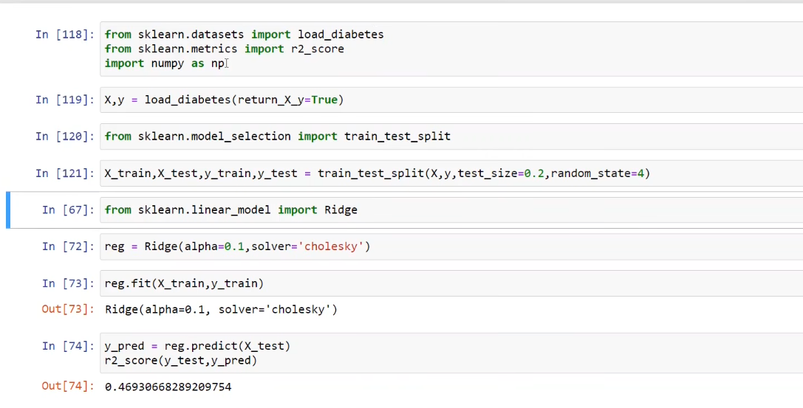

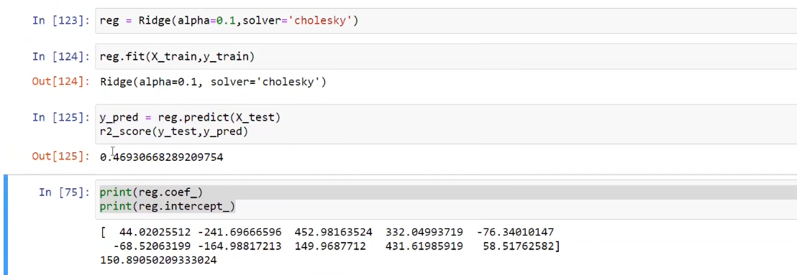

---

lets create the class

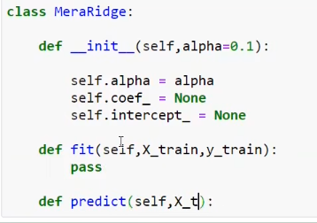

* i will frist make the Xtrain matrix 
* Identity 
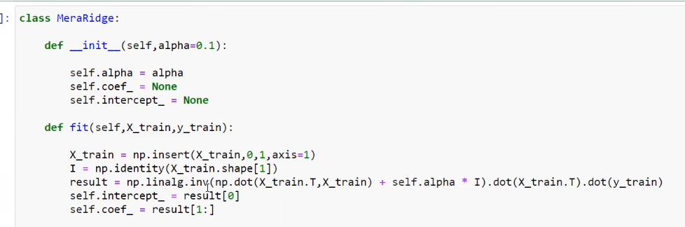
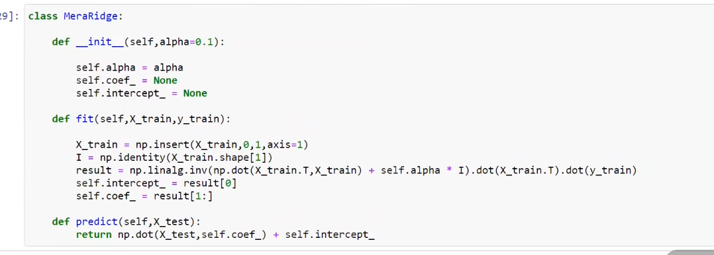

### CampusX PDF notes - L64 Ridge Regression: Complete Mathematical Guide / part 2 (PDF pp. 1436-1453)

**1. Introduction**
Ridge regression (also **Tikhonov regularization** or **L2 regularization**) adds a penalty term to the loss function. It fixes three problems of ordinary least squares: **overfitting** (models the noise), **high variance** (small changes in the training data give large changes in the coefficients) and **multicollinearity** (correlated predictors make coefficients unstable).

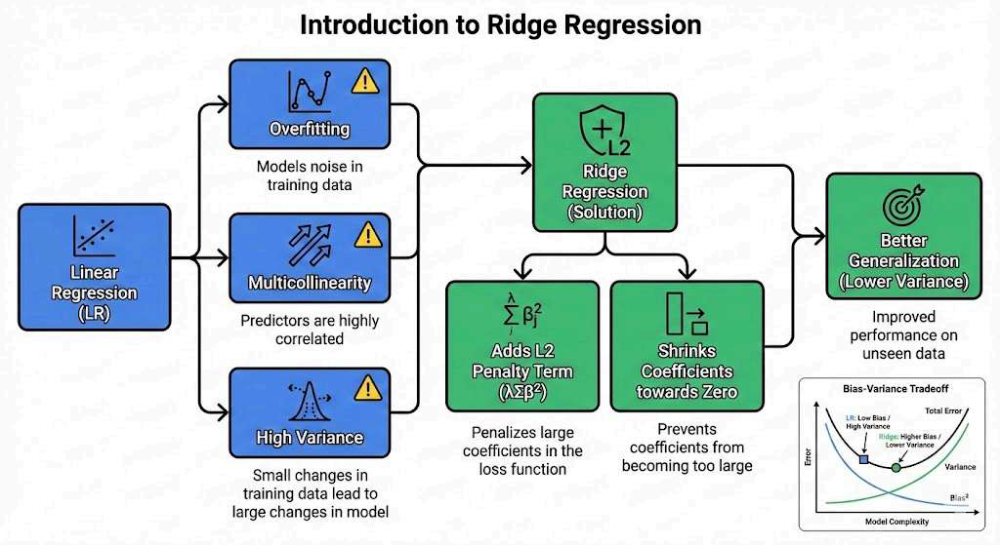

Key idea - the **bias-variance trade-off**: Ridge introduces a *controlled bias* to reduce variance.

| | Linear regression | Ridge regression |
|---|---|---|
| Bias | low | slightly higher |
| Variance | high (can overfit) | lower |
| Model complexity | can be high | controlled |
| Coefficient magnitude | can be very large | shrunk towards zero |

Your note: "we want to decrease the value of `m` and hence **increase bias and decrease variance**".

**2. Ridge for 2-D data (one feature) - derivation**
Model `y_hat = m x + b`. OLS loss `L = sum (y_i - m x_i - b)^2`. Ridge loss:

**`L = sum (y_i - m x_i - b)^2 + lambda * m^2`**

* MSE term = how well the line fits; **`lambda * m^2`** = L2 penalty on large slopes; `lambda` = the hyperparameter that controls the strength.
* **Why only `m` and not `b`?** The slope decides how sensitive the model is to the input (that is what overfits); the intercept is only a vertical shift - penalising it would artificially move the predictions. This is your note "our focus is only on `m`, to decrease the dependency on `x` (training data)".

**Step 1 - derivative w.r.t. `b`** and set it to 0:
`dL/db = -2 sum (y_i - m x_i - b) = 0` -> `sum (y_i - m x_i - b) = 0` -> divide by n: **`b = y_mean - m x_mean`** (same as plain regression, as `b` is not penalised).

**Step 2 - derivative w.r.t. `m`** and set it to 0:
`dL/dm = -2 sum (y_i - m x_i - b) x_i + 2 lambda m = 0`

**Step 3 - substitute `b = y_mean - m x_mean`:**
`sum [(y_i - y_mean) - m (x_i - x_mean)] x_i = lambda m`

**Step 4 - expand.** Use the identity `sum (x_i - x_mean) x_i = sum (x_i - x_mean)^2` and `sum (y_i - y_mean) x_i = sum (y_i - y_mean)(x_i - x_mean)` (because `sum (x_i - x_mean) = 0`):
`sum (y_i - y_mean)(x_i - x_mean) - m sum (x_i - x_mean)^2 = lambda m`
`sum (y_i - y_mean)(x_i - x_mean) = m [ sum (x_i - x_mean)^2 + lambda ]`

**Step 5 - the final formula:**

**`m_ridge = sum (y_i - y_mean)(x_i - x_mean) / ( sum (x_i - x_mean)^2 + lambda )`**

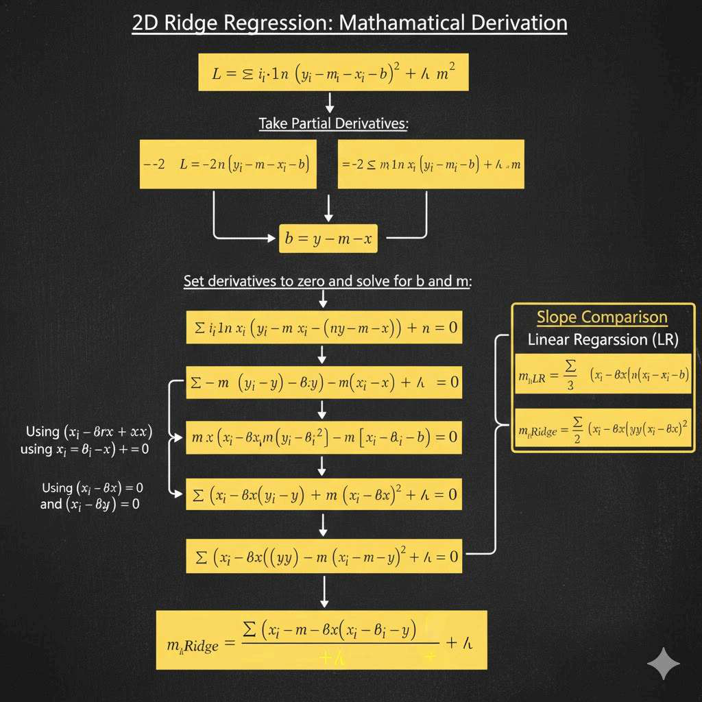

| Method | slope `m` |
|---|---|
| Linear regression | `sum (y_i - y_mean)(x_i - x_mean) / sum (x_i - x_mean)^2` |
| Ridge | `sum (y_i - y_mean)(x_i - x_mean) / ( sum (x_i - x_mean)^2 + lambda )` |

**The only difference is `+ lambda` in the denominator** (your note: "original LR, now we just have a lambda term in the denominator"). Consequences: `lambda = 0` -> no effect, Ridge = linear regression; `lambda` large -> `m` decreases; `lambda -> infinity` -> `m -> 0`.

| lambda | effect on slope | model |
|---|---|---|
| 0 | original LR slope | no regularization |
| small (0.1 - 1) | slightly smaller | minor shrinkage |
| moderate (10) | noticeably smaller | balanced |
| large (100) | much smaller | strong shrinkage |
| very large | approaches 0 | extreme underfitting |

Numbers from the notebook (`make_regression`, noise = 20, 1 feature): alpha = 0 -> slope 27.83, intercept -2.29; alpha = 10 -> 24.95, -2.13; alpha = 100 -> 12.93, -1.42. The slope shrinks as alpha grows (this is your "increase alpha too much we get a lot of bias").

**3. Ridge for n-D data - matrix form**
Notation: `X` is `m x n` (m rows = samples, n columns = features), `W` is `n x 1`, `y` is `m x 1`, `y_hat = X W`. To include the intercept add a column of ones to `X` -> `X` is `m x (n+1)` and `W` is `(n+1) x 1` (your note "n + 1 column, m rows").

* OLS loss in matrix form: `L = (XW - y)^T (XW - y)` (the vector of residuals dotted with itself = sum of squared residuals).
* Ridge loss: **`L = (XW - y)^T (XW - y) + lambda * W^T W`**, where `||W||^2 = W^T W = w1^2 + ... + wn^2`.

**Derivation**
1. Expand: `L = (W^T X^T - y^T)(XW - y) + lambda W^T W`
2. Distribute: `L = W^T X^T X W - W^T X^T y - y^T X W + y^T y + lambda W^T W`
3. `W^T X^T y` is a 1 x 1 scalar, so it equals its transpose `y^T X W` -> the middle two terms are the same (your note "middle two terms same"): `L = W^T X^T X W - 2 y^T X W + y^T y + lambda W^T W`
4. Differentiate w.r.t. `W` (rules: `d(W^T A W)/dW = 2 A W` for symmetric A, `d(c^T W)/dW = c`): `dL/dW = 2 X^T X W - 2 X^T y + 0 + 2 lambda W`
5. Set to 0 and divide by 2: `X^T X W + lambda W = X^T y` -> `(X^T X + lambda I) W = X^T y`
6. Solve:

**`W = (X^T X + lambda I)^-1 X^T y`**   (this is "the solution of Ridge regression" on your slide)

| Method | closed-form solution |
|---|---|
| Linear regression (OLS) | `W = (X^T X)^-1 X^T y` |
| Ridge | `W = (X^T X + lambda I)^-1 X^T y` |

Adding `lambda I` to `X^T X` before inverting (a) makes the matrix **always invertible** even if `X^T X` is singular (e.g. perfectly correlated columns), (b) shrinks the coefficients, (c) improves numerical stability. Note: in the PDF's derivation `W` includes `w0`, so the intercept would be penalised too; the **code sets `I[0][0] = 0`** so the intercept is not regularised (consistent with the 2-D case).

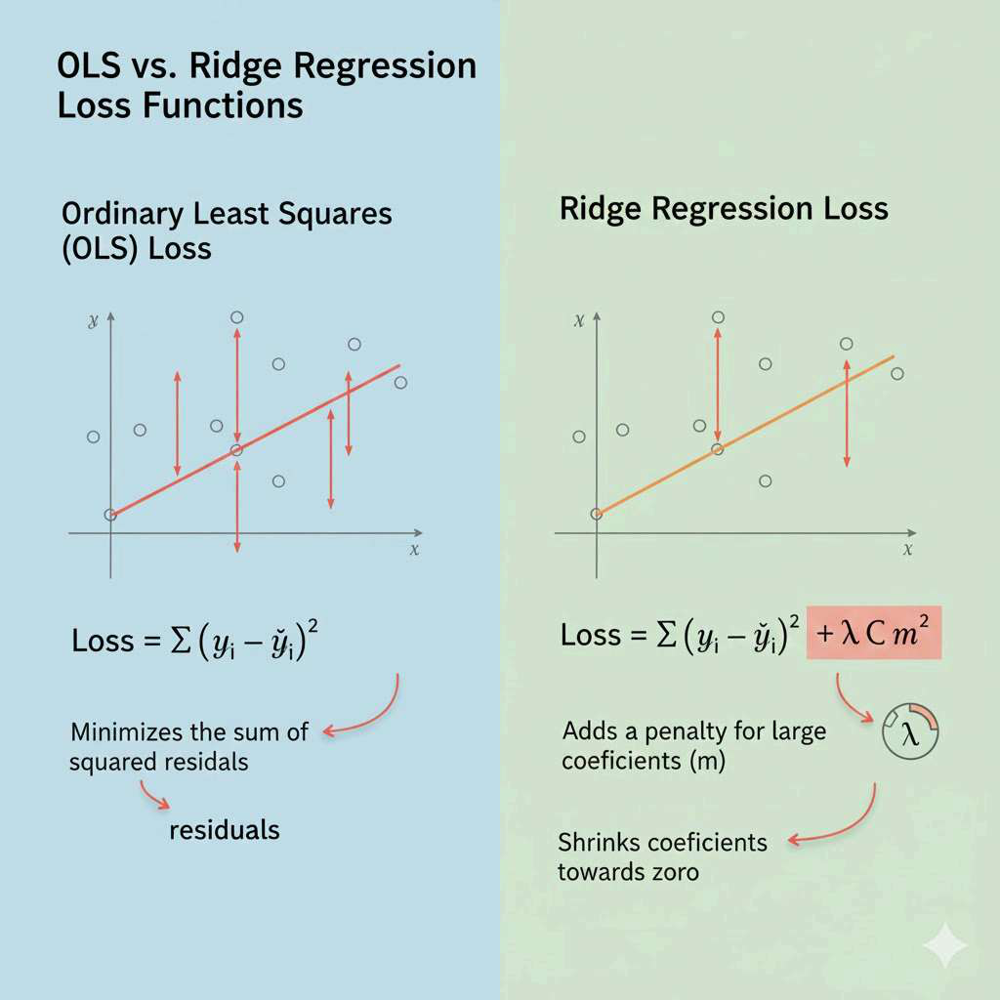

| Aspect | Linear regression | Ridge regression |
|---|---|---|
| Loss | `sum (y - y_hat)^2` | `sum (y - y_hat)^2 + lambda ||w||^2` |
| Penalty | none | L2 (squared magnitude) |
| Coefficient size | can be arbitrarily large | shrunk towards zero |
| Solution (matrix) | `(X^T X)^-1 X^T y` | `(X^T X + lambda I)^-1 X^T y` |
| Invertibility | may fail | always invertible |
| Bias / variance | low / high | higher / lower |
| Multicollinearity | problematic | handled |
| Feature selection | no | no (keeps all features) |

**4. Implementation notes**
* 2-D class (`MeraRidge`): loop to get `num = sum (y_i - y_mean)(x_i - x_mean)` and `den = sum (x_i - x_mean)^2`, then `m = num / (den + alpha)`, `b = y_mean - m * x_mean`.
* n-D class (`MeraRidgeND` in the PDF, `MeraRidge` in the repo): insert a column of ones, build the identity matrix, set `I[0][0] = 0`, compute `(X^T X + alpha I)^-1 X^T y`; `result[0]` is the intercept and `result[1:]` are the coefficients. Your notes: "first make the Xtrain matrix, then the identity".
* sklearn: `Ridge(alpha=0.1, solver='cholesky')`. Parameters: `alpha` (default 1.0), `fit_intercept` (True), `solver` (`auto`, `svd`, `cholesky`, `lsqr`, `sparse_cg`, `sag`, `saga`), `max_iter`, `tol`. The scratch class gives **exactly the same R2 (0.4693) and coefficients** as sklearn's `cholesky` solver - this is the check that the derivation is right.

### Official code - L64 Ridge regression part 2 (repo: `day55-regularized-linear-models/ridge-regression-from-scratch-m-and-b.ipynb` and `ridge-regression-from-scratch.ipynb`)

**Block 1 - 1-D data and sklearn Ridge at different alphas**

```python
from sklearn.datasets import make_regression
import matplotlib.pyplot as plt
import numpy as np

# 100 points, 1 feature, noise = 20 (repeatable with random_state)
X, y = make_regression(n_samples=100, n_features=1, n_informative=1, n_targets=1, noise=20, random_state=13)
plt.scatter(X, y)

from sklearn.linear_model import LinearRegression, Ridge
lr = LinearRegression()
lr.fit(X, y)
print(lr.coef_, lr.intercept_)       # [27.83] -2.29      (alpha = 0)

rr = Ridge(alpha=10)
rr.fit(X, y)
print(rr.coef_, rr.intercept_)       # [24.95] -2.13      slope shrinks a little

rr1 = Ridge(alpha=100)
rr1.fit(X, y)
print(rr1.coef_, rr1.intercept_)     # [12.93] -1.42      slope shrinks a lot

plt.plot(X, y, 'b.')
plt.plot(X, lr.predict(X), color='red', label='alpha=0')
plt.plot(X, rr.predict(X), color='green', label='alpha=10')
plt.plot(X, rr1.predict(X), color='orange', label='alpha=100')
plt.legend()                         # the line gets flatter as alpha increases
```

**Block 2 - our own Ridge for 1-D data (formula m = num / (den + alpha))**

```python
class MeraRidge:

    def __init__(self, alpha=0.1):
        self.alpha = alpha          # lambda
        self.m = None               # slope
        self.b = None               # intercept

    def fit(self, X_train, y_train):
        num = 0
        den = 0
        for i in range(X_train.shape[0]):
            # num = sum (y_i - y_mean)(x_i - x_mean) ; den = sum (x_i - x_mean)^2
            num = num + (y_train[i] - y_train.mean()) * (X_train[i] - X_train.mean())
            den = den + (X_train[i] - X_train.mean()) * (X_train[i] - X_train.mean())

        self.m = num / (den + self.alpha)                 # the only change vs linear regression: + alpha
        self.b = y_train.mean() - (self.m * X_train.mean())
        print(self.m, self.b)

    def predict(X_test):            # left as a stub in the repo
        pass

reg = MeraRidge(alpha=100)
reg.fit(X, y)                       # [12.93442104] [-1.42484415] -> identical to sklearn's Ridge(alpha=100)
```

**Block 3 - n-D data: baseline sklearn Ridge (diabetes)**

```python
from sklearn.datasets import load_diabetes
from sklearn.metrics import r2_score
from sklearn.model_selection import train_test_split
import numpy as np

X, y = load_diabetes(return_X_y=True)
X_train, X_test, y_train, y_test = train_test_split(X, y, test_size=0.2, random_state=4)

from sklearn.linear_model import Ridge
reg = Ridge(alpha=0.1, solver='cholesky')   # 'cholesky' = closed-form solve of (X^T X + alpha I) w = X^T y
reg.fit(X_train, y_train)

y_pred = reg.predict(X_test)
print(r2_score(y_test, y_pred))             # 0.4693
print(reg.coef_)                            # [ 44.0 -241.7 453.0 332.0 -76.3 -68.5 -165.0 150.0 431.6 58.5]
print(reg.intercept_)                       # 150.89
```

**Block 4 - our own Ridge for n-D data (closed form)**

```python
class MeraRidge:

    def __init__(self, alpha=0.1):
        self.alpha = alpha
        self.coef_ = None
        self.intercept_ = None

    def fit(self, X_train, y_train):
        X_train = np.insert(X_train, 0, 1, axis=1)     # add the column of ones -> intercept is w0
        I = np.identity(X_train.shape[1])              # identity matrix of size (n+1)
        I[0][0] = 0                                    # do NOT regularise the intercept
        # W = (X^T X + alpha I)^-1 X^T y
        result = np.linalg.inv(np.dot(X_train.T, X_train) + self.alpha * I).dot(X_train.T).dot(y_train)
        self.intercept_ = result[0]
        self.coef_ = result[1:]

    def predict(self, X_test):
        return np.dot(X_test, self.coef_) + self.intercept_    # y_hat = X w + b

reg = MeraRidge()                    # alpha = 0.1
reg.fit(X_train, y_train)
y_pred = reg.predict(X_test)
print(r2_score(y_test, y_pred))      # 0.4693 - same as sklearn
print(reg.coef_)                     # same coefficients as sklearn's Ridge(alpha=0.1, solver='cholesky')
print(reg.intercept_)
```

(Functions used: `np.insert(a, 0, 1, axis=1)` adds a column of ones at position 0; `np.identity(k)` builds the identity matrix; `np.linalg.inv` inverts a matrix; `.dot` is matrix multiplication; `Ridge(..., solver='cholesky')` solves the closed form directly. In practice `np.linalg.solve` is numerically better than `inv`.)

## L65 Ridge regression part 3

using GD we will implement the Ridge regression

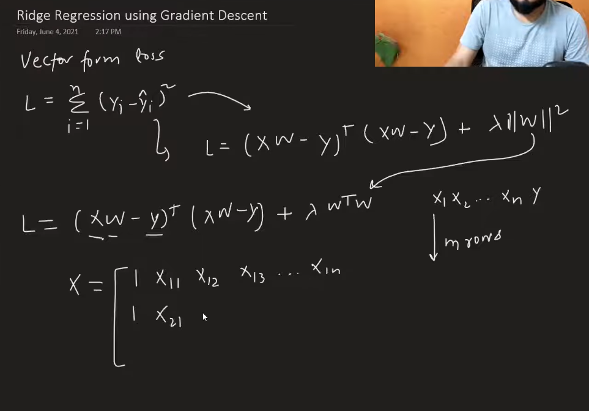

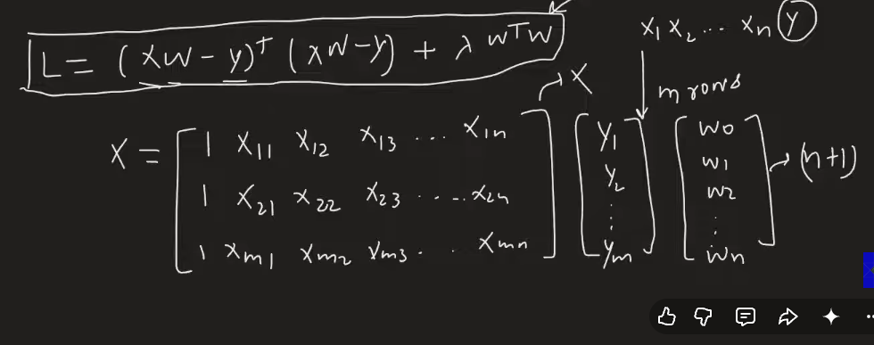

-------------

updating the parameterss
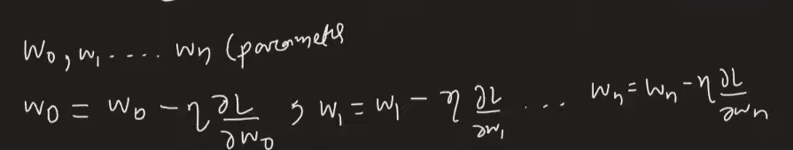

writing them collectively in a single equation 
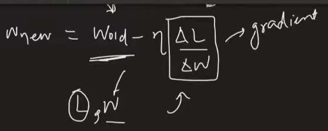

multiplying by 1/2 to just help calculation 

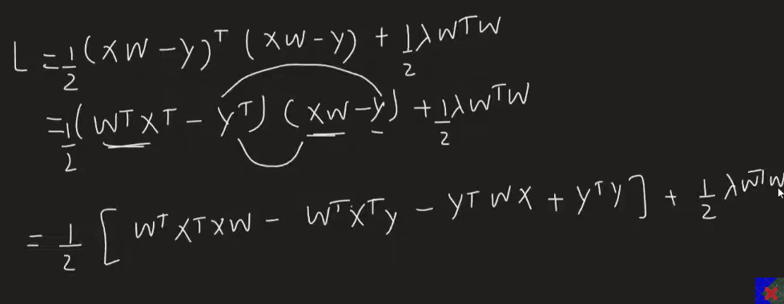


W -> final answer


will run epoch time 

---------

Code


* first shown using scikit learn
* 

* Made our own Ridge regression SGD class
* 


----------

### CampusX notes - L65 Ridge regression part 3 (Gradient Descent)

*Source note: the PDF section that follows L64 (PDF pp. 1454-1482, "Regularization: Complete Guide") is a verbatim repeat of the L63 guide - same text, same diagrams, same tables - so it adds nothing new for this lecture and is not repeated here. The notes below follow your slides and the official notebook `ridge-regression-gradient-descent.ipynb`.*

**1. Why gradient descent for Ridge?**
The closed form `W = (X^T X + lambda I)^-1 X^T y` (L64) needs a matrix inverse - cost about O(n^3) in the number of features and heavy in memory. For many features / large data we instead minimise the Ridge loss **iteratively with gradient descent**, exactly like linear regression (L57) but with the extra `lambda * W` term.

**2. Derivation (matrix form)**
* Loss: `L = (XW - y)^T (XW - y) + lambda W^T W`  (X already includes the column of ones; `W = [w0, w1 ... wn]`).
* Gradient: `dL/dW = 2 X^T X W - 2 X^T y + 2 lambda W`.
* **Multiply the loss by 1/2** (your slide: "multiplying by 1/2 just to help the calculation") so the 2 cancels: `dL/dW = X^T X W - X^T y + lambda W = X^T (XW - y) + lambda W`.
* **Update rule** (repeated for `epochs` iterations):

**`W_new = W_old - lr * ( X^T X W_old - X^T y + lambda W_old )`**

* Rearranged: `W_new = W_old (1 - lr * lambda) - lr * X^T (X W_old - y)`. The factor `(1 - lr * lambda) < 1` shrinks the weights a little on **every** step - that is why L2 regularization is also called **weight decay**. Linear regression is the special case `lambda = 0`.
* Written coordinate-wise for one weight: `w_j = w_j - lr * ( sum_i (y_hat_i - y_i) x_ij + lambda w_j )`.
* "W -> final answer": after `epochs` iterations the vector `W` holds the intercept `W[0]` and the coefficients `W[1:]`.

**3. Things to remember**
* Both solvers minimise the same convex loss, so with enough iterations and a suitable learning rate GD reaches (almost exactly) the closed-form answer. In the notebook the closed form `Ridge(solver='sparse_cg')` gets R2 = 0.4624 and our GD gets 0.4738 with slightly different coefficients because GD was stopped after only 500 epochs.
* The learning rate must be small (here `0.005`): `X^T X` is large because it sums over all samples (the code does not divide by `m`), so a bigger step diverges.
* In this scratch code the **intercept is also penalised** (the whole `theta` vector, including `theta[0]`, is multiplied by `alpha`); this is a small simplification compared with L64's closed form where `I[0][0] = 0`.
* `SGDRegressor(penalty='l2', ...)` is sklearn's stochastic-gradient-descent version of the same idea (`alpha` is the L2 strength; `eta0` and `learning_rate='constant'` fix the step size).

### Official code - L65 Ridge regression part 3 (repo: `day55-regularized-linear-models/ridge-regression-gradient-descent.ipynb`)

**Block 1 - data and split**

```python
from sklearn.datasets import load_diabetes
from sklearn.metrics import r2_score
import numpy as np

X, y = load_diabetes(return_X_y=True)          # 442 x 10

from sklearn.model_selection import train_test_split
X_train, X_test, y_train, y_test = train_test_split(X, y, test_size=0.2, random_state=4)
```

**Block 2 - sklearn's SGD with an L2 penalty**

```python
from sklearn.linear_model import SGDRegressor
# penalty='l2' -> Ridge-style penalty; alpha = lambda; constant learning rate eta0 = 0.1
reg = SGDRegressor(penalty='l2', max_iter=500, eta0=0.1, learning_rate='constant', alpha=0.001)

reg.fit(X_train, y_train)
y_pred = reg.predict(X_test)
print("R2 score", r2_score(y_test, y_pred))     # 0.4409
print(reg.coef_)                                # [ 49.4 -149.0 366.8 266.5 -3.4 -55.2 -167.6 138.1 325.7 101.8]
print(reg.intercept_)                           # [145.99981928]
```

**Block 3 - sklearn's closed-form Ridge (for comparison)**

```python
from sklearn.linear_model import Ridge
# solver='sparse_cg' = conjugate-gradient solver (iterative, no explicit matrix inverse)
reg = Ridge(alpha=0.001, max_iter=500, solver='sparse_cg')
reg.fit(X_train, y_train)
y_pred = reg.predict(X_test)
print("R2 score", r2_score(y_test, y_pred))     # 0.4624
print(reg.coef_)
print(reg.intercept_)                           # 151.10
```

**Block 4 - our own Ridge with gradient descent**

```python
class MeraRidgeGD:

    def __init__(self, epochs, learning_rate, alpha):
        self.learning_rate = learning_rate
        self.epochs = epochs
        self.alpha = alpha              # lambda
        self.coef_ = None
        self.intercept_ = None

    def fit(self, X_train, y_train):
        self.coef_ = np.ones(X_train.shape[1])                 # start every weight at 1
        self.intercept_ = 0
        thetha = np.insert(self.coef_, 0, self.intercept_)     # theta = [intercept, w1 ... wn]

        X_train = np.insert(X_train, 0, 1, axis=1)             # column of ones for the intercept

        for i in range(self.epochs):
            # gradient of (1/2)*[ ||X theta - y||^2 + alpha ||theta||^2 ] = X^T X theta - X^T y + alpha theta
            thetha_der = np.dot(X_train.T, X_train).dot(thetha) - np.dot(X_train.T, y_train) + self.alpha * thetha
            thetha = thetha - self.learning_rate * thetha_der  # gradient step

        self.coef_ = thetha[1:]
        self.intercept_ = thetha[0]

    def predict(self, X_test):
        return np.dot(X_test, self.coef_) + self.intercept_
```

**Block 5 - train and compare**

```python
reg = MeraRidgeGD(epochs=500, alpha=0.001, learning_rate=0.005)
reg.fit(X_train, y_train)

y_pred = reg.predict(X_test)
print("R2 score", r2_score(y_test, y_pred))     # 0.4738
print(reg.coef_)                                # [ 46.7 -221.4 452.1 325.5 -29.1 -96.5 -190.9 146.3 400.8 95.1]
print(reg.intercept_)                           # 150.87
```

(Functions used: `np.insert(a, 0, 1, axis=1)` prepends a column of ones; `np.dot(A, B)` / `.dot` is matrix multiplication; `SGDRegressor` updates the weights on single samples / mini-batches; `solver='sparse_cg'` solves the Ridge equations iteratively.)

## L66 5 keypoint in the Ridge Regression | Part 4

Ridge regression we add something in our loss funciton


shrinkage coefficient 

* this result in decrease of overfitting

-------------


How the coefficient get affected??

* ad we increase the lambda


as we increase they shrink all the parameter but they never get zero 


* we can see that the coefficients are shrinking to zeros but they will nevere be zeros
* IN ridge regression we can nevere get zero
------------

Higher values are impacte more 


it shows that X1 is most important feature for predicting Y  and then on applying the Ridge regression we will know that 
* lamda 1 to infinity 
* jo coefficient jitna jyada badha hai wo utna tejj decrease hoga 


on x axis we have lambda 

----------

Bias Variance Tradeoff

* imporving by three techniques
* 
* red color model 
* it shows overfitting -> bias low -> but variance high 
* after applyign regulization we can see that (blue curve and green curve) we may end up with increase int he training error but it may end up in resulting to the better test accuracy

* lambda clsoe to zero --> bias decrease --> variance high 


* 

we can also use this graph to find the appt value of alpha / lambda -> we can use intersection point 

------------

Impact of the loss function


* lets assume b constant , we change m 


Lets see the graph 


* 

graph between loss and m 
* lambda increasee coeff tned to zero , since loss function tends to 0 (center)
* this explain why coefff tend to zero 

-------

Why called Ridge


* loss of Ridge regression is MSE + lambda * ||w||^2


* Solution will always be on the edge of the circle | hence we call it Ridge regression
* Tip
- when input column greater than 2

### CampusX PDF notes - L66 Ridge Regression: 5 Key Understandings / part 4 (PDF pp. 1483-1501)

**1. Recap - the Ridge loss**
Ridge regression is a regularization technique that adds a penalty on the size of the coefficients (the "shrinkage" term) to the loss, which reduces overfitting.

| Concept | Description |
|---|---|
| Regularization | adding a penalty term to reduce overfitting |
| Shrinkage coefficient | the coefficients are shrunk towards zero |
| Lambda (alpha) | the regularization parameter that controls the penalty strength |
| L2 penalty | sum of the squares of the coefficients |

**`L_Ridge = sum (y_i - y_hat_i)^2 + lambda * ||w||^2 = MSE + lambda (w1^2 + w2^2 + ... + wn^2)`**

* `lambda = 0` -> plain linear regression. `lambda -> infinity` -> the coefficients shrink to (near) zero: high bias, low variance. `lambda` ranges from 0 to +infinity.


**2. Understanding 1 - how are the coefficients affected?**
Interview question: *what happens to the coefficients when lambda increases?* **Answer:** all coefficients shrink (decrease in magnitude), move towards zero, but **never become exactly zero**. The penalty term forces a balance between *minimising the prediction error* and *keeping the coefficients small*.

| alpha | coefficient range | R2 (PDF table) | observation |
|---|---|---|---|
| 0 | -750 to +750 | 0.45 | large variance in coefficients |
| 10 | -60 to +60 | 0.45 | significant shrinkage |
| 100 | -8 to +8 | 0.42 | further shrinkage |
| 1000 | -0.8 to +0.4 | 0.28 | coefficients very close to zero |

(The notebook plots these four cases as four bar charts of the 10 coefficients; the exact table above is the PDF's summary, so read it as "shape of the behaviour", not as an exact run.) Your note: "we can see the coefficients are shrinking to zero but they will never be zero - in Ridge we can never get zero". This is the key difference from Lasso (L67).


**3. Understanding 2 - higher coefficients are impacted more**
Interview question: *if the coefficients have different magnitudes, which are affected more?* **Answer: the larger ones** - your note in Hinglish says the same: "the bigger a coefficient is, the faster it decreases".

* The penalty is `lambda * w^2`: a large `w` contributes a much bigger squared value, so the optimiser works hardest to reduce exactly those weights.
* Illustration with three features `w1 = 1000` (high), `w2 = 100` (medium), `w3 = 1` (low): small lambda -> 800 / 90 / 0.95; medium lambda -> 300 / 50 / 0.8; large lambda -> 10 / 5 / 0.3 (the PDF's illustrative numbers). The 1000 collapses ~100x while the 1 only drops a little.
* On the diabetes data (alpha 0 -> 10000), `s5` (+861) and `s1` (-896, strongly negative) are the high-magnitude coefficients: they fall very fast as alpha grows, while a small one like `age` (-9) barely moves. (The alpha = 0 column of the PDF matches the notebook; at large alphas treat the exact numbers as approximate.)
* **Coefficient path plot:** x-axis = alpha (use a log axis), one line per feature; all lines converge to the black `y = 0` line but never touch it. You can use this graph to see which features matter most (those that stay away from zero longest).


**4. Understanding 3 - impact on bias and variance**
`Total error = Bias^2 + Variance + Irreducible error` (L62). Your note: "improving by three techniques" - the red model overfits (low bias, high variance); after regularization (blue / green curves) the **training error may increase** but the test error improves.

| lambda | bias | variance | model behaviour |
|---|---|---|---|
| ~ 0 | low | high | fits the training data too closely (**overfitting**) |
| optimal | moderate | moderate | best balance, good generalisation |
| -> infinity | high | low | too constrained (**underfitting**) |

* The notebook uses a degree-15 polynomial on the quadratic data, `bias_variance_decomp` from **mlxtend** for `alpha` in `linspace(0, 30, 100)`, and plots total loss, bias and variance against alpha. As alpha increases, **variance falls and bias rises** and the two curves cross.
* **Choosing lambda:** where the bias is still low and the variance has been reduced a lot - near, or slightly before, the intersection point (where the variance curve starts to flatten but the bias has not risen much). This matches your note: "we can use the intersection point to find the appropriate alpha".

**5. Understanding 4 - effect on the loss function**
Interview question: *what happens to the loss function as lambda increases?* Take one coefficient `m` with the intercept fixed at `b = -2.29` (so we can plot loss vs `m`): `Loss(m) = sum (y - (m x + b))^2 + lambda m^2`.

| lambda | behaviour | optimal `m` |
|---|---|---|
| 0 | the normal parabola | `m ~ 27.8` (the OLS estimate) |
| 10 | shifted and narrower | moves towards 0 |
| 50 | more shift | closer to 0 |
| 100 | maximum shift | close to 0 |

Why: `Loss(m) = constant + a m^2 + lambda m^2 = constant + (a + lambda) m^2`. As lambda grows the **curvature increases** (the parabola gets steeper and narrower), the **minimum moves towards the origin**, and the **loss at the minimum rises**. This explains why the coefficients tend to zero as lambda increases (your note: "since the loss function tends to the centre").


**6. Understanding 5 - why is it called "Ridge"?**
Ridge can be written as a **constrained optimisation**: minimise the MSE *subject to* `beta1^2 + beta2^2 <= t` (a larger lambda corresponds to a smaller `t`). The constraint region is a **circle** (sphere / hypersphere in higher dimensions); drawn in 3-D with the bowl-shaped loss, the solution lies on this circular "ridge" - on the edge of the circle, as in your note ("the solution will always be on the edge of the circle, hence Ridge"). The Lagrangian shows the solution always lies on the constraint boundary.

| Aspect | Ridge (L2) | Lasso (L1) |
|---|---|---|
| Constraint shape | circle / sphere | diamond / cross-polytope |
| Solution lies | on the circular boundary | on the diamond corners |
| Coefficients at zero | never exactly zero | can be exactly zero |
| Feature selection | no (all features kept) | yes |

(Side note: historically the name comes from Hoerl and Kennard's "ridge" - the `lambda I` added along the diagonal of `X^T X`; the circle picture is the intuition used in the lecture.)

**7. Practical tip - when to apply Ridge**
Use Ridge when the number of input features `p >= 2` (your note: "when input columns are more than 2").

| Condition | Recommendation |
|---|---|
| 1 feature, low noise | linear regression |
| 1 feature, high noise | consider Ridge |
| 2+ features | Ridge recommended |
| correlated features | Ridge highly recommended |
| many features (p > 10) | Ridge essential |
| p > n (more features than samples) | Ridge mandatory |

May not help: a single feature with a clear linear relationship; a very small dataset (the penalty may over-constrain); when you need feature selection (use Lasso).

**8. Quick reference - the five understandings**
1. Coefficients **shrink but never reach exactly zero** as lambda increases. 2. **Larger coefficients shrink faster.** 3. Low lambda = overfitting (low bias, high variance); high lambda = underfitting (high bias, low variance). 4. The loss function **shifts towards the origin** as lambda increases. 5. The constraint is circular - the **"ridge"**. Formulas to remember: `L = sum (y - y_hat)^2 + lambda ||w||^2`; `||w||^2 = sum w_j^2`; `W = (X^T X + lambda I)^-1 X^T y`. Always find lambda with cross-validation; Ridge is best for multicollinearity.

### Official code - L66 Ridge: 5 key understandings (repo: `day55-regularized-linear-models/ridge-regression-key-understandings.ipynb`)

**Block 1 - Understanding 1: coefficients for alpha = 0, 10, 100, 1000**

```python
from sklearn.datasets import load_diabetes
import numpy as np
import pandas as pd
import matplotlib.pyplot as plt

data = load_diabetes()
df = pd.DataFrame(data.data, columns=data.feature_names)   # age, sex, bmi, bp, s1..s6
df['TARGET'] = data.target

from sklearn.model_selection import train_test_split
X_train, X_test, y_train, y_test = train_test_split(data.data, data.target, test_size=0.2, random_state=2)

from sklearn.linear_model import Ridge
from sklearn.metrics import r2_score

coefs = []            # one list of 10 coefficients per alpha
r2_scores = []
for i in [0, 10, 100, 1000]:
    reg = Ridge(alpha=i)                      # alpha = lambda
    reg.fit(X_train, y_train)
    coefs.append(reg.coef_.tolist())
    y_pred = reg.predict(X_test)
    r2_scores.append(r2_score(y_test, y_pred))

# 4 bar charts: the bars shrink as alpha grows
plt.figure(figsize=(14, 9))
plt.subplot(221); plt.bar(data.feature_names, coefs[0]); plt.title('Alpha = 0 ,r2_score = {}'.format(round(r2_scores[0], 2)))
plt.subplot(222); plt.bar(data.feature_names, coefs[1]); plt.title('Alpha = 10 ,r2_score = {}'.format(round(r2_scores[1], 2)))
plt.subplot(223); plt.bar(data.feature_names, coefs[2]); plt.title('Alpha = 100 ,r2_score = {}'.format(round(r2_scores[2], 2)))
plt.subplot(224); plt.bar(data.feature_names, coefs[3]); plt.title('Alpha = 1000 ,r2_score = {}'.format(round(r2_scores[3], 2)))
plt.show()
```

**Block 2 - Understanding 2: bigger coefficients shrink more (table and path plot)**

```python
alphas = [0, 0.0001, 0.001, 0.01, 0.1, 1, 10, 100, 1000, 10000]
coefs = []
for i in alphas:
    reg = Ridge(alpha=i)
    reg.fit(X_train, y_train)
    coefs.append(reg.coef_.tolist())

input_array = np.array(coefs)                              # rows = alphas, columns = features
coef_df = pd.DataFrame(input_array, columns=data.feature_names)
coef_df['alpha'] = alphas
coef_df.set_index('alpha')                                 # table: s1 and s5 drop fastest

# coefficient path: one line per feature
alphas = [0, 0.0001, 0.0005, 0.001, 0.005, 0.1, 0.5, 1, 5, 10]
coefs = []
for i in alphas:
    reg = Ridge(alpha=i)
    reg.fit(X_train, y_train)
    coefs.append(reg.coef_.tolist())

input_array = np.array(coefs).T                            # transpose -> rows = features
plt.figure(figsize=(15, 8))
plt.plot(alphas, np.zeros(len(alphas)), color='black', linewidth=5)    # the y = 0 line (never reached)
for i in range(input_array.shape[0]):
    plt.plot(alphas, input_array[i], label=data.feature_names[i])
plt.legend()
```

**Block 3 - Understanding 3: bias-variance versus alpha (degree-15 polynomial)**

```python
m = 100
X = 5 * np.random.rand(m, 1) - 2
y = 0.7 * X ** 2 - 2 * X + 3 + np.random.randn(m, 1)        # quadratic + noise
plt.scatter(X, y)
plt.show()

X_train, X_test, y_train, y_test = train_test_split(X.reshape(100, 1), y.reshape(100), test_size=0.2, random_state=2)

from sklearn.preprocessing import PolynomialFeatures
poly = PolynomialFeatures(degree=15)                         # very flexible model -> overfits at alpha = 0
X_train = poly.fit_transform(X_train)
X_test = poly.transform(X_test)

from mlxtend.evaluate import bias_variance_decomp            # pip install mlxtend

alphas = np.linspace(0, 30, 100)
loss, bias, variance = [], [], []
for i in alphas:
    reg = Ridge(alpha=i)
    # trains the model on many bootstrap samples and returns the average loss, bias and variance on the test set
    avg_expected_loss, avg_bias, avg_var = bias_variance_decomp(
        reg, X_train, y_train, X_test, y_test, loss='mse', random_seed=123)
    loss.append(avg_expected_loss)
    bias.append(avg_bias)
    variance.append(avg_var)

plt.plot(alphas, loss, label='loss')
plt.plot(alphas, bias, label='Bias')
plt.plot(alphas, variance, label='Variance')
plt.ylim(0, 5)
plt.xlabel('Alpha')
plt.legend()
```

**Block 4 - Understanding 4: effect of alpha on the loss function of one coefficient**

```python
from sklearn.datasets import make_regression
X, y = make_regression(n_samples=100, n_features=1, n_informative=1, n_targets=1, noise=20, random_state=13)
plt.scatter(X, y)

from sklearn.linear_model import LinearRegression
reg = LinearRegression()
reg.fit(X, y)
print(reg.coef_)         # [27.83]
print(reg.intercept_)    # -2.29  -> we fix b = -2.29 and vary only m

def cal_loss(m, alpha):
    # squared error with the intercept fixed + the L2 penalty alpha * m^2
    return np.sum((y - m * X.ravel() + 2.29) ** 2) + alpha * m * m

def predict(m):
    return m * X - 2.29

m = np.linspace(-45, 100, 100)                # try many values of the slope
plt.figure(figsize=(4, 6))
for j in [0, 10, 20, 30, 40, 50, 100]:
    loss = []
    for i in range(m.shape[0]):
        loss.append(cal_loss(m[i], j))
    plt.plot(m, loss, label='alpha = {}'.format(j))   # the minimum moves towards m = 0 as alpha grows
plt.legend()
plt.xlabel('Alpha')      # (the notebook's label; the x axis is really the coefficient m)
plt.ylabel('Loss')
plt.show()
```

(The last notebook cell is a markdown note "for 2 coefficients" with an animation from explained.ai showing the constraint circle and the loss contours; there is no code for it. Functions used: `np.linspace` makes evenly spaced values; `.ravel()` flattens an array; `bias_variance_decomp` re-fits the model on bootstrap samples to estimate bias and variance.)

## L67 Lasso Regression 

this is also called L1 regularization 


* coeff value tend to zero if we keep on increasing lambda
* Lasso we also take MSE but we take L1 norm 


Penalty term we are usign L1 norm
-----------

Code 


as we increase lambda value , we end up going underfitting 


* lambda value greater than zero 


* alpha = 30 our slope got zero --> here we can have our slope = 0


* green line is the balance
* lets say we work with high dimension data, if we apply ridge regresison none coeff will get zero
* if we apply lasso then many feature can have thier coeff = 0, and automatically we are applying the feature selection 
* this is the benefit of the lasso
* specially on higher dimesniojn

--------


on increaseing lambda value we can see that scale decreased and in lot bigger alpha it make everything zero


end mai everything gets zero 
* in middle step the actual faeture selectioin is happedning 
* 
* eventually everything get zero | higher value are getting penalized

----------

lambda value increasing then , overfitting decreasing, bias decreasing, variance ncireaading 


varianve didn't got reduce too much, it maybe due to dataset

--------


same dataset used


it is getting more upward in the right side 


### CampusX PDF notes - L67 Lasso Regression: Complete Comprehensive Guide (PDF pp. 1502-1519)

**1. Introduction**
**LASSO = Least Absolute Shrinkage and Selection Operator** - a regularization technique for linear regression that prevents overfitting by adding an **L1 penalty** to the loss. (Your note: "also called L1 regularization; coefficient values tend to zero as we keep increasing lambda; in Lasso we also take the MSE but we take the L1 norm".) When a model has many features or very large coefficients it fits the training data very well (low train error) but fails on unseen data (it learned the noise); the penalty controls the magnitude of the coefficients.


**2. Mathematical foundation**
* **OLS loss (MSE):** `L = (1/n) sum_i (y_i - y_hat_i)^2`, `y_hat_i = w0 + sum_j w_j x_ij` (n samples, p features, `w_j` the coefficient of feature j).
* **Lasso loss:**

**`L_Lasso = MSE + lambda * ||w||_1 = (1/n) sum (y_i - y_hat_i)^2 + lambda * ( |w1| + |w2| + ... + |wp| )`**

* **L1 norm** = sum of the absolute values of the coefficients. Example: `w = [3, -2, 5, -1]` -> `||w||_1 = 3 + 2 + 5 + 1 = 11`. The intercept `w0` is normally **not** penalised.
* `lambda` (sklearn `alpha`) = regularization strength; `lambda > 0` always (your note "lambda value greater than zero"; with `alpha = 0` sklearn warns that coordinate descent may not converge and you should use `LinearRegression`).

**3. L1 vs L2 (Lasso vs Ridge)**

| Aspect | Ridge (L2) | Lasso (L1) |
|---|---|---|
| Penalty | `lambda * sum w_j^2` | `lambda * sum abs(w_j)` |
| Norm | L2 (Euclidean) | L1 (Manhattan) |
| Coefficients | shrink towards zero, rarely / never exactly zero | shrink towards zero **and can become exactly zero** |
| Feature selection | no (all features kept) | **yes, automatic** |
| Solution | non-sparse | **sparse** |
| Large coefficients | penalised heavily (squared) | penalised linearly |
| Optimisation | closed form exists | **iterative** (coordinate descent) - no closed form |
| Multicollinearity | handles well | may select one feature out of a correlated group |
| Constraint shape | circle | diamond |

**Why exact zeros? the gradient of the penalty.** L2: gradient = `2w`, so as `w -> 0` the push also -> 0 (a diminishing push - `w` gets tiny but never reaches 0). L1: gradient = `sign(w)`, a **constant push of +-1 regardless of the size** of the coefficient, so a coefficient can be pushed all the way to exactly zero.


**4. How alpha affects the coefficients** (diabetes data, `random_state` as in your notebook)

| alpha | age | sex | bmi | bp | s1 | s2 | s3 | s4 |
|---|---|---|---|---|---|---|---|---|
| 0 | -9.16 | -205.46 | 516.68 | 340.63 | -895.54 | 561.21 | 153.88 | 126.7 |
| 0.1 | 0.00 | -113.98 | 526.74 | 292.64 | -82.69 | 0.00 | -152.69 | 0.00 |
| 1 | 0.00 | 0.00 | 363.88 | 27.28 | 0.00 | 0.00 | 0.00 | 0.00 |
| 10 | 0 | 0 | 0 | 0 | 0 | 0 | 0 | 0 |

Observations: at `alpha = 0` every coefficient is non-zero (= OLS); at `0.1` several become exactly 0 (age, s2, s4); at `1` only a few (bmi, bp, s5) remain; at `10` **all are 0 and the model predicts a constant** (the mean of y). Your notes match: "as we increase lambda we end up going to underfitting" and "alpha = 30 -> our slope became zero".

* The L1 pressure is the same for every coefficient, so **small coefficients reach zero first**; large ones take longer.
* **Feature selection** is the standout property - Lasso is an **embedded** feature-selection method (selection happens while the model trains). Illustrative table from the PDF (10 features): alpha 0.0001 -> 10 non-zero; 0.01 -> 8; 0.1 -> 5; 1.0 -> 3; 10 -> 0. Higher alpha -> fewer non-zero coefficients -> lower dimensionality.


**5. Bias-variance trade-off and the loss function**
Polynomial features (degree 10) with a varying alpha:

| alpha range | bias | variance | total loss | model state |
|---|---|---|---|---|
| 0 - 1 | low | high | moderate | overfitting (wiggly curve) |
| 1 - 5 | medium | medium | **minimum** | optimal |
| 5 - 15 | high | low | moderate | slight underfitting |
| 15 - 30 | very high | very low | high | underfitting (nearly flat line / constant) |

Alpha = 0 -> too flexible, captures noise; alpha = 0.1 -> smoother, balanced; alpha = 1 -> even smoother, may miss some patterns; alpha = 30 -> nearly flat, the model becomes a constant.

**Effect on the loss.** For one feature `L(w) = sum (y_i - w x_i)^2 + lambda * abs(w)`. With `lambda = 0` it is a parabola with its minimum at the OLS solution; the L1 term adds a **V-shaped** component, so the minimum shifts towards 0 (and the curve has a sharp kink at `w = 0`, where a minimum can sit exactly on 0).

**Soft-thresholding.** For a single (standardised) feature the derivative (a sub-gradient, because `abs(w)` is not differentiable at 0) gives `w_lasso = sign(w_ols) * max( abs(w_ols) - lambda , 0 )`:
* if `abs(w_ols) > lambda` the coefficient is shrunk by `lambda`; if `abs(w_ols) <= lambda` it becomes **exactly 0**.
* Example: `w_ols = 5, lambda = 3` -> `1 * max(5 - 3, 0) = 2`. `w_ols = 2, lambda = 3` -> `max(2 - 3, 0) = 0`.
(Exact constants depend on how the MSE is scaled - sklearn uses `1/(2n)` - but the "subtract lambda, clip at zero" idea is what matters.)

**6. Geometric interpretation**
Lasso as a constrained problem: `min MSE subject to sum abs(w_j) <= t` (`t` is related to lambda - bigger lambda, smaller `t`). In 2-D the L1 region `abs(w1) + abs(w2) <= t` is a **diamond**, the L2 region `w1^2 + w2^2 <= t` is a **circle**. The elliptical contours of the MSE first touch the diamond at a **corner** (one coefficient = 0, sparse) but touch the circle at an **edge** (both non-zero).


**7. sklearn usage and parameters**
* `Lasso(alpha=1.0)`, then `.fit`, `.predict`, `.coef_`; count selected features with `np.sum(lasso.coef_ != 0)`. Loop over `alphas = [0.0001 ... 100]` with `max_iter=10000` and build a DataFrame (`index=alphas`) to see the coefficient path (plot with `plt.xscale('log')` and a dashed zero line).
* **`LassoCV(alphas=np.logspace(-4, 2, 100), cv=5)`** picks alpha automatically (`.alpha_`).
* Pipeline `PolynomialFeatures(degree=10)` -> `Lasso(alpha=0.1)` fits a smooth curve instead of the degree-10 wiggle.

| parameter | meaning | default |
|---|---|---|
| `alpha` | regularization strength | 1.0 |
| `fit_intercept` | fit the intercept | True |
| `max_iter` | maximum iterations | 1000 |
| `tol` | tolerance for convergence | 1e-4 |
| `warm_start` | reuse the previous solution | False |
| `positive` | force positive coefficients | False |
| `selection` | coefficient update order (`'cyclic'` or `'random'`) | 'cyclic' |

**8. When to use Lasso - advantages and limitations**

| Scenario | Recommendation |
|---|---|
| high-dimensional data (p > n) | Lasso |
| feature selection needed | Lasso |
| interpretable model required | Lasso |
| sparse solution expected | Lasso |
| highly correlated features | Ridge or Elastic Net |
| all features important | Ridge |
| need stable coefficient estimates | Ridge |

* **Advantages:** automatic feature selection; interpretability (sparse models); prevents overfitting; works when features > samples.
* **Limitations:** with correlated features it may arbitrarily pick one; the estimates are biased (shrunk towards zero); the L1 penalty is non-differentiable at 0, which complicates optimisation; when `p > n` it can select at most `n` features.
* **Elastic Net** (L69) mixes both: `L = MSE + lambda1 ||w||_1 + lambda2 ||w||_2^2`, `ElasticNet(alpha=1.0, l1_ratio=0.5)` = 50 percent L1 + 50 percent L2.

**Quick reference - when to change alpha:** overfitting (high train score, low test score) -> increase alpha; underfitting (both scores low) -> decrease alpha; too many features selected -> increase alpha; too few selected -> decrease alpha; high variance in predictions -> increase alpha; high bias -> decrease alpha. Higher alpha -> more sparsity -> more bias; find alpha with `LassoCV`.


### Official code - L67 Lasso regression (repo: `day56-lasso-regression/lasso-regression-demo.ipynb`)

**Block 1 - imports and 1-D data with a plain linear regression**

```python
import numpy as np
import pandas as pd
import matplotlib.pyplot as plt

from sklearn.linear_model import Lasso
from sklearn.datasets import make_regression
from sklearn.model_selection import train_test_split

# 100 points, 1 feature, noise = 20
X, y = make_regression(n_samples=100, n_features=1, n_informative=1, n_targets=1, noise=20, random_state=13)

X_train, X_test, y_train, y_test = train_test_split(X, y, test_size=0.2)   # no random_state -> numbers vary per run

plt.scatter(X, y)

from sklearn.linear_model import LinearRegression
reg = LinearRegression()
reg.fit(X_train, y_train)
print(reg.coef_)            # ~ [26.4] (saved output: [26.44])
print(reg.intercept_)       # ~ -2.53
```

**Block 2 - Lasso slope for increasing alpha**

```python
alphas = [0, 1, 5, 10, 30]
plt.figure(figsize=(12, 6))
plt.scatter(X, y)
for i in alphas:
    L = Lasso(alpha=i)                        # alpha = 0 triggers a warning: use LinearRegression instead
    L.fit(X_train, y_train)
    plt.plot(X_test, L.predict(X_test), label='alpha={}'.format(i))
plt.legend()
plt.show()      # the line gets flatter with alpha; at alpha = 30 the slope is 0 (a horizontal line)
```

**Block 3 - non-linear data (quadratic + noise)**

```python
m = 100
x1 = 5 * np.random.rand(m, 1) - 2
x2 = 0.7 * x1 ** 2 - 2 * x1 + 3 + np.random.randn(m, 1)

plt.scatter(x1, x2)
plt.show()
```

**Block 4 - degree-16 polynomial with Lasso at alpha = 0, 0.1, 1**

```python
from sklearn.pipeline import Pipeline
from sklearn.preprocessing import PolynomialFeatures
from sklearn.linear_model import Ridge        # (imported in the notebook but not used)

def get_preds_lasso(x1, x2, alpha):
    # polynomial features up to x^16, then Lasso on those columns
    model = Pipeline([
        ('poly_feats', PolynomialFeatures(degree=16)),
        ('lasso', Lasso(alpha=alpha))
    ])
    model.fit(x1, x2)
    return model.predict(x1)

alphas = [0, 0.1, 1]
cs = ['r', 'g', 'b']

plt.figure(figsize=(10, 6))
plt.plot(x1, x2, 'b+', label='Datapoints')

for alpha, c in zip(alphas, cs):
    preds = get_preds_lasso(x1, x2, alpha)
    plt.plot(sorted(x1[:, 0]), preds[np.argsort(x1[:, 0])], c, label='Alpha: {}'.format(alpha))

plt.legend()
plt.show()      # red (alpha = 0) wiggles through the noise, green (0.1) is smooth, blue (1) is nearly flat
```

The same repo folder has a second notebook, `lasso-regression-key-points.ipynb`, with the "key points" experiments shown in L68 (coefficients vs alpha on the diabetes data, bias-variance, loss function with `alpha * abs(m)`).

## L68 Lasso regression

* why does lasso regression create sparsity 
* coeff get to zero 

* and why ridge regression can't do this??

-------------

Simple 

x | y

y = mx + b

b and m calculating e formul a=


In Lasso regression 
* in modulus we can't differentiate we divide into cases


---------


m > 0 , and lambda > 0 

lets say 


but it doesn't get coeff les than zero because we have to use different formula 


----

and our algorithm stops at zero (since we have lambda term in Nr) since formula changes as above
* 
* now lets say use lambda = 150 then we get m = 1 but now we got to choose the other formula 

-----

why ridge regression doesn't have sparsity 


m can be zero only if Numerator is zero, but lambda is only on the Denominator, and since numerator is generally not zero 

------------------------

### CampusX PDF notes - L68 Why Lasso Creates Sparsity (While Ridge Doesn't) (PDF pp. 1519-1536)

**1. The interview question**
*"Why does Lasso regression create sparsity (coefficients become exactly zero) while Ridge does not?"* (the PDF notes it is asked in a large share of ML interviews). **Sparsity** = as lambda increases many coefficients become exactly zero, which gives automatic feature selection (the features with zero coefficients are effectively removed).

| Regularization | behaviour when lambda increases | sparsity |
|---|---|---|
| Lasso (L1) | coefficients become **exactly zero** | yes |
| Ridge (L2) | coefficients approach zero but **never reach it** | no |

To see why we need the maths. We use the **single-variable case** (it extends to many variables).

**2. Quick revision - simple linear regression**
`y = m x + b`, with `b = y_mean - m x_mean` and `m = sum (y_i - y_mean)(x_i - x_mean) / sum (x_i - x_mean)^2`. Since `b = y_mean - m x_mean`, the prediction is `y_hat_i = y_mean + m (x_i - x_mean)`. The Lasso loss then becomes

**`L(m) = sum ( (y_i - y_mean) - m (x_i - x_mean) )^2 + lambda * abs(m)`**

Because `abs(m)` is **not differentiable at `m = 0`** we treat three cases: `m > 0`, `m = 0`, `m < 0`.

**3. Lasso derivation - the three cases**
Write `YX = sum (y_i - y_mean)(x_i - x_mean)` (the numerator, "cov") and `X2 = sum (x_i - x_mean)^2` (the denominator, "var").

* **Case 1, `m > 0`:** `abs(m) = m`. `dL/dm = -2 sum ((y_i - y_mean) - m (x_i - x_mean))(x_i - x_mean) + lambda = 0`. Expanding: `YX - m X2 - lambda/2 = 0` (the PDF multiplies lambda by 2 in the original loss "for mathematical convenience" so the 2 disappears):

**`m = (YX - lambda) / X2`**   -> *lambda is subtracted in the **numerator***.

* **Case 3, `m < 0`:** `abs(m) = -m`, so the derivative has `-lambda`: **`m = (YX + lambda) / X2`** -> lambda is *added* to the numerator (moving a negative number towards 0).
* **Case 2, `m = 0`:** the boundary case, reached when lambda is large enough to cancel the numerator.

| condition | formula for `m` | effect of lambda |
|---|---|---|
| `m > 0` | `(YX - lambda) / X2` | subtracts from the numerator |
| `m = 0` | boundary case | - |
| `m < 0` | `(YX + lambda) / X2` | adds to the numerator |

**Compact result - soft thresholding:** `m = sign(YX) * max( abs(YX) - lambda , 0 ) / X2`. If `abs(YX) <= lambda` the coefficient is **exactly 0** (a "weak correlation" - the penalty dominates); if `abs(YX) > lambda` it is just shrunk by lambda. So Lasso keeps shrinking coefficients and does variable selection by setting some of them to zero.

**4. Worked numbers - why Lasso stops at zero**
Take `YX = 100`, `X2 = 50`:

| lambda | `m = (100 - lambda)/50` | |
|---|---|---|
| 0 | 2 | start |
| 10 | 1.8 | decreasing |
| 50 | 1 | decreasing |
| **100** | **0** | reached zero |
| 150 | ? | |

At lambda = 150 the positive-`m` formula gives `(100 - 150)/50 = -1` - but then we are in the negative zone, where the formula is `(100 + 150)/50 = 5`, which is positive (a contradiction in both directions). **Neither branch gives a consistent value, so the optimum stays at exactly `m = 0`** (the PDF's wording: the algorithm "stops at zero"). Same for a negative start with `YX = -100`: `m = (-100 + lambda)/50` runs -2, -1, 0 for lambda = 0, 50, 100 and stops at 0 for lambda = 150. (Rigorous version: the sub-gradient of `abs(m)` at 0 is the whole interval `[-lambda, lambda]`, and `m = 0` satisfies the optimality condition exactly when `abs(YX) <= lambda`.)

**5. Ridge - why there is no sparsity**
Ridge loss `L = sum (y_i - y_hat_i)^2 + lambda m^2` -> `dL/dm = -2 sum (...)(x_i - x_mean) + 2 lambda m = 0` ->

**`m = YX / (X2 + lambda)`**   -> *lambda is in the **denominator***.

| lambda | `m = 100/(50 + lambda)` |
|---|---|
| 0 | 2 |
| 50 | 1 |
| 450 | 0.2 |
| 9950 | 0.01 |
| 999950 | 0.0001 |
| infinity | -> 0 but never exactly 0 |

For `m` to be exactly zero the **numerator must be zero**; the numerator `YX` does not depend on lambda, so unless `YX = 0` the coefficient is never exactly zero, however large lambda is. Lambda in the denominator only *inflates* the variance term (shrinks, never cancels).

| Aspect | Lasso (L1) | Ridge (L2) |
|---|---|---|
| Loss | `sum (y - y_hat)^2 + lambda abs(m)` | `sum (y - y_hat)^2 + lambda m^2` |
| Position of lambda in the formula | **numerator** (subtracts from the correlation) | **denominator** (inflates the variance term) |
| Can `m = 0`? | yes (when `lambda >= abs(YX)`) | no (unless `YX = 0`) |
| Sparsity / feature selection | yes, automatic | no |


**6. Geometric interpretation (L67 recap)**
Lasso: `minimise RSS subject to abs(b1) + abs(b2) <= s` - a diamond; the contours touch it at a corner, so one coefficient is exactly 0. Ridge: `b1^2 + b2^2 <= s` - a circle; no corners, the touching point has both coefficients non-zero. Along the coefficient path: Lasso `beta_lasso = S(beta_ols, lambda)` hits zero at a finite lambda; Ridge `beta_ridge = beta_ols / (1 + lambda)` (the form in the figure, orthonormal case) decays asymptotically.

**7. Key takeaways**
1. Sparsity comes from lambda sitting in the **numerator** (Lasso), which allows exact cancellation. 2. Ridge's lambda is in the **denominator**: it can only shrink, never cancel. 3. Only Lasso performs automatic feature selection. 4. Choose Lasso when you suspect many irrelevant features. 5. Interview answer: "L1's gradient is a constant +-1 that can push a coefficient exactly to zero; L2's gradient `2w` fades as `w` approaches 0".


### Official code - L68 Lasso regression key points (repo: `day56-lasso-regression/lasso-regression-key-points.ipynb`)

**Block 1 - Key point 1: how the coefficients are affected (alpha = 0, 0.1, 1, 10)**

```python
from sklearn.datasets import load_diabetes
import numpy as np
import pandas as pd
import matplotlib.pyplot as plt

from sklearn.linear_model import Lasso
from sklearn.metrics import r2_score
from sklearn.model_selection import train_test_split

data = load_diabetes()
df = pd.DataFrame(data.data, columns=data.feature_names)
df['TARGET'] = data.target
df.head()

X_train, X_test, y_train, y_test = train_test_split(data.data, data.target, test_size=0.2, random_state=2)

coefs = []
r2_scores = []
for i in [0, 0.1, 1, 10]:
    reg = Lasso(alpha=i)               # alpha = 0 gives a convergence warning (it is plain OLS)
    reg.fit(X_train, y_train)
    coefs.append(reg.coef_.tolist())
    y_pred = reg.predict(X_test)
    r2_scores.append(r2_score(y_test, y_pred))

# one bar chart per alpha: more and more bars become exactly 0
plt.figure(figsize=(14, 9))
plt.subplot(221); plt.bar(data.feature_names, coefs[0]); plt.title('Alpha = 0 ,r2_score = {}'.format(round(r2_scores[0], 2)))
plt.subplot(222); plt.bar(data.feature_names, coefs[1]); plt.title('Alpha = 0.1 ,r2_score = {}'.format(round(r2_scores[1], 2)))
plt.subplot(223); plt.bar(data.feature_names, coefs[2]); plt.title('Alpha = 1 ,r2_score = {}'.format(round(r2_scores[2], 2)))
plt.subplot(224); plt.bar(data.feature_names, coefs[3]); plt.title('Alpha = 10 ,r2_score = {}'.format(round(r2_scores[3], 2)))
plt.show()
```

**Block 2 - Key point 2: higher coefficients are affected more (table and path)**

```python
alphas = [0, 0.0001, 0.001, 0.01, 0.1, 1, 10, 100, 1000, 10000]
coefs = []
for i in alphas:
    reg = Lasso(alpha=i)
    reg.fit(X_train, y_train)
    coefs.append(reg.coef_.tolist())

input_array = np.array(coefs)
coef_df = pd.DataFrame(input_array, columns=data.feature_names)
coef_df['alpha'] = alphas
coef_df.set_index('alpha')             # exact zeros appear in the table as alpha grows

alphas = [0, 0.0001, 0.0005, 0.001, 0.005, 0.1, 0.5, 1, 5, 10]
coefs = []
for i in alphas:
    reg = Lasso(alpha=i)
    reg.fit(X_train, y_train)
    coefs.append(reg.coef_.tolist())

input_array = np.array(coefs).T        # rows = features
plt.figure(figsize=(15, 8))
plt.plot(alphas, np.zeros(len(alphas)), color='black', linewidth=5)
for i in range(input_array.shape[0]):
    plt.plot(alphas, input_array[i], label=data.feature_names[i])     # each line touches 0 and stays there
plt.legend()
```

**Block 3 - Key point 3: bias and variance versus alpha (degree-10 polynomial)**

```python
m = 100
X = 5 * np.random.rand(m, 1) - 2
y = 0.7 * X ** 2 - 2 * X + 3 + np.random.randn(m, 1)
plt.scatter(X, y)
plt.show()

X_train, X_test, y_train, y_test = train_test_split(X.reshape(100, 1), y.reshape(100), test_size=0.2, random_state=2)

from sklearn.preprocessing import PolynomialFeatures
poly = PolynomialFeatures(degree=10)
X_train = poly.fit_transform(X_train)
X_test = poly.transform(X_test)

from mlxtend.evaluate import bias_variance_decomp

alphas = np.linspace(0, 30, 100)
loss, bias, variance = [], [], []
for i in alphas:
    reg = Lasso(alpha=i)
    avg_expected_loss, avg_bias, avg_var = bias_variance_decomp(
        reg, X_train, y_train, X_test, y_test, loss='mse', random_seed=123)
    loss.append(avg_expected_loss)
    bias.append(avg_bias)
    variance.append(avg_var)

plt.plot(alphas, loss, label='loss')
plt.plot(alphas, bias, label='Bias')
plt.plot(alphas, variance, label='Variance')
plt.xlabel('Alpha')
plt.legend()
```

**Block 4 - Key point 4: effect of the L1 penalty on the loss function**

```python
from sklearn.datasets import make_regression
X, y = make_regression(n_samples=100, n_features=1, n_informative=1, n_targets=1, noise=20, random_state=13)
plt.scatter(X, y)

from sklearn.linear_model import LinearRegression
reg = LinearRegression()
reg.fit(X, y)
print(reg.coef_)         # [27.83]
print(reg.intercept_)    # -2.29

def cal_loss(m, alpha):
    # squared error (intercept fixed at -2.29) + L1 penalty alpha * |m|  -> note abs(), not m*m as in Ridge
    return np.sum((y - m * X.ravel() + 2.29) ** 2) + alpha * abs(m)

def predict(m):
    return m * X - 2.29

m = np.linspace(-45, 100, 100)
plt.figure(figsize=(12, 12))
for j in [0, 100, 500, 1000, 2500, 3500, 4500, 5500]:     # much larger alphas than in Ridge
    loss = []
    for i in range(m.shape[0]):
        loss.append(cal_loss(m[i], j))
    plt.plot(m, loss, label='alpha = {}'.format(j))       # the minimum sticks to m = 0 for large alpha (V-shaped kink)
plt.legend()
plt.xlabel('Alpha')      # (notebook label; the x axis is the coefficient m)
plt.ylabel('Loss')
plt.show()
```

(Functions used: `Lasso(alpha=...)` solves the L1 problem by coordinate descent; `abs()` in `cal_loss` is the L1 penalty; `np.zeros`/black line marks `coef = 0`.)

## L69 ElasticNet Regression 

combination of Ridge and Lasso 


* ridge used when the features are imp and can't afforded to be removed
* lambda to hgh then remove feature, we can use it for feature selction , used when we know only subset of the column are only important 

-----

ElasticNet shou;d 


acc to scikit learn


by default it is 50% 50 --> saying will be applying 50% ridge and 50% lasso 

---------

Input columns have multicollinearity

* gthen we should use ElasticNet regression
----------

code 


---

we can also use SGD regressor class to apply ElasticNet Regression

### CampusX PDF notes - L69 Elastic Net Regression: Complete Guide (PDF pp. 1537-1550)

**1. The problem Elastic Net solves**
Elastic Net combines **Ridge (L2)** and **Lasso (L1)** and was designed to overcome the limits of using either alone. Imagine a dataset with 100+ columns and you do not know whether *all* features matter (suggesting Ridge) or only *some* matter (suggesting Lasso). Elastic Net lets you **balance the two**: it shrinks coefficients (Ridge) *and* can set some to exactly zero (Lasso), while staying stable when features are correlated.


**2. Prerequisites - Ridge and Lasso in one table**

| | Ridge (L2) | Lasso (L1) |
|---|---|---|
| Loss | `sum (y - y_hat)^2 + lambda sum w_j^2` | `sum (y - y_hat)^2 + lambda sum abs(w_j)` |
| Penalty type | squared magnitude (L2 norm) | absolute value (L1 norm) |
| Effect on coefficients | shrinks towards zero, **never exactly zero** | shrinks and **can become exactly zero** |
| Feature selection | no | yes (automatic) |
| Best when | all features are important | some features are not important |


**3. Mathematical foundation**
Elastic Net puts both penalties in a single loss function:

**`L_ElasticNet = sum (y_i - y_hat_i)^2 + a * ||w||_2^2 + b * ||w||_1 = MSE + a (w1^2 + ... + wm^2) + b ( abs(w1) + ... + abs(wm) )`**

* `a` = the coefficient of the Ridge (L2) penalty, `b` = the coefficient of the Lasso (L1) penalty. (Writing `a` and `b` separately is how your lecture introduces it.)


**4. Hyperparameters - alpha and l1_ratio**
scikit-learn does not take `a` and `b`; it takes two knobs:

| parameter | definition | default |
|---|---|---|
| `alpha` | `a + b` - the **overall regularization strength** | 1.0 |
| `l1_ratio` | `b / (a + b)` - the **fraction that is L1 (Lasso)** | 0.5 |

* **Higher `alpha`** -> stronger regularization -> more shrinkage; lower `alpha` -> closer to ordinary least squares.
* **`l1_ratio = 0`** -> pure Ridge (all L2); **`1`** -> pure Lasso (all L1); **`0.5`** -> equal mix.
* Converting: `b = l1_ratio * alpha`, `a = alpha * (1 - l1_ratio)`. Example: `alpha = 1, l1_ratio = 0.5` -> `a = 0.5`, `b = 0.5` (equal weight, the default).

**Correction to the PDF.** The PDF's tables write `l1_ratio = a/(a+b)` and describe `l1_ratio = 0.9` as "90% Ridge, 10% Lasso". That is **wrong for scikit-learn**: in `ElasticNet`, `l1_ratio` is the weight of the **L1 / Lasso** part, so `l1_ratio = 0.9` means **90% Lasso, 10% Ridge** (this is also why the PDF's own tuning advice "use 0.7 - 0.9 when many features are irrelevant" only makes sense this way). The exact sklearn objective is
`(1 / (2 n)) * ||y - Xw||^2 + alpha * l1_ratio * ||w||_1 + 0.5 * alpha * (1 - l1_ratio) * ||w||_2^2`
(so the MSE is scaled by `1/(2n)`, and the L2 term is halved - the mind map in the PDF writes it as `Loss = (1/2n) SE + alpha * l1_ratio * ||w||_1 + 0.5 * alpha * (1 - l1_ratio) * ||w||_2^2`).

**5. When to use Elastic Net**

| scenario | why Elastic Net? |
|---|---|
| large datasets (100+ columns) | you cannot manually decide the importance of every column |
| **multicollinearity** present | highly correlated features (e.g. height and weight; years of experience and age; temperature in Celsius and Fahrenheit) - Ridge handles them, Lasso picks one arbitrarily, Elastic Net keeps correlated groups together |
| uncertain feature importance | you do not know if all or only a subset matter |
| need both regularization and selection | shrinkage **and** automatic feature selection |

**Multicollinearity** = two or more input features are highly correlated with each other.

**6. Results on the diabetes data (your notebook)**

| model | alpha | l1_ratio | R2 |
|---|---|---|---|
| Linear regression | - | - | 0.4399 |
| Ridge | 0.1 | - | 0.4520 |
| Lasso | 0.01 | - | 0.4411 |
| Elastic Net | 0.005 | 0.9 | **0.4531** |

All four use `train_test_split(..., test_size=0.2, random_state=2)`. Elastic Net is the best here, slightly ahead of Ridge. (The PDF's note says "90% Ridge" for `l1_ratio = 0.9` - as explained above this is actually 90% L1.) The differences are small because this dataset has only 10 features - the real value of Elastic Net shows on wide, correlated data.

**Alternative implementation:** `SGDRegressor(penalty='elasticnet', alpha=0.005, l1_ratio=0.9, random_state=42)` trains the same kind of model with stochastic gradient descent; the `ElasticNet` class (coordinate descent) is the recommended, more optimised one.

**7. Tuning and practical tips**
* **Tuning:** `GridSearchCV(ElasticNet(), {'alpha': [0.0001 ... 10], 'l1_ratio': [0.1 ... 0.9]}, cv=5, scoring='r2')`; read `best_params_` / `best_score_`. (`ElasticNetCV` does this with built-in cross-validation.)
* **Always scale the features first** (`StandardScaler`, fit on train only) - the penalties depend on the size of the coefficients.
* Starting points for `l1_ratio` (sklearn meaning):

| dataset characteristic | `l1_ratio` | reasoning |
|---|---|---|
| many irrelevant features | 0.7 - 0.9 | more Lasso for feature selection |
| multicollinearity present | 0.3 - 0.5 | more Ridge to handle correlations |
| unknown feature importance | 0.5 | balanced starting point |
| very large dataset | 0.1 - 0.3 | more Ridge for stability |

* Interpreting: `np.sum(model.coef_ == 0)` = features eliminated; `np.sum(model.coef_ != 0)` = features kept.
* **When NOT to use it:** a small dataset with few features -> manual feature selection; all features known to be important -> Ridge; you need maximum sparsity -> Lasso; non-linear relationships -> tree-based methods.

| Aspect | Ridge | Lasso | Elastic Net |
|---|---|---|---|
| Penalty | L2 | L1 | L1 + L2 |
| Coefficients exactly zero | never | possible | possible |
| Feature selection | no | yes | yes |
| Multicollinearity | handles well | may pick one arbitrarily | handles best |
| Computation | low | medium | higher |
| Hyperparameters | 1 (`alpha`) | 1 (`alpha`) | 2 (`alpha`, `l1_ratio`) |
| Best when | all features important | sparse solution needed | uncertain / mixed |

**Takeaways:** Elastic Net = Ridge + Lasso; two hyperparameters `alpha` and `l1_ratio`; use it for many features, multicollinearity and uncertainty about importance; sklearn defaults are `alpha = 1.0` and `l1_ratio = 0.5`; classes: `Ridge()`, `Lasso()`, `ElasticNet()`.


### Official code - L69 Elastic Net regression (repo: `day57-elasticnet-regression/elastic-net-regression.ipynb`)

**Block 1 - imports, data and split**

```python
from sklearn.datasets import load_diabetes
from sklearn.linear_model import LinearRegression, Ridge, Lasso, ElasticNet   # all four models
from sklearn.model_selection import train_test_split
from sklearn.metrics import r2_score

X, y = load_diabetes(return_X_y=True)                     # 442 x 10
X_train, X_test, y_train, y_test = train_test_split(X, y, test_size=0.2, random_state=2)
```

**Block 2 - baseline: linear regression**

```python
# Linear Regression (no penalty)
reg = LinearRegression()
reg.fit(X_train, y_train)
y_pred = reg.predict(X_test)
r2_score(y_test, y_pred)         # 0.4399
```

**Block 3 - Ridge and Lasso**

```python
# Ridge (L2 penalty)
reg = Ridge(alpha=0.1)
reg.fit(X_train, y_train)
y_pred = reg.predict(X_test)
r2_score(y_test, y_pred)         # 0.4520

# Lasso (L1 penalty)
reg = Lasso(alpha=0.01)
reg.fit(X_train, y_train)
y_pred = reg.predict(X_test)
r2_score(y_test, y_pred)         # 0.4411
```

**Block 4 - Elastic Net (L1 + L2)**

```python
# ElasticNet: alpha = overall strength (a + b); l1_ratio = share of the L1 (Lasso) part
reg = ElasticNet(alpha=0.005, l1_ratio=0.9)     # 90% L1, 10% L2
reg.fit(X_train, y_train)
y_pred = reg.predict(X_test)
r2_score(y_test, y_pred)         # 0.4531  -> the best of the four
```

(Functions used: `load_diabetes(return_X_y=True)` returns `X, y` directly; `ElasticNet(alpha, l1_ratio)` fits by coordinate descent; `r2_score(y_true, y_pred)` is the coefficient of determination. The repo notebook ends here; to choose the two hyperparameters use `GridSearchCV` or `ElasticNetCV`.)

## L70 Logistic Regression

deep learnign fundamental perceptron is quite similar to Logistic Regression

* 2 perspective of logistic
* geometric | probabilistic 
* probabilistic approach first adn then we will see geometric

* pre requisite 
* our dataset must be linearly separable

* mostly data should be linearly separable

-----------------

Perceptron Trick 


* we wont get the best possible solution from this trick 
* x axis -> cgpa 
* y axis -> iq 

we need to figure the equation of line 

* we use the general form of line 
* i need to find the value of A, B, C
* A=1, B=1, C=0 we start with the random value 


the line is the initiall line but its not good
* they ask the each(random) point whether they have prob with line or not , for example the line at bottom left, if we ask any point whether they have prob or not , they say they have problem because they are called as green , but they are actually blue

* and then we do change in such a way that now this point doesn't have any more problem
* we keep on doing this with random points and then bring line to them 
* we will run till convergence happens or not  | or maybe no. of epoch 
* we can find positive region to line , we simply put the point on the line equation if it is greater than zero it on positive region 

* red region is the negative region 

-----

Transformation 


* on changing c and keep everything constant , line move parallely up and down 
* 
* two point are classified wrongly

* please mention the perceptron trick here how it is done for each point 


* to move in negative region we subtract and to move in positive region we add 
----------

Algorithm 


here is the notation we will follow, features are X1, X2, X3....


* all this done to simplify our equation 
* how does our model do prediction??
* w0* 1 + w1 * 7.5 + w2*8 


* data of student actually -ve but model ke hisabh sai uska postiive hogaya (-ve pointstuck on positive refion then we do )

* now if student got placed but acc to our point it should not be placed then we upadate this 

(positive point sutck in the negative refion )

----------

Simplified Algorithm 


* I will simplify this algorithm and have one single condition 


* 1 --> placed
* 0 --> no placed


<!-- add explanation here please  -->


### CampusX PDF notes - L70 Logistic Regression & The Perceptron Trick, part 1 (PDF pp. 1551-1565)

**1. Introduction**
Logistic regression is one of the most fundamental ML algorithms and a building block for deep learning: the **perceptron** (the basic unit of a neural network) is so close to it that mastering logistic regression gives a solid foundation for deep learning (your note: "deep learning fundamental - the perceptron is quite similar to logistic regression").

| Aspect | Description |
|---|---|
| Type | supervised learning - **classification** |
| Output | binary (0 or 1) or a probability |
| Use case | predicting categorical outcomes |
| Relation | closely related to the perceptron (single layer); deep learning = stacked perceptrons |
| Prerequisite | linear regression, gradient descent |


**2. Two perspectives - geometric and probabilistic**
(Your note: "2 perspectives of logistic: geometric | probabilistic. Probabilistic first and then geometric".)

| Perspective | Description | Best for |
|---|---|---|
| **Geometric** | separating the data points in space; the boundary is a hyperplane | initial intuition, visual explanation |
| **Probabilistic** | models the probability of class membership, `P(y = 1 | x) = 1 / (1 + e^-z)` (the **sigmoid**); uses likelihood and probability distributions | complete understanding, rigorous analysis |

The PDF recommends emphasising the probabilistic view: it gives a richer picture, and the geometric interpretation then becomes much easier. (This series starts from the geometric perceptron trick in L70-L72 and reaches the probabilistic view with maximum likelihood in the next lectures.)


**3. Prerequisite - linearly separable data**
For logistic regression to work well the data must be **linearly separable** (or approximately so). Example: predicting student placement - x-axis = **CGPA**, y-axis = **IQ**, green dots = placed, blue dots = not placed.

| data condition | applicability |
|---|---|
| clearly linearly separable | perfect for logistic regression |
| almost separable (a few outliers) | works well |
| completely non-linear | poor results - use other methods (or add polynomial features, L72/L73) |

Your note: "we won't get the best possible solution from this trick" - the perceptron trick finds *a* separating line, not the best one (shown in L71).


**4. The perceptron trick - the idea**
A simple way to find a decision boundary for binary classification:
1. **Initialize** a random line (random `A, B, C`; your note: start with `A = 1, B = 1, C = 0`).
2. **Iterate** for a fixed number of epochs (e.g. 1000) or until convergence.
3. **Sample** one random training point.
4. **Check** "is this point classified correctly?" - yes: do nothing; no: **move the line towards that point** (your note: "we ask each random point whether it has a problem with the line, and then we change the line so that this point no longer has a problem").
5. **Repeat** until convergence (zero misclassified points) or the maximum number of iterations.

Convergence criteria: a fixed number of iterations (1000 / 10000) or stop when the misclassified count is 0.


**5. Line equation - the general form**
We do **not** use `y = m x + b`; we use the general form **`A x + B y + C = 0`**, because it extends naturally to higher dimensions:

| dimension | equation | separating element |
|---|---|---|
| 2-D | `A x1 + B x2 + C = 0` | line |
| 3-D | `A x1 + B x2 + C x3 + D = 0` | plane |
| n-D | `sum_{j=0}^{n} w_j x_j = 0` | hyperplane |

For the placement example `A x1 + B x2 + C = 0` with `x1 = CGPA`, `x2 = IQ`; the goal is to learn `A, B, C` (your note: "I need to find the values of A, B, C").

**6. Positive and negative regions**
For a line `A x + B y + C = 0` and a point `(x1, y1)` compute `A x1 + B y1 + C`: **> 0 -> positive region, < 0 -> negative region, = 0 -> on the line.** (Your note: "put the point in the line equation; if it is greater than zero it is in the positive region".) Example line `2x + 3y + 5 = 0`: point `(1, 2)` -> `2 + 6 + 5 = 13 > 0` positive; point `(-3, -2)` -> `-6 - 6 + 5 = -7 < 0` negative. (The whiteboard figure uses `2x + 3y - 6 = 0`: `(1, 2)` -> 2 > 0, `(-3, -2)` -> -18 < 0.)


**7. Transformations of the line**
| change | effect on the line |
|---|---|
| change `C`, keep `A, B` fixed | **parallel shift** up / down (your note: "on changing C and keeping everything constant the line moves parallelly") |
| change `A` | the slope changes - the line **rotates** about its intercept |
| change `B` | the line rotates about the other intercept |

Example for `2x + 3y + 5 = 0`: `C + 5` -> `2x + 3y + 10 = 0` (shifts down); `C - 5` -> `2x + 3y + 0 = 0` (shifts up); `A + 2` -> `4x + 3y + 5 = 0` (rotates). Changing `A, B, C` together gives a combined shift + rotation, so the line can be moved anywhere (the PDF's clockwise / counter-clockwise labels depend on the signs of the coefficients, so just remember "A and B rotate, C shifts").

**8. The perceptron transformation rule**
Add a **dummy feature 1** to each point `(x1, x2) -> (x1, x2, 1)` so the coefficients form a vector `[A, B, C]`. When a point is misclassified, move the line **towards** it:

| situation | current region | action |
|---|---|---|
| **negative** (class 0) point lying in the **positive** region | positive | **subtract** the point: `[A, B, C]_new = [A, B, C] - [x1, x2, 1]` |
| **positive** (class 1) point lying in the **negative** region | negative | **add** the point: `[A, B, C]_new = [A, B, C] + [x1, x2, 1]` |
| correctly classified | correct | no change |

Examples (line `[2, 3, 5]`): negative point `(4, 5)` in the positive region -> `[2 - 4, 3 - 5, 5 - 1] = [-2, -2, 4]`; positive point `(1, 3)` in the negative region -> `[2 + 1, 3 + 3, 5 + 1] = [3, 6, 6]`. (Your note: "to move into the negative region we subtract and to move into the positive region we add".) *This is the "how it is done for each point" explanation your slide asked for.*

**9. Notation - weights and the dummy feature**
Rename `C -> w0` (bias / intercept), `A -> w1`, `B -> w2`, so the line is `w0 + w1 x1 + w2 x2 = 0`, or `W^T X = 0`. Add the dummy `x0 = 1` to every row:

| x0 | x1 (CGPA) | x2 (IQ) | y (placed) |
|---|---|---|---|
| 1 | 7.5 | 61 | 1 |
| 1 | 8.9 | 109 | 0 |
| 1 | 7.0 | 81 | 0 |

`W = [w0, w1, w2]`, `X_i = [1, CGPA, IQ]`. **Prediction:** `score = W^T X_i = w0*1 + w1*7.5 + w2*8 ...` and the decision rule `y_hat = 1 if score >= 0 (sum w_j x_j >= 0), else 0` (your note: "how does our model do prediction? `w0*1 + w1*7.5 + w2*8`"; the repo code uses `> 0`).

**10. The algorithm with two conditions**
Hyperparameters: **epochs** (e.g. 1000) and **learning rate** `eta` (e.g. 0.01).
```
initialize W randomly
for i in 1..epochs:
    pick a random row (X_i, y_i); score = sum_j w_j x_j
    if y_i = 0 and score >= 0:   W = W - eta * X_i      # negative point in the positive region
    elif y_i = 1 and score < 0:  W = W + eta * X_i      # positive point in the negative region
    else:                        no change
return W
```
**Why a learning rate?** Applying the full transformation makes the line jump around; a small step gives controlled updates: `W_new = W_old +- eta * X_i`. Too large -> overshooting / unstable; too small -> slow convergence; **0.01 - 0.1** is a good range.

**11. The simplified single-formula algorithm**
Combine both conditions into one rule:

**`W_new = W_old + eta * (y_i - y_hat_i) * X_i`**   (`y_i` actual 0/1, `y_hat_i` predicted 0/1)

| y (actual) | y_hat (predicted) | y - y_hat | result |
|---|---|---|---|
| 1 | 1 | 0 | correct -> no update |
| 0 | 0 | 0 | correct -> no update |
| 1 | 0 | +1 | positive point in the negative region -> **add** `eta X_i` |
| 0 | 1 | -1 | negative point in the positive region -> **subtract** `eta X_i` |

(This is the "simplify the algorithm and have one single condition" on your slide: 1 = placed, 0 = not placed; the truth table is the explanation requested in your comment.) Same result as the two-condition version but a single update line.

Clean version of the PDF's pseudocode:
```python
import numpy as np

def perceptron(X, y, epochs=1000, lr=0.01):
    X = np.insert(X, 0, 1, axis=1)             # dummy feature x0 = 1
    W = np.ones(X.shape[1])                    # (the PDF says random init)
    for _ in range(epochs):
        i = np.random.randint(0, X.shape[0])   # pick a random student
        y_hat = 1 if np.dot(X[i], W) >= 0 else 0
        W = W + lr * (y[i] - y_hat) * X[i]     # one unified update rule
    return W
```


**12. Summary - perceptron vs full logistic regression**

| Feature | Perceptron | Logistic regression |
|---|---|---|
| Output | binary class (0 or 1) | probability (0 to 1) |
| Activation | **step function** | **sigmoid function** |
| Update | only misclassified points update the line | gradient descent on a loss function (e.g. cross-entropy) |
| Probabilistic? | no | yes |

Key formulas: line `A x + B y + C = 0` (or `w^T x + b = 0`); update `W = W + eta (y - y_hat) x_i`. The flaw of the perceptron (it stops as soon as every point is classified, so the boundary can be poor) and the sigmoid fix come in L71 and L72.

### Code - L70 Logistic Regression part 1
This lecture is theory only: the official notebooks (`day58-logistic-regression/perceptron-trick.ipynb` and `perceptron-trick-sigmoid.ipynb`) are used from the next lecture. The simplified-algorithm code above is the same function the repo implements, as shown in L71.

## L71 Logistic Regression Part 2

code 


<!-- make_classification to create dataset  -->


return weights and intercept 
* in each loop , random value between o to 100, whcih student we picking , then predicted its y value, 

* we predicted placement hoga ki ni 
* 
* m and b nikalna is easy 
* 
* 
* line we got using perceptron trick , line only move when a point is found which is mis classified
* line is classifying properly for every point , lets implement actual point 

* black line scikit learn 
* lets keep classes fat awya and then see 

* as all line classigy foodly then perceptron stops 
* but in black line does proper margin 
* lets increase margin more 

* logistic regression is dividing the points nicely 

### CampusX PDF notes - L71 Perceptron Trick vs Logistic Regression, part 2 - code (PDF pp. 1566-1572)

**1. Problem setup - linearly separable binary classification**
We use **2-D synthetic data** from `make_classification` (`n_samples=100, n_features=2, n_informative=1, n_redundant=0, n_classes=2, n_clusters_per_class=1, random_state=41, hypercube=False, class_sep=10` - the `class_sep` value is changed later for experiments; your note: "`make_classification` to create the dataset"). Blue = class 0 (not placed), green = class 1 (placed); the goal is a straight line that separates them.

* **Model:** `y_hat = g(w^T x)` with the augmented input `x = [1, x1, x2]`, weight vector `w = [w0, w1, w2]`, decision boundary `w0 + w1 x1 + w2 x2 = 0`.
* **Step activation:** `g(z) = 1 if z > 0 else 0` (the slide writes `>= 0`; the code uses `> 0`). If `w^T x > 0` predict class 1, otherwise class 0.


**2. The perceptron algorithm in code**
**Update rule (the "trick"):** for a misclassified point `w_new = w_old + eta * (y_i - y_hat_i) * x_i` - exactly what was on the blackboard. Per loop of the code (your note: "in each loop a random value between 0 and 100 - which student we are picking - then predict its y"): pick a random row `j`, predict `y_hat = step(w . x_j)`, update the weights (no change if the prediction was right, because `y - y_hat = 0`), and at the end return `weights[0]` (intercept) and `weights[1:]` (coefficients).

Update example from the PDF figure: `eta = 0.1`, misclassified sample `x = [3, 2]` with `y = 1, y_hat = 0` -> `0.1 * (1 - 0) * [3, 2] = [0.3, 0.2]` is added to the weights, which rotates / moves the boundary towards that point (the step is only ever applied for **misclassified** points - stochastic-gradient-descent style).


**3. Weights -> slope-intercept form**
The learned weights give `w0 + w1 x1 + w2 x2 = 0`, the same as `A x + B y + C = 0` with `A = w1`, `B = w2`, `C = w0`. To plot the line as `y = m x + c`:

**`m = -w1 / w2`,  `b = -w0 / w2`**  (code: `m = -(coef_[0]/coef_[1])`, `b = -(intercept_/coef_[1])`) - your note "finding `m` and `b` is easy".

**4. Animation - how the perceptron learns epoch by epoch**
Store `m` and `b` after every iteration (200 iterations: `m_list.append(-(w[1]/w[2]))`, `b_list.append(-(w[0]/w[2]))`) and animate with matplotlib `FuncAnimation`. The red line **only moves when a point is misclassified**, jumps around, and once all points are classified correctly it **stops moving - even if it is stuck in a bad position** (your note: "the line only moves when a misclassified point is found").

**5. Comparison with scikit-learn's `LogisticRegression`**
Fit `LogisticRegression()` on the same data and convert its `coef_` / `intercept_` to `m, b` the same way. Plotted together: **red = perceptron, black = logistic regression** (your note: "black line = scikit-learn"). Even on the same data **the two lines are different**: the perceptron's line classifies every point correctly, but the logistic-regression line sits properly in the middle with a good margin.

**6. The critical experiment - changing `class_sep`**
Move the two classes further apart (`class_sep` = 10, 15, 20, 30) and compare (your note: "lets keep the classes far away and then see ... all lines classify fine, so the perceptron stops, but the black line keeps a proper margin"):

| class_sep | perceptron line | logistic regression line |
|---|---|---|
| 10 | stops early, close to the green points | stays centred |
| 15 | gets even closer to one class | still centred |
| 20 | extremely close to the green cluster | still perfectly centred (maximum margin) |
| 30 | almost touching the green points | still balanced |

As soon as the perceptron has zero misclassifications it stops - any separating line is "good enough" for it, so it can end anywhere, close to one class.

**7. The core problem with the perceptron trick**

| Property | Perceptron | Logistic regression |
|---|---|---|
| Stopping | as soon as there are zero misclassifications | never stops improving (minimises the log loss) |
| Objective | just reach 100 percent training accuracy | maximise the likelihood - the best probabilistic fit |
| Margin | no guarantee of a large margin | naturally prefers a large margin (like a soft SVM) |
| Decision boundary | can stop anywhere as long as the data are separable | converges to a statistically optimal separator |
| Generalization | poor (sensitive to the training points) | much better |
| Output | hard 0 / 1 | probabilities between 0 and 1 |

The perceptron says *"I'm done as soon as I don't make any mistake"*; logistic regression says *"I will keep improving until I find the most balanced, maximum-margin line"*. (Your note: "logistic regression is dividing the points nicely".)

| Feature | Perceptron trick | Logistic regression |
|---|---|---|
| Loss function | none (just count errors) | binary cross-entropy (log loss) |
| Convergence | stops at the first perfect separation | keeps optimising even after 100 percent accuracy |
| Margin maximisation | no | yes (implicitly) |
| Output | 0 or 1 | probability in [0, 1] |
| Sensitivity to outliers | very high | lower |
| Mathematical foundation | heuristic update rule | maximum likelihood estimation |
| Real-life use | only for teaching (historical, foundation of deep learning) | used everywhere |

(The PDF says sklearn never uses the raw perceptron; sklearn does ship a `Perceptron` class, but it is rarely the best choice - the point is the lecture's: use logistic regression.)

**Hands-on from the PDF:** (1) run with `class_sep = 10, 20, 30, 50` and watch the perceptron line move towards the green points; (2) change `random_state` and see the perceptron sometimes stop in terrible positions; (3) run the animation slowly and see the line move only on misclassified points; (4) compare the final weights of the perceptron and `LogisticRegression` - almost always different.


### Official code - L71 Logistic Regression part 2 (repo: `day58-logistic-regression/perceptron-trick.ipynb`)

**Block 1 - create and plot a linearly separable dataset**

```python
from sklearn.datasets import make_classification
import numpy as np

# 100 students, 2 features (think CGPA and IQ), 2 classes; class_sep = how far apart the classes are
X, y = make_classification(n_samples=100, n_features=2, n_informative=1, n_redundant=0,
                           n_classes=2, n_clusters_per_class=1, random_state=41,
                           hypercube=False, class_sep=10)

import matplotlib.pyplot as plt
plt.figure(figsize=(10, 6))
plt.scatter(X[:, 0], X[:, 1], c=y, cmap='winter', s=100)    # colour = class
```

**Block 2 - the perceptron trick**

```python
def perceptron(X, y):
    X = np.insert(X, 0, 1, axis=1)          # add the bias column of 1s -> shape (100, 3)
    weights = np.ones(X.shape[1])           # [w0, w1, w2] start at 1
    lr = 0.1                                # learning rate

    for i in range(1000):                   # 1000 epochs (one random point per epoch)
        j = np.random.randint(0, 100)       # pick a random student
        y_hat = step(np.dot(X[j], weights)) # predict placed (1) / not placed (0)
        weights = weights + lr * (y[j] - y_hat) * X[j]   # 0 if correct; +lr*x or -lr*x if wrong

    return weights[0], weights[1:]          # intercept, coefficients

def step(z):
    return 1 if z > 0 else 0                # the step activation function
```

**Block 3 - train and plot the line**

```python
intercept_, coef_ = perceptron(X, y)
print(coef_)         # e.g. [1.44152475 0.10464821]
print(intercept_)    # e.g. 0.9   (values change from run to run - random points)

# w0 + w1*x1 + w2*x2 = 0  ->  x2 = m*x1 + b
m = -(coef_[0] / coef_[1])
b = -(intercept_ / coef_[1])

x_input = np.linspace(-3, 3, 100)
y_input = m * x_input + b

plt.figure(figsize=(10, 6))
plt.plot(x_input, y_input, color='red', linewidth=3)
plt.scatter(X[:, 0], X[:, 1], c=y, cmap='winter', s=100)
plt.ylim(-3, 2)
```

**Block 4 - record the line at every epoch (for the animation)**

```python
def perceptron(X, y):
    m = []
    b = []

    X = np.insert(X, 0, 1, axis=1)
    weights = np.ones(X.shape[1])
    lr = 0.1

    for i in range(200):
        j = np.random.randint(0, 100)
        y_hat = step(np.dot(X[j], weights))
        weights = weights + lr * (y[j] - y_hat) * X[j]

        m.append(-(weights[1] / weights[2]))     # slope after this epoch
        b.append(-(weights[0] / weights[2]))     # intercept after this epoch

    return m, b

m, b = perceptron(X, y)
```

**Block 5 - animate the learning**

```python
%matplotlib notebook
from matplotlib.animation import FuncAnimation
import matplotlib.animation as animation

fig, ax = plt.subplots(figsize=(9, 5))

x_i = np.arange(-3, 3, 0.1)
y_i = x_i * m[0] + b[0]
ax.scatter(X[:, 0], X[:, 1], c=y, cmap='winter', s=100)
line, = ax.plot(x_i, x_i * m[0] + b[0], 'r-', linewidth=2)     # the moving line
plt.ylim(-3, 3)

def update(i):                                   # called once per frame
    label = 'epoch {0}'.format(i + 1)
    line.set_ydata(x_i * m[i] + b[i])            # redraw the line of epoch i
    ax.set_xlabel(label)

anim = FuncAnimation(fig, update, repeat=True, frames=200, interval=100)   # 200 frames, 100 ms each
```

**Block 6 - compare with scikit-learn's LogisticRegression**

```python
from sklearn.linear_model import LogisticRegression
lor = LogisticRegression()
lor.fit(X, y)

m = -(lor.coef_[0][0] / lor.coef_[0][1])
b = -(lor.intercept_ / lor.coef_[0][1])

x_input1 = np.linspace(-3, 3, 100)
y_input1 = m * x_input + b       # (the notebook reuses x_input; same values)

plt.figure(figsize=(10, 6))
plt.plot(x_input, y_input, color='red', linewidth=3)       # perceptron
plt.plot(x_input1, y_input1, color='black', linewidth=3)   # logistic regression
plt.scatter(X[:, 0], X[:, 1], c=y, cmap='winter', s=100)
plt.ylim(-3, 2)
```

(To repeat the "class_sep" experiment in the notes, re-run Block 1 with `class_sep = 15, 20, 30` and redraw both lines. Functions used: `np.insert(a, 0, 1, axis=1)` adds a bias column; `np.random.randint(0, 100)` picks a random row; `np.dot` is the dot product `w . x`; `FuncAnimation(fig, update, frames=...)` calls `update(i)` for every frame.)

## L72 Logistic Regression Part 3 | Sigmoid function 

Problem with perceptron

Our flaw is in algorithm itself for

------------

Now both points will have say , both classified and misclassified
* correctly classified point will push the line 
* not correctly classifiend point will pull the line


* push and pull magnitude will depedn on how far the point is from the line 
* correctly classified point --> near to the line will push jorr sai and exactly opposite for the misclassified point 


* first two cases , we need to make change even if it is classified correctly 
stop Yi - Yi^ to be zero
* Yi hat is model prediction wayu 
* Wi * 8.1 + w2&8.1 + wo = , we used the step function previously 
* now i want our model doesn't predict 0 or 1 , now i dont want ot use step funciton 
* here comes the sigmoid funciton 


----------

Sigmodi function


sigmoid value tend to 1 at +ve infinity 
* funciton output always betweeen 0 to 1 
* but how will we use it 
* y^  = w1*7.5 + w2*8 + w0

then pass to step function 

* but now we will pass it to the sigmoid funciton 
* if z is +ve then output greater than 0.5 

* any point lying on line its sigma will have 0.5
* green point will have sigma > 0.5 


* same is true for opposite
* sigmoid is converting th ewhole region into a gradient 

* jitna line sai durr ho utna placement hone ka chance jyada hai in +ve region 
* placement nahi hone ka prob = 1 - p(y)
* we converted the whole thing into prob
* each point has prob for not getting placed and getting placed

--------

Impact of sigmoid 


code


 

 

 

brown -> sigmoid 
black -> logistic regression 

----

lets see the problem we still are facing in our approach

### CampusX PDF notes - L72 From Perceptron to Logistic Regression: the Sigmoid Solution (PDF pp. 1573-1589)

**1. What we learn here**
Why the perceptron stops improving once all points are classified; how to make *correctly classified points also contribute* to learning; why the **sigmoid** is the right tool; and how the sigmoid turns the feature space into a **probability gradient**. (Your note: "Problem with the perceptron - our flaw is in the algorithm itself".)

**2. The problem with the perceptron**
The perceptron is a binary linear classifier that adjusts the boundary based on **misclassified points only**.

| Aspect | Perceptron behaviour | Consequence |
|---|---|---|
| Correctly classified points | contribute nothing - ignored completely | no optimisation from them |
| Misclassified points | **pull** the line towards themselves | the only source of learning |
| After all points are classified | the algorithm stops improving | suboptimal decision boundary |
| Margin quality | not considered | unequal margins on both sides |

Its logic: *if misclassified -> update the weights; if correctly classified -> do nothing.* So once it finds **any** separating line it stops, even if that line is poor.


**3. The new strategy - every point contributes (push and pull)**
Your notes: "now both points will have say, both classified and misclassified - a correctly classified point will **push** the line, a misclassified point will **pull** the line; the push / pull magnitude depends on how far the point is from the line".

| | Old (perceptron) | New (sigmoid-based) |
|---|---|---|
| Which points affect the line | only misclassified | **all points** |
| Misclassified | pull the line towards the point | pull the line towards the point |
| Correctly classified | no action | **push the line away** (increase the margin) |
| Learning | stops after correct classification | continues to optimise the margin |

**Distance-based magnitude:** a *misclassified* point **close** to the line pulls **weakly**, one **far** from the line pulls **strongly**; a *correctly classified* point **close** to the line pushes **strongly**, one **far** from the line pushes **weakly**. (Your note: "a correctly classified point near the line will push hard, and exactly the opposite for the misclassified point".)


**4. Why the perceptron update gives zero - the four cases**
Update: `W_new = W_old + eta * (y_i - y_hat_i) * X_i`.

| case | y | y_hat | y - y_hat | update | line movement |
|---|---|---|---|---|---|
| 1 positive, predicted positive (correct) | 1 | 1 | 0 | no change | none |
| 2 negative, predicted negative (correct) | 0 | 0 | 0 | no change | none |
| 3 positive, predicted negative (wrong) | 1 | 0 | +1 | **add** `eta X_i` | pull towards the point |
| 4 negative, predicted positive (wrong) | 0 | 1 | -1 | **subtract** `eta X_i` | push away from the point (move towards the correct side) |

Your note: "the first two cases - we *need* to make a change even if the point is classified correctly - **stop `y_i - y_hat_i` being zero**". The cause is the **step function** (`y_hat` is exactly 0 or 1). So `y_hat` should **not** be 0 or 1 - we replace the step function by the **sigmoid**.

**5. The sigmoid function**

**`sigma(z) = 1 / (1 + e^-z)`**  (also called the logistic function; `e = 2.71828`)

Example `sigma(2)`: `e^-2 = 0.135`, `1 + 0.135 = 1.135`, `1 / 1.135 = 0.88`.

| property | value |
|---|---|
| range | always between 0 and 1 (`0 < sigma(z) < 1`) |
| domain | any real number |
| midpoint | `sigma(0) = 0.5` |
| asymptotes | -> 1 as `z -> +infinity`, -> 0 as `z -> -infinity` |
| monotonicity | strictly increasing |
| symmetry | `sigma(-z) = 1 - sigma(z)` |

| z | -8 | -4 | -2 | -1 | 0 | 1 | 2 | 4 | 8 |
|---|---|---|---|---|---|---|---|---|---|
| sigma(z) | ~0 | 0.018 | 0.119 | 0.269 | 0.500 | 0.731 | 0.881 | 0.982 | ~1 |

Your notes: "sigmoid value tends to 1 at +infinity; the function output is always between 0 and 1".

**6. Using the sigmoid in the update**
Before, `z = w0*1 + w1*x1 + w2*x2` was passed to the step function. **Now we pass `z` to the sigmoid:** `y_hat = sigma(z)`. The update formula is unchanged:

**`W_new = W_old + eta * (y_i - sigma(z_i)) * X_i`**

| input z | step output | sigmoid output |
|---|---|---|
| -3.0 | 0 | 0.047 |
| -1.0 | 0 | 0.269 |
| -0.1 | 0 | 0.475 |
| 0.0 | (0 or 1 by convention) | 0.500 |
| 0.1 | 1 | 0.525 |
| 1.0 | 1 | 0.731 |
| 3.0 | 1 | 0.953 |

**Why updates never become zero.** Step function: correct prediction -> `y - y_hat = 0` -> no update. Sigmoid: `y_hat` is strictly between 0 and 1, so `y - y_hat` is **never exactly 0**: for a correct positive point `1 - sigma(z)` is a small positive number (a small **push**), for a correct negative point `0 - sigma(z)` is a small negative number (a small push the other way), and for misclassified points it is large (a strong **pull**). The step function gives zero (or +-1); the sigmoid gives a **smooth, continuous** correction for every point.


**7. Worked illustration - distance and magnitude**
Two correctly classified green points above the line: Point A close (z = 10, sigma = 0.6, `y - y_hat = 0.4` -> strong push), Point B far (z = 30, sigma = 0.8, `y - y_hat = 0.2` -> weak push). `W_new = W_old + eta * 0.4 * X_A` versus `W_old + eta * 0.2 * X_B` - the **closer** point makes the larger push. A misclassified point (e.g. true class 1 but `sigma = 0.3`) gives `y - y_hat = +0.7` -> a large pull (add `0.7 eta X`), while a misclassified negative with `sigma = 0.85` gives `-0.85` (subtract `0.85 eta X`). Signs follow Case 3 / Case 4 above.

(The PDF's four-point numeric example uses z = 50, 20, -20, -40 with "illustrative" sigmoid values like 0.8 and 0.15. These are **not real** sigmoid values - `sigma(50)` is essentially 1 - and its Point 2 is labelled both positive and "actually negative" in different steps. Use the A / B example above for the idea: *the update size depends on `y - sigma(z)`, which is large near the boundary and fades for far-away points.*)


**8. Sigmoid as a probability**
`sigma(z)` can be read as **`P(y = 1 | x)`**: if `z > 0` the output is greater than 0.5; any point **on the line** has `z = 0`, so `sigma = 0.5`; a point in the positive (green) region has `sigma > 0.5`; the opposite holds for the negative side. The sigmoid **converts the whole region into a gradient**: the farther a point is from the line on the positive side, the higher the chance of placement; and `P(no placement) = 1 - P(placement)` (your notes: "we converted the whole thing into probability; each point has a probability of getting placed and of not getting placed").

| location | sigmoid | P(placement) | P(no placement) |
|---|---|---|---|
| far in the positive region | -> 1 | ~100% | ~0% |
| near the boundary (positive side) | 0.6 | 60% | 40% |
| on the boundary | 0.5 | 50% | 50% |
| near the boundary (negative side) | 0.4 | 40% | 60% |
| far in the negative region | -> 0 | ~0% | ~100% |

**9. In code - and what remains**
The only change to the perceptron code is one line: `y_hat = sigmoid(z)` instead of `step(z)`. The notebook plots three lines: **red = perceptron (step), black = sklearn logistic regression, brown = perceptron with sigmoid** (your note: "brown -> sigmoid, black -> logistic regression"). The sigmoid-perceptron line is much closer to the logistic-regression line. This is still *not* exactly logistic regression: the update rule `w += lr*(y - sigma(z))*x` is the **gradient of the log loss**, which the next lectures derive via maximum likelihood (L73: log loss / MLE, then the derivative of the sigmoid and gradient descent). Your last note: "let's see the problem we still face in our approach" - we have no loss function yet that proves this update is the right one.

| Aspect | Step function (perceptron) | Sigmoid function |
|---|---|---|
| Output range | {0, 1} discrete | (0, 1) continuous |
| Correctly classified points | no contribution (`y - y_hat = 0`) | contribute to learning |
| Learning behaviour | stops when all points are classified | continuous optimisation |
| Margin quality | arbitrary | improved (but not optimal) |
| Probabilistic interpretation | none | yes - a probability output |
| Distance sensitivity | none | yes - the magnitude varies with the distance |

**What we achieved:** (1) changed the activation from step to sigmoid; (2) continuous updates for all points; (3) distance-based magnitude for push / pull; (4) a probability framework for classification. **What is still missing (PDF):** we use no proper **loss function** (cross-entropy / log loss), we do not do **gradient descent**, and the update rule is still ad hoc rather than mathematically optimal - the next lectures fix exactly this.


### Official code - L72 Logistic Regression part 3 (repo: `day58-logistic-regression/perceptron-trick-sigmoid.ipynb`)

**Block 1 - data (classes far apart: class_sep = 30)**

```python
from sklearn.datasets import make_classification
import numpy as np

X, y = make_classification(n_samples=100, n_features=2, n_informative=1, n_redundant=0,
                           n_classes=2, n_clusters_per_class=1, random_state=41,
                           hypercube=False, class_sep=30)       # very well separated classes

import matplotlib.pyplot as plt
plt.figure(figsize=(10, 6))
plt.scatter(X[:, 0], X[:, 1], c=y, cmap='winter', s=100)
```

**Block 2 - the old perceptron (step function)**

```python
def perceptron(X, y):
    X = np.insert(X, 0, 1, axis=1)            # bias column
    weights = np.ones(X.shape[1])
    lr = 0.1

    for i in range(1000):
        j = np.random.randint(0, 100)
        y_hat = step(np.dot(X[j], weights))   # 0 or 1  ->  (y - y_hat) is 0 for every correct point
        weights = weights + lr * (y[j] - y_hat) * X[j]

    return weights[0], weights[1:]

def step(z):
    return 1 if z > 0 else 0

intercept_, coef_ = perceptron(X, y)
print(coef_)         # e.g. [1.1134548  0.33857969]
print(intercept_)    # e.g. 1.3

m = -(coef_[0] / coef_[1])        # slope of the boundary line
b = -(intercept_ / coef_[1])      # intercept of the boundary line
x_input = np.linspace(-3, 3, 100)
y_input = m * x_input + b

plt.figure(figsize=(10, 6))
plt.plot(x_input, y_input, color='red', linewidth=3)              # perceptron line (red)
plt.scatter(X[:, 0], X[:, 1], c=y, cmap='winter', s=100)
plt.ylim(-3, 2)
```

**Block 3 - sklearn's logistic regression for comparison**

```python
from sklearn.linear_model import LogisticRegression
lor = LogisticRegression()
lor.fit(X, y)

m = -(lor.coef_[0][0] / lor.coef_[0][1])
b = -(lor.intercept_ / lor.coef_[0][1])
x_input1 = np.linspace(-3, 3, 100)
y_input1 = m * x_input + b                       # black line

plt.figure(figsize=(10, 6))
plt.plot(x_input, y_input, color='red', linewidth=3)     # perceptron
plt.plot(x_input1, y_input1, color='black', linewidth=3) # logistic regression
plt.scatter(X[:, 0], X[:, 1], c=y, cmap='winter', s=100)
plt.ylim(-3, 2)
```

**Block 4 - the sigmoid perceptron (only y_hat changes)**

```python
def perceptron(X, y):
    X = np.insert(X, 0, 1, axis=1)
    weights = np.ones(X.shape[1])
    lr = 0.1

    for i in range(1000):
        j = np.random.randint(0, 100)
        y_hat = sigmoid(np.dot(X[j], weights))     # a probability in (0, 1), never exactly 0 or 1
        weights = weights + lr * (y[j] - y_hat) * X[j]     # now EVERY point pushes or pulls

    return weights[0], weights[1:]

def sigmoid(z):
    return 1 / (1 + np.exp(-z))                    # squashes any real number into (0, 1)

intercept_, coef_ = perceptron(X, y)
m = -(coef_[0] / coef_[1])
b = -(intercept_ / coef_[1])
x_input2 = np.linspace(-3, 3, 100)
y_input2 = m * x_input + b

plt.figure(figsize=(10, 6))
plt.plot(x_input, y_input, color='red', linewidth=3)        # step perceptron
plt.plot(x_input1, y_input1, color='black', linewidth=3)    # sklearn logistic regression
plt.plot(x_input2, y_input2, color='brown', linewidth=3)    # sigmoid perceptron (close to the black line)
plt.scatter(X[:, 0], X[:, 1], c=y, cmap='winter', s=100)
plt.ylim(-3, 2)
```

**Block 5 - animation of the step perceptron (200 epochs)**

```python
def perceptron(X, y):
    m = []
    b = []

    X = np.insert(X, 0, 1, axis=1)
    weights = np.ones(X.shape[1])
    lr = 0.1

    for i in range(200):
        j = np.random.randint(0, 100)
        y_hat = step(np.dot(X[j], weights))
        weights = weights + lr * (y[j] - y_hat) * X[j]

        m.append(-(weights[1] / weights[2]))      # store the line after each epoch
        b.append(-(weights[0] / weights[2]))

    return m, b

m, b = perceptron(X, y)

%matplotlib notebook
from matplotlib.animation import FuncAnimation
import matplotlib.animation as animation

fig, ax = plt.subplots(figsize=(9, 5))
x_i = np.arange(-3, 3, 0.1)
y_i = x_i * m[0] + b[0]
ax.scatter(X[:, 0], X[:, 1], c=y, cmap='winter', s=100)
line, = ax.plot(x_i, x_i * m[0] + b[0], 'r-', linewidth=2)
plt.ylim(-3, 3)

def update(i):
    label = 'epoch {0}'.format(i + 1)
    line.set_ydata(x_i * m[i] + b[i])
    ax.set_xlabel(label)

anim = FuncAnimation(fig, update, repeat=True, frames=200, interval=100)
```

(Functions used: `np.exp(-z)` is `e^-z`; `sigmoid(z) = 1/(1+e^-z)`; `np.linspace(-3, 3, 100)` makes the x values for the line; `FuncAnimation` redraws the line per epoch. The notebook also has empty cells at the end. A third repo notebook, `gradient-descent.ipynb` of the same folder, belongs to the later gradient-descent-for-logistic-regression lecture.)
