## L73 Logistic Regression Part 4

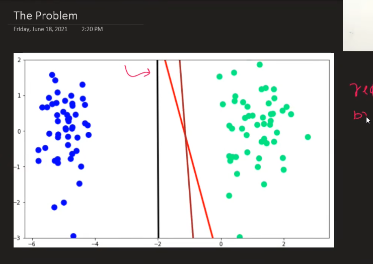

still we are not getting the best line 

--------

* this can't be perfect solution , everytime we are choosing the random points, there is no guarantedd that we will get the best solution we are just getting the solution
* ML say first find the loss function and then find its minimum

-------------

Maximum Likelihood


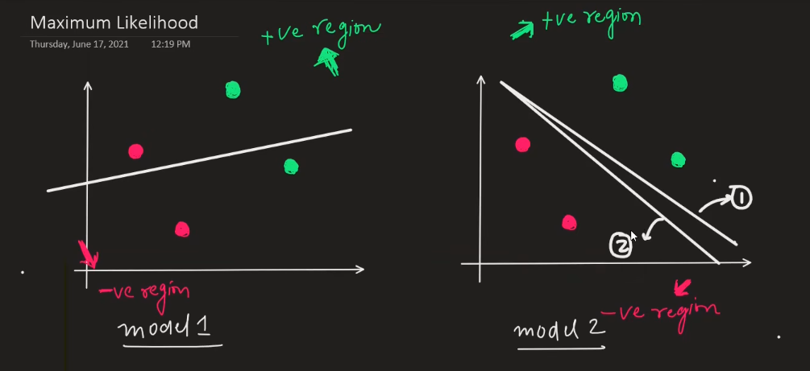

which model is better??

* we will use the concept of maximum likelihood
* 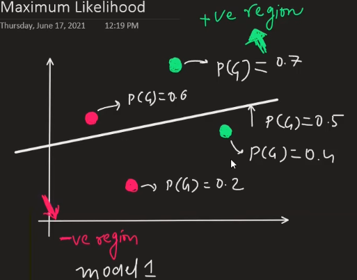
* above the line green probability is greater than 0.5 and its less than 0.5 below the line 

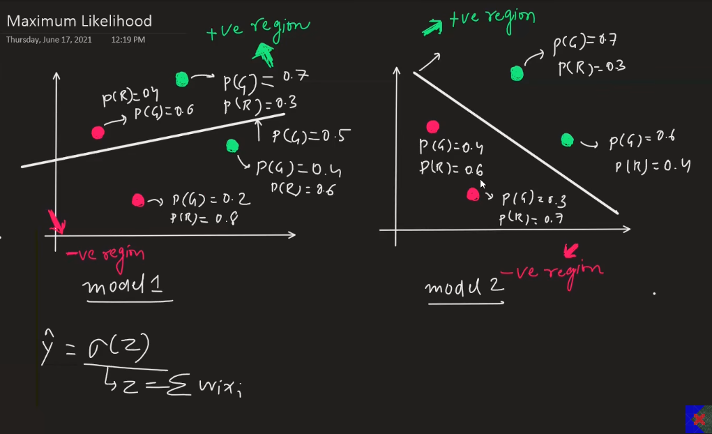
* for both model to calculate maximumlikelihood
* take only probability that color that is , for example for green point take probability of being green 
* 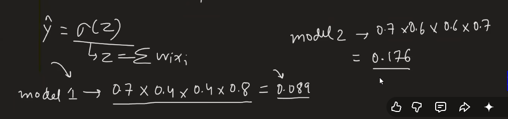
* seeing this we cna mathematically say that model 2 is better than model 1
* but the problem is that we need to find the product of small no.s 
* we replace the product with the summation 

* 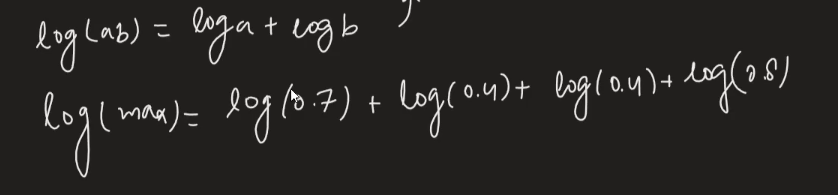
* but log of any number between 0 to 1 is also -ve hence we will get the -ve of each log , this thing is called cross entropy (-ve log of likelihood)
* 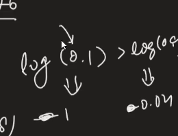
* cross entropy mai we need to minimize the cross entropy value 
* we cam't directly write probability of Yi^ because we take only the color of that dot , hence we need to transform formul a

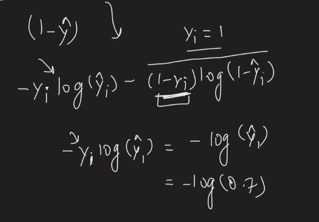
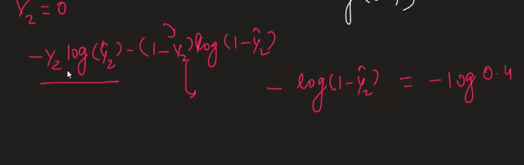
* 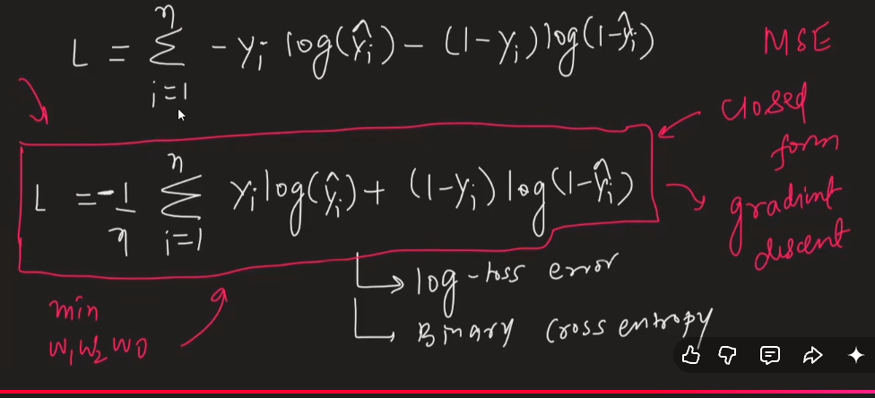

----------------------

### CampusX PDF notes - L73 Logistic Regression: From Maximum Likelihood to Binary Cross-Entropy (PDF pp. 1590-1605)

**1. The core question**
Logistic regression is a supervised algorithm that uses the **sigmoid** to map any real number to a probability between 0 and 1. The question of this lecture: **how do we prove mathematically that one decision boundary is better than another?** The answer is a **loss function**, here **binary cross-entropy**.

**2. Why the earlier tricks are not enough**

| approach | how it updates | problem | best solution guaranteed? |
|---|---|---|---|
| perceptron trick (step function) | only misclassified points move the line | output is only 0 or 1, no confidence, no probabilities | no |
| sigmoid trick | every randomly chosen point pushes or pulls the line | still random trial and error | no |
| **loss function minimisation** | mathematical optimisation | - | yes |

Without a mathematical measure we cannot claim that a solution is "best" (your note: "ML says: first find the loss function, then find its minimum").

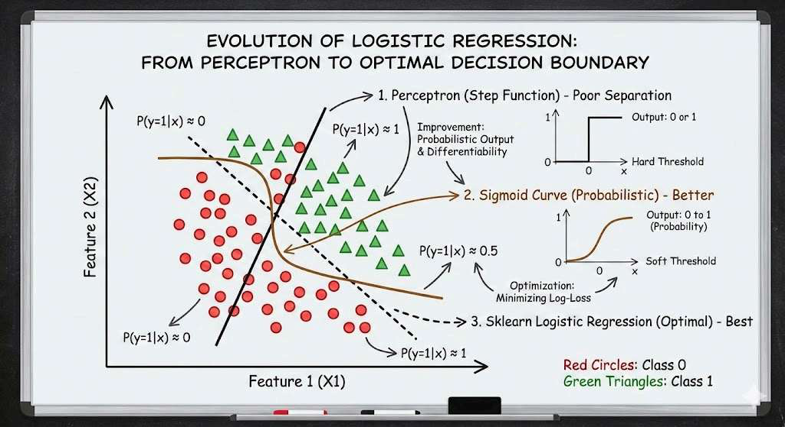

**3. Loss function**
A loss (cost / error) function is one number that says how wrong the predictions are. It lets us (1) quantify the error, (2) compare models (higher loss = worse) and (3) optimise the parameters. **MSE is not suitable for classification**: labels are 0 or 1, outputs are probabilities, MSE does not punish confident wrong predictions enough, and with a sigmoid it gives a non-convex surface.

**4. Maximum likelihood**
**Likelihood** = probability of the observed data given the model's parameters. **Principle: among all models choose the one that gives the highest likelihood to the data we actually saw.**

For every point take **the probability of its true class**: if `y = 1` (green) use `y_hat = P(green)`; if `y = 0` (red) use `1 - y_hat = P(red)`. Then **multiply** (the points are assumed independent). Here `y_hat_i = sigmoid(w . x_i + b)`.

| point | true class | Model 1: P(true class) | Model 2: P(true class) |
|---|---|---|---|
| 1 | green (1) | 0.7 | 0.7 |
| 2 | red (0) | 1 - 0.6 = 0.4 | 1 - 0.3 = 0.7 |
| 3 | green (1) | 0.5 | 0.6 |
| 4 | red (0) | 1 - 0.2 = 0.8 | 1 - 0.3 = 0.7 |
| **likelihood** | | **0.112** | **0.2058** |

Model 2 has the higher likelihood, so it is the better model. (The PDF also quotes "from the video" values 0.089 and 0.176; they come from different probabilities than the ones in this table. The conclusion is the same.)

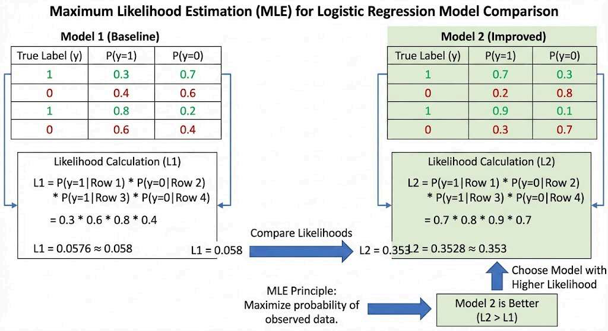

**5. Log-likelihood - replace the product by a sum**
With 10,000 points, multiplying numbers below 1 gives something like `10^-1000`: **numerical underflow**, impossible to compare, and unstable. Use `log(a * b) = log a + log b`:

`log L = sum_i log(p_i)`, where `p_i` is the probability of the true class of point `i`.

Example (natural log): `log(0.7) + log(0.4) + log(0.5) + log(0.8) = -0.357 - 0.916 - 0.693 - 0.223 = -2.189`.

Because `0 < p_i <= 1`, every log is zero or negative. The log is monotonic, so maximising `log L` picks the same model as maximising `L`.

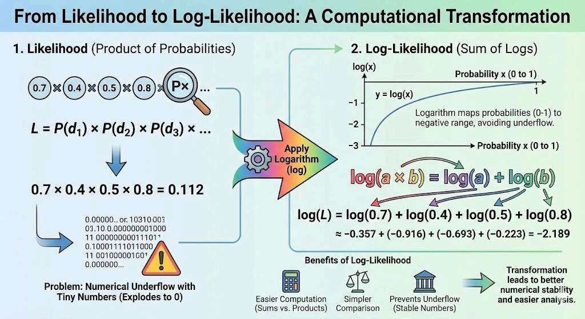

**6. Negative log-likelihood = cross-entropy**
Put a minus sign in front to get a positive number: **`cross-entropy = - sum log(p_correct)`**.

| quantity | goal |
|---|---|
| likelihood `L` | maximise |
| log-likelihood `log L` | maximise |
| negative log-likelihood `-log L` | **minimise** |

| probability of the true class | `-log(p)` | meaning |
|---|---|---|
| 0.9 | 0.105 | low loss (confident and correct) |
| 0.7 | 0.357 | moderate |
| 0.5 | 0.693 | unsure |
| 0.1 | 2.303 | very high loss (confident and wrong) |

**7. One formula for both classes**
We cannot write `-log(y_hat)` for every point, because for a red point we need `-log(1 - y_hat)` (your note: "we can't directly write the probability as `y_hat`"). This expression picks the correct term by itself:

**`loss_i = - y_i log(y_hat_i) - (1 - y_i) log(1 - y_hat_i)`**

| `y_i` | first term | second term | total |
|---|---|---|---|
| 1 | `-log(y_hat)` | 0 | `-log(y_hat)` |
| 0 | 0 | `-log(1 - y_hat)` | `-log(1 - y_hat)` |

**Binary cross-entropy (log loss), averaged over `n` points:**

**`J(w, b) = -(1/n) sum_{i=1}^{n} [ y_i log(y_hat_i) + (1 - y_i) log(1 - y_hat_i) ]`**, with `y_hat_i = sigmoid(w . x_i + b)`.

Check on Model 1: `0.357 + 0.916 + 0.693 + 0.223 = 2.189`, the same as `-log(0.112)`.

**8. Why binary cross-entropy**
* derived from probability theory (maximum likelihood);
* differentiable, so gradient descent can be used;
* punishes confident wrong predictions heavily;
* convex in the weights, so gradient descent has no bad local minima;
* uses logs, so no underflow.

**Binary cross-entropy = negative log-likelihood = log loss** (three names for one loss, up to the `1/n` average).

**Common mistakes:** using MSE for classification; calling `log(0)` (clip predictions to `[eps, 1 - eps]`); mixing up "maximise likelihood" with "minimise cross-entropy".

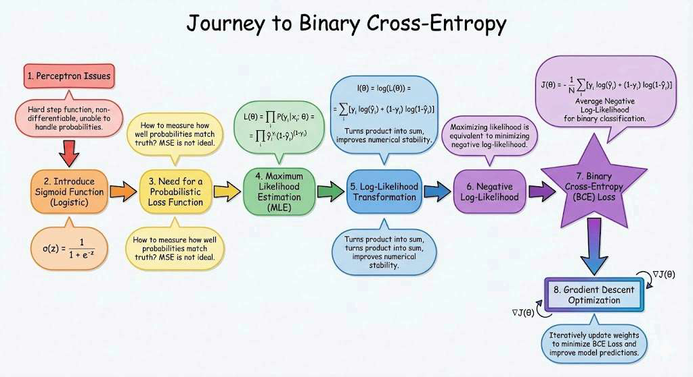

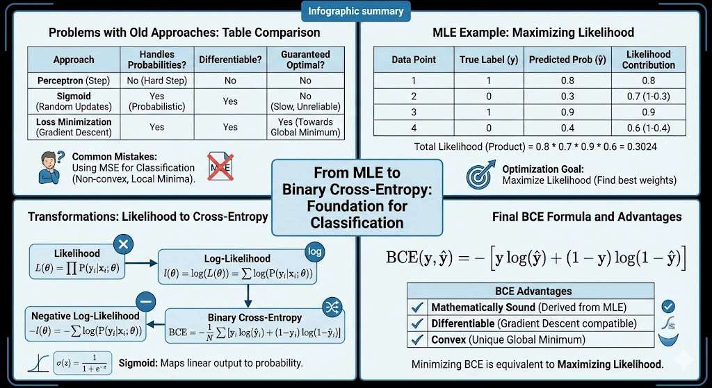

### Code - L73 likelihood and log loss (a small check of the numbers above; the repo has no notebook for this lecture)

```python
import numpy as np

y = np.array([1, 0, 1, 0])                    # true labels: green, red, green, red
model1 = np.array([0.7, 0.6, 0.5, 0.2])       # y_hat = P(green) from model 1
model2 = np.array([0.7, 0.3, 0.6, 0.3])       # y_hat = P(green) from model 2

for name, y_hat in [('model 1', model1), ('model 2', model2)]:
    p_true = np.where(y == 1, y_hat, 1 - y_hat)     # probability given to the TRUE class
    likelihood = np.prod(p_true)                    # product
    y_clip = np.clip(y_hat, 1e-15, 1 - 1e-15)       # never take log(0)
    bce = -np.mean(y * np.log(y_clip) + (1 - y) * np.log(1 - y_clip))
    print(name, round(likelihood, 4), round(np.log(likelihood), 3), round(bce, 4))
# model 1 0.112 -2.189 0.5473
# model 2 0.2058 -1.581 0.3952
```

(`np.where(cond, a, b)` picks `a` where the condition holds, else `b`; `np.prod` multiplies all elements; `np.clip` limits values to a range; `np.log` is the natural logarithm. sklearn's `log_loss(y, y_hat)` returns the same averaged value.)

## L74 Derivative of Sigmoid function 


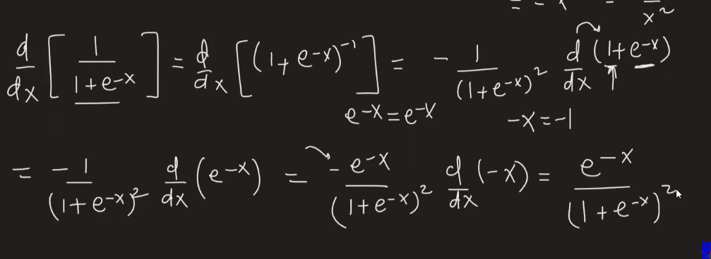

* continuing
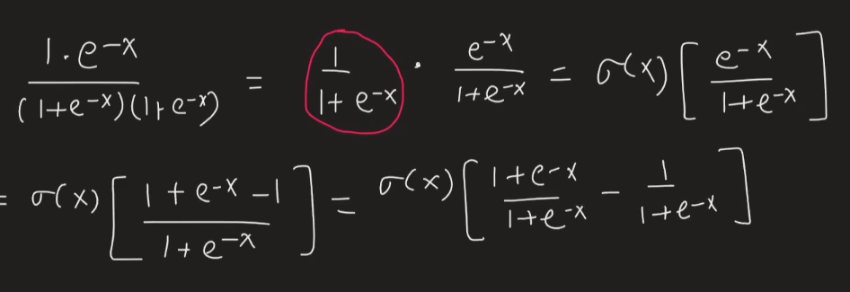
* 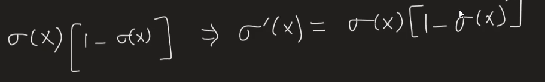
* sigmoid comes in its own derivative
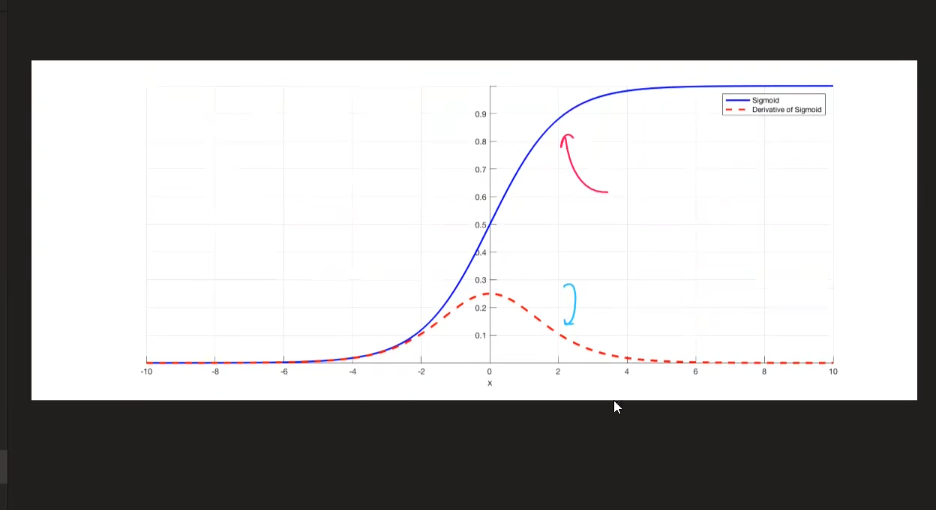

------------

### CampusX PDF notes - L74 Derivative of the Sigmoid Function (PDF pp. 1606-1618)

**1. Why we need it**
The sigmoid (logistic) function is the base of logistic regression and a classic activation function in neural networks. Its derivative is needed to compute gradients (gradient descent now, backpropagation later).

**2. The function and its properties**

`sigmoid(x) = 1 / (1 + e^-x)` - also written `e^x / (e^x + 1)` or `(1 + e^-x)^-1` (the power form is the handiest for the chain rule).

| property | value |
|---|---|
| domain | all real numbers |
| range | (0, 1), never exactly 0 or 1 |
| `sigmoid(0)` | 0.5 |
| symmetry | `sigmoid(-x) = 1 - sigmoid(x)` |
| monotonic | strictly increasing |
| asymptotes | `y = 0` on the left, `y = 1` on the right |

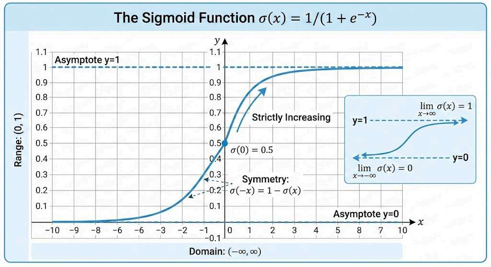

**3. Calculus rules used**
* quotient rule: `(u/v)' = (u' v - u v') / v^2`
* chain rule: `g(h(x))' = g'(h(x)) h'(x)`
* power rule with chain: `(g^n)' = n g^(n-1) g'`
* exponential: `(e^u)' = e^u u'`

**4. Derivation (goal: sigmoid' = sigmoid x (1 - sigmoid))**

*Method 1, quotient rule* with `u = 1`, `v = 1 + e^-x`, so `u' = 0`, `v' = -e^-x`:

`sigmoid'(x) = [0 (1 + e^-x) - 1 (-e^-x)] / (1 + e^-x)^2 = e^-x / (1 + e^-x)^2`

*Method 2, chain rule* on `(1 + e^-x)^-1`:

`sigmoid'(x) = (-1)(1 + e^-x)^-2 (-e^-x) = e^-x / (1 + e^-x)^2`

*Final simplification* (your note: "sigmoid comes in its own derivative"):

`e^-x / (1 + e^-x)^2 = [1 / (1 + e^-x)] * [e^-x / (1 + e^-x)]`

The second factor is `(1 + e^-x - 1) / (1 + e^-x) = 1 - 1/(1 + e^-x) = 1 - sigmoid(x)`. Therefore

**`sigmoid'(x) = sigmoid(x) * (1 - sigmoid(x))`**

(the same factor also equals `sigmoid(-x)`, so `sigmoid'(x) = sigmoid(x) sigmoid(-x)`).

**5. Numbers to check it**

| x | sigmoid(x) | 1 - sigmoid(x) | derivative |
|---|---|---|---|
| -10 | 0.0000454 | 0.9999546 | 0.0000454 |
| -2 | 0.1192 | 0.8808 | 0.1050 |
| -1 | 0.2689 | 0.7311 | 0.1966 |
| 0 | 0.5 | 0.5 | **0.25** (maximum) |
| 1 | 0.7311 | 0.2689 | 0.1966 |
| 2 | 0.8808 | 0.1192 | 0.1050 |
| 10 | 0.9999546 | 0.0000454 | 0.0000454 |

**6. Shape of the derivative**
It is a **bell shape**, not another S-curve: one factor rises from 0 to 1 while the other falls from 1 to 0, and the product is largest when they are equal, at `x = 0` (`0.5 * 0.5 = 0.25`). It is always positive, it is an even function (`sigmoid'(-x) = sigmoid'(x)`), and it goes to 0 for large `|x|`. The second derivative is `sigmoid (1 - sigmoid)(1 - 2 sigmoid)`.

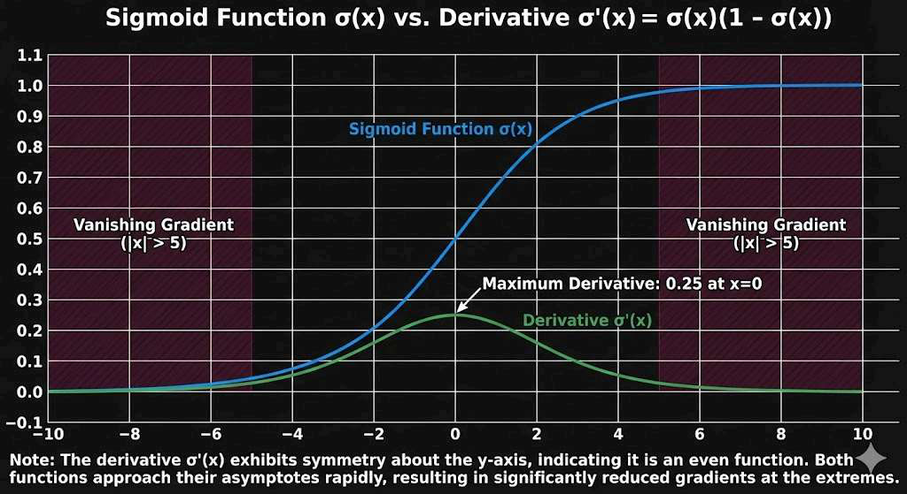

**7. Why this form matters**
* **Cheap:** the forward pass already computes `a = sigmoid(z)`; the derivative is just `a * (1 - a)` (one subtraction and one multiplication, no new exponential).
* **Vanishing gradient:** for large `|z|` the derivative is almost 0, so weights barely update and deep networks learn slowly. This is why hidden layers today usually use ReLU and similar functions.

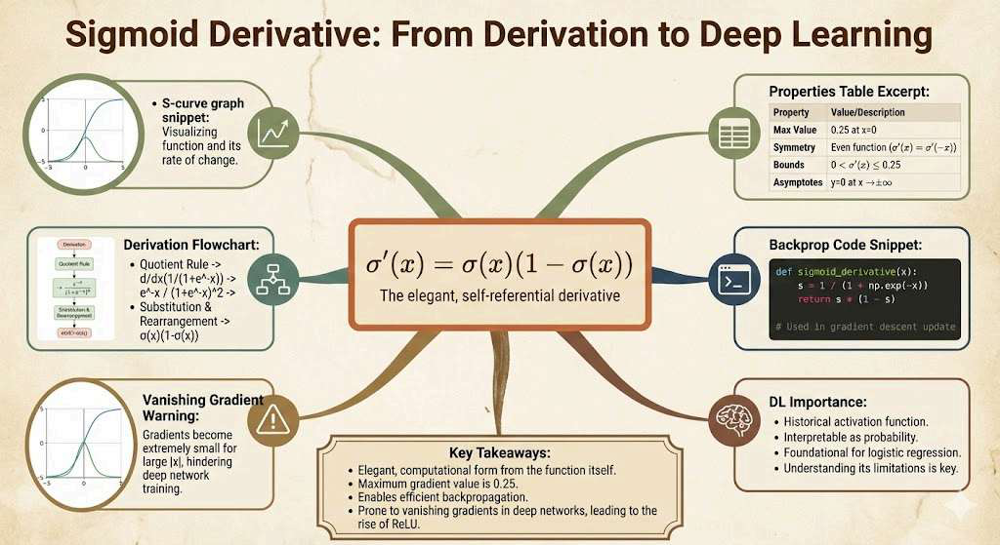

### Code - L74 sigmoid derivative with a numerical check (the repo has no notebook for this lecture)

```python
import numpy as np

def sigmoid(x):
    return 1 / (1 + np.exp(-x))

def sigmoid_derivative(x):
    s = sigmoid(x)
    return s * (1 - s)                 # reuse the sigmoid value

x = np.array([-2.0, 0.0, 2.0])
h = 1e-5
numerical = (sigmoid(x + h) - sigmoid(x - h)) / (2 * h)   # slope measured directly

print(np.round(sigmoid_derivative(x), 4))   # [0.105 0.25  0.105]
print(np.round(numerical, 4))               # [0.105 0.25  0.105]  -> the formula is right
```

## L75 Logistic Regression Part 5 | GD and code from scratch

* Y^ is the output value
* n input column n+1 coeff
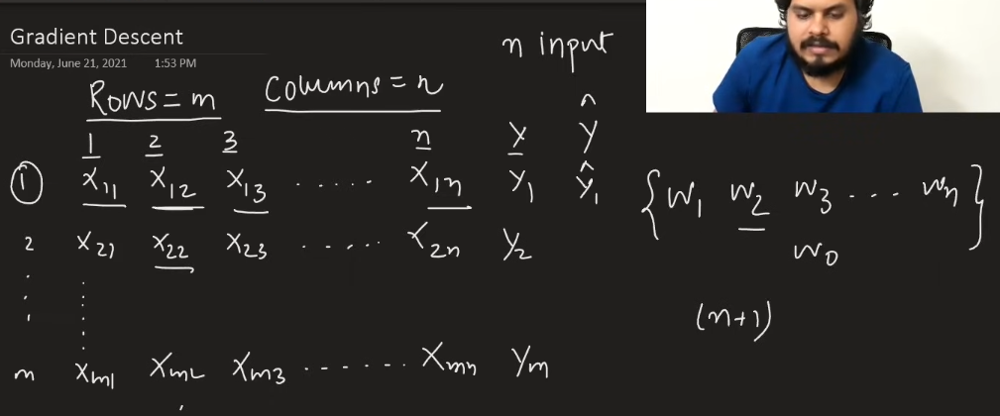
* 1st row output 
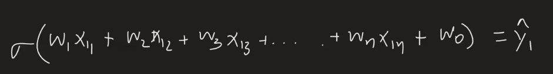
* Y^ consist of matrix of all the predicted otuput 
* 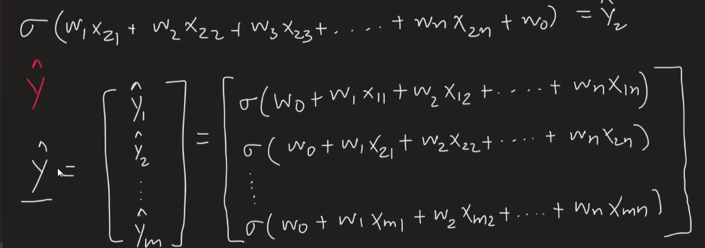

* expresses in dot product of two matrix
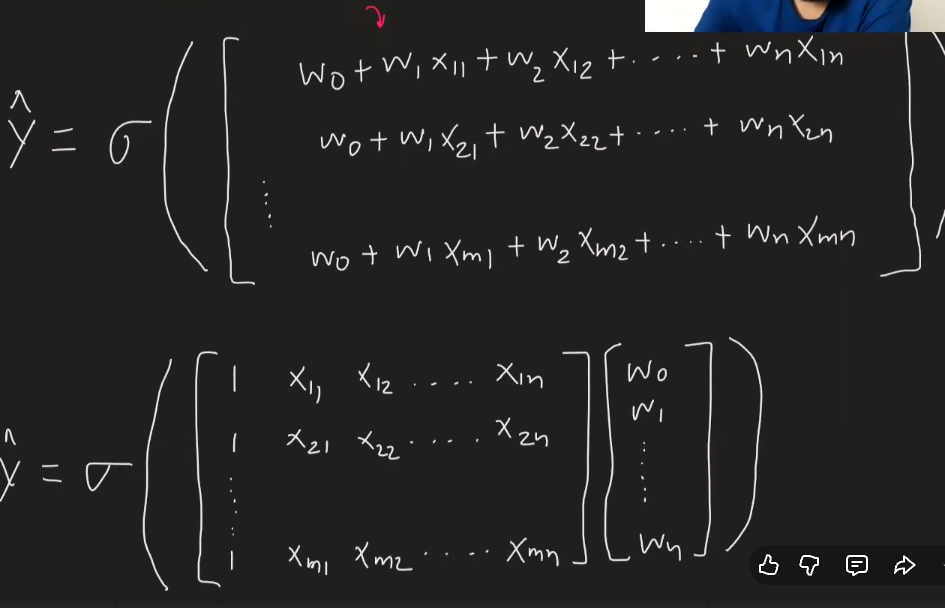
* input column and weights
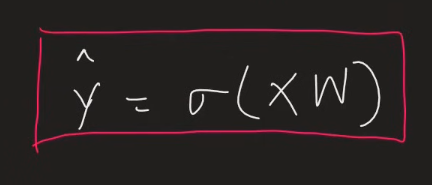

--------

Now we will write the loss fucntion in the matrix form 
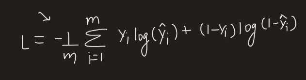
* 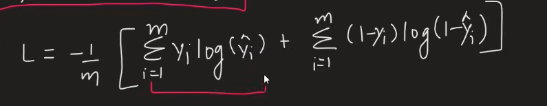

LEts convert the first part into the matrix form 

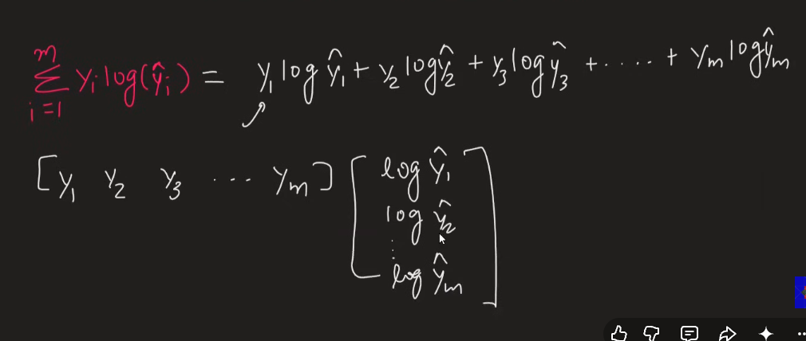

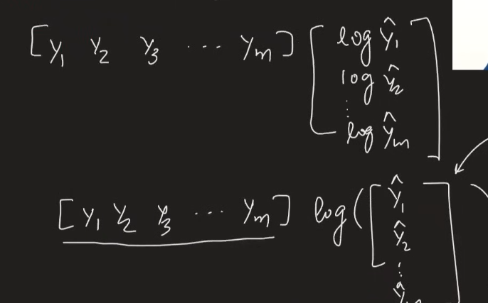
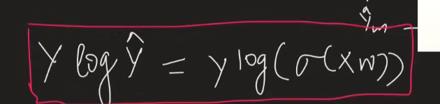

* complete loss gunction in matrix form 
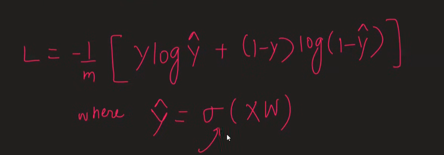
----------
no closed form solution exist for this loss funciton , jhence we wil use GD

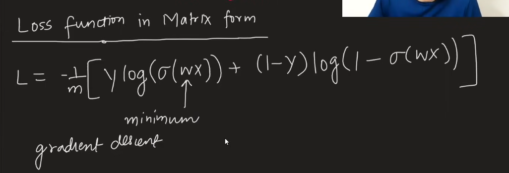
* W matrix initialised

and update using 
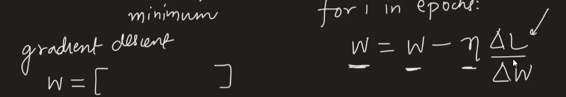
* 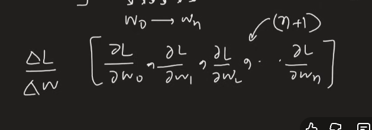
* how will we get gradient matrix

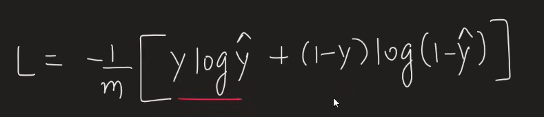

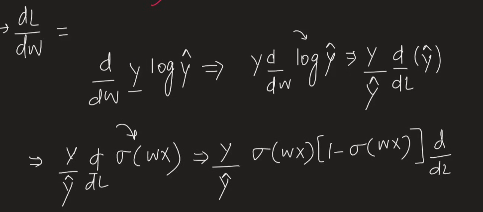
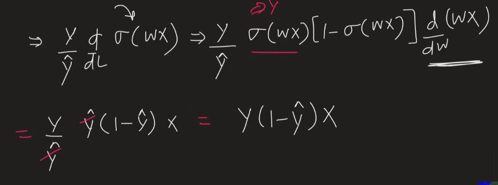


------

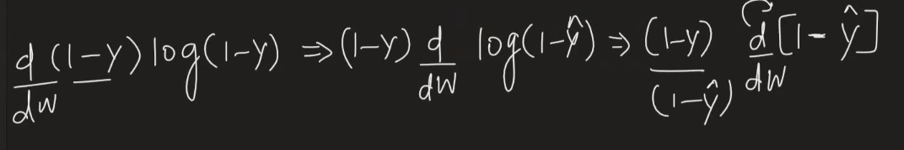

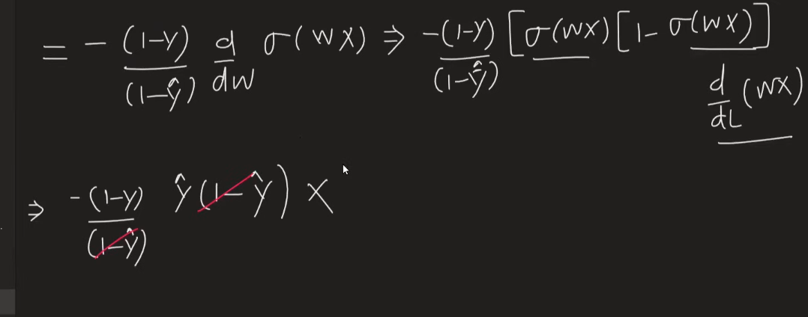

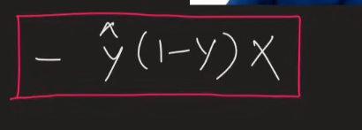

combinign both 

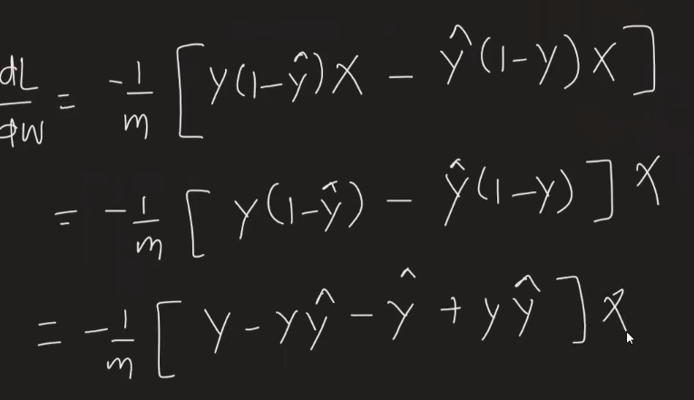

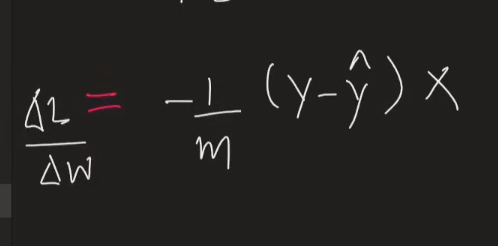
* GD update happend like this
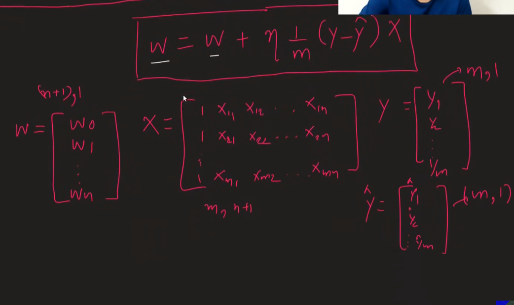

--------

<!-- include code here -->

### Official code - L75 Logistic Regression with gradient descent (repo: `day58-logistic-regression/gradient-descent.ipynb`)

**Block 1 - data: two well separated classes**

```python
from sklearn.datasets import make_classification
import numpy as np
import matplotlib.pyplot as plt

# 100 rows, 2 features, 2 classes; class_sep=20 keeps the two groups far apart
X, y = make_classification(n_samples=100, n_features=2, n_informative=1, n_redundant=0,
                           n_classes=2, n_clusters_per_class=1, random_state=41,
                           hypercube=False, class_sep=20)

plt.figure(figsize=(10, 6))
plt.scatter(X[:, 0], X[:, 1], c=y, cmap='winter', s=100)
```

**Block 2 - reference line: scikit-learn without regularization**

```python
from sklearn.linear_model import LogisticRegression

# no penalty, so that it solves the same problem as our plain gradient descent
lor = LogisticRegression(penalty='none', solver='sag')     # newer sklearn: penalty=None
lor.fit(X, y)                                              # warns that max_iter was reached

print(lor.coef_)         # [[4.7808362  0.2062583]]
print(lor.intercept_)    # [5.7492783]

# w0 + w1*x1 + w2*x2 = 0  ->  x2 = m*x1 + b
m1 = -(lor.coef_[0][0] / lor.coef_[0][1])
b1 = -(lor.intercept_ / lor.coef_[0][1])

x_input = np.linspace(-3, 3, 100)
y_input = m1 * x_input + b1
```

**Block 3 - our batch gradient descent**

```python
def gd(X, y):
    X = np.insert(X, 0, 1, axis=1)        # add the column of 1s for w0  -> (100, 3)
    weights = np.ones(X.shape[1])         # start with all weights = 1
    lr = 0.5                              # learning rate

    for i in range(5000):                 # 5000 epochs (your screenshot uses 2500)
        y_hat = sigmoid(np.dot(X, weights))                                   # predict ALL rows
        weights = weights + lr * (np.dot((y - y_hat), X) / X.shape[0])        # one update per epoch

    return weights[1:], weights[0]        # coefficients, intercept

def sigmoid(z):
    return 1 / (1 + np.exp(-z))

coef_, intercept_ = gd(X, y)
```

**Block 4 - compare the two lines**

```python
m = -(coef_[0] / coef_[1])
b = -(intercept_ / coef_[1])

x_input1 = np.linspace(-3, 3, 100)
y_input1 = m * x_input1 + b

plt.figure(figsize=(10, 6))
plt.plot(x_input, y_input, color='red', linewidth=3)       # scikit-learn
plt.plot(x_input1, y_input1, color='black', linewidth=3)   # our gradient descent
plt.scatter(X[:, 0], X[:, 1], c=y, cmap='winter', s=100)
plt.ylim(-3, 2)
```

(Functions used: `np.insert(X, 0, 1, axis=1)` adds the bias column; `np.dot(X, weights)` computes `XW` for all rows at once; `np.dot((y - y_hat), X)` is `(Y - Y_hat) X`, the downhill direction for all weights at once. It is **batch** gradient descent because every update uses the whole dataset.)


we need to code it
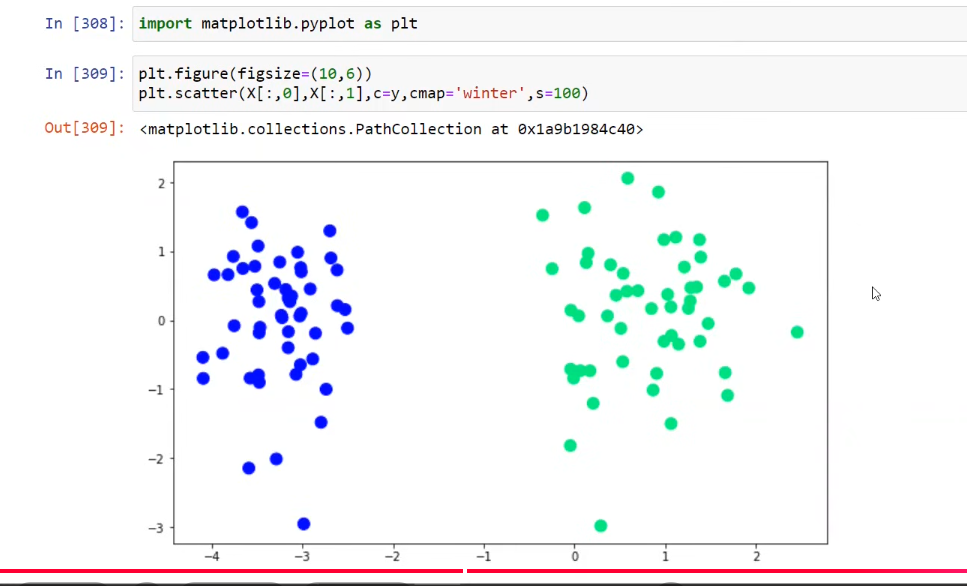

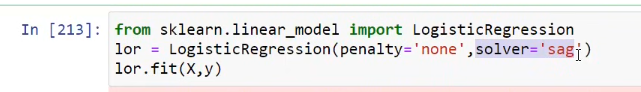

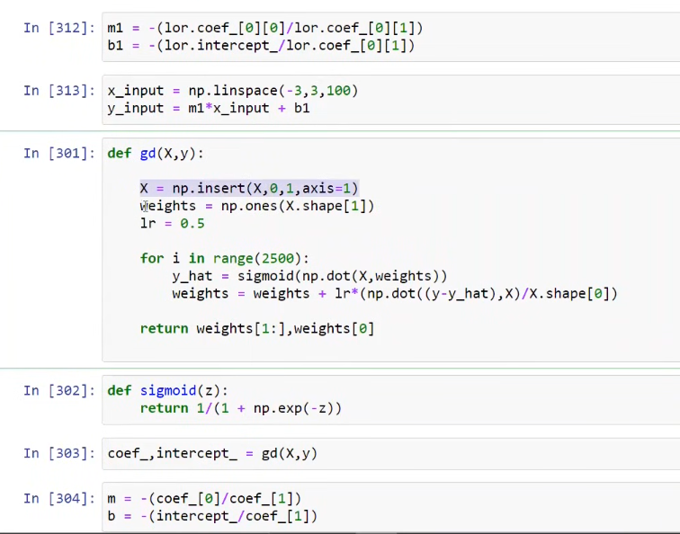

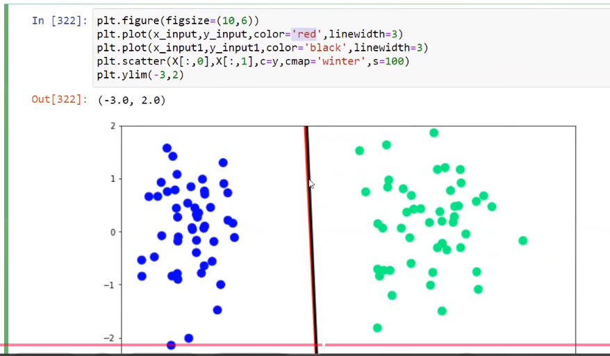

both are very close
* we used batch GD

--------------------------

### CampusX PDF notes - L75 Gradient Descent for Logistic Regression: Matrix Derivation (PDF pp. 1619-1637)

**1. Why gradient descent**
Binary cross-entropy has **no closed-form solution** (unlike linear regression's normal equation), so the weights are found iteratively.

**2. Data in matrix form**
`m` rows, `n` input columns, so `n + 1` coefficients (`w0` is the bias).

| symbol | content | shape |
|---|---|---|
| `X` | inputs with an extra first column of 1s | `(m, n+1)` |
| `Y` | true labels | `(m, 1)` |
| `W` | `[w0, w1, ..., wn]` | `(n+1, 1)` |
| `Y_hat` | predicted probabilities | `(m, 1)` |

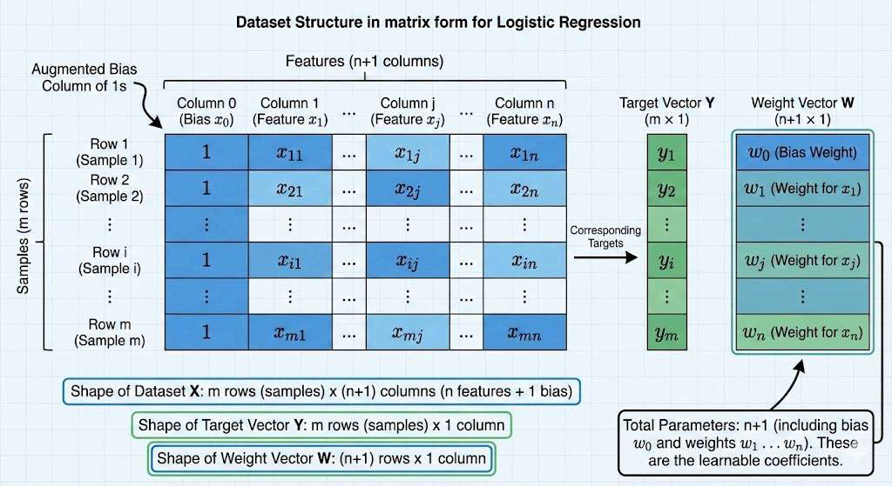

**3. Predictions**
One row: `z_i = w0 + w1 x_i1 + ... + wn x_in`, `y_hat_i = sigmoid(z_i)`. All rows at once:

**`Y_hat = sigmoid(X W)`**


(The figure draws one column of 1s too many: next to the bias column there should be only the features `x_i1 ... x_in`.)

**4. Loss in matrix form**
Scalar form: `L = -(1/m) sum [ y_i log(y_hat_i) + (1 - y_i) log(1 - y_hat_i) ]`. The sum `sum y_i log(y_hat_i)` is the dot product `Y^T log(Y_hat)`, so

**`L = -(1/m) [ Y^T log(Y_hat) + (1 - Y)^T log(1 - Y_hat) ]`**

(`log` and `1 - ...` act element by element).

**5. Gradient descent algorithm**
1. Initialise `W` (zeros, ones or random).
2. For each epoch: predict `Y_hat = sigmoid(XW)`, compute the gradient, update `W = W - eta * dL/dW`.
3. Return `W`.

The gradient is the vector of partial derivatives `[dL/dw0, dL/dw1, ..., dL/dwn]`.

**6. Deriving the gradient**
Needed: `d sigmoid(z)/dz = sigmoid(z)(1 - sigmoid(z))` (L74), so `dY_hat/dW = Y_hat (1 - Y_hat) X`.

* First term: `d/dW [Y log(Y_hat)] = (Y / Y_hat) Y_hat (1 - Y_hat) X = Y (1 - Y_hat) X`
* Second term: `d/dW [(1 - Y) log(1 - Y_hat)] = ((1 - Y) / (1 - Y_hat)) (-Y_hat (1 - Y_hat)) X = -(1 - Y) Y_hat X`
* Add them: `[Y (1 - Y_hat) - (1 - Y) Y_hat] X = (Y - Y_hat) X`, because the `Y Y_hat` terms cancel.

Including the leading `-(1/m)`:

**`dL/dW = -(1/m) X^T (Y - Y_hat)`**

**7. Update rule**
The two minus signs cancel:

**`W_new = W_old + (eta / m) * X^T (Y - Y_hat)`**

| factor | shape |
|---|---|
| `X^T` | `(n+1, m)` |
| `Y - Y_hat` | `(m, 1)` |
| product (the update) | `(n+1, 1)`, same as `W` |

Writing `(Y - Y_hat)^T X` gives the row version `(1, n+1)`; use the transpose form for a column `W`. In NumPy, with 1-D arrays, `np.dot(y - y_hat, X)` gives the same `n+1` numbers.

Compare with L72: the perceptron-style rule `W = W + eta (y_i - y_hat_i) x_i` is this rule for one random row. Here it is averaged over all rows (**batch** gradient descent) and now follows from a loss function.

**8. From scratch versus scikit-learn**
(Code: see "Official code - L75" above, at your `include code here` comment.)

| line of code | meaning |
|---|---|
| `X = np.insert(X, 0, 1, axis=1)` | add the bias column |
| `weights = np.ones(X.shape[1])` | initialise all weights to 1 |
| `y_hat = sigmoid(np.dot(X, weights))` | predictions |
| `np.dot(y - y_hat, X) / X.shape[0]` | the negative of the gradient |
| `weights = weights + lr * ...` | step downhill |

With `lr = 0.5` and 5000 epochs the two lines nearly coincide. On perfectly separable data like this the unpenalised loss keeps decreasing as the weights grow, so the exact numbers depend on when training stops (hence sklearn's `max_iter` warning); the boundaries are what you compare.

**Takeaways:** no closed form, so use gradient descent; the messy derivative collapses to `(Y - Y_hat) X`; vectorised matrix code handles large data efficiently; a learning rate that is too large can diverge, one that is too small is slow.

## L76 Accuracy and Confusion Matrix | Type 1 and Type 2 erros | Classification Metrics

Accuracy


* we have data of cgpa | iq | placement | 1000

* test data on both logistic regression(LOR) and decision tree both 

* how will we tell which model is better at prediction 
* accuracy score = no. of correct prediction / no. of total prediciton 


<!-- insert code here of this topic -->

### Official code - L76 accuracy score (repo: `day59-classification-metrics/classification-metrics-binary.ipynb`)

**Block 1 - load the heart disease data and split**

```python
import numpy as np
import pandas as pd
from sklearn.model_selection import train_test_split

df = pd.read_csv('/kaggle/input/heart-disease-uci/heart.csv')   # change to your local path of heart.csv
df.head()

# all columns except the last are inputs; the last column (target) is the output
X_train, X_test, y_train, y_test = train_test_split(df.iloc[:, 0:-1], df.iloc[:, -1],
                                                    test_size=0.2, random_state=2)
```

**Block 2 - train two models**

```python
from sklearn.linear_model import LogisticRegression
from sklearn.tree import DecisionTreeClassifier

clf1 = LogisticRegression()
clf2 = DecisionTreeClassifier()

clf1.fit(X_train, y_train)     # may warn "failed to converge": increase max_iter or scale the data
clf2.fit(X_train, y_train)

y_pred1 = clf1.predict(X_test)
y_pred2 = clf2.predict(X_test)
```

**Block 3 - accuracy of both models**

```python
from sklearn.metrics import accuracy_score, confusion_matrix

print("Accuracy of Logistic Regression", accuracy_score(y_test, y_pred1))   # 0.9016
print("Accuracy of Decision Trees", accuracy_score(y_test, y_pred2))        # 0.8361
```

(`accuracy_score(y_true, y_pred)` = correct predictions / all predictions. The decision tree has no `random_state`, so its score can change from run to run; your screenshots show both 0.8361 and 0.8197.)


first metric we will go after doing classification 
* what if more than one class (not binary classificaiton )


THis time we using flower dataset 


same logic is followed

------
How much accuracy is good???

it depends on the problem we are solving 
* chest accuracy on breast cancer -> with 99% 
* one patient can die out of 100 -> too less
* swiggy if we say this guy will order or not even 80% is good
* accuracy score 90% --> then it wont tell what type of your galti in 10%
* two type of mistake we can do in wrong prediciton 

* Student placement was done ->but our model told no placement
* student placement was not done -> but our model called the student placed

-----------

* hear disease hai --> model says nhi hai
* heart disease nhi hai --> model says hai


-----------

Confusion matrix


<!-- insert code here -->

### Official code - L76 confusion matrix, binary (same notebook)

**Block 4 - confusion matrix of both models**

```python
confusion_matrix(y_test, y_pred1)
# array([[26,  6],
#        [ 0, 29]])

print("Logistic Regression Confusion Matrix\n")
pd.DataFrame(confusion_matrix(y_test, y_pred1), columns=list(range(0, 2)))   # [[26, 6], [0, 29]]

print("Decision Tree Confusion Matrix\n")
pd.DataFrame(confusion_matrix(y_test, y_pred2), columns=list(range(0, 2)))   # [[24, 8], [2, 27]]
```

**Block 5 - look at individual predictions**

```python
result = pd.DataFrame()
result['Actual Label'] = y_test
result['Logistic Regression Prediction'] = y_pred1
result['Decision Tree Prediction'] = y_pred2
result.sample(10)                      # 10 random test rows side by side
```

**Careful: how to read sklearn's array**
`confusion_matrix` puts **actual on the rows and predicted on the columns, in label order 0, 1**:

| | predicted 0 | predicted 1 |
|---|---|---|
| **actual 0** | TN = 26 | FP = 6 |
| **actual 1** | FN = 0 | TP = 29 |

The slide below lists class **1 first**, so the numbers cannot be copied cell by cell from the array. For `y_pred1`, with `1 = heart disease`, sklearn's output means **TP = 29, TN = 26, FP = 6, FN = 0**, not TP = 26, FN = 6, FP = 0, TN = 29 as written on the slide and in the bullets below. The notebook's own scores confirm it: precision = 29 / (29 + 6) = 0.8286 and recall = 29 / (29 + 0) = 1.0. Accuracy is the same either way: (29 + 26) / 61 = 0.9016. To get the four numbers safely:

```python
tn, fp, fn, tp = confusion_matrix(y_test, y_pred1).ravel()    # 26, 6, 0, 29
accuracy = (tp + tn) / (tp + tn + fp + fn)                    # keep both brackets
```


------


prediction -> 1 : heart disease predicted by model 
              0 : no heart disease predicted by the model

Actual      -> 1: patient has heart disease
               0: patient does not have heart disease

**Remember the terms by prediction term first**
* TP: 26 patient were predicted as having heart disease and they actually did have heart disease
* TN: 29 patient were predicted as not having heart disease and they actually did NOT have any heart disease
* FN(false negative): 6 patient were predicted as not having heart disease but they actually HAD heart disease
* FP(false positive):0 patient were predicted as having heart disease but they did not had the heart disease

* confusion matrix will also tell us the nature of the matrix


accuracy = TP + TN / TP + TN + FP + FN

------------------
* False positive is Type 1 error (model predicted this patient as having the heart disease but he DID not had the heart disease)

------

Confusion matrixfor mutli classification 


<!-- show code for confusion matrix for multiclassficaiton  dataset -->

### Official code - L76 confusion matrix, multiclass iris (repo: `day59-classification-metrics/classification-metrics-multi-iris1.ipynb`)

**Block 1 - load iris and turn species names into 0, 1, 2**

```python
import numpy as np
import pandas as pd
from sklearn.preprocessing import LabelEncoder
from sklearn.model_selection import train_test_split

df = pd.read_csv('/kaggle/input/iris/Iris.csv')      # change to your local path

encoder = LabelEncoder()
df['Species'] = encoder.fit_transform(df['Species']) # setosa=0, versicolor=1, virginica=2

X_train, X_test, y_train, y_test = train_test_split(df.iloc[:, 0:-1], df.iloc[:, -1],
                                                    test_size=0.2, random_state=1)
```

**Block 2 - train, predict, accuracy**

```python
from sklearn.linear_model import LogisticRegression
from sklearn.tree import DecisionTreeClassifier
from sklearn.metrics import accuracy_score, confusion_matrix

clf1 = LogisticRegression()
clf2 = DecisionTreeClassifier()
clf1.fit(X_train, y_train)
clf2.fit(X_train, y_train)
y_pred1 = clf1.predict(X_test)
y_pred2 = clf2.predict(X_test)

print("Accuracy of Logistic Regression", accuracy_score(y_test, y_pred1))   # 1.0
print("Accuracy of Decision Trees", accuracy_score(y_test, y_pred2))        # 0.9667
```

**Block 3 - 3 x 3 confusion matrices**

```python
print("Logistic Regression Confusion Matrix\n")
pd.DataFrame(confusion_matrix(y_test, y_pred1), columns=list(range(0, 3)))
#     0   1  2
# 0  11   0  0
# 1   0  13  0
# 2   0   0  6

print("Decision Tree Confusion Matrix\n")
pd.DataFrame(confusion_matrix(y_test, y_pred2), columns=list(range(0, 3)))
#     0   1  2
# 0  11   0  0
# 1   0  12  1      <- one versicolor predicted as virginica
# 2   0   0  6
```

(Rows = actual class, columns = predicted class; the diagonal holds the correct predictions. **Note on the notebook:** `df.iloc[:, 0:-1]` keeps the `Id` column as a feature. The rows of this file are ordered by species, so `Id` gives the answer away (data leakage) and the scores look better than they should. Use `df.iloc[:, 1:-1]` to drop it.)


------

Accruacry fail on misleading dataset

* no. of passenger compare to terrorist is to high 
* 
* model does msitake only one time
* 
* accuracy so high and it is not relaible
* accuracy specially not reliable when we have highly unbalanced dataset 


---------

### CampusX PDF notes - L76 Classification Metrics: Accuracy Score and Confusion Matrix (PDF pp. 1638-1660)

**1. Why classification metrics**
Like MSE or R2 for regression, classification metrics let us (1) measure performance, (2) compare models, (3) see where a model fails and (4) decide whether to deploy it. The main ones: accuracy, confusion matrix, precision, recall, F1 and ROC-AUC.


**2. Accuracy**
**`accuracy = correct predictions / total predictions = (TP + TN) / (TP + TN + FP + FN)`**

Range 0 to 1, higher is better, simplest to understand, but it does not show the **type** of errors.

* Board example (10 students): logistic regression gets 8 of 10 right (80 percent), the decision tree 9 of 10 (90 percent), so the tree is better on this test set.
* **Multiclass** (iris: setosa 0, versicolor 1, virginica 2): exactly the same formula; 10 of 10 correct = 100 percent.


**3. How much accuracy is good?**
**It depends on the problem**: the domain, the cost of each kind of error, and what random guessing would score.

| problem | rough requirement | reason |
|---|---|---|
| self-driving car | above 99.99 percent | one wrong turn can cause an accident |
| cancer detection | above 99.9 percent | a single miss can cost a life |
| credit card fraud | above 99 percent | financial loss |
| spam detection | 95 to 99 percent | a few mistakes are tolerable |
| food delivery recommendation | 70 to 80 percent | a wrong guess costs very little |

(The numbers are illustrative.) **Interview tip:** never give one fixed number; say that it depends on the problem.


**4. What accuracy hides: two types of mistakes**
90 percent accuracy says there are 10 percent errors, not which kind:

| mistake | placement example | heart disease example |
|---|---|---|
| predicted 0, actually 1 | placed student predicted "not placed" | sick patient predicted healthy: goes untreated |
| predicted 1, actually 0 | unplaced student predicted "placed" | healthy patient predicted sick: worry and extra tests |


**5. Confusion matrix**
A table of **actual versus predicted** counts; it shows where the model gets "confused".

| | predicted 1 | predicted 0 |
|---|---|---|
| **actual 1** | TP | FN (Type 2 error) |
| **actual 0** | FP (Type 1 error) | TN |

**Naming trick** (your note: "remember the terms by the prediction term first"):
* **second word** (positive / negative) = what the **model predicted**;
* **first word** (true / false) = whether that prediction was **correct**.

| error | also called | meaning | memory aid |
|---|---|---|---|
| false positive | **Type 1** | predicted 1, actual 0 | false alarm |
| false negative | **Type 2** | predicted 0, actual 1 | missed detection |

| scenario | Type 1 (FP) | Type 2 (FN) |
|---|---|---|
| medical test | healthy person told "sick" | sick person told "healthy" |
| spam filter | real mail marked spam | spam reaches the inbox |
| court | innocent convicted | guilty acquitted |
| fire alarm | alarm without fire | fire without alarm |

From the matrix you can compute accuracy, but not the other way round. Error rate = `1 - accuracy`.


**Note on array order.** scikit-learn prints `[[TN, FP], [FN, TP]]` (class 0 first), the reverse of the table above. See "Careful: how to read sklearn's array" next to your confusion matrix comment. (The PDF also shows a second example `[[26, 0], [6, 22]]` with 54 test rows; it does not match the notebook run `[[26, 6], [0, 29]]` with 61 rows.)

**6. Multiclass confusion matrix**
For `N` classes the matrix is `N x N` (3 x 3 for iris, 10 x 10 for MNIST digits). The **diagonal** holds the correct predictions, everything else is a mistake.

Your board example:

| actual / predicted | 0 | 1 | 2 |
|---|---|---|---|
| **0** | 7 | 0 | 5 |
| **1** | 2 | 21 | 6 |
| **2** | 9 | 1 | 13 |

**`accuracy = sum of the diagonal / sum of all cells = (7 + 21 + 13) / 64 = 41/64`**, about 64 percent.


**7. Accuracy is misleading on imbalanced data**
An imbalanced dataset has one class far more common than the other. Airport example with 100,000 passengers and 1 terrorist, and a "model" that always says "not terrorist": `TP = 0, FN = 1, FP = 0, TN = 99,999`, so **accuracy = 99.999 percent**, yet it never catches anyone. The same happens in fraud detection (about 99.9 : 0.1), disease diagnosis (99 : 1) and manufacturing defects (99.5 : 0.5). Use precision, recall, F1 and ROC-AUC instead.


## L77 Precision, Recall and F1 Score | Classificaiton metrix Part 2

PRecision

* you are manager an you gave task to two of your junior to make a system to predict spam email or not , and the best one will be used in our application 


both model have same accuracy 

* onyl difference is FP 
* FP a > FP b
* FN a < FN b

* FP ( predicted as positive(spam) by our model, but it was not spam)
* FN ( predicted as NOT spam by our model, but it was a spam)

-------

Here FP is more dangerous 

What proportion of predicted positive is truly positive??


hence we choose the model B , since it has higher precision


* Precision = TP / TP + FP 

-------------------


Recall 


Accuracy is again same in both model A and B

* here we have different usecase
* once again lets define the FP and FN according to our example
* FP : the model predicted that patient has cancer, but in reality patient did not had the cancer
* FN : the model predicted as not having cancer, but in reality patient had the cancer

in this usecase the better model is the one, which gives FN less no. of times, hence model A is better


hence we choose model A

---------

if the model is making high Type 2 error then you will be using high Recall model

---------------------

IN some case you may not be able to figure out which error is dangerous Type 1 or Type 2

* cat predicted as dog
* dog predicted as cat

F1 score: Harmonic mean of Precision and Recall 


* F1 score will also remain closer to the lower value


* Harmonic value penalized precision value, says since you are low , i F1 score is also low

<!-- add code here -->

### Official code - L77 precision, recall, F1 for binary data (repo: `day59-classification-metrics/classification-metrics-binary.ipynb`)

(Continues the L76 heart disease code: it needs `pd`, `y_test`, `y_pred1`, `y_pred2`.)

**Block 1 - logistic regression**

```python
from sklearn.metrics import recall_score, precision_score, f1_score, confusion_matrix

print("For Logistic regression Model")
print("-" * 50)
cdf = pd.DataFrame(confusion_matrix(y_test, y_pred1), columns=list(range(0, 2)))
print(cdf)
print("-" * 50)
print("Precision - ", precision_score(y_test, y_pred1))   # 0.8286
print("Recall - ", recall_score(y_test, y_pred1))         # 1.0
print("F1 score - ", f1_score(y_test, y_pred1))           # 0.9063
```

**Block 2 - decision tree**

```python
print("For DT Model")
print("-" * 50)
cdf = pd.DataFrame(confusion_matrix(y_test, y_pred2), columns=list(range(0, 2)))
print(cdf)
print("-" * 50)
print("Precision - ", precision_score(y_test, y_pred2))   # 0.7714
print("Recall - ", recall_score(y_test, y_pred2))         # 0.9310
print("F1 score - ", f1_score(y_test, y_pred2))           # 0.8437
```

**Block 3 - the score of each class separately**

```python
precision_score(y_test, y_pred1, average=None)   # array([1.    , 0.8286])  -> [class 0, class 1]
precision_score(y_test, y_pred2, average=None)   # array([0.9231, 0.7714])
recall_score(y_test, y_pred2, average=None)      # array([0.75  , 0.9310])
```

(By default these functions report the **positive class, 1**. `average=None` returns one value per class. Your screenshot of the decision tree shows slightly different numbers because the tree is random without `random_state`.)


-------------------

Multi Class precision and Recall how to calculate

Binary (2 class) | Multi (3 or more)

* in binary focus in on more positive (1)

-----------
Behind the scene we also calculate the precision for both +ve and -ve class, in binary class prediction , we may thought we focus on +ve classification metric but that not true specially in mutli classification


* Precision of Dog class = 25 / 25 + 0 + 4
* precision of cat class = 30 (kitne actually cat hai) / 5 + 30 + 10 (how many wer predicted as cat)


* combined precision  -> Macro precision 
* weighted precision -> multiplied with class weight 

------

Now lets calculate for the recall


---------
<!-- code mnist - classification metric multi -->

### Official code - L77 multiclass metrics on MNIST (repo: `day59-classification-metrics/classification-metrics-multi-mnist1.ipynb`)

**Block 1 - load the digits and split**

```python
import numpy as np
import pandas as pd
from sklearn.model_selection import train_test_split

df = pd.read_csv('/kaggle/input/digit-recognizer/train.csv')   # label + 784 pixel columns
df.head()

X_train, X_test, y_train, y_test = train_test_split(df.iloc[:, 1:], df.iloc[:, 0],
                                                    test_size=0.2, random_state=2)
```

**Block 2 - train both models and check accuracy**

```python
from sklearn.linear_model import LogisticRegression
from sklearn.tree import DecisionTreeClassifier
from sklearn.metrics import accuracy_score, confusion_matrix

clf1 = LogisticRegression()
clf2 = DecisionTreeClassifier()
clf1.fit(X_train, y_train)        # convergence warning: pixels are unscaled
clf2.fit(X_train, y_train)
y_pred1 = clf1.predict(X_test)
y_pred2 = clf2.predict(X_test)

print("Accuracy of Logistic Regression", accuracy_score(y_test, y_pred1))   # 0.9145
print("Accuracy of Decision Trees", accuracy_score(y_test, y_pred2))        # 0.8518
```

**Block 3 - 10 x 10 confusion matrices**

```python
print("Logistic Regression Confusion Matrix\n")
pd.DataFrame(confusion_matrix(y_test, y_pred1), columns=list(range(0, 10)))

print("Decision Tree Confusion Matrix\n")
pd.DataFrame(confusion_matrix(y_test, y_pred2), columns=list(range(0, 10)))
```

**Block 4 - precision, recall, F1 for 10 classes**

```python
from sklearn.metrics import precision_score, recall_score, f1_score

precision_score(y_test, y_pred1, average=None)         # 10 values, one per digit
precision_score(y_test, y_pred1, average='macro')      # plain mean of the 10 values
precision_score(y_test, y_pred1, average='weighted')   # 0.9142  mean weighted by class count
recall_score(y_test, y_pred1, average='weighted')      # 0.9145  (always equals accuracy)
f1_score(y_test, y_pred1, average='weighted')          # 0.9143
```

**Block 5 - everything in one table**

```python
from sklearn.metrics import classification_report
print(classification_report(y_test, y_pred1))   # precision, recall, f1, support per digit + macro/weighted avg
```

(`average=None` is in your screenshot and `average='macro'` is the macro precision from your board; the saved notebook runs the `'weighted'` versions and the report.)


### CampusX PDF notes - L77 Precision, Recall and F1 Score (PDF pp. 1661-1677)

**1. Start: accuracy on imbalanced data**
1000 people, 1 terrorist; "nobody is a terrorist" gives `TN = 999, FN = 1`, so **99.9 percent accuracy** and a useless model.


**2. Precision**
*Of everything predicted positive, how much really is positive?*

**`precision = TP / (TP + FP)`**

Use it when **false positives are more dangerous**. Spam filter: a job offer sent to the spam folder (FP) hurts more than one spam mail in the inbox (FN).

| spam filter | TP | FN | FP | TN | precision | accuracy |
|---|---|---|---|---|---|---|
| model A | 100 | 0 | **20** | 880 | 100 / 120 = **83.3 percent** | 98 percent |
| model B | 100 | 0 | **80** | 820 | 100 / 180 = 55.6 percent | 92 percent |

**Choose model A** in this example: fewer false positives. (The PDF says both models have the "same accuracy" but its own numbers give 98 and 92 percent. Your lecture example has equal accuracy and there model B has the higher precision; the rule is the same: pick the higher precision.)


**3. Recall (sensitivity, true positive rate)**
*Of all the actual positives, how many did we find?*

**`recall = TP / (TP + FN)`**

Use it when **false negatives are more dangerous** (your note: "high Type 2 error -> high recall model"). Cancer detection, 10,000 patients:

| model | TP | FN | FP | TN | accuracy | recall |
|---|---|---|---|---|---|---|
| A | 1000 | **200** | 800 | 8000 | 90 percent | 1000 / 1200 = **83.3 percent** |
| B | 1000 | **500** | 500 | 8000 | 90 percent | 1000 / 1500 = 66.7 percent |

**Choose model A**: it misses far fewer cancer patients, even though it raises more false alarms.


**4. F1 score**
When neither error is clearly worse (cat predicted as dog or dog as cat), use both. Raising precision usually lowers recall and the other way round.

**`F1 = 2 P R / (P + R)`**, the **harmonic mean**.

| model | precision | recall | arithmetic mean | F1 |
|---|---|---|---|---|
| A | 80 | 80 | 80 | **80** |
| B | 60 | 100 | 80 | **75** |

The arithmetic mean cannot separate them; the harmonic mean **stays close to the lower value** and penalises model B for its low precision.


**5. Multiclass precision and recall**
Compute the metric **for every class**, then combine. PDF example (rows = actual, columns = predicted):

| actual / predicted | dog | cat | rabbit | total |
|---|---|---|---|---|
| dog | 25 | 5 | 10 | 40 |
| cat | 0 | 30 | 4 | 34 |
| rabbit | 4 | 10 | 20 | 34 |
| total | 29 | 45 | 34 | 108 |

| class | precision (diagonal / **column** total) | recall (diagonal / **row** total) |
|---|---|---|
| dog | 25 / 29 = 0.86 | 25 / 40 = 0.625 |
| cat | 30 / 45 = 0.67 | 30 / 34 = 0.88 |
| rabbit | 20 / 34 = 0.59 | 20 / 34 = 0.59 |

| average | formula | precision here | use when |
|---|---|---|---|
| **macro** | plain mean of the class values | about 0.71 | every class matters equally |
| **weighted** | mean weighted by actual class counts (40, 34, 34) | about 0.71 | you want class sizes reflected (imbalanced data) |
| **micro** | computed from the pooled TP, FP, FN | equals accuracy (75 / 108 = 0.69) | single-label problems where each row counts equally |
| `None` | no averaging | one value per class | inspecting each class |

Note that a weighted average lets large classes dominate; if rare classes matter, look at **macro** or the per-class values. F1 works the same way: compute it per class, then average.

**6. classification_report**
One call prints precision, recall, F1 and **support** (number of actual rows) for every class, plus accuracy, macro average and weighted average.

**7. Which metric?**

| situation | metric |
|---|---|
| balanced classes, errors cost the same | accuracy |
| false positives costly | precision |
| false negatives costly | recall |
| need a balance, or unsure which error is worse | F1 |
| more than two classes | per-class values, then macro or weighted |


## L78 ROC curve in ML 

Why ROC Curve???
* threshold selection is the main reason we use ROC curve
* supervised ML problem 
* Regression -> iq | cgpa | lpa
* classificaiton -> iq | cgpa | placed
* ROC special;y related to the Binary classification

------

Threshold selection 
* one model is trained then we see its performance on testing stage
* 
* they always give probability -> 0-1  a number
* our role as datascientist is to convert prob to prediction 

* always this 0.5 threshold is not always true
* example
email spam classification 
* goal to predict new email -> is spam or not 

Binary classification problem we can make two mistakes 

* A : SPAM
* P : not spam 

* A -> not spam 
  P -> spam 

this is very big mistake , to prevent this we will do what is increase the threshold , maybe 0.75 then only spam , because of this threshold we are able to reduce particualrly error
* here ROC curve is used

-------------------

Confusion matrix 

* report card : or binary classification 


* Two type of mistake 
* FP (prediction placement hua, but actually nhi hua)
* FN (orediction placement nahi hua, but actually hua tha)

* we did mistake in 20 

----------------

True postive Rate (TPR) : benefits

TPR = TP / TP + FN
(it means out kitn spam email ko hm actually spam mai classify kr paaye)

* ex: email spam classifier
* 1 -> spam 
* 0 -> not spam


* out of 100 spam email we were only able to identify 80 email as spam
* Churn rate prediciton -> Netflix 
1-> leave platform
0 -> not leave


* only able to predict the 80 % which we going to leave | TPR more better it is 
* it will be 100% when FN will be 0 
* 100 spam we predict all as spam
----------------

False Positive Rate (FPR)


TPR benefir

FPR tells cost
* you identify 10 people as leaving the platform then you must give them some dicount , but they where normal people 
* ideally TPR - 100 % 
* FPR - 0%


-------

ROC curve

TPR , FPR -> graph plot between TPR and FPR


---------

Different cases 

* graph between benefit(y) and cost(x)
* two case : threshold very small = 0.1 
* threshold case very large = 0.99


* increase threshold : FPR and TPR dono increases
* TPR and FPR dont have linear relationship !!!


--------


threshold decreased to 09 -> 0.8 now TPR will increase , since we are classi, 
but in FPR we wont have much change comparatively 

* Now lets see from the opposite end where we choose the lowest threshold 
* will increase threshold by little 0.1 -> 0.2 | automatically the FP decreases , because now you classify less email as spam 
* but TPR rate is still comparatively low

* we pick point closest to the 1 

------------


<!-- code here -->

### Code - L78 ROC curve (PDF pp. 2690-2692 and your screenshots; the official repo has no ROC notebook)

**Block 1 - load the diabetes data and split**

```python
import pandas as pd
from sklearn.model_selection import train_test_split

data = pd.read_csv('diabetes.csv')        # Pima diabetes data; use your local path
X = data.drop('Outcome', axis=1)          # 8 inputs: Glucose, BMI, Age, ...
y = data['Outcome']                       # 0 = no diabetes, 1 = diabetes

X_train, X_test, y_train, y_test = train_test_split(X, y, test_size=0.2, random_state=2)
```

**Block 2 - train the model and get probability scores**

```python
from sklearn.linear_model import LogisticRegression

model = LogisticRegression(max_iter=1000)
model.fit(X_train, y_train)

y_scores = model.predict_proba(X_test)[:, 1]    # probability of class 1, NOT the 0/1 prediction
```

**Block 3 - TPR and FPR at every threshold**

```python
from sklearn.metrics import roc_curve

fpr, tpr, thresholds = roc_curve(y_test, y_scores)
thresholds
```

(`roc_curve` returns arrays of FPR, TPR and the thresholds, ordered from high threshold to low. The first threshold is an extra "nothing is predicted positive" point: `max score + 1` in older sklearn, which is why your screenshot starts at `1.97`, and `inf` in newer versions.)

**Block 4 - plot the curve and label a few thresholds**

```python
import plotly.graph_objects as go

trace0 = go.Scatter(x=fpr, y=tpr, mode='lines', name='ROC curve')
trace1 = go.Scatter(x=[0, 1], y=[0, 1], mode='lines', name='Random (Area = 0.5)',
                    line=dict(dash='dash'))                  # random guessing

layout = go.Layout(title='Receiver Operating Characteristic',
                   xaxis=dict(title='False Positive Rate'),
                   yaxis=dict(title='True Positive Rate'),
                   width=800, height=800)

fig = go.Figure(data=[trace0, trace1], layout=layout)

# red points with the threshold written next to them (added to match your plot)
step = 10
fig.add_trace(go.Scatter(x=fpr[::step], y=tpr[::step], mode='markers+text',
                         text=[f'Thr={t:.2f}' for t in thresholds[::step]],
                         textposition='top center', showlegend=False))
fig.show()
```


what is the best point acc to the curve 


* AUC - ROC : we can use to compare two seaprate model 
* AUC = 1 then 
model AUC compare

<!-- code -->

### Code - L78 best threshold, AUC, and logistic regression versus SVM (PDF pp. 2692-2693 and your screenshots)

(Continues the ROC code above: it needs `fpr, tpr, thresholds`, `y_scores`, `layout` and the train/test split.)

**Block 1 - best threshold and AUC of one model**

```python
import numpy as np
from sklearn.metrics import roc_auc_score

optimal_idx = np.argmax(tpr - fpr)                  # largest benefit minus cost
optimal_threshold = thresholds[optimal_idx]
print(f"Optimal threshold: {optimal_threshold:.3f}")

auc_score = roc_auc_score(y_test, y_scores)         # area under the ROC curve
print(f"AUC Score: {auc_score:.3f}")
```

**Block 2 - scores and AUC of both models**

```python
from sklearn.linear_model import LogisticRegression
from sklearn.svm import SVC
from sklearn.metrics import roc_curve
from sklearn.preprocessing import StandardScaler

# SVM requires feature scaling for better performance
scaler = StandardScaler()
X_train_scaled = scaler.fit_transform(X_train)
X_test_scaled = scaler.transform(X_test)

# Logistic Regression model
lr_model = LogisticRegression(max_iter=1000)
lr_model.fit(X_train, y_train)
lr_scores = lr_model.predict_proba(X_test)[:, 1]

# SVM model (probability=True so that predict_proba exists)
svm_model = SVC(probability=True)
svm_model.fit(X_train_scaled, y_train)
svm_scores = svm_model.predict_proba(X_test_scaled)[:, 1]

# ROC curve data and area for both
lr_fpr, lr_tpr, lr_thresholds = roc_curve(y_test, lr_scores)
lr_auc = roc_auc_score(y_test, lr_scores)

svm_fpr, svm_tpr, svm_thresholds = roc_curve(y_test, svm_scores)
svm_auc = roc_auc_score(y_test, svm_scores)
```

**Block 3 - plot both curves**

```python
trace_lr = go.Scatter(x=lr_fpr, y=lr_tpr, mode='lines',
                      name=f'Logistic Regression (Area = {lr_auc:.2f})')
trace_svm = go.Scatter(x=svm_fpr, y=svm_tpr, mode='lines',
                       name=f'SVM (Area = {svm_auc:.2f})')
trace_random = go.Scatter(x=[0, 1], y=[0, 1], mode='lines', line=dict(dash='dash'),
                          name='Random (Area = 0.5)')

fig = go.Figure(data=[trace_lr, trace_svm, trace_random], layout=layout)
fig.show()

print(f"Logistic Regression AUC: {lr_auc:.3f}")
print(f"SVM AUC: {svm_auc:.3f}")
```

(In your screenshot both models have area 0.81, so neither is clearly better on that data. `roc_auc_score(y_true, scores)` should be given probabilities or scores, not hard 0/1 predictions.)


* SVm is better classifier | there should be significant difference 

### CampusX PDF notes - L78 ROC Curve and ROC-AUC (PDF pp. 2676-2695)

**1. Why the ROC curve**
ROC = Receiver Operating Characteristic. Two uses: (1) **threshold selection**, the main reason, and (2) **model comparison** with the AUC score. ROC is defined for **binary classification** (placed / not placed, spam / not spam, disease / no disease, churn / no churn).

**2. From probability to class**
The model outputs a probability; a **threshold** turns it into a class: `P >= threshold -> 1`, else `0`. With 0.5: `0.45 -> 0`, `0.85 -> 1`, `0.30 -> 0`. **0.5 is only a default**, the right value depends on the problem.

**3. Confusion matrix recap**

| | predicted 1 | predicted 0 |
|---|---|---|
| **actual 1** | TP | FN (Type 2) |
| **actual 0** | FP (Type 1) | TN |

Example with 200 test emails: `TP = 100, FN = 5, FP = 15, TN = 80`, so `180` correct, `20` mistakes, accuracy 90 percent. Not all mistakes are equal: spam in the inbox is minor, a real mail (job offer, interview call) in the spam folder is serious.


**4. True positive rate - the benefit**
**`TPR = TP / (TP + FN)`** (sensitivity, recall, hit rate): of all actual positives, how many did we catch? Example: `80 / (80 + 20) = 0.80`. TPR is 1 when `FN = 0` and 0 when `TP = 0`. **Maximise it.**

**5. False positive rate - the cost**
**`FPR = FP / (FP + TN)`** (fall-out): of all actual negatives, how many did we wrongly flag? Example: `20 / (20 + 80) = 0.20`. FPR is 0 when `FP = 0` and 1 when `TN = 0`. **Minimise it.**
Churn example: 100 customers who would stay, 10 wrongly predicted to leave, a discount of 100 each, so 1000 wasted.

The ideal is **TPR = 100 percent and FPR = 0 percent**.


**6. Building the curve**
**ROC curve = TPR (y-axis) against FPR (x-axis) for all thresholds.**
1. train a classifier (logistic regression, SVM, tree ...);
2. get **probabilities** for the test set;
3. for each threshold (0.1, 0.2, ... 0.9): make predictions, build the confusion matrix, compute TPR and FPR, plot the point;
4. join the points.


**7. What the threshold does**

| threshold | predicted positive | TPR | FPR | place on the curve |
|---|---|---|---|---|
| about 1 | nothing | 0 | 0 | origin (0, 0) |
| high, e.g. 0.95 | very few | low | low | lower left |
| low, e.g. 0.1 | most | high | high | upper right |
| about 0 | everything | 1 | 1 | (1, 1) |

**Lowering** the threshold raises (or keeps) both TPR and FPR; **raising** it lowers both. (Your note "increase threshold: FPR and TPR both increase" is the other way round; your later examples, 0.9 to 0.8 raising TPR and 0.1 to 0.2 reducing false positives, are consistent with this table.)

**TPR and FPR are not linearly related.** Going from 0.95 to 0.8, the new positives are mostly real spam, so TPR rises fast and FPR barely moves (steep start). Going from 0.5 to 0.1, many genuine mails enter, so FPR rises fast and the curve flattens.

Special points: **(0, 1)** top left is the perfect classifier; the **diagonal** is random guessing.


**Careful with the figure above:** its two corner labels are swapped in meaning. The **origin** is the **high** threshold (nothing positive) and the **top right** is the **low** threshold (everything positive), as in the table.

**8. Choosing the threshold**
* closest point to (0, 1): minimise `sqrt(FPR^2 + (TPR - 1)^2)`;
* maximise `TPR - FPR` (Youden's J): `thresholds[np.argmax(tpr - fpr)]`;
* use the domain: cancer detection wants high TPR, so a **lower** threshold (e.g. 0.3); a spam filter wants low FPR, so a **higher** threshold (e.g. 0.7), as in your 0.75 example.

**9. AUC - area under the ROC curve**
One number over all thresholds. It measures how well the model **ranks** positives above negatives, so it does not depend on the threshold or on the scale of the scores.

| AUC | meaning |
|---|---|
| 1.0 | perfect separation |
| 0.9 to 0.99 | excellent |
| 0.8 to 0.89 | good |
| 0.7 to 0.79 | fair |
| just above 0.5 to 0.69 | poor |
| 0.5 | random (diagonal) |
| below 0.5 | worse than random (0 = every ranking reversed) |

**Comparing models:** on the same test set the higher AUC is better (PDF example: logistic regression 0.85 against SVM 0.82). As your note says, the difference should be significant before you prefer one model.


## L79 Softmax Regression | Multinomial Logistic Regression

cgpa | iq | place??


* we need to learn Softmax in Deep learning also 

* Softmax is generalization

----------

What is softmax function 


yes = 1
No = 2
opt = 3


softmax add up to be 1 

----------

Training intuition 

* data

cgpa | iq | place --> {y, n , o}

transformation on poutpyt  --> one hot encoding


now we have 5 columnm, dividing output into 3 columns 


* now in a way we made it into binary classificationm 

* we train three diff logistic regresison 
* fro every model we get 3 coeff


* 

----------------

Prediction

* 


* due to change in logistic loss fucntion instead of trainig n model we are able to get in single model 

-------------------------------------

Loss funciton in logistic regression


* now in term of softmax regression


* outer summation for no. of rows 


Expansion of it 
* Loss funciton will be 


* we need to find these three values 


* loss funciton depend on 9 coeff
* hence we will be needed to find 9 derivatives


-------------

Code -> iris dataset


* 


### CampusX PDF notes - L79 Softmax Regression / Multinomial Logistic Regression (PDF pp. 1678-1697)

**1. What it is**
Softmax regression extends logistic regression to **more than two classes** (`K > 2`, mutually exclusive): it gives one probability per class and predicts the largest. It matters for real problems (digits, sentiment, species) and it is the standard **output layer of neural networks**.


**2. Problem**
Placement with three outcomes: yes (1), no (2), opted out (3), from CGPA and IQ. A sigmoid gives only one probability; we need `K` values, each between 0 and 1, adding to 1.

**3. The softmax function**

**`softmax(z)_i = e^(z_i) / sum_{j=1}^{K} e^(z_j)`**

where `z_i` is the raw score (**logit**) of class `i`. For three classes, `P(yes) = e^z1 / (e^z1 + e^z2 + e^z3)` and so on.

Properties: every output is in (0, 1); outputs **sum to 1**; a higher logit gives a higher probability; differentiable.

**Sigmoid is the `K = 2` case:** `e^z1 / (e^z1 + e^z2) = 1 / (1 + e^-(z1 - z2))`.


**4. Training intuition: one-vs-rest**
1. **One-hot encode** the output into `K` columns:

| CGPA | IQ | placement | y = yes | y = no | y = opt |
|---|---|---|---|---|---|
| 7.1 | 85 | yes | 1 | 0 | 0 |
| 6.8 | 51 | no | 0 | 1 | 0 |
| 9.5 | 95 | opt | 0 | 0 | 1 |

2. Make `K` datasets, one per output column.
3. Train `K` binary logistic regressions (class `k` against the rest). With `n` features each has `n + 1` coefficients, so `K (n + 1) = 3 x 3 = 9` coefficients.

Drawbacks: `K` models to train and store, and their probabilities need not sum to 1.

**5. What is actually done: one model, new loss**

| | one-vs-rest | softmax (multinomial) |
|---|---|---|
| models | `K` | **1** |
| loss | `K` binary cross-entropies | **categorical cross-entropy** |
| parameters | `K (n + 1)` | the same count, held in one weight matrix (one row per class) |

(Your note: "because of the change in the loss function we get a single model instead of training n models.")

**6. Categorical cross-entropy**

**`L = -(1/m) sum_{i=1}^{m} sum_{k=1}^{K} y_ik log(y_hat_ik)`**

Outer sum over rows, inner sum over classes. `y_ik` is 1 only for the true class, so only that term survives. For three rows whose true classes are 1, 2, 3:

`L = -(1/3) [ log(y_hat_11) + log(y_hat_22) + log(y_hat_33) ]`

with `y_hat_ik = softmax(z_i)_k` and `z_ik = w1^(k) x_i1 + w2^(k) x_i2 + w0^(k)`.

**7. Gradient descent**
Nine weights, so nine partial derivatives. Initialise the weight matrix; then repeat: logits for all rows, softmax, loss, gradients, update `w^(k) = w^(k) - eta dL/dw^(k)`. The gradient has the same simple form as binary logistic regression:

**`dL/dw_j^(k) = -(1/m) sum_i (y_ik - y_hat_ik) x_ij`**  (with `x_i0 = 1` for the bias)

**8. Prediction - worked example**
Student with CGPA 7, IQ 70 and made-up trained weights:

| class | w1 | w2 | w0 | logit z | e^z | probability |
|---|---|---|---|---|---|---|
| yes | 0.5 | 0.1 | -2.0 | 8.5 | 4914.77 | **0.987** |
| no | 0.3 | 0.05 | -1.5 | 4.1 | 60.34 | 0.012 |
| opt | 0.2 | 0.02 | -1.0 | 1.8 | 6.05 | 0.001 |

Sum of `e^z` = 4981.16, probabilities add to 1, and **`y_hat = argmax`** = yes.

### Official code - L79 softmax regression on iris (repo: `day60-logistic-regression-contd/softmax-demo.ipynb`)

**Block 1 - imports and data**

```python
import seaborn as sns
from sklearn.preprocessing import LabelEncoder
from sklearn.model_selection import train_test_split
from sklearn.linear_model import LogisticRegression
from sklearn.metrics import accuracy_score, confusion_matrix
import pandas as pd
import numpy as np
import matplotlib.pyplot as plt

df = sns.load_dataset('iris')

encoder = LabelEncoder()
df['species'] = encoder.fit_transform(df['species'])        # setosa 0, versicolor 1, virginica 2

df = df[['sepal_length', 'petal_length', 'species']]        # 2 features, so the regions can be drawn
```

**Block 2 - split and train**

```python
X = df.iloc[:, 0:2]
y = df.iloc[:, -1]
X_train, X_test, y_train, y_test = train_test_split(X, y, test_size=0.2, random_state=2)

clf = LogisticRegression(multi_class='multinomial')    # softmax regression
clf.fit(X_train, y_train)
y_pred = clf.predict(X_test)
```

(`multi_class` is deprecated from scikit-learn 1.5 and removed in newer releases. There, plain `LogisticRegression()` already uses softmax when there are three or more classes, with the default `lbfgs` solver.)

**Block 3 - evaluate**

```python
print(accuracy_score(y_test, y_pred))          # 0.9667
pd.DataFrame(confusion_matrix(y_test, y_pred))
#     0  1  2
# 0  14  0  0
# 1   0  7  1
# 2   0  0  8
```

**Block 4 - probabilities for one flower**

```python
query = np.array([[3.4, 2.7]])      # sepal length, petal length
clf.predict_proba(query)            # [[0.7260, 0.2736, 0.0004]] -> sums to 1
clf.predict(query)                  # array([0])  -> setosa
```

**Block 5 - decision regions**

```python
from mlxtend.plotting import plot_decision_regions     # pip install mlxtend

plot_decision_regions(X.values, y.values, clf, legend=2)

plt.xlabel('sepal length [cm]')
plt.ylabel('petal length [cm]')      # the notebook calls xlabel twice here; this should be ylabel
plt.title('Softmax on Iris')
plt.show()
```

## L80 Polynomial Features in Logistic Regressuon


* non linear realtionship in data then how to apply logistic regression


* now as we introduced these polynomial features we wil be able to work on this type data

--------------

<!-- Code -->

### Official code - L80 polynomial logistic regression (repo: `day60-logistic-regression-contd/polynomial-logistic-regression.ipynb`)

**Block 1 - load the U-shaped data**

```python
import numpy as np
import pandas as pd
import matplotlib.pyplot as plt

df = pd.read_csv('ushape.csv')    # columns X, Y, class. The file is not in that repo folder;
df.head()                         # sklearn.datasets.make_moons gives a similar shape

X = df.iloc[:, 0:2].values
y = df.iloc[:, -1].values
plt.scatter(X[:, 0], X[:, 1], c=y)
```

**Block 2 - plain logistic regression (straight line)**

```python
from sklearn.linear_model import LogisticRegression
from sklearn.model_selection import cross_val_score
from mlxtend.plotting import plot_decision_regions      # pip install mlxtend

clf = LogisticRegression()
clf.fit(X, y)
plot_decision_regions(X, y.astype('int'), clf, legend=2)

np.mean(cross_val_score(clf, X, y, scoring='accuracy', cv=10))     # 0.83
```

**Block 3 - add polynomial features of degree 3**

```python
from sklearn.preprocessing import PolynomialFeatures

poly = PolynomialFeatures(degree=3, include_bias=False)
X_trf = poly.fit_transform(X)       # 2 columns -> 9 columns (x1, x2, x1^2, x1*x2, ...)

clf1 = LogisticRegression()
np.mean(cross_val_score(clf1, X_trf, y, scoring='accuracy', cv=10))   # 0.90
```

**Block 4 - draw the boundary for any degree**

```python
def plot_decision_boundary(X, y, degree=1):
    poly = PolynomialFeatures(degree=degree)
    X_trf = poly.fit_transform(X)

    clf = LogisticRegression()
    clf.fit(X_trf, y)
    accuracy = np.mean(cross_val_score(clf, X_trf, y, scoring='accuracy', cv=10))

    # a fine grid covering the whole plot
    a = np.arange(start=X[:, 0].min() - 1, stop=X[:, 0].max() + 1, step=0.01)
    b = np.arange(start=X[:, 1].min() - 1, stop=X[:, 1].max() + 1, step=0.01)
    XX, YY = np.meshgrid(a, b)
    input_array = np.array([XX.ravel(), YY.ravel()]).T

    labels = clf.predict(poly.transform(input_array))       # class of every grid point

    plt.contourf(XX, YY, labels.reshape(XX.shape), alpha=0.5)   # colour the regions
    plt.scatter(X[:, 0], X[:, 1], c=y)
    plt.title('Degree = {}, accuracy is {}'.format(degree, np.round(accuracy, 4)))

# try the degrees one by one (each in its own cell); the notebook runs 1 to 7, then 25
plot_decision_boundary(X, y)             # degree 1
plot_decision_boundary(X, y, degree=2)
plot_decision_boundary(X, y, degree=3)
plot_decision_boundary(X, y, degree=4)
plot_decision_boundary(X, y, degree=7)
plot_decision_boundary(X, y, degree=25)  # very high degree; warns that it did not converge
```


data 


normal logistic regression


accuracy : 83 %

------


### CampusX PDF notes - L80 Polynomial Logistic Regression (PDF pp. 1698-1710)

**1. The problem**
Plain logistic regression can only draw a **linear** boundary (it assumes a linear relation between the inputs and the log-odds). On U-shaped, circular or curved data it performs poorly.


**2. Solution: polynomial features**
Create new inputs from powers and products of the old ones, then fit **ordinary logistic regression** on them. The model is still linear in the weights, but the boundary is curved in the original space.

* standard: `z = w0 + w1 x1 + w2 x2`
* degree 2: `z = w0 + w1 x1 + w2 x2 + w3 x1^2 + w4 x1 x2 + w5 x2^2`, then `P(y = 1) = sigmoid(z)`

Example with `x1 = 2, x2 = 3`, degree 2, `include_bias=False`: `[x1, x2, x1^2, x1 x2, x2^2] = [2, 3, 4, 6, 9]`.

Number of features from 2 inputs (without the bias column):

| degree | 1 | 2 | 3 | 4 | 5 | 25 |
|---|---|---|---|---|---|---|
| features | 2 | 5 | 9 | 14 | 20 | 350 |


**3. Choosing the degree**

| degree | boundary | verdict |
|---|---|---|
| 1 | straight line | underfits (accuracy 0.83) |
| 2 | parabola-like | may help slightly curved data; the PDF reports about 0.83 here |
| 3 to 5 | smooth curve | good fit (0.90 at degree 3) |
| 6 to 10 | more complex | little or no gain |
| 25 | jagged, hundreds of parameters | overfits (the PDF reports about 0.80) |

The 0.83 and 0.90 for degrees 1 and 3 match the repo notebook (10-fold cross-validation); the other figures are the PDF's.


**4. Convergence warnings at high degree**
`STOP: TOTAL NO. of ITERATIONS REACHED LIMIT`: increase `max_iter`, scale the features, strengthen regularisation (smaller `C`) or lower the degree.

**5. Takeaways and alternatives**
Too low a degree underfits, too high overfits; pick it with cross-validation. For strongly non-linear data also consider tree-based models or an RBF SVM.

| method | strength | weakness |
|---|---|---|
| polynomial logistic regression | simple, interpretable | feature explosion, overfits |
| decision tree | handles non-linearity naturally | overfits easily |
| random forest | robust | less interpretable |
| SVM (RBF) | powerful on non-linear data | slow on large data |


## L81 Logistic regression Hyperparameters


Parameters

* penalty : l1, l2 , elasticnet, none
* dual : false | will see later
* tolerance : GD pehle rukh jayega
* C : 1/lambda -> smaller it the better the regularizaitn


* class_weight when imbalanced dataset


----------


* verbose 


* l1-ratio used when we need to use the elastic-net regression

------------------

### CampusX PDF notes - L81 Logistic Regression Hyperparameters in scikit-learn (PDF pp. 1711-1729)

**1. Hyperparameter versus parameter**
Parameters (weights) are **learned**; hyperparameters are **set before training**. They control overfitting, solver speed, convergence, multiclass handling and class imbalance.


**2. All the important ones**

| hyperparameter | default | meaning |
|---|---|---|
| `penalty` | `'l2'` | `'l1'`, `'l2'`, `'elasticnet'` or none |
| `C` | 1.0 | **inverse** regularisation strength |
| `solver` | `'lbfgs'` | optimisation algorithm |
| `max_iter` | 100 | maximum iterations |
| `tol` | 1e-4 | stop when the improvement is smaller than this (your note: "GD stops earlier") |
| `dual` | False | dual formulation, only liblinear with L2 |
| `fit_intercept` | True | learn `w0` |
| `intercept_scaling` | 1.0 | only used by liblinear |
| `class_weight` | None | `'balanced'` or a dictionary, for imbalanced data |
| `random_state` | None | reproducibility (sag, saga, liblinear) |
| `multi_class` | `'auto'` | `'ovr'` or `'multinomial'` |
| `verbose` | 0 | print progress |
| `warm_start` | False | start from the previous solution |
| `n_jobs` | None | parallel cores for one-vs-rest |
| `l1_ratio` | None | elastic net mix |

**3. penalty and C**

| penalty | effect | use |
|---|---|---|
| `l1` (Lasso) | some coefficients become exactly 0 | feature selection |
| `l2` (Ridge) | shrinks all, never exactly 0, handles multicollinearity | general default |
| `elasticnet` | mix of both (`l1_ratio` = share of L1: 0 is pure L2, 1 pure L1) | correlated features; `saga` only |
| none | no regularisation | small, well behaved problems |

**`C = 1 / lambda`**: **smaller `C` means stronger regularisation.**

| C | lambda | behaviour |
|---|---|---|
| 0.001 | 1000 | very strong, simple model, may underfit |
| 0.1 | 10 | strong to moderate |
| 1 | 1 | default |
| 100 | 0.01 | very weak, complex model, may overfit |

Search `C` on a log scale (`0.001, 0.01, ..., 1000`) with cross-validation.

**4. The loss with regularisation**
Log loss `J = -(1/n) sum [ y log p + (1 - y) log(1 - p) ]`, plus `(1/C) sum abs(w_j)` for L1 or `(1/(2C)) sum w_j^2` for L2. The L2 gradient step is `w = w - eta [ (1/n) X^T (p - y) + w / C ]`.
(scikit-learn's exact objective multiplies the **summed** log loss by `C` and adds the penalty, without dividing by `n`, and does not penalise the intercept. The idea is the same.)

**5. Solvers**

| solver | penalties | good for |
|---|---|---|
| `lbfgs` (default) | l2, none | general use, supports multinomial |
| `liblinear` | l1, l2 | small data; one-vs-rest only |
| `newton-cg` | l2, none | medium data, precise, more memory |
| `sag` | l2, none | large data (scale the features) |
| `saga` | l1, l2, elasticnet, none | large or sparse data, all penalties |

A wrong pair, such as `penalty='l1'` with `solver='lbfgs'`, raises a `ValueError`.

**6. class_weight**
`'balanced'` gives class `j` the weight **`n / (k * n_j)`** (`n` rows, `k` classes, `n_j` rows in class `j`), so rare classes count more. Or pass your own, e.g. `{0: 1, 1: 10}`.

**7. Multiclass strategy**

| | one-vs-rest | multinomial (softmax) |
|---|---|---|
| models | `K` binary | 1 |
| probabilities | normalised afterwards | sum to 1 by construction |
| parallel | yes (`n_jobs`) | single model |

**8. Common problems**

| problem | fix |
|---|---|
| `ConvergenceWarning` | scale features, raise `max_iter`, try another solver, strengthen regularisation (smaller `C`) |
| solver and penalty clash | follow the solver table |
| imbalanced classes | `class_weight='balanced'` |
| overfitting | smaller `C`, L1, more data, fewer features |

(The PDF lists "increase `C`" as a convergence fix; that weakens regularisation, which usually makes convergence harder.)

**Version note.** In recent scikit-learn releases `penalty='none'` is written `penalty=None`, and `multi_class` is deprecated (1.5) and later removed; newer versions also move from `penalty` towards `l1_ratio`. Check the documentation of your installed version.


### Official code - L81 hyperparameter explorer (repo: `day60-logistic-regression-contd/streamlit-viz-tool.py`)

Save as a `.py` file and run `streamlit run streamlit-viz-tool.py` (needs an older scikit-learn that still accepts `multi_class` and `penalty='none'`).

**Block 1 - imports and helper functions**

```python
import matplotlib.pyplot as plt
import streamlit as st
import numpy as np
from sklearn.model_selection import train_test_split
from sklearn.datasets import make_classification, make_blobs
from sklearn.linear_model import LogisticRegression
from sklearn.metrics import accuracy_score

def load_initial_graph(dataset, ax):               # toy data with 2 or 3 classes
    if dataset == "Binary":
        X, y = make_blobs(n_features=2, centers=2, random_state=6)
        ax.scatter(X.T[0], X.T[1], c=y, cmap='rainbow')
        return X, y
    elif dataset == "Multiclass":
        X, y = make_blobs(n_features=2, centers=3, random_state=2)
        ax.scatter(X.T[0], X.T[1], c=y, cmap='rainbow')
        return X, y

def draw_meshgrid():                               # grid of points for the decision regions
    a = np.arange(start=X[:, 0].min() - 1, stop=X[:, 0].max() + 1, step=0.01)
    b = np.arange(start=X[:, 1].min() - 1, stop=X[:, 1].max() + 1, step=0.01)
    XX, YY = np.meshgrid(a, b)
    input_array = np.array([XX.ravel(), YY.ravel()]).T
    return XX, YY, input_array
```

**Block 2 - sidebar controls, one per hyperparameter**

```python
plt.style.use('fivethirtyeight')
st.sidebar.markdown("# Logistic Regression Classifier")

dataset = st.sidebar.selectbox('Select Dataset', ('Binary', 'Multiclass'))
penalty = st.sidebar.selectbox('Regularization', ('l2', 'l1', 'elasticnet', 'none'))
c_input = float(st.sidebar.number_input('C', value=1.0))
solver = st.sidebar.selectbox('Solver', ('newton-cg', 'lbfgs', 'liblinear', 'sag', 'saga'))
max_iter = int(st.sidebar.number_input('Max Iterations', value=100))
multi_class = st.sidebar.selectbox('Multi Class', ('auto', 'ovr', 'multinomial'))
l1_ratio = int(st.sidebar.number_input('l1 Ratio'))
# note: int() turns 0.5 into 0; use float(...) to try values between 0 and 1
```

**Block 3 - initial plot**

```python
fig, ax = plt.subplots()
X, y = load_initial_graph(dataset, ax)
X_train, X_test, y_train, y_test = train_test_split(X, y, random_state=42)
orig = st.pyplot(fig)
```

**Block 4 - train with the chosen settings and draw the regions**

```python
if st.sidebar.button('Run Algorithm'):
    orig.empty()

    clf = LogisticRegression(penalty=penalty, C=c_input, solver=solver, max_iter=max_iter,
                             multi_class=multi_class, l1_ratio=l1_ratio)
    clf.fit(X_train, y_train)
    y_pred = clf.predict(X_test)

    XX, YY, input_array = draw_meshgrid()
    labels = clf.predict(input_array)

    ax.contourf(XX, YY, labels.reshape(XX.shape), alpha=0.5, cmap='rainbow')
    plt.xlabel("Col1")
    plt.ylabel("Col2")
    orig = st.pyplot(fig)
    # the label in the repo says "Decision Tree", but this is logistic regression
    st.subheader("Accuracy for Decision Tree  " + str(round(accuracy_score(y_test, y_pred), 2)))
```

### Code - L81 search for the best settings (PDF pp. 1726-1727)

```python
from sklearn.model_selection import GridSearchCV
from sklearn.linear_model import LogisticRegression
from sklearn.datasets import load_iris
from sklearn.preprocessing import StandardScaler

iris = load_iris()
X, y = iris.data, iris.target
X_scaled = StandardScaler().fit_transform(X)        # for a fair score, put the scaler in a Pipeline

param_grid = {'C': [0.001, 0.01, 0.1, 1, 10, 100],
              'penalty': ['l1', 'l2'],
              'solver': ['liblinear', 'saga'],      # both support l1 and l2
              'max_iter': [100, 500, 1000]}

grid_search = GridSearchCV(LogisticRegression(), param_grid, cv=5,
                           scoring='accuracy', n_jobs=-1)   # try every combination
grid_search.fit(X_scaled, y)

print("Best Parameters:", grid_search.best_params_)
print("Best Accuracy:", round(grid_search.best_score_, 4))
```

## L82 Naive Bayes | Conditional probability 


sample space is 36 , (1,1) -> (1,2) ..... (1,6)
* d1 being dice 1 
* d2 being dice 2


1) P(A = 5) = 1/36
2) D1 + D2 <= 10 probability of this will be  33/36


### CampusX PDF notes - L82 Conditional Probability (PDF pp. 2424-2436)

**1. Idea**
Conditional probability is the probability of an event **given that another event has already happened**: how does new information change the probability? Rain might be 30 percent in general, but 70 percent once you see dark clouds. It is the basis of **Naive Bayes** (`P(class | features)`), and is used in diagnosis, forecasting, quality control and language models.


**2. Definition**

**`P(A | B) = P(A and B) / P(B)`, only when `P(B) > 0`**

| notation | read as |
|---|---|
| `P(A)` | probability of A |
| `P(A and B)` | both happen (intersection) |
| `P(A or B)` | at least one happens (union) |
| `P(A \| B)` | probability of A **given** B |

Knowing `B` happened **shrinks the sample space** to `B`; the favourable outcomes are those in both `A` and `B`.


**3. Two dice**
Sample space `(D1, D2)`: `6 x 6 = 36` equally likely outcomes, each 1/36.

| sum | 2 | 3 | 4 | 5 | 6 | 7 | 8 | 9 | 10 | 11 | 12 |
|---|---|---|---|---|---|---|---|---|---|---|---|
| ways | 1 | 2 | 3 | 4 | 5 | 6 | 5 | 4 | 3 | 2 | 1 |


(In this figure the die faces in the headers are drawn wrongly, and the cell with sum 10 at row 5, column 5 is shaded red although 10 satisfies "sum <= 10". Only the three outcomes with sums 11, 11 and 12 break the condition.)

**4. Worked example: P(D1 = 5 given D1 + D2 <= 10)**
* `A`: `D1 = 5`; `B`: `D1 + D2 <= 10`.
* `B`: exclude (5,6), (6,5), (6,6), so 33 outcomes: `P(B) = 33/36`.
* `A and B`: (5,1), (5,2), (5,3), (5,4), (5,5), so `P(A and B) = 5/36`.
* **`P(A | B) = (5/36) / (33/36) = 5/33`**, about 0.152.

Direct check: of the 33 outcomes in `B`, 5 have `D1 = 5`.

**A correction for the line "P(A = 5) = 1/36" above:** `P(D1 = 5)` is **6/36 = 1/6**. 1/36 is the probability of one particular pair such as (5, 1), and 5/36 is the probability of `D1 = 5` **and** sum <= 10.

Here `P(A | B) = 0.152 < P(A) = 0.167`: knowing the sum is at most 10 makes a 5 slightly less likely.

**5. Properties**

| property | formula |
|---|---|
| bounds | `0 <= P(A \| B) <= 1` |
| multiplication rule | `P(A and B) = P(A \| B) P(B)` |
| chain rule | `P(A, B, C) = P(A) P(B \| A) P(C \| A, B)` |
| total probability (`B_i` exclusive and covering everything) | `P(A) = sum_i P(A \| B_i) P(B_i)` |
| Bayes' theorem | `P(B \| A) = P(A \| B) P(B) / P(A)` |
| independence | `P(A \| B) = P(A)` |

**6. Common mistakes**
* confusing `P(A | B)` with `P(B | A)`: here `P(D1 = 5 | sum <= 10) = 5/33` but `P(sum <= 10 | D1 = 5) = 5/6`;
* confusing the joint `P(A and B) = 5/36` with the conditional `5/33`;
* not restricting the sample space to `B`, or forgetting `P(B) > 0`.

**7. Practice (answers worked out here)**

| question | answer |
|---|---|
| `P(D2 = 3 \| sum = 7)` | 1/6 |
| `P(sum even \| D1 = 4)` | 1/2 |
| `P(D1 > D2 \| sum <= 8)` | 11/26 |

### Code - L82 check the dice answers by counting (the repo has no notebook for this lecture)

```python
from fractions import Fraction
from itertools import product

space = list(product(range(1, 7), repeat=2))        # all 36 outcomes (d1, d2)

def prob(A, B):
    """P(A | B): keep the outcomes in B, then count those that are also in A."""
    in_b = [o for o in space if B(*o)]
    return Fraction(sum(1 for o in in_b if A(*o)), len(in_b))

print(prob(lambda a, b: a == 5, lambda a, b: a + b <= 10))        # 5/33
print(prob(lambda a, b: a + b <= 10, lambda a, b: a == 5))        # 5/6
print(prob(lambda a, b: a == 5, lambda a, b: True))               # 1/6
print(prob(lambda a, b: b == 3, lambda a, b: a + b == 7))         # 1/6
print(prob(lambda a, b: (a + b) % 2 == 0, lambda a, b: a == 4))   # 1/2
print(prob(lambda a, b: a > b, lambda a, b: a + b <= 8))          # 11/26
```
