## L83 Naive Bayes Classifier | Part 2 | Independent events in probability 

A,B independent if 
P(A and B) = P(A)* P(B)

* probbiality of head on die 1 if die 2 had tail 
* one event doesn't affect the happending of other event 

--------

## L84 Mutually exclusive events 

when P(A and B) = 0
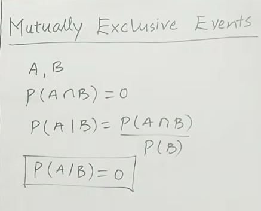

## L85 Bayes Theorem 

* statistic we have bayesian statistics subjects
* naive bayes

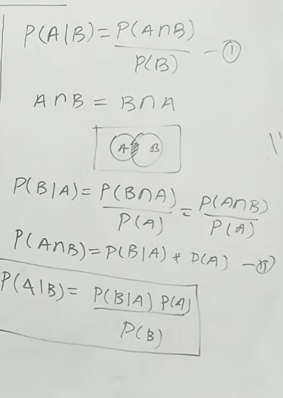

## L86 Naive bayes classifier | part 5

<!-- explain the problem explained by the campusx -->

* there is a factory and three amchine and percetnage created by each machine 

* manufacture defects is given to us: Machine 1 : 5% defective , Machine 2 : 3 % defective and the machine 3 is 1% defective 

------------

## L87 Naive bayes classifier | Part 6

* chennai wins or not??
* bi classficatin (win or lose)
* P(winning/ conditions)
* P(lossing/condiiton)

* P (W / lost(toss) and mumbai and sunny) = 0.56

-------

P(A/B) = P(B/A)P(A) / P(B)

* Naive bayes breaks into 

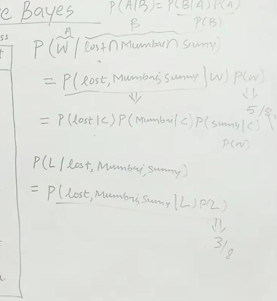

## L88 Mathematics behind Naive Bayes

What is the naive assumption in this algo??

<!-- mathematic behind naive bayes, please incldue it here in your language such that it is easy to understand -->

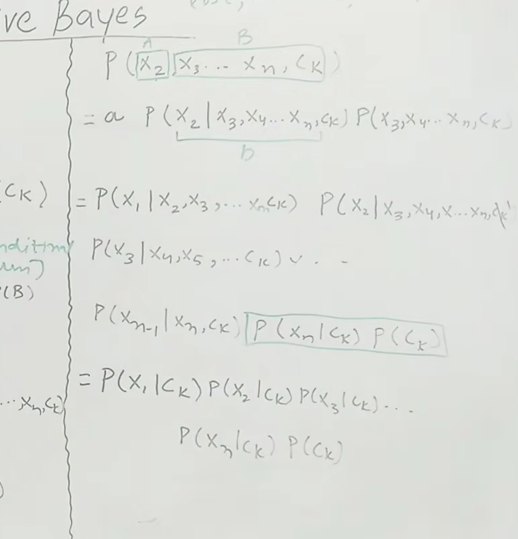

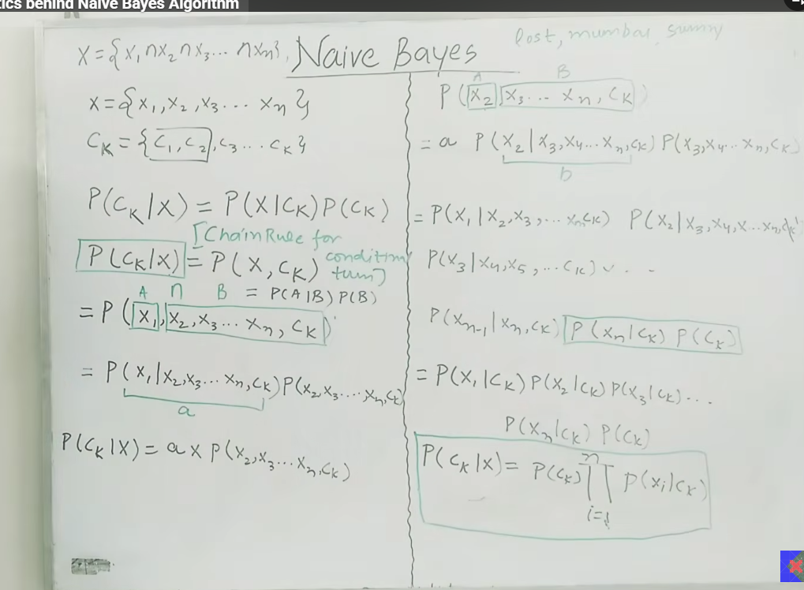

------------

P(Ck | x) proporitonal to on RHS 

----------

## L89 Example Code

<!-- Code -->

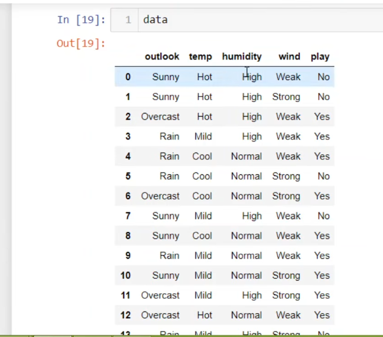

play tennis dataset

problem is as such

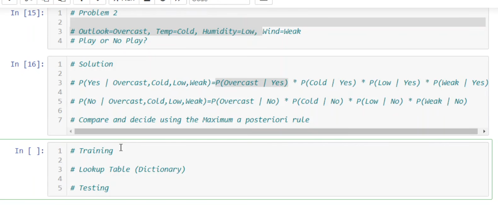

Naive bayes store all the possible probability in a look up table in the training phase -> it already computes all the thign which may need in the future

* Outlook column i

* 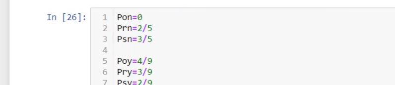
* 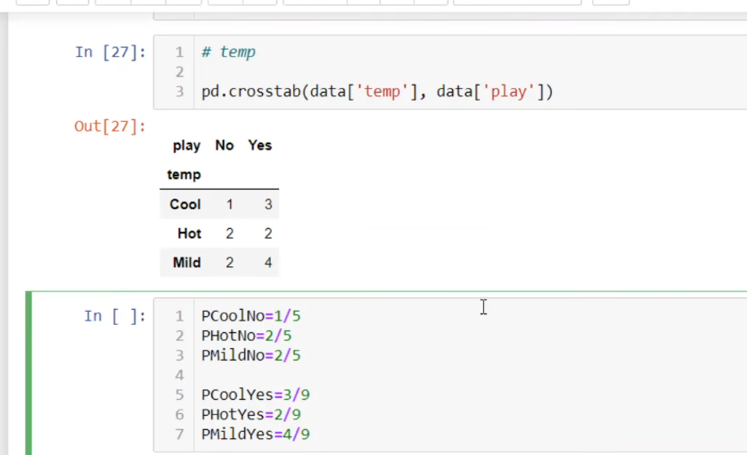
* Now humidity 
* 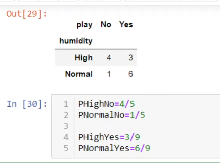
* now wind 

---------

will he play or not 

## L90 Handling Numerical Data

* machine Learnign model -> predict the gender 

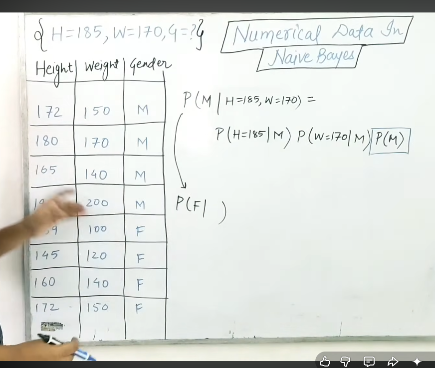
* we will make assumption 
* those four dataset follow normal distribution , and then i find their mean and SD
* 

Gaussian Naive Bayes

------------------

## L91 KNN 

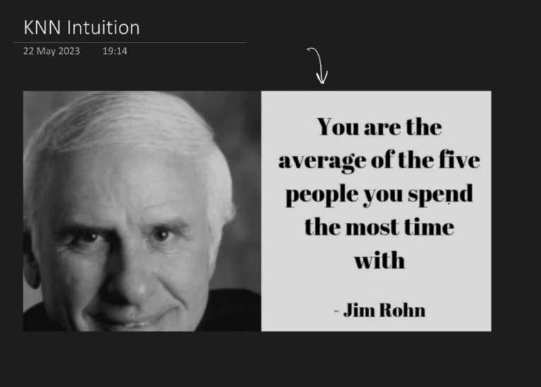

* most simplest ML algorithm 
* dataset : iq | cgpa | placement

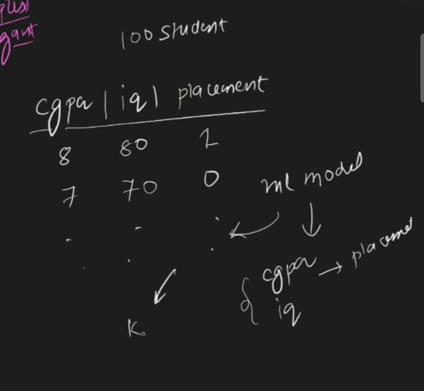

* we will plot it 
* blue -> placed , pruple -> not placed

* we need to predict about the green point

* closest point come closest
* majority count 
1 1 0 --> green class label is 1

---------------

KNN works in any dimension 
* distnace find with all vectors 
---------

<!-- code on breast cancer anlsis KNN -->

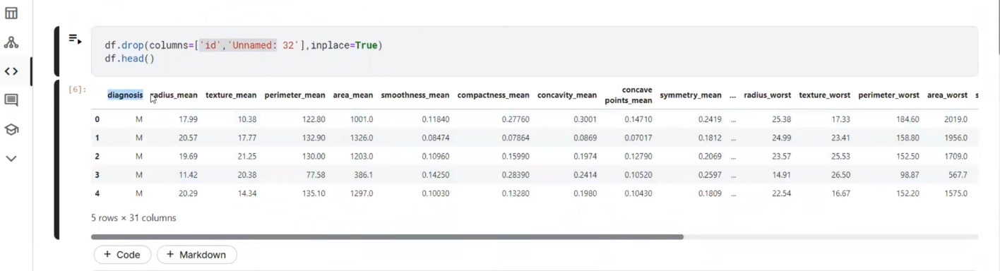
* ML we divide data into training and test data --> running ML model on Test data we get the prediciton 
* then we get our accuracy score  -> performance of our model 
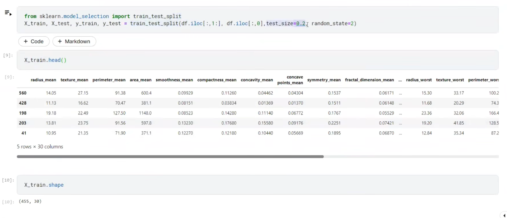
* when using KNN it is advised to bring all the features in the same scale 
* KNN relied completely on calculating distnace
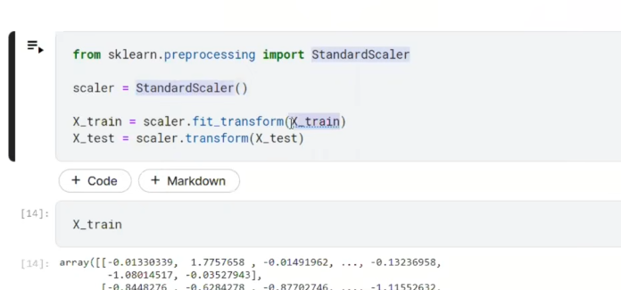
* 
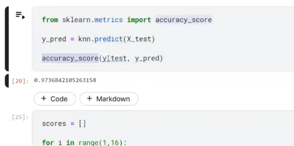

-------

How to select K ??

* it depends on the data
* heurestic approach --> square root on n (observation), prevent taking even values 
* experimentation 
- we use cross validation 
    * 800 in train , 200 in test 
    * KNN with lot of diff K value andthen train and then test on testinf and then take the best one with highest accuracy 

* cross validation 
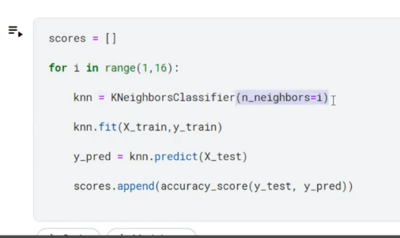

---------

Decision Surface

* tool used to find the performance of classification 

<!-- description we had video which explained how it was made along with the code -->
* decision boundary is very very important
* we plot the training data , for the range of x and y we generate the meshgrid, and each model we send in KNN, and each point are colored based ont he class it is classified into 

<!-- sir has explained this , in 40 min video -->

-----------

Overfitting and underfitting in KNN

* if k = 1, then decision surface get divided into small small surface

* high variance in dataset , overfitting
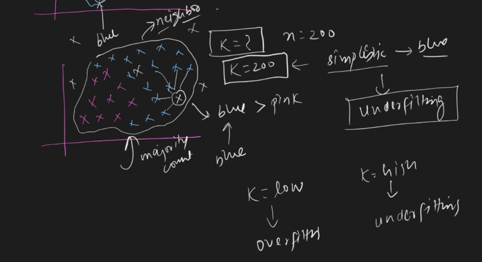

-----

Code demo 

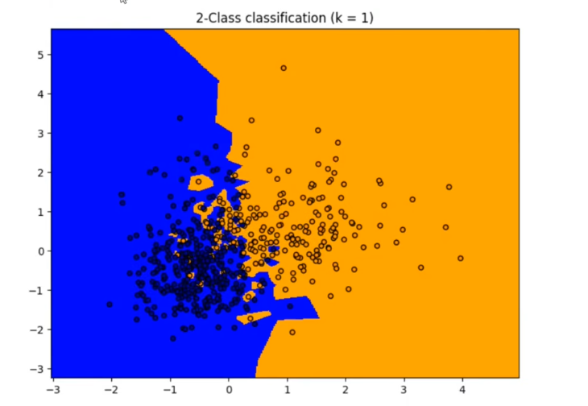

---------

Limitation of KNN 

* large dataset - eg. no. of obsercation = 5 L , feature = 100, KNN is lazy learnign algorithn , nothing is done in traingin phase, distance calculation is done when we have query 
* prediction is slow specially on the huge dataset, 5 Lakh dataset calcualted, then sorted etc
* lets say one website you put the data, and it took 3 sec to get the output
* High dimensional data , curse of dimensionality, Distnace concept is not reliablei n hgih dimensiton 
* KNN doesn't work well with the outliers

* Non homogenous scales , 
exp | salary | fire
* salary has huge bigger scale k,nwo, hence we need to use scale to get reliable info from dataset

* result bias toward one color
* KNN is used for inference it fails, but its ohkay for predicition 

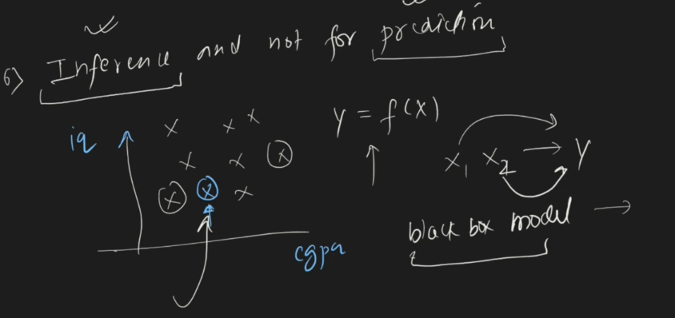

--------------

## L92 Support vector machines

* which of them will be better hyperplane
* black one
* core idea to maximize the gap 

-----------------

* we need to find an algorithm which mazimize this margin
* margin maximizing hyperplane
* stop when you find the first green point and same for the red points 
* the shortest distance is called margin 
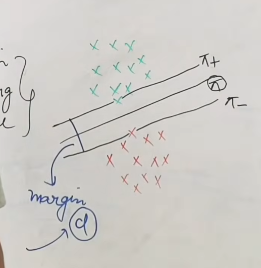
* W^t * x  + b

* What are support vectors (the points on the margin)
* are very robust on the outliers
* can also work on non linear data
* can be implement on both regression and classification dataset

