## L83 Naive Bayes Classifier | Part 2 | Independent events in probability 

A,B independent if 
P(A and B) = P(A)* P(B)

* probbiality of head on die 1 if die 2 had tail 
* one event doesn't affect the happending of other event 
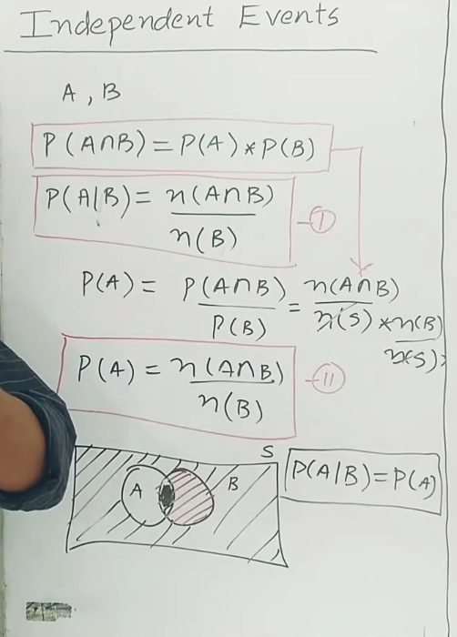

--------

### CampusX PDF notes - L83 Independent Events (PDF pp. 2437-2448)

**1. Notation**

An **event** is a subset of the sample space `S`. `P(A and B)` is the intersection, `P(A or B)` the union, `P(A | B)` the probability of A given B, `n(A)` the number of outcomes in A.

**2. Definition**

Two events are **independent** if one happening does **not** change the probability of the other. Flip a coin and roll a die together: the coin tells you nothing about the die. Both can happen, they just do not influence each other.

**`P(A and B) = P(A) * P(B)`**

**3. Why `P(A | B) = P(A)`**

`P(A | B) = P(A and B) / P(B) = P(A) P(B) / P(B) = P(A)` (needs `P(B) > 0`).

The same thing with counts, as on the board: `P(A | B) = [n(A and B) / n(S)] / [n(B) / n(S)] = n(A and B) / n(B)`, and for independent events this equals `P(A)`. It also works the other way: `P(B | A) = P(B)`.

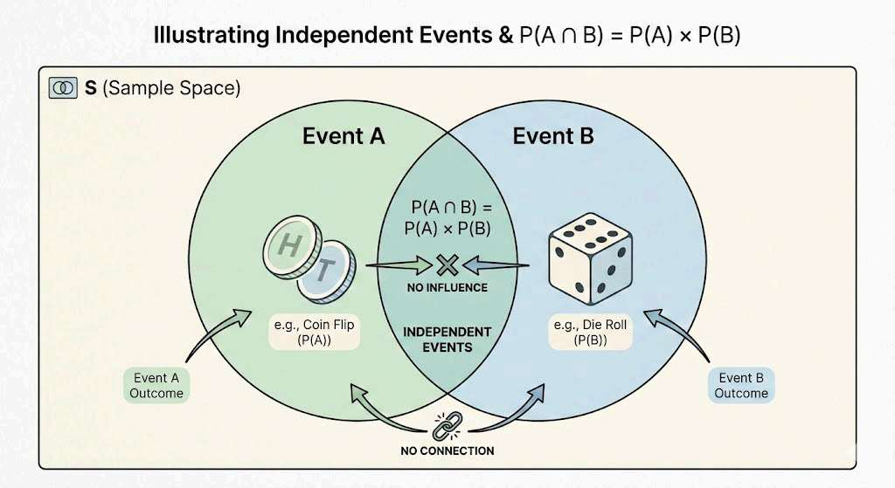

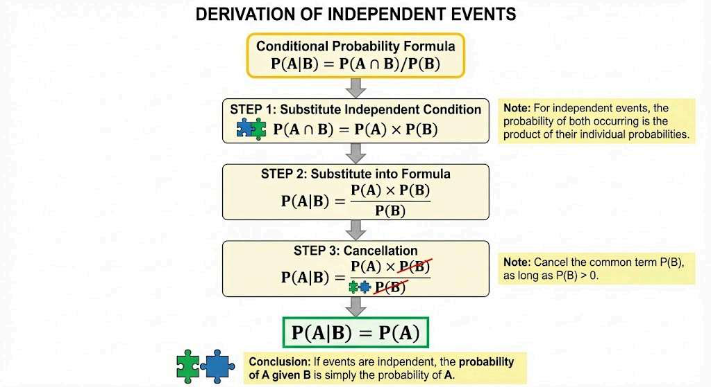

**4. Examples**

| example | calculation | type |
|---|---|---|
| coin shows heads (A), die shows 6 (B) | `P(A and B) = 1/2 * 1/6 = 1/12`, and `P(A given B) = (1/12)/(1/6) = 1/2` | independent |
| one coin: heads (A), tails (B) | `P(A and B) = 0`, `P(A or B) = 1/2 + 1/2 = 1` | mutually exclusive |
| two cards without replacement: 1st is a king (A), 2nd is a king (B) | `P(B) = 4/52 = 1/13` but `P(B given A) = 3/51` | neither (dependent, but can both happen) |

**5. Independent versus mutually exclusive**

| | independent | mutually exclusive |
|---|---|---|
| meaning | one does not affect the other | one prevents the other |
| `P(A and B)` | `P(A) P(B)` | 0 |
| can happen together? | yes | no |
| `P(A given B)` | `P(A)` | 0 |
| `P(A or B)` | `P(A) + P(B) - P(A) P(B)` | `P(A) + P(B)` |
| Venn diagram | overlapping circles | separate circles |

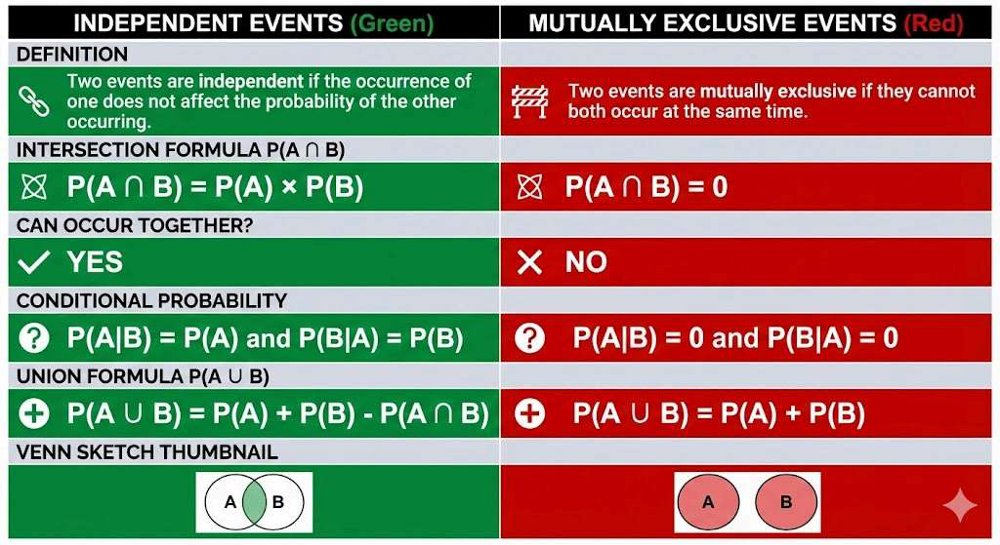

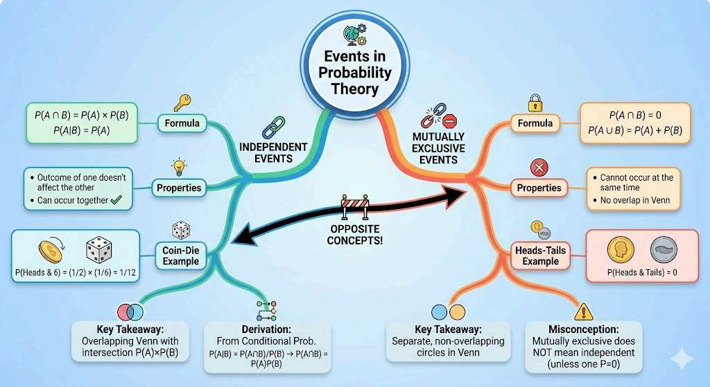

## L84 Mutually exclusive events 

when P(A and B) = 0


### CampusX PDF notes - L84 Mutually Exclusive Events (PDF pp. 2449-2452, with 2441-2447)

**1. Definition**

Events are **mutually exclusive** (disjoint) if they **cannot happen at the same time**: **`P(A and B) = 0`**.

**2. Properties**

* `P(A given B) = P(A and B) / P(B) = 0`: once B has happened, A is impossible (and the other way round).
* Addition rule: `P(A or B) = P(A) + P(B)`. In general it is `P(A) + P(B) - P(A and B)`.

**3. Examples**

Heads and tails in one flip; a 1 and a 6 in one die roll; one drawn card being both a heart and a spade.
(The PDF's third example, "a red card and a spade", also works, because spades are black.)

**4. Common misconceptions**

| statement | verdict |
|---|---|
| "independent means mutually exclusive" | **wrong**, they are almost opposites |
| "mutually exclusive events are independent" | **wrong**: if `P(A) > 0` and `P(B) > 0` then `P(A) P(B) > 0`, but `P(A and B) = 0`, so they are **dependent** |
| "`P(A given B) = 0` shows independence" | **wrong**, it shows exclusivity (independence needs `P(A given B) = P(A)`) |
| "for independent events, knowing one says nothing about the other" | correct |

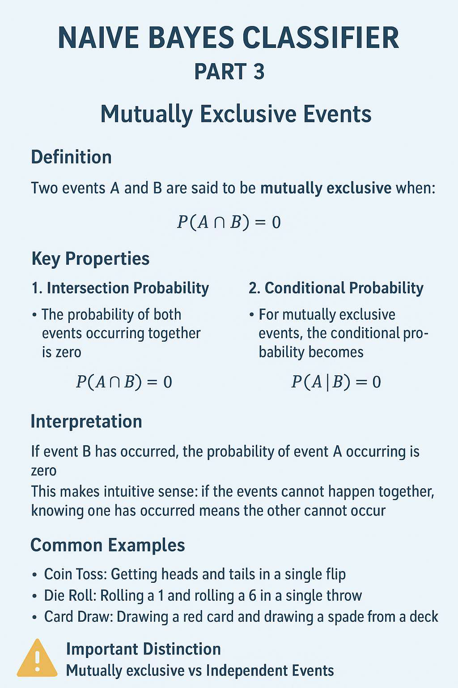

## L85 Bayes Theorem 

* statistic we have bayesian statistics subjects
* naive bayes

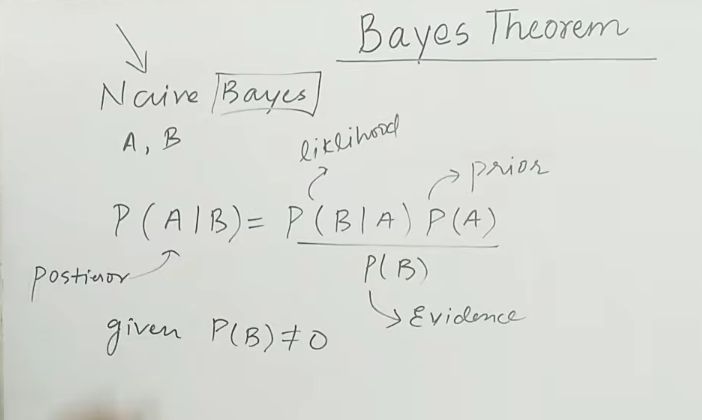


### CampusX PDF notes - L85 Bayes' Theorem (PDF pp. 2453-2463)

**1. What it does**

Bayes' theorem **reverses** a conditional probability: if we know how likely the evidence is under a hypothesis, we get how likely the hypothesis is after seeing the evidence. It is the base of Bayesian statistics and of **Naive Bayes** (spam filtering, diagnosis, topic classification).

**`P(A | B) = P(B | A) * P(A) / P(B)`, with `P(B) != 0`**

| term | name | question it answers |
|---|---|---|
| `P(A \| B)` | **posterior** | what do we believe about A after seeing B? |
| `P(B \| A)` | **likelihood** | if A is true, how likely is B? |
| `P(A)` | **prior** | what did we believe before? |
| `P(B)` | **evidence** | how common is B overall? (normaliser) |

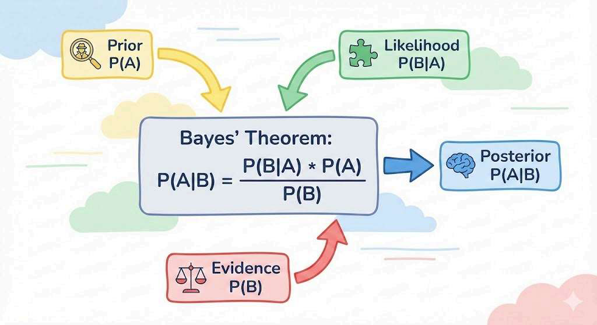

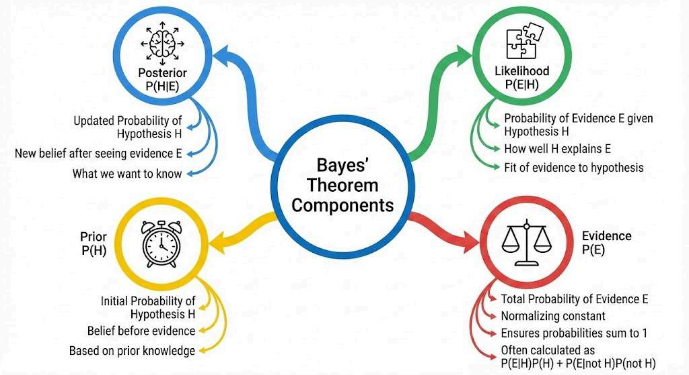

**2. Derivation**

1. Definition: `P(A | B) = P(A and B) / P(B)` ... (I)
2. Intersection is commutative: `A and B` = `B and A`
3. Definition the other way: `P(B | A) = P(A and B) / P(A)`, so `P(A and B) = P(B | A) P(A)` ... (II, product rule)
4. Put (II) into (I): `P(A | B) = P(B | A) P(A) / P(B)`

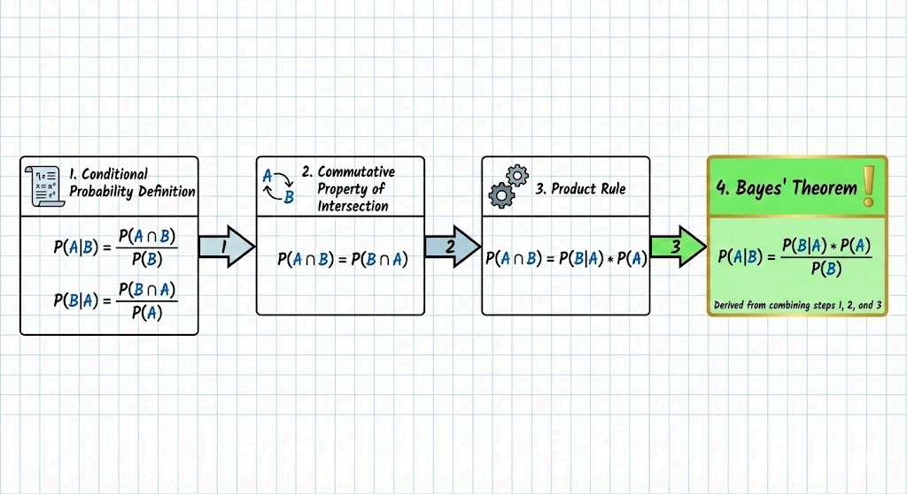

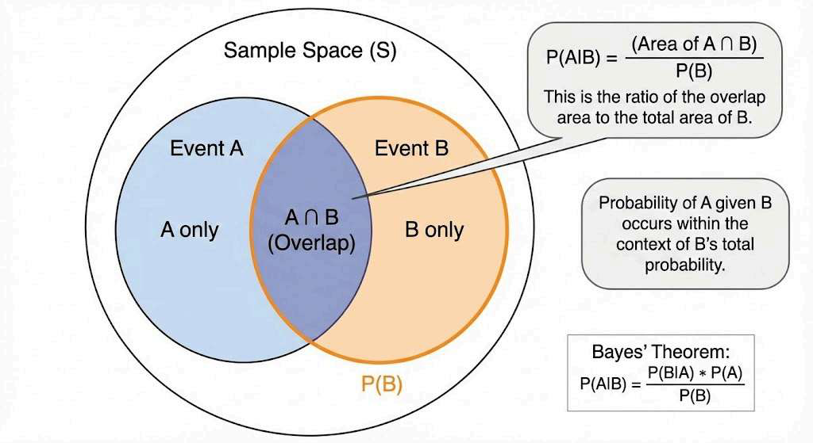

**3. Example: a rare disease**

`P(disease) = 0.01`, `P(symptom | disease) = 0.90`, `P(symptom) = 0.10`.

`P(disease | symptom) = 0.90 * 0.01 / 0.10 = 0.09`, only **9 percent**, because the disease itself is rare.

**4. Link to Naive Bayes**

`P(class | features) = P(features | class) P(class) / P(features)`. With the "naive" independence assumption: `P(class | x1..xn)` is proportional to `P(class) * product of P(x_i | class)`.

For spam: prior `P(spam)`, likelihood `P("free" | spam)`, evidence `P("free")`, posterior `P(spam | "free")`.

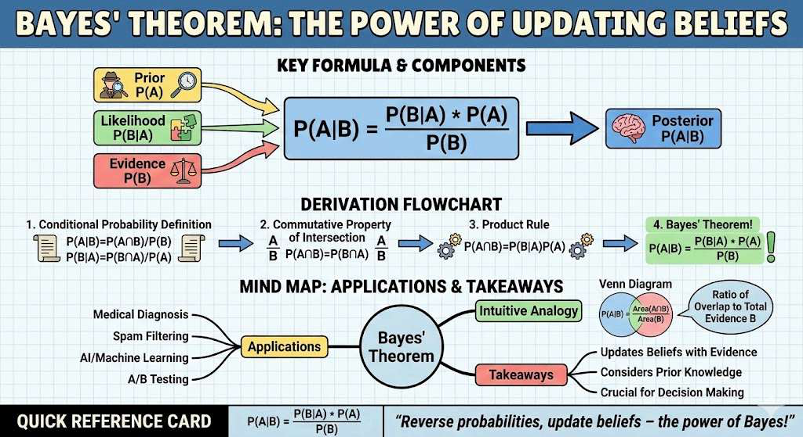

### Code - L85 check the disease example

```python
prior = 0.01          # P(disease)
likelihood = 0.90     # P(symptom | disease)
evidence = 0.10       # P(symptom)

posterior = likelihood * prior / evidence
print(round(posterior, 4))     # 0.09
```

## L86 Naive bayes classifier | part 5

<!-- explain the problem explained by the campusx -->

### The factory problem, step by step

**The question**

A factory has three machines. Together they make 100 items:

| machine | items made | share of production | defect rate |
|---|---|---|---|
| M1 | 20 | `P(M1) = 0.20` | `P(D given M1) = 0.05` |
| M2 | 30 | `P(M2) = 0.30` | `P(D given M2) = 0.03` |
| M3 | 50 | `P(M3) = 0.50` | `P(D given M3) = 0.01` |

One item is picked and it is **defective** (`D`). **What is the probability that it came from machine M3?**

We know "defect, given the machine". We want "machine, given the defect". That reversal is exactly what Bayes' theorem does:

**`P(M3 | D) = P(D | M3) * P(M3) / P(D)`**

**Step 1: find `P(D)`, the chance that any item is defective**

A defective item comes from M1, M2 or M3, and only one of them, so add the three routes (law of total probability):

`P(D) = P(D|M1) P(M1) + P(D|M2) P(M2) + P(D|M3) P(M3)`
`P(D) = (0.05)(0.20) + (0.03)(0.30) + (0.01)(0.50) = 0.010 + 0.009 + 0.005 = 0.024`

**Step 2: apply Bayes**

`P(M3 | D) = 0.005 / 0.024 = 5/24 = 0.2083`, about **20.8 percent**.

**Step 3: the other machines, as a check**

| machine | prior `P(M)` | posterior `P(M given D)` |
|---|---|---|
| M1 | 20 percent | 10/24 = **41.7 percent** |
| M2 | 30 percent | 9/24 = **37.5 percent** |
| M3 | 50 percent | 5/24 = **20.8 percent** |

The posteriors add up to 1.

**Same answer by counting 1000 items**

M1 makes 200 items with 10 defective, M2 makes 300 with 9, M3 makes 500 with 5. There are 24 defective items, and 5 of them are from M3: `5/24`.

**What to learn from it:** M3 produces the most items, but it is the least likely source of a defect because its defect rate is lowest. The evidence (a defect) moved our belief towards M1.

```python
share = {'M1': 0.20, 'M2': 0.30, 'M3': 0.50}      # P(machine)
defect = {'M1': 0.05, 'M2': 0.03, 'M3': 0.01}     # P(defect | machine)

p_d = sum(share[m] * defect[m] for m in share)    # total probability of a defect
print(round(p_d, 3))                              # 0.024

for m in share:
    print(m, round(share[m] * defect[m] / p_d, 4))
# M1 0.4167
# M2 0.375
# M3 0.2083
```


* there is a factory and three amchine and percetnage created by each machine 
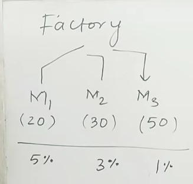
* manufacture defects is given to us: Machine 1 : 5% defective , Machine 2 : 3 % defective and the machine 3 is 1% defective 
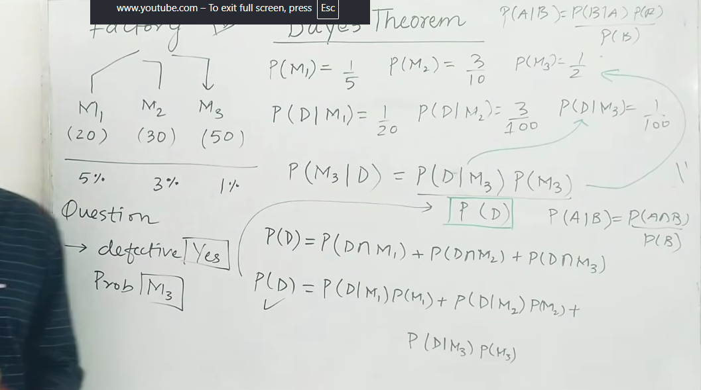

------------

### CampusX PDF notes - L86 Bayes' Theorem with the factory defect problem (PDF pp. 2464-2475)

(The full worked solution is above, at your comment.)

**1. Formula with the law of total probability**

If `A1 ... An` do not overlap and together cover everything, then `P(B) = sum_i P(B | Ai) P(Ai)`: a weighted average of the likelihoods. It supplies the denominator of Bayes' theorem.

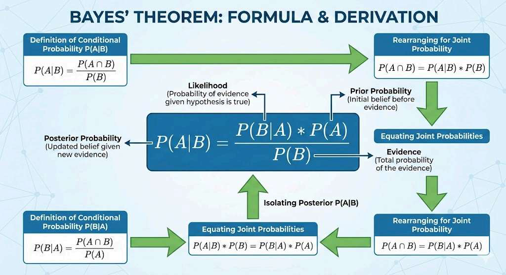

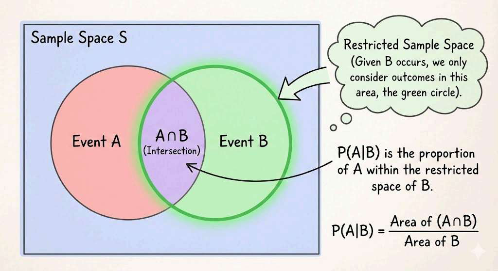

**2. Base rate fallacy**

It is the mistake of ignoring the prior (the base rate) and looking only at the new evidence. PDF example: a disease affects 1 percent of people; a test is 99 percent accurate both ways. For a positive result:

`P(disease | positive) = (0.99)(0.01) / [(0.99)(0.01) + (0.01)(0.99)] = 0.0099 / 0.0198 = 0.50`

Only **50 percent**, even with a 99 percent accurate test.

**3. Takeaways**

* Bayes' theorem goes from `P(B given A)` to `P(A given B)`.
* Priors matter: high production does not mean high chance of causing the defect.
* Posteriors over all causes must add to 1, which is a good check.

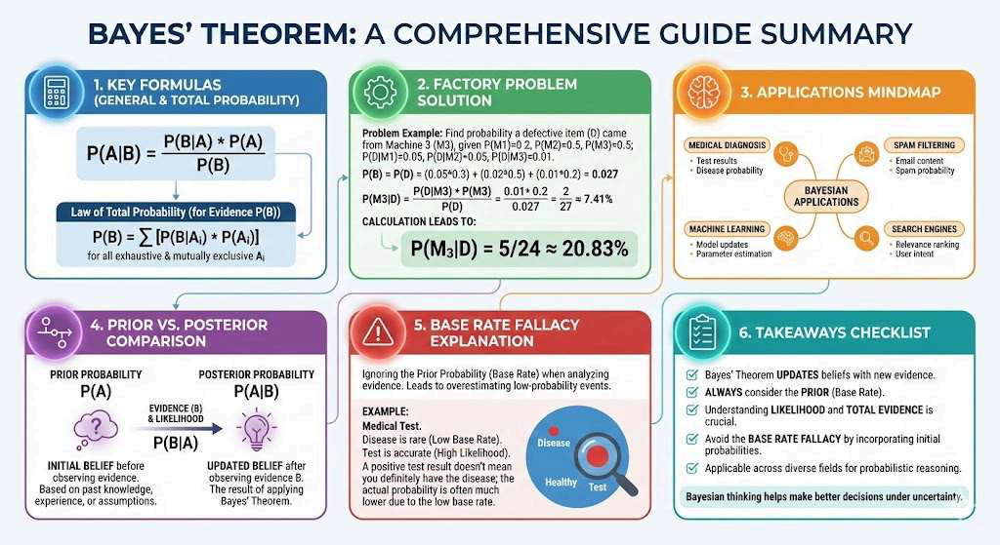

(In the factory panel of this figure the line computing `P(D)` mixes up the numbers and shows 0.027. The correct value is `P(D) = 0.024`, and the final answer `5/24` is right.)

## L87 Naive bayes classifier | Part 6

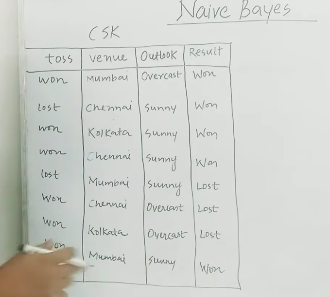

* chennai wins or not??
* bi classficatin (win or lose)
* P(winning/ conditions)
* P(lossing/condiiton)

* P (W / lost(toss) and mumbai and sunny) = 0.56

-------

P(A/B) = P(B/A)P(A) / P(B)

* Naive bayes breaks into 


### CampusX PDF notes - L87 Naive Bayes Classifier with the CSK match data (PDF pp. 2476-2489)

**1. What it is**

Naive Bayes is a **supervised, probabilistic classification** algorithm. It applies Bayes' theorem and **naively assumes the features are independent of each other once the class is known**. It trains in one pass, works well on categorical data and is common in spam detection, sentiment analysis and document classification.

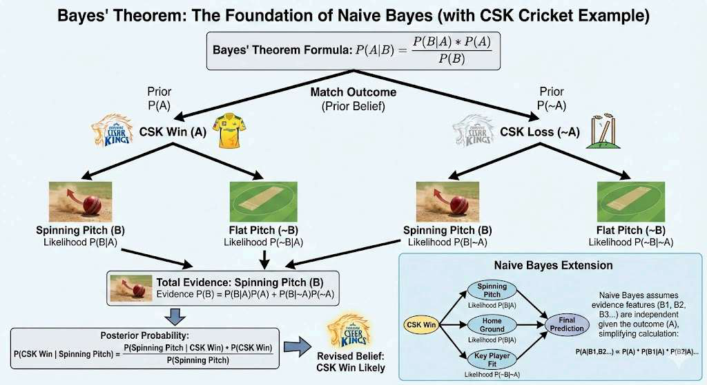

**2. The data (from your board)**

| toss | venue | outlook | result |
|---|---|---|---|
| won | Mumbai | overcast | **won** |
| lost | Chennai | sunny | **won** |
| won | Kolkata | sunny | **won** |
| won | Chennai | sunny | **won** |
| lost | Mumbai | sunny | lost |
| won | Chennai | overcast | lost |
| won | Kolkata | overcast | lost |
| won | Mumbai | sunny | **won** |

**Question:** toss **lost**, venue **Mumbai**, outlook **sunny**. Does CSK win?

**3. Why "naive"**

Estimating `P(lost, Mumbai, sunny | won)` directly needs many rows with that exact combination (here there may be none). The assumption splits it into pieces that are easy to count:

`P(x1, x2, x3 | C) = P(x1 | C) P(x2 | C) P(x3 | C)`

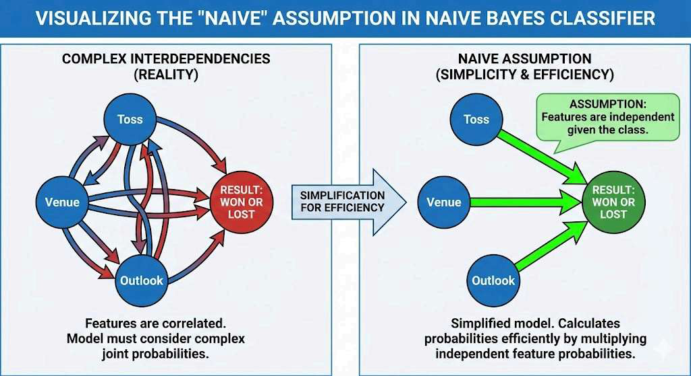

**4. Count the probabilities**

| | won (5 rows) | lost (3 rows) |
|---|---|---|
| prior `P(C)` | 5/8 | 3/8 |
| `P(toss = lost given C)` | 1/5 | 1/3 |
| `P(Mumbai given C)` | 2/5 | 1/3 |
| `P(sunny given C)` | 4/5 | 1/3 |
| **product with the prior** | `1/5 * 2/5 * 4/5 * 5/8 = 0.04` | `1/3 * 1/3 * 1/3 * 3/8 = 0.0139` |

`0.04 > 0.0139`, so the prediction is **CSK wins**.

**5. Turning scores into probabilities**

`P(won | evidence) = 0.04 / (0.04 + 0.0139) = 0.742` and `P(lost | evidence) = 0.258`.

**About the 0.56 in your note above:** with this table the score for "won" is **0.04**, and the probability after normalising is **about 0.74**. I could not get 0.56 from these rows.

The denominator `P(x)` is the same for both classes, so it can be ignored when only the winner is needed:

**`y_hat = argmax over C of P(C) * product of P(x_i | C)`**

**6. Zero-frequency problem and Laplace smoothing**

If a value never appears with a class, its probability is 0 and wipes out the whole product. Add `alpha` (usually 1):

**`P(x_i | C) = (count(x_i, C) + alpha) / (count(C) + alpha * |V|)`**, where `|V|` is the number of different values of that feature.

**7. Pros, cons, uses**

| advantages | disadvantages |
|---|---|
| simple and very fast | features are rarely truly independent |
| works with little data | zero-frequency problem |
| handles many classes | correlated features hurt it |
| no iterative training | continuous data needs binning or an assumed distribution |
| good on categorical and text data | its probabilities are often poorly calibrated |

Excellent for text, spam and sentiment; moderate for credit scoring (correlated features); poor for images.

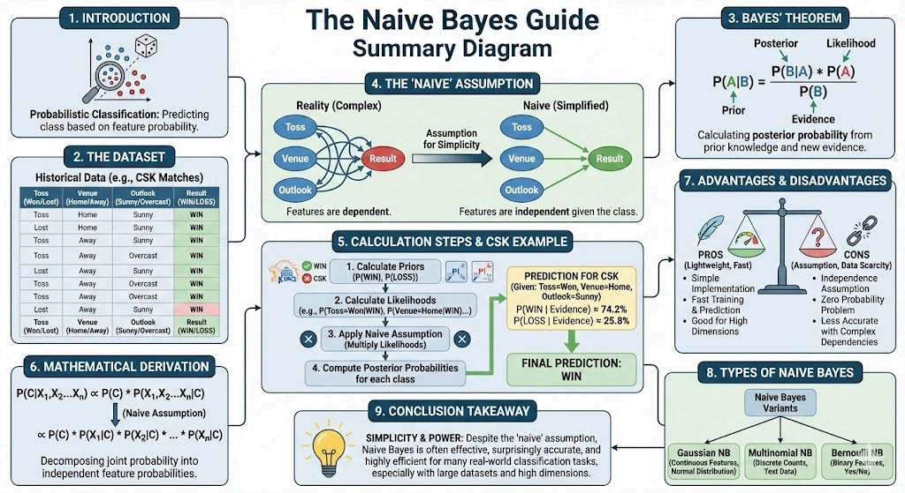

(The small match table drawn in this figure is not the board's data; use the table in section 2.)

### Code - L87 the CSK prediction by counting

```python
import pandas as pd

df = pd.DataFrame({
    'toss':    ['won', 'lost', 'won', 'won', 'lost', 'won', 'won', 'won'],
    'venue':   ['Mumbai', 'Chennai', 'Kolkata', 'Chennai', 'Mumbai', 'Chennai', 'Kolkata', 'Mumbai'],
    'outlook': ['Overcast', 'Sunny', 'Sunny', 'Sunny', 'Sunny', 'Overcast', 'Overcast', 'Sunny'],
    'result':  ['Won', 'Won', 'Won', 'Won', 'Lost', 'Lost', 'Lost', 'Won']})

query = {'toss': 'lost', 'venue': 'Mumbai', 'outlook': 'Sunny'}

score = {}
for c in ['Won', 'Lost']:
    rows = df[df['result'] == c]
    s = len(rows) / len(df)                       # prior P(C)
    for col, value in query.items():
        s *= (rows[col] == value).mean()          # likelihood P(value | C)
    score[c] = s

total = sum(score.values())
for c, s in score.items():
    print(c, round(s, 4), round(s / total, 3))
# Won 0.04 0.742
# Lost 0.0139 0.258
```

## L88 Mathematics behind Naive Bayes

What is the naive assumption in this algo??

<!-- mathematic behind naive bayes, please incldue it here in your language such that it is easy to understand -->

### The mathematics of Naive Bayes in plain words

**What we have and what we want**

* The input is a list of features `x = (x1, x2, ..., xn)`, for example (outlook, temperature, humidity, wind).
* The possible classes are `C1, C2, ..., CK`, for example (play, do not play).
* We want `P(Ck | x)`: "now that I have seen these features, how likely is class `Ck`?"

**Step 1: turn the question around with Bayes**

`P(Ck | x) = P(x | Ck) P(Ck) / P(x)`

`P(x)` is the same number for every class, so for **comparing** classes we can drop it. The top part is the joint probability:

`P(Ck | x)` is proportional to `P(x | Ck) P(Ck) = P(x1, x2, ..., xn, Ck)`

**Step 2: peel the features off one at a time (chain rule)**

The rule is `P(A and B) = P(A | B) P(B)`. Take `A = x1` and `B` = everything else:

`P(x1, x2, ..., xn, Ck) = P(x1 | x2, ..., xn, Ck) * P(x2, ..., xn, Ck)`

Do the same with `x2`, then `x3`, and so on until only the class is left:

`= P(x1 | x2..xn, Ck) * P(x2 | x3..xn, Ck) * ... * P(x(n-1) | xn, Ck) * P(xn | Ck) * P(Ck)`

This is exact, but useless in practice: to estimate `P(x1 | x2..xn, Ck)` we would need many rows that match **all** the other features at once, and real data rarely has them.

**Step 3: the naive assumption**

**Once the class is known, the features do not tell us anything about each other.**

`P(xi | x(i+1), ..., xn, Ck) = P(xi | Ck)`

Every long term collapses to a short one:

**`P(Ck | x) = (1/Z) * P(Ck) * product for i = 1..n of P(xi | Ck)`**

`Z = P(x)` just makes the answers add up to 1.

**Step 4: choose the class (MAP rule, "maximum a posteriori")**

**`y_hat = argmax over k of P(Ck) * product of P(xi | Ck)`**

In words: **for each class, multiply how common the class is by how common each feature value is inside that class; the biggest result wins.**

**The whole method in four lines**

1. prior: `P(Ck) = rows in class k / all rows`
2. likelihood: `P(xi | Ck) = rows in class k with value xi / rows in class k`
3. multiply the prior and the likelihoods for each class
4. take the largest

**One practical detail:** multiplying many small numbers underflows, so libraries add logarithms instead: `log P(Ck) + sum of log P(xi | Ck)`. The winner is the same.

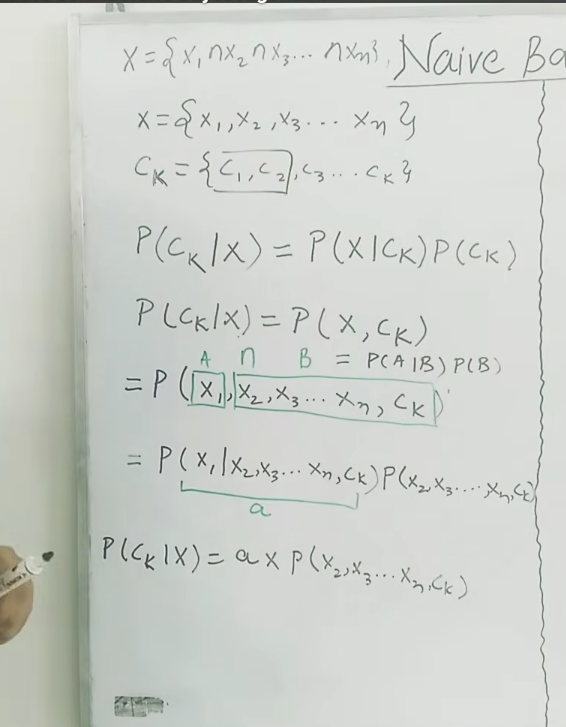


------------

P(Ck | x) proporitonal to on RHS 

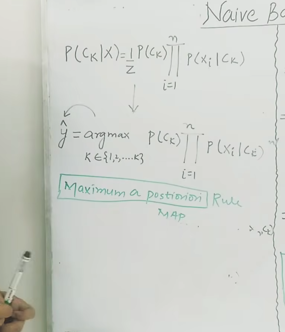

----------

### CampusX PDF notes - L88 Mathematics behind Naive Bayes (PDF pp. 2490-2504)

(The derivation itself is explained above, at your comment.)

**1. Notation**

| symbol | meaning |
|---|---|
| `X = (x1..xn)` | feature vector |
| `Ck` | class label, `K` classes |
| `P(Ck)` | prior |
| `P(X \| Ck)` | likelihood |
| `P(Ck \| X)` | posterior |
| `P(X)` or `Z` | evidence (normaliser) |

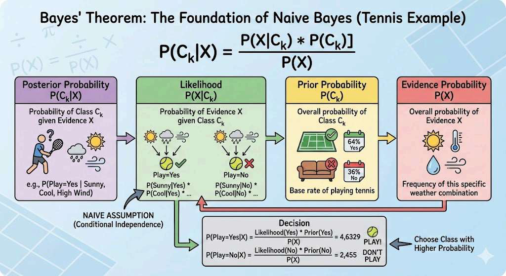

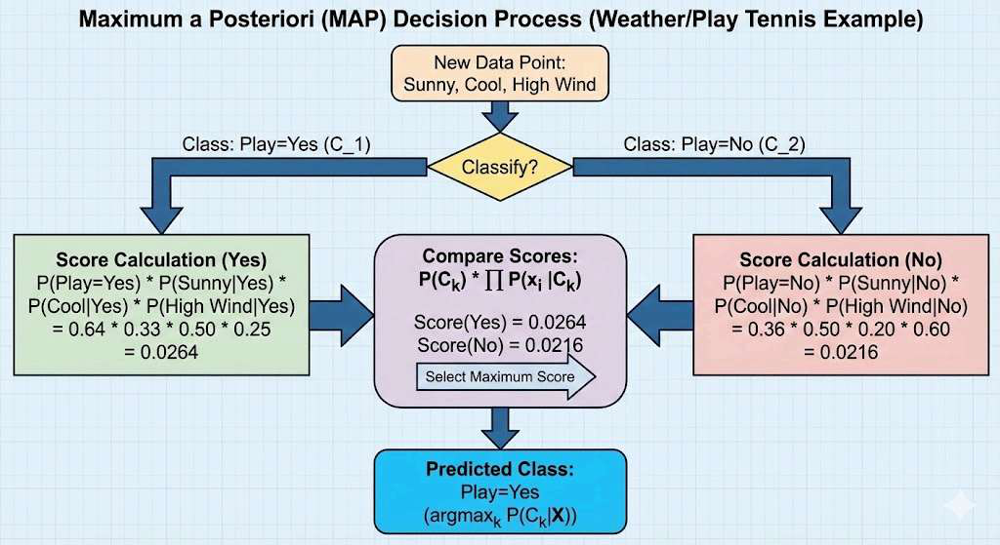

(The numbers in the "Decision" box of the first figure are meaningless; follow the table below.)

**2. Worked example (play tennis, 14 days: 9 yes, 5 no)**

New day: sunny, hot, high humidity, weak wind.

| | yes | no |
|---|---|---|
| prior | 9/14 | 5/14 |
| sunny | 2/9 | 3/5 |
| hot | 2/9 | 2/5 |
| high | 3/9 | 4/5 |
| weak | 6/9 | 2/5 |
| **product** | **0.0071** | **0.0274** |
| normalised | 0.206 | **0.794** |

Prediction: **do not play**. (The scores in the MAP figure, 0.0264 and 0.0216, belong to its own illustration, not to this table.)

**3. Types of Naive Bayes**

| type | features | assumed distribution | typical use |
|---|---|---|---|
| `GaussianNB` | continuous | normal | measurements |
| `MultinomialNB` | counts | multinomial | text, word counts |
| `BernoulliNB` | 0/1 | Bernoulli | word present or absent |
| `CategoricalNB` | categories | categorical | categorical columns |

Gaussian: `P(xi | Ck) = 1 / sqrt(2 pi s^2) * exp( -(xi - m)^2 / (2 s^2) )`, where `m` and `s^2` are the mean and variance of feature `i` inside class `k`.

Multinomial with smoothing: `P(xi | Ck) = (N_ki + alpha) / (N_k + alpha * n)`, where `N_ki` is the count of feature `i` in class `k`, `N_k` the total count in class `k` and `n` the number of features.

**4. Pros and cons**

Simple, fast, good with little data and many features, few hyperparameters, gives probabilities. But features are rarely independent, unseen values give zero probability (use Laplace smoothing), and the probability estimates can be poor even when the predicted class is right.

## L89 Example Code

<!-- Code -->

### Code - L89 Naive Bayes on the play tennis data (typed from your screenshots; the official repo has no notebook for this lecture)

**Block 1 - the data**

```python
import numpy as np
import pandas as pd

# the 14 days of the classic play tennis data (the video reads it from a CSV)
rows = """Sunny,Hot,High,Weak,No
Sunny,Hot,High,Strong,No
Overcast,Hot,High,Weak,Yes
Rain,Mild,High,Weak,Yes
Rain,Cool,Normal,Weak,Yes
Rain,Cool,Normal,Strong,No
Overcast,Cool,Normal,Strong,Yes
Sunny,Mild,High,Weak,No
Sunny,Cool,Normal,Weak,Yes
Rain,Mild,Normal,Weak,Yes
Sunny,Mild,Normal,Strong,Yes
Overcast,Mild,High,Strong,Yes
Overcast,Hot,Normal,Weak,Yes
Rain,Mild,High,Strong,No"""
data = pd.DataFrame([r.split(',') for r in rows.split('\n')],
                    columns=['outlook', 'temp', 'humidity', 'wind', 'play'])
data.head()
```

**Block 2 - priors**

```python
data['play'].value_counts()       # Yes 9, No 5

py = 9 / 14                       # P(Yes)
pn = 5 / 14                       # P(No)
```

**Block 3 - one frequency table per column**

```python
pd.crosstab(data['outlook'], data['play'])     # Overcast 0/4, Rain 2/3, Sunny 3/2   (No/Yes)
pd.crosstab(data['temp'], data['play'])        # Cool 1/3, Hot 2/2, Mild 2/4
pd.crosstab(data['humidity'], data['play'])    # High 4/3, Normal 1/6
pd.crosstab(data['wind'], data['play'])        # Strong 3/3, Weak 2/6
```

**Block 4 - "training": store every probability in a lookup table**

```python
lookup = {}
for col in ['outlook', 'temp', 'humidity', 'wind']:
    # normalize='columns' divides each count by the total of its class
    table = pd.crosstab(data[col], data['play'], normalize='columns')
    for value in table.index:
        for c in ['Yes', 'No']:
            lookup[(value, c)] = table.loc[value, c]      # P(value | class)

priors = {'Yes': py, 'No': pn}
```

**Block 5 - "testing": multiply and compare (MAP rule)**

```python
def predict(query):
    scores = {}
    for c in ['Yes', 'No']:
        s = priors[c]
        for value in query:
            s *= lookup[(value, c)]        # naive assumption: just multiply
        scores[c] = s
    return max(scores, key=scores.get), scores

# Problem 1
print(predict(['Sunny', 'Hot', 'High', 'Weak']))
# ('No', {'Yes': 0.0070546..., 'No': 0.0274285...})

# Problem 2 (your screenshot says "Cold" and "Low"; the data only has "Cool" and "Normal")
print(predict(['Overcast', 'Cool', 'Normal', 'Weak']))
# ('Yes', {'Yes': 0.0423..., 'No': 0.0})
```

**Block 6 - the same with scikit-learn**

```python
from sklearn.preprocessing import OrdinalEncoder
from sklearn.naive_bayes import CategoricalNB

enc = OrdinalEncoder()                                   # words -> integers
X = enc.fit_transform(data[['outlook', 'temp', 'humidity', 'wind']])
y = data['play']

model = CategoricalNB(alpha=1.0)                         # alpha=1 is Laplace smoothing
model.fit(X, y)

q = pd.DataFrame([['Overcast', 'Cool', 'Normal', 'Weak']],
                 columns=['outlook', 'temp', 'humidity', 'wind'])
print(model.predict(enc.transform(q)))                   # ['Yes']
print(model.predict_proba(enc.transform(q)).round(3))    # no probability is exactly 0 now
```

(`pd.crosstab` counts value pairs. `CategoricalNB` is Naive Bayes for categorical columns.)


play tennis dataset

problem is as such
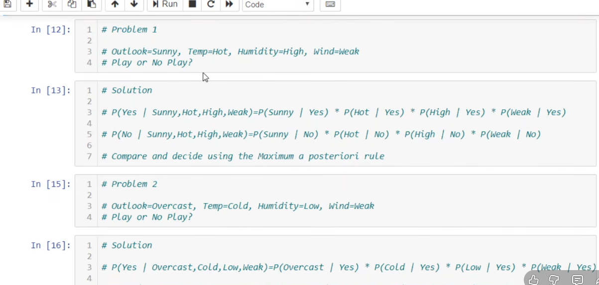


Naive bayes store all the possible probability in a look up table in the training phase -> it already computes all the thign which may need in the future

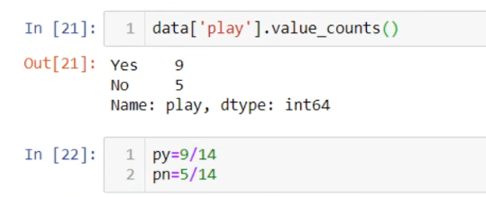

* Outlook column i

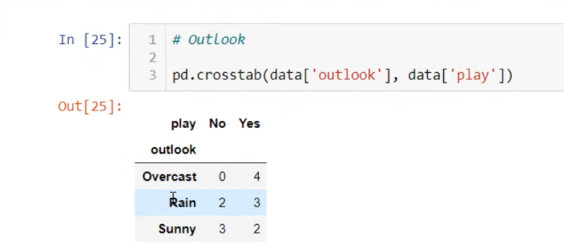
* 
* 
* Now humidity 
* 
* now wind 
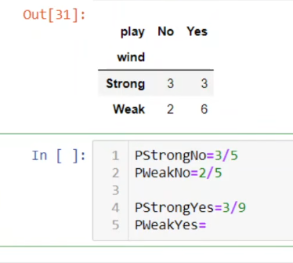

---------

will he play or not 

### CampusX PDF notes - L89 Naive Bayes example code (PDF pp. 2505-2520)

(The code is above, at your `Code` comment.)

**1. Training versus testing**

| phase | work | input | output |
|---|---|---|---|
| training | count priors and all conditional probabilities | labelled data | lookup table |
| testing | look up, multiply, compare | new rows | predicted class |

As your note says, everything needed is computed in training, so prediction is only a few multiplications.

**2. The lookup table**

| feature | value | P(value given yes) | P(value given no) |
|---|---|---|---|
| outlook | sunny | 2/9 | 3/5 |
| outlook | overcast | 4/9 | 0/5 |
| outlook | rain | 3/9 | 2/5 |
| temp | cool | 3/9 | 1/5 |
| temp | hot | 2/9 | 2/5 |
| temp | mild | 4/9 | 2/5 |
| humidity | high | 3/9 | 4/5 |
| humidity | normal | 6/9 | 1/5 |
| wind | strong | 3/9 | 3/5 |
| wind | weak | 6/9 | 2/5 |

**3. The two problems**

* **Sunny, hot, high, weak:** yes `0.00705`, no `0.02743`, so **no play**.
* **Overcast, "cold", "low", weak:** since `P(overcast given no) = 0`, the score for "no" is 0, so **play**. This shows the zero-frequency effect. (The PDF reads "cold" as "cool" and "low" humidity as "normal"; those words do not occur in the data.)

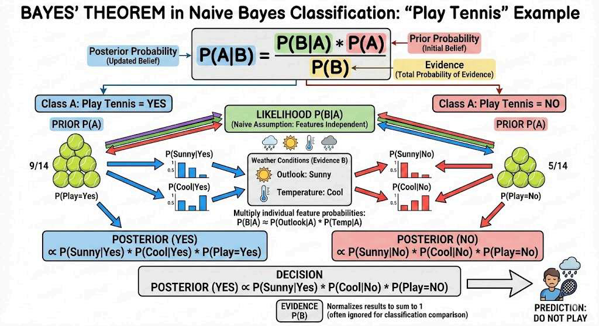

(The bottom "Decision" line of this figure mixes yes and no terms. The yes score uses only yes probabilities and the prior `P(Yes)`.)

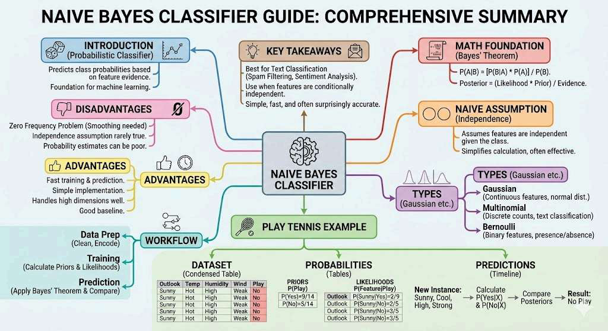

## L90 Handling Numerical Data

* machine Learnign model -> predict the gender 


* we will make assumption 
* those four dataset follow normal distribution , and then i find their mean and SD
* 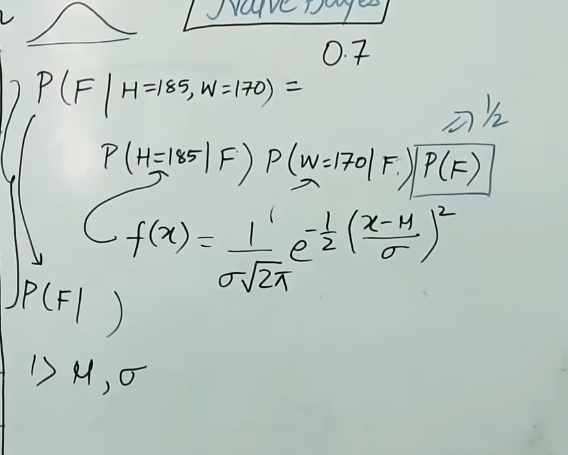

Gaussian Naive Bayes

------------------

### CampusX PDF notes - L90 Numerical data: Gaussian Naive Bayes (PDF pp. 2521-2534)

**1. The problem**

With continuous features (height, weight, salary) counting fails: the exact value 185 cm may never occur, and the probability of any exact value is zero.

**2. The solution**

Assume each numerical feature follows a **normal (Gaussian) distribution inside each class**, estimate its mean `m` and standard deviation `s`, and use the density at the query value as the likelihood:

**`f(x) = 1 / (s * sqrt(2 pi)) * exp( -1/2 * ((x - m)/s)^2 )`**

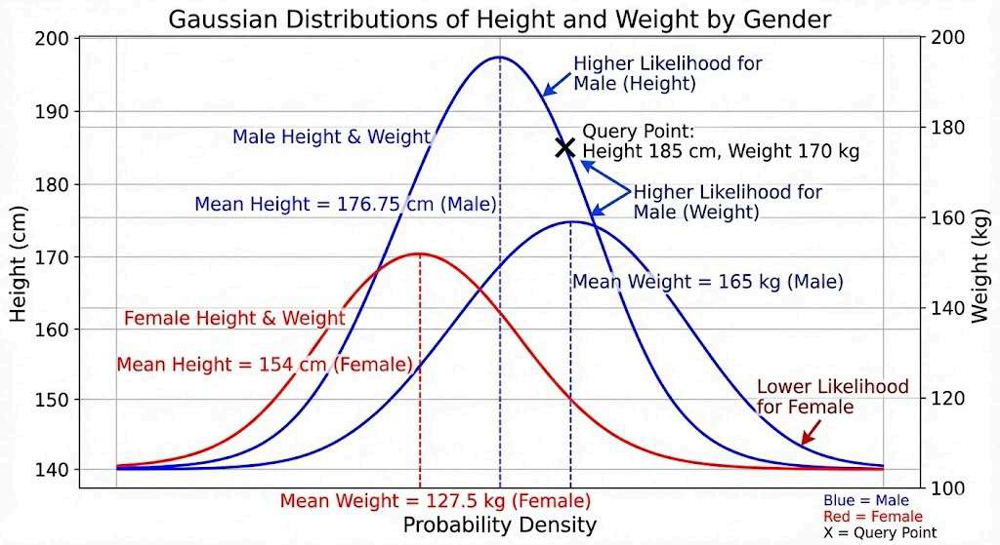

**3. Example: height 185, weight 170, male or female?**

| height | 172 | 180 | 165 | 190 | 139 | 145 | 160 | 172 |
|---|---|---|---|---|---|---|---|---|
| weight | 150 | 170 | 140 | 200 | 100 | 120 | 140 | 150 |
| gender | M | M | M | M | F | F | F | F |

**Step 1: mean and standard deviation per class** (dividing by `n`)

| parameter | male | female |
|---|---|---|
| mean height | 176.75 | 154.0 |
| std height | 9.31 | 12.90 |
| mean weight | 165.0 | 127.5 |
| std weight | 22.91 | 19.20 |

**Step 2: priors** `P(M) = P(F) = 4/8 = 0.5`

**Step 3: densities and product**

| | male | female |
|---|---|---|
| `f(height = 185)` | 0.0289 | 0.00172 |
| `f(weight = 170)` | 0.0170 | 0.00179 |
| prior x both | 0.000246 | 0.00000154 |
| normalised | **99.4 percent** | 0.6 percent |

**Prediction: male.**

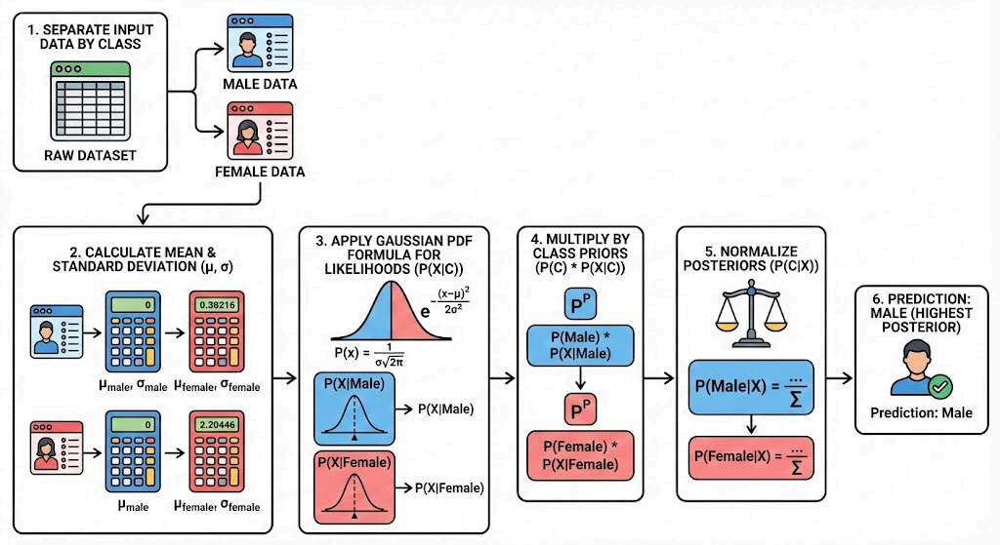

**4. Why the Gaussian assumption is reasonable**

Many natural measurements are roughly normal (central limit theorem), and it needs only two numbers per feature and class. If a feature is clearly not normal, transform it or choose another distribution.

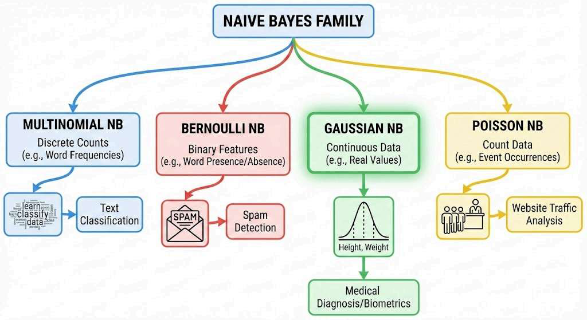

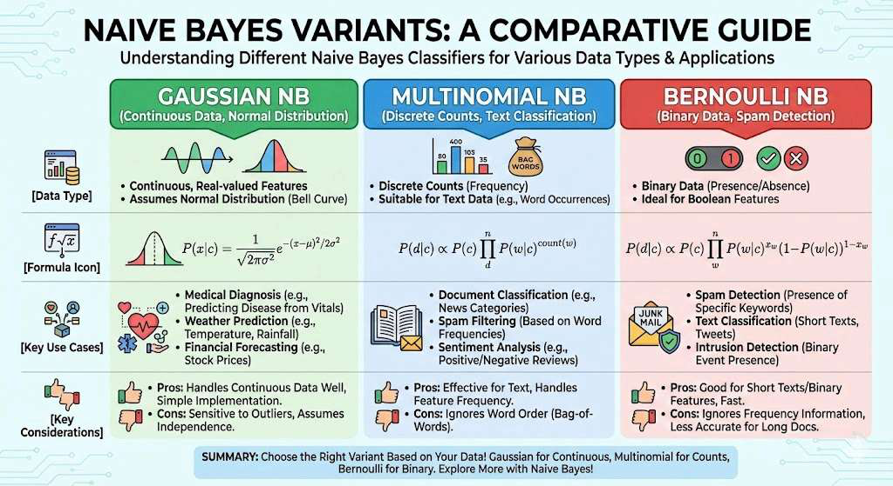

### Code - L90 Gaussian Naive Bayes by hand and with scikit-learn

```python
import numpy as np
from sklearn.naive_bayes import GaussianNB

X = np.array([[172, 150], [180, 170], [165, 140], [190, 200],
              [139, 100], [145, 120], [160, 140], [172, 150]])     # height, weight
y = np.array(['M'] * 4 + ['F'] * 4)
query = np.array([185, 170])

def gaussian(x, mean, std):                       # the normal density
    return np.exp(-0.5 * ((x - mean) / std) ** 2) / (std * np.sqrt(2 * np.pi))

score = {}
for c in ['M', 'F']:
    part = X[y == c]
    likelihood = gaussian(query, part.mean(axis=0), part.std(axis=0))   # one value per feature
    score[c] = (y == c).mean() * np.prod(likelihood)                    # prior x likelihoods

total = sum(score.values())
for c in score:
    print(c, round(score[c] / total, 4))          # M 0.9937, F 0.0063

model = GaussianNB().fit(X, y)
print(model.predict([query]))                     # ['M']
print(model.predict_proba([query]).round(4))      # columns F, M: [[0.0063 0.9937]]
```

## L91 KNN 


* most simplest ML algorithm 
* dataset : iq | cgpa | placement


* we will plot it 
* blue -> placed , pruple -> not placed

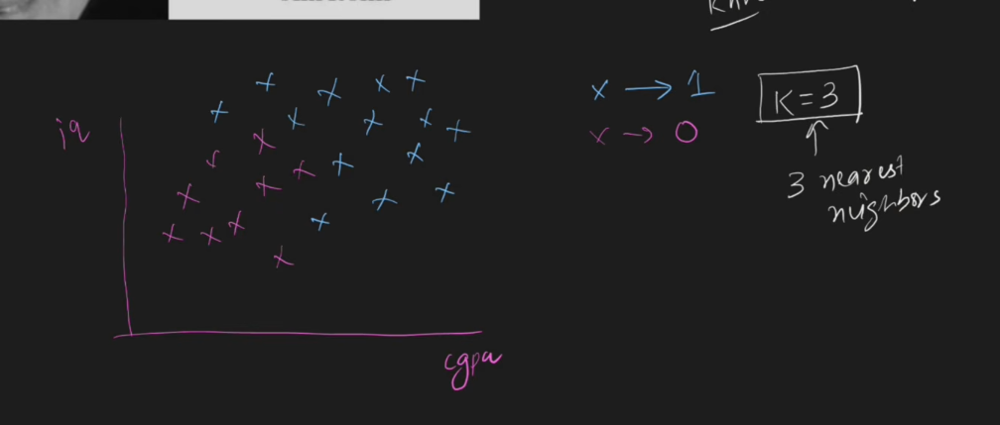

* we need to predict about the green point
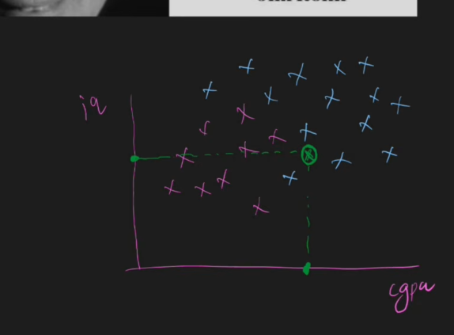
* closest point come closest
* majority count 
1 1 0 --> green class label is 1

---------------

KNN works in any dimension 
* distnace find with all vectors 
---------

<!-- code on breast cancer anlsis KNN -->

### Code - L91 KNN on the breast cancer data (typed from your screenshots; the official repo has no notebook for this lecture)

**Block 1 - load the data**

```python
import numpy as np
import pandas as pd
import matplotlib.pyplot as plt
from sklearn.datasets import load_breast_cancer

# The video uses the Kaggle CSV:
#   df = pd.read_csv('/kaggle/input/breast-cancer-wisconsin-data/data.csv')
#   df.drop(columns=['id', 'Unnamed: 32'], inplace=True)   # id and an empty column
# The same data ships with scikit-learn, so this builds an identical table without a download:
raw = load_breast_cancer()
df = pd.DataFrame(raw.data, columns=raw.feature_names)
df.insert(0, 'diagnosis', np.where(raw.target == 0, 'M', 'B'))   # M = malignant, B = benign

print(df.shape)          # (569, 31): the label + 30 features
df.head()
```

**Block 2 - train and test split**

```python
from sklearn.model_selection import train_test_split

X_train, X_test, y_train, y_test = train_test_split(df.iloc[:, 1:], df.iloc[:, 0],
                                                    test_size=0.2, random_state=2)
print(X_train.shape)     # (455, 30)
```

**Block 3 - scale the features (KNN depends on distances)**

```python
from sklearn.preprocessing import StandardScaler

scaler = StandardScaler()
X_train = scaler.fit_transform(X_train)   # learn mean and std from the training data only
X_test = scaler.transform(X_test)         # apply the same numbers to the test data
```

**Block 4 - fit KNN with K = 5 and score it**

```python
from sklearn.neighbors import KNeighborsClassifier
from sklearn.metrics import accuracy_score

knn = KNeighborsClassifier(n_neighbors=5)
knn.fit(X_train, y_train)                  # "training" only stores the data

y_pred = knn.predict(X_test)
print(accuracy_score(y_test, y_pred))      # about 0.9737
```

**Block 5 - choose K by trying 1 to 15**

```python
scores = []
for i in range(1, 16):
    knn = KNeighborsClassifier(n_neighbors=i)
    knn.fit(X_train, y_train)
    y_pred = knn.predict(X_test)
    scores.append(accuracy_score(y_test, y_pred))

plt.plot(range(1, 16), scores)             # the best K here is 3 (about 0.99)
plt.xlabel('K')
plt.ylabel('test accuracy')
plt.show()
```

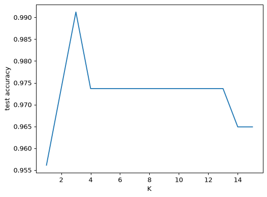

**Block 6 - the better way: cross-validation on the training data**

```python
from sklearn.model_selection import cross_val_score
from sklearn.pipeline import make_pipeline

raw_train, raw_test, t_train, t_test = train_test_split(df.iloc[:, 1:], df.iloc[:, 0],
                                                        test_size=0.2, random_state=2)
cv_scores = {}
for k in range(1, 16, 2):                  # odd K avoids ties between two classes
    model = make_pipeline(StandardScaler(), KNeighborsClassifier(n_neighbors=k))
    cv_scores[k] = cross_val_score(model, raw_train, t_train, cv=10).mean()

best_k = max(cv_scores, key=cv_scores.get)
print(best_k, round(cv_scores[best_k], 4))   # 3, about 0.969
print('square root rule:', int(np.sqrt(len(raw_train))))   # 21 for 455 rows
```

(Block 5 is what the video does. Choosing K on the test set makes the reported score optimistic, so Block 6 picks K with cross-validation and keeps the test set untouched.)


* ML we divide data into training and test data --> running ML model on Test data we get the prediciton 
* then we get our accuracy score  -> performance of our model 

* when using KNN it is advised to bring all the features in the same scale 
* KNN relied completely on calculating distnace

* 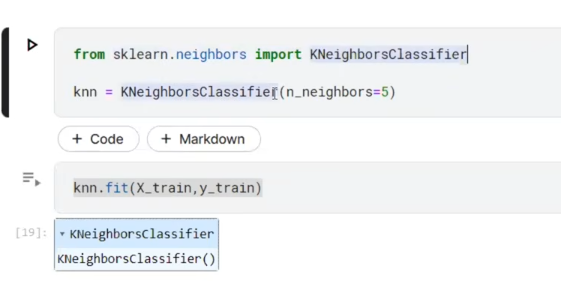


-------

How to select K ??

* it depends on the data
* heurestic approach --> square root on n (observation), prevent taking even values 
* experimentation 
- we use cross validation 
    * 800 in train , 200 in test 
    * KNN with lot of diff K value andthen train and then test on testinf and then take the best one with highest accuracy 

* cross validation 


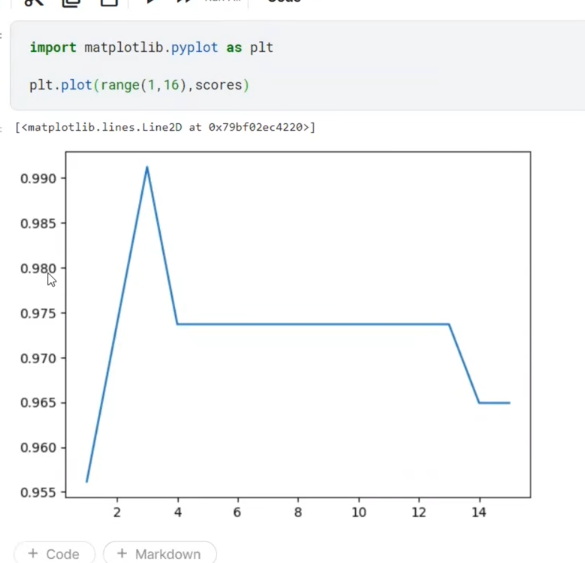

---------

Decision Surface

* tool used to find the performance of classification 
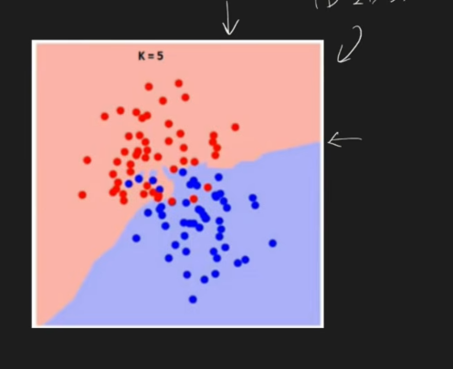
<!-- description we had video which explained how it was made along with the code -->
* decision boundary is very very important
* we plot the training data , for the range of x and y we generate the meshgrid, and each model we send in KNN, and each point are colored based ont he class it is classified into 

<!-- sir has explained this , in 40 min video -->

### How a decision surface is made, with code (L91)

A **decision surface** colours every location of the feature space with the class the model would predict there. It shows how the model "thinks", which one accuracy number cannot.

**The steps (as in your notes)**

1. Take **two** features, so the space can be drawn, and plot the training points.
2. Find the range of each feature and build a fine **grid** of points over it (`np.meshgrid`).
3. Send **every grid point** to the trained model and get its predicted class.
4. **Colour** each grid point by that class (`contourf`) and draw the training points on top.

The border between two colours is the **decision boundary**.

**Block 1 - two-feature data**

```python
import numpy as np
import matplotlib.pyplot as plt
from matplotlib.colors import ListedColormap
from sklearn.datasets import make_moons
from sklearn.neighbors import KNeighborsClassifier

X2, y2 = make_moons(n_samples=300, noise=0.35, random_state=42)   # two overlapping half circles
```

**Block 2 - the function that draws the surface**

```python
def plot_decision_surface(model, X, y, title, step=0.02):
    # step 2: a grid that covers the data with a margin of 1
    xs = np.arange(X[:, 0].min() - 1, X[:, 0].max() + 1, step)
    ys = np.arange(X[:, 1].min() - 1, X[:, 1].max() + 1, step)
    XX, YY = np.meshgrid(xs, ys)                    # all (x, y) combinations

    grid = np.c_[XX.ravel(), YY.ravel()]            # one row per grid point
    Z = model.predict(grid).reshape(XX.shape)       # step 3: classify every point

    plt.figure(figsize=(7, 5))
    plt.contourf(XX, YY, Z, alpha=0.35, cmap=ListedColormap(['blue', 'orange']))   # step 4
    plt.scatter(X[:, 0], X[:, 1], c=y, cmap=ListedColormap(['blue', 'orange']),
                edgecolors='k', s=18)
    plt.title(title)
    plt.show()
```

**Block 3 - the surface for K = 5**

```python
model = KNeighborsClassifier(n_neighbors=5).fit(X2, y2)
plot_decision_surface(model, X2, y2, 'KNN, K = 5')
```

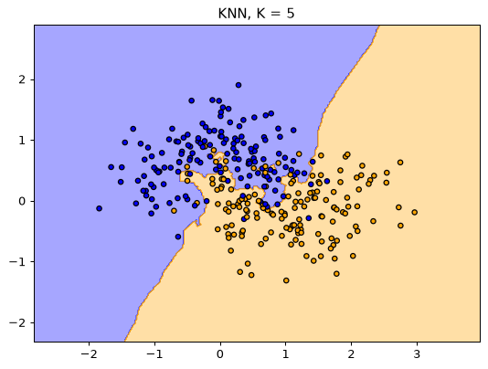

(`np.meshgrid` turns two 1-D ranges into two 2-D arrays of coordinates; `ravel` flattens them; `np.c_` joins them as columns; `reshape` puts the predictions back into the grid shape. `mlxtend.plotting.plot_decision_regions(X, y, model)` does the same in one line.)


-----------


Overfitting and underfitting in KNN

* if k = 1, then decision surface get divided into small small surface

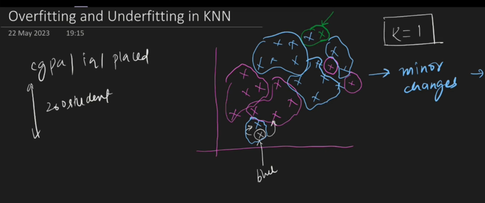
* high variance in dataset , overfitting


-----

Code demo 


---------

Limitation of KNN 

* large dataset - eg. no. of obsercation = 5 L , feature = 100, KNN is lazy learnign algorithn , nothing is done in traingin phase, distance calculation is done when we have query 
* prediction is slow specially on the huge dataset, 5 Lakh dataset calcualted, then sorted etc
* lets say one website you put the data, and it took 3 sec to get the output
* High dimensional data , curse of dimensionality, Distnace concept is not reliablei n hgih dimensiton 
* KNN doesn't work well with the outliers
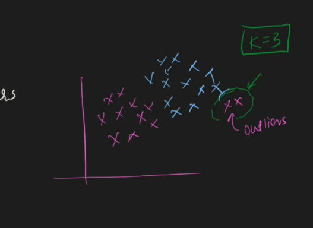
* Non homogenous scales , 
exp | salary | fire
* salary has huge bigger scale k,nwo, hence we need to use scale to get reliable info from dataset
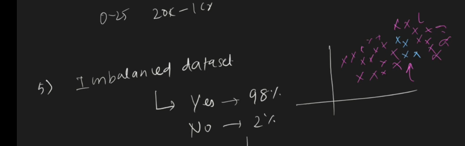
* result bias toward one color
* KNN is used for inference it fails, but its ohkay for predicition 


--------------

### CampusX PDF notes - L91 K-Nearest Neighbors (PDF pp. 2330-2338)

**1. Idea**

"You are the average of the five people you spend the most time with." KNN gives a new point the **majority class of its K closest training points**. It does not build a model: it stores the data and computes distances when a query arrives, so it is called a **lazy learner**.

**2. Steps**

1. choose `K`;
2. compute the distance from the query to **every** training point, usually Euclidean: `d(p, q) = sqrt( sum (q_i - p_i)^2 )`;
3. sort and keep the `K` nearest;
4. take a majority vote.

Example: query (CGPA 3.5, IQ 110); points (3.2, 105) class 1, (3.6, 115) class 1, (3.4, 100) class 0. Distances 5.01, 5.00 and 10.00. With `K = 3` the vote is 2 to 1, so class 1.

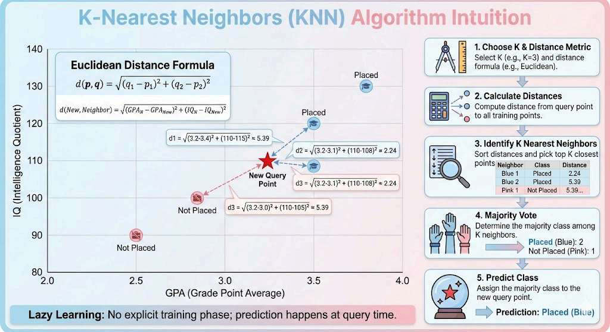

(The distances written inside this figure do not match its plotted points; it shows the idea only.)

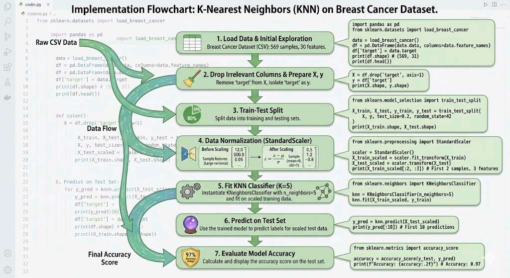

**3. Why scaling matters**

A feature with large numbers (area, salary) dominates the distance, so standardise first: `z = (x - mean) / std`, fitted on the training data only.

**4. Choosing K**

| method | idea |
|---|---|
| square root rule | `K` about `sqrt(n)`, prefer odd values; quick but ignores the data |
| **cross-validation** (recommended) | try several `K` and keep the best average score |

**5. Overfitting and underfitting**

| | small K (e.g. 1) | large K (e.g. close to n) |
|---|---|---|
| boundary | jagged, small islands | very smooth |
| behaviour | memorises noise | predicts the majority class almost everywhere |
| error type | **overfitting** (high variance) | **underfitting** (high bias) |
| fix | increase K | decrease K |

**6. When KNN fails**

| situation | why | remedy |
|---|---|---|
| large dataset | every prediction scans all rows | smaller sample, tree-based or approximate search |
| many features (curse of dimensionality) | distances become similar and unreliable | feature selection, PCA |
| outliers | they distort neighbourhoods, mostly with small K | remove them, larger K |
| different scales | large-scale features dominate | scaling |
| imbalanced classes | the majority class wins the vote | resampling, weighting |
| inference (explaining why) | no coefficients or feature importance | use trees or linear models |

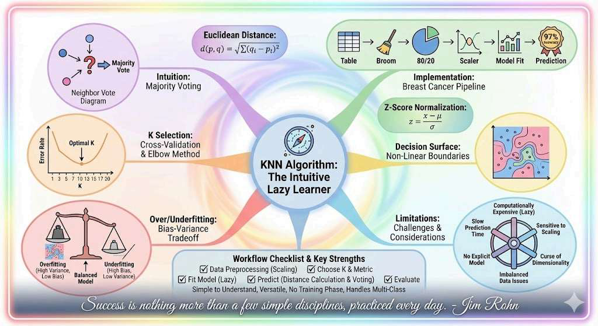

### Code - L91 overfitting and underfitting on the decision surface

(Uses `X2`, `y2` and `plot_decision_surface` from the decision surface code above.)

```python
for k in [1, 200]:       # 200 of the 300 points vote
    model = KNeighborsClassifier(n_neighbors=k).fit(X2, y2)
    name = 'overfitting' if k == 1 else 'underfitting'
    plot_decision_surface(model, X2, y2, f'K = {k}: {name}')
```

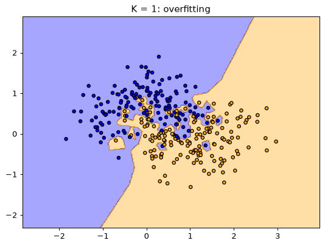


## L92 Support vector machines


* which of them will be better hyperplane
* black one
* core idea to maximize the gap 

-----------------

* we need to find an algorithm which mazimize this margin
* margin maximizing hyperplane
* stop when you find the first green point and same for the red points 
* the shortest distance is called margin 

* W^t * x  + b


* What are support vectors (the points on the margin)
* are very robust on the outliers
* can also work on non linear data
* can be implement on both regression and classification dataset

### CampusX PDF notes - L92 Support Vector Machines (PDF pp. 2358-2373)

**1. Background**

SVM is a supervised algorithm, mainly for **classification** (the regression version is **SVR**). It was developed in the 1990s by Vladimir Vapnik and colleagues at AT&T Bell Labs on statistical learning theory.


**2. Hyperplane and margin**

Many boundaries can separate two classes. SVM picks the one with the **largest margin**, the gap to the nearest points of both classes; this tends to generalise better.

| dimensions | the separator is a |
|---|---|
| 1 | point |
| 2 | line |
| 3 | plane |
| n | hyperplane |


**3. Equations**

* decision boundary: `w.x + b = 0` (`w` is perpendicular to it, `b` shifts it)
* decision rule: `y_hat = sign(w.x + b)`, giving +1 or -1
* margin lines: `w.x + b = +1` and `w.x + b = -1`
* **margin width: `2 / ||w||`**

Example: `w = [2, 3]`, so `||w|| = sqrt(13) = 3.61` and the margin is `2 / 3.61 = 0.55`.


**4. Support vectors**

The training points **on the margin lines**, where `|w.x + b| = 1` (in the soft-margin version also those inside the margin or misclassified). They alone fix the boundary: removing other points changes nothing, and only the support vectors are needed for prediction.

**5. Objective**

Maximise `2 / ||w||`, which is the same as minimising `||w||^2 / 2`, subject to `y_i (w.x_i + b) >= 1` for every point.

**6. Outliers and non-linear data (details in L93-L96)**

Hard margin allows no errors and needs perfectly separable data. **Soft margin** adds slack variables and a parameter `C`. The **kernel trick** handles data that a straight line cannot separate.

| kernel | formula | use |
|---|---|---|
| linear | `xi . xj` | linearly separable, many features |
| polynomial | `(xi . xj + c)^d` | polynomial relations |
| RBF | `exp(-gamma * distance(xi, xj)^2)` | the usual choice for curved data |
| sigmoid | `tanh(a xi . xj + c)` | neural-network-like |


**7. SVM versus logistic regression**

| | logistic regression | SVM |
|---|---|---|
| output | probability | class (+1 or -1) |
| objective | minimise log loss | maximise margin |
| which points matter | all | mainly support vectors |
| probabilities | built in | only with extra calibration (`probability=True`) |

(In logistic regression a point **near** the boundary has a probability close to **0.5**; the PDF's "0.1 (uncertain)" is a mistake.)

**8. More than two classes**

* **One-vs-one:** `k (k - 1) / 2` classifiers, one per pair, then vote. (The PDF writes `k(k-1)`.) This is what scikit-learn's `SVC` does.
* **One-vs-rest:** `k` classifiers, pick the most confident.

### Code - L92 a first linear SVM

```python
import numpy as np
from sklearn.datasets import make_blobs
from sklearn.svm import SVC

X3, y3 = make_blobs(n_samples=100, centers=2, cluster_std=0.8, random_state=3)

clf = SVC(kernel='linear', C=1000)      # a very large C behaves like a hard margin
clf.fit(X3, y3)

w, b = clf.coef_[0], clf.intercept_[0]
print('w =', w.round(3), ' b =', round(b, 3))
print('margin width 2/||w|| =', round(2 / np.linalg.norm(w), 3))
print('support vectors:', len(clf.support_vectors_))
print((w @ clf.support_vectors_.T + b).round(2))    # each is about +1 or -1
```
